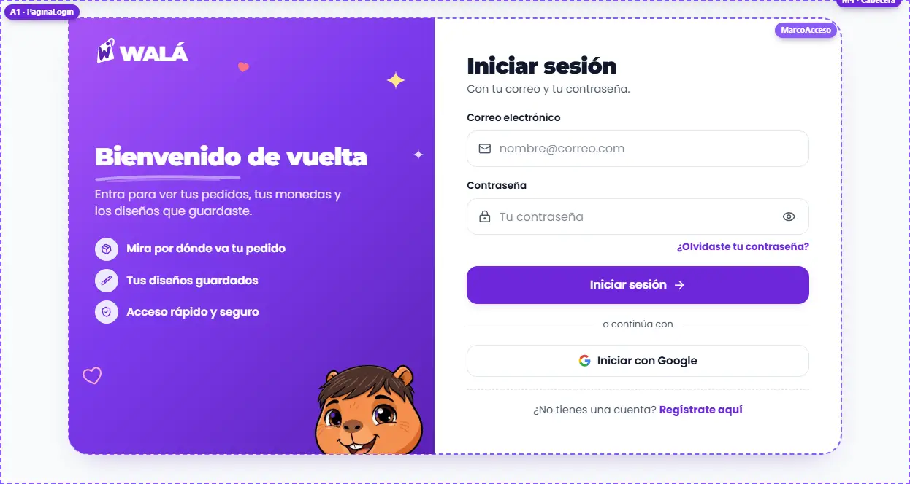
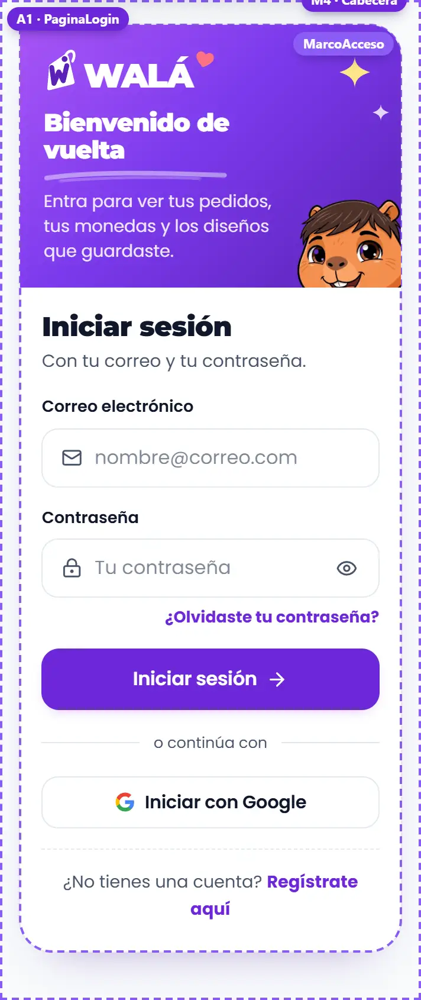
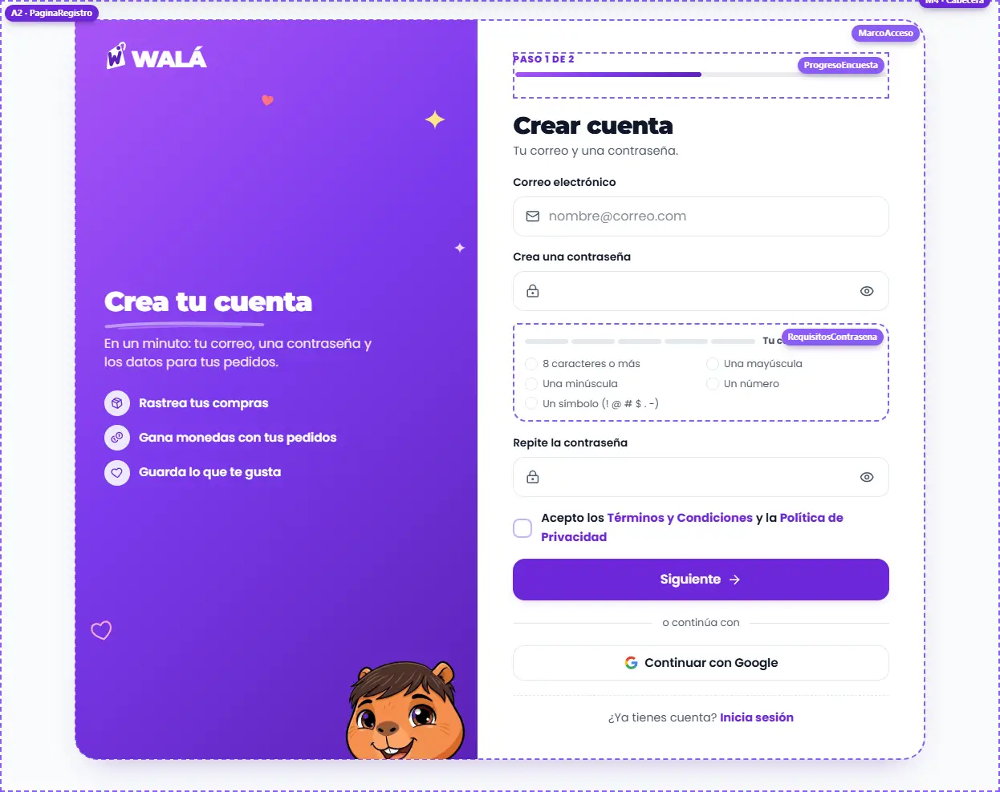
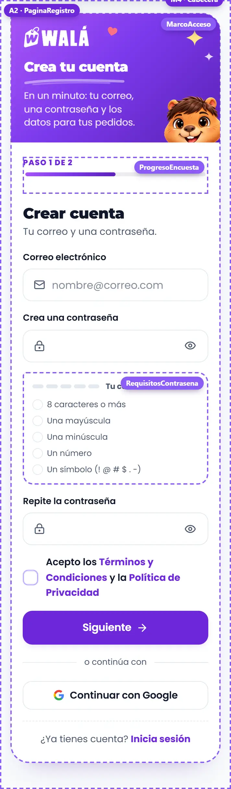
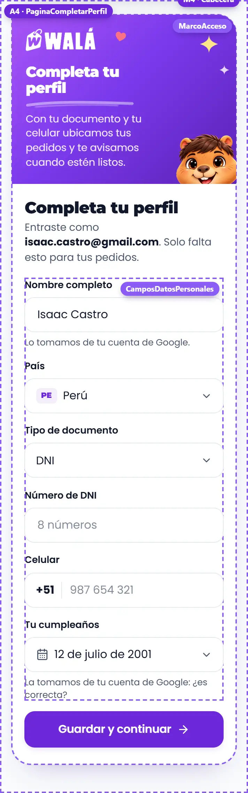
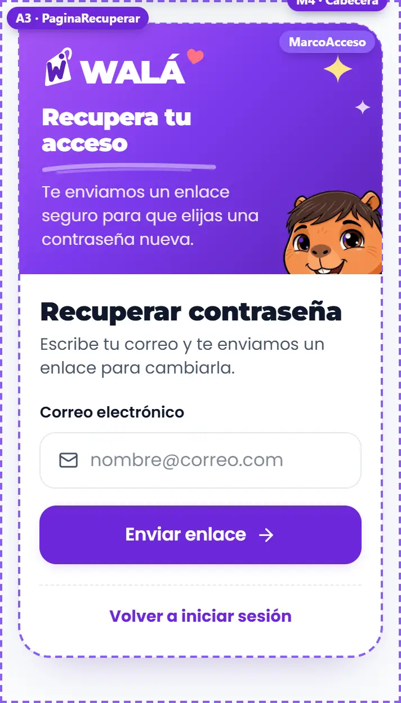

# Acceso (`/login`, `/registro`, `/recuperar-contrasena`, `/completar-perfil`)

Cómo verlo en vivo: `npm run dev` → http://localhost:3000/componentes.html →
**Páginas** → **Tienda de prueba** → página **Acceso** (también llegan los
botones "Iniciar sesión" y "Crear cuenta" de Mi cuenta sin sesión). Los chips
**Pantalla** cambian entre Iniciar sesión, Crear cuenta, Recuperar contraseña
y Completar perfil. Para ver los errores: contraseña `error` al entrar, un
correo con `usado` al registrarse y el DNI `12345678` (ya registrado). Al
terminar el registro o completar el perfil se pasa a la Encuesta, como en la
tienda. Las piezas sueltas están en **Piezas** → **10 · Piezas de la cuenta**.
El marco de la tienda (M) es el de siempre: ver
[INICIO.md](INICIO.md#marco-m-lo-que-rodea-a-las-secciones).

| Iniciar sesión (escritorio) | Iniciar sesión (celular) |
|---|---|
|  |  |

| Crear cuenta, paso 1 (escritorio) | Crear cuenta (celular) | Completar perfil (celular) | Recuperar (celular) |
|---|---|---|---|
|  |  |  |  |

Revisado el 2026-10-14 contra wala.pe/login y `src/pages/LoginPage.jsx`,
`RegisterPage.jsx`, `CompleteProfilePage.jsx` y `ResetPasswordPage.jsx`. No
son del builder: contenido propio, numerado **A** (A1-A4).

## Cómo se arma

- **`MarcoAcceso`** (`paginas/Acceso.jsx`), dentro de `MarcoTienda` con
  `kapiEnPie={false}` (Kapi ya asoma en el panel). Una tarjeta de dos
  paneles: a la izquierda la **marca** (degradado del logo, `LogoWala`
  blanco, garabatos quietos, título con `Trazo`, lo que trae la cuenta en
  sellos y Kapi asomado abajo) y a la derecha el formulario. Con menos de
  820px de ancho (container query) la marca se vuelve una **franja** arriba,
  sin la lista y con Kapi más chico.
- El título del formulario va con la letra del logo; los botones son
  violeta liso (`Boton`), el de Google es de contorno con la G a color.
- **Sin `alert`, modales ni pantallas de carga**: los errores son `Aviso`
  en la tarjeta (el mensaje lo pone la tienda con `getAuthErrorMessage`), el
  botón muestra que carga, y "¿Tus datos son correctos?" se confirma en la
  misma tarjeta.
- Los datos personales son **`CamposDatosPersonales`**: los mismos campos y
  reglas (`validarPerfil`) que Mi perfil.
- Vida: Kapi se asoma un poco más al pasar por la tarjeta, los sellos de la
  lista se enderezan al pasar, el ojo de la contraseña parpadea al cambiar,
  los tramos de la contraseña se llenan y cada regla salta al cumplirse, y
  el paso 2 entra de lado. Nada se repite solo.

## Partes

| N.º | Qué es | Componente | Piezas | Archivo del diseño | Datos en la tienda |
|---|---|---|---|---|---|
| A0 | Marco de las cuatro | `MarcoAcceso` | `LogoWala`, `Garabatos`, `Trazo`, `Sello`, Kapi | `paginas/Acceso.module.css` | textos fijos por página |
| A1 | Iniciar sesión | `PaginaLogin` | `Campo` (correo), `CampoContrasena`, `Aviso`, `SeparadorAcceso`, `BotonGoogle` | `paginas/Acceso.module.css`, `Formulario.module.css` | `signInWithEmail`, `signInWithGoogle`; `motivo` desde `location.state` |
| A2 | Crear cuenta (2 pasos) | `PaginaRegistro` | `ProgresoEncuesta` ("Paso 1 de 2"), `CampoContrasena`, `RequisitosContrasena`, `Casilla` (términos), `CamposDatosPersonales`, `BotonGoogle` | `piezas/Acceso.module.css`, `piezas/DatosPersonales.module.css` | `signUpWithEmail`, `checkDniAvailableSecure`, `setDocument(usuarios)`, `detectCountry` |
| A3 | Recuperar contraseña | `PaginaRecuperar` | `Campo`, `Sello` menta (enviado) | `paginas/Acceso.module.css` | `sendPasswordResetEmail` |
| A4 | Completar perfil | `PaginaCompletarPerfil` | `CamposDatosPersonales` (con cumpleaños) | `piezas/DatosPersonales.module.css` | `userProfile`, `esperarCumpleGoogle`, `checkDniAvailableSecure`, `updateUserProfile` |

## Para cambiar el diseño rápido: qué se repite

- **`CamposDatosPersonales`** (`piezas/DatosPersonales.jsx`): Mi perfil,
  Crear cuenta (paso 2) y Completar perfil. Cambiar un campo o una regla
  (`validarPerfil`) cambia las tres.
- **`CampoContrasena`** (`Formulario.jsx`): login y registro (y el día que
  haya "cambiar contraseña" en Ajustes).
- **`ProgresoEncuesta`** es el mismo avance de la encuesta.
- **`MarcoAcceso`**: las cuatro páginas; el panel cambia solo de textos.

## Llevar a la tienda (a futuro: TODAVÍA NO se hace)

Páginas propias: van en el paso 6 de [MIGRACION.md](MIGRACION.md). Son
pantallas chicas y aisladas: buen lugar para empezar a migrar páginas. Una
a la vez, empezando por recuperar (la más simple).

### Reemplazos

| Parte | Hoy en la tienda | Pasa a (kit) |
|---|---|---|
| Marco | `.container` + `.wrapper` + `.branding` (`LoginPage.jsx` ~103, `RegisterPage.jsx` ~198, `CompleteProfilePage.jsx` ~204, `ResetPasswordPage.jsx` ~38), con `LOGO_URL` y vistos "✓" | `MarcoAcceso` |
| Login | `LoginPage.jsx`: formulario ~127, Google ~67 | `PaginaLogin` |
| Registro | `RegisterPage.jsx`: paso 1 ~213-327, paso 2 ~329-465, `Modal` de confirmar ~497 | `PaginaRegistro` (confirmar en la tarjeta) |
| Recuperar | `ResetPasswordPage.jsx` (formulario ~61, enviado ~45) | `PaginaRecuperar` |
| Completar perfil | `CompleteProfilePage.jsx` (formulario ~214) | `PaginaCompletarPerfil` |
| País, documento, teléfono | `CountrySelect`, `<select>` de documento, `PhoneIntlInput`, `<input type="date">` | `CamposDatosPersonales` (`ListaOpciones`, `CampoTelefono`, `CampoFecha`) |
| Contraseña | `<input>` + `passwordToggle` con `EyeIcon` | `CampoContrasena` |
| Reglas de la contraseña | lista `passwordReqs` (`getPasswordRequirements`) | `RequisitosContrasena` (`requisitosContrasena` usa la misma lista de símbolos de Firebase) |
| Cargando | `<Loading fullScreen>` ("Iniciando sesión...") | el botón con `cargando` |

### De dónde sale cada dato

- **`PaginaLogin`**: `onEntrar({ correo, contrasena })` = `signInWithEmail`;
  si hay `error`, `throw new Error(getAuthErrorMessage(errorCode, err))`.
  `onGoogle` = `signInWithGoogle` + `registrarConversionPopup('registro')` si
  `esNuevo`; cerrar la ventana (`auth/popup-closed-by-user`,
  `auth/cancelled-popup-request`) **resuelve** sin error. La redirección se
  queda en el `useEffect` de la página (~28): perfil completo → `from`,
  encuesta o inicio; incompleto → `/completar-perfil` con `from`.
- **`PaginaRegistro`**: `paso={user && !perfilCompleto ? 2 : 1}`;
  `datosIniciales={{ pais: detectCountry() }}`; `correo={user?.email}`.
  `onCrearCuenta` = `signUpWithEmail` + `enviarVerificacionCorreo` +
  `registrarConversionPopup`. `onRegistrar(datos)` = lo de
  `handleConfirmRegister` (~116): `checkDniAvailableSecure` (si no está
  libre, `throw` con el mensaje de siempre) y `setDocument(PORTAL_USERS_COLLECTION,
  uid, …)` con los campos de documento (`dni`, `clienteNumeroDocumento`,
  `envioNumeroDocumento`, `tipoDocumento`/`docType`: `OTRO` fuera del Perú),
  `phone` / `phoneIntl`, `accountOrigin: 'register_form'`; después
  `navigate('/encuesta-suscripcion')`.
- **`PaginaRecuperar`**: `onEnviar` = `sendPasswordResetEmail`.
- **`PaginaCompletarPerfil`**: `inicial` desde `userProfile` (nombre de
  Google, país, documento, teléfono, `birthDate`) y `deGoogle` (`nombre` si
  vino de `user.displayName`, `cumpleanos` si vino de `esperarCumpleGoogle`).
  `cargando={authLoading || userProfile?._perfilNoCargado}`. `onGuardar` =
  lo de `handleSubmit` (~119) con `updateUserProfile` y la misma redirección.
- `paises`: la lista de `constants/countries` como `{ valor, texto, prefijo }`.
- Los nombres del kit → Firestore: `nombre` → `displayName`, `pais` →
  `country`, `tipoDocumento`, `documento` → `dni`, `telefono` → `phone`,
  `cumpleanos` → `birthDate` (como `perfilDesdeUsuario` al revés).

### Comportamiento que no se puede perder

- Redirecciones (en las páginas de la tienda, no en el kit): sin sesión
  `/completar-perfil` va a `/login`; con perfil completo, login/registro/
  completar van a `from`, a la encuesta (`shouldPromptSurvey`) o al inicio;
  `_perfilNoCargado` entra normal.
- `from` se respeta solo si empieza con `/` y no con `//`.
- El correo se guarda en minúsculas y sin espacios (ya lo hace el kit).
- La contraseña nueva exige las 5 reglas (la política de Firebase está en
  modo ENFORCE desde 2026-10-09).
- El documento se revisa en el servidor antes de guardar (`checkDniAvailableSecure`).
- Fuera del Perú: un solo campo de documento y teléfono libre con prefijo.
- No se dice si un correo tiene cuenta al recuperar.

### Diferencias a propósito (no "corregirlas" al migrar)

- Confirmar los datos **en la tarjeta** (con el resumen) en vez del `Modal`.
- El paso 2 del registro **no tiene "Atrás"**: la cuenta ya está creada
  (volver al paso 1 no servía para nada).
- "Siguiente" no está apagado: al tocarlo dice qué falta en cada campo.
- Iniciar sesión acepta un `motivo` ("Inicia sesión para participar en el
  sorteo") cuando se llega desde otra página.
- El nombre del documento sigue la elección (DNI, Carnet de extranjería,
  Pasaporte) y el pasaporte en el Perú pide de 6 a 12 (las reglas de Mi perfil).
- Sin emojis (⚠, ✓, 🎂).

### Pasos (cada uno se verifica solo y se puede volver atrás)

1. `ResetPasswordPage.jsx` → `PaginaRecuperar` dentro del layout de siempre.
2. `LoginPage.jsx` → `PaginaLogin`, dejando el `useEffect` de redirección.
3. `CompleteProfilePage.jsx` → `PaginaCompletarPerfil`.
4. `RegisterPage.jsx` → `PaginaRegistro` (el más largo: probar Perú y
   extranjero, documento repetido, Google a mitad de camino).
5. Borrar los `.module.css` viejos cuando lleven un tiempo en producción.
