# Panel administrativo (`/admin`): el kit del admin (D0-D8 hechos en el kit y unidos al admin)

Lo mismo que se hizo con la tienda, ahora con el panel: **primero todo en el
kit**, con datos de ejemplo en `/componentes.html`; **cuando un apartado está
completo en el kit, se une al admin real** con sus conectores y su
interruptor para volver a lo de antes. Nada se migra a medias: un apartado
entra entero o no entra.

Esta ficha es el único plan del admin. Cada avance se anota aquí (en su
apartado y en el **Registro** del final), con la fecha y qué se probó. Lo
viejo que quede sin uso va a [ELIMINAR.md](ELIMINAR.md), como siempre.

Numeración: **D** = admin. **D0** es el marco (menú, cabecera de página,
inicio) y **D1-D8** los apartados, en el orden en que se hacen.

## Para qué

1. **Un solo sistema.** El admin tiene que verse y comportarse como Walá
   clientes: las mismas piezas, los mismos tokens, el mismo modo noche.
2. **Mejor experiencia para quien administra.** Menos pasos, nada de
   `alert()` ni `window.confirm`, estados claros (cargando, vacío, error,
   guardado), deshacer donde se pueda y confirmar solo lo que no se deshace.
3. **Un celular de verdad.** Hoy el admin es de escritorio con el menú
   apretado. Tiene que poder usarse completo desde el teléfono (y la app con
   Capacitor): revisar un pedido, cambiar un stock, publicar un sorteo,
   responder un reclamo.

## Punto de partida (mapa del 2026-11-02)

- **91 archivos JSX** (`pages/admin`, `pages/Tienda/admin`, `components/admin`,
  `components/AdminLayout`), unas 38 mil líneas, y **26 mil líneas de CSS
  propio**: cada página dibuja lo suyo.
- **Solo 6 usan el kit**, y para algo suelto: `Boton` y `Sello` (Marcas),
  `Campo`/`Chip`/`useConfirmar` (Popups, Ruleta, Yoryo), `RuedaRuleta`,
  `VentanaCampana`, `TarjetaProducto` (Landing pages).
- **Cuatro familias de estilo a la vez**: `components/common/Button` (33
  páginas), los `Glass*` de `components/ui` (7), `GlassCard`/`KpiCard` de
  `components/dashboard` (8) y las piezas de `pages/admin/resultados/piezas.jsx` (7).
- Hecho a mano y repetido:

| Hecho a mano | Veces | Lo reemplaza |
|---|---|---|
| `<select>` nativo | 104 | `Selector` / `Campo` con `opciones` (`ListaOpciones`) |
| Modales con clases propias (`styles.modal…`) | 77 | `HojaInferior` / `HojaEdicion` |
| `alert(...)` | 58 | `useToast` |
| `window.confirm` | 42 | `useConfirmar` |
| `<input type="checkbox">` | 35 | `Casilla` / `Interruptor` |
| `<textarea>` | 30 | `Campo multilinea` |
| `<table>` | 26 (+ `ProductTable`) | `TablaAdmin` (nueva) |
| `type="file"` + subida propia | 17 | `CampoImagen` (nueva) |
| `type="color"` / `type="date"` | 10 / 10 | `ControlColor` / `CampoFecha` |
| `ToastContext` viejo | 10 | `useToast` del kit |
| Paginación o "cargar más" | 0 | `CargarMas` (nueva): hoy todas las listas bajan todo |

- **Ya está en el kit:** el editor del builder (`editor/PanelEditor`, por
  `components/constructor/EditorDeTienda.jsx`; `VisualEditorPanel` solo con
  `editorViejo`). Sus controles (`ControlImagen`, `ControlColor`,
  `ControlLista`, `ControlIcono`, `ControlEnlace`, `ControlFecha`) y
  `FormularioSeccion` + `esquemas.js` son un motor de formularios por
  esquema que el admin puede reutilizar.

## Diseño: el lenguaje de Walá, con la densidad de un panel

Es el mismo sistema del kit (README, "Lenguaje de marca"). Lo que cambia es
cuánto entra en pantalla, no la marca.

**Igual que en clientes**
- Tokens de `styles/variables.css` y `theme/tokens.css`, noche violeta
  (`--noche-wala`), nada de gris carbón.
- `--fuente-marca` (Montserrat 900) en títulos de página, cifras y nombres;
  Poppins en el resto.
- **Botón violeta liso** (`Boton`), sin el degradado de `GlassButton`.
- Íconos en `Sello` (el del menú, el de cada cabecera de página, el de los
  estados vacíos), con un tono por grupo del menú. Nada de emojis en los
  títulos (hoy: "🎯 Datos para recomendar", "📦 Recepción…").
- `Visto` para lo elegido; `EstadoVacio` con Kapi donde no hay datos.
- Animaciones livianas: `transform`/`opacity`, brillo solo al interactuar,
  sin bucles, sin glows, sin blur (el admin de hoy usa *liquid glass*: se va).
- Fotos de producto con `FotoProducto` (fondo blanco, `--escenario-foto`).

**Distinto a propósito**
- **Más denso**: filas de tabla de 44-48 px, márgenes menores, títulos más
  chicos que en la tienda. Un panel se lee rápido, no se recorre.
- **Sin etiqueta colgante** salvo en las vistas previas de producto (la
  regla de siempre: la etiqueta violeta es de productos; en datos y cuentas
  se confunde con "Combo"). Sin garabatos en tablas ni formularios; Kapi
  solo en vacíos y en el inicio.
- **Costos y cobros etiquetados** con texto ("CUESTA", "Cobrado"), nunca un
  ícono de moneda con un número solo.
- **Estados con texto y color** (`InsigniaEstado`), nunca solo color.

## En el celular

Regla: **todo lo que se hace en escritorio se puede hacer en el celular**,
con menos cosas a la vez.

- **Menú**: en el celular no hay barra lateral. Arriba, la cabecera del
  panel (logo, título de la sección y el botón del menú); el menú abre como
  hoja con los grupos y un buscador de secciones. Abajo, una
  **barra inferior del admin** con 4 accesos fijos (Inicio, Pedidos,
  Productos, Resultados) y "Más" (el menú). El botón atrás de Android cierra
  la hoja antes de salir de la página (`useCerrarConAtras`).
- **Tablas → tarjetas**: la misma `TablaAdmin` se dibuja como lista de
  tarjetas por debajo de 720 px (container query, como `MarcoCuenta`): foto,
  título, 2-3 datos y el estado; las acciones en el `MenuContextual` (toque
  largo o "⋯").
- **Editar → pantalla completa**: `HojaEdicion` es un panel lateral en
  escritorio y una hoja de alto completo en el celular, con Guardar fijo
  abajo (encima del teclado).
- **Filtros → hoja**: el buscador queda arriba; los demás filtros, en una
  hoja con "Ver N resultados". Los filtros activos como chips quitables.
- **Acciones en lote**: al elegir filas aparece una barra fija abajo
  ("3 elegidos · Ocultar · Eliminar").
- Toques de 44 px como mínimo, nada que dependa del hover, nada de
  arrastrar sin una alternativa con botones (subir/bajar).
- Las vistas previas ("así se ve en la tienda") en el celular van en una
  pestaña aparte ("Editar · Ver"), no al costado.

## Reglas del kit (las de siempre, aplicadas al admin)

- **Los datos entran por props.** Ninguna pieza del admin lee Firestore,
  React Query, AuthContext ni permisos: la página real (el conector) se los
  pasa. El menú recibe los grupos ya filtrados por permiso.
- **Las acciones salen por props** (`onGuardar`, `onEliminar`…) y devuelven
  una promesa: la pieza pone sola el cargando, el error y el "Guardado".
- **Se arma con sus propias piezas**: la tabla usa `Casilla`, `Avatar`,
  `FotoProducto`, `InsigniaEstado`, `MenuContextual`; nada se dibuja dos veces.
- Todo en `src/componentes/kit/`: piezas del admin en `piezas/admin/`,
  páginas en `paginas/admin/`, adaptadores en `adaptadoresAdmin.js` (aparte,
  para no ir en el archivo principal de la tienda).
- En `/componentes.html`, una vista nueva **Admin** (como Piezas, Secciones
  y Páginas): las piezas sueltas y el "Panel de prueba" con el mismo marco,
  en escritorio y celular, con estados (cargando, vacío, error, sin permiso).

## Lo que ya sirve tal cual

| Pieza del kit | En el admin reemplaza |
|---|---|
| `Boton` | `common/Button`, `GlassButton` |
| `Campo`, `Selector`, `ListaOpciones`, `Interruptor`, `Casilla`, `CampoTelefono` | `<select>`, `<input>`, `<textarea>`, checkboxes, `common/Toggle`, `GlassInput` |
| `CampoFecha` | `type="date"` |
| `ControlColor`, `ControlImagen`, `ControlIcono`, `ControlLista`, `ControlEnlace` (`editor/CamposEditor.jsx`) | color, subida simple, listas repetibles (premios, planes, botones) |
| `Pestanas`, `Acordeon` | `tabBtn` propios (18 páginas) |
| `HojaInferior`, `Confirmar` + `useConfirmar` | modales propios, `GlassModal`, `common/Modal`, `window.confirm` |
| `useToast`, `Aviso` | `alert()`, `ToastContext` |
| `EstadoVacio`, `Esqueletos`, `Cargando`, `CapaCargando` | "No hay…", `Loader2`, `PageLoading` |
| `Chip`, `Etiqueta`, `Avatar`, `FotoProducto`, `Sello`, `BarraProgreso` | badges y miniaturas propias |
| `RecortarFoto`, `QuitarFondo` | `AdminImageCropper`, `ThumbnailCropEditor` |
| `MenuContextual` | botones de editar/eliminar sueltos por fila |
| `CodigoCopiable` | "copiar enlace / código" propios |
| `TarjetaProducto`, `VentanaCampana`, `RuedaRuleta`, `CabezaSorteo`, `BotonEnlace`, secciones del builder | vistas previas de la tienda dibujadas aparte |

## Piezas nuevas (por hacer)

Estado: **·** por hacer · **kit** hecha en el kit · **admin** ya en el panel.

### Marco

| Pieza | Qué hace | Estado |
|---|---|---|
| `MarcoAdmin` | Menú lateral con grupos plegables (el abierto se recuerda), buscador de secciones, sello por grupo; en el celular, cabecera + hoja + `BarraInferiorAdmin`. Recibe `grupos` ya filtrados por permiso | kit (2026-11-02) |
| `BarraInferiorAdmin` | Los 4 accesos fijos + "Más" en el celular | kit (2026-11-02) |
| `CabezaAdmin` | Sello, título, una línea de ayuda, migas, acciones ("Nuevo", "Exportar") y, en el celular, la acción principal como botón fijo | kit (2026-11-02) |
| `SinPermiso` | Lo que ve un admin sin el permiso de esa sección | kit (2026-11-02) |

### Datos

| Pieza | Qué hace | Estado |
|---|---|---|
| `TablaAdmin` | Columnas, ordenar, elegir filas, acciones por fila, esqueleto, vacío, error; tarjetas en el celular | kit (2026-11-02) |
| `BarraFiltros` | Buscador, chips de filtros, `Selector`, rango de fechas; en el celular los filtros en hoja | kit (2026-11-02) |
| `AccionesLote` | La barra de "N elegidos" (reemplaza `components/admin/BulkActions`) | kit (2026-11-02) |
| `CargarMas` | "Cargar más" / paginación con cuántos hay | kit (2026-11-02) |
| `InsigniaEstado` | Un estado con texto y color desde un mapa (borrador, activo, cerrado, pagado, pendiente, anulado…) | kit (2026-11-02) |
| `FilaRecurso` | Foto, nombre, datos y acciones: categorías, colecciones, marcas, cliparts | · |
| `ListaOrdenable` | Reordenar arrastrando, con subir/bajar como alternativa (en vez del número `order` escrito a mano) | kit (2026-11-02) |
| `SelectorProductos` | Buscar y elegir productos con su foto (reemplaza `components/admin/BuscadorProducto`) | kit (2026-11-02) |
| `PasoAdmin` | Un paso de una herramienta de una vez: número en sello, botón, pregunta, cómo va, resultado, a medias o error | kit (2026-11-02) |

### Formularios

| Pieza | Qué hace | Estado |
|---|---|---|
| `HojaEdicion` | Crear/editar: panel lateral o pantalla completa en el celular; Guardar/Cancelar; aviso de cambios sin guardar; bloqueada mientras guarda | kit (2026-11-02) |
| `GrupoCampos` | Un bloque de campos con su título y ayuda (hoy 19 versiones de `fieldGroup`/`formSection`) | kit (2026-11-02) |
| `CampoImagen` | Soltar o elegir, recortar (`RecortarFoto`), avance de la subida, cambiar y quitar. La subida llega por props | kit (2026-11-02) |
| `CampoFechaHora` | `CampoFecha` + la hora (sorteos, ofertas, popups) | · |
| `CampoDinero`, `CampoPorcentaje` | Soles (o céntimos guardados), dólares, comisión | `CampoDinero` kit (2026-11-02) |
| `CampoColor` | La muestra del color sobre un damero y su código (#ffffff) | kit (2026-11-02) |
| `EstadoGuardado` | "Sin guardar · Guardando… · Guardado" en la cabecera del formulario | · |
| `VistaPrevia` | El marco "Así se ve en la tienda" con celular/escritorio; en el celular, pestaña "Ver" | · |

### Métricas

| Pieza | Qué hace | Estado |
|---|---|---|
| `Cifra` | Una cifra con su nombre y ▲/▼ frente al periodo anterior (reemplaza `KpiCard` y la de `resultados/piezas`) | kit (2026-11-02, con `FilaCifras`; el ▲/▼ y la explicación desde D4a) |
| `SelectorPeriodo` | Hoy, 7, 30, 90 días, fechas y "comparar" | kit (2026-11-02) |
| `GraficoTendencia`, `GraficoBarras`, `GraficoDona`, `GraficoComparar` | Los de `components/dashboard/charts` y `resultados/piezas` en una sola versión | `GraficoTendencia` kit (2026-11-02, líneas o barras); las barras y las donas de Resultados pasaron a `ListaBarras` (D4b, D4d): no hacen falta otros |
| `RankingConFotos` | `RankingConMiniaturas` del dashboard | `ListaBarras` kit (2026-11-02, con foto opcional) |

## Plantillas de página

Casi todo el admin entra en cinco formas. Se hacen como páginas del kit
(`paginas/admin/`) que reciben las piezas de arriba.

| Plantilla | Forma | Páginas que cubre |
|---|---|---|
| `PaginaListaAdmin` (kit, 2026-11-02) | `CabezaAdmin` + `BarraFiltros` + `TablaAdmin` + `HojaEdicion` | Categorías, Colecciones, Atributos, Marcas, Cliparts, Envíos, Recompensas, Misiones, Retos, Popups, Sorteos, Enlaces, Landing pages, Temas, Referidos, Libro de reclamaciones… |
| `PaginaDetalleAdmin` | Cabeza con estado + `Pestanas` + tablas y acciones | Detalle de sorteo, de suscripción, ficha de cliente, un pedido |
| `PaginaEditorAdmin` | Formulario + `VistaPrevia` | Editor de enlaces, Popups, Ruleta, Encuestas, Palabra, Mascota |
| `PaginaResultadosAdmin` | `SelectorPeriodo` + `Cifra` + tarjetas con gráficos | Las pestañas de Resultados, el historial de pagos |
| `PaginaAjustesAdmin` | `GrupoCampos` + Guardar | Configuración, WhatsApp, Mascota, configuración de pagos |

Quedan fuera de las plantillas (herramientas propias, como el estudio):
`AdminProductoFormV2` (1.881 líneas), `PrintAreasEditor` (1.632),
`PersonalizacionPrenda` (899), `ShapeCreator`, `AdminViewEditor`. Se arman
con las mismas piezas, al final de su apartado.

## Apartados

Cada uno se hace **entero en el kit** (piezas que falten, sus páginas en el
Panel de prueba, celular y escritorio, capturas en `guia/`) y después **se
une** al admin. Columna "Kit" / "Admin": **·** por hacer, **en marcha**,
**hecho (fecha)**.

| # | Apartado | Páginas (ruta `/admin/…`) | Plantilla | Kit | Admin |
|---|---|---|---|---|---|
| D0 | Marco | el menú (`AdminLayout`), la cabecera de cada página, el inicio (`/admin`, `AdminDashboard`) | — | hecho (2026-11-02) | hecho (2026-11-03) |
| D1 | Catálogo base | `categorias`, `colecciones`, `atributos-catalogo`, `marcas` (+ productos de la marca), `envios`, `cliparts`, `destacados` | Lista | hecho (2026-11-02) | hecho (2026-11-03) |
| D2 | Productos | `productos` (lista, packs), `inventario`, `productos/:id` (la ficha), `plantillas-yoryo`, personalizables y combos de Crear, `blueprints`, `publico-productos` | Lista + herramientas propias | hecho (2026-11-02) | hecho (2026-11-03) |
| D3 | Pedidos y pagos | `recepcion-pedidos`, `gestion-pagos` (configuración, generar enlace, historial), `crear-cuentas-pedidos`, `libro-reclamaciones` | Lista · Detalle · Ajustes | hecho (2026-11-02) | hecho (2026-11-03) |
| D4 | Resultados | `resultados` (Resumen, Productos, Visitantes, Clientes con la ficha, Opiniones, Detalle técnico y sus pantallas) | Resultados · Detalle | hecho (2026-11-02) | hecho (2026-11-03) |
| D5 | Clientes y fidelidad | `referidos`, `recompensas`, `misiones`, `retos`, `notificaciones`, `fechas-importantes`, `encuestas` | Lista · Editor | hecho (2026-11-02) | hecho (2026-11-03) |
| D6 | Campañas | `sorteos` (+ detalle), `sorteos-suscripcion` (+ detalle), `enlaces` (+ editor), `popups`, `landing-pages`, `temas` | Lista · Detalle · Editor | hecho (2026-11-02) | hecho (2026-11-03) |
| D7 | Juegos y Kapi | `wordle`, `ruleta`, `bolitas`, `mascota` | Editor | hecho (2026-11-02) | hecho (2026-11-03) |
| D8 | Ajustes | `configuracion` (admins, permisos, bloqueos), `whatsapp`, `backups` | Ajustes · Lista | hecho (2026-11-02) | hecho (2026-11-03) |

El orden: D0 con las piezas base (tabla, hoja de edición, campo de imagen,
estado), probadas en **Categorías**, que es un CRUD simple con foto y toca
casi todo. Después el resto de D1, y así hacia abajo. D2 (la ficha de
producto) puede ir después de D3 si hace falta: es la más grande.

## D0 · El marco y las piezas base (en el kit desde el 2026-11-02)

Cómo verlo: `npm run dev` → http://localhost:3000/componentes.html → **Admin**.
**Panel de prueba**: el marco con el menú real; **Ver como** cambia los
permisos (Super Admin, Catálogo, Solo inventario, Clientes) y el menú, la
barra del celular y lo que se puede abrir cambian solos; **Tamaño**
Computadora · Celular; **Estado**: cargando, error al cargar, sin datos y
"Guardar y subir fallan". **Piezas del admin**: `InsigniaEstado`, una tabla
con casillas y `AccionesLote`, y `CampoImagen` con sus estados.

| Parte | Componente | Archivo | Qué hace |
|---|---|---|---|
| D0·1 Menú | `MarcoAdmin` | `piezas/admin/Marco.jsx` | Menú lateral (marco de 960 px o más, container query `admin`): logo con "Panel", buscador de secciones (sin tildes), Inicio suelto y los grupos plegables con su sello; el grupo de la sección actual se abre solo; abajo, quién eres, "Ver la tienda" y "Salir". En el celular: cabecera con el título de la sección y el botón del menú, el menú en una hoja |
| D0·2 Barra del celular | `BarraInferiorAdmin` | `piezas/admin/Marco.jsx` (dibujo de `BarraInferior.module.css`, sin blur) | Cuatro accesos que el admin puede abrir y "Más" (el menú) |
| D0·3 Cabecera de página | `CabezaAdmin` | `piezas/admin/Marco.jsx` | Migas, sello, título con la letra del logo, ayuda, acciones; `principal` ("Nueva categoría") baja en el celular a un botón sobre la barra (el marco lo recibe por contexto) |
| D0·4 Sin permiso | `SinPermiso` | `piezas/admin/Marco.jsx` | Qué permiso pedir y "Volver al inicio" |
| D0·5 Inicio | `PaginaInicioAdmin` | `paginas/admin/Inicio.jsx` | Saludo con la fecha y Kapi (con hambre si algo espera, feliz si todo está al día), "Para hoy" (lo que espera respuesta, con su cuenta o "Al día") y atajos |
| Tabla | `TablaAdmin` | `piezas/admin/Datos.jsx` | Tabla con cabecera pegada, ordenar, casillas, "⋯" y clic derecho (`MenuContextual`); a menos de 720 px de caja, tarjetas (foto, título, datos, estado); cargando, error con Reintentar y vacío |
| Filtros | `BarraFiltros` | `piezas/admin/Datos.jsx` | Buscador y filtros en una fila; angosta, "Filtros" abre una hoja y los puestos quedan como chips; cuántos quedan |
| Estado | `InsigniaEstado`, `ESTADOS_ADMIN` | `piezas/admin/Datos.jsx` | `Etiqueta` con punto y texto, desde un mapa |
| Lo elegido | `AccionesLote` | `piezas/admin/Datos.jsx` | Barra noche pegada abajo (sobre la barra del celular: `--admin-abajo`) |
| Editar | `HojaEdicion` | `piezas/admin/Formularios.jsx` | Panel derecho de 520 px en escritorio, pantalla entera en el celular; Guardar fijo; el error de guardar queda arriba; con cambios, cerrar (X, Cancelar, Esc, afuera o atrás) pregunta "¿Salir sin guardar?" |
| Bloques | `GrupoCampos` | `piezas/admin/Formularios.jsx` | Título en versalitas, ayuda, una o dos columnas |
| Imagen | `CampoImagen` | `piezas/admin/Formularios.jsx` | Elegir o soltar, `RecortarFoto` (círculo o cuadrado), avance de la subida, Cambiar, Quitar, error con Reintentar |
| Datos | `MENU_ADMIN`, `menuAdminPara`, `accesosAdminPara`, `opcionActiva`, `categoriaDesdeFirestore` / `categoriaAFirestore`, `marcaAdminDesdeFirestore` | `adaptadoresAdmin.js` (con pruebas: `npm run test:admin`) | El menú con el permiso de cada opción (las mismas reglas de `AdminLayout`), la barra del celular y las categorías |

La prueba de las piezas: **Categorías** (`paginas/admin/Categorias.jsx`,
`PaginaCategorias`; es de D1, se armó primero porque toca casi todo):
aviso de las que no tienen marca con "Verlas", buscar, filtrar por marca
(o "Sin marca"), ordenar por nombre u orden, crear y editar en la hoja
(nombre, orden, marcas con "Todas · Ninguna", la foto de la burbuja en
círculo) y eliminar con su pregunta. Datos de la demo: la copia real de
`categories` (`demo/tienda.json`) y `tienda_brands` (`demo/marcas.json`;
las marcas de cada categoría salen de su `categoryNav`, por eso varias
quedan "sin marca").

### Diferencias a propósito (no "corregirlas" al unir)

- **El menú se ordena por tarea**, no por permiso: Inicio · Pedidos y pagos ·
  Catálogo · Resultados · Clientes · Campañas · Diseño y juegos · Ajustes.
  Cada opción conserva su permiso de hoy (`adaptadoresAdmin.js`); un grupo
  sin opciones no sale. **Inicio lo ve cualquier admin** (antes su enlace
  estaba en el grupo de diseño, aunque `/admin` ya abría para todos).
- Sin emojis en el menú: cada opción tiene su ícono (`iconosAdmin.js`).
- **Categorías no deja dos con el mismo nombre** (sin tildes ni
  mayúsculas): propone sumarle marcas a la que ya existe.
- La orden de una categoría nueva es la mayor + 1 (antes, cuántas había).
- Guardar cierra la hoja y avisa con un toast; antes el formulario quedaba
  arriba de la lista y subía la página.
- `useCerrarConAtras` (`Efectos.jsx`) ganó `alBloquear`: con "atrás"
  bloqueado, avisa (la hoja de edición pregunta antes de salir). Lo de
  antes no cambia.

### Qué se probó (2026-11-02, demo en localhost)

- Escritorio (1180 px) y celular (375 px; también el tamaño Celular de la
  demo): el menú lateral o la cabecera + barra, la tabla o las tarjetas, el
  botón "Nueva categoría" sobre la barra; nada se sale del ancho a 375 px
  (el buscador de los filtros empujaba "Filtros": corregido).
- Crear sin nombre → el error en el campo y el foco ahí; crear con marca →
  toast y la fila nueva; editar → guardar falla ("Guardar y subir fallan")
  → el motivo arriba y lo escrito se queda → guardar bien.
- Con cambios: Esc → pregunta; "Seguir editando" → sigue la hoja; atrás →
  pregunta; atrás otra vez → solo se va la pregunta; "Salir sin guardar"
  → se cierra sin salir de la página.
- "⋯" → Editar · Eliminar → la pregunta → la fila se va y el toast.
- Permisos: "Solo inventario" ve Inicio e Inventario y Categorías dice qué
  permiso pedir; "Clientes" ve Pedidos y pagos, Resultados, Clientes y
  Campañas (solo Popups).
- En el celular: "Más" abre el menú en una hoja, buscar "ruleta" la
  encuentra y tocarla navega y cierra la hoja; la subida de una foto
  (recorte en círculo, avance, falla con Reintentar).
- Sin errores en la consola. Ese día el panel del navegador estaba oculto
  (no dibujaba): lo visual se revisó a ojo con D1 (abajo).

### Pendiente de D0

- ~~Las capturas y el modo noche~~: hechas con D1 (abajo); el modo noche se
  revisó a ojo el 2026-11-02 (la barra de lo elegido se perdía de noche:
  ahora violeta oscuro con borde).
- ~~`AccionesLote` encima del botón de la página~~: mientras hay algo
  elegido, el botón se esconde (`useMarcoAdmin().setConLote`).
- ~~`PaginaListaAdmin`~~: salió con D1.
- ~~Al unir: el editor viejo de secciones por zonas de `AdminDashboard`~~:
  queda en `AdminDashboardViejo.jsx` y solo vuelve con `adminViejo`. Se
  borra con él.

### D0 unido al admin (2026-11-03)

| Parte | Conector | Qué hace |
|---|---|---|
| El marco | `components/panel/MarcoDelPanel.jsx` (por `AdminLayout.jsx`) | `MarcoAdmin` con `menuAdminPara(adminPermissions)` y `accesosAdminPara`; quién eres con el nombre y la foto de la cabecera y `textoPermisos`; "Salir" sale del panel y después cierra la sesión (si no, `AdminRoute` mandaba al login). Esconde la cabecera, el pie y la barra de la tienda (`LayoutContext`) mientras está montado; la barra «Modo administrador» tampoco sale en `/admin` (`BarraDeAdmin`) |
| Sin permiso | el mismo | Una ruta del menú que no está en el de este admin muestra `SinPermiso` con el permiso que falta. Las que no están en el menú (direcciones viejas que redirigen, el detalle de un sorteo…) abren como antes: `AdminRoute` sigue decidiendo la entrada. Las fichas de Crear (`/admin/prendas-crear/…`) cuentan como Productos |
| Mientras carga (2026-11-03) | `AdminRoute.jsx`, `carga/CargandoRuta.jsx` y `MarcoDelPanel.jsx` | `CargandoPanel` (`piezas/admin/CargandoPanel.jsx`, aparte del marco para no llevar el menú al paquete de la tienda): la silueta del panel por encima de la cabecera y el pie de la tienda mientras se confirma quién entra y mientras baja el marco (antes, "Verificando acceso…" y la grilla de productos de la tienda). Dentro del marco, cada página que baja muestra `EsqueletoPaginaAdmin` y el menú sigue a mano. En la demo, el estado "Abriendo el panel". Con `adminViejo`, lo de antes |
| El inicio | `components/panel/InicioDelPanel.jsx` (por `pages/AdminDashboard.jsx`) | "Para hoy": pedidos por entregar (`useAdminWalaOrders` con los parámetros de Recepción: comparten la caché), reclamos sin responder y evidencias de retos (`getCountFromServer`, sin bajar los documentos), cada uno solo con su permiso; atajos filtrados con `puedeVer` |

Interruptor `adminViejo` (`useLoViejo('admin')`): vuelven `AdminLayoutViejo`,
`AdminDashboardViejo`, la cabecera, el pie, la barra de la tienda y la barra
«Modo administrador».

**Diferencias con la demo**: "Referidos por aprobar" no va en el inicio (con
el modelo de hoy las monedas se liberan solas; no hay nada que aprobar), y
"Pedidos por recibir" se llama "Pedidos por entregar" (es la cifra de
Recepción). **Lo que ya pasaba**: las páginas que todavía no se unieron
(D2-D8) se ven dentro del marco nuevo tal como eran; algunas tienen el título
en negro fijo y de noche no se lee (también con el marco viejo): se arregla
al unir cada una.

**Qué se probó** (localhost con los emuladores; admins de prueba sembrados
en `scripts/seed-emulator.js`: Super Admin, solo Catálogo, solo Inventario,
solo Clientes): el inicio con sus tres pendientes "Al día" y los seis
atajos; el marco a 1280 px y a 375 px (cabecera del celular y barra del
panel, sin la de la tienda, nada se sale del ancho) con una página vieja
(Productos) adentro; "Salir" lleva a la tienda; con solo Catálogo el menú
muestra Catálogo y Clientes, el inicio solo los atajos de Productos y
Categorías, y `/admin/destacados` dice que falta «Diseño y pedidos»; con
`localStorage.wala_kit_viejo = "admin,adminCatalogo"` vuelve todo lo de
antes. Sin errores en la consola. El build no mete el panel en el paquete
principal de la tienda.

## D1 · Catálogo base (en el kit desde el 2026-11-02)

Cómo verlo: **Admin** → Panel de prueba → "Ir a" (Categorías, Colecciones,
Marcas, Atributos, Envíos, Cliparts, Destacados) o el menú. Datos: la copia
real de `categories`, `collections`, `tags`, `characters`, `productTypes`,
35 productos (`demo/tienda.json`) y `tienda_brands` (`demo/marcas.json`);
las zonas de envío y los cliparts son de ejemplo (no hay copia).

| Escritorio | Celular |
|---|---|
| 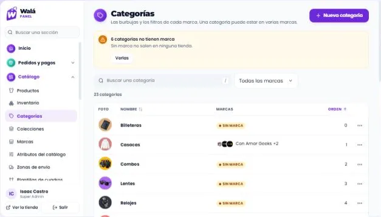 | 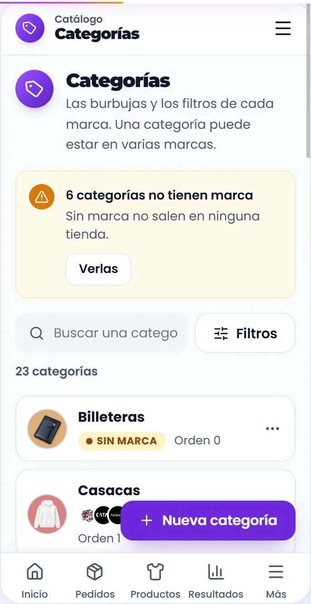 |
| 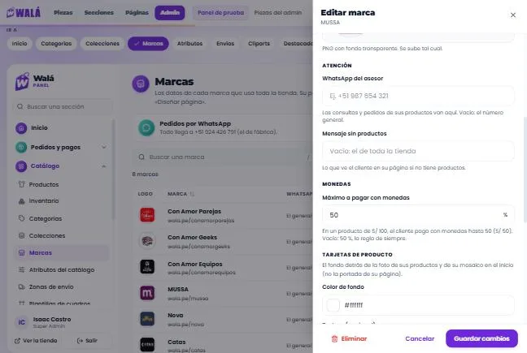 | 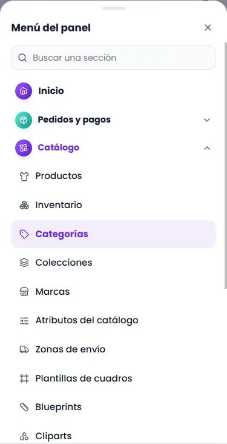 |
| 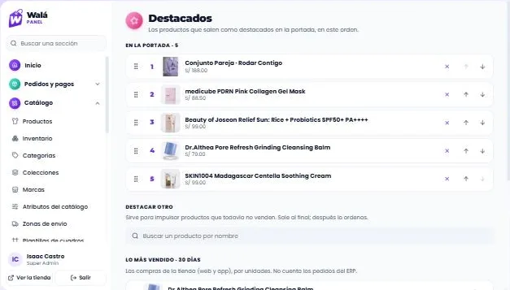 | 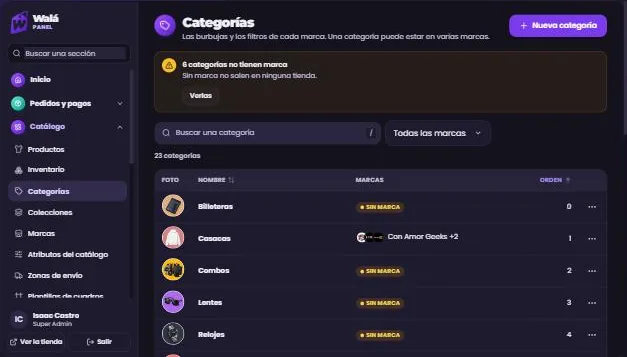 |

### La plantilla: `PaginaListaAdmin` (`paginas/admin/Lista.jsx`)

Toda lista con su hoja: `CabezaAdmin` + `antes` (un aviso, pestañas) +
`BarraFiltros` + `TablaAdmin` (de a 50, con `CargarMas`) + `HojaEdicion` +
la pregunta de eliminar + los toasts. Cada página da sus columnas, sus
filtros (`filtrar(r, valor)`), sus órdenes, y un `formulario` con `vacio`,
`desde`, `validar` (el primer campo con error recibe el foco), `limpiar` y
`campos`. `eliminar.bloqueado(r)` no pregunta: avisa por qué no se puede.
Lo que se repite en las celdas está en `paginas/admin/celdas.jsx`
(`FotoCelda`, `MarcasCelda`, `NumeroCelda`, `ElegirMarcas`, `porNombre`,
`porOrden`). Categorías pasó a la plantilla.

### Las páginas

| Página | Componente | Archivo | Qué tiene |
|---|---|---|---|
| Categorías | `PaginaCategorias` | `paginas/admin/Categorias.jsx` | (D0) sobre la plantilla |
| Colecciones | `PaginaColecciones` | `paginas/admin/Catalogo.jsx` | Nombre, orden y el banner (ancho, sin recorte); no repite nombres |
| Atributos | `PaginaAtributos` | `paginas/admin/Catalogo.jsx` | Pestañas Tipos · Etiquetas · Personajes con su cuenta; etiquetas y personajes con marcas (sin ninguna: de todas); cuántos productos usa cada uno; **no deja eliminar uno en uso** (como antes) y dice en cuántos está |
| Zonas de envío | `PaginaEnvios` | `paginas/admin/Catalogo.jsx` | Zona y departamento, costo (`CampoDinero`; 0 = gratis), días, orden y activa (`Interruptor`); filtro activas/inactivas |
| Cliparts (borrada el 2026-11-03) | `PaginaCliparts` | `paginas/admin/Catalogo.jsx` | Nombre, categoría (elegir o escribir una nueva), la imagen (PNG/SVG, sin recorte, también por enlace) |
| Marcas | `PaginaMarcas` | `paginas/admin/Marcas.jsx` | Arriba, "Pedidos por WhatsApp" (número principal y multimarca, en su hoja). La lista: logo, dirección, WhatsApp del asesor, tope de monedas. La hoja: nombre, dirección (`wala.pe/…`, **no deja repetir la de otra marca**), orden, logo, WhatsApp del asesor, mensaje sin productos, tope de monedas con el ejemplo de S/ 100, el fondo de sus tarjetas (`CampoColor`, textura, cuánto se ve) y la **vista previa de la tarjeta** con uno de sus productos. Menú "Páginas": aplicar la plantilla de página (pregunta) y quitar páginas repetidas. Por fila: sus productos y diseñar página |
| Productos de una marca | `PaginaProductosMarca` | `paginas/admin/Marcas.jsx` | Pestañas "En la marca · N" y "Agregar productos", buscar, casillas, `AccionesLote` (Quitar de la marca / Pasar a …), de a 50; "Crear producto en …" (`/admin/productos/nuevo?brandId=`) |
| Destacados | `PaginaDestacados` | `paginas/admin/Destacados.jsx` | Los de la portada en una `ListaOrdenable` (arrastrar o flechas; "Guardar orden" / "Deshacer" pegados abajo), quitar, `SelectorProductos` para destacar otro y lo más vendido de 30 días con Destacar / Quitar |

Piezas nuevas en D1: `ListaOrdenable`, `SelectorProductos`, `CargarMas`
(`piezas/admin/Datos.jsx`), `CampoDinero`, `CampoColor` y `conEnlace` /
`contener` en `CampoImagen` (`piezas/admin/Formularios.jsx`). Adaptadores
nuevos (con pruebas): colecciones, atributos (`ATRIBUTOS`,
`usosDeAtributo`), zonas, cliparts, marcas (`slugDeMarca`, `topeMonedasDe`),
`productoAdminDesde` y `mismoNombre`.

### Diferencias a propósito (D1)

- Colecciones, zonas y atributos **no dejan dos con el mismo nombre** (sin
  tildes ni mayúsculas); los atributos ya lo hacían.
- Una marca **no puede tomar la dirección de otra** (antes lo decía el
  servidor al guardar).
- **Destacar uno lo pone al final** (antes, con orden 0: al principio y
  empatado con otros). El orden se guarda de una vez para todos, con su
  posición (`featuredOrder` 0, 1, 2…); antes, uno por uno con un número.
- El WhatsApp de "Pedidos por WhatsApp" se cambia en su hoja, con el
  resto de la página quieta.
- "Aplicar plantilla" y "Quitar páginas repetidas" van en el menú
  "Páginas" (antes, dos botones grandes arriba); el resultado sale en un toast.
- "Gestionar productos" es una página con su dirección (en la demo,
  `/admin/marcas/:id/productos`); antes reemplazaba la lista sin cambiar
  la dirección (atrás salía de Marcas).

### Qué se probó (2026-11-02, demo en localhost, con el navegador dibujando)

- Las siete páginas cargan con sus datos; en el celular (375 px) nada se
  sale del ancho (las pestañas de Atributos y la lista de Destacados se
  salían: pestañas más cortas, que se deslizan si no entran, y el número
  de la lista y el texto "Quitar" se van en angosto).
- Destacados: bajar el primero con la flecha → aparece "Guardar orden" →
  guardar → toast y se va el aviso; buscar "conjunto" → los ya destacados
  dicen "Destacado" → destacar otro → queda al final; quitar → se va.
- Atributos: las tres pestañas con su cuenta; eliminar una etiqueta en uso
  → no pregunta y avisa "Está en 1 producto…".
- Marcas → "Sus productos" de MUSSA → "Agregar productos" → elegir dos →
  el botón de la página se esconde → "Pasar a MUSSA" → toast y la cuenta
  pasa de 11 a 13.
- Editar una marca: la hoja con la vista previa de la tarjeta; el color
  con su muestra (el `ControlColor` del editor no se veía fuera del editor:
  por eso `CampoColor`).
- Modo noche a ojo (Categorías y las piezas sueltas). Sin errores en la consola.

### Cómo se une D1 (unido el 2026-11-03: ver abajo)

Un conector por página en `src/components/panel/` con los servicios de hoy
y sus mismas `queryKey` (las de la tienda también: `['categories']`,
`['collections']`, `['brands']`, `['tags']`, `['characters']`,
`['productTypes']`, `['shipping-zones']`, `['cliparts']`,
`['featured-products']`, `['products']`…):

| Página | Lee | Escribe |
|---|---|---|
| Categorías | `getCategories`, `getBrands` | `createCategory` / `updateCategory` / `deleteCategory` con `categoriaAFirestore`; `uploadFile` en `categories/` |
| Colecciones | `getCollections` | `create/update/deleteCollection` con `coleccionAFirestore`; `uploadFile` en `collections/` |
| Atributos | `getProductTypes`, `getTags`, `getCharacters`, `getBrands`, `getProducts([], null, null, { includeHidden: true })` para `usosDeAtributo` | `create/update/delete` de cada uno con `atributoAFirestore(datos, tipo)` |
| Envíos | `getShippingZones` | `create/update/deleteShippingZone` con `zonaAFirestore` |
| Cliparts | `getCliparts` | `create/update/deleteClipart` con `clipartAFirestore(datos, toDirectImageUrl)`; `uploadFile` en `cliparts/` |
| Marcas | `getBrands`, `getMessage('whatsapp_number_principal' \| 'whatsapp_multimarca')`, `getProductsByBrand` (la muestra) | `create/update/deleteBrand` con `marcaAFirestore` (si `updateBrand` devuelve error, se lanza: la hoja lo muestra); `setMessage` ×2; `ensureAllBrandLandings({ force: false })` y `dedupeBrandLandings` con su texto de resultado; logo en `brands/logos/`, textura en `brands/backgrounds/` (`opciones.carpeta`) |
| Productos de una marca | `getProducts(… includeHidden)` con `productoAdminDesde` | `setProductBrand(id, brandId)` (vacío para quitar) uno por uno, contando los que fallan |
| Destacados | `getProducts(… includeHidden)`, `getTopSellingWala({ days: 30, topLimit: 10 })` (staleTime 15 min) | `updateProductField(id, { featured: true, featuredOrder: último + 1 })`, `{ featured: false, featuredOrder: 0 }` y el orden `{ featured: true, featuredOrder: i }` |

Interruptor: `adminCatalogoViejo`. No se pierde: el tope de monedas es el
mismo de `utils/topeMonedas` (y su espejo en `functions/checkoutTotals.js`);
eliminar una marca borra su landing (`deleteBrand`); `storeTitle` y
`storeSubtitle` no se escriben (se conservan).

### D1 unido al admin (2026-11-03)

Un conector por página en `components/panel/` con lo de la tabla de arriba
y `comun.js` (`useLectura` sobre los servicios `{ data, error }`, `sinError`,
`useInvalidar` y `subirA(carpeta)` para `CampoImagen` con el mismo
`uploadFile`). Cada página vieja pasó a `…Viejo.jsx`; el `.jsx` de siempre
elige con `conInterruptor('adminCatalogo', …)`:

| Página | Conector |
|---|---|
| Categorías | `CategoriasDelPanel.jsx` |
| Colecciones, Atributos, Zonas de envío, Cliparts | `CatalogoDelPanel.jsx` (`ColeccionesDelPanel`, `AtributosDelPanel`, `EnviosDelPanel`, `ClipartsDelPanel`) |
| Marcas | `MarcasDelPanel.jsx` (la vista previa pide un producto de la marca al abrir su hoja) |
| Productos de una marca | `ProductosDeMarcaDelPanel` en `MarcasDelPanel.jsx`, en la **ruta nueva** `/admin/marcas/:id/productos` (`pages/admin/AdminMarcaProductosRuta.jsx`; con el interruptor vuelve a Marcas) |
| Destacados | `DestacadosDelPanel.jsx` |

Interruptor `adminCatalogoViejo` (`useLoViejo('adminCatalogo')`).

**Cambios del kit al unir**: "Quitar páginas repetidas" (Marcas) ahora
pregunta antes, como la página de antes: borra páginas y no se deshace.

**Qué se probó** (localhost con los emuladores): Categorías crear → el
documento en `tienda_categories` con `name`, `order` (número), `brandIds`
(lista) y `createdAt` como antes → editar el nombre → eliminar con su
pregunta; Marcas crear → "Sus productos" abre la ruta nueva → "Agregar
productos" → elegir dos → "Pasar a…" → "En la marca · 2"; Destacados con los
4 del sembrado → quitar uno → "En la portada · 3"; Colecciones, Atributos,
Zonas (2), Cliparts abren sin errores. No se probó subir una imagen (el
recorte necesita elegir un archivo a mano).

## D2 · Productos (en el kit desde el 2026-11-02: los cuatro tramos)

D2 es el apartado más grande (la ficha sola tiene 1.881 líneas y se apoya
en editores de otras 3.000). Se hace por tramos; el apartado se une entero
cuando estén los cuatro (ya están: falta unirlo).

| Tramo | Qué | Páginas de hoy | Kit |
|---|---|---|---|
| D2a | La lista, el inventario y los datos para recomendar | `pages/Tienda/admin/AdminProductos.jsx` (vistas Tienda y Todos), `ProductTable`, `BulkActions`, `pages/Tienda/admin/AdminInventario.jsx`, `pages/admin/AdminPublicoProductos.jsx` | hecho (2026-11-02) |
| D2b | La ficha de un producto: general (precio, stock, descripción, organización, WhatsApp, destacado), colores y tallas (variantes con sus fotos, el encuadre 3:4, la galería, frente y espalda), un combo (sus piezas y su portada) y "Dónde se ve" (personalizar en Crear) | `pages/Tienda/admin/AdminProductoFormV2.jsx`, `AdminComboEditor`, `ThumbnailCropEditor`, `GenerarFrenteEspalda`, `PersonalizarEnCrear` | hecho (2026-11-02) |
| D2c | Crear: la lista de personalizables, su ficha (colores, diseño con vistas y zonas, plantillas, dónde se ve) y los packs (lista, formulario y "Sugerir combos") | `pages/admin/AdminPrendasCrear.jsx`, `prendasCrear/PersonalizacionPrenda.jsx`, `ZonaEditor.jsx`, `PlantillasDeLaFicha.jsx`, `AdminCombosCrear.jsx` | hecho (2026-11-02) |
| D2d | Blueprints (una lista más, sobre la plantilla) y decidir qué pasa con las herramientas de una vez y lo viejo (abajo) | `pages/admin/AdminBlueprints.jsx`, `plantillasYoryo/ImportarPlantillasYoryo.jsx` | hecho (2026-11-02) |

**Para D2d**
- **Decidido (2026-11-02): la personalización de antes no se rehace en el kit**: `AdminCustomizationViewsEditor`,
  `YoryoPersonalizado`, `AdminViewEditor` + `PrintAreasEditor` + `ShapeSelector`
  (y `ShapeCreator`, que ya no se importa en ningún lado) solo salen con el
  interruptor `personalizableViejo` y en `/editor/:id`. La tienda no los usa
  desde el 2026-10-20. Quedan fuera del kit y, cuando no quede ningún
  producto con esa personalización (el aviso de D2a lo dice), pasan a
  [ELIMINAR.md](ELIMINAR.md).
- **Plantillas de cuadros** (`/admin/plantillas-yoryo`) son siete pasos de
  una sola vez (crear los productos de Yoryo, sus plantillas, la billetera,
  las cómodas de Daida…). Propuesta: una página del kit con los pasos en
  sellos y su estado, sin cambiar lo que hace cada paso. **Hecho así** (abajo).

### D2a: lo que hay

| Escritorio | Celular |
|---|---|
| 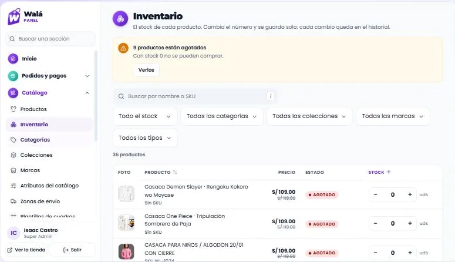 | 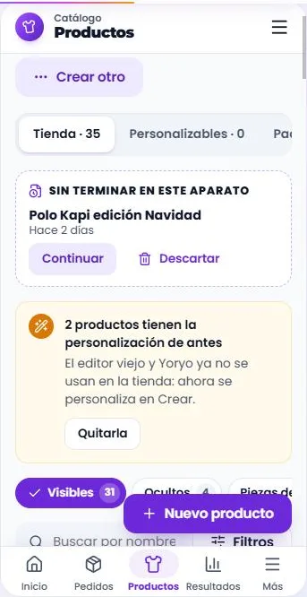 |

| Página | Componente | Archivo | Qué tiene |
|---|---|---|---|
| Productos | `PaginaProductos` | `paginas/admin/Productos.jsx` | Pestañas Tienda · N, Personalizables · N, Packs de Crear · N (lo que ponga D2c; hoy, un aviso) y Todos. En Tienda: los borradores sin terminar de este aparato (Continuar · Descartar), el aviso de la personalización de antes (con la lista y "Quitarla"), Visibles · Ocultos · Piezas de combo · Todos con su cuenta, buscar (nombre, categoría o precio), filtrar por categoría y marca, ordenar por nombre, precio o stock; en cada fila, Destacado, Combo, Pieza de combo, Personalizable; mostrar u ocultar con un toque (al momento, y vuelve si falla); menú Editar · Mostrar/Ocultar · Duplicar · Archivar; casillas con Mostrar · Ocultar · CSV · Archivar; "Exportar CSV"; "Nuevo producto" y "Crear otro" (un personalizable o un pack). Todos: qué es cada uno (Pack de Crear, En Crear, Borrador, Reemplazado…) |
| Inventario | `PaginaInventario` | `paginas/admin/Productos.jsx` | Aviso de agotados con "Verlos"; buscar por nombre o SKU; filtros de stock (agotados, últimas, disponibles), categoría, colección, marca y tipo; el estado con su color; el stock con − / + que se guarda solo (un segundo después), con guardando, guardado o Reintentar. La fila no se mueve al guardar (el orden y el filtro usan el stock con que llegó) |
| Datos para recomendar | `PaginaRecomendar` | `paginas/admin/Productos.jsx` | Faltan datos · Todos · De un equipo · No para niños con su cuenta; para quién y la edad con un toque (`ElegirUno`: lo deducido punteado; tocar lo guardado lo quita); el equipo con sugerencias y "Usar"; "Aceptar sugerencias" y "Marcar los N como…" |

Piezas nuevas: `NumeroEnLinea` y `tarjeta: 'control'` en `TablaAdmin`
(lo que se toca va debajo de la tarjeta, nunca dentro de su botón) en
`piezas/admin/Datos.jsx`; `ElegirUno` en `piezas/admin/Formularios.jsx`.
Adaptadores: `productoAdminDesde` ahora trae stock, SKU, categorías,
colecciones, tipo, si es combo y sus piezas, lo de Crear (personalizable,
tal cual, en la tienda, pack, reemplazado), la personalización de antes y
los datos para recomendar, con la foto de la lista como AdminProductos;
`esDeLaTienda`, `piezasDeCombos`, `etiquetasDeProducto`,
`rutaAdminDeProducto` y `estadoDeStock` (con pruebas). Los filtros
(`BarraFiltros`) bajan de línea cuando no entran (Inventario tiene cinco).

### Diferencias a propósito (D2a)

- **Sin el cambio tarjetas / tabla**: la misma lista es tabla o tarjetas
  según el ancho (antes se elegía y se guardaba en el aparato).
- **Todo lo que pregunta usa `Confirmar`** (antes `window.confirm` en
  mostrar, ocultar y archivar varios, descartar un borrador y la
  personalización de antes) y los errores salen en toasts (antes `alert`
  en el inventario).
- **Inventario no lista los archivados** (antes sí, por no filtrar
  `deleted`), suma el filtro por stock y −/+ junto al número.
- Duplicar deja la copia en la lista (oculta) en vez de abrir su ficha a
  la fuerza; el conector decide si la abre.
- "Crear productos de referencia" no vuelve: no tenía botón.

### Qué se probó (2026-11-02, demo en localhost, escritorio y 375 px)

- Productos: las cuatro pestañas con su cuenta; ocultar con un toque
  cambia las cuentas (Visibles 31 → 30, Ocultos 4 → 5) y avisa; elegir dos
  y archivarlos con la pregunta; Todos muestra qué es cada uno; el aviso
  de la personalización de antes cuenta 2. En el celular, el botón de
  visible quedaba dentro del botón de la tarjeta (y se salía): ahora va
  abajo; los chips de estado no se parten.
- Inventario: − / + guarda solo y el estado pasa de Agotado a Últimas
  unidades; con "Guardar y subir fallan", Reintentar; reintentar sin la
  falla guarda. Dos toques rápidos en + contaban uno: arreglado.
- Recomendar: lo deducido sale punteado y tocarlo lo guarda; "Aceptar
  sugerencias" ya no se sale de la fila en el celular.
- Sin errores en la consola; nada se sale del ancho a 375 px.

### Cómo se une D2a (cuando D2 esté entero)

| Página | Lee | Escribe |
|---|---|---|
| Productos | `getProducts([], null, null, { includeHidden: true })` (`['admin-products']`), `getCategories`, `getBrands`; los borradores de `localStorage.wala_drafts` | Mostrar/ocultar: `updateProductField(id, { visible })` (**nunca** `updateProduct` con la fila de la tabla: tiene las claves en español y el servicio guardaría precio 0, sin variantes ni fotos; el kit no lista archivados, así que el arreglo anti-zombi de AdminProductos ya no hace falta); archivar: `deleteProduct` (uno por uno, contando fallas); duplicar: `createProduct({ ...sin id ni createdAt, name: 'X (Copia)', visible: false })`; CSV: `exportProducts(productos, categorias, ids)`; la personalización de antes: `quitarPersonalizacionVieja` uno por uno; descartar un borrador: borra sus fotos de Storage **solo si nunca se publicó** (la regla P0 de AdminProductos) e invalida `admin-products`, `products`, `featured-products`, `collection-products` |
| Inventario | `getProducts(… includeHidden)` sin los `deleted`, y las seis listas de filtros | `updateProductField(id, { inStock })` y `logInventoryChange(id, nombre, antes, ahora, email)` |
| Recomendar | `getProducts(… includeHidden)`, `getCategories`; `sugerenciaDe` con `publicoDe`, `edadMinimaDe` y `equipoDe` de `utils/giftRecommender.mjs`; los equipos de sus SINONIMOS | `updateDocument('productos_wala', id, campos)` (null borra el campo); en lote, de a 20; invalida `['products']` y `['gift-catalog-dicts']` |

### D2b: la ficha de un producto (en el kit desde el 2026-11-02)

| Escritorio | Celular |
|---|---|
| 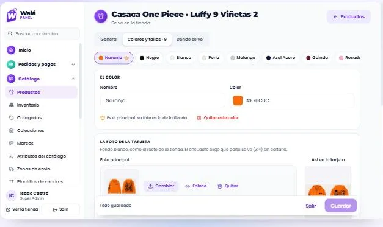 | 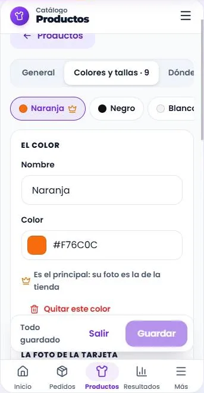 |

`PaginaFichaProducto` (`paginas/admin/Ficha.jsx`), para un producto de la
tienda o un combo (los personalizables tienen su ficha en D2c). Pestañas
General · Colores y tallas (o Piezas del combo) · Dónde se ve; la que tiene
un error lleva un punto. **Guardar está siempre a mano**, pegado abajo
(sobre la barra del celular), con "Cambios sin guardar" o "Todo guardado";
salir con cambios pregunta. Uno nuevo se va guardando en el aparato
(`onBorrador`).

| Parte | Qué tiene |
|---|---|
| General | Cómo se vende (individual o combo); nombre, precio y oferta (`CampoDinero`, con el % que se ahorra; si no es menor que el precio, avisa antes de guardar en vez de perderla), SKU, stock, descripción (el editor con formato llega por `descripcion`; sin él, un texto largo); la marca con su logo (`ElegirMarca`); categoría y tipo (elegir o crear ahí); colecciones, personajes y etiquetas (`ElegirVarios`, con crear); cómo se prepara (`fulfillmentType`); para quién, la edad y el equipo; WhatsApp (activo, número propio con el de la marca de ejemplo, mensaje con `{url}`); destacado |
| Colores y tallas | Los colores en chips con su punto y la corona del principal, "+ Color"; por color: nombre, `CampoColor`, "Hacerlo el principal", quitar (pregunta; queda al menos uno); la foto de la tarjeta (subir o pegar enlace) con **"Así en la tarjeta"** y el encuadre 3:4 (`EncuadreFoto`: arrastrar, zoom, flechas; "Toda la foto" lo quita; no corta la foto); las tallas (`CampoTallas`: Enter o coma, sin repetir, "Poner S a XL") y cómo se llaman; la galería (`GaleriaFotos`: subir varias, ← →, encuadrar, quitar; la primera es la del mouse) y lo que se agregue abajo (`extraGaleria`: frente y espalda) |
| Piezas del combo | Tallas (cada prenda con la suya o una para todo); las piezas en una `ListaOrdenable` con su nombre en el combo y su color (el que ya no existe se marca); buscar para agregar (sin combos ni lo de Crear); la portada |
| Dónde se ve | Se ve en la tienda; se personaliza en (una prenda o un pack de Crear; uno que ya no existe se marca); "Pasarla a Crear" (pregunta; con cambios, pide guardar primero) |

Adaptadores (con pruebas): `fichaDesdeProducto` (lo que cargaba el
formulario, con la variante "Principal" para los productos de antes sin
variantes), `fichaAProducto` (el mismo payload que armaba
AdminProductoFormV2: `mainImage` del principal, `mainSizes: []`,
`hasVariants`, `isV2`, `customizable: false`; conserva las copias chicas
de las fotos que siguen y, en un combo, lo que la ficha no muestra de cada
pieza, como su escala o su Yoryo), `erroresDeFicha` y `CUMPLIMIENTOS`.

### Diferencias a propósito (D2b)

- **Avisa en vez de perder**: una oferta que no es menor que el precio ya
  no se guarda en silencio como vacía; el combo sin piezas, el nombre y el
  precio vacíos llevan a su campo (antes, `alert` o nada).
- **Guardar no sale de la ficha**: avisa y se queda (antes volvía a la
  lista); salir con cambios pregunta (antes no había aviso).
- **"Crear marca" no está en la ficha**: las marcas se crean en Marcas
  (antes había una ventana con nombre y logo).
- **Sin la personalización de antes**: el "Producto personalizable" de los
  combos, el editor de vistas y Yoryo no vuelven (D2d). "Se personaliza en
  Crear" del producto pasa a "Pasarla a Crear" (abre su ficha de Crear).
- La foto principal también acepta un enlace (antes, "Fijar URL" aparte).
- El encuadre se hace con el recuadro de Walá (antes, react-image-crop);
  guarda lo mismo: `{ percentages: { x, y, width, height } }`.

### Qué se probó (2026-11-02, demo en localhost)

- Abrir "Casaca One Piece · Luffy 9 Viñetas" desde la lista: sus 9 colores
  con el principal, precio 119, stock 10; cambiar el nombre → "Cambios sin
  guardar"; oferta 500 → al guardar, la pestaña General con su punto, el
  foco en la oferta y el aviso; vaciarla → se guarda.
- El encuadre: el recuadro 3:4 se mueve con las flechas y el zoom, y "Así
  en la tarjeta" lo muestra igual que la tienda.
- Salir con cambios → "¿Salir sin guardar?"; un combo con sus dos piezas,
  buscar "casaca" y agregarla con su primer color, guardar; uno nuevo sin
  datos → el foco en el nombre.
- Etiquetas: elegir "Alianza Lima" de las 74. Nada se sale del ancho a
  375 px y Guardar queda sobre la barra del celular. Sin errores en la consola.

### Cómo se une D2b

`inicial` cambia solo cuando llega otro producto (con `useMemo` por id: si
cambia en cada render, la ficha vuelve a empezar). El conector hace lo que
hacía AdminProductoFormV2:

- **Lee** `getProduct(id)`, las listas (`getBrands`, `getCategories`,
  `getCollections`, `getProductTypes`, `getCharacters`, `getTags`, con sus
  `brandIds` como `marcas`), el catálogo para las piezas y sus colores, y
  `getPrendasBase` + `getCombosCrear({ incluirBorradores: true })` para
  "Se personaliza en". Redirige como antes: un `esPrendaBase` a
  `/admin/prendas-crear/:id`, un `esComboCrear` a los packs.
- **Guarda** `createProduct(fichaAProducto(datos), draftId)` o
  `updateProduct(id, fichaAProducto(datos, producto))`, borra el borrador
  de `wala_drafts`, refresca `admin-products` y `admin-product,id` e
  invalida `products`, `products-infinite`, `product,id`,
  `featured-products` y `collection-products` (el comentario de
  `products-infinite` en FormV2 dice por qué).
- **Sube** a `productos_v2/{draftId}/` con el nombre de siempre según
  `carpeta` (`main_…`, `gallery_…`, `combo_preview_…`) y guarda las copias
  de `uploadFile` en `variante.copias` (`imagesVariantes`); nunca borra de
  Storage una foto que ya estaba en el producto (`safelyDeleteOldImage`).
- `descripcion`: el ReactQuill de siempre (las mismas fuentes y tamaños);
  `extraGaleria`: `GenerarFrenteEspalda` (el nombre `_frente-espalda.` del
  archivo importa: lo busca la página del combo).
- `?brandId=` elige la marca solo en uno nuevo; `?pestana=` va por
  `pestanaInicial` / `onPestana`.

### D2c: Crear (en el kit desde el 2026-11-02)

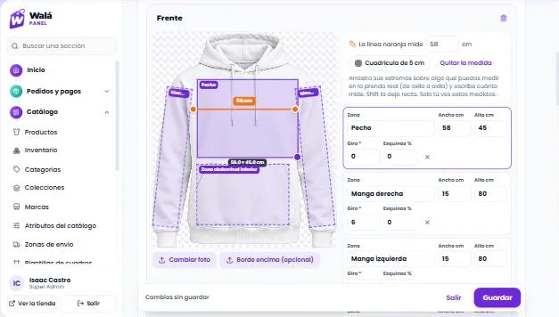

| Parte | Componente | Archivo | Qué tiene |
|---|---|---|---|
| Personalizables | `PaginaPersonalizables` | `paginas/admin/Crear.jsx` | La pestaña de Productos (`embebido`): Todos · Publicados · Borradores; foto, cuántos colores, vistas, zonas y plantillas, "Le faltan vistas con zonas", en qué packs está, En Crear / Borrador y En la tienda; Editar, Verlo en Crear, Publicar / Volver a borrador (al momento, vuelve si falla), Archivar (pregunta y dice qué packs publicados la usan) |
| Packs | `PaginaPacks` | `paginas/admin/Crear.jsx` | La lista (piezas, precio, tallas, estado) y la hoja: nombre, descripción, marca, categoría (de esa marca), portada; 2 a 4 piezas, cada una "Se diseña" (una prenda de Crear y el color en que abre) o "Va tal cual" (un producto de la tienda y su color); "Agregar prenda" copia la última; las tallas (Automático · Una por prenda · Una para todas, con su explicación); precio y oferta con **lo que cuestan por separado y lo que se ahorra**; publicado y en la tienda. "Sugerir packs": pareja y trío de cada prenda, con nombre y precio editables, cuáles crear y "Publicarlos de una vez" |
| Ficha de un personalizable | `PaginaFichaProducto` con `datos.esPrenda` | `paginas/admin/Ficha.jsx` | General (sin "Cómo se vende"; stock vacío = sin límite) · Colores y fotos · Diseño · Plantillas · Dónde se ve (publicado en Crear, también en la tienda, también tal cual, el aviso si su color principal no tiene foto de tienda) |
| Diseño | `DisenoPrenda` | `piezas/admin/Crear.jsx` | Prenda o producto, impresión o láser, solo con plantillas, portada en Crear; "Ver en" un color; cada vista con su nombre, foto, borde encima, la medida de referencia (cm y cuadrícula de 5 cm) y sus zonas (`EditorZonas` + `ListaZonas`); "Agregar vista" (Frente, Espalda…); "Usar el hoodie de ejemplo"; las zonas de los bicolores (de todos y propias de un color, copiar las heredadas o volver a ellas) |
| El editor de zonas | `EditorZonas`, `ListaZonas` | `piezas/admin/Crear.jsx` | El de `ZonaEditor`: la foto teñida en un lienzo, mover, estirar por el borde derecho, el de abajo o la esquina (sobre los ejes de una zona girada), la línea naranja con Shift, la medida en cm de la zona elegida; **ahora también con las flechas**. La lista: nombre con sugerencias, ancho y alto en cm (si hay escala, se confirman al salir), giro, esquinas, quitar, agregar |
| Colores | `ColoresPrenda` | `piezas/admin/Crear.jsx` | "Colores de polera (S–XL)"; por color: bicolor (segundo tono con `CampoColor`, cómo se reparten), "Agregar versión invertida" (fotos en espejo), el aviso si le falta la foto en una vista, la foto de tienda (subir o "Con una plantilla") y la foto propia de cada vista con su miniatura teñida |
| Plantillas | `PlantillasPrenda` | `piezas/admin/Crear.jsx` | Se guardan al momento (como antes): por grupo, renombrar, cambiar de grupo (elegir o escribir uno), editar en el estudio, quitar (pregunta), "Nueva plantilla" y "Traer de otro" (elegir el producto y cuáles); sin guardar el producto, avisa que primero hay que guardarlo |

Las reglas son las de `utils/prendaBase` (normalizar zonas y vistas,
medir en cm, teñir, `leerPrendaBase`, `colorDisponible`): el kit las
importa, no las copia. **`prendaBaseParaGuardar` pasó de
`PersonalizacionPrenda.jsx` a `utils/prendaBase.js`** (el archivo viejo la
reexporta: AdminProductoFormV2 no cambió) para que el kit la use sin cargar
Firebase. Adaptadores (con pruebas): `personalizableDesde`,
`packDesdeFirestore`, `packAGuardar`, `erroresDePack`, `MODOS_TALLA_PACK`;
`fichaDesdeProducto` / `fichaAProducto` / `erroresDeFicha` saben de
personalizables (prendaBase, stock sin límite, la foto de la primera vista
para un color sin foto, `enTienda` y `seVendeTalCual`, "cada vista necesita
su foto y una zona" en la pestaña Diseño).

### Diferencias a propósito (D2c)

- **Quitar una vista pregunta** (antes se iba con un toque); quitar las
  zonas de un bicolor usa `Confirmar` (antes `window.confirm`); los errores
  de subida y de la foto con plantilla salen en toasts (antes `alert`).
- Las zonas se mueven también con las flechas (Shift, más rápido).
- El grupo de una plantilla se elige con la lista de Walá (antes
  react-select).
- "Sugerir packs" se abre en una hoja; el resto del flujo es el mismo.

### Qué se probó (2026-11-02, demo en localhost)

- Personalizables: las 4 prendas de la copia con sus cuentas y sus packs;
  la Polera clásica abre con sus 14 colores, el stock "Sin límite" y las
  cinco pestañas.
- Diseño: las dos vistas teñidas con sus zonas, la línea de 58 cm y las
  zonas de los bicolores (cuatro editores); mover una zona con la flecha
  marca "Cambios sin guardar".
- Colores: "Agregar versión invertida" de Panda crea "Panda (al revés)";
  guardar → "Cambios guardados".
- Plantillas: traer las dos de la casaca (de ejemplo) → "Plantillas · 2"
  sin marcar cambios sin guardar.
- Packs: crear vacío → los tres avisos; un trío de Polera con precio 250 →
  "Por separado: S/ 387.00 · el cliente ahorra S/ 137.00 (35 %)" → creado;
  "Sugerir packs" → 8 → creados.
- Nada se sale del ancho a 375 px en ninguna pestaña. Sin errores en la consola.

### Cómo se une D2c

- **Personalizables**: `getPrendasBaseAdmin` + `getCombosCrear({ incluirBorradores: true })`
  (`refetchOnMount: 'always'`); publicar: `updateProductField(id, { visible })`;
  archivar: `deleteProduct`.
- **Ficha**: `/admin/prendas-crear/nueva` y `/:id` (RutasPrendasCrear) con
  `fichaDesdeProducto(producto, { prenda: true })`; al guardar, **releer
  las plantillas del producto** (`getDocument`) y pasar
  `fichaAProducto(datos, producto, { prendaBaseParaGuardar })` con esas
  plantillas (así guardar no borra una que se agregó en el estudio); las
  subidas como antes (`crear_…png`, `tienda_…`); `fotoConPlantilla` →
  `fotoDeTiendaConPlantilla`; las plantillas, `cambiarPlantillaDelProducto`,
  `quitarPlantillaDelProducto`, `traerPlantillas` y releer
  (`plantillas` = `leerPlantillas`); `urlNueva`/`urlEditar` con
  `state.desde` para volver a `?pestana=plantillas`. Invalida además
  `prenda-base`, `prendas-base` y `admin-prendas-crear`.
- **Packs**: `getCombosCrear`, `getPrendasBase({ incluirBorradores: true })`,
  los productos que sirven tal cual (`sirveTalCual`), marcas y categorías;
  guardar: `guardarComboCrear(id, conFotos(packAGuardar(datos)))` (el
  nombre y la foto de cada pieza); archivar: `archivarComboCrear`;
  sugerir: `sugerirCombos(prendasPublicadas, combos, precioBase)` y crear
  uno por uno; invalida `admin-combos-crear`, `combos-crear`, `combo-crear`.
- El menú: las fichas de Crear marcan "Productos" (`activo`).

### D2d: Blueprints y Plantillas de cuadros (en el kit desde el 2026-11-02)

> **Blueprints se borró el 2026-11-03** (no lo leía nadie fuera del admin); lo de abajo sobre esa página es historia.

| Computadora | Celular |
|---|---|
| 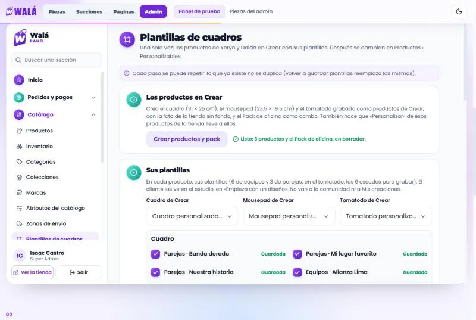 | 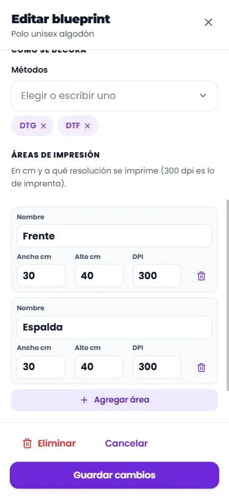 |

| Parte | Componente | Archivo | Qué tiene |
|---|---|---|---|
| Blueprints (borrada el 2026-11-03) | `PaginaBlueprints` | `paginas/admin/Herramientas.jsx` | Sobre `PaginaListaAdmin`: el nombre con su prenda base, el costo de impresión, las áreas (`Frente 30×40 cm · Espalda…`), los métodos y Activo / Inactivo; buscar, filtrar por estado, ordenar por nombre. La hoja: nombre, prenda base, costo (`CampoDinero`), orden, métodos (`ElegirVarios`: DTG, DTF, Sublimación, Bordado, Serigrafía, Vinilo o uno escrito), las áreas (nombre, ancho y alto en cm, DPI; agregar, quitar, siempre queda una) y Activo. Eliminar **borra** (como antes; no se archiva) y lo dice al preguntar |
| Un paso | `PasoAdmin` | `piezas/admin/Pasos.jsx` | Para herramientas de una sola vez: el número en un `Sello`, qué hace, lo que se elige antes (`contenido`), el botón, la pregunta antes de hacerlo (`confirmar`), **cómo va mientras corre** (`avisar(texto)`), el resultado (el sello pasa a menta con un visto) o el error, y por qué no se puede todavía (`motivo`). Sirve también para "Crear cuentas desde pedidos" (D3) |
| Plantillas de cuadros | `PaginaPlantillasYoryo` | `paginas/admin/Herramientas.jsx` | Los siete pasos de `ImportarPlantillasYoryo` con sus textos: 1 crear productos y pack · 2 sus plantillas (un destino por producto, cuáles por grupo y el estado de cada una mientras se guarda) · 3 quitar las copias de la comunidad · 4 pasar a la tienda (pregunta) · 5 ajustar el tomatodo · 6 billetera, esclava y packs · 7 cómodas de Daida. **Un paso a la vez**, como antes; sin sesión, ninguno |

Adaptadores (con pruebas): `blueprintDesdeFirestore`, `blueprintAFirestore`
(las áreas sin nombre no se guardan; los métodos sin repetir) y `areaVacia`.
Lo que hace cada paso de Plantillas **no cambia**: siguen siendo
`crearProductosYoryo`, `grabadosYoryo`, `comodasDaida` y el guardado de
plantillas de hoy; el kit solo pone cómo se ve y cómo avisa.

### Diferencias a propósito (D2d)

- Blueprints: los métodos son chips (antes un texto con comas) y el costo
  va en soles con `CampoDinero`. Avisa si no hay nombre, si ya hay otro con
  el mismo nombre y si ninguna área tiene nombre (antes se guardaba vacío).
  En el celular cada área tiene el nombre arriba y las medidas debajo.
- Plantillas: el botón del paso 2 se acorta a "Guardar las plantillas"
  (cabe en el celular); el estado de cada plantilla va a su lado y las
  plantillas van en dos columnas en la computadora. El resultado de cada
  paso se queda en su paso (antes, un aviso arriba para todos).
- La demo simula los pasos (ninguno toca Firestore) y trae tres
  blueprints de ejemplo: en la copia de la tienda no hay.

### Qué se probó (2026-11-02, demo en localhost, 1280 px y 375 px)

- Blueprints: "Nuevo blueprint" vacío → los dos avisos y el foco en el
  nombre; con nombre, prenda, un área de 28 × 32 y una segunda sin nombre →
  creado con una sola área (la vacía no se guarda), pasando por
  `blueprintAFirestore` y de vuelta. Editar el Polo → Eliminar → "Se borra
  del todo (no se archiva)" → borrado (quedan 3).
- Plantillas: paso 1 → "Subiendo la foto del cuadro…" → hecho, y los
  destinos del paso 2 se eligen solos con los productos nuevos (borrador);
  paso 2 → las 24 plantillas (9 + 9 + 6) pasan por "Guardando…" a
  "Guardada"; paso 4 pregunta antes; con "Guardar y subir fallan", el
  paso 3 muestra el error y deja reintentar. Mientras corre el 5, los otros
  seis esperan ("Espera a que termine el otro paso").
- A 375 px nada se sale del ancho (la hoja de blueprints, los destinos y
  los pasos). Sin errores en la consola.

### Cómo se une D2d

- **Blueprints** (`BlueprintsDelPanel.jsx`): `getBlueprints` →
  `blueprintDesdeFirestore`; guardar `createBlueprint` / `updateBlueprint`
  con `blueprintAFirestore(datos)`; eliminar `deleteBlueprint` (el borrado
  de verdad, como hoy). Invalida `['admin-blueprints']` y `['blueprints']`.
- **Plantillas de cuadros** (`PlantillasYoryoDelPanel.jsx`): `prendas` de
  `getPrendasBase({ incluirBorradores: true })` (`['admin-prendas-crear-importar']`);
  `destinosIniciales` con `IDS_CREAR_YORYO` si esos productos ya existen;
  `plantillas` = `plantillasDe(producto)` con **las editadas de
  `templates/yoryo-composiciones-v4` mandando** (como hoy); `sinSesion` =
  `!user`. Cada `on…` llama a la misma función de hoy y devuelve su texto
  de resultado; el paso 2 llama a `marcar(id, 'Guardada' | 'Error: …')` por
  plantilla. Las invalidaciones de cada paso, las mismas de hoy
  (`prendas-base`, `prenda-base`, `products`, `admin-products`,
  `admin-combos-crear`, `categories`, `comunidad`, `mis-creaciones-crear`,
  `mis-borradores-crear`).
- Los pasos siguen en `pages/admin/plantillasYoryo/` (no son del kit); al
  unir solo se reemplaza la pantalla. **Antes**, lo que hoy vive dentro de
  la pantalla sale a un archivo propio (`plantillasYoryo/pasosYoryo.js`):
  `plantillasDe`, `importar` (paso 2, con la miniatura y la subida) y
  `limpiar` (paso 3).

### D2 unido al admin (2026-11-03)

Los cuatro tramos a la vez, con el interruptor `adminProductosViejo`
(`useLoViejo('adminProductos')`). Cada página vieja pasó a `…Viejo.jsx`; el
`.jsx` de siempre elige:

| Página | Conector (`components/panel/`) |
|---|---|
| Productos (con las pestañas Personalizables y Packs de Crear) | `ProductosDelPanel.jsx` + `CrearDelPanel.jsx` (`PersonalizablesDelPanel`, `PacksDelPanel` con `nuevoInicial` por `?nuevo=1`) |
| Inventario | `InventarioDelPanel` en `ProductosDelPanel.jsx` |
| Datos para recomendar | `RecomendarDelPanel` en `ProductosDelPanel.jsx` |
| La ficha (producto, combo y personalizable) | `FichaDelPanel.jsx` (por `AdminProductoFormV2.jsx`, también desde `RutasPrendasCrear`) |
| Blueprints | `BlueprintsDelPanel.jsx` |
| Plantillas de cuadros | `PlantillasYoryoDelPanel.jsx`; los pasos 2 y 3 salieron de la pantalla a `pages/admin/plantillasYoryo/pasosYoryo.js` (la pantalla vieja los importa de ahí) |

- **La ficha**: la de antes vuelve también con `personalizableViejo` (solo
  ella tiene "Producto personalizable" y Yoryo). Los borradores de uno
  nuevo se guardan en `wala_drafts` con la forma de antes (`{ draftId,
  form, updatedAt }`), así la lista vieja también los lee y la nueva abre
  los de antes. Las copias chicas de cada foto subida viajan con su
  variante. Un personalizable relee sus plantillas al guardar; "Nueva
  plantilla" y "Editar" llevan `state.desde` para que el estudio vuelva a
  esa pestaña (`PlantillasPrenda` ganó `estadoEnlace`); la foto de tienda
  con una plantilla recibe las vistas y si es láser (`fotoConPlantilla`
  ganó un tercer argumento).
- **Datos para recomendar**: quitar un dato lo borra (`deleteField`, lo
  mismo que ya hacía `updateDocument` con un campo vaciado).
- **Pendiente: "Pasarla a Crear"** no está conectado. Pasar un producto de
  la tienda a Crear lo saca de la app de Android (no muestra prendas de
  Crear) y la ficha de antes además lo sacaba de la tienda; hay que decidir
  cómo debe quedar antes de ponerlo. Mientras, se hace con la ficha de
  antes (`adminProductosViejo`).
- **Diferencias que quedaron** (de los conectores): publicar o archivar un
  personalizable también refresca la lista de Productos y la tienda; un
  pack sugerido sin nombre o con precio 0 no deja crear ninguno (antes se
  creaban todos); los productos "tal cual" de un pack van por nombre (antes
  primero los de su marca); la portada de un pack se llama
  `<fecha>_portada.<ext>` (misma carpeta); en Plantillas de cuadros el
  estado de cada plantilla no se limpia al repetir el paso 2 y los textos
  intermedios ("Preparando…") se ven en verde.

**Qué se probó** (localhost con los emuladores): la lista con sus cuatro
pestañas; ocultar un producto escribe solo `visible: false` (precio, stock y
marca intactos); la ficha de un producto: cambiar el nombre y guardar (el
documento conserva sus campos, `featuredOrder` incluido); uno nuevo: el
`?draftId=` en la dirección, el borrador sobrevive a una recarga, guardar
lo crea y borra el borrador; Inventario: "+" y Guardar → `inStock` 11 y su
registro en `inventoryLogs` con el correo; Datos para recomendar,
Personalizables, Packs, Blueprints, Plantillas de cuadros y la ficha de un
personalizable nuevo abren sin errores; con `adminProductosViejo` vuelve la
ficha de antes. No se probaron subidas de fotos, el estudio de plantillas
ni los siete pasos de Yoryo (necesitan archivos y datos reales).

## D3 · Pedidos y pagos (en el kit desde el 2026-11-02: los tres tramos)

Cuatro pantallas de hoy, en tres tramos; el apartado se une entero cuando
estén los tres (ya están: falta unirlo).

| Tramo | Qué | Páginas de hoy | Kit |
|---|---|---|---|
| D3a | Recepción de pedidos: las cifras, los filtros y un pedido por tarjeta con lo del envío primero | `pages/admin/dashboard/DashRecepcion.jsx` + `RecepcionPedidos.jsx` (`useAdminWalaOrders` → `services/adminOrders.js`, solo lectura del ERP) | hecho (2026-11-02) |
| D3b | Gestión de pagos: historial y cifras de los enlaces (con su gráfico por día), generar un enlace y la configuración de Yape, Plin y WhatsApp | `pages/admin/AdminGestionPagos.jsx` (KpiRow, TrendChart, `enlacesPago.js`, `messages`) | hecho (2026-11-02) |
| D3c | Crear cuentas desde pedidos (tres pasos con `PasoAdmin`, uno con simulación) y el Libro de reclamaciones (responder) | `pages/admin/AdminCrearCuentasPedidos.jsx`, `AdminLibroReclamaciones.jsx` | hecho (2026-11-02) |

**Para D3b y D3c**
- El gráfico de pagos necesita un `GraficoTendencia` (de Métricas): se
  hace en D3b y Resultados (D4) lo reusa. **Hecho** (abajo).
- El Libro de reclamaciones tiene trabajo en pausa (correo y código,
  LEGALES.md paso 3): el kit no cambia qué guarda ni cuándo; solo la
  pantalla para responder. **Hecho así** (abajo).

### D3a: Recepción de pedidos (en el kit desde el 2026-11-02)

| Computadora | Celular |
|---|---|
| 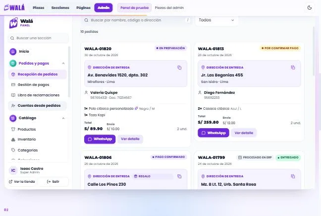 | 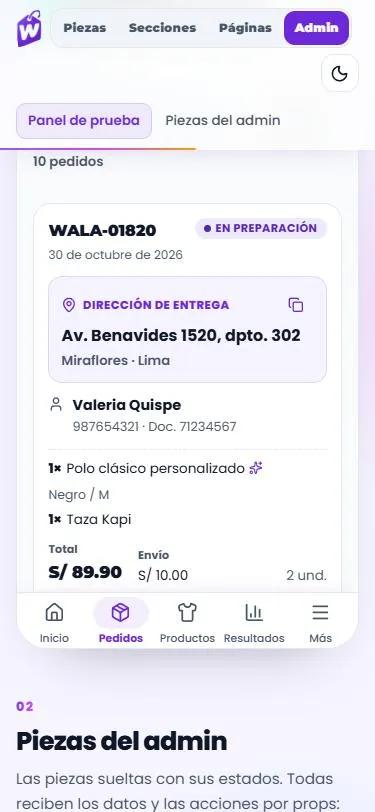 |

| Parte | Componente | Archivo | Qué tiene |
|---|---|---|---|
| La página | `PaginaRecepcion` | `paginas/admin/Pedidos.jsx` | Cabecera con "Actualizar"; las cifras (Por entregar, Pagos pendientes, En producción, Entregados, Monto total) **que filtran al tocarlas**; buscar por nombre, código, teléfono, documento o dirección y el filtro de estado (`BarraFiltros`); las tarjetas de a 30 (`CargarMas`); esqueletos, error con Reintentar y los dos vacíos (no hay pedidos · ninguno coincide, con "Quitar filtros") |
| Las cifras | `Cifra`, `FilaCifras` | `piezas/admin/Metricas.jsx` | La cifra en letra de marca con su rayita de color, su nombre y una línea; si se toca, es un botón con `aria-pressed`. De a dos en el celular (la última sola, a todo el ancho). Reemplazan `KpiRow` y servirán a Resultados (D4) |
| Un pedido | `TarjetaEnvio`, `EsqueletoEnvio` | `piezas/admin/Pedidos.jsx` | Código, fecha y estado (`ESTADOS_RECEPCION`); "Procesado en ERP" (la copia de respaldo); **la dirección de entrega resaltada con "Copiar"** (dirección, distrito, departamento y a quién con su teléfono, para la agencia); regalo: para quién, cuándo entregar y el mensaje; el cliente con teléfono y documento; lo que lleva (cantidad, nombre, color / talla, personalizado); total, envío y unidades; WhatsApp (`utils/whatsappLink`) y "Ver detalle" |

Adaptadores (con pruebas): `ESTADOS_RECEPCION`, `FILTROS_RECEPCION`,
`pedidoEnFiltro`, `textoDePedido`, `resumenRecepcion` y
`direccionParaCopiar`. Los pedidos llegan **ya normalizados**
(`normalizarPedidoRecepcion`): el kit no lee el ERP ni recalcula estados.

### Diferencias a propósito (D3a)

- **Las cifras filtran**: tocar "Por entregar" deja solo esos (otra vez,
  todos). Antes eran solo de mirar.
- **"Pagos pendientes" ya no cuenta los anulados**: antes contaba todo lo
  no pagado y no cuadraba con su filtro "Pago pendiente".
- **Copiar la dirección** para la agencia (nuevo); la búsqueda no distingue
  tildes; las tarjetas salen de a 30.
- **La fecha de entrega de un regalo** ("2026-11-14") se lee como ese día
  aquí: antes salía un día antes (se leía a medianoche UTC).
- Sin emojis (📍👤🎁✨💬): íconos de lucide; el estado con su texto y su
  punto, como el resto del admin.

### Qué se probó (2026-11-02, demo en localhost, 1280 px y 375 px)

- 10 pedidos de ejemplo con la forma de `normalizarPedidoRecepcion` (uno
  sin teléfono, uno sin dirección ni productos, un regalo, uno de España,
  uno "Procesado en ERP", uno anulado): las cifras dan 7 · 3 · 2 · 2 ·
  S/ 1,236.20.
- Tocar "Pagos pendientes" → 3 tarjetas y la cifra marcada; otra vez → 10.
  Buscar "surco" → 1; "zzz" → "Ningún pedido coincide" → Quitar filtros → 10.
- WhatsApp: 51 delante de los 9 dígitos, el de España tal cual (34…), sin
  teléfono el botón queda apagado; sin dirección, "Copiar" apagado.
- Cargando (6 esqueletos y las cifras en hueso), error (sin cifras, con
  Reintentar, que vuelve a cargar), sin datos (Kapi y el texto).
- A 375 px nada se sale del ancho (el monto, que se cortaba, va a todo el
  ancho); el modo noche con la entrega en lila oscuro. Sin errores en la consola.

### Cómo se une D3a

- `RecepcionDelPanel.jsx`: `useAdminWalaOrders()` → `pedidos={data.pedidos}`,
  `cargando={isLoading}`, `actualizando={isFetching}`,
  `error={isError || data.available === false ? (data.error || 'No se pudieron cargar los pedidos del ERP en este momento.') : undefined}`,
  `onActualizar={refetch}`. El resumen ya no hace falta del servicio (la
  página lo saca de los pedidos con `resumenRecepcion`).
- `detalleDe={(p) => `/cuenta/pedidos/${p.id}`}` como hoy (ver si hace falta
  una ficha del pedido para el admin: hoy abre la del cliente).
- La ruta sigue siendo `/admin/recepcion-pedidos`; `/admin/dashboard/recepcion`
  sigue redirigiendo.
- Interruptor del apartado: `adminPedidosViejo` (las cuatro pantallas de D3 juntas).

### D3b: Gestión de pagos (en el kit desde el 2026-11-02)

| Computadora | Celular |
|---|---|
| 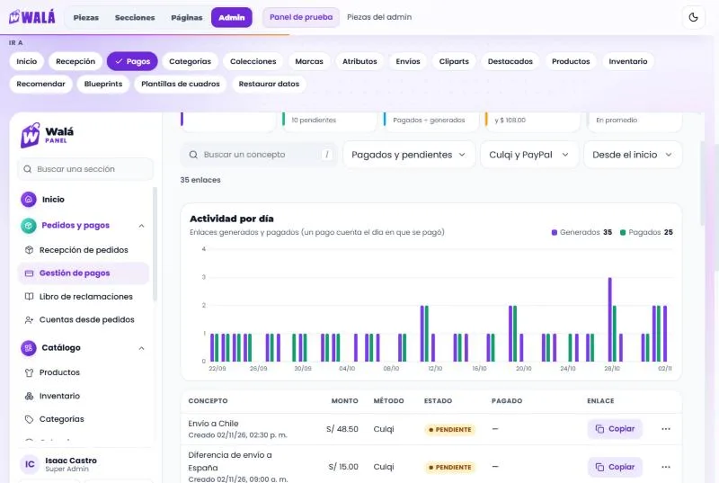 |  |

| Parte | Componente | Archivo | Qué tiene |
|---|---|---|---|
| La página | `PaginaPagos` | `paginas/admin/Pagos.jsx` | Tres pestañas: **Historial**, **Nuevo enlace** y **Ajustes** (la pestaña puede venir de afuera: `pestana` / `onPestana`). En el celular, "Generar enlace" es el botón flotante del historial |
| Historial | (dentro de la página) | `paginas/admin/Pagos.jsx` | Las cifras sobre lo filtrado (generados, pagados con cuántos pendientes, conversión, cobrado en soles y en dólares por separado, tiempo promedio hasta el pago); buscar el concepto; estado, método y **periodo** (7, 30, 90 días o "Elegir fechas" con dos `CampoFecha`); el gráfico; la tabla (`TablaAdmin`: concepto con la fecha, monto, método, estado, cuándo se pagó y en cuánto, "Copiar"; en "⋯", copiar o abrir la página de pago) de a 50 |
| El gráfico | `GraficoTendencia` | `piezas/admin/Grafico.jsx` | SVG propio (sin recharts): una escala con marcas redondas, `forma` `'lineas'` o `'barras'` (con las puntas de arriba redondeadas), la leyenda con el total de cada serie, la franja o la guía y el recuadro al pasar, **las flechas del teclado** para recorrer los días, una tabla oculta para lectores de pantalla; si las barras no caben (muchos días en un celular), las junta de a 2 o más días y lo dice. Colores validados con el validador de paletas: clara #7c3aed / #0f9f6e, noche #9b7bf5 / #1fa774. Reemplaza `TrendChart` y servirá a Resultados (D4) |
| Nuevo enlace | (dentro de la página) | `paginas/admin/Pagos.jsx` | Concepto, moneda (soles por Culqi, dólares por PayPal) y monto (`CampoDinero` con su símbolo); los avisos en cada campo; listo: el enlace con Copiar y Abrir, y "Ver en el historial" |
| Ajustes | (dentro de la página) | `paginas/admin/Pagos.jsx` | Yape y Plin (número y titular), el WhatsApp de los comprobantes y su mensaje con `{id}` y `{monto}`; **"Así le llega"** con un pedido de ejemplo y las negritas de WhatsApp; Guardar solo con cambios |

Adaptadores (con pruebas): `PERIODOS_PAGOS`, `rangoDePeriodo`,
`enlaceEnFiltro`, `resumenEnlaces`, `serieDiariaEnlaces`, `duracionCorta`,
`enlaceNuevo` (lo que se guarda en `enlaces_pago`, igual que antes),
`MENSAJE_PAGOS_POR_DEFECTO`, `configPagosDesde` y `configPagosAMensajes`
(las mismas claves de `messages`). Los enlaces llegan **ya normalizados**
(`normalizarEnlace` de `services/enlacesPago.js`).

### Diferencias a propósito (D3b)

- **El gráfico cuenta todos los días** (los vacíos en cero) y va en
  **barras**: antes saltaba los días sin enlaces y juntaba fechas lejanas
  en una línea que subía y bajaba. Con pocos datos por día, las barras se
  leen mejor.
- **Periodos rápidos** (7, 30, 90 días) además de las fechas a mano.
- La pestaña se llama "Nuevo enlace" (cabe en el celular); "pendientes"
  va en la cifra de pagados.
- Ajustes muestra **cómo le llega el mensaje** al cliente y no deja
  guardar sin cambios; los avisos de guardado son toasts (antes, un texto
  al lado del botón).
- Sin emojis en las pestañas (💳📊🔗⚙️).

### Qué se probó (2026-11-02, demo en localhost, 1280 px y 375 px)

- 34 enlaces de ejemplo en seis semanas: 34 · 25 · 73.5 % · S/ 987.50 y
  $ 108.00 · 7h 40m. Filtrar "Pendientes" → 9 y las cifras se recalculan;
  "Elegir fechas" muestra los dos campos. Las flechas recorren el gráfico
  ("19/10: Generados 2, Pagados 2") y el recuadro sale al pasar.
- Nuevo enlace vacío → los dos avisos; "Envío a Chile", 48.50 → el enlace
  `…/pago-rapido/{id}` y queda primero en el historial (10 pendientes).
- Ajustes: Guardar apagado sin cambios; con un número de Plin, guarda; con
  "Guardar y subir fallan", el aviso de error y lo escrito sigue ahí.
- Cargando (cifras en hueso, sin gráfico), error (la tabla con Reintentar,
  sin gráfico), sin datos (el vacío de la tabla y el del gráfico).
- A 375 px nada se sale del ancho (las pestañas, que se cortaban, ya
  entran); las barras se juntan de a 2 días. Sin errores en la consola.

### Cómo se une D3b

- `PagosDelPanel.jsx`:
  - **Historial**: `useQuery(['enlaces-pago', { max: 300 }], getEnlacesPago)`
    (los mismos `staleTime` 5 min y `gcTime` 30 min) → `enlaces`,
    `cargando`, `actualizando={isFetching}`, `error`, `onActualizar={refetch}`;
    `urlDe={(id) => `${window.location.origin}/pago-rapido/${id}`}`.
  - **Nuevo enlace**: `onGenerar={async (datos) => { const { id, error } = await createDocument('enlaces_pago', datos); if (error) throw new Error(error); invalidar ['enlaces-pago']; return id; }}`.
  - **Ajustes**: `useQuery(['admin-pagos-config'])` con los `getMessage` de
    hoy (más `whatsapp_number_cuenta` de respaldo) → `configPagosDesde`;
    guardar: `setMessage` por cada clave de `configPagosAMensajes(config)`
    e invalidar `admin-pagos-config` y `user-pagos-config`.
- La ruta sigue siendo `/admin/gestion-pagos`; la pestaña puede ir en
  `?ver=` si hace falta enlazarla.

### D3c: Cuentas desde pedidos y Libro de reclamaciones (en el kit desde el 2026-11-02)

> **Cuentas desde pedidos se borró el 2026-11-03** (menú, ruta, páginas,
> conector, `PaginaCuentasDePedidos`, `filasMigracion` y
> `services/accountFromOrder.js`): "Mis pedidos" ya encuentra los pedidos del
> ERP solo, y crear cuentas desde el navegador cambiaba la sesión del admin
> por la del cliente. Lo de abajo sobre esa página es historia.

| Libro de reclamaciones (computadora) |
|---|
| 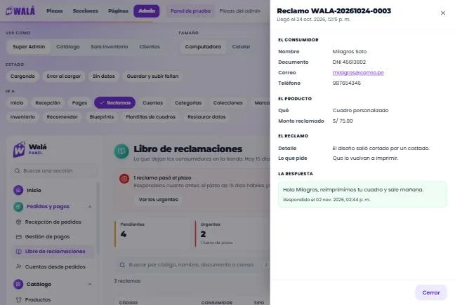 |

| Parte | Componente | Archivo | Qué tiene |
|---|---|---|---|
| Cuentas desde pedidos (borrada el 2026-11-03) | `PaginaCuentasDePedidos` | `paginas/admin/Cuentas.jsx` | Cuatro `PasoAdmin`, **uno a la vez**: 1 cargar pedidos (cuántos y cuántos con correo; "Cargar 100 más" si hay), 2 crear las cuentas que faltan (pregunta antes; cómo va, "Creando cuentas… 45 de 129"; creadas, ya existían, errores y "Ver los errores"), 3 simular la migración (sin cambios) y 4 migrar de verdad (pregunta). La simulación y la de verdad quedan las dos a la vista para compararlas |
| Libro de reclamaciones | `PaginaReclamos` | `paginas/admin/Reclamos.jsx` | Las cifras que filtran (pendientes, **urgentes**: 3 días hábiles o menos o fuera de plazo, respondidos, total); un aviso si alguno pasó el plazo; buscar por código, nombre, documento, correo o pedido; estado y tipo (reclamo o queja); la lista con el **plazo de cada pendiente** ("Quedan 9 días hábiles", "Pasó el plazo hace 2 días hábiles"), los que menos plazo tienen arriba. Tocar uno abre la hoja con todo (consumidor, menor de edad y apoderado, el producto o servicio, el detalle, lo que pide) y la respuesta; uno respondido se abre solo para mirar |
| Un paso | `PasoAdmin` (D2d) | `piezas/admin/Pasos.jsx` | Ahora también termina **a medias**: `{ texto, aviso: true }` sale en ámbar y el sello no se pone verde (el paso 2 cuando hubo errores) |
| La hoja | `HojaEdicion` (D0) | `piezas/admin/Formularios.jsx` | Sin `onGuardar` es solo para mirar: el pie dice "Cerrar" |

Adaptadores (con pruebas): `reclamoDesdeFirestore`, `respuestaDeReclamo`
(lo mismo que se guardaba: `estado`, `respuestaProveedor`, `respondidoEn`),
`diasHabilesEntre` (lunes a viernes; **los feriados no se descuentan**),
`plazoDeReclamo`, `textoDeReclamo` y `filasMigracion`.

### Diferencias a propósito (D3c)

- **El plazo a la vista**: cada pendiente dice cuántos días hábiles le
  quedan de los 15 (`config/empresa.js`), los urgentes van arriba y hay un
  aviso si alguno ya pasó. Antes solo se contaban los pendientes.
- Responder va en la hoja, con todo el reclamo a la vista; sin texto el
  botón está apagado (antes, `alert()`). Al responder, dice que ya no se
  puede cambiar.
- En Cuentas, el paso 3 de antes (dos botones: simular y migrar) son ahora
  los pasos 3 y 4; crear cuentas también pregunta antes (antes, solo la
  migración); un paso a la vez (antes se podía cargar mientras se creaban).
- "Terminó con 2 errores" sale en ámbar, no como si todo hubiera ido bien.

### Qué se probó (2026-11-02, demo en localhost, 1280 px y 375 px)

- Libro: 7 reclamos de ejemplo con fechas desde hoy → 5 pendientes, 2
  urgentes (1 fuera de plazo, con su aviso), 2 respondidos. "Ver los
  urgentes" → 2; otra vez la cifra → 7; respondidos → 3 después de
  responder uno. Abrir un pendiente: "Quedan 9 días hábiles", el botón
  apagado hasta escribir; responder → se cierra y pasa a respondidos. Un
  respondido se abre con la respuesta en verde y solo "Cerrar".
- Cuentas: cargar → 100 · 68; "Cargar 100 más" → 200 · 129; mientras corre
  un paso, los demás esperan; crear → la pregunta, el avance y 52 · 75 · 2
  con los dos errores; simular y migrar → las dos tablas a la vez; con
  "Guardar y subir fallan", el paso 1 muestra el error del ERP.
- A 375 px nada se sale del ancho; la hoja del reclamo ocupa la pantalla y
  los datos van en una columna. Sin errores en la consola.

### Cómo se une D3c

- `CuentasDePedidosDelPanel.jsx`: guarda los pedidos y el `lastDoc` como hoy;
  `onCargar({ mas })` → `getPedidosForAccountSync(100, mas ? lastDoc : null)`;
  `cargados`, `unicos` (los de correo válido, uno por correo, con
  `extraerDatosClienteDesdePedido`), `hayMas={Boolean(lastDoc)}`;
  `onCrearCuentas(avisar)` → el mismo recorrido de a 15 con 400 ms entre
  tandas y `ensureAccountFromOrderData(pedido, { linkOrderId: true })`,
  llamando a `avisar('Creando cuentas… N de M')`; devuelve
  `{ creadas, existian, errores, detalles }`; `onMigrar({ simulacion })` →
  `migrateLegacyAutoCreatedUsers({ maxPedidos: 5000, dryRun: simulacion })`
  (si trae `error`, lanzarlo).
- `ReclamosDelPanel.jsx`: `getCollection('libro_reclamaciones', [], { field: 'createdAt', direction: 'desc' })`
  → `reclamoDesdeFirestore`; `plazo={empresa.plazoRespuestaDiasHabiles}`;
  `onResponder(id, datos)` → `updateDocument('libro_reclamaciones', id, datos)`
  y volver a leer. Cuando se retome el correo del libro (LEGALES.md paso 3),
  el aviso al consumidor sale de esa escritura, no de la pantalla.
- Las rutas siguen siendo `/admin/crear-cuentas-pedidos` y
  `/admin/libro-reclamaciones`.

### D3 unido al admin (2026-11-03)

Las cuatro pantallas a la vez con `adminPedidosViejo`
(`useLoViejo('adminPedidos')`), cada conector en
`components/panel/PedidosDelPanel.jsx`: `RecepcionDelPanel` (por
`DashRecepcion.jsx`), `PagosDelPanel` (por `AdminGestionPagos.jsx`),
`CuentasDePedidosDelPanel` (por `AdminCrearCuentasPedidos.jsx`) y
`ReclamosDelPanel` (por `AdminLibroReclamaciones.jsx`). Las de antes, en
`…Viejo.jsx`. Responder un reclamo también refresca la cuenta del inicio.
"Ver detalle" de un pedido sigue abriendo la ficha del cliente
(`/cuenta/pedidos/:id`), como antes.

**Qué se probó** (localhost con los emuladores): las cuatro abren sin
errores; un reclamo sembrado → "Marcar como respondido" → el documento con
`estado: 'respondido'`, `respuestaProveedor` y `respondidoEn` (texto ISO),
como antes; nuevo enlace de S/ 25.50 → el documento en `enlaces_pago` con
`concepto`, `moneda`, `monto`, `montoPEN` y `estado: 'pendiente'`, y sale en
el historial; Ajustes → `messages/yape_number` y las demás claves de antes;
con `adminPedidosViejo` vuelve el libro de antes. En el emulador no hay
pedidos del ERP: Recepción y Cuentas desde pedidos se vieron vacías (crear
cuentas y migrar no se probaron). **Ojo**: el monto del enlace es un campo
numérico; escrito con coma ("25,5") el navegador lo deja vacío y no se
genera (ya pasaba con la página de antes).

## D4 · Resultados (en el kit desde el 2026-11-02: los cuatro tramos)

Seis pestañas de hoy (1.660 líneas en `pages/admin/resultados/`) y cuatro
pantallas técnicas en `dashboard/` (otras 2.000). Se hace por tramos; el
apartado se une entero cuando estén los cuatro (ya están: falta unirlo).

| Tramo | Qué | Páginas de hoy | Kit |
|---|---|---|---|
| D4a | El marco (periodo, comparar, actualizar y las pestañas) y el Resumen: cifras con su cambio, la comparativa, cosas por mejorar, visitas por día, de dónde vienen, quién está ahora y los enlaces rotos | `ResultadosLayout.jsx`, `Resumen.jsx`, `piezas.jsx`, `dashboard/EnlacesRotos.jsx` | hecho (2026-11-02) |
| D4b | Productos y Visitantes (rankings con fotos y barras, búsquedas, canales, aparatos) | `Productos.jsx`, `Visitantes.jsx` | hecho (2026-11-02) |
| D4c | Clientes con su ficha, el contacto de un carrito y Opiniones (el selector; las dos encuestas, en D5) | `Clientes.jsx`, `FichaCliente.jsx`, `ContactoCarrito.jsx`, `Opiniones.jsx` | hecho (2026-11-02) |
| D4d | Detalle técnico y sus pantallas (mapa de calor, páginas, uso, navegador; el visor del mapa sigue siendo `HeatmapViewer`) | `DetalleTecnico.jsx`, `dashboard/DashHeatmap`, `DashPaginas`, `DashUso`, `DashOrigen`, `dashShared` | hecho (2026-11-02) |

### D4a: el marco y el Resumen (en el kit desde el 2026-11-02)

| Computadora | Celular |
|---|---|
| 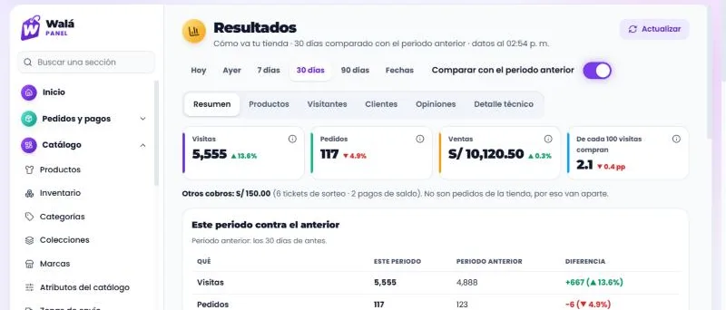 | 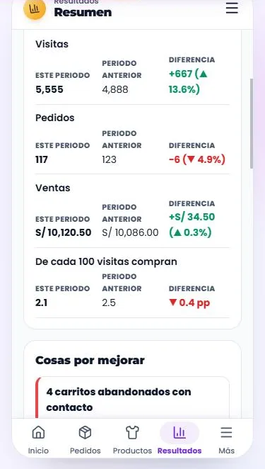 |

| Parte | Componente | Archivo | Qué tiene |
|---|---|---|---|
| El marco | `MarcoResultados` | `paginas/admin/Resultados.jsx` | Cabecera "Resultados" con "Cómo va tu tienda · 30 días comparado con el periodo anterior · datos al 14:52" y Actualizar; el periodo; las pestañas (ya filtradas por permiso: Clientes y Opiniones solo con `manage_clients`); la pestaña va adentro (`children`) |
| El periodo | `SelectorPeriodo` | `piezas/admin/Metricas.jsx` | Hoy, Ayer, 7, 30, 90 días y Fechas (dos `CampoFecha`, hasta hoy), en botones que se deslizan en el celular, y el interruptor "Comparar con…" |
| El Resumen | `PaginaResumenResultados` | `paginas/admin/Resultados.jsx` | Las cuatro cifras (visitas, pedidos, ventas, de cada 100 visitas compran) con su cambio y **su explicación con la "i"**; "Otros cobros" aparte; los avisos de días sin sumar y de "no se puede comparar"; la comparativa; cosas por mejorar; visitas por día (`GraficoTendencia` en líneas); de dónde vienen (los 3 primeros canales; **tocar uno pasa las cifras a ese canal**); ahora en la tienda; los enlaces rotos si hay sin resolver. Esqueleto mientras carga, error y vacío |
| Una cifra | `Cifra` (D3a) | `piezas/admin/Metricas.jsx` | Ahora con `cambio` ("▲ 13.6%" en verde, "▼ 4.9%" en rojo, siempre con su flecha) y `explicacion` (se abre con la "i") |
| Bloques | `BloqueMetrica`, `ColumnasMetricas`, `SinDatos` | `piezas/admin/Metricas.jsx` | La tarjeta con título, ayuda y acciones; dos lado a lado si hay ancho |
| Comparativa | `TablaComparativa` | `piezas/admin/Resultados.jsx` | Qué, este periodo, el anterior y la diferencia; **en el celular, cada fila apilada** con sus rótulos (antes se deslizaba de lado y la diferencia quedaba fuera) |
| Cosas por mejorar | `ListaAvisos` | `piezas/admin/Resultados.jsx` | Cada aviso con su urgencia en texto (Urgente · Importante · Cuando puedas), su rayita de color y la flecha si lleva a otra parte |
| Ahora en la tienda | `ListaEnVivo` | `piezas/admin/Resultados.jsx` | Quién (cliente o visitante), en qué página y desde qué hora |
| Enlaces rotos | `TarjetaEnlacesRotos` | `piezas/admin/Resultados.jsx` | La dirección, visitas, personas, la última vez, de dónde venían; "Crear landing" o "Llevar a…" una que existe, **con pregunta** (antes `window.confirm`); "Ver los N" |

Adaptadores (con pruebas): `cambioPorcentual` y `cambioEnPuntos` (los de
`calcularDelta` y `calcularDeltaPuntos`), `porCienVisitas`,
`cifrasDelResumen` (las cifras, la comparativa y si hay con qué comparar),
`otrosCobrosDe`, `serieDeVisitas` y `PERIODOS_RESULTADOS`. "Cosas por
mejorar" se sigue calculando con `cosasPorMejorar.mjs` en el conector.

### Diferencias a propósito (D4a)

- **La explicación de cada cifra con la "i"** (antes, un `title` que no se
  ve en el celular).
- **Comparar es un interruptor** y el periodo usa los campos de fecha del
  kit; Actualizar va en la cabecera.
- La comparativa **se apila en el celular**; "De dónde vienen" son botones
  con el canal arriba y sus tres números (antes, una tabla con un botón en
  la primera columna).
- Las urgencias de "Cosas por mejorar" se dicen con palabras, no solo con
  el color.
- Redirigir un enlace roto pregunta con `Confirmar`.

### Qué se probó (2026-11-02, demo en localhost, 1280 px y 375 px)

- 30 días de ejemplo con la forma de `useDashboardAnalytics`: 5,555 ▲ 13.6% ·
  117 ▼ 4.9% · S/ 10,120.50 ▲ 0.3% · 2.1 ▼ 0.4 pp, y la comparativa con
  +667, −6, +S/ 34.50 y ▼ 0.4 pp.
- Tocar Instagram → las cifras pasan a 2,278 · 54 · 2.4 sin cambios y el
  aviso "Mostrando solo las visitas de Instagram" con "Ver todas".
- "Hoy" → "hoy comparado con ayer", "Hoy contra ayer", "Hoy va hasta las…"
  y las columnas Hoy / Ayer; "Fechas" abre los dos campos; apagar Comparar
  quita los cambios y la comparativa.
- Enlaces rotos: elegir "Navidad 2026" → la pregunta "¿Llevar /cyber-wala a
  /navidad-2026?" → "Ya lleva a /navidad-2026".
- Cargando (cuatro cifras en hueso), error y sin datos; las pestañas que
  faltan dicen en qué tramo se harán.
- A 375 px nada se sale del ancho. Sin errores en la consola.

### Cómo se une D4a

- `ResultadosDelPanel.jsx` (el marco, en lugar de `ResultadosLayout`):
  `useDashboardFilters(30)` y `useDashboardAnalytics(filtros)` como hoy.
  - `periodo.id`: 'hoy' / 'ayer' si el rango es ese día suelto
    (`diaSuelto`), `'fechas'` si es otro rango propio, si no `rangeDays`;
    `onPeriodo`: hoy y ayer → `setCustomRange(key, key)`, 7/30/90 →
    `setRangeDays(n)`, fechas → abre los campos (`desde`/`hasta` =
    `customStart`/`customEnd`, `onFechas` = `setCustomRange`, `hoy` =
    `limaHoyKey()`).
  - `comparar` / `onComparar` = `filtros.compare` / `setCompare`;
    `datosAl` = `data.actualizadoEnMs || dataUpdatedAt`; `onActualizar` = `refetch`.
  - Las pestañas siguen siendo rutas (`rutas.js`): `pestana` sale de la ruta
    y `onPestana` navega con `filtros.filtersSearch`.
- `ResumenDelPanel.jsx`: `datos`, `anterior`, `comparar`, `periodo`
  (`dia`, `contra`, `anteriorTexto = filtros.prevRangeLabel`), `avisos` =
  `cosasPorMejorar({...})` con `to` = `DESTINOS[destino]` (y el
  `filtersSearch`); `nombrePagina` = `prettyRouteName`; `enlacesRotos` con la
  consulta de hoy (`CLAVE_ENLACES_ROTOS`, `getEnlacesRotos`),
  `crearLandingDe` = `/admin/landing-pages?nueva=…` y `onRedirigir` =
  `redirigirALanding` + invalidar.

### D4b: Productos y Visitantes (en el kit desde el 2026-11-02)

| Productos (computadora) | Quién se quedó mirando (celular) |
|---|---|
| 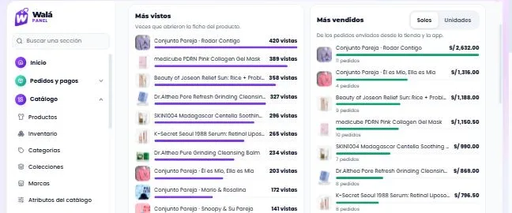 |  |

| Parte | Componente | Archivo | Qué tiene |
|---|---|---|---|
| Productos | `PaginaProductosResultados` | `paginas/admin/Resultados.jsx` | Más vistos y más vendidos (en soles o unidades, con `Pestanas`); "Los que más miran" (tiempo en la ficha y quién se quedó 30 s o más, con "Solo quienes aceptaron WhatsApp"); líneas más vistas y más vendidas; colecciones; lo más buscado; lista de deseos y Crear con sus cifras |
| Visitantes | `PaginaVisitantesResultados` | `paginas/admin/Resultados.jsx` | Cinco cifras (visitas, personas distintas, hicieron algo, páginas y tiempo por visita); canal por canal en `TablaAdmin` (**tarjetas en el celular**); país (o el aproximado, con su nota); con qué entran (aparato y app o web) |
| Un ranking | `ListaBarras` | `piezas/admin/Metricas.jsx` | Nombre, valor y la barra frente al primero, con foto si la fila la trae (o el hueco), una línea debajo; violeta o menta (los colores del gráfico); el nombre largo se corta y **el valor siempre se ve** |
| Quién miró | `ListaInteresados` | `piezas/admin/Resultados.jsx` | El nombre, el producto, cuánto tiempo y cuándo; WhatsApp (`utils/whatsappLink`, con el mensaje de producto visto) o por qué no ("Sin teléfono", "No aceptó WhatsApp") |

Adaptadores (con pruebas): `listasDeProductos` (todas las listas de la
pestaña, con `productoDe` y `nombreCategoria` del conector, y la medida de
los vendidos) y `listasDeVisitantes` (las cifras, los canales con su parte,
el país o el aproximado, aparatos y app o web). Las duraciones usan
`duracionCorta` (D3b).

### Diferencias a propósito (D4b)

- En el celular, "Canal por canal" son tarjetas (antes, una tabla que se
  deslizaba); "Solo quienes aceptaron WhatsApp" es un interruptor.
- En "quién miró", el tiempo y la fecha van en su propia línea: no se
  cortan con un nombre de producto largo.
- Las búsquedas van entre comillas latinas («tomatodo azul»).
- Las pestañas de Resultados también son rutas en la demo
  (`/admin/resultados/productos`…), como en el menú.

### Qué se probó (2026-11-02, demo en localhost, 1280 px y 375 px)

- Con 12 productos reales de la copia de la tienda: más vistos (10), más
  vendidos (8; "Unidades" reordena), los que más miran (6) y 4 personas:
  Valeria con WhatsApp, Diego "No aceptó WhatsApp", Camila "Sin teléfono",
  Luis con su número de España; con el interruptor quedan las 3 que
  aceptaron. Líneas, colecciones, búsquedas, deseos y Crear con sus datos.
- Visitantes: 5,555 · 4,000 · 46% · 3.4 · 2m 22s; los cuatro canales con su
  parte; Perú 90%, España, Chile y "No se sabe"; celular 78%; web 83%.
- El menú de la izquierda ("Productos más vistos") abre esa pestaña y la
  marca. Un nombre de producto largo ya no saca la fila de la tarjeta.
- A 375 px nada se sale del ancho. Sin errores nuevos en la consola.

### Cómo se une D4b

- `ProductosResultadosDelPanel.jsx`: `analitica` del marco (`useOutletContext`);
  `useProducts([], { includeHidden: true })` → `productoDe(id, nombre)` =
  `{ nombre: p.name, imagen: p.mainImage || p.images[0], producto: p }`;
  `getCategories` (`['resultados-categorias']`) → `nombreCategoria`;
  `getPerfilesPorUid(uids)` con los uid de `interes.pares` (los 60 primeros,
  `['resultados-perfiles-interes', uids]`) → `perfiles`, `cargandoPerfiles`.
- `VisitantesDelPanel.jsx`: solo `datos`, `cargando` y `error` del marco.

### D4c: Clientes y Opiniones (en el kit desde el 2026-11-02)

| La ficha de un cliente (computadora) | Su carrito (celular) |
|---|---|
| 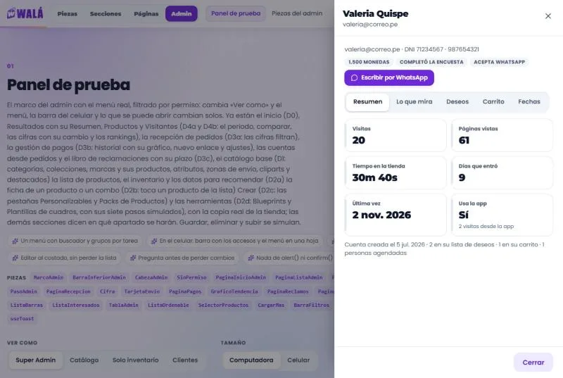 |  |

| Parte | Componente | Archivo | Qué tiene |
|---|---|---|---|
| Clientes | `PaginaClientesResultados` | `paginas/admin/Resultados.jsx` | Tres cifras (carritos abandonados con su valor, cumpleaños en 30 días, usaron la app); los carritos abandonados en `TablaAdmin` (**tarjetas en el celular**) con WhatsApp o por qué no ("Sin cuenta", "Sin teléfono", "No aceptó WhatsApp"); la lista de clientes con buscador (espera a que dejes de escribir), "Ver más clientes" y, si nadie coincide, "¿Falta alguien? Preparar la búsqueda" **con pregunta** (antes `window.confirm`); los próximos cumpleaños con el enlace a Fechas importantes |
| La ficha | `FichaCliente` | `piezas/admin/Clientes.jsx` | **En una hoja al costado** (en el celular, la pantalla entera; antes se abría dentro de la lista): contacto, monedas, encuesta, si acepta WhatsApp y "Escribir por WhatsApp"; pestañas Resumen (seis cifras y la cuenta, el carrito y las compras de antes estimadas), Interés (dónde pasa más tiempo y para recomendarle), Deseos, Carrito y Fechas |
| Cumpleaños | `ListaCumpleanos` | `piezas/admin/Clientes.jsx` | Cuándo ("Hoy", "En 3 días"; los de esta semana resaltados), de quién y si lo agendó otro cliente |
| Opiniones | `PaginaOpinionesResultados` | `paginas/admin/Resultados.jsx` | El selector de encuesta ("Cómo les fue con su pedido" · "Encuesta de regalos") y la encuesta debajo (`children`) |

Adaptadores (con pruebas): `enDiasTexto`, `quienDelCarrito`,
`cumpleanosDe`, `resumenDeFicha` (contacto, chips, cifras y notas) y
`listasDeFicha` (lo que mira, deseos, carrito, personas y su cumpleaños).
**`mensajeCarrito` pasó de `ContactoCarrito.jsx` a `utils/whatsappLink.js`**
(el archivo viejo lo reexporta) para que el kit lo use sin importar la página.

**Decidido (2026-11-02): las dos encuestas no se rehacen en D4.** Son
`AdminEncuestaEntregas` (222 líneas) y `AdminRespuestasEncuesta` (626), que
ya solo se abren dentro de Opiniones; pertenecen a "encuestas" de D5. Hasta
entonces, el conector de Opiniones las pone embebidas (`embebido`, con el
periodo y el anterior como hoy) dentro de `PaginaOpinionesResultados`, y D4
se puede unir entero.

### Diferencias a propósito (D4c)

- La ficha va en una hoja al costado en vez de abrirse dentro de la lista:
  la lista no salta y en el celular es una pantalla.
- "Lo que mira" se llama "Interés" (las cinco pestañas caben mejor en el
  celular); "Lo dejó para después" y "Ya se lo regalaron" van debajo del
  producto, no al costado.
- Preparar la búsqueda pregunta con `Confirmar`.
- Los nombres de todas las `Cifra` usan hasta dos líneas (antes se cortaban
  con puntos suspensivos en el celular).

### Qué se probó (2026-11-02, demo en localhost, 1280 px y 375 px)

- Cifras 4 · S/ 549.10, 4 cumpleaños, 667 en la app. Carritos: Valeria con
  WhatsApp, Diego "No aceptó WhatsApp", un visitante "Sin cuenta", Luis con
  WhatsApp. Cumpleaños de hoy, en 3, 12 y 26 días ("lo agendó Valeria").
- Clientes: 4 → "Ver más clientes" → 6; buscar "luis" → 1; "zzz" → "Nadie
  coincide" → Preparar → la pregunta → "Listo: 812 perfiles revisados, 37
  actualizados".
- La ficha de Valeria: su contacto, 1,500 monedas, "Escribir por WhatsApp";
  Resumen con 20 visitas, 30m 40s y "Usa la app: Sí"; Carrito con "Lo dejó
  para después"; Fechas con su cumpleaños y Andrés (Pareja); solo "Cerrar".
- Opiniones cambia de encuesta. A 375 px nada se sale del ancho (las
  pestañas de la ficha se deslizan, como las de la tienda).

### Cómo se une D4c

- `ClientesResultadosDelPanel.jsx`: `datos` del marco; `getPerfilesPorUid`
  de los uid de `abandonedCarts` (`['admin-carritos-perfiles', uids]`);
  `getDatosPersonalesAggregate({ maxDocs: 800 })` → `cumpleanos`; la lista
  con `useInfiniteQuery(['adminUserInsights', 'users', 25], listUsers)` →
  `clientes`, `hayMas`, `onMas`; `onBuscar(texto)` → `buscarClientes(texto, 25)`
  (`['resultados-buscar-clientes', texto]`; con texto, `clientes` son los
  encontrados); `onPrepararBusqueda` → `httpsCallable('reindexarBusquedaClientes')`.
- La ficha: `onAbrir(cliente)` guarda el uid; `getUserFicha(uid)` →
  `ficha.ficha`; `getUserAnalytics(uid, email)` solo con la pestaña Resumen o
  Interés → `ficha.actividad`; `recomendarSimilares(actividad.productInterest, catálogo, 6)`
  → `ficha.recomendados`; `productoDe` del catálogo.
- `OpinionesDelPanel.jsx`: `PaginaOpinionesResultados` con
  `AdminEncuestaEntregas` o `AdminRespuestasEncuesta` (`embebido`, `desde`/`hasta`
  y `previo` como hoy) de `children`, hasta D5.

### D4d: Detalle técnico y sus pantallas (en el kit desde el 2026-11-02)

| Detalle técnico (computadora) | Navegador y sistema (celular) |
|---|---|
| 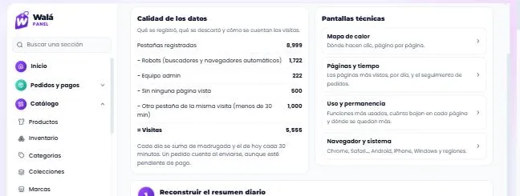 | 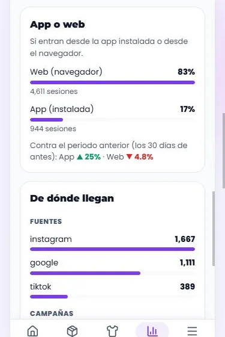 |

| Parte | Componente | Archivo | Qué tiene |
|---|---|---|---|
| Detalle técnico | `PaginaDetalleTecnico` | `paginas/admin/Resultados.jsx` | La calidad de los datos (de las pestañas registradas a las visitas); las cuatro pantallas técnicas con su flecha; **dos `PasoAdmin`**: reconstruir el resumen diario (atajos 30/90 días que eligen las fechas, dos `CampoFecha`, tope 365, de a 10 días con "Reconstruyendo… N de M días", y si un tramo falla dice hasta dónde llegó) y recalcular las compras de antes de medir |
| El marco | `MarcoResultados` (D4a) | `paginas/admin/Resultados.jsx` | **Las pantallas técnicas van en el mismo marco** (antes, cada una con su cabecera y su propio selector de rango): `titulo`, `queHace`, `migas` (Resultados › Detalle técnico › …) y `controles` (el origen en Uso), sin pestañas |
| Páginas y tiempo | `PaginaPaginasTecnica` | `paginas/admin/Tecnico.jsx` | Cuatro cifras (páginas vistas, días con tráfico, ruta líder, búsquedas); páginas vistas por día (todas, app o web); **las páginas más vistas** (antes salían dos veces: en barras y en ranking); búsquedas; los enlaces rotos (`TarjetaEnlacesRotos`); el seguimiento de pedidos (visitas al estado, personas distintas, tiempo promedio) |
| Uso y permanencia | `PaginaUsoTecnica` | `paginas/admin/Tecnico.jsx` | El aviso del origen; cuatro cifras por origen (sesiones, páginas vistas, scroll medio, tiempo por sesión); quién vio más páginas (con cuenta o sin cuenta, y su permanencia) con sus notas honestas; áreas y funciones más usadas; rutas más visitadas y con más tiempo; búsquedas |
| Navegador y sistema | `PaginaNavegadorTecnica` | `paginas/admin/Tecnico.jsx` | Cuatro cifras (en vivo, muestras, fuente y región líderes); aparatos, navegador y sistema **en barras con su parte** (antes, tres donas); país confiable y el aproximado por la hora, con los días sin dato; app o web con su cambio contra el periodo anterior; fuentes, campañas y regiones; ahora en la tienda; búsquedas |
| Mapa de calor | `PaginaMapaDeCalor` | `paginas/admin/Tecnico.jsx` | Los filtros (origen, diseño de la página, aparato; sin "Computadora" con la app), cuántos clics y lotes, el aviso de demasiados lotes y el de clics sin origen con "Incluirlos" / "Dejarlos fuera"; **el visor va de `children`** |

Adaptadores (con pruebas): `ultimosDias`, `diasEntreClaves`, `tramosDeDias`,
`ayudaDeRango`, `MAX_DIAS_RECONSTRUIR`, `filasDeCalidad`, `segunOrigen` (el
`segTAW` de antes), `traficoPorDia`, `seguimientoDePedidos` (con el respaldo
sobre `/cuenta/pedidos`), `listasDePaginas`, `claveAnonimaCorta`,
`listasDeUso`, `nombreDePais` y `listasDeNavegador`.

**Decidido (2026-11-02): `HeatmapViewer` no se rehace en el kit.** Son 1.580
líneas de herramienta, no de pantalla: carga la página real de la tienda en
un iframe con la sesión del admin, mide dónde quedó cada botón, dibuja el
calor en dos canvas y ubica cada clic por su sección, su selector o su
texto. Funciona y no tiene nada de la interfaz vieja del admin que cambiar.
El kit pone su marco (filtros, avisos); el visor va en el hueco tal cual.

### Diferencias a propósito (D4d)

- Las cuatro pantallas van **dentro del marco de Resultados**: el mismo
  periodo (con Hoy y Ayer), comparar y actualizar; las migas llevan de
  vuelta a Detalle técnico.
- "Páginas y tiempo" ya no repite las rutas en dos tarjetas.
- **Barras en vez de donas** para aparatos, navegador, sistema y app o web:
  con más de tres partes se comparan mejor (dataviz).
- En Navegador ya no hay filtro de origen: antes estaba pero no filtraba
  nada (la nota lo decía). App o web tiene su propia tarjeta.
- "Reconstruir": los atajos eligen el rango y hay que tocar Reconstruir
  (antes arrancaban solos con 30 o 90 días).
- Sin emojis en las cifras (👁️📅🏆🔎📦👤⏱️👥📄📜🟢🖥️🌐📍💡⚠️).

### Qué se probó (2026-11-02, demo en localhost, 1280 px y 375 px)

- Detalle técnico: 8,999 − 1,722 − 222 − 500 − 1,000 = 5,555 visitas; los
  cuatro enlaces abren sus pantallas; "Últimos 90 días" → "Se reconstruirán
  90 días"; reconstruir 30 → "Reconstruyendo… 10 de 30 días" → "Listo. Días
  procesados: 30 · correctos: 30."; con falla, "Quedaron reconstruidos 0 de
  30 días (hasta antes del …)".
- Páginas: título, migas y cifras; "App" → "Páginas vistas · App".
- Uso: en "App" sale el aviso y las cifras pasan al corte de la app; quién
  vio más con "Visitante anónimo (anon_7f3a91)".
- Navegador: "App ▲ 25% · Web ▼ 4.8%" contra el periodo anterior y "No hay
  país antes del 07/10/2026: 3 días del rango no lo incluyen".
- Mapa de calor: con "App" se va "Computadora"; el aviso de clics sin origen
  cambia con "Dejarlos fuera".
- A 375 px nada se sale del ancho. Sin errores de carga.

### Cómo se une D4d

- `DetalleTecnicoDelPanel.jsx`: `datos` del marco; `rutaDe(id)` =
  `/admin/resultados/tecnico/${id}` con el `filtersSearch`;
  `onReconstruirTramo(tramo)` → `httpsCallable(getFunctions(), 'aggregateAnalyticsDailyBackfill', { timeout: 540000 })(tramo)`
  → `res.data` (`{ processed, ok }`); `onRecalcular` →
  `rebuildHistoricalAnalyticsSummary()` (si trae error, lanzarlo) e invalidar
  `['admin-analytics-user-detail']`.
- Las cuatro rutas técnicas pasan a ser hijas del marco de Resultados
  (`<Route path="tecnico/mapa-de-calor" …>` dentro de `resultados`), con
  `titulo`, `queHace` y `migas`, y sin pestañas.
- `PaginasTecnicaDelPanel.jsx`: `useGlobalAnalytics(filtros.dateRange)` →
  `datos`; `nombrePagina` = `prettyRouteName`, `rutaCorta` = `shortPath`; los
  enlaces rotos como en el Resumen (y Actualizar invalida
  `CLAVE_ENLACES_ROTOS`).
- `UsoTecnicaDelPanel.jsx`: `useDashboardAnalytics(filtros)`; `origen` /
  `setOrigen` en `controles`; `areas` = `deriveAppUsage(topRoutesByViews con
  las vistas por origen)`.
- `NavegadorTecnicaDelPanel.jsx`: `datos`, `anterior`, `comparar` y
  `periodoAnterior = filtros.prevRangeLabel`.
- `MapaDeCalorDelPanel.jsx`: las dos consultas de hoy
  (`['admin-heatmap-paginas-builder']` → `versionesDesdePaginas`,
  `['admin-heatmap-batches', …]` → `fetchHeatmapBatches`),
  `aggregateHeatmapBatches(docs, { origen, ancho, incluirSinMeta, versionesPorRuta, soloDisenoActual })`;
  `anchos` desde `ANCHOS_PANTALLA`; de `children`, `<HeatmapViewer data loading error emptyMessage ancho origen versionesPorRuta soloDisenoActual onCambiarDiseno />`
  como hoy.

### D4 unido al admin (2026-11-03)

Todo Resultados a la vez con `adminResultadosViejo`
(`useLoViejo('adminResultados')`). Cada pantalla vieja pasó a `…Viejo.jsx`
(`ResultadosLayout`, `Resumen`, `Productos`, `Visitantes`, `Clientes`,
`Opiniones`, `DetalleTecnico` y `dashboard/DashPaginas`, `DashUso`,
`DashOrigen`, `DashHeatmap`); el `.jsx` de siempre elige. Los conectores:

| Pantalla | Conector (`components/panel/`) |
|---|---|
| El marco, Resumen, Productos, Visitantes | `ResultadosDelPanel.jsx` (también `useMarcoResultados` y `useEnlacesRotos`, compartidos) |
| Clientes (con la ficha) y Opiniones | `ResultadosClientesDelPanel.jsx` |
| Detalle técnico y sus cuatro pantallas | `ResultadosTecnicoDelPanel.jsx` |

- **El marco** da a las pestañas lo mismo que `ResultadosLayout`
  (`{ filtros, analitica, periodo }` por el Outlet): las de antes también
  funcionan dentro de él. El periodo sigue en la dirección (`?rango=…`).
- **Diferencia con el plan**: las cuatro pantallas técnicas **siguen en sus
  rutas de antes**, fuera del marco de pestañas: cada una arma su cabecera
  con `useMarcoResultados` (sin pestañas, con migas Resultados › Detalle
  técnico). Así el interruptor vuelve a las viejas sin tocar `App.jsx`.
- **Cambios que quedaron** (de los conectores): en Navegador, "Ahora en la
  tienda" dice el nombre de la página (antes la ruta) y ya no tiene el
  filtro de origen que no filtraba nada; el Mapa de calor muestra "datos al"
  y el periodo trae Hoy, Ayer y comparar; en Reconstruir, los atajos de 30 y
  90 días eligen las fechas y hay que tocar Reconstruir (antes arrancaban
  solos); la ficha de un cliente se abre en una hoja.

**Qué se probó** (localhost con los emuladores, sin analítica sembrada): las
seis pestañas y las cuatro pantallas técnicas abren con su título y sin
errores; "7 días" → "últimos 7 días" y "Hoy" → `?rango=custom&desde=…` con
"hoy" en la cabecera; con `adminResultadosViejo` vuelve la pantalla de
Páginas de antes. No se probaron con datos reales (cifras, la ficha de un
cliente, reconstruir, el mapa de calor con clics).

## D5 · Clientes y fidelidad (en el kit desde el 2026-11-02: los cinco tramos)

Siete pantallas de hoy (unas 4.900 líneas con las de Fechas importantes),
en cinco tramos; el apartado se une entero cuando estén los cinco.

| Tramo | Qué | Páginas de hoy | Kit |
|---|---|---|---|
| D5a | Referidos (seguimiento), Misiones diarias y Retos semanales (catálogo, evidencias, reto activo) | `AdminReferidos.jsx`, `AdminMisiones.jsx`, `AdminRetos.jsx` | hecho (2026-11-02) |
| D5b | Recompensas (el catálogo de canje) | `AdminRecompensas.jsx` (603 líneas) | hecho (2026-11-02) |
| D5c | Fechas importantes: el calendario, los avisos y fechas festivas, las fechas de los clientes y los paquetes | `AdminFechasImportantesPage.jsx` + `components/admin/fechas/*` (1.345 líneas) | hecho (2026-11-02) |
| D5d | Notificaciones y ofertas | `AdminNotifications/AdminNotifications.jsx` (755 líneas) | hecho (2026-11-02) |
| D5e | Encuestas: el editor de la de suscripción y las dos pantallas de respuestas que hoy van embebidas en Opiniones (D4c) | `AdminEncuestas.jsx`, `AdminEncuestaEntregas.jsx`, `AdminRespuestasEncuesta.jsx` | hecho (2026-11-02) |

### D5a: Referidos, Misiones y Retos (en el kit desde el 2026-11-02)

| Misiones (computadora) | Evidencias de un reto (celular) |
|---|---|
| 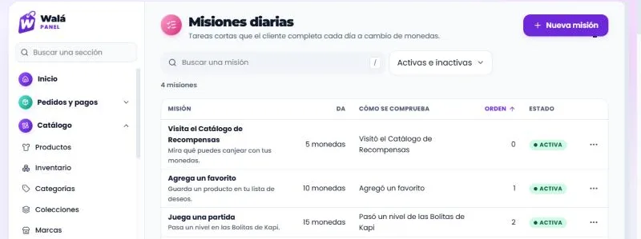 | 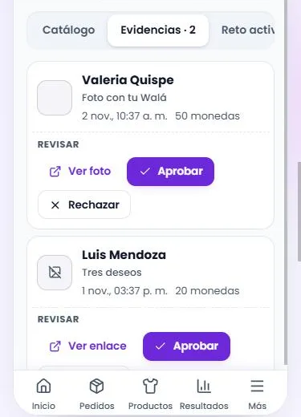 |

| Parte | Componente | Archivo | Qué tiene |
|---|---|---|---|
| Referidos | `PaginaReferidosAdmin` | `paginas/admin/Fidelidad.jsx` | El aviso de que no se aprueba nada; cuatro cifras (enlaces y cuántos los abrieron, compraron, monedas pagadas, **monedas por pagar** estimadas); buscar por código, quién entró o pedido; el filtro de estado; la lista (`TablaAdmin`, tarjetas en el celular) con quién refirió, el enlace, quién entró, el pedido con su venta, las monedas (pagadas o "estimado") y el estado |
| Misiones diarias | `PaginaMisionesAdmin` | `paginas/admin/Fidelidad.jsx` | Sobre `PaginaListaAdmin`: la misión con su descripción, lo que da, **cómo se comprueba** (o "La marca el cliente"), el orden y el estado; la hoja con título, descripción, monedas, orden, la verificación con su aviso (qué pasa sin ella) y Activa |
| Retos semanales | `PaginaRetosAdmin` | `paginas/admin/Fidelidad.jsx` | Tres pestañas: **Catálogo** (sobre `PaginaListaAdmin`; "Es el de esta semana" en el activo; "Activar esta semana" en el menú de cada fila, **con pregunta**), **Evidencias · N** (la foto o el enlace, quién, qué reto, cuándo, lo que da; Aprobar y Rechazar, que pregunta) y **Reto activo** (qué cuenta, lo que da, cuándo empezó y vence, cuántos días quedan) |

Adaptadores (con pruebas): `ESTADOS_REFERIDO`, `referidoDesdeFirestore`
(con `estimateReferralReward` del conector), `resumenReferidos`,
`misionDesdeFirestore` / `misionAFirestore`, `RECOMPENSAS_RETO`,
`recompensaDeReto`, `retoDesdeFirestore` / `retoAFirestore`,
`retoActivoDesde` (`globals/activeChallenge` por siete días, como antes) y
`evidenciaDesde`. Las tres páginas llevan "Admin" al final del nombre: el kit
ya tiene `PaginaReferidos` y `PaginaMisiones` del cliente.

### Diferencias a propósito (D5a)

- Referidos: **cifras arriba** (antes, solo la tabla), buscar y filtrar por
  estado, de a 50; en el celular, tarjetas.
- Misiones: la lista y la hoja al costado (antes el formulario fijo a la
  izquierda y la lista partida en activas e inactivas; ahora un filtro).
- Retos: el formulario va en la hoja; activar, aprobar y rechazar avisan con
  toasts y preguntan con `Confirmar` (antes `window.confirm` y `alert()`);
  "Quedan N días" en el reto activo. Sin emojis en los botones (✏️🗑️🚀✅❌).
- Las monedas se dicen con su palabra ("20 monedas"), no con el ícono solo.

### Qué se probó (2026-11-02, demo en localhost, 1280 px y 375 px)

- Referidos: 7 · 4 · 26 pagadas · 24 por pagar (el que no califica no
  cuenta); "Invitación", "Enlace anterior", "Producto …"; el estimado de
  Kevin (20, por invitación).
- Misiones: crear vacía → "Escribe el título de la misión"; con título →
  creada; sin verificación, el aviso de auto-reporte.
- Retos: "Activar esta semana" → la pregunta → "Es el de esta semana" pasa a
  ese reto y Reto activo dice "Quedan 7 días"; rechazar pregunta; aprobar y
  rechazar vacían la lista ("Nada por revisar").
- A 375 px nada se sale del ancho. Sin errores de carga.

### Cómo se une D5a

- `ReferidosDelPanel.jsx`: `getDocs(query(collection(db, 'referrals'), orderBy('createdAt', 'desc')))`
  (`['adminReferrals']`) → `referidoDesdeFirestore(doc, estimateReferralReward)`.
- `MisionesDelPanel.jsx`: `getMissions` (`['admin-missions']`) →
  `misionDesdeFirestore`; guardar `createMission` / `updateMission` con
  `misionAFirestore`; eliminar `deleteMission`; `verificaciones` desde
  `MISSION_ACTIONS` (`{ valor: clave, texto: adminLabel }`).
- `RetosDelPanel.jsx`: `getCollection('weeklyChallenges')`,
  `getDocument('globals', 'activeChallenge')`,
  `getCollection('challengeEvidences', [status == 'pending'])`; guardar
  `createDocument` / `updateDocument` con `retoAFirestore`; `onActivar` →
  `setDocument('globals', 'activeChallenge', retoActivoDesde(reto))`;
  `onAprobar` / `onRechazar` → `httpsCallable('approveChallengeEvidence')({ evidenceId, action, rewardCoins, rewardType })`
  y volver a leer.

### D5b: Recompensas (en el kit desde el 2026-11-02)

| La lista (computadora) | La hoja de una recompensa (celular) |
|---|---|
| 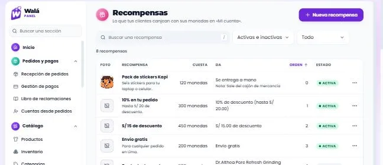 | 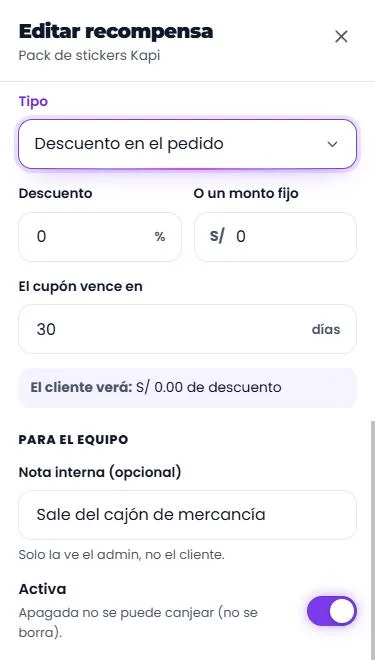 |

| Parte | Componente | Archivo | Qué tiene |
|---|---|---|---|
| Recompensas | `PaginaRecompensasAdmin` | `paginas/admin/Fidelidad.jsx` | Sobre `PaginaListaAdmin`: la foto, la recompensa, **"Cuesta 120 monedas"** (con su palabra), qué da (el texto que ve el cliente, o "Se entrega a mano" con su nota), el orden y el estado; filtros por estado y por qué da. La hoja: título, descripción, imagen (`CampoImagen` con recorte cuadrado), cuánto cuesta, orden, el tipo; según el tipo, **el producto** (`SelectorProductos`, "Elegir este"), el descuento en % con su tope o un monto fijo, cuándo vence el cupón y **"El cliente verá: …"**; la nota interna y Activa |

Adaptadores (con pruebas): `TIPOS_RECOMPENSA`, `RECOMPENSA_CON_PRODUCTO`,
`RECOMPENSA_CON_VIGENCIA`, `beneficioDeRecompensa` (el `textoPremio` de
`utils/ruletaModel` para estos tipos), `recompensaAdminDesdeFirestore` /
`recompensaAdminAFirestore` (con "Admin": el kit ya tiene
`recompensaDesdeFirestore` del catálogo del cliente) y `erroresDeRecompensa`.

### Diferencias a propósito (D5b)

- "Cuesta 120 monedas" en vez de "120 pts" (la regla de las monedas: lo
  que cuesta se dice con su palabra).
- La lista y la hoja al costado (antes, formulario fijo y la lista partida
  en activas e inactivas); filtro por qué da.
- El producto se elige con `SelectorProductos` (antes, `BuscadorProducto`) y
  el porcentaje no puede pasar de 100.
- **`TablaAdmin` corregido para todo el admin**: con foto y estado, la
  tarjeta del celular se estiraba al contenido y se salía del ancho; ahora la
  lista y los textos tienen `minmax(0, 1fr)`.

### Qué se probó (2026-11-02, demo en localhost, 1280 px y 375 px)

- Cinco recompensas: a mano con nota, 10% con tope S/ 20, S/ 15 fijos, envío
  gratis y un producto gratis inactivo; cada una dice lo que da.
- Nueva → "Producto gratis" sin producto → "Elige el producto de la
  recompensa"; buscar "conjunto" → "Elegir este" → "El cliente verá:
  Conjunto Pareja · Rodar Contigo gratis" → creada.
- En el celular, la hoja con "Descuento en el pedido": el porcentaje, "O un
  monto fijo", "El cupón vence en 30 días". La lista ya no se sale del ancho
  (y tampoco Productos, Categorías, Referidos, Misiones ni Cuentas).

### Cómo se une D5b

- `RecompensasDelPanel.jsx`: `getRewards` (`['admin-rewards']`) →
  `recompensaAdminDesdeFirestore`; guardar `createReward` / `updateReward`
  con `recompensaAdminAFirestore`; eliminar `deleteReward`; invalidar
  `['admin-rewards']` y `['rewards']`; `productos` del catálogo
  (`productoAdminDesde`); `subirImagen` → `uploadFile(blob, 'rewards/{ms}_cropped.jpg')`.

### D5c: Fechas importantes (en el kit desde el 2026-11-02)

| Fechas de clientes (computadora) | El calendario (celular) |
|---|---|
| 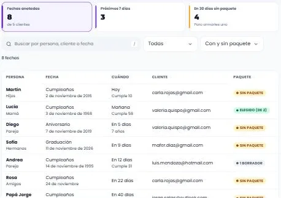 | 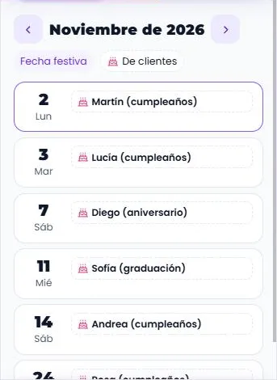 |

| Parte | Componente | Archivo | Qué tiene |
|---|---|---|---|
| Fechas importantes | `PaginaFechasAdmin` | `paginas/admin/Fechas.jsx` | Tres pestañas (Calendario · Festivas · Clientes) con la misma cabecera |
| Calendario | (dentro) | ídem | El mes con lunes primero, el día de hoy marcado, las fechas festivas activas y **las fechas de los clientes** (antes no salían); anterior, siguiente y "Hoy". Con menos de 640 px de caja, la rejilla pasa a una **agenda** (solo los días con algo). Tocar una fecha lleva a su pestaña |
| Festivas | (dentro, sobre `PaginaListaAdmin`) | ídem | Arriba, los avisos de las fechas de cada persona (los días, "El cliente verá: «Te avisamos…»", Guardar y "Enviarme una prueba") y la vista previa de la notificación. La lista: la fecha y su regla, la próxima vez y cuánto falta, a quién le toca, los avisos y el estado; en "⋯", probar y apagar o encender. La hoja: emoji y nombre, cómo cae (`ElegirUno`) con "cae el … y el …", la relación (chips) y el género, los días de aviso con su texto, avisar a todos y Activa. "Fechas de Perú" pregunta antes (`Confirmar`) |
| Clientes | (dentro) | ídem | Tres cifras que filtran (anotadas, próximos 7 días, en 30 días sin paquete), buscar y filtrar por cuándo y por paquete; **una fila por fecha**, la más cercana primero, con cuánto falta, los años que cumple y el estado del paquete. La hoja de una fecha: el cliente, la relación, sus gustos y sus paquetes (elegido o borrador, los productos y el total; elegir, editar, usar de base, eliminar). El paquete se arma en la misma hoja: "Sugerir con sus gustos", quitar productos, `SelectorProductos` y el total |

Adaptadores (con pruebas): `semanasDelMes`, `mesVecino`, `fechaClienteDesde`
(la próxima vez que se celebra, un 29 de febrero cae el 28; los años que
cumple), `cuandoFecha`, `FILTROS_FECHAS_CLIENTES` / `fechaEnVentana`,
`paqueteDesdeFirestore` / `paqueteAFirestore`, `paquetesDeFecha`,
`cambiosAlElegir`, `siguienteElegido`, `estadoDePaquetes`, `diasDesdeTexto` e
`idDeFestiva`. Las reglas de cuándo cae una fecha festiva no se copiaron: la
página usa `utils/fechasFestivas.mjs`, la misma que el servidor
(`adaptadoresAdmin.js` sigue sin imports para probarse solo).

### Diferencias a propósito (D5c)

- Pestañas en vez del menú lateral de la página (en el celular el menú
  lateral se comía la pantalla).
- El calendario muestra también las fechas de los clientes, y en el celular
  es una agenda.
- Las fechas de los clientes van **una por fila, por cercanía**, no
  agrupadas por correo con filas que se abren: lo urgente queda arriba. Cada
  fila dice si tiene paquete; "En 30 días sin paquete" junta lo que falta
  armar.
- El paquete se arma en la hoja de la fecha (antes, un modal aparte con dos
  pasos); los botones de solo ícono pasan a tener texto ("Elegir este",
  "Usar de base").
- Se pregunta antes de borrar con `Confirmar` (antes `window.confirm`) y los
  errores salen como aviso, no en la consola.
- Sin paginación con selector: "Cargar más" de 50 en 50.

### Qué se probó (2026-11-02, demo en localhost, 1280 px y 375 px)

- Calendario de noviembre con Black Friday (4.º viernes) y seis personas;
  hoy marcado; en el celular, la agenda con "hoy".
- Nueva fecha sin nombre → "Escribe el nombre de la fecha"; "Día del Abuelo",
  "Cambia cada año", Padres → creada: "2.º domingo de enero · 10 de enero ·
  En 69 días · Padres · 7 y 2 días antes".
- Avisos personales "3, 0" → "Te avisamos 3 días antes y el mismo día" y
  guardado; "Enviarme una prueba" → la vista previa con su texto de dónde
  llegó.
- Clientes: Lucía (mañana, cumple 58, elegido de 2): "Elegir este" en el
  segundo → cambia el elegido; eliminar el elegido → el otro pasa a elegido.
  Diego (aniversario, "7 años"): "Crear paquete" → "Sugerir con sus gustos" →
  creado y elegido por ser el primero.
- 375 px: las tres pestañas, la lista, la hoja y el editor de paquete sin
  salirse del ancho.

### Cómo se une D5c

- `FechasDelPanel.jsx`, por pestaña (`/admin/fechas-importantes?ver=…`):
  - Festivas: `getFechasFestivas` (`['admin-fechas-festivas']`; si falla,
    no se deja editar) → `onGuardarFestivas` = `saveFechasFestivas(lista)` e
    invalidar `FESTIVAS_QUERY_KEY`; `getRecordatorioPersonal` /
    `saveRecordatorioPersonal` e invalidar `RECORDATORIO_QUERY_KEY`;
    `onProbarAviso` = `probarAvisoFechas(id)` → `{ titulo, cuerpo, imagen: image, tieneApp, push }`.
  - Clientes: `getUserDates` → `fechaClienteDesde(f, hoyLocal())`;
    `getSuggestedPackages` → `paqueteDesdeFirestore`; crear con
    `saveSuggestedPackage(paqueteAFirestore(productos, fecha, primero))`,
    editar con `updateSuggestedPackage(id, { products })`, elegir con
    `cambiosAlElegir` (un `updateSuggestedPackage` por cambio), eliminar con
    `deleteSuggestedPackage` y `siguienteElegido`.
  - `productos` del catálogo (`productoAdminDesde`); `sugerirProductos` =
    `useGiftCatalog().recomendar(persona, { ocasion: evento, limite: 3 })`
    con la persona armada como en `PackageCreatorModal`.

### D5d: Notificaciones y ofertas (en el kit desde el 2026-11-02)

| Ofertas (computadora) | Un aviso con dos textos (celular) |
|---|---|
| 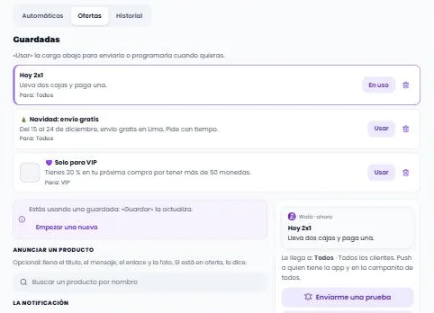 |  |

| Parte | Componente | Archivo | Qué tiene |
|---|---|---|---|
| Notificaciones | `PaginaNotificacionesAdmin` | `paginas/admin/Notificaciones.jsx` | Tres pestañas (Automáticos · Ofertas · Historial); "Nueva oferta" arriba. La oferta a medio escribir se queda al cambiar de pestaña |
| Automáticos | (dentro) | ídem | Cada categoría con su interruptor, qué hace y su horario (Desde/Hasta; avisa si termina antes de empezar). Los textos por grupo (un grupo apagado lo dice): mensaje con "+ Nombre", "+ Monedas" (y "+ Producto"), frase final, emoji y la vista previa como llega al celular; "Probar un segundo texto" (A/B) y "Enviarme una prueba" en las encuestas. **Guardar aparece solo con cambios**, en una barra fija con "Descartar" |
| Ofertas | (dentro) | ídem | Las guardadas (usar o borrar con `Confirmar`), "Anunciar un producto" (`SelectorProductos`: llena título, mensaje, enlace y foto; si está en oferta lo dice), título, mensaje, enlace, imagen (`CampoImagen`: subir o pegar un enlace), a quién le llega y cuándo: ahora o un día (`CampoFecha`) y una hora en punto, con aviso si cae fuera del horario de ofertas. Al costado, la vista previa y los tres botones. **Enviar siempre pregunta antes**; si el horario de ofertas no la deja salir, pregunta "¿Enviarla igual?" |
| Historial | (dentro) | ídem | "¿Qué texto funciona mejor?" (`TablaAdmin`: abiertos de enviados por texto y cuál gana; con 50 envíos por texto), y las ofertas enviadas y programadas con su foto, cuándo, para quién, a cuántos llegó, abiertas y el estado; en "⋯", volver a usar y cancelar el envío (`Confirmar`) |

Adaptadores (con pruebas): `CATEGORIAS_NOTIF`, `GRUPOS_AVISOS`,
`configNotificacionesDesde` / `configNotificacionesAFirestore` (mezcla con los
valores de siempre, como antes, con las claves del motor), `vistaPreviaAviso`,
`conDato`, `SEGMENTOS_NOTIF`, `ESTADOS_CAMPANA`, `tasaTexto`, `campanaDesde`,
`ofertaAFirestore`, `ofertaDeProducto`, `programadaIso`, `erroresDeOferta` (la
hora programada no puede haber pasado), `NOMBRES_AVISO` y `filaDeEstadistica`.

### Diferencias a propósito (D5d)

- "Enviar ahora" pregunta antes, con a quién le llega y "No se puede
  deshacer" (antes salía con un clic); los `window.confirm` pasan a
  `Confirmar`.
- La hora programada va en punto (el motor corre cada hora en punto) y no
  puede ser una que ya pasó; si cae fuera del horario de ofertas, lo dice
  antes de enviar.
- La imagen se sube o se pega (antes solo una URL escrita a mano).
- Los estados y la comparación con texto y color (antes emojis "✅ 🕒 🏆").
- Guardar los automáticos aparece solo con cambios, y se puede descartar.
- La opción de cuándo dice "Ahora" / "Un día y hora": con "Enviar ahora" en
  la opción y en el botón, el clic iba a la opción.

### Qué se probó (2026-11-02, demo en localhost, 1280 px y 375 px)

- Automáticos: encender "Kapi te extraña" → aparece la barra; "+ Nombre" en
  el carrito de 1 h → "Tu regalo te está esperando. María ¿Terminamos? 📦";
  el de 24 h con sus dos textos; guardar → "Configuración guardada".
- Ofertas: enviar vacía → los errores; buscar "casaca" → "Anunciar este" →
  "🔥 Oferta: … Ahora a S/ 109 (antes S/ 119)"; enviar → la pregunta →
  "Oferta enviada: 380 por push y 1,790 en la campanita".
- Con el horario de ofertas desde las 17:00 (a las 16:00): "¿Enviarla
  igual?"; programar sin día → "Elige el día y la hora del envío" y el aviso
  de fuera de horario; "Guardar para después" → arriba como "En uso".
- Historial: la comparación (Carrito 24 h: gana el texto 2; Encuesta: faltan
  envíos) y cancelar la programada → "Cancelada".
- 375 px: las tres pestañas sin salirse del ancho.

### Cómo se une D5d

- `NotificacionesDelPanel.jsx`:
  - `getDoc(notification_settings/global)` → `configNotificacionesDesde`
    (si falla, la pestaña no deja guardar); guardar con
    `setDoc(…, { ...docLeido, ...configNotificacionesAFirestore(c) })` para
    no perder otros campos.
  - `onProbarAutomatico` = `probarAvisoAutomatico({ type, copy })` (con
    `copy` en las claves del motor: `{ text, emoji, cta }`).
  - Guardadas: `notification_drafts` (orden `updatedAt`, 50) →
    `campanaDesde`; guardar `addDoc` / `setDoc(merge)` con
    `ofertaAFirestore` + `createdAt` (al crear) y `updatedAt` **como texto
    ISO**, igual que AdminNotifications: con un Timestamp, `orderBy('updatedAt')`
    las manda después de las viejas y quedan fuera de las 50; borrar `deleteDoc`.
  - `onProbarOferta` = `sendManualPromoNotification({ ...ofertaAFirestore(d), prueba: true })`;
    `onEnviarOferta` = la misma con `scheduledAt` y `forzar`; el error trae
    `details.motivo`.
  - Historial: `notification_campaigns` (orden `createdAt`, 50) →
    `campanaDesde`; `notification_stats` crudo; cancelar con
    `cancelPromoCampaign({ campaignId })`.
  - `subirImagen` → `uploadFile(blob, 'notifications/{ms}.jpg')`.

### D5e: Encuestas (en el kit desde el 2026-11-02)

| Las respuestas de la encuesta de regalos, dentro de Opiniones (computadora) | Una pregunta en el editor (celular) |
|---|---|
| 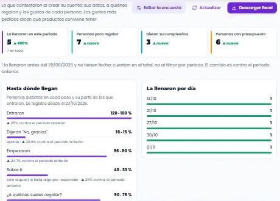 | 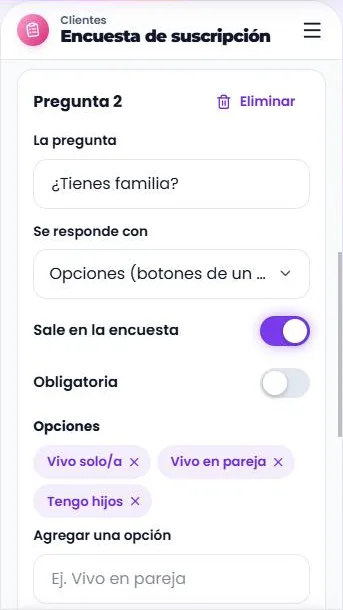 |

| Parte | Componente | Archivo | Qué tiene |
|---|---|---|---|
| El editor | `PaginaEncuestaAdmin` | `paginas/admin/Encuestas.jsx` | `/admin/encuestas`, en cuatro pestañas: **Inicio** (títulos, el mensaje y los dos botones), **Sobre ti** (sus preguntas), **Gustos** (el presupuesto y el Conjunto familia, el paso y cada interés con sus categorías de la tienda como chips y sus preguntas) y **Final** (el agradecimiento, la pregunta de WhatsApp y el color, con una muestra). Cada pregunta: el texto, cómo se responde, «Sale en la encuesta», «Obligatoria», «Busca productos por sí sola» (en un interés) y **las opciones como chips** que se quitan, con un campo para sumar otra. Las que ya no salen, plegadas abajo (según lo guardado). Eliminar pregunta o interés pregunta antes (`Confirmar`). `BarraGuardar` aparece solo con cambios |
| Cómo les fue con su pedido | `RespuestasEntregas` | ídem | Dentro de Opiniones, con el periodo de Resultados: respuestas, promedio y «4 o 5 estrellas» con su cambio; las estrellas y «¿Qué podemos mejorar?» (`ListaBarras`), los comentarios con «Cargar más». «Editar la encuesta» abre una hoja: prendida, monedas (0 a 50) y las opciones como chips |
| La encuesta de regalos | `RespuestasEncuesta` | ídem | Dentro de Opiniones: cuatro cifras con su cambio, hasta dónde llegan (el embudo, con su cambio por paso) y por día o mes; las preguntas en el orden de la encuesta o «Cambios» (las retiradas con **«Volver a preguntarla»**, que pregunta antes, y las que cambiaron de texto); «Por cliente» con buscador y `TablaAdmin` (la ficha en una hoja); «Descargar Excel» |
| Barra de cambios | `BarraGuardar` | `piezas/admin/Formularios.jsx` | Nueva pieza, sacada de Notificaciones (D5d): fija abajo, solo con cambios, con Descartar y Guardar. La usan los avisos automáticos y el editor de la encuesta |

Adaptadores (con pruebas): `TIPOS_PREGUNTA`, `preguntaNueva`,
`separarPreguntas`, `conOpcion`, `OPCIONES_MEJORAR_ENTREGA` /
`entregaPanelDesde` (como `configEntregaPanel`, que vive junto a Firebase),
`cambioEstrellas`, `estrellasTexto`, `unidadDeRango`, `etiquetaDePeriodo`,
`fechaDeDia` y `configConPregunta` ("Volver a preguntarla"). La config se
edita tal cual (la lee la encuesta del cliente y el buscador de regalos) y
las cuentas no se copiaron: las páginas usan `services/surveyResponses.mjs` y
`services/encuestaEntrega.mjs`, puros. `ListaBarras` ganó `conCeros` (un paso
del embudo o "1 estrella" en 0 también dice algo).

### Diferencias a propósito (D5e)

- Cuatro pestañas en vez de cinco (Diseño, que era solo el color, va en
  Final): en el celular caben; Portada se llama Inicio e Intereses, Gustos.
- **Las opciones son chips**: antes eran un texto separado por comas que se
  reescribía al teclear y no dejaba escribir la coma de la segunda opción.
- Los «¿Es obligatorio?» y «¿Se pregunta?» de Sí/No pasan a interruptores.
- Guardar aparece solo con cambios, con Descartar (antes, `alert`).
- Las dos pantallas de respuestas son piezas de Opiniones: sin su propio
  título ni periodo (usan el de Resultados) y la ficha del cliente en una
  hoja en vez de abrirse dentro de la lista.

### Qué se probó (2026-11-02, demo en localhost, 1280 px y 375 px)

- Editor: en Sobre ti, agregar «Facebook» con Enter → chip; la barra →
  guardar → «Encuesta guardada»; «¿Tienes familia?» plegada en «Ya no se
  preguntan (1)». Gustos: Anime con sus dos preguntas y «Busca productos por
  sí sola» apagado en la que solo ordena.
- Cómo les fue: 6 respuestas (▲ 200 %), 4 ★ (▼ 0.5 ★), 67 % (▼ 33 pp); las
  cinco estrellas (también la de 0) y lo que mejorar; los comentarios.
- Encuesta de regalos: 5 en el periodo de 7 en total; el embudo con su cambio;
  por día; «Cambios» → «Volver a preguntarla» en «¿Tienes familia?» → la
  pregunta → «Listo» y queda «Cambios (1)»; la ficha de Valeria con sus dos
  personas y sus gustos.
- 375 px: las cuatro pestañas caben; nada se sale del ancho.

### Cómo se une D5e

- `EncuestaDelPanel.jsx` (`/admin/encuestas`): `getSurveyConfig` →
  `config = { ...DEFAULT_SURVEY_CONFIG, ...data }`, `guardada = data`;
  `getCategories` → `categoriasTienda` (`{ valor: id, texto: name }`);
  `onGuardar(c)` = `saveSurveyConfig(configConHistorial(c, guardada))`.
- `OpinionesDelPanel.jsx`: en vez de las pantallas viejas embebidas,
  - entregas: `resultadosEncuestaEntrega` (`['admin-encuesta-entregas']`) →
    `respuestas`; `config` = `entregaPanel` de la encuesta;
    `onGuardarConfig(e)` = `saveSurveyConfig({ entregaPanel: e })`;
    `desdeMs`/`hastaMs`/`previo` del marco, como hoy;
  - regalos: `getCollection(usuarios, hasCompletedSurvey == true)` y la config
    (`['admin-respuestas-encuesta']`); el embudo con `cargarEmbudo` de hoy
    (`analytics_events`, `survey_step`) → `embudoEncuesta` para el periodo y el
    anterior; `onVolverAPreguntar(que)` = leer la config,
    `saveSurveyConfig(configConHistorial(configConPregunta(actual, que), actual))`
    y volver a leer.

### D5 unido al admin (2026-11-03)

Todo el apartado a la vez con `adminClientesViejo`
(`useLoViejo('adminClientes')`). Las páginas viejas pasaron a `…Viejo.jsx`
(`AdminReferidos`, `AdminMisiones`, `AdminRetos`, `AdminRecompensas`,
`AdminFechasImportantesPage`, `AdminNotifications/AdminNotifications`,
`AdminEncuestas`); el `.jsx` de siempre elige. Los conectores:

| Pantalla | Conector (`components/panel/`) |
|---|---|
| Referidos, Misiones, Retos (con las evidencias), Recompensas | `FidelidadDelPanel.jsx` |
| Fechas importantes | `FechasDelPanel.jsx` |
| Notificaciones y ofertas, Encuesta de suscripción | `AvisosDelPanel.jsx` |
| Opiniones (en Resultados) | `RespuestasEntregas` / `RespuestasEncuesta` del kit dentro de `OpinionesDelPanel` (`ResultadosClientesDelPanel.jsx`); con `adminClientesViejo`, ahí vuelven `AdminEncuestaEntregas` y `AdminRespuestasEncuesta` |

- Aprobar o rechazar una evidencia refresca la cuenta del inicio; guardar
  la encuesta refresca también la de la tienda (`encuesta-config`,
  `encuesta-entrega-config`), cosa que antes no pasaba.
- Ofertas guardadas con `createdAt`/`updatedAt` en texto ISO; los ajustes
  de notificaciones se leen con `getDoc(...).data()`; si no se pueden leer,
  no se deja guardar (antes se podía pisar el documento).
- **Cambios que quedaron** (de los conectores): Retos y Fechas leen con
  claves nuevas de React Query (las viejas no usaban React Query); editar un
  reto ya no escribe su `id` adentro; activar un reto de tipo Kapi guarda
  `rewardCoins: 0`; Retos y Fechas ahora avisan si algo falla; elegir o
  eliminar un paquete ya no es optimista (guarda y vuelve a leer); un
  paquete conserva la foto de sus productos al editarlo (antes la perdía);
  la imagen de una oferta va a `notifications/{ms}_oferta.jpg`; la pestaña
  de Notificaciones no va en la dirección (tampoco antes).

**Qué se probó** (localhost con los emuladores): las siete páginas y
Opiniones abren sin errores con lo sembrado (3 misiones, 1 reto, 4
recompensas); editar el título de una misión → el documento conserva
`actionKey`, monedas y orden; con `adminClientesViejo` vuelve Misiones de
antes. No se probaron: aprobar evidencias, enviar notificaciones u ofertas
(son callables) ni los paquetes con fechas reales.

## D6 · Campañas (en el kit desde el 2026-11-02: los cuatro tramos)

Nueve pantallas de hoy (unas 5.500 líneas), en cuatro tramos; el apartado se
une entero cuando estén los cuatro.

| Tramo | Qué | Páginas de hoy | Kit |
|---|---|---|---|
| D6a | Sorteos y rifas: la lista con su formulario y el detalle (participantes, tickets y chances a mano, los ganadores con su evidencia) | `AdminSorteos.jsx` (603 líneas), `AdminSorteoDetalle.jsx` (676) | hecho (2026-11-02) |
| D6b | Sorteos de suscripción y su detalle | `AdminSuscripcionSorteos.jsx` (1.249), `AdminSuscripcionDetalle.jsx` (573) | hecho (2026-11-02) |
| D6c | Enlaces (los de bio y campañas) y su editor | `AdminEnlaces.jsx` (253), `AdminEnlaceEditor.jsx` (1.138) | hecho (2026-11-02) |
| D6d | Popups, landing pages y temas | `AdminPopups.jsx` (445), `Tienda/admin/AdminLandingPages.jsx` (307), `Tienda/admin/AdminThemes.jsx` (268) | hecho (2026-11-02) |

### D6a: Sorteos y rifas (en el kit desde el 2026-11-02)

| Un sorteo (computadora) | La hoja de un sorteo (celular) |
|---|---|
| 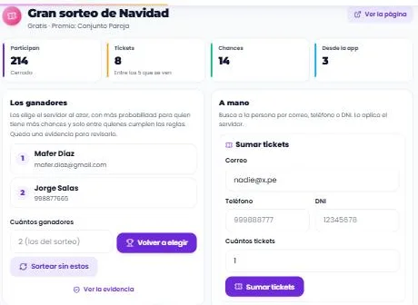 | 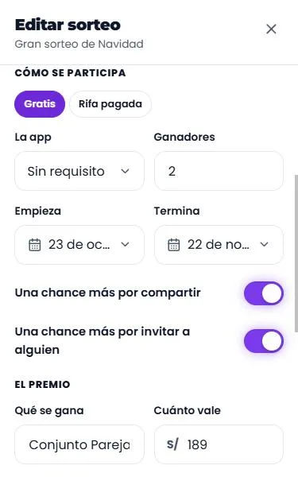 |

| Parte | Componente | Archivo | Qué tiene |
|---|---|---|---|
| Sorteos | `PaginaSorteosAdmin` | `paginas/admin/Sorteos.jsx` | Sobre `PaginaListaAdmin`: la foto, el sorteo y su premio, el tipo ("Rifa · S/ 5"), las fechas, cuántos participan y cuántos ganan, el estado; filtros por estado y tipo; en "⋯", **Participantes y ganadores** y **Ver la página**. No deja eliminar uno activo con participantes. La hoja: título, el enlace (`wala.pe/sorteos/…`, sale del título), descripción; gratis o rifa (`ElegirUno`) con su precio (`CampoDinero`), la app, los ganadores, las fechas (`CampoFecha`), las dos chances de más; el premio (qué, cuánto vale, su foto) y la imagen principal (`CampoImagen`); el estado con lo que significa y **la vista previa** |
| Un sorteo | `PaginaSorteoAdmin` | ídem | `/admin/sorteos/:id`: cuatro cifras (participan, tickets, chances, desde la app); **los ganadores** con "Elegir ganadores" / "Volver a elegir" y "Sortear sin estos" (los dos preguntan con `Confirmar`) y el resultado en una hoja con su evidencia (el sorteo, cuántos podían ganar, la semilla y la huella); **a mano**: "Sumar tickets" y "Dar o quitar chances" (correo, teléfono o DNI); los participantes con buscador y, en "⋯", sumarle tickets o darle chances (llena el formulario) |

Adaptadores (con pruebas): `slugDeSorteo` (como `slugifySorteo`),
`ESTADOS_SORTEO`, `REQUISITOS_APP`, `sorteoDesdeFirestore`,
`sorteoAFormulario` (los nombres que esperan `createSorteo` y
`updateSorteo`, que arman el documento y aseguran el enlace único),
`erroresDeSorteo`, `tipoDeSorteo`, `participanteDesde`, `identificadorDe` y
`erroresDeAjuste`.

### Diferencias a propósito (D6a)

- La lista y la hoja al costado (antes, el formulario fijo a la izquierda y
  la vista previa debajo): la vista previa va al final de la hoja.
- Elegir ganadores **pregunta antes**, diciendo cuántos y si reemplaza a los
  de ahora; el resultado se puede volver a abrir ("Ver la evidencia").
- Desde un participante se llenan los formularios de tickets o chances.
- Las fechas no pueden ir al revés y "Termina" no deja elegir antes de
  "Empieza".
- Palabras de la tienda: "Huella de la lista" (hash del pool), "Podían
  ganar" (elegibles), "Sorteo" (draw ID).

### Qué se probó (2026-11-02, demo en localhost, 1280 px y 375 px)

- Cuatro sorteos: dos activos (uno rifa a S/ 5), uno cerrado con su
  ganador y un borrador sin fechas.
- Nuevo: "Rifa del Día del Padre" → el enlace `wala.pe/sorteos/rifa-del-dia-del-padre`;
  "Rifa pagada" sin precio → "Una rifa necesita un precio de ticket mayor a
  0"; con S/ 3 → creado como borrador.
- Navidad: 214 participan, 8 tickets entre los 5 que se ven. Sumar tickets
  a alguien que no está → el error del servidor; elegir 2 ganadores → la
  pregunta → Valeria y Carla con su evidencia; "Sortear sin estos" → Mafer y
  Jorge; desde Luis, "Darle o quitarle chances" → el formulario con su
  correo → "Ahora tiene 2 chances".
- 375 px: la lista, la hoja y el detalle sin salirse del ancho.

### Cómo se une D6a

- `SorteosDelPanel.jsx`: `getSorteos` (`['admin-sorteos']`) →
  `sorteoDesdeFirestore`; guardar con `createSorteo` / `updateSorteo(id, …)`
  de `sorteoAFormulario(datos)` (el `error` que devuelven se lanza);
  eliminar `deleteSorteo`; `subirImagen` → `uploadFile(blob, 'sorteos/{premios|hero}/{ms}.jpg')`;
  `onDetalle(s)` → `/admin/sorteos/{id}`.
- `SorteoDelPanel.jsx`: `getSorteoById` (`['admin-sorteo', id]`) y
  `getParticipantes` (`['admin-sorteo-participantes', id]`, tope 200) →
  `participanteDesde`; `onSumarTickets` = `asignarTicketsManual({ sorteoId, ... })`,
  `onDarChances` = `grantRaffleChancesSecure` (devuelve `chancesTotal`),
  `onDecidirGanadores` = `decidirGanadoresSorteo`; tras cada uno, invalidar
  las dos `queryKey`.

### D6b: Sorteos por suscripción (en el kit desde el 2026-11-02)

| Una campaña (computadora) | Un plan en la hoja (celular) |
|---|---|
| 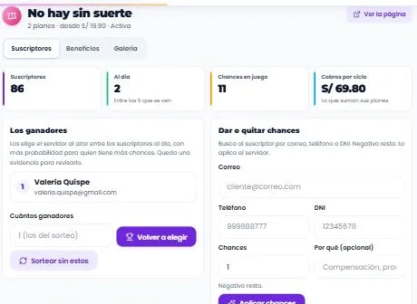 | 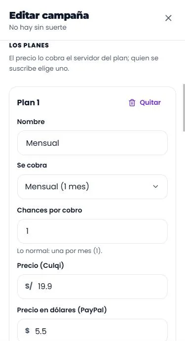 |

| Parte | Componente | Archivo | Qué tiene |
|---|---|---|---|
| Campañas | `PaginaSuscripcionesAdmin` | `paginas/admin/Suscripciones.jsx` | Sobre `PaginaListaAdmin`: la foto, la campaña y sus premios, los planes ("2 planes · desde S/ 19.90"), suscriptores y ganadores, el estado; en "⋯", **Suscriptores y ganadores**, **Beneficios y galería** y **Ver la página**. No deja eliminar una activa con suscriptores. La hoja: título, enlace (`wala.pe/suscrito-sorteo/…`), descripción, ganadores y estado; **los planes** (cada uno: nombre, cada cuánto se cobra, chances por cobro que siguen al ciclo, precio en soles y en dólares, beneficios como chips con `CampoLista`, destacado); los premios con su foto; imagen principal, logo, los cuatro colores (`CampoColor`) y **la vista previa con esos colores y los planes** |
| Una campaña | `PaginaSuscripcionAdmin` | ídem | Tres pestañas: **Sorteo** (cuatro cifras: suscriptores, al día, chances en juego y cobros por ciclo; `GanadoresSorteo` entre los suscriptores al día; `AjusteSorteo` para dar o quitar chances; los suscriptores con su plan y precio, hasta cuándo están al día, chances y estado, y en "⋯" darle chances), **Beneficios** (las marcas y descuentos, sobre `PaginaListaAdmin`) y **Galería** (los ganadores de antes con su foto) |
| Ganadores y ajustes | `GanadoresSorteo`, `AjusteSorteo` | `paginas/admin/Sorteos.jsx` | Sacados del detalle de D6a para que los usen los dos sorteos |
| Una lista de textos | `CampoLista` | `piezas/admin/Formularios.jsx` | Nueva pieza, sacada de las opciones de Encuestas (D5e): chips que se quitan y un campo para sumar otro. La usan las preguntas de la encuesta, sus opciones de entrega y los beneficios de un plan |

Adaptadores (con pruebas): `INTERVALOS_PLAN`, `mesesDeIntervalo`,
`COLORES_CAMPANA`, `campanaSuscripcionDesde`, `campanaSuscripcionAFormulario`
(los soles pasan a céntimos; los premios vacíos no se guardan), `planNuevo`,
`planConIntervalo`, `erroresDeCampanaSuscripcion` (para activarla hace falta
un plan con precio), `textoDePlanes`, `ESTADOS_SUSCRIPTOR`, `suscriptorDesde`,
`beneficioDesde` / `beneficioAFirestore` y `ganadorGaleriaDesde` /
`ganadorGaleriaAFirestore`. (Con "Suscripcion" en el nombre: `campanaDesde`
ya es de las ofertas de D5d.)

### Diferencias a propósito (D6b)

- **Los beneficios y la galería pasan al detalle**, en sus pestañas (antes
  iban debajo del formulario y solo al editar): la hoja queda para la
  campaña.
- Los beneficios de un plan son chips (antes, un texto con uno por línea).
- La vista previa usa los colores y muestra los planes con su precio, como
  la página.
- Elegir ganadores pregunta antes (igual que D6a) y el suscriptor de una fila
  llena "Dar o quitar chances".
- La pestaña del sorteo se llama "Sorteo": "Suscriptores" no cabía con las
  otras dos en el celular.

### Qué se probó (2026-11-02, demo en localhost, 1280 px y 375 px)

- Dos campañas: "No hay sin suerte" activa con 86 suscriptores y dos planes
  (el trimestral destacado), y "Club Kapi" en borrador con un plan sin
  precio.
- Club Kapi → Activa → guardar → "Para activarla, agrega un plan con precio
  (S/ o USD) mayor a 0"; precio S/ 99 y el beneficio "Un sticker al mes" con
  Enter → guardada: "1 plan · desde S/ 99.00 · Activa".
- No hay sin suerte: 86 suscriptores, 2 al día entre los 5 que se ven, 11
  chances, S/ 69.80 por ciclo; elegir 1 ganador → la pregunta "entre los
  suscriptores al día" → Valeria. Beneficios: sin marca ni título → el
  error; "Walá Tienda" → agregado. Galería: los dos de antes.
- D6a sigue igual con las piezas compartidas (Rosa ganadora, sus botones).
- 375 px: la lista, la hoja (los planes), las tres pestañas y sus listas sin
  salirse del ancho.

### Cómo se une D6b

- `SuscripcionesDelPanel.jsx`: `getCampaigns` (`['admin-suscripcion-campaigns']`)
  → `campanaSuscripcionDesde`; guardar con `createCampaign` / `updateCampaign`
  de `campanaSuscripcionAFormulario(datos)`; eliminar `deleteCampaign`;
  `subirImagen` → `uploadFile(blob, 'sorteos_suscripcion/{hero|logo|premios}/{ms}.jpg')`;
  `onDetalle(c, pestana)` → `/admin/sorteos-suscripcion/{id}?ver={pestana}`.
- `SuscripcionDelPanel.jsx`: `getCampaignById`, `getContadorSuscriptores`
  → `contador`, `getSuscriptores` (tope 200) → `suscriptorDesde(s, campana.planes)`;
  `onDarChances` = `grantChancesSuscripcion`, `onDecidirGanadores` =
  `decidirGanadoresSuscripcion`; beneficios con `getBeneficios` /
  `createBeneficio` / `updateBeneficio` / `deleteBeneficio`
  (`beneficioAFirestore`) y la galería con `getGanadoresGaleria` /
  `createGanadorGaleria` / `updateGanadorGaleria` / `deleteGanadorGaleria`
  (`ganadorGaleriaAFirestore`), cada una con su `queryKey` de hoy.

### D6c: Enlaces (en el kit desde el 2026-11-02)

| El diseño con la vista previa (computadora) | Los botones (celular) |
|---|---|
| 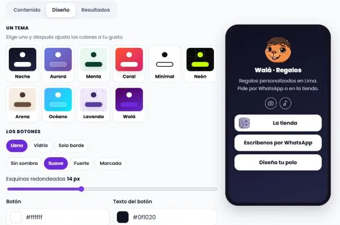 | 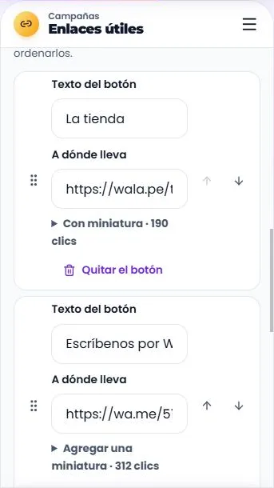 |

| Parte | Componente | Archivo | Qué tiene |
|---|---|---|---|
| Enlaces | `PaginaEnlacesAdmin` | `paginas/admin/Enlaces.jsx` | Dos cifras (páginas y visitas), buscador y `TablaAdmin`: la foto, la página y su `/l/…`, cuántos botones y redes, visitas y estado; tocar una abre el constructor; en "⋯", ver la página y eliminar (`Confirmar`). "Nueva página" abre una hoja con el título y el enlace (sale del título; no deja repetir uno) y al crearla **entra al constructor** |
| El constructor | `PaginaEnlaceAdmin` | ídem | Tres pestañas. **Contenido**: la foto (`CampoImagen` en círculo), título, enlace, descripción, estado; los botones y las redes con `ListaOrdenable` (arrastrar o flechas), cada uno con sus clics, su miniatura o ícono propio plegados y "Quitar". **Diseño**: los temas, el estilo, la sombra y las esquinas de los botones, sus colores, los del título y el texto, la alineación, la letra y el fondo (color, degradado, textura o imagen). **Resultados**: visitas y clics, los clics por botón y red, de qué país, desde qué aparato y los últimos días (`ListaBarras`). **La vista previa** al lado (en el celular, con "Ver cómo se ve") usa `services/linkThemes` como la página pública. `BarraGuardar` aparece con cambios y no deja guardar un enlace que ya usa otra página |

Adaptadores (con pruebas): `DISENO_ENLACES`, `TIPOS_RED`, `disenoDeEnlaces`
(como la hidratación de antes: las páginas viejas toman el título y el texto
del color del texto del botón), `paginaEnlacesDesde`, `paginaEnlacesAFirestore`
(el orden es el de la lista), `botonEnlaceNuevo`, `redNueva`,
`erroresDeEnlaces` (título, enlace y que no lo use otra página) y
`clicsDeEnlaces`. El diseño se guarda con los nombres de siempre (lo lee la
página pública).

### Diferencias a propósito (D6c)

- Ordenar se puede también con flechas (antes solo arrastrando, que en el
  celular no funcionaba).
- El editor en pestañas (Contenido · Diseño · Resultados) y la vista previa
  fija al lado; en el celular se abre con "Ver cómo se ve".
- Guardar aparece solo con cambios; el enlace repetido se avisa en el campo,
  antes de llamar al servidor.
- La miniatura de un botón y el ícono propio de una red van plegados.
- Palabras de la tienda: "Lleno · Vidrio · Solo borde", "Textura" (patrón),
  "Letra" (tipografía).

### Qué se probó (2026-11-02, demo en localhost, 1280 px y 375 px)

- Dos páginas: "Walá · Regalos" activa (3 botones, 2 redes, 1,240 visitas) y
  "Catálogo de Navidad" en borrador.
- Bajar "Escríbenos por WhatsApp" con la flecha → la vista previa cambia de
  orden y aparece la barra; el tema Noche → el fondo de la vista previa;
  enlace "navidad" → "Ya hay otra página en /l/navidad"; "wala-regalos" →
  guardado.
- Resultados: 1,240 visitas, 619 clics (50 %), los clics por botón y red, y
  por país, aparato y día.
- "Nueva página" → "Catálogo de Navidad" → `/l/catalogo-de-navidad` → creada
  y abierta en el constructor.
- 375 px: la lista, las tres pestañas y la vista previa sin salirse del ancho
  (la barra de las esquinas se pasaba 2 px por el margen del navegador).

### Cómo se une D6c

- `EnlacesDelPanel.jsx`: `getLinkPages` (`['admin-link-pages']`) →
  `paginaEnlacesDesde`; `onCrear` = `createLinkPage({ titulo, slug })` → su
  `id`; `onAbrir(p)` → `/admin/enlaces/{id}`; `onEliminar` = `deleteLinkPage`.
- `EnlaceDelPanel.jsx`: `getLinkPage(id)` (`['admin-link-page', id]`),
  `getLinkPages` para `paginas`, `getClicsDeLinkPage` → `clics`,
  `getAnaliticaEnlace` → `analitica`; `onGuardar(d)` =
  `updateLinkPage(id, paginaEnlacesAFirestore(d))` (lanzar su `error`) e
  invalidar las dos `queryKey`; `subirImagen` →
  `uploadFile(blob, 'link_pages/{avatars|thumbnails|redes|backgrounds}/{id}/{ms}.jpg')`.

### D6d: Popups, páginas y temas (en el kit desde el 2026-11-02)

| Popups con la vista previa (computadora) | Las páginas (celular) |
|---|---|
| 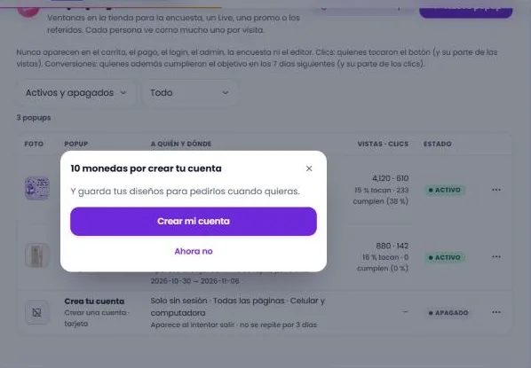 |  |

| Parte | Componente | Archivo | Qué tiene |
|---|---|---|---|
| Popups | `PaginaPopupsAdmin` | `paginas/admin/Popups.jsx` | Sobre `PaginaListaAdmin`: la foto, el popup y para qué es, a quién, dónde y cuándo sale, **vistas · clics con su parte y cuántos cumplen**, el estado; filtros por estado y para qué; en "⋯", **ver cómo se ve** (la misma `VentanaCampana` de la tienda) y encender o apagar. La hoja: el nombre para ti, el formato (`ElegirUno`), lo que dice, la imagen (`CampoImagen`: subir o pegar), el botón y a dónde lleva, a quién, en qué aparato y en qué páginas (las de siempre como chips y otras con `CampoLista`), cuándo aparece, no repetir, las fechas (`CampoFecha`), la prioridad, Activo y "Ver cómo se ve". "Volver a verlos aquí" en la cabecera |
| Páginas | `PaginaLandingsAdmin` | `paginas/admin/Paginas.jsx` | El inicio y la tienda arriba (siempre están, con "Diseñar"); la lista de las de marca y de campaña con su dirección, dónde estaban antes, su marca y su tipo; en "⋯", diseñar y ver. La hoja: nombre, dirección (si cambia, la vieja lleva a la nueva) y marca; la de una marca no cambia su dirección ni se borra aquí. **El atajo "Crear landing" de Enlaces rotos abre la hoja con la dirección puesta** (`nuevoCon`) |
| Temas | `PaginaTemasAdmin` | ídem | El tema, su autor y versión, cuánto CSS tiene y de dónde viene; "Importar de WordPress (.zip)" en la cabecera; la hoja con el CSS en letra de código |
| Abrir una nueva ya llena | `PaginaListaAdmin` (`nuevoCon`) | `paginas/admin/Lista.jsx` | Nueva prop: con datos, abre la hoja de "nuevo" con ellos |

Adaptadores (con pruebas): `cuandoPopup`, `erroresDePopup` (como antes, y las
páginas elegidas y las fechas en orden), `slugDeLanding`, `landingDesde` (sabe
si es la de una marca), `erroresDeLanding`, `landingAFirestore` (anota la
dirección vieja), `temaDesde` / `temaAFirestore`, `temaDesdeCss` (el nombre,
autor y versión de la cabecera del `style.css`) y `pesoTexto`. Los popups se
guardan como los lee la tienda: la página normaliza con
`services/popupsLogic.mjs`.

### Diferencias a propósito (D6d)

- Popups: la lista y la hoja al costado (antes, el formulario arriba de la
  lista); las métricas van en la misma fila; no
  deja guardar con "las páginas que elija" vacías (antes salía en ninguna sin
  avisar) ni fechas al revés.
- Páginas: la dirección va bajo el nombre (en el celular la vieja no cabía al
  costado); los mensajes con `useToast` y `Confirmar` del kit.
- Temas: los `alert` y el `window.confirm` pasan a avisos y `Confirmar`; el
  CSS se ve en letra de código y dice cuánto pesa.

### Qué se probó (2026-11-02, demo en localhost, 1280 px y 375 px)

- Popups: tres (la encuesta con 4,120 vistas, 15 % tocan y 233 cumplen; el
  Live del viernes, solo imagen, al bajar 50 %; uno apagado). "Ver cómo se
  ve" del de crear cuenta → la tarjeta con "Crear mi cuenta" y "Ahora no";
  en el Live, otra página con `https://wala.pe/alianza-lima?x=1` → queda
  `/alianza-lima` y se guarda; nuevo "solo imagen" vacío → "Describe lo que
  dice la imagen" y "Sube la imagen o pega su enlace", y la vista previa
  apagada.
- Páginas: la de la marca no se deja eliminar ("se borra con la marca");
  Promo Navidad a "Navidad 2026" → `/navidad-2026` con "antes /navidad-2025,
  /promo-navidad"; desde Enlaces rotos, "Crear landing" de `cyber-wala` → la
  hoja nueva con esa dirección.
- Temas: importar `astra-child.zip` → "Tema importado"; vaciar el CSS → "Escribe
  el CSS".
- 375 px: las tres listas y sus hojas sin salirse del ancho.

### Cómo se une D6d

- `PopupsDelPanel.jsx`: `getPopups` (`['admin-popups']`; si falla, no deja
  guardar) → `popups`; `onGuardarPopups` = `savePopups(lista)`, poner la lista
  en la caché e invalidar `['popups-config']`; `estadisticas` con
  `getEstadisticasPopup(id)` de cada uno (`['admin-popup-stats', id]`);
  `onReiniciarLocal` = `reiniciarEstadoLocal`; `subirImagen` →
  `uploadFile(blob, 'config/popups/{ms}.jpg')`.
- `PaginasDelPanel.jsx`: `getLandingPages` y `getBrands` → `landingDesde(p, marcas)`;
  guardar: si cambia la dirección, `moverDisenoDeLanding(vieja, nueva)` antes
  y luego `saveLandingPage(id, landingAFirestore(datos, previa))`; eliminar
  `deleteLandingPage(id, slug)`; `onDisenar(ruta)` → `navigate(`${ruta}?editar`)`;
  `nuevaDireccion` del `?nueva=` de la URL (y borrarlo).
- `TemasDelPanel.jsx`: `getThemes` → `temaDesde`; `saveTheme(id, temaAFirestore(d))`,
  `deleteTheme`; `onImportarZip(archivo)` = JSZip (import dinámico, como hoy)
  saca los `.css` (sin `__MACOSX`, `vendor` ni `node_modules`) y el
  `style.css` de arriba → `temaDesdeCss({ principal, todos, archivo })` →
  `saveTheme(null, temaAFirestore(t))`.

### D6 unido al admin (2026-11-03)

Todo el apartado a la vez con `adminCampanasViejo`
(`useLoViejo('adminCampanas')`). Las páginas viejas pasaron a `…Viejo.jsx`
(`AdminSorteos`, `AdminSorteoDetalle`, `AdminSuscripcionSorteos`,
`AdminSuscripcionDetalle`, `AdminEnlaces`, `AdminEnlaceEditor`,
`AdminPopups`, `Tienda/admin/AdminLandingPages`, `Tienda/admin/AdminThemes`);
el `.jsx` de siempre elige. Los conectores:

| Pantalla | Conector (`components/panel/`) |
|---|---|
| Sorteos y su detalle, sorteos por suscripción y su detalle (beneficios y galería) | `SorteosDelPanel.jsx` |
| Enlaces y su constructor | `EnlacesDelPanel.jsx` |
| Popups, Páginas (landing pages), Temas | `CampanasDelPanel.jsx` |

- **Cambio del kit al unir**: cada `CampoImagen` de Sorteos, Suscripciones y
  Enlaces pasa su carpeta a `subirImagen` (`premios`, `hero`, `logo`,
  `avatars`, `thumbnails`, `redes`, `backgrounds`), como ya hacía Marcas:
  las fotos caen en las carpetas de antes (el nombre del archivo cambia).
- `?nueva=<dirección>` en Páginas (lo usa la tarjeta de enlaces rotos) abre
  "Nueva" con esa dirección y se quita de la URL.
- Guardar una landing también refresca el editor y los enlaces rotos.
- **Cambios que quedaron** (de los conectores): el enlace `/l/…` ya no cambia
  solo al editar el título (antes se rehacía si no se tocaba el campo); al
  editar un beneficio o un ganador se guarda el documento limpio (antes se
  colaba su `id`); un tema de WordPress editado a mano conserva su tipo y
  versión; si no se leen las marcas, Páginas no deja trabajar (antes una
  página de marca parecía de campaña y se podía borrar); las métricas de un
  popup que no cargan salen "—"; errores que antes se callaban ahora avisan.

**Qué se probó** (localhost con los emuladores): las seis listas abren sin
errores (1 popup y 1 página sembrados); crear un sorteo → el documento en
`sorteos` con `titulo`, `slug`, `tipo`, `requisitoApp`, `numGanadores` y
`estado: 'borrador'` → su detalle en `/admin/sorteos/:id`; crear una página
de enlaces → `link_pages` con `slug: 'mis-redes-prueba'` → abre su
constructor; con `adminCampanasViejo` vuelve Temas de antes. No se probaron:
elegir ganadores ni chances (callables), subidas de fotos, importar un tema.

## D7 · Juegos y Kapi (en el kit desde el 2026-11-02: los dos tramos)

Cuatro pantallas de hoy (unas 1.640 líneas), en dos tramos; el apartado se
une entero cuando estén los dos.

| Tramo | Qué | Páginas de hoy | Kit |
|---|---|---|---|
| D7a | Kapi (su imagen), La Palabra del día y Las Bolitas de Kapi (retos patrocinados, mundos, premios del ranking y cifras) | `AdminMascota.jsx` (171), `AdminWordlePage.jsx` (164), `AdminBolitasPage.jsx` (426) | hecho (2026-11-02) |
| D7b | La Ruleta semanal (premios, cómo se ve y entregas) | `AdminRuletaPage.jsx` (880) | hecho (2026-11-02) |

### D7a: Kapi, La Palabra del día y Las Bolitas (en el kit desde el 2026-11-02)

| Las Bolitas: cifras (computadora) | Kapi (celular) |
|---|---|
| 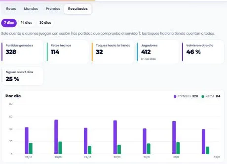 |  |

| Parte | Componente | Archivo | Qué tiene |
|---|---|---|---|
| Kapi | `PaginaKapiAdmin` | `paginas/admin/Juegos.jsx` | La imagen con `CampoImagen` (subir o pegar un enlace; se guarda al elegirla) y **cómo se ve en Mi cuenta** sobre el fondo de marca, con el aviso si el enlace no carga; quitar pregunta antes |
| La Palabra del día | `PaginaPalabraAdmin` | ídem | Sobre `PaginaListaAdmin`: el día (con su nombre), **la palabra en casillas como en el juego** y si es hoy, programada o ya pasó; filtro por cuándo. La hoja: el día (`CampoFecha`, desde hoy) y la palabra (de 5 a 8 letras, sin tildes), con sus casillas; avisa si ese día ya tiene una |
| Las Bolitas de Kapi | `PaginaBolitasAdmin` | ídem | Cuatro pestañas. **Retos**: los patrocinados desde hoy (`PaginaListaAdmin`) con la marca, el cupón, entregados de cuántos (con su barrita) y el estado; la hoja con el día, la marca, el cupo, Activo y el cupón. **Mundos**: el orden de las marcas (`ListaOrdenable`) y agregar una. **Premios**: entregar cada lunes, cada premio con sus puestos, la marca y el cupón, y premiar una semana a mano (pregunta antes). **Cifras**: 7, 14 o 30 días; seis cifras, partidas y retos por día (`GraficoTendencia` en barras), dónde se traban y los toques hacia la tienda por marca (`ListaBarras`). El cupón (% o S/ de descuento o envío gratis, su tope y cuándo vence) dice "El cliente recibe: …". Mundos y Premios guardan con `BarraGuardar` |

Adaptadores (con pruebas): `palabraLimpia`, `palabraDiaDesde`,
`erroresDePalabra`, `CUPON_JUEGO_VACIO`, `modoDeCupon`, `cuponConModo`,
`textoCuponJuego`, `erroresDeCupon` (los topes del servidor: 1 a 50 %, S/ 1 a
S/ 100, 1 a 90 días), `patrocinioDesde`, `erroresDePatrocinio`,
`premiosBolitasDesde` / `premiosBolitasAFirestore`, `nuevoPuesto`,
`erroresDePremios` (puestos al revés o que se pisan) y `metricasBolitas`. La
vista previa de Kapi usa `utils/mascotaImage` (los enlaces de Drive).

### Diferencias a propósito (D7a)

- Kapi se guarda al elegir la imagen (antes, subir guardaba pero pegar un
  enlace pedía "Guardar URL").
- La Palabra: la lista y la hoja al costado; el día no deja elegir uno que
  pasó; avisa si ese día ya tiene palabra (antes la pisaba sin decir).
- Las Bolitas en pestañas (antes, las cuatro partes una debajo de otra); los
  `alert` y `window.confirm` pasan a avisos y `Confirmar`; los topes del
  cupón y los premios que se pisan se avisan antes de llamar al servidor; las
  cifras por día en un gráfico en vez de una tabla.
- En el celular las cuatro pestañas de las Bolitas van con menos relleno, y
  la última se llama "Cifras": "Resultados" no cabía.

### Qué se probó (2026-11-02, demo en localhost, 1280 px y 375 px)

- Kapi: la imagen y su vista en Mi cuenta; "Quitar" → la pregunta → "Imagen
  quitada" y "Sin imagen".
- La Palabra: cuatro (una pasada, la de hoy, dos programadas); nueva con
  "feliz dia" → "Solo letras, sin espacios" y, para hoy, "Ese día ya tiene
  palabra"; "Canción" → casillas CANCION; editar NAVIDAD a "Regalós" →
  REGALOS.
- Bolitas: dos retos (hoy 31 de 50); el de hoy al 60 % → "De 1 a 50 %";
  envío gratis → "El cliente recibe: Envío gratis · 15 días" y guardado con
  sus 31 entregados. Mundos: bajar una marca → la barra → "Mundos guardados".
  Premios: el primero hasta el puesto 3 → "Los premios 1 y 2 se pisan" y
  Guardar apagado. Cifras: 693 partidas en 14 días, 328 en 7.
- 375 px: las tres páginas, las cuatro pestañas y las hojas sin salirse del
  ancho.

### D7b: La Ruleta semanal (en el kit desde el 2026-11-02)

| Cómo se ve (computadora) | Premios (celular) |
|---|---|
| 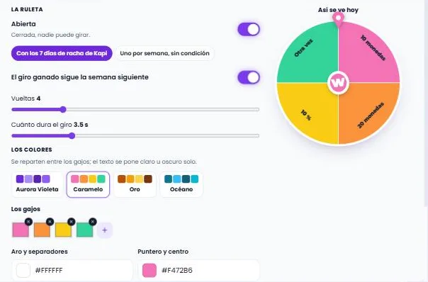 | 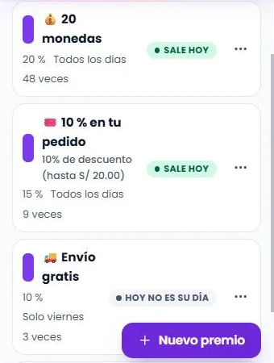 |

| Parte | Componente | Archivo | Qué tiene |
|---|---|---|---|
| La Ruleta | `PaginaRuletaAdmin` | `paginas/admin/Ruleta.jsx` | Tres pestañas. **Premios** (`PaginaListaAdmin`): cuánto suman las probabilidades (aviso si no da 100 %) y cuántos pueden salir hoy; cada premio con su color, qué gana, la probabilidad, qué días, cuántas veces salió y **por qué no sale hoy** (apagado, agotado, todavía no empieza, ya terminó, hoy no es su día); filtros por hoy y por tipo; reiniciar el contador (pregunta antes). La hoja: emoji, nombre y texto del gajo, qué gana (monedas, descuento con su tope, producto con `SelectorProductos`, envío gratis, a mano o nada), cuándo vence el cupón, **"El cliente verá: …"**, la probabilidad con lo que suman todos, los días en chips, desde/hasta con `CampoFecha`, cupo total y por persona, Activo y el color. **Cómo se ve**: abierta o cerrada, cómo se gana el giro, la semana de gracia, vueltas y duración, las cuatro paletas, los gajos uno por uno, el aro, el puntero y la imagen del centro (`CampoImagen`), con **la rueda de hoy** (`RuedaRuleta`, la misma del cliente) al costado; guarda con `BarraGuardar`. **Entregas**: los premios ganados con quién, el cupón y la semana; los premios a mano se marcan entregados (y se pueden desmarcar); "Solo lo que falta entregar" |

Adaptadores (con pruebas): `DIAS_RULETA`, `textoDiasRuleta`,
`TIPOS_PREMIO_RULETA`, `PREMIO_RULETA_CON_PRODUCTO`,
`PREMIO_RULETA_CON_CUPON`, `premioRuletaAFormulario`,
`premioRuletaAFirestore` (los vacíos como null, sin `stockUsado` ni `id`),
`erroresDePremioRuleta` (los de antes y las fechas al revés),
`motivoRuletaHoy` (lo que mira el servidor al sortear, en palabras) y
`ganadoRuletaDesde`. La página usa también `utils/ruletaModel`
(`normalizarPremio`, `premiosDeHoy`, `sumaProbabilidades`, `textoPremio`,
`PRESETS_TEMA`), el mismo que lee la rueda del cliente.

### Diferencias a propósito (D7b)

- La hoja al costado en vez del formulario arriba de la lista; los errores
  van junto a su campo (antes, un aviso suelto) y eliminar usa `Confirmar`
  (antes, `window.confirm`).
- Cada premio dice si sale hoy y, si no, por qué (antes había que
  deducirlo); "El cliente verá" y "Con este, suman X %" se ven mientras se
  edita.
- "Cómo se ve" guarda con la barra (antes, cada cambio se guardaba solo, uno
  por uno); se puede descartar.
- El buscador de productos dentro de la hoja ya no la envía con Enter
  (`Buscador` corta el submit: ahora vale para todas las hojas con
  `SelectorProductos`).

### Qué se probó (2026-11-02, demo en localhost, 1280 px y 375 px)

- Seis premios que suman 99 %: el aviso; envío gratis "Hoy no es su día"
  (solo viernes) y el peluche "Agotado" (5 de 5). "Sigue intentando" al 13 % →
  "Con este, suman 100.0 %" y, guardado, "Perfecto".
- Nuevo premio de producto sin elegirlo → "Elige el producto del premio"; con
  la casaca → "El cliente verá: Casaca … gratis". Enter en el buscador no
  guarda la hoja; cerrarla con cambios pregunta antes.
- Cómo se ve: la paleta Caramelo → la barra → "Ruleta guardada"; la rueda
  cabe en su columna.
- Entregas: "Falta 1" → marcar el peluche de Valeria → "No falta entregar
  nada"; sin el filtro, los cuatro con su semana.
- 375 px: las tres pestañas y la hoja sin salirse del ancho.

### Cómo se une D7b

- `RuletaDelPanel.jsx`: `getRuletaPrizes` (`normalizarPremio`) y
  `getRuletaConfig` (`normalizarConfig`) al abrir, cada uno con su
  `queryKey`; `hoy` = `limaTodayStr()`, `diaSemana` = `limaDayOfWeek()`;
  `onGuardarPremio(d, id)` = `saveRuletaPrize(premioRuletaAFirestore(d), id)`,
  `onEliminarPremio` = `deleteRuletaPrize`, `onReiniciarContador` =
  `resetStockPremio`, `onGuardarConfig` = `saveRuletaConfig`; cada uno
  devuelve `{ success, error }`: si no, lanzar el error.
- Las entregas solo se leen al abrir su pestaña (como hoy):
  `getRuletaWins(200)` → `ganadoRuletaDesde`; `onMarcarEntregado(id, v)` =
  `marcarPremioEntregado(id, v)`.
- `productos`: los del catálogo, como en D5b; `subirImagen` → `uploadFile`
  en `config/ruleta/`.

### Cómo se une D7a

- `KapiDelPanel.jsx`: `getMessage('mascota_kap_image_url')`
  (`['admin-mascota-url']`); `onGuardar(url)` = `setMessage(…, url)` e
  invalidar también `['mascota-image-url']`; `subirImagen` →
  `uploadFile(blob, 'config/mascota_kap.png')`.
- `PalabraDelPanel.jsx`: `getAllDailyWords` (`['admin-wordle-words']`) →
  `palabraDiaDesde(x, limaTodayStr())`; `onGuardar({ fecha, palabra }, id)` =
  `setDailyWord(fecha, palabra)` y, si cambió el día, `deleteDailyWord(id)`;
  `onEliminar` = `deleteDailyWord`.
- `BolitasDelPanel.jsx`: `getBrands` (activas y visibles) → `marcas`;
  `listarPatrociniosBolitas(hoy)` → `patrocinioDesde`; guardar con
  `adminBolitas('guardarPatrocinio', { fecha, patrocinio })` (si cambió el
  día, `borrarPatrocinio` del anterior), quitar con `borrarPatrocinio`;
  `leerMundosBolitas` / `guardarMundos`; `leerPremiosBolitas` →
  `premiosBolitasDesde`, guardar `guardarPremios` con
  `premiosBolitasAFirestore(p, marcas)`, `premiarSemana`;
  `adminBolitas('metricas', { dias })` → `metricas`. Cada uno con su
  `queryKey` de hoy.

### D7 unido al admin (2026-11-03)

Todo el apartado a la vez con `adminJuegosViejo`
(`useLoViejo('adminJuegos')`). Las páginas viejas pasaron a `…Viejo.jsx`
(`AdminMascota`, `AdminWordlePage`, `AdminBolitasPage`, `AdminRuletaPage`);
el `.jsx` de siempre elige. Los conectores:

| Pantalla | Conector (`components/panel/`) |
|---|---|
| Kapi, La Palabra del día, Las Bolitas | `JuegosDelPanel.jsx` (`KapiDelPanel`, `PalabraDelPanel`, `BolitasDelPanel`) |
| La Ruleta | `RuletaDelPanel.jsx` |

- **Cambio del kit al unir**: en las Bolitas, Mundos y Premios dicen
  "Cargando…" mientras llegan (antes se veía el editor vacío y lo editado en
  ese momento se perdía al llegar los datos). `cargando` y `error` son los de
  la pestaña abierta; si las cifras fallan, sale el aviso con Reintentar.
- Las claves de la ruleta (`admin-ruleta-*`) son nuevas (la página vieja no
  usaba React Query) y se releen al entrar; las entregas, al abrir su
  pestaña. La tienda no guarda la ruleta en caché: no hay nada suyo que
  invalidar.
- **Cambios que quedaron** (de los conectores): un premio de la ruleta que
  no es de producto guarda `productId: null` y `productName: ''` (antes
  arrastraba el producto si se cambiaba de tipo); la imagen del centro se
  puede subir (`config/ruleta/`); editar una palabra o un reto patrocinado
  cambiando el día quita el del día anterior (antes quedaban los dos); los
  puestos de los premios de las Bolitas se guardan solo con sus campos
  (`desde`, `hasta`, `marcaId`, `marcaNombre`, `cupon`) y el cupón completo
  con sus valores de casa; si no cargan Kapi o las marcas, ahora se avisa
  (antes salía vacío); borrar o reiniciar un premio avisa si falla.

**Qué se probó** (localhost con los emuladores): las cuatro páginas abren;
Kapi con un enlace → "Kapi guardado" y `messages/mascota_kap_image_url`
con ese enlace; una palabra nueva para hoy "Canción" →
`wordle_daily_words/2026-11-03` con `word: 'CANCION'`; las Bolitas: Retos,
Mundos y Premios abren, Cifras sin el emulador de functions → el aviso con
Reintentar; la ruleta: editar un premio (emoji, nombre y solo domingo) →
`ruletaPrizes/r3` con los campos nuevos y el espejo viejo (`name`, `type`,
`probability`) y "Hoy no es su día"; Cómo se ve y Entregas abren; con
`adminJuegosViejo` vuelve La Palabra de antes. No se probaron (son
callables o subidas): guardar retos, mundos y premios de las Bolitas,
premiar una semana, las cifras, subir imágenes, guardar "Cómo se ve".
La semilla del emulador usa `prize` en los premios (ni la página vieja ni la
nueva lo leen): por eso salen sin nombre al editarlos.

## D8 · Ajustes (en el kit desde el 2026-11-02: los dos tramos)

Tres pantallas de hoy (unas 1.050 líneas), en dos tramos; el apartado se
une entero cuando estén los dos.

| Tramo | Qué | Páginas de hoy | Kit |
|---|---|---|---|
| D8a | Configuración: el equipo y sus permisos, las páginas bloqueadas, pasar imágenes a WebP y publicar traducciones | `AdminConfiguracion.jsx` (618) | hecho (2026-11-02) |
| D8b | WhatsApp y el historial (diseño de la tienda e inventario) | `AdminWhatsApp.jsx` (247), `AdminBackups.jsx` (191) | hecho (2026-11-02) |

### D8a: Configuración (en el kit desde el 2026-11-02)

| Los permisos de una persona (computadora) | El equipo (celular) |
|---|---|
| 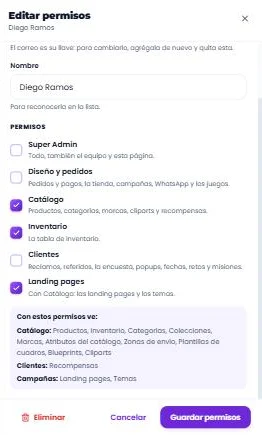 |  |

| Parte | Componente | Archivo | Qué tiene |
|---|---|---|---|
| Configuración | `PaginaConfiguracionAdmin` | `paginas/admin/Configuracion.jsx` | Solo Super Admin (si no, lo dice). Tres pestañas. **Equipo** (`PaginaListaAdmin`): cada persona con su correo, "Tú" en la propia, sus permisos y **cuántas secciones ve**; filtro por permiso. La hoja: el correo (fijo al editar: es la llave), el nombre y los seis permisos en casillas (con Super Admin, los demás van incluidos) y **"Con estos permisos ve: …"**, el menú real agrupado (`menuAdminPara`). No deja agregar a alguien que ya está, quitarse a uno mismo ni quitarse Super Admin. **Bloqueos**: las tres páginas fijas y las landing pages, cuántas bloqueadas y un botón por página para bloquear o abrir. **Optimizar**: las imágenes viejas a WebP (diseño de tienda o productos: el recuento con `Cifra`, la pregunta, la barra con el archivo que va, el resultado y los que fallaron) y publicar las traducciones juntadas (cuántas por idioma) |

Adaptadores (con pruebas): `PERMISOS_ADMIN`, `adminDesdeFirestore`,
`adminAFirestore` (Super Admin va solo; los demás en orden),
`erroresDeAdmin`, `textoPermisos`, `PAGINAS_FIJAS`, `paginasBloqueables`,
`conBloqueo`, `textoConteoImagenes`, `textoResultadoImagenes`,
`NOMBRES_IDIOMA` y `traduccionesPorIdioma`.

### Diferencias a propósito (D8a)

- La hoja al costado en vez del formulario arriba de la tabla; los `alert` y
  `window.confirm` pasan a errores junto al campo, avisos y `Confirmar`.
- Cada permiso dice qué abre y la hoja muestra el menú que verá esa persona
  (antes, solo los nombres de los permisos).
- Quitarse Super Admin a uno mismo ya no se puede (antes se guardaba y uno
  perdía la página); agregar un correo que ya está avisa en vez de pisarlo.
- Imágenes e idiomas van juntos en **Optimizar** (como antes, en
  "Optimización de imágenes"): con cuatro pestañas la última no cabía en el
  celular, ni con "Mantenimiento".
- El menú dice **Configuración** (antes, "Administradores y bloqueos"), como
  la página; el aviso de "sin permiso" del marco apunta ahí.

### Qué se probó (2026-11-02, demo en localhost, 1280 px y 375 px)

- Equipo: cuatro personas (Isaac con "Tú", Super Admin, "Todo"; Mariela,
  "Diseño y pedidos · Clientes", 29 secciones). Agregar a Mariela otra vez →
  "Ya está en el equipo"; a Rocío con Clientes → 14 secciones. Editarse uno
  y dejar solo Catálogo → "Te quitarías el acceso…"; eliminarse → "No puedes
  quitarte a ti mismo". Con Super Admin, las otras cinco casillas marcadas y
  apagadas, "Ve todo el panel".
- Bloqueos: seis páginas, el pie bloqueado; bloquear Promo Navidad → "2
  bloqueadas" y el toast.
- Optimizar: diseño (4 imágenes, 6 veces) → la pregunta → la barra → "4
  imágenes convertidas" y "No queda ninguna". Productos: 37 → 35 convertidas,
  1 se dejó y 1 falló (en "1 no se pudo convertir"). Traducciones: 14 en
  inglés y 3 en portugués → "17 traducciones publicadas" y la lista vacía.
- Con permisos de Catálogo, el marco no abre la página.
- 375 px: las tres pestañas y la hoja sin salirse del ancho.

### D8b: WhatsApp y el historial (en el kit desde el 2026-11-02)

| WhatsApp (computadora) | El historial del diseño (celular) |
|---|---|
| 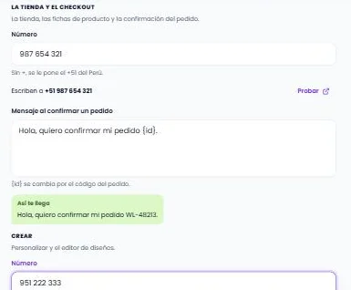 | 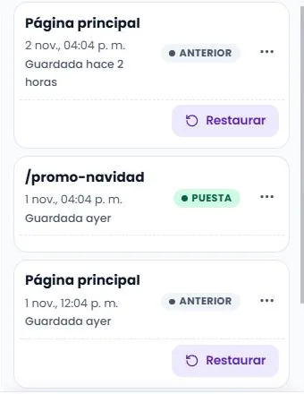 |

| Parte | Componente | Archivo | Qué tiene |
|---|---|---|---|
| WhatsApp | `PaginaWhatsAppAdmin` | `paginas/admin/Ajustes.jsx` | Un grupo por sección (la tienda y el checkout, Crear, Mi cuenta) con dónde se usa, el número (vacío: el de la tienda) y **a qué número escriben de verdad** con "Probar" (abre wa.me). El mensaje al confirmar un pedido con su **globo de chat** ({id} cambiado por un código de ejemplo) y el aviso si falta {id}. El botón en iniciar sesión y registro. Guarda con `BarraGuardar`; los números mal escritos se marcan en su campo |
| Historial | `PaginaHistorialAdmin` | ídem | Dos pestañas. **Diseño de la tienda** (`PaginaListaAdmin`): cada copia del editor con su página, cuándo (y hace cuánto) y si es **la puesta** (la más nueva de cada página) o anterior; filtro por página; "Restaurar" en las anteriores, con la pregunta. **Inventario**: cada cambio de stock con el producto, quién, cuándo, "12 → 10" y "Bajó −2" (en palabras, no solo color); buscar, filtro sube/baja, ordenar por fecha y **Descargar CSV** (con la hora de Lima y tildes que Excel lee) |

Adaptadores (con pruebas): `MENSAJE_PEDIDO_POR_DEFECTO`,
`SECCIONES_WHATSAPP`, `whatsappDesdeMensajes` / `whatsappAMensajes` (el
general sigue al de la tienda), `telefonoEscrito`, `erroresDeWhatsApp`,
`mensajePedidoDeEjemplo`, `cambioDisenoDesde`, `conVersionActual`,
`nombreDePaginaGuardada`, `movimientoInventarioDesde`, `textoCambioStock` y
`csvInventario`. El número final lo arma `numeroWhatsApp` (el mismo del
botón flotante).

### Diferencias a propósito (D8b)

- **Los mensajes de Crear y Mi cuenta ya no se muestran**: no los lee nadie
  (el botón flotante manda uno fijo; solo el checkout usa el de la tienda).
  Lo guardado en `whatsapp_text_crear` / `_cuenta` no se toca.
- Un número vacío ya no "llena" los otros al abrir la página (antes, el
  general se copiaba en Crear y Mi cuenta y se guardaba así); vacío dice
  "usa el de la tienda", que es lo que hace el botón. La tienda no puede ir
  vacía: es la que usa el checkout.
- La nota de antes ("si dejas un número vacío, el botón no aparecerá") no
  era cierta: vacío usa el general.
- Historial: la copia puesta de cada página se marca y no se restaura (antes
  todas decían "Restaurar"); los `alert` y `window.confirm` pasan a
  `Confirmar` y avisos; el autor no se muestra (el editor solo anota
  "Admin").
- **Restaurar arreglado en el conector**: antes solo escribía
  `storeConfig/homePage` (el documento viejo), pero el editor guarda cada
  página con `saveStorefrontConfig`: restaurar no cambiaba la tienda de hoy.
  Ver abajo.

### Qué se probó (2026-11-02, demo en localhost, 1280 px y 375 px)

- WhatsApp: tienda +51 987 654 321, Crear vacío ("el de la tienda"), Mi
  cuenta +51 912 345 678. Crear "98765abc" → queda "98765" → Guardar →
  "Revisa el número: tiene 5 dígitos" y el foco ahí. El mensaje sin {id} →
  el aviso. Arreglado → "WhatsApp guardado" y "Escriben a +51 951 222 333".
- Historial: cinco copias (home tres veces, promo-navidad y la tienda; las
  tres más nuevas de cada página, "Puesta"). Restaurar la de home de ayer →
  la pregunta → una copia nueva arriba ("Restaurada hace un momento",
  puesta) y la de hace 2 horas pasa a anterior.
- Inventario: seis cambios (subió, bajó y uno igual); el CSV
  `inventario_2026-11-02.csv` con la hora de Lima y las comillas bien.
- 375 px: las dos páginas y las dos pestañas sin salirse del ancho.

### Cómo se une D8b

- `WhatsAppDelPanel.jsx`: los seis `getMessage` de hoy más
  `whatsapp_number` (`['admin-whatsapp-numbers']`) →
  `whatsappDesdeMensajes`; `onGuardar(c)` = `setMessage` de cada clave de
  `whatsappAMensajes(c)` e invalidar `['admin-whatsapp-numbers']` y
  `['whatsapp-numbers-config']` (y la del botón flotante).
- `HistorialDelPanel.jsx`: `storeConfigLogs` por `timestamp` desc, 50 →
  `conVersionActual(map(cambioDisenoDesde))`; `getInventoryLogs` →
  `movimientoInventarioDesde`. `onRestaurar(x)` hace lo mismo que guardar en
  el editor (`VisualEditorContext`): `setDocument('storeConfig', 'homePage',
  x.config)` **y** `saveStorefrontConfig(x.config.sections || [],
  x.pagina)`, invalida la config de esa página y anota su propia copia en
  `storeConfigLogs` ("Restaurada desde el historial"), así la más nueva
  sigue siendo la puesta.

### Cómo se une D8a

- `ConfiguracionDelPanel.jsx`: `esSuperadmin` y `yo` de `useAuth()`
  (`adminPermissions`, `user.email`); `getAdminRoles` → `adminDesdeFirestore`
  (`['admin-roles']`); `onGuardarAdmin(d)` = `adminAFirestore(d)` →
  `setAdminRole(correo, datos)`, `onEliminarAdmin` = `deleteAdminRole`
  (los dos devuelven `{ error }`: lanzarlo).
- Bloqueos: `getLockedPages` y `getLandingPages` → `paginasBloqueables`;
  `onBloquear(id, si)` = `saveLockedPages(conBloqueo(bloqueadas, id, si))`.
- Optimizar: `onRevisarImagenes(a)` = `contarImagenesPorConvertir({
  colecciones })` con `AMBITO_DISENO` o `AMBITO_PRODUCTOS`;
  `onConvertirImagenes(a, { alAvanzar })` = `reconvertirImagenesAWebp({
  colecciones, onProgreso: alAvanzar })`; `onRevisarTraducciones` =
  `traduccionesPendientes`, `onPublicarTraducciones` =
  `guardarTraduccionesEnNube`.

### D8 unido al admin (2026-11-03)

Todo el apartado a la vez con `adminAjustesViejo`
(`useLoViejo('adminAjustes')`). Las páginas viejas pasaron a `…Viejo.jsx`
(`AdminConfiguracion`, `AdminWhatsApp`, `AdminBackups`); el `.jsx` de
siempre elige. Con D8, **todo el admin está unido**. Los conectores:

| Pantalla | Conector (`components/panel/`) |
|---|---|
| Configuración (equipo, bloqueos, optimizar) | `ConfiguracionDelPanel.jsx` |
| WhatsApp, Historial | `AjustesDelPanel.jsx` (`WhatsAppDelPanel`, `HistorialDelPanel`) |

- **Cambios del kit al unir**: `BarraGuardar` queda sobre la barra inferior
  del celular (`--admin-abajo`, como las demás barras fijas del admin; antes
  quedaba debajo y "Guardar cambios" no se podía tocar en el celular: lo
  arrastraban todas las páginas con esa barra desde D5). La pregunta de
  Restaurar avisa que también vuelven el menú, la cuenta y el buscador.
- **Restaurar** hace lo mismo que el editor: mira si la página está
  bloqueada, escribe `storeConfig/homePage` y la página
  (`saveStorefrontConfig`, solo si la copia trae `sections`), anota su copia
  "Restaurada desde el historial (Página: …)" e invalida
  `['storefront-config', página]` y `['store-config-custom']`.
- WhatsApp invalida también lo que lee la tienda: el botón flotante, el
  checkout (`['whatsapp-config-checkout']`) y Mi cuenta
  (`['whatsapp_number_cuenta']`).
- **Cambios que quedaron** (de los conectores): con Super Admin se guarda
  solo `['superadmin']` y los demás permisos van en orden (los desconocidos
  se descartan); el correo y el nombre se guardan recortados; si falla
  bloquear una página, se avisa y se vuelve a leer (antes la pantalla
  quedaba con lo no guardado); si no se leen los números de WhatsApp, se
  avisa (antes salían los de por defecto y se podían guardar encima); el
  inventario del Historial se lee al abrir su pestaña.
- **Lo que ya pasaba y sigue**: `getAdminRoles`, `getLockedPages` y
  `getLandingPages` dan `[]` si fallan; si falla la lectura de bloqueos,
  bloquear una página guardaría solo esa (igual que antes).

**Qué se probó** (localhost con los emuladores, 375 px): WhatsApp, la tienda
951222333 → "WhatsApp guardado", en `messages` la tienda y el general con
ese número, Crear vacío y Mi cuenta con el de la tienda. Configuración:
agregar `Prueba@wala.test` con Clientes → `adminRoles/prueba@wala.test` con
`manage_clients` y "14 secciones"; eliminarlo → la pregunta → 3 personas;
bloquear La tienda → `storeConfig/lockedPages` con `tienda`, y abrirla otra
vez. Historial: dos copias de la tienda sembradas (la más nueva "Puesta");
restaurar la de ayer → la pregunta con el aviso → una copia nueva puesta y
`pages/tienda` con las secciones de ayer. Con `adminAjustesViejo` vuelve el
Historial de antes. No se probaron: convertir imágenes, publicar
traducciones, el inventario con datos.

## Reemplazos: qué sale y qué entra

La misma tabla que las fichas de la tienda (CUENTA.md, "Reemplazos"): qué
hay hoy en el admin, qué pieza del kit entra y el conector que la une
(`src/components/panel/`). Al unir un apartado, la
página vieja se renombra `…Viejo.jsx` (vuelve con su interruptor), la fila
se marca ✓ y lo que queda sin uso pasa a [ELIMINAR.md](ELIMINAR.md)
("Panel administrativo"). Nada se borra al unir.

### D0 · Marco

| Parte | Hoy en el admin | Pasa a (kit) | Conector |
|---|---|---|---|
| Menú y permisos ✓ | `components/AdminLayout/AdminLayout.jsx` + `.module.css` (grupos a mano, `NavLink`, emojis, permisos con `adminPermissions`) | `MarcoAdmin` + `menuAdminPara` / `accesosAdminPara` (`adaptadoresAdmin.js`) | `MarcoDelPanel.jsx` (lee `useAuth().adminPermissions` y la ruta; `<Outlet>` adentro) |
| Barra del celular ✓ | — (no había) | `BarraInferiorAdmin` (dentro de `MarcoAdmin`) | el mismo |
| Cabecera de cada página (D1 ✓; el resto al unir cada apartado) | `<h1>`/`styles.header` propios en cada página | `CabezaAdmin` | cada conector |
| Sin permiso ✓ | lo decide `AdminRoute` (no hay pantalla) | `SinPermiso` | `MarcoDelPanel.jsx` |
| Inicio ✓ | `pages/AdminDashboard.jsx` (accesos sueltos + un editor viejo de secciones por zonas: ver si se usa) | `PaginaInicioAdmin` | `InicioDelPanel.jsx` (cuentas de reclamos, pedidos, referidos, retos) |
| Avisos y preguntas (D1 ✓; el resto al unir cada apartado) | `alert()`, `window.confirm`, `ToastContext` (`useGlobalToast`) | `useToast`, `Confirmar` / `useConfirmar` | cada conector |
| Botones y campos (D1 ✓; el resto al unir cada apartado) | `components/common/Button`, `components/ui` (`GlassButton`, `GlassInput`, `GlassModal`), `<select>`, `common/Toggle` | `Boton`, `Campo`, `Interruptor`, `Casilla`, `HojaInferior` / `HojaEdicion` | cada página del kit |

### D1 · Catálogo base

| Parte | Hoy en el admin | Pasa a (kit) | Conector |
|---|---|---|---|
| Categorías ✓ | `pages/admin/AdminCategorias.jsx` + `.module.css`; `AdminImageCropper` | `PaginaCategorias` (`PaginaListaAdmin`, `CampoImagen` con `RecortarFoto`) | `CategoriasDelPanel.jsx` |
| Colecciones ✓ | `pages/admin/AdminColecciones.jsx` + `.module.css`; `AdminImageCropper` | `PaginaColecciones` | `ColeccionesDelPanel.jsx` |
| Atributos ✓ | `pages/admin/AdminCatalogAttributes.jsx` + `.module.css` | `PaginaAtributos` | `AtributosDelPanel.jsx` |
| Zonas de envío ✓ | `pages/admin/AdminEnviosZonas.jsx` + `.module.css` | `PaginaEnvios` | `EnviosDelPanel.jsx` |
| Cliparts ✓ | `pages/admin/AdminCliparts.jsx` + `.module.css` | `PaginaCliparts` | `ClipartsDelPanel.jsx` |
| Marcas ✓ | `pages/admin/AdminMarcas.jsx` + `.module.css` (con la tarjeta de WhatsApp, `TarjetaProducto` del kit y `AdminImageCropper`) | `PaginaMarcas` | `MarcasDelPanel.jsx` |
| Productos de una marca ✓ | `pages/admin/AdminMarcaProductos.jsx` + `.module.css` (dentro de AdminMarcas, sin ruta) | `PaginaProductosMarca` | `ProductosDeMarcaDelPanel.jsx` en una ruta nueva (`/admin/marcas/:id/productos`) |
| Destacados ✓ | `pages/admin/AdminDestacados.jsx` + `.module.css` | `PaginaDestacados` (`ListaOrdenable`, `SelectorProductos`) | `DestacadosDelPanel.jsx` |

### D2 · Productos

| Parte | Hoy en el admin | Pasa a (kit) | Conector |
|---|---|---|---|
| D2a · La lista ✓ | `pages/Tienda/admin/AdminProductos.jsx` + `.module.css` (`ListaTodos`, tarjetas, borradores, la personalización de antes), `components/admin/ProductTable`, `components/admin/BulkActions`, `common/Toggle` | `PaginaProductos` (`TablaAdmin`, `AccionesLote`, `CargarMas`) | `ProductosDelPanel.jsx` (`?ver=` y los borradores de `wala_drafts`) |
| D2a · Inventario ✓ | `pages/Tienda/admin/AdminInventario.jsx` + `.module.css` | `PaginaInventario` (`NumeroEnLinea`) | `InventarioDelPanel.jsx` (con `logInventoryChange`) |
| D2a · Datos para recomendar ✓ | `pages/admin/AdminPublicoProductos.jsx` + `.module.css` | `PaginaRecomendar` (`ElegirUno`) | `RecomendarDelPanel.jsx` (con `giftRecommender`) |
| D2b · La ficha ✓ | `pages/Tienda/admin/AdminProductoFormV2.jsx` + `.module.css` (el editor de variantes, la galería, el modal de marca, ReactQuill, CreatableSelect) | `PaginaFichaProducto` (`ElegirMarca`, `ElegirVarios`, `CampoTallas`, `GaleriaFotos`) | `FichaDelPanel.jsx` (pasa el ReactQuill por `descripcion`) |
| D2b · Encuadre 3:4 ✓ | `components/admin/ThumbnailCropEditor` (react-image-crop) | `EncuadreFoto` + `FotoEncuadrada` | la ficha |
| D2b · Combo ✓ | `pages/Tienda/components/AdminComboEditor` | la pestaña "Piezas del combo" (`ListaOrdenable`, `SelectorProductos`) | la ficha |
| D2b · Frente y espalda ✓ | `pages/Tienda/admin/GenerarFrenteEspalda.jsx` (ya hecho con piezas del kit) | **se queda**: entra por `extraGaleria` | la ficha |
| D2b · Dónde se personaliza ✓ | `pages/Tienda/admin/PersonalizarEnCrear.jsx` | `Campo` "Se personaliza en" + `destinosCrear` | la ficha |
| D2c · Personalizables ✓ | `pages/admin/AdminPrendasCrear.jsx` + `.module.css` | `PaginaPersonalizables` | `PersonalizablesDelPanel.jsx` (dentro de Productos, `?ver=crear`) |
| D2c · Packs ✓ | `pages/admin/AdminCombosCrear.jsx` + `.module.css` | `PaginaPacks` | `PacksDelPanel.jsx` (`?ver=packs`, `&nuevo=1`) |
| D2c · Ficha de un personalizable ✓ | `AdminProductoFormV2 modo="prenda"` por `pages/admin/RutasPrendasCrear.jsx` | `PaginaFichaProducto` con `esPrenda` | `FichaDelPanel.jsx` (la misma; `RutasPrendasCrear` pasa a usarla) |
| D2c · Diseño y colores ✓ | `pages/admin/prendasCrear/PersonalizacionPrenda.jsx` + `.module.css`, `ZonaEditor.jsx` | `DisenoPrenda`, `ColoresPrenda`, `EditorZonas`, `ListaZonas` | la ficha |
| D2c · Plantillas ✓ | `pages/admin/prendasCrear/PlantillasDeLaFicha.jsx` + `.module.css` (react-select) | `PlantillasPrenda` | la ficha (con `plantillasProducto.js`) |
| D2d · Blueprints ✓ | `pages/admin/AdminBlueprints.jsx` + `.module.css` | `PaginaBlueprints` (`PaginaListaAdmin`) | `BlueprintsDelPanel.jsx` |
| D2d · Plantillas de cuadros ✓ | `pages/admin/plantillasYoryo/ImportarPlantillasYoryo.jsx` | `PaginaPlantillasYoryo` (`PasoAdmin` por paso) | `PlantillasYoryoDelPanel.jsx` (los mismos scripts de `plantillasYoryo/`) |
| Fuera del kit (decidido) | `AdminCustomizationViewsEditor`, `YoryoPersonalizado`, `AdminViewEditor`, `PrintAreasEditor`, `ShapeSelector`, `ShapeCreator` | — (no se rehacen) | — |

### D3 · Pedidos y pagos

| Parte | Hoy en el admin | Pasa a (kit) | Conector |
|---|---|---|---|
| D3a · Recepción ✓ | `pages/admin/dashboard/DashRecepcion.jsx` (la página con `DashHeader`) + `RecepcionPedidos.jsx` + `.module.css` | `PaginaRecepcion` | `RecepcionDelPanel.jsx` (`useAdminWalaOrders`) |
| D3a · Las cifras ✓ | `components/dashboard/KpiRow` (aquí) | `Cifra`, `FilaCifras` | la página |
| D3a · Un pedido ✓ | `TarjetaPedido` y `TarjetaSkeleton` (dentro de RecepcionPedidos) | `TarjetaEnvio`, `EsqueletoEnvio` | la página |
| D3b · Gestión de pagos ✓ | `pages/admin/AdminGestionPagos.jsx` + `.module.css` (`SeccionHistorial`, `SeccionGenerar`, `SeccionConfig`; `GlassCard`, `GlassInput`, `Badge`) | `PaginaPagos` | `PagosDelPanel.jsx` |
| D3b · Gráfico por día ✓ | `components/dashboard/charts/TrendChart` (recharts; aquí) | `GraficoTendencia` (`forma='barras'`) | la página |
| D3b · Las cifras ✓ | `KpiRow` (aquí) | `Cifra`, `FilaCifras` | la página |
| D3c · Cuentas desde pedidos (borrada el 2026-11-03) | `pages/admin/AdminCrearCuentasPedidos.jsx` + `.module.css` (`common/Button`, `common/Modal`) | `PaginaCuentasDePedidos` (`PasoAdmin`) | `CuentasDePedidosDelPanel.jsx` |
| D3c · Libro de reclamaciones ✓ | `pages/admin/AdminLibroReclamaciones.jsx` (estilos en línea, `alert()`) | `PaginaReclamos` (`TablaAdmin`, `HojaEdicion`) | `ReclamosDelPanel.jsx` |

### D4 · Resultados

| Parte | Hoy en el admin | Pasa a (kit) | Conector |
|---|---|---|---|
| D4a · El marco ✓ | `pages/admin/resultados/ResultadosLayout.jsx` + `.module.css` (`SelectorPeriodo` propio, `NavLink`) | `MarcoResultados`, `SelectorPeriodo` | `ResultadosDelPanel.jsx` (con `<Outlet>` adentro) |
| D4a · Resumen ✓ | `pages/admin/resultados/Resumen.jsx` + `.module.css` (KpiRow, TrendChart, `Comparativa`, `Aviso`, `OtrosCobros`) | `PaginaResumenResultados` | `ResumenDelPanel.jsx` |
| D4a · Tarjetas y cifras ✓ | `resultados/piezas.jsx` (`Tarjeta`, `Columnas`, `Vacio`, `Cifras`) | `BloqueMetrica`, `ColumnasMetricas`, `SinDatos`, `Cifra` | las páginas |
| D4a · Enlaces rotos ✓ | `pages/admin/dashboard/EnlacesRotos.jsx` + `.module.css` (`GlassCard`, `window.confirm`) | `TarjetaEnlacesRotos` | el Resumen (y Páginas, en D4d) |
| D4b · Productos ✓ | `pages/admin/resultados/Productos.jsx` + `.module.css` | `PaginaProductosResultados` (`ListaBarras`, `ListaInteresados`) | `ProductosResultadosDelPanel.jsx` |
| D4b · Visitantes ✓ | `pages/admin/resultados/Visitantes.jsx` + `.module.css` | `PaginaVisitantesResultados` (`TablaAdmin`, `ListaBarras`) | `VisitantesDelPanel.jsx` |
| D4b · Rankings ✓ | `Barras` e `Interruptor` de `resultados/piezas.jsx` | `ListaBarras`, `Pestanas` | las páginas |
| D4c · Clientes ✓ | `pages/admin/resultados/Clientes.jsx` + `.module.css` (`ListaClientes`, la tabla de carritos, `window.confirm`) | `PaginaClientesResultados` | `ClientesResultadosDelPanel.jsx` |
| D4c · La ficha ✓ | `pages/admin/resultados/FichaCliente.jsx` + `.module.css` (dentro de la lista) | `FichaCliente` (en `HojaEdicion`) | el mismo conector |
| D4c · Contacto del carrito ✓ | `pages/admin/resultados/ContactoCarrito.jsx` + `.module.css` | la columna "Escribirle" de la página (`mensajeCarrito` en `utils/whatsappLink`) | la página |
| D4c · Opiniones ✓ | `pages/admin/resultados/Opiniones.jsx` + `.module.css` | `PaginaOpinionesResultados` con `RespuestasEntregas` o `RespuestasEncuesta` (D5e) | `OpinionesDelPanel.jsx` |
| D4d · Detalle técnico ✓ | `pages/admin/resultados/DetalleTecnico.jsx` + `.module.css`, `dashboard/BackfillAnaliticaButton.jsx` + `.module.css` (`GlassCard`, `GlassInput`) | `PaginaDetalleTecnico` (`PasoAdmin`) | `DetalleTecnicoDelPanel.jsx` |
| D4d · Páginas, Uso, Navegador ✓ | `dashboard/DashPaginas.jsx`, `DashUso.jsx`, `DashOrigen.jsx` + sus css (`DashHeader`, `KpiRow`, `TrendChart`, `CompareBars`, `Donut`, `RankingConMiniaturas`, recharts) | `PaginaPaginasTecnica`, `PaginaUsoTecnica`, `PaginaNavegadorTecnica` (en `MarcoResultados`) | un conector por pantalla |
| D4d · Mapa de calor ✓ | `dashboard/DashHeatmap.jsx` + css (cabecera, filtros, avisos) | `PaginaMapaDeCalor` (**`HeatmapViewer` se queda**, de `children`) | `MapaDeCalorDelPanel.jsx` |

### D5 · Clientes y fidelidad

| Parte | Hoy en el admin | Pasa a (kit) | Conector |
|---|---|---|---|
| D5a · Referidos ✓ | `pages/admin/AdminReferidos.jsx` + `.module.css` (estilos en línea) | `PaginaReferidosAdmin` | `ReferidosDelPanel.jsx` |
| D5a · Misiones ✓ | `pages/admin/AdminMisiones.jsx` + `.module.css` (`common/Button`, su propio modal) | `PaginaMisionesAdmin` (`PaginaListaAdmin`) | `MisionesDelPanel.jsx` |
| D5a · Retos ✓ | `pages/admin/AdminRetos.jsx` + `.module.css` (`window.confirm`, `alert()`) | `PaginaRetosAdmin` | `RetosDelPanel.jsx` |
| D5b · Recompensas ✓ | `pages/admin/AdminRecompensas.jsx` + `.module.css` (`AdminImageCropper`, `BuscadorProducto`, `common/Button`, su propio modal) | `PaginaRecompensasAdmin` (`PaginaListaAdmin`, `CampoImagen`, `SelectorProductos`) | `RecompensasDelPanel.jsx` |
| D5c · Fechas importantes ✓ | `pages/admin/AdminFechasImportantesPage.jsx` + `.module.css`, `components/admin/fechas/*` (`GlobalCalendarView`, `FechasFestivasView`, `UsuariosView`, `PackageCreatorModal` y sus CSS) | `PaginaFechasAdmin` (`PaginaListaAdmin`, `TablaAdmin`, `HojaEdicion`, `SelectorProductos`, `ElegirUno`, `Confirmar`) | `FechasDelPanel.jsx` |
| D5d · Notificaciones ✓ | `pages/admin/AdminNotifications/AdminNotifications.jsx` + `.module.css` (`BuscadorProducto`, `useGlobalToast`, `window.confirm`) | `PaginaNotificacionesAdmin` (`TablaAdmin`, `SelectorProductos`, `CampoImagen`, `CampoFecha`, `ElegirUno`, `Confirmar`) | `NotificacionesDelPanel.jsx` |
| D5e · Encuestas ✓ | `pages/admin/AdminEncuestas.jsx` + `.module.css`, `AdminEncuestaEntregas.jsx`, `AdminRespuestasEncuesta.jsx` + `.module.css`, `CambioKpi.jsx` (`alert`, `window.confirm`, `useGlobalToast`) | `PaginaEncuestaAdmin`, `RespuestasEntregas`, `RespuestasEncuesta`, `BarraGuardar` | `EncuestaDelPanel.jsx`, `OpinionesDelPanel.jsx` |
| D6a · Sorteos ✓ | `pages/admin/AdminSorteos.jsx` + `.module.css` (`common/Button`, su propio modal, la subida a mano) | `PaginaSorteosAdmin` (`PaginaListaAdmin`, `CampoImagen`, `CampoFecha`, `CampoDinero`) | `SorteosDelPanel.jsx` |
| D6a · Un sorteo ✓ | `pages/admin/AdminSorteoDetalle.jsx` + `.module.css` (su propio modal) | `PaginaSorteoAdmin` (`TablaAdmin`, `HojaEdicion`, `Confirmar`) | `SorteoDelPanel.jsx` |
| D6b · Sorteos por suscripción ✓ | `pages/admin/AdminSuscripcionSorteos.jsx` + `.module.css` (con `BeneficiosEditor` y `GaleriaEditor` adentro; `common/Button`, su modal, la subida a mano) | `PaginaSuscripcionesAdmin` (`PaginaListaAdmin`, `CampoLista`, `CampoColor`, `CampoImagen`) | `SuscripcionesDelPanel.jsx` |
| D6b · Una campaña ✓ | `pages/admin/AdminSuscripcionDetalle.jsx` + `.module.css` | `PaginaSuscripcionAdmin` (`GanadoresSorteo`, `AjusteSorteo`, `PaginaListaAdmin` en Beneficios y Galería) | `SuscripcionDelPanel.jsx` |
| D6c · Enlaces ✓ | `pages/admin/AdminEnlaces.jsx` + `.module.css` (`common/Button`, su modal, `window.alert`) | `PaginaEnlacesAdmin` (`TablaAdmin`, `HojaEdicion`, `Confirmar`) | `EnlacesDelPanel.jsx` |
| D6c · El constructor ✓ | `pages/admin/AdminEnlaceEditor.jsx` + `.module.css` (arrastrar con HTML5, la subida a mano) | `PaginaEnlaceAdmin` (`ListaOrdenable`, `CampoImagen`, `CampoColor`, `ElegirUno`, `BarraGuardar`, `ListaBarras`) | `EnlaceDelPanel.jsx` |
| D6d · Popups ✓ | `pages/admin/AdminPopups.jsx` + `.module.css` (`window.confirm`) | `PaginaPopupsAdmin` (`PaginaListaAdmin`, `VentanaCampana`, `CampoLista`, `CampoImagen`, `CampoFecha`) | `PopupsDelPanel.jsx` |
| D6d · Páginas ✓ | `pages/Tienda/admin/AdminLandingPages.jsx` + `pages/admin/AdminLandingPages.module.css` (`common/Button`) | `PaginaLandingsAdmin` (`PaginaListaAdmin` con `nuevoCon`) | `PaginasDelPanel.jsx` |
| D6d · Temas ✓ | `pages/Tienda/admin/AdminThemes.jsx` + `.module.css` (`alert`, `window.confirm`, su modal) | `PaginaTemasAdmin` (`PaginaListaAdmin`) | `TemasDelPanel.jsx` |
| D7a · Kapi ✓ | `pages/admin/AdminMascota.jsx` (usa `AdminTiendaTextos.module.css`, estilos en línea, `alert`, `window.confirm`) | `PaginaKapiAdmin` (`CampoImagen`) | `JuegosDelPanel.jsx` (`KapiDelPanel`) |
| D7a · La Palabra del día ✓ | `pages/admin/AdminWordlePage.jsx` + `.module.css` (`alert`, `window.confirm`) | `PaginaPalabraAdmin` (`PaginaListaAdmin`, `CampoFecha`) | `JuegosDelPanel.jsx` (`PalabraDelPanel`) |
| D7a · Las Bolitas ✓ | `pages/admin/AdminBolitasPage.jsx` + `.module.css` (`alert`, `window.confirm`) | `PaginaBolitasAdmin` (`PaginaListaAdmin`, `ListaOrdenable`, `GraficoTendencia`, `ListaBarras`, `BarraGuardar`) | `JuegosDelPanel.jsx` (`BolitasDelPanel`) |
| D7b · La Ruleta ✓ | `pages/admin/AdminRuletaPage.jsx` + `.module.css` (`BuscadorProducto`, `useGlobalToast`, `window.confirm`) | `PaginaRuletaAdmin` (`PaginaListaAdmin`, `SelectorProductos`, `CampoFecha`, `CampoColor`, `CampoImagen`, `BarraGuardar`, `RuedaRuleta`) | `RuletaDelPanel.jsx` |
| D8a · Configuración ✓ | `pages/admin/AdminConfiguracion.jsx` + `.module.css` (`common/Button`, estilos en línea, `alert`, `window.confirm`) | `PaginaConfiguracionAdmin` (`PaginaListaAdmin`, `Casilla`, `TablaAdmin`, `ElegirUno`, `Cifra`, `BarraProgreso`, `Confirmar`) | `ConfiguracionDelPanel.jsx` |
| D8b · WhatsApp ✓ | `pages/admin/AdminWhatsApp.jsx` (usa `AdminTiendaTextos.module.css`, estilos en línea) | `PaginaWhatsAppAdmin` (`GrupoCampos`, `BarraGuardar`) | `AjustesDelPanel.jsx` (`WhatsAppDelPanel`) |
| D8b · Historial ✓ | `pages/admin/AdminBackups.jsx` + `.module.css` (`alert`, `window.confirm`) | `PaginaHistorialAdmin` (`PaginaListaAdmin`, `Confirmar`) | `AjustesDelPanel.jsx` (`HistorialDelPanel`) |

## Cómo se une un apartado (la misma lógica que clientes)

1. El apartado está **completo en el kit**: todas sus páginas en el Panel de
   prueba, con sus estados, en celular y escritorio, y su sección en esta
   ficha (qué pieza va en cada parte, de dónde salen los datos).
2. Un **conector por página** en `src/components/panel/` (`CategoriasDelPanel.jsx`…):
   lee con los mismos servicios y React Query de hoy (mismas `queryKey` e
   invalidaciones, también las de la tienda como `['categories']`) y le pasa
   datos y acciones a la página del kit. El kit no cambia por la migración.
3. **Interruptor** con `useLoViejo` (`configuracion/kit_interruptores`):
   `adminViejo` para el marco y uno por apartado (`adminCatalogoViejo`,
   `adminProductosViejo`…). La página vieja se renombra `…Viejo.jsx` y sigue
   cargándose aparte.
4. **Se prueba** en localhost con los emuladores, con un admin de cada
   permiso, y se anota aquí "Qué se probó".
5. Su fila de **Reemplazos** (arriba) se marca ✓ y lo viejo pasa a **listo para borrar** en [ELIMINAR.md](ELIMINAR.md) («Panel administrativo») cuando ya nadie lo importe.

### Comportamiento que no se puede perder (todo el admin)

- **Permisos** de `AdminLayout` / `AdminConfiguracion`: Super Admin,
  `manage_design`, `manage_products`, `manage_inventory`, `manage_clients`,
  `manage_landing_pages`; el grupo Catálogo aparece con cualquiera de
  productos, inventario o landing pages. `AdminRoute` decide la entrada.
- **Eliminar un producto es archivar** (soft-delete desde 2026-07-01).
- Las **invalidaciones** de React Query que refrescan la tienda.
- Las **direcciones viejas** que redirigen (dashboard, usuarios-app…).
- Las reglas de Firestore no se tocan en esta migración (solo con el ok del
  dueño; ver [MIGRACION.md](MIGRACION.md) y la memoria de reglas).

### Lo que cada conector tiene que cuidar (revisión del 2026-11-03)

Se comparó, apartado por apartado, lo que guardaría el kit con lo que guarda
la página vieja y con lo que leen la tienda, `functions/` y la app
(`wala-mobile`). Lo que era del kit ya se corrigió (ver el Registro); esto
depende de cómo se escriba cada conector:

- **D2a · Mostrar u ocultar un producto**: `updateProductField(id, { visible })`,
  nunca `updateProduct` con la fila de `TablaAdmin` (ver "Cómo se une D2a").
- **D2b/D2c · Guardar la ficha de un personalizable**: releer las plantillas
  (`plantillasProducto.js`) y ponerlas en `datos.prenda.plantillas` antes de
  `fichaAProducto`; si no, se pisan las que se cambiaron en el estudio, y la
  app las lee (`wala-mobile/src/…/garment.ts`).
- **D1 · Destacados**: destacar pone el producto al final (`último + 1`). La
  app pide solo 24 (`featured == true` por `featuredOrder`, y quita ocultos y
  archivados después). Antes de unir, contar en producción cuántos productos
  tienen `featured: true` (con ocultos, archivados y copias): si pasan de 24,
  el recién destacado no saldría en la portada de la app.
- **D5a/D5b · Borrar un valor**: ~~no se guardaba~~ (corregido el
  2026-11-03): desde `e402bf3c`, `updateDocument` ya convierte en
  `deleteField()` todo campo de primer nivel que llega como `''`, `null`,
  `[]` o `{}`, así que vaciar `actionKey` o la foto de una recompensa sí se
  guardaba. Los conectores igual mandan `deleteField()` explícito. (Un campo
  vaciado **dentro** de un objeto o lista sí se pierde: ver la memoria de
  Firestore y los vacíos.)
- **D5c · Editar un paquete**: `updateSuggestedPackage(id, { products })` con
  las claves de antes (`id`, `name`, `price`, `image`), no las del kit.
- **D5d · Ajustes de notificaciones**: leer con `getDoc(...).data()`, no con
  `getDocument` (agrega `id` y se escribiría en el documento). Ofertas con
  fechas ISO (ver "Cómo se une D5d").
- **D8b · Restaurar en el Historial**:
  - antes de escribir, `getLockedPages()`: una página bloqueada no se restaura
    (el editor tampoco deja guardarla);
  - si la copia no trae `sections` como lista (copias de antes de `pages`),
    no llamar a `saveStorefrontConfig`: vaciaría la página;
  - la copia nueva en `storeConfigLogs` lleva `timestamp` como texto ISO y
    `pageId`, como el editor; si no, otra copia queda marcada como puesta;
  - la pregunta de Restaurar avisa que también vuelven el menú, la cuenta y
    el buscador (viven en `storeConfig/homePage`, también para la app).

Lo que ya pasaba antes y el kit hereda (para arreglar aparte, no al unir):
el bloqueo de una landing `lp_…` compara el id y el editor el slug (no la
bloquea de verdad); en Inventario, un personalizable sin límite de stock
(`inStock` null) sale como agotado y "+" le pone 1.

## Registro

| Fecha | Qué | Dónde |
|---|---|---|
| 2026-11-05 | **Rueda nueva de La Ruleta de Kapi** (`RuedaRuleta`): aro grueso con el degradado del color del puntero y luces (blancas y doradas) que parpadean solo mientras gira; cada gajo con el ícono en un sello blanco junto al borde y el nombre en dos líneas («15» grande / «MONEDAS»; «10 %» no se parte); volumen con un sombreado hacia el borde y un brillo fijo que no gira; puntero con degradado y borde blanco que hace «tic» al pasar cada gajo (lee el ángulo solo durante el giro; nada con movimiento reducido). Mismos ángulos de parada | `piezas/Ruleta.jsx`, `piezas/Ruleta.module.css` |
| 2026-11-05 | **La rueda muestra el ícono de cada premio**: `RuedaRuleta` dibuja el emoji del premio (el que se elige en el admin) junto al borde de su gajo, sobre el texto; sin ícono, el gajo queda como antes. Se ve igual en la tienda y en la vista previa del admin | `piezas/Ruleta.jsx` |
| 2026-11-05 | **La palabra que ya se jugó no se toca**: la de hoy, si alguien ya jugó, y las de días pasados no se pueden editar ni quitar (`bloqueoPalabra`; el kit suma `formulario.bloqueado(r)` en `PaginaListaAdmin`, que avisa en vez de abrir), ni se programa otra para hoy. En el juego, una partida terminada se muestra con la palabra con la que se jugó, y una a medias con otra palabra empieza de nuevo | `paginas/admin/Juegos.jsx`, `paginas/admin/Lista.jsx`, `adaptadoresAdmin.js`, `minijuegos/PalabraDeTienda.jsx` |
| 2026-11-05 | **El recorte conserva la transparencia**: `RecortarFoto` (círculo y cuadrado) sacaba siempre JPG, y lo transparente de un PNG quedaba negro (la imagen del centro de la ruleta); ahora, si el recorte tiene partes transparentes, sale PNG. Las fotos sin transparencia siguen en JPG | `piezas/RecortarFoto.jsx` |
| 2026-11-05 | **La Palabra del día admite de 5 a 8 letras desde el admin**: las de 5 tienen que estar en el diccionario; con 6 a 8 (no hay diccionario de ese largo) el juego acepta cualquier intento de ese largo ese día. `palabraLimpia` conserva la Ñ, como el juego | `minijuegos/PalabraDeTienda.jsx`, `adaptadoresAdmin.js`, `paginas/admin/Juegos.jsx` |
| 2026-11-05 | **La Ruleta con piezas del kit y la Palabra de 5 letras**: «Cómo se ve» usa `Deslizador` (vueltas y duración), `ElegirMuestra` (las paletas en franjas) y la pieza nueva `CampoColores` (los gajos: agregar, cambiar, quitar), y explica la regla elegida; «El giro sigue la semana siguiente» solo sale con lunes a domingo. La Palabra del día pide exactamente 5 letras y que esté en el diccionario del juego (antes dejaba 5 a 8: con más, ningún intento valía); el juego acepta siempre la palabra del día como intento | `piezas/admin/Formularios.jsx`, `paginas/admin/Ruleta.jsx`, `paginas/admin/Juegos.jsx`, `adaptadoresAdmin.js`, `minijuegos/PalabraDeTienda.jsx` |
| 2026-11-05 | **«Ruleta Semanal» pasa a «La Ruleta de Kapi»** (ya no va por semana): el título de la página y su tarjeta en Minijuegos, compartir el premio, el talón de los cupones, Mis cupones, los avisos de la app, el menú y la cabeza del admin; la tarjeta dice «Premio cada 7 días». La dirección /ruleta no cambia | `paginas/Ruleta.jsx`, `adaptadoresArcade.js`, `adaptadoresAdmin.js`, `piezas/Recompensas.jsx` |
| 2026-11-05 | **Ruleta: 7 días con Kapi, cuando sea** (modo `dias7`, ya puesto en producción): cada día que se alimenta a Kapi suma 1 en `weeklyClaimsData.ruleta` (campo que solo escribe el servidor) y no se reinicia el lunes; al séptimo queda el giro listo (uno guardado como mucho, no vence) y al girar la cuenta vuelve a 0. Quien no tenía cuenta arranca con los días de su semana y conserva el giro pendiente de antes. Textos de la ruleta, el arcade y los avisos de la app según la cuenta; el admin tiene la opción (las de antes siguen) | `functions/ruletaLogic.js`, `functions/index.js`, `services/firebase/ruleta.js`, `paginas/Ruleta.jsx`, `adaptadoresArcade.js`, `kapiNotifications.js` |
| 2026-11-05 | **La Palabra del día muestra lo que sale**: además de las puestas a mano, las automáticas de los próximos 14 días (`palabrasConAutomaticas` + `palabraAutomatica`, la misma cuenta del juego), con «Quién la eligió»; editar una automática la pone a mano y no se puede «quitar». Arriba, las partidas de hoy y de 30 días (`contarPartidas`) | `paginas/admin/Juegos.jsx`, `panel/JuegosDelPanel.jsx`, `services/wordle.js`, `adaptadoresAdmin.js` |
| 2026-11-05 | **Fuera el apartado Kapi** (/admin/mascota): la imagen que subía (`mascota_kap_image_url`) solo la leía `KapMessage`, que ya no estaba en ninguna página; la tienda usa sus propias caras de Kapi. Se quitan el menú, `PaginaKapiAdmin`, `KapiDelPanel`, `AdminMascota`(+Viejo), `useMascotaImageUrl`, `KapMessage` y `utils/mascotaImage`. `/admin/mascota` lleva al inicio del panel; el archivo en Storage y el mensaje guardado quedan | `paginas/admin/Juegos.jsx`, `panel/JuegosDelPanel.jsx`, `adaptadoresAdmin.js`, `App.jsx` |
| 2026-11-05 | **Destacados se explica solo**: dice que es la fila «Destacados» (inicio con todos, cada marca con los suyos) y trae «Ver en la tienda»; cada producto de la fila dice dónde sale (Inicio y su marca); «Destacar otro» pasa a «Agregar a la fila»; lo más vendido queda como «Ideas» (aclara que no sale en la tienda) y, si ya está, muestra su puesto en vez de un «Quitar» repetido | `paginas/admin/Destacados.jsx`, `panel/DestacadosDelPanel.jsx` |
| 2026-11-05 | **Destacados pasa a Catálogo**, debajo de Productos (estaba en Diseño y juegos): ordena la fila «Destacados» del inicio y de las 9 páginas de marca que la tienen; Productos solo marca cuáles. Mismo permiso (diseño) | `adaptadoresAdmin.js` |
| 2026-11-05 | **Popups en personas, con su embudo**: la nueva `embudoPopupsSecure` (admin, solo lee) cuenta personas distintas que vieron, cerraron, tocaron, abrieron la encuesta y cumplieron; con la encuesta cruza el primer clic con la cuenta (`surveyCompletedAt` en 7 días), porque la conversión del navegador se perdía (marcaba 0 con una que sí cumplió). La columna pasa a «Personas» y «Ver resultados» abre el embudo (`ListaBarras`, `pasosEmbudoPopup`); si la función no responde, las veces de antes. El evento del popup guarda la página donde se tocó, no la de destino | `functions/popupsEmbudo.js`, `paginas/admin/Popups.jsx`, `panel/CampanasDelPanel.jsx`, `analytics/tracker.js` |
| 2026-11-05 | **Fuera Temas** (CSS por landing, escrito o de un .zip de WordPress): en producción había 0 temas y ninguna landing lo usaba. Se quitan el menú, la página del kit (`PaginaTemasAdmin`), su conector, los adaptadores `temaDesde`/`temaAFirestore`/`temaDesdeCss`/`pesoTexto`, el selector «Tema visual» de los dos editores, la carga del CSS en `DynamicLandingPage` y `services/themes.js`. `/admin/temas` lleva a Páginas. La colección `tienda_themes` y sus reglas quedan (vacía) | `adaptadoresAdmin.js`, `paginas/admin/Paginas.jsx`, `panel/CampanasDelPanel.jsx`, `constructor/EditorDeTienda.jsx`, `App.jsx` |
| 2026-11-05 | **El editor se cierra al volver al panel** (Atrás desde «Diseñar» o el botón Panel): antes quedaba abierto encima del admin; si había cambios sin publicar sale un aviso. Fuera «Editar la tienda» de Diseño y juegos: la tienda y el inicio se diseñan desde Campañas › Landing pages (Páginas) | `components/marco/BarraDeAdmin.jsx`, `adaptadoresAdmin.js` |
| 2026-11-05 | **El buscador ya no se encoge al escribir**: el ancho del `Buscador` (300 px que crecen a 380 px al enfocarlo) va con `:where`, sin peso, así que la clase de quien lo usa manda también enfocado. Antes, el de Piezas del combo (a todo el ancho) bajaba a 380 px y el de las barras de filtros (28rem) también | `Formulario.module.css` |
| 2026-11-05 | **Mientras carga un contenido, su esqueleto** (no `Cargando`, que es para esperar una acción): los 15 lugares del cambio anterior pasan a `EsqueletoFormulario` (Ajustes, Encuesta, Enlaces, Juegos, Pagos, Ruleta), `EsqueletoTarjeta` (Notificaciones), `EsqueletoFila` (clientes de Resultados) y `EsqueletoTexto` (embudo, cumpleaños, actividad, enlaces rotos, «Revisando» de Configuración y el WhatsApp de Marcas) | `paginas/admin/*.jsx`, `piezas/admin/Clientes.jsx`, `piezas/admin/Resultados.jsx` |
| 2026-11-05 | **Cargando del kit en todo el admin**: los «Cargando…» y «Revisando…» de texto suelto pasan a `Cargando` (con `bloque` cuando es la página entera; `tamano='sm'` dentro de tarjetas y métricas) en Ajustes, Configuración, Encuestas, Enlaces, Juegos, Marcas, Pagos, Ruleta, Resultados, Notificaciones y las piezas Clientes y Resultados. Quedan como texto los «Cargando…» que son el valor de una celda | `paginas/admin/*.jsx`, `piezas/admin/Clientes.jsx`, `piezas/admin/Resultados.jsx`, `Notificaciones.module.css` |
| 2026-11-04 | **Pieza nueva `ElegirMuestra`** (piezas/admin/Formularios): elegir entre muestras que se ven (cuadro con su `estilo` y `contenido`, nombre debajo en `tamano='grande'`; la elegida con borde violeta y visto). Enlaces › Diseño la usa para los temas (el que coincide con el diseño sale elegido), los degradados y las texturas, y «Esquinas redondeadas» pasa al `Deslizador` del kit; se fueron las tarjetas, muestras y barra hechas a mano. El tema nuevo de lavanda se llama «Walá lavanda» (ya había un «Lavanda») | `piezas/admin/Formularios.jsx` + `.module.css`, `kit/index.js`, `paginas/admin/Enlaces.jsx` + `.module.css`, `services/linkThemes.js` |
| 2026-11-04 | **Enlaces › Diseño: seis temas de Walá primero** (`TEMAS` en `services/linkThemes.js`): Walá noche, Walá violeta, Lavanda (con puntos), Rosa Walá, Kapi caramelo y Dorado. Sin letra propia: el título va con la de marca | `services/linkThemes.js` |
| 2026-11-04 | **Enlaces: la vista previa es la página de verdad**. El celular del constructor muestra `PaginaEnlaces` con `vistaPrevia` (más chica, sin «Compartir» y con los enlaces `inert`) en vez de una copia dibujada aparte que ya no se parecía; la lista, sin foto, muestra el sello de Walá como la página | `paginas/Enlaces.jsx` + `.module.css`, `paginas/admin/Enlaces.jsx` + `.module.css` |
| 2026-11-04 | **Página de enlaces (/l/…) con la marca de Walá**, sin tocar el diseño que elige el admin: sin foto, el `Sello` con `IsoWala` (antes las iniciales) y `Garabatos` alrededor; el título con la letra de marca (si no se eligió otra), en 900; cada botón sin miniatura lleva un ícono según a dónde va (`iconoDeEnlace`: WhatsApp, Instagram, TikTok, tienda, sorteo, Crear…) y una flecha; el brillo solo al pasar; los botones entran una vez; al pie, Kapi con «Creado con Walá» | `kit/paginas/Enlaces.jsx` + `.module.css`, `piezas/Campanas.jsx` + `.module.css` |
| 2026-11-04 | **Encuesta de suscripción: sin «El color»**. La encuesta de la tienda usa los colores del kit y ya no lee `design.primaryColor`; el campo y su muestra salen del admin (el valor guardado no se toca) | `paginas/admin/Encuestas.jsx` + `.module.css` |
| 2026-11-04 | **Fechas importantes › Clientes: el paquete es opcional**. «Sin paquete» pasa a «Ideas automáticas» (al cliente le llegan las del buscador de regalos en Mis fechas y en el aviso de 7 y 1 día) y el elegido es «Paquete del equipo»; la cifra «En 30 días sin paquete» pasa a «Próximos 30 días» con cuántos tienen paquete; el filtro es «Regalo». En la hoja, «Armar con las ideas» abre un paquete ya lleno con las 3 mejores ideas (`sugerirProductos`) y «Elegir productos» uno vacío | `paginas/admin/Fechas.jsx` + `.module.css`, `adaptadoresAdmin.js` (+ pruebas) |
| 2026-11-04 | **Niveles con regalo**: `functions/nivelesLogic.js` (umbrales de `constants/tiers.js`, +20 XP por pedido entregado en `secureClaimMonedas`) y `sumarXp` en index.js, usado por la entrada diaria, las misiones y los pedidos: cada nivel alcanzado deja una vez un cupón `origen: 'nivel'` (Plata envío gratis; Oro 10 % hasta S/ 20; Diamante 20 % hasta S/ 50 + stickers Kapi), también a quien ya tenía el nivel (`nivelesPremiados`). Responden `subioDeNivel` y Misiones y el detalle del pedido avisan. `NivelCuenta` muestra el regalo de cada nivel y cómo se gana XP; `MenuCuenta` lleva «Nivel …» bajo el correo | `functions/nivelesLogic.js` (+ pruebas), `functions/index.js`, `constants/tiers.js`, `piezas/Recompensas.jsx` + `.module.css`, `MenusCabecera.jsx` + `.module.css`, `MarcoDeCuenta.jsx`, `CabeceraDeTienda.jsx`, `MisionesDeCuenta.jsx`, `DetallePedidoDeCuenta.jsx`, `kit/adaptadores.js` |
| 2026-11-04 | **Checkout: monedas + cupón no pasan el tope de la marca** (`repartoTopeCupon`, en `functions/checkoutTotals.js` y su espejo `utils/topeMonedas.js`). El cupón va primero (recortado al tope, salvo «producto gratis»; el envío gratis no cuenta) y las monedas llegan hasta lo que queda. El cupón se calcula siempre sobre el subtotal entero (antes, al pagar, sobre el subtotal menos las monedas: un cupón de % valía menos que al aplicarlo y el pago podía rechazarse). `prepareCheckoutPayment` desplegada | `functions/index.js`, `functions/checkoutTotals.js` (+ pruebas), `utils/topeMonedas.js`, `kit/paginas/Checkout.jsx`, `CheckoutDeTienda.jsx` |
| 2026-11-04 | **Notificaciones › Ofertas: editar una guardada con salida clara**. La que se edita muestra «Editando» y «Cancelar» en su fila; el formulario lleva el aviso «Editando «…»» con «Cancelar edición» y dice si hay cambios sin guardar. Con cambios, cancelar pregunta «¿Descartar los cambios?»; abrir otra con cambios pendientes avisa en vez de perderlos. «Cargando la configuración» usa `Cargando` del kit | `paginas/admin/Notificaciones.jsx` + `.module.css` |
| 2026-11-04 | **Notificaciones: hora del kit, logo nuevo y Guardadas con Enviar/Editar**. Pieza nueva `CampoHora` (kit/Fecha.jsx): la lista del kit cada 30 min (con buscador) en vez del reloj del navegador, en los horarios de los avisos automáticos. La vista previa de la notificación (Notificaciones y Fechas importantes) usa `IsoWala`, no el logo viejo. En «Guardadas», «Enviar» la manda con la misma confirmación de «Enviar ahora» y «Editar» la carga en el formulario (antes era un solo «Usar») | `kit/Fecha.jsx`, `kit/index.js`, `paginas/admin/Notificaciones.jsx`, `paginas/admin/Fechas.jsx` |
| 2026-11-04 | **El reto semanal, también en Mi cuenta › Misiones**: `PaginaMisiones` recibe `reto` y pone `RetoSemanal` arriba («Reto de la semana»), con la evidencia igual que en Kapi. Kapi muestra su puntito mientras haya un reto activo sin completar que el cliente no abrió (`utils/retoVisto.js`, en este navegador; abrir la ventana o verlo en Misiones lo apaga) | `paginas/CuentaRecompensas.jsx`, `MisionesDeCuenta.jsx`, `components/marco/Kapi.jsx`, `utils/retoVisto.js` |
| 2026-11-04 | **Retos semanales: cómo se cumplen, de una lista** (`ACCIONES_RETO`): «Agregar a la Lista de Deseos (cuenta solo)» o «Con evidencia» (`manual_evidencia`, meta 1); antes era un id escrito a mano y cualquier otro nunca avanzaba. Columna «Cómo se cumple» con `textoAccionReto` (uno viejo sale con su id). En la ventana de Kapi, el de evidencia explica qué hacer en vez de la barra 0/1. `submitChallengeEvidence` pide cuenta real, enlace https y que sea el reto activo | `adaptadoresAdmin.js` (+ pruebas), `paginas/admin/Fidelidad.jsx`, `piezas/RetoSemanal.jsx`, `functions/index.js` |
| 2026-11-04 | **Misiones diarias, Beneficios y Galería de ganadores se ordenan arrastrando** (como Recompensas): `PaginaMisionesAdmin` con `onGuardarOrden`, `PaginaSuscripcionAdmin` con `onOrdenBeneficios` y `onOrdenGaleria`; sin la columna ni el campo Orden, y uno nuevo va al final | `paginas/admin/Fidelidad.jsx` + `.module.css`, `paginas/admin/Suscripciones.jsx` + `.module.css`, `FidelidadDelPanel.jsx`, `SorteosDelPanel.jsx` |
| 2026-11-04 | **Pack de stickers «Adicto, el gatito de Kapi»** (13, `public/stickers/adicto/`), en `packs.json`, `PACKS_STICKERS` y `PACKS_STICKERS_WHATSAPP`; portada de su recompensa en `public/recompensas/stickers-adicto.webp` | `public/stickers/`, `constants/stickersWhatsapp.js`, `functions/index.js` |
| 2026-11-04 | **Stickers de WhatsApp como recompensa**: tipo `stickers_whatsapp` con `packId` (por ahora `kapi`, 13 stickers en `public/stickers/kapi/` y su ficha en `public/stickers/packs.json`). `redeemRewardSecure` deja un cupón sin `tipo` con `entrega: 'stickers_whatsapp'` y lo permite una vez por persona; `stickersAgregadosSecure` (solo el dueño) lo marca entregado cuando la app confirma. En Mis cupones, `TarjetaStickers` arriba: en la app de Android "Añadir a WhatsApp" (plugin nativo `StickersWhatsapp`, `services/stickersWhatsapp.js`), en la web o en una app vieja el enlace a Google Play. App: `android/.../stickers/` (`ProveedorDeStickers` con el contrato de WhatsApp, `StickersWhatsappPlugin`, `PacksDeStickers` lee `assets/public/stickers/packs.json`), proveedor y `<queries>` en el manifiesto, `noCompress webp/png`, regla de proguard. En Canjes, estado "Falta añadirlos" y entregado "desde la app" | `functions/index.js`, `adaptadoresAdmin.js` (+ pruebas), `paginas/admin/Fidelidad.jsx`, `piezas/Recompensas.jsx` + `.module.css`, `paginas/CuentaRecompensas.jsx`, `CuponesDeCuenta.jsx`, `CatalogoDeCuenta.jsx`, `constants/stickersWhatsapp.js`, `android/app/...` |
| 2026-11-04 | **Recompensas › Canjes**: pestañas Catálogo · Canjes (`?ver=canjes`, la de canjes cuenta los que hay por entregar). `PaginaCanjesAdmin`: quién canjeó qué, con su teléfono y código; lo que se entrega a mano (cupón sin tipo, como los stickers) queda Por entregar con WhatsApp y "Entregado" (y Deshacer con confirmación); los cupones de descuento y envío solo se ven (sin usar / usado / venció). Lo dan dos funciones solo para admin, porque `userCoupons` solo lo lee su dueño: `canjesRecompensasSecure` (lista con el perfil del cliente) y `entregarCanjeSecure` (status 'used' + `entregadoAt`/`entregadoPor`, o lo deshace). Adaptadores `canjeDesde`, `canjesDesde`, `resumenCanjes`, `ESTADOS_CANJE` con pruebas. `PaginaRecompensasAdmin` recibe `pestanas` | `functions/index.js`, `adaptadoresAdmin.js` (+ pruebas), `paginas/admin/Fidelidad.jsx` + `.module.css`, `FidelidadDelPanel.jsx`, `DemoAdmin.jsx`, `kit/index.js` |
| 2026-11-04 | **Recompensas se ordenan arrastrando** (como Marcas y Categorías): `PaginaRecompensasAdmin` con `onGuardarOrden(ids)` muestra la lista para arrastrar (o las flechas) con las columnas de la tabla y "Guardar orden"; sin él, la columna y el campo Orden de antes. Se numeran 1, 2, 3… y solo se escriben las que cambian; una nueva va al final | `paginas/admin/Fidelidad.jsx` + `.module.css`, `FidelidadDelPanel.jsx`, `DemoAdmin.jsx` |
| 2026-11-04 | **Referidos por persona**: una fila por quien comparte (`referentesDesde`: su nombre de `portal_clientes_users` por `referralCode`, cuántos abrieron, cuentas nuevas, compras, monedas, estado Con compras / Con visitas / Sin visitas); tocarla abre una `HojaInferior` con cada visita (quién entró, el enlace con el nombre del producto, pedido y monedas). Los enlaces del sistema anterior que nadie abrió solo se cuentan ("2 sin abrir"). El aviso explica también la invitación (10 monedas y 15 o el %). `referidoDesdeFirestore` usa `clickedAt` y da `anterior` y `cuentaNueva`. `TablaAdmin` recibe `accionFila` (lo que lee el lector de pantalla, "Editar" por defecto) | `adaptadoresAdmin.js` (+ pruebas), `paginas/admin/Fidelidad.jsx` + `.module.css`, `piezas/admin/Datos.jsx`, `FidelidadDelPanel.jsx`, `DemoAdmin.jsx` |
| 2026-11-04 | **Resultados, una sola entrada del menú**: el grupo pasó a `suelto` con un solo ítem (como Inicio); sus secciones son las pestañas de la página (estaban repetidas en el menú). `claves` en un ítem: más palabras para el buscador del menú ("visitantes", "mapa de calor"…). Clientes y Opiniones siguen pidiendo el permiso de clientes (`SinPermiso` en `ResultadosDelPanel`). `GraficoTendencia` con `align-content: start`: estirado junto a otra tarjeta, ya no flota al medio | `adaptadoresAdmin.js` (+ pruebas), `piezas/admin/Marco.jsx`, `ResultadosDelPanel.jsx`, `piezas/admin/Grafico.module.css` |
| 2026-11-04 | **Logo del panel nítido**: `IsoWala` a color dibuja la etiqueta en `::before` y la W blanca en su propia capa (`.isoW`), cada una con su máscara, como la cabecera de la tienda. Con las dos imágenes en una sola máscara se mezclaban sus bordes y la W salía borrosa | `kit/Marca.jsx` + `.module.css` |
| 2026-11-04 | **Mapa de calor armado con piezas del kit**: `HeatmapViewer` ya no dibuja su panel: las páginas son `Cifra` que se tocan en `FilaCifras` (12 y `VerTodos`), la vista previa y el ranking van en `BloqueMetrica`, la pantalla en `Campo` con opciones, la intensidad en `Deslizador`, Claro/Oscuro en `Pestanas`, los avisos en `Aviso`, la carga en `Cargando`, los vacíos en `EstadoVacio`/`SinDatos` y "24 clics" en `Etiqueta`. Pieza nueva: `ListaBarras` que se toca (`onElegir`, `elegida`, `numerada`, `etiqueta` y `nota` por fila), para los elementos más clicados. El visor solo pone el iframe, el canvas y los recuadros | `components/dashboard/HeatmapViewer.jsx` + `.module.css`, `piezas/admin/Metricas.jsx` + `.module.css`, `ResultadosTecnicoDelPanel.jsx` |
| 2026-11-04 | **Detalle técnico y Comparar**: "Recalcular compras de antes de medir" salió (era de una vez; sus estimados siguen en cada ficha; el visor viejo aún lo usa). Reconstruir el resumen diario va plegado en Mantenimiento. Las pantallas técnicas son tarjetas con ícono y color. Comparar con el periodo anterior es una pastilla con ícono (violeta al compararse) y sale solo en Resumen, la única pestaña que compara (ni en las demás ni en las pantallas técnicas) | `paginas/admin/Resultados.jsx` + `.module.css`, `piezas/admin/Metricas.jsx` + `.module.css`, `ResultadosDelPanel.jsx`, `ResultadosTecnicoDelPanel.jsx`, `DemoAdmin.jsx` |
| 2026-11-04 | **Resultados sin páginas enormes**: `VerTodos` (Metricas) bajo las listas largas: quién se quedó mirando (8, los que aceptan WhatsApp arriba), carritos abandonados (8, los que se pueden escribir arriba) y país (6; `ListaBarras` `inicial`/`unidad`). La lista de clientes va en su caja con scroll (26rem). `ColumnasMetricas` estira las dos tarjetas a la misma altura. País con su nombre (Perú, no PE) y "Producto que ya no está" en vez de "Producto sin nombre" | `piezas/admin/Metricas.jsx` + `.module.css`, `piezas/admin/Resultados.jsx`, `paginas/admin/Resultados.jsx` + `.module.css`, `adaptadoresAdmin.js` |
| 2026-11-04 | **La W del logo del panel, blanca**: `IsoWala` a color tenía la W calada y de noche se veía el fondo oscuro; ahora lleva la W blanca encima (dos máscaras, como Cargando y la cabecera de la tienda). Vale para el panel, su carga y el editor | `kit/Marca.module.css` |
| 2026-11-04 | **Tipos de producto dentro de Categorías**: "Ponerlos todos" salió (las 26 categorías de producción ya tienen tipo). Categorías tiene dos pestañas, Categorías y Tipos de producto (`?ver=tipos`, `AtributosDelPanel soloTipos` con columna Categorías: un tipo que usa una categoría no se elimina). Atributos del catálogo queda con Etiquetas y Personajes (`PaginaAtributos` `listas`, `cabeza`, `arriba`) | `CategoriasDelPanel.jsx`, `CatalogoDelPanel.jsx`, `kit/paginas/admin/Categorias.jsx` + `.module.css`, `Catalogo.jsx`, `adaptadoresAdmin.js` |
| 2026-11-04 | **"Ponerlos todos" en Categorías**: en el aviso de las que no tienen tipo, una hoja con todas ellas y el tipo propuesto por su nombre (`tipoPorNombreDeCategoria`: Ropa, Accesorios, Belleza, Hogar; si no se reconoce, el de sus productos con los nombres de antes pasados a los de ahora), para cambiar y guardar de una vez. Crea los tipos que faltan, guarda cada categoría y les pasa el tipo a sus productos | `kit/paginas/admin/Categorias.jsx` + `.module.css`, `adaptadoresAdmin.js`, `CategoriasDelPanel.jsx` |
| 2026-11-04 | **El tipo de producto vive en la categoría**: Categorías tiene "Tipo de producto" (se elige o se crea; sin tipo propone el que ya tienen sus productos), columna Tipo, filtro y aviso de las que no tienen. Al guardar, sus productos (los que la tienen de principal) toman el tipo (`tiposParaSincronizar`); la ficha ya no lo elige: muestra el de su categoría y lo guarda al guardar; los packs lo toman de su categoría. Así el filtro «Tipo» de la tienda y de la app encuentra a todos (antes solo 27 de 226 lo tenían) | `kit/paginas/admin/Categorias.jsx` + `.module.css`, `Ficha.jsx` + `.module.css`, `adaptadoresAdmin.js`, `CategoriasDelPanel.jsx`, `FichaDelPanel.jsx`, `CrearDelPanel.jsx`, `services/categories.js`, `combosCrear.js` |
| 2026-11-04 | **Pack con logos de marca y Equipo con lista en la ficha**: Crear pack elige la marca con `ElegirMarca` (los logos, como la ficha de un producto). El Equipo de la ficha usa la lista del kit (buscable, creable) con los equipos que ya usan otros productos, igual que Datos para recomendar | `kit/paginas/admin/Crear.jsx`, `Ficha.jsx`, `FichaDelPanel.jsx` |
| 2026-11-04 | **Barra de la descripción simplificada**: solo Texto/Título/Subtítulo, negrita, cursiva, listas y quitar formato (lo que se ve igual en la web y en la app de Android). Fuera fuente, tamaño, color, resaltado, subrayado, tachado y enlace: la app no los muestra, la web los pintaba sin respetar el diseño ni el modo noche y ninguna de las 180 descripciones los usaba. `formats` también los quita al pegar | `FichaDelPanel.jsx`, `kit/paginas/admin/Ficha.module.css` |
| 2026-11-04 | **Descripción de la ficha con diseño del kit**: el editor (Quill) tiene la caja de los campos (borde, radio 14, foco violeta), barra con grupos y botones de 32 px, menús de fuente, tamaño y color como paneles del kit, y ya no se sale de su tarjeta (Quill medía el texto al 100% sin contar la barra). Fuente y tamaño muestran "Fuente"/"Normal" sin elegir (`false` en la barra); al abrir ya no marca "Cambios sin guardar" (solo cuenta `source === 'user'`). El stock dice "También se cambia desde la lista de Productos" | `kit/paginas/admin/Ficha.module.css` + `.jsx`, `FichaDelPanel.jsx` |
| 2026-11-04 | **Chips de Tienda por visibilidad**: Todos · Visibles · Ocultos miran solo si se ve (Visibles + Ocultos = Todos; las piezas ocultas cuentan en Ocultos) y "Piezas de combo" va aparte, tras un separador, y se suma al elegido. Antes las piezas solo estaban en su chip y Ocultos salía en 0 | `kit/paginas/admin/Productos.jsx` + `.module.css` |
| 2026-11-04 | **Stock con globo y carrito que avisa**: `NumeroEnLinea` muestra encima un globo con flecha ("¿Guardar 12? Antes: 10" · Cancelar · Guardar) que entra y sale con una transición corta (`globoEntra`/`globoSale`, 160/140 ms; sin bucles). En la tienda, el carrito revisa cada producto (`utils/carritoDisponible.mjs`, con pruebas): lo que está en la papelera, borrado, oculto o sin una prenda de su combo o pack sale apagado con su motivo, "Quitar los que ya no están" y el pago frenado hasta quitarlo (`ItemCarrito` `noDisponible`) | `piezas/admin/Datos.jsx` + `.module.css`, `kit/Pedido.jsx`, `kit/paginas/Carrito.jsx`, `kit/adaptadores.js`, `CarritoDeTienda.jsx` |
| 2026-11-04 | **Papelera revisada en todos sus flujos y stock con Enter**: quién usa a quién se busca en el documento entero (comillas y `/crear/<id>` de `personalizarEn`), contando también lo que está en la papelera y los premios de ruleta y recompensas (`usosDeProductos`, `borrablesDePapelera`, `restaurablesDePapelera`; igual en `functions/papeleraLogic.js`). Mover a la papelera avisa qué lo usa; restaurar un combo trae sus piezas; un pack vuelve publicado si lo estaba. En la tienda, un combo con una pieza en la papelera no se vende (`usePiezasDelCombo` `incompleto`) y el servidor lo rechaza (`cartValidation`, desplegado). `NumeroEnLinea` ya no guarda solo: barrita "Guardar" + deshacer, Enter y Esc | `adaptadoresAdmin.js`, `Productos.jsx`, `piezas/admin/Datos.jsx` + `.module.css`, `ProductosDelPanel.jsx`, `CrearDelPanel.jsx`, `services/products.js`, `combosCrear.js`, `usePiezasDelCombo.js`, `functions/cartValidation.js`, `papelera*.js` |
| 2026-11-04 | **Papelera de productos y chips que cuadran**: "Archivar" pasa a "Mover a la papelera" (Productos, Personalizables y Packs; guarda `papeleraDesde` y `visibleAntes`). Pestaña **Papelera** (`PapeleraProductos`, `papeleraDesde` del adaptador): restaurar como estaba, borrar para siempre (solo el documento: las fotos quedan por los pedidos), vaciar; lo que nombra un producto vivo (pieza de un combo) sale "En uso" y no se borra. La función `vaciarPapeleraVieja` (03:30 Lima) borra a los 30 días y pone la fecha a los archivados de antes (cuentan desde su primera pasada). Chips de Tienda: Todos primero (por defecto), visibles · ocultos · piezas sin pisarse y con cuentas que siguen a la búsqueda y los filtros | `kit/paginas/admin/Productos.jsx`, `Crear.jsx`, `adaptadoresAdmin.js`, `ProductosDelPanel.jsx`, `services/products.js`, `combosCrear.js`, `functions/papelera.js` + `papeleraLogic.js` |
| 2026-11-04 | **Inventario unido a Productos**: el stock se cambia en la fila (Tienda y Todos; `StockCelda` con `NumeroEnLinea`, historial con `logInventoryChange`), filtro de stock (agotados, últimas, disponibles, **sin límite**), colección y tipo, y el aviso de agotados. Sin `inStock` ya no se lee como 0: es "Sin límite" (en producción, los 9 "agotados" eran personalizables y packs que se venden). La ficha también anota sus cambios de stock; el historial muestra "Sin límite" y abre con `?ver=inventario` ("Historial de stock"). `manage_inventory` abre Productos en `soloStock` (sin crear, editar, ocultar ni exportar; la ficha le muestra SinPermiso). `/admin/inventario` lleva a `?ver=todos`; `PaginaInventario`, `InventarioDelPanel` y `AdminInventario(Viejo)` borrados | `kit/paginas/admin/Productos.jsx` + `.module.css`, `adaptadoresAdmin.js`, `ProductosDelPanel.jsx`, `FichaDelPanel.jsx`, `AjustesDelPanel.jsx`, `paginas/admin/Ajustes.jsx`, `App.jsx`, `InicioDelPanel.jsx`, `DemoAdmin.jsx` |
| 2026-11-04 | **Zonas de envío: aviso de que no está operativa** (arriba y en el formulario): el checkout de la web y de la app cobra el envío fijo de `constants/envio.js` (el aviso toma de ahí los números) y `shippingZones` solo la lee `createOrderWithSubordersSecure`, que nadie llama. Se deja así hasta mapear el envío por departamento (checkout, carrito, servidor y la app de Android) | `kit/paginas/admin/Catalogo.jsx` |
| 2026-11-04 | **Plantillas de cuadros borrada del admin**: los 7 pasos ya estaban hechos en producción (comprobado: productos de Yoryo con plantillas, viejos ocultos, tomatodo ajustado, billetera y esclava, cómodas de Daida). Se fueron la página, su conector, `PaginaPlantillasYoryo` (`Herramientas.jsx`), `pages/admin/plantillasYoryo/`, `public/yoryo/` y `public/daida/`; `/admin/plantillas-yoryo` lleva a Productos › Personalizables. `PasoAdmin` queda (lo usa Resultados) | `App.jsx`, `adaptadoresAdmin.js`, `DemoAdmin.jsx`, `AdminLayoutViejo.jsx`, `iconosAdmin.js` |
| 2026-11-04 | **Datos para recomendar: el Equipo con la lista del kit**: el `<datalist>` mostraba el desplegable del navegador; ahora `Campo opciones buscable creable` (buscador, «Ninguno» lo quita, «Usar «…»» crea un equipo nuevo). `Campo` con opciones toma el `aria-label` como título del panel | `kit/paginas/admin/Productos.jsx` + `.module.css`, `kit/Formulario.jsx` |
| 2026-11-04 | **Datos para recomendar: «Aceptar sugerencias» honesto**: el botón dice cuántas hay ("Aceptar 4 sugerencias") y solo guarda esas; sin ninguna (el nombre no dice para quién es) se ve un aviso que manda a elegir a mano o a «Marcar los N como»; los avisos cuentan lo guardado de verdad. Antes guardaba nada y decía "Sugerencias guardadas" | `kit/paginas/admin/Productos.jsx` + `.module.css` |
| 2026-11-03 | **Blueprints y Cliparts borrados del admin**: menú, rutas, páginas, conectores, `PaginaBlueprints`, `PaginaCliparts`, sus adaptadores y `services/blueprints.js` (no los usa la tienda, ni Crear, ni la app; `services/cliparts.js` queda para el editor viejo) | `adaptadoresAdmin.js`, `App.jsx`, `DemoAdmin.jsx`, `AdminLayoutViejo.jsx` |
| 2026-11-03 | **Campos de números y montos**: `Campo type="number"` sin las flechas del navegador y con «−» y «+» del kit (respetan min y max; `paso`; `pasos={false}` en los angostos: el rango de precio y Reclamaciones), la rueda ya no cambia el número y las cifras alineadas; `CampoDinero` con «S/» discreto, céntimos sin trabas (`step="any"`) y botones de a S/ 1. Los números del editor, sin flechas. Vale para todo el admin (51 numéricos y 28 montos) | `kit/Formulario.jsx` + `.module.css`, `piezas/admin/Formularios.jsx` + `.module.css`, `editor/Editor.module.css`, `SeccionesExtra.jsx`, `paginas/Reclamaciones.jsx` |
| 2026-11-03 | **Atributos: «Quitar los sin usar»**: en cada pestaña (tipos, etiquetas, personajes), si hay alguno que no está en ningún producto (ni oculto ni borrado), un aviso con el botón; pregunta con los nombres y los borra de a uno con el mismo eliminar, refrescando una vez (`onQuitarSinUsar`). Solo con la lista y los usos ya leídos | `kit/paginas/admin/Catalogo.jsx`, `CatalogoDelPanel.jsx`, `DemoAdmin.jsx` |
| 2026-11-03 | **Marcas: orden arrastrando y tope de monedas de dos formas**: la lista se arrastra como Categorías (sin el campo Orden); el tope es un % del precio o **monedas por producto** (`topeMonedasTipo` `'pct'`/`'monedas'` y `topeMonedasCantidad` en `tienda_brands`; por unidad, nunca más que su precio). La cuenta cambió en los dos espejos (`utils/topeMonedas.js` y `functions/checkoutTotals.js`, con `cartValidation.js` leyendo los campos nuevos) y se desplegaron `validateCartPricingSecure` y `prepareCheckoutPayment`. La app no cambia: usa el tope que da el servidor | `kit/paginas/admin/Marcas.jsx`, `adaptadoresAdmin.js`, `services/brands.js`, `utils/topeMonedas.js`, `functions/`, `CheckoutDeTienda.jsx`, `kit/paginas/Checkout.jsx` |
| 2026-11-03 | **Colecciones con foto**: en Admin › Colecciones, el banner (ancho, que no se usaba en ningún lado) es la foto de la colección y la lista se arrastra como Categorías; en el builder, la sección nueva `collection_grid` («Colecciones con foto», `GrillaColecciones` con la pieza nueva `TarjetaColeccion`: banners 16:9 con "Colección", el nombre sobre una sombra y una flecha, de 1 a 4 por fila y deslizables en el celular; a propósito distinta de las categorías): automática (las colecciones con productos, con `categoriasDeGrilla` y `p.collections`, en el orden del admin) o a mano; tocar una abre `/tienda?coleccion=…` (o la misma página si tiene catálogo con filtros). La app Android la dibuja igual (`collection-row.tsx` en wala-mobile) | `kit/paginas/admin/Catalogo.jsx`, `CatalogoDelPanel.jsx`, `kit/Secciones.jsx`, `kit/editor/esquemas.js`, `TiendaPage.jsx`, `storefront.js`, `seccionesDelKit.js`, `Esqueletos.jsx`, demos |
| 2026-11-03 | **Categorías como Destacados**: la lista misma se arrastra (`PaginaListaAdmin` con `ordenable`: asa, flechas y "Deshacer / Guardar orden"; tocar una fila la edita; con un filtro o una búsqueda se ordenan solo esas). Sin la hoja "Ordenar" de antes ni el campo Orden: una nueva va al final sola | `kit/paginas/admin/Lista.jsx`, `Categorias.jsx` |
| 2026-11-03 | **Categorías: «Ordenar» arrastrando**: una hoja con `ListaOrdenable` (todas o solo las de una marca, las demás no se mueven: `ordenConParte`, con pruebas); al guardar se numeran 1, 2, 3… y solo se escriben las que cambian (`updateCategory(id, { order })`). Las nuevas ya salían con el número siguiente | `kit/paginas/admin/Categorias.jsx`, `adaptadoresAdmin.js`, `components/panel/CategoriasDelPanel.jsx`, `DemoAdmin.jsx` |
| 2026-11-03 | **Cuentas desde pedidos borrada**: sin menú ni ruta, y borrados sus páginas, el conector, `PaginaCuentasDePedidos`, `filasMigracion`, `services/accountFromOrder.js` y `updateOrderInERP` (no hace falta: Mis pedidos encuentra los pedidos solo; crear cuentas cambiaba la sesión del admin) | `adaptadoresAdmin.js`, `App.jsx`, `DemoAdmin.jsx` |
| 2026-11-03 | **El admin mientras carga, con el kit**: `CargandoPanel` en vez de "Verificando acceso…" y la grilla de productos de la tienda; `EsqueletoPaginaAdmin` dentro del marco mientras baja cada página | `kit/piezas/admin/CargandoPanel.jsx`, `AdminRoute`, `CargandoRuta`, `MarcoDelPanel`, `DemoAdmin.jsx` |
| 2026-11-03 | **D8 unido al admin, y con él todo el admin**: Configuración, WhatsApp e Historial (`ConfiguracionDelPanel`, `AjustesDelPanel`, interruptor `adminAjustesViejo`); `BarraGuardar` sobre la barra inferior del celular; Restaurar pone la copia en la tienda de verdad | `components/panel/`, `pages/admin/`, `kit/piezas/admin/Formularios.module.css`, `kit/paginas/admin/Ajustes.jsx` |
| 2026-11-03 | **D7 unido al admin**: Kapi, La Palabra del día, Las Bolitas y la Ruleta (`JuegosDelPanel`, `RuletaDelPanel`, interruptor `adminJuegosViejo`); en las Bolitas, Mundos y Premios esperan a sus datos | `components/panel/`, `pages/admin/`, `kit/paginas/admin/Juegos.jsx` |
| 2026-11-03 | **D6 unido al admin**: sorteos, sorteos por suscripción, enlaces, popups, landing pages y temas (`SorteosDelPanel`, `EnlacesDelPanel`, `CampanasDelPanel`, interruptor `adminCampanasViejo`); los `CampoImagen` de Sorteos, Suscripciones y Enlaces dicen su carpeta | `components/panel/`, `pages/admin/`, `pages/Tienda/admin/`, `kit/paginas/admin/` |
| 2026-11-03 | **D5 unido al admin**: referidos, misiones, retos, recompensas, fechas importantes, notificaciones y la encuesta (`FidelidadDelPanel`, `FechasDelPanel`, `AvisosDelPanel`, interruptor `adminClientesViejo`); Opiniones pasa a las respuestas del kit. Corregido: `updateDocument` ya borraba los campos vaciados de primer nivel (desde `e402bf3c`) | `components/panel/`, `pages/admin/` |
| 2026-11-03 | **D4 unido al admin**: el marco de Resultados, sus seis pestañas y las cuatro pantallas técnicas (`ResultadosDelPanel`, `ResultadosClientesDelPanel`, `ResultadosTecnicoDelPanel`, interruptor `adminResultadosViejo`); las técnicas siguen en sus rutas | `components/panel/`, `pages/admin/resultados/`, `pages/admin/dashboard/` |
| 2026-11-03 | **D3 unido al admin**: recepción, gestión de pagos, cuentas desde pedidos y libro de reclamaciones (`components/panel/PedidosDelPanel.jsx`, interruptor `adminPedidosViejo`) | `components/panel/`, `pages/admin/` |
| 2026-11-03 | **D2 unido al admin**: lista, inventario, datos para recomendar, la ficha (producto, combo y personalizable), personalizables, packs, blueprints y plantillas de cuadros (`components/panel/`, interruptor `adminProductosViejo`); `pasosYoryo.js` sale de la pantalla; `PlantillasPrenda` con `estadoEnlace` y `fotoConPlantilla` con las vistas; "Pasarla a Crear" queda pendiente | `components/panel/`, `pages/Tienda/admin/`, `pages/admin/`, `kit/piezas/admin/Crear.jsx` |
| 2026-11-03 | **D0 y D1 unidos al admin**: el marco, sin permiso y el inicio (`MarcoDelPanel`, `InicioDelPanel`, interruptor `adminViejo`) y las ocho páginas del catálogo base (`components/panel/`, interruptor `adminCatalogoViejo`, la ruta `/admin/marcas/:id/productos`); la barra «Modo administrador» ya no sale en el panel; "Quitar páginas repetidas" pregunta; admins de prueba por permiso en el sembrado del emulador | `components/panel/`, `components/AdminLayout/`, `pages/AdminDashboard.jsx`, `pages/admin/`, `components/marco/BarraDeAdmin.jsx`, `App.jsx`, `scripts/seed-emulator.js` |
| 2026-11-03 | Revisión antes de unir: lo que guardaría el kit frente a la tienda, `functions/` y la app. Corregido en el kit: la ficha conserva `featuredOrder`; los sorteos conservan «+1 chance desde la app» (`chanceExtra`, ahora una opción más); "Mi cuenta" vacío en WhatsApp se guarda con el número de la tienda; un `/l/…` de enlaces ya no se corta a 60 (`slugDeEnlace`); las monedas `null` de la encuesta de entregas son 0, como el servidor; un pack sin tocar su categoría conserva todas. Lo que depende de cada conector, en «Lo que cada conector tiene que cuidar» | `adaptadoresAdmin.js`, `paginas/admin/Enlaces.jsx`, `guia/ADMIN.md` |
| 2026-11-02 | Paso 0: el mapa del admin y este plan | `guia/ADMIN.md` |
| 2026-11-02 | D0 en el kit: marco, barra del celular, cabecera, sin permiso, inicio, tabla, filtros, estados, lo elegido, hoja de edición, bloques, campo de imagen y el menú con permisos (con pruebas); Categorías como primera página; vista **Admin** en `/componentes.html` | `piezas/admin/`, `paginas/admin/`, `adaptadoresAdmin.js`, `DemoAdmin.jsx` |
| 2026-11-02 | D1 en el kit: `PaginaListaAdmin` (Categorías pasó a ella), Colecciones, Atributos, Zonas de envío, Cliparts, Marcas con sus productos y Destacados; `ListaOrdenable`, `SelectorProductos`, `CargarMas`, `CampoDinero`, `CampoColor`; capturas en `guia/admin-*.webp` y el modo noche revisado | `paginas/admin/`, `piezas/admin/`, `adaptadoresAdmin.js` |
| 2026-11-02 | D2 dividido en tramos (a: lista, b: ficha, c: Crear, d: blueprints y lo viejo). D2a en el kit: `PaginaProductos`, `PaginaInventario`, `PaginaRecomendar`; `NumeroEnLinea`, `ElegirUno`, controles en las tarjetas de `TablaAdmin` | `paginas/admin/Productos.jsx`, `piezas/admin/`, `adaptadoresAdmin.js` |
| 2026-11-02 | D2b en el kit: `PaginaFichaProducto` (general, colores y tallas, piezas del combo, dónde se ve) con `EncuadreFoto`, `FotoEncuadrada`, `GaleriaFotos`, `CampoTallas`, `ElegirVarios`, `ElegirMarca`; `fichaDesdeProducto` / `fichaAProducto` / `erroresDeFicha` con pruebas | `paginas/admin/Ficha.jsx`, `piezas/admin/Producto.jsx`, `adaptadoresAdmin.js` |
| 2026-11-02 | D2c en el kit: `PaginaPersonalizables`, `PaginaPacks` (con Sugerir), la ficha de un personalizable (`DisenoPrenda` con `EditorZonas` y `ListaZonas`, `ColoresPrenda`, `PlantillasPrenda`); `prendaBaseParaGuardar` pasó a `utils/prendaBase.js`; adaptadores de Crear con pruebas | `paginas/admin/Crear.jsx`, `piezas/admin/Crear.jsx`, `paginas/admin/Ficha.jsx`, `adaptadoresAdmin.js`, `utils/prendaBase.js` |
| 2026-11-02 | Reemplazos de D0 a D2 (qué sale, qué entra y el conector) y la sección «Panel administrativo» de ELIMINAR.md con quién importa hoy cada pieza vieja | `guia/ADMIN.md`, `guia/ELIMINAR.md` |
| 2026-11-02 | D8b en el kit y **D8 completo** (todos los apartados en el kit): `PaginaWhatsAppAdmin` (a qué número escriben y el globo del mensaje), `PaginaHistorialAdmin` (la copia puesta de cada página, el stock y su CSV); adaptadores con pruebas. Restaurar debe escribir también la página nueva | `paginas/admin/Ajustes.jsx`, `adaptadoresAdmin.js` |
| 2026-11-02 | D8 dividido en tramos (a: configuración; b: WhatsApp e historial). D8a en el kit: `PaginaConfiguracionAdmin` (equipo con lo que ve cada uno, bloqueos, optimizar); adaptadores con pruebas. El menú dice «Configuración» | `paginas/admin/Configuracion.jsx`, `adaptadoresAdmin.js`, `piezas/admin/Marco.jsx` |
| 2026-11-02 | D7b en el kit y **D7 completo**: `PaginaRuletaAdmin` (premios con por qué no salen hoy, cómo se ve con la rueda, entregas); adaptadores con pruebas. `Buscador` ya no envía la hoja que lo contiene | `paginas/admin/Ruleta.jsx`, `adaptadoresAdmin.js`, `Formulario.jsx` |
| 2026-11-02 | D7 dividido en tramos (a: Kapi, la palabra y las bolitas; b: la ruleta). D7a en el kit: `PaginaKapiAdmin`, `PaginaPalabraAdmin`, `PaginaBolitasAdmin`; adaptadores con pruebas | `paginas/admin/Juegos.jsx`, `adaptadoresAdmin.js` |
| 2026-11-02 | D6d en el kit y **D6 completo**: `PaginaPopupsAdmin`, `PaginaLandingsAdmin`, `PaginaTemasAdmin`; `PaginaListaAdmin` con `nuevoCon`; adaptadores con pruebas | `paginas/admin/Popups.jsx`, `paginas/admin/Paginas.jsx`, `paginas/admin/Lista.jsx`, `adaptadoresAdmin.js` |
| 2026-11-02 | D6c en el kit: `PaginaEnlacesAdmin`, `PaginaEnlaceAdmin` (el constructor en pestañas con la vista previa de `linkThemes`); adaptadores con pruebas | `paginas/admin/Enlaces.jsx`, `adaptadoresAdmin.js` |
| 2026-11-02 | D6b en el kit: `PaginaSuscripcionesAdmin`, `PaginaSuscripcionAdmin` (beneficios y galería en el detalle); `GanadoresSorteo` y `AjusteSorteo` compartidos con D6a; `CampoLista` (también en Encuestas); adaptadores con pruebas | `paginas/admin/Suscripciones.jsx`, `paginas/admin/Sorteos.jsx`, `piezas/admin/Formularios.jsx`, `adaptadoresAdmin.js` |
| 2026-11-02 | D6 dividido en tramos (a: sorteos; b: sorteos de suscripción; c: enlaces; d: popups, landing pages y temas). D6a en el kit: `PaginaSorteosAdmin`, `PaginaSorteoAdmin`; adaptadores con pruebas | `paginas/admin/Sorteos.jsx`, `adaptadoresAdmin.js` |
| 2026-11-02 | D5e en el kit y **D5 completo**: `PaginaEncuestaAdmin` (las opciones como chips), `RespuestasEntregas` y `RespuestasEncuesta` para Opiniones, `BarraGuardar` (también en Notificaciones), `ListaBarras` con `conCeros`; adaptadores con pruebas | `paginas/admin/Encuestas.jsx`, `piezas/admin/Formularios.jsx`, `piezas/admin/Metricas.jsx`, `adaptadoresAdmin.js` |
| 2026-11-02 | D5d en el kit: `PaginaNotificacionesAdmin` (automáticos con sus horarios y textos A/B, ofertas con guardadas y envío que pregunta, historial con la comparación); adaptadores con pruebas | `paginas/admin/Notificaciones.jsx`, `adaptadoresAdmin.js` |
| 2026-11-02 | D5c en el kit: `PaginaFechasAdmin` (calendario con agenda en el celular, fechas festivas y sus avisos, fechas de clientes por cercanía con sus paquetes); adaptadores con pruebas | `paginas/admin/Fechas.jsx`, `adaptadoresAdmin.js` |
| 2026-11-02 | D5b en el kit: `PaginaRecompensasAdmin`; adaptadores con pruebas; las tarjetas de `TablaAdmin` ya no se salen del ancho en el celular | `paginas/admin/Fidelidad.jsx`, `piezas/admin/Datos.module.css`, `adaptadoresAdmin.js` |
| 2026-11-02 | D5 dividido en tramos (a: referidos, misiones y retos; b: recompensas; c: fechas importantes; d: notificaciones; e: encuestas). D5a en el kit: `PaginaReferidosAdmin`, `PaginaMisionesAdmin`, `PaginaRetosAdmin`; adaptadores con pruebas | `paginas/admin/Fidelidad.jsx`, `adaptadoresAdmin.js` |
| 2026-11-02 | D4d en el kit: `PaginaDetalleTecnico` (reconstruir por tramos con `PasoAdmin`), `PaginaPaginasTecnica`, `PaginaUsoTecnica`, `PaginaNavegadorTecnica` y el marco de `PaginaMapaDeCalor` (`HeatmapViewer` se queda); las cuatro dentro de `MarcoResultados`; adaptadores con pruebas. **D4 completo en el kit** | `paginas/admin/Tecnico.jsx`, `paginas/admin/Resultados.jsx`, `adaptadoresAdmin.js` |
| 2026-11-02 | D4c en el kit: `PaginaClientesResultados`, `FichaCliente` (en una hoja), `ListaCumpleanos`, `PaginaOpinionesResultados`; `mensajeCarrito` pasó a `utils/whatsappLink.js`; las dos encuestas quedan para D5; adaptadores con pruebas | `paginas/admin/Resultados.jsx`, `piezas/admin/Clientes.jsx`, `adaptadoresAdmin.js`, `utils/whatsappLink.js` |
| 2026-11-02 | D4b en el kit: `PaginaProductosResultados`, `PaginaVisitantesResultados`, `ListaBarras`, `ListaInteresados`; adaptadores con pruebas; en la demo, cada pestaña de Resultados es su ruta | `paginas/admin/Resultados.jsx`, `piezas/admin/Metricas.jsx`, `piezas/admin/Resultados.jsx`, `adaptadoresAdmin.js` |
| 2026-11-02 | D4 dividido en tramos (a: marco y Resumen, b: productos y visitantes, c: clientes y opiniones, d: detalle técnico). D4a en el kit: `MarcoResultados`, `SelectorPeriodo`, `PaginaResumenResultados`, `BloqueMetrica`, `TablaComparativa`, `ListaAvisos`, `ListaEnVivo`, `TarjetaEnlacesRotos`; `Cifra` con su cambio y su explicación; adaptadores con pruebas | `paginas/admin/Resultados.jsx`, `piezas/admin/Resultados.jsx`, `piezas/admin/Metricas.jsx`, `adaptadoresAdmin.js` |
| 2026-11-02 | D3c en el kit: `PaginaCuentasDePedidos` (cuatro pasos, uno a la vez) y `PaginaReclamos` (con el plazo en días hábiles); `PasoAdmin` termina a medias y `HojaEdicion` sirve para solo mirar; adaptadores con pruebas. **D3 completo en el kit** | `paginas/admin/Cuentas.jsx`, `paginas/admin/Reclamos.jsx`, `piezas/admin/Pasos.jsx`, `piezas/admin/Formularios.jsx`, `adaptadoresAdmin.js` |
| 2026-11-02 | D3b en el kit: `PaginaPagos` (historial, nuevo enlace, ajustes) y `GraficoTendencia` (líneas o barras, teclado, tabla oculta, colores validados); adaptadores de pagos con pruebas | `paginas/admin/Pagos.jsx`, `piezas/admin/Grafico.jsx`, `adaptadoresAdmin.js` |
| 2026-11-02 | D3 dividido en tramos (a: recepción, b: pagos, c: cuentas y reclamos). D3a en el kit: `PaginaRecepcion`, `Cifra` / `FilaCifras`, `TarjetaEnvio`; adaptadores de recepción con pruebas | `paginas/admin/Pedidos.jsx`, `piezas/admin/Metricas.jsx`, `piezas/admin/Pedidos.jsx`, `adaptadoresAdmin.js` |
| 2026-11-02 | D2d en el kit: `PaginaBlueprints`, `PasoAdmin` y `PaginaPlantillasYoryo` (siete pasos, uno a la vez); adaptadores de blueprints con pruebas. **D2 completo en el kit** | `paginas/admin/Herramientas.jsx`, `piezas/admin/Pasos.jsx`, `adaptadoresAdmin.js` |
