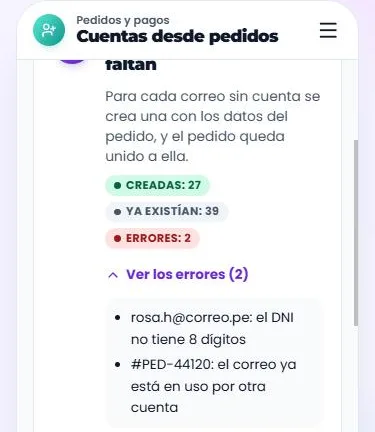

# Panel administrativo (`/admin`): el kit del admin (en marcha: D0 y D1 hechos en el kit, D2 por tramos)

Lo mismo que se hizo con la tienda, ahora con el panel: **primero todo en el
kit**, con datos de ejemplo en `/componentes.html`; **cuando un apartado está
completo en el kit, se une al admin real** con sus conectores y su
interruptor para volver a lo de antes. Nada se migra a medias: un apartado
entra entero o no entra.

Esta ficha es el único plan del admin. Cada avance se anota aquí (en su
apartado y en el **Registro** del final), con la fecha y qué se probó. Lo
viejo que quede sin uso va a [ELIMINAR.md](ELIMINAR.md), como siempre.

Numeración: **D** = admin. **D0** es el marco (menú, cabecera de página,
inicio) y **D1-D8** los apartados, en el orden en que se hacen.

## Para qué

1. **Un solo sistema.** El admin tiene que verse y comportarse como Walá
   clientes: las mismas piezas, los mismos tokens, el mismo modo noche.
2. **Mejor experiencia para quien administra.** Menos pasos, nada de
   `alert()` ni `window.confirm`, estados claros (cargando, vacío, error,
   guardado), deshacer donde se pueda y confirmar solo lo que no se deshace.
3. **Un celular de verdad.** Hoy el admin es de escritorio con el menú
   apretado. Tiene que poder usarse completo desde el teléfono (y la app con
   Capacitor): revisar un pedido, cambiar un stock, publicar un sorteo,
   responder un reclamo.

## Punto de partida (mapa del 2026-11-02)

- **91 archivos JSX** (`pages/admin`, `pages/Tienda/admin`, `components/admin`,
  `components/AdminLayout`), unas 38 mil líneas, y **26 mil líneas de CSS
  propio**: cada página dibuja lo suyo.
- **Solo 6 usan el kit**, y para algo suelto: `Boton` y `Sello` (Marcas),
  `Campo`/`Chip`/`useConfirmar` (Popups, Ruleta, Yoryo), `RuedaRuleta`,
  `VentanaCampana`, `TarjetaProducto` (Landing pages).
- **Cuatro familias de estilo a la vez**: `components/common/Button` (33
  páginas), los `Glass*` de `components/ui` (7), `GlassCard`/`KpiCard` de
  `components/dashboard` (8) y las piezas de `pages/admin/resultados/piezas.jsx` (7).
- Hecho a mano y repetido:

| Hecho a mano | Veces | Lo reemplaza |
|---|---|---|
| `<select>` nativo | 104 | `Selector` / `Campo` con `opciones` (`ListaOpciones`) |
| Modales con clases propias (`styles.modal…`) | 77 | `HojaInferior` / `HojaEdicion` |
| `alert(...)` | 58 | `useToast` |
| `window.confirm` | 42 | `useConfirmar` |
| `<input type="checkbox">` | 35 | `Casilla` / `Interruptor` |
| `<textarea>` | 30 | `Campo multilinea` |
| `<table>` | 26 (+ `ProductTable`) | `TablaAdmin` (nueva) |
| `type="file"` + subida propia | 17 | `CampoImagen` (nueva) |
| `type="color"` / `type="date"` | 10 / 10 | `ControlColor` / `CampoFecha` |
| `ToastContext` viejo | 10 | `useToast` del kit |
| Paginación o "cargar más" | 0 | `CargarMas` (nueva): hoy todas las listas bajan todo |

- **Ya está en el kit:** el editor del builder (`editor/PanelEditor`, por
  `components/constructor/EditorDeTienda.jsx`; `VisualEditorPanel` solo con
  `editorViejo`). Sus controles (`ControlImagen`, `ControlColor`,
  `ControlLista`, `ControlIcono`, `ControlEnlace`, `ControlFecha`) y
  `FormularioSeccion` + `esquemas.js` son un motor de formularios por
  esquema que el admin puede reutilizar.

## Diseño: el lenguaje de Walá, con la densidad de un panel

Es el mismo sistema del kit (README, "Lenguaje de marca"). Lo que cambia es
cuánto entra en pantalla, no la marca.

**Igual que en clientes**
- Tokens de `styles/variables.css` y `theme/tokens.css`, noche violeta
  (`--noche-wala`), nada de gris carbón.
- `--fuente-marca` (Montserrat 900) en títulos de página, cifras y nombres;
  Poppins en el resto.
- **Botón violeta liso** (`Boton`), sin el degradado de `GlassButton`.
- Íconos en `Sello` (el del menú, el de cada cabecera de página, el de los
  estados vacíos), con un tono por grupo del menú. Nada de emojis en los
  títulos (hoy: "🎯 Datos para recomendar", "📦 Recepción…").
- `Visto` para lo elegido; `EstadoVacio` con Kapi donde no hay datos.
- Animaciones livianas: `transform`/`opacity`, brillo solo al interactuar,
  sin bucles, sin glows, sin blur (el admin de hoy usa *liquid glass*: se va).
- Fotos de producto con `FotoProducto` (fondo blanco, `--escenario-foto`).

**Distinto a propósito**
- **Más denso**: filas de tabla de 44-48 px, márgenes menores, títulos más
  chicos que en la tienda. Un panel se lee rápido, no se recorre.
- **Sin etiqueta colgante** salvo en las vistas previas de producto (la
  regla de siempre: la etiqueta violeta es de productos; en datos y cuentas
  se confunde con "Combo"). Sin garabatos en tablas ni formularios; Kapi
  solo en vacíos y en el inicio.
- **Costos y cobros etiquetados** con texto ("CUESTA", "Cobrado"), nunca un
  ícono de moneda con un número solo.
- **Estados con texto y color** (`InsigniaEstado`), nunca solo color.

## En el celular

Regla: **todo lo que se hace en escritorio se puede hacer en el celular**,
con menos cosas a la vez.

- **Menú**: en el celular no hay barra lateral. Arriba, la cabecera del
  panel (logo, título de la sección y el botón del menú); el menú abre como
  hoja con los grupos y un buscador de secciones. Abajo, una
  **barra inferior del admin** con 4 accesos fijos (Inicio, Pedidos,
  Productos, Resultados) y "Más" (el menú). El botón atrás de Android cierra
  la hoja antes de salir de la página (`useCerrarConAtras`).
- **Tablas → tarjetas**: la misma `TablaAdmin` se dibuja como lista de
  tarjetas por debajo de 720 px (container query, como `MarcoCuenta`): foto,
  título, 2-3 datos y el estado; las acciones en el `MenuContextual` (toque
  largo o "⋯").
- **Editar → pantalla completa**: `HojaEdicion` es un panel lateral en
  escritorio y una hoja de alto completo en el celular, con Guardar fijo
  abajo (encima del teclado).
- **Filtros → hoja**: el buscador queda arriba; los demás filtros, en una
  hoja con "Ver N resultados". Los filtros activos como chips quitables.
- **Acciones en lote**: al elegir filas aparece una barra fija abajo
  ("3 elegidos · Ocultar · Eliminar").
- Toques de 44 px como mínimo, nada que dependa del hover, nada de
  arrastrar sin una alternativa con botones (subir/bajar).
- Las vistas previas ("así se ve en la tienda") en el celular van en una
  pestaña aparte ("Editar · Ver"), no al costado.

## Reglas del kit (las de siempre, aplicadas al admin)

- **Los datos entran por props.** Ninguna pieza del admin lee Firestore,
  React Query, AuthContext ni permisos: la página real (el conector) se los
  pasa. El menú recibe los grupos ya filtrados por permiso.
- **Las acciones salen por props** (`onGuardar`, `onEliminar`…) y devuelven
  una promesa: la pieza pone sola el cargando, el error y el "Guardado".
- **Se arma con sus propias piezas**: la tabla usa `Casilla`, `Avatar`,
  `FotoProducto`, `InsigniaEstado`, `MenuContextual`; nada se dibuja dos veces.
- Todo en `src/componentes/kit/`: piezas del admin en `piezas/admin/`,
  páginas en `paginas/admin/`, adaptadores en `adaptadoresAdmin.js` (aparte,
  para no ir en el archivo principal de la tienda).
- En `/componentes.html`, una vista nueva **Admin** (como Piezas, Secciones
  y Páginas): las piezas sueltas y el "Panel de prueba" con el mismo marco,
  en escritorio y celular, con estados (cargando, vacío, error, sin permiso).

## Lo que ya sirve tal cual

| Pieza del kit | En el admin reemplaza |
|---|---|
| `Boton` | `common/Button`, `GlassButton` |
| `Campo`, `Selector`, `ListaOpciones`, `Interruptor`, `Casilla`, `CampoTelefono` | `<select>`, `<input>`, `<textarea>`, checkboxes, `common/Toggle`, `GlassInput` |
| `CampoFecha` | `type="date"` |
| `ControlColor`, `ControlImagen`, `ControlIcono`, `ControlLista`, `ControlEnlace` (`editor/CamposEditor.jsx`) | color, subida simple, listas repetibles (premios, planes, botones) |
| `Pestanas`, `Acordeon` | `tabBtn` propios (18 páginas) |
| `HojaInferior`, `Confirmar` + `useConfirmar` | modales propios, `GlassModal`, `common/Modal`, `window.confirm` |
| `useToast`, `Aviso` | `alert()`, `ToastContext` |
| `EstadoVacio`, `Esqueletos`, `Cargando`, `CapaCargando` | "No hay…", `Loader2`, `PageLoading` |
| `Chip`, `Etiqueta`, `Avatar`, `FotoProducto`, `Sello`, `BarraProgreso` | badges y miniaturas propias |
| `RecortarFoto`, `QuitarFondo` | `AdminImageCropper`, `ThumbnailCropEditor` |
| `MenuContextual` | botones de editar/eliminar sueltos por fila |
| `CodigoCopiable` | "copiar enlace / código" propios |
| `TarjetaProducto`, `VentanaCampana`, `RuedaRuleta`, `CabezaSorteo`, `BotonEnlace`, secciones del builder | vistas previas de la tienda dibujadas aparte |

## Piezas nuevas (por hacer)

Estado: **·** por hacer · **kit** hecha en el kit · **admin** ya en el panel.

### Marco

| Pieza | Qué hace | Estado |
|---|---|---|
| `MarcoAdmin` | Menú lateral con grupos plegables (el abierto se recuerda), buscador de secciones, sello por grupo; en el celular, cabecera + hoja + `BarraInferiorAdmin`. Recibe `grupos` ya filtrados por permiso | kit (2026-11-02) |
| `BarraInferiorAdmin` | Los 4 accesos fijos + "Más" en el celular | kit (2026-11-02) |
| `CabezaAdmin` | Sello, título, una línea de ayuda, migas, acciones ("Nuevo", "Exportar") y, en el celular, la acción principal como botón fijo | kit (2026-11-02) |
| `SinPermiso` | Lo que ve un admin sin el permiso de esa sección | kit (2026-11-02) |

### Datos

| Pieza | Qué hace | Estado |
|---|---|---|
| `TablaAdmin` | Columnas, ordenar, elegir filas, acciones por fila, esqueleto, vacío, error; tarjetas en el celular | kit (2026-11-02) |
| `BarraFiltros` | Buscador, chips de filtros, `Selector`, rango de fechas; en el celular los filtros en hoja | kit (2026-11-02) |
| `AccionesLote` | La barra de "N elegidos" (reemplaza `components/admin/BulkActions`) | kit (2026-11-02) |
| `CargarMas` | "Cargar más" / paginación con cuántos hay | kit (2026-11-02) |
| `InsigniaEstado` | Un estado con texto y color desde un mapa (borrador, activo, cerrado, pagado, pendiente, anulado…) | kit (2026-11-02) |
| `FilaRecurso` | Foto, nombre, datos y acciones: categorías, colecciones, marcas, cliparts | · |
| `ListaOrdenable` | Reordenar arrastrando, con subir/bajar como alternativa (en vez del número `order` escrito a mano) | kit (2026-11-02) |
| `SelectorProductos` | Buscar y elegir productos con su foto (reemplaza `components/admin/BuscadorProducto`) | kit (2026-11-02) |
| `PasoAdmin` | Un paso de una herramienta de una vez: número en sello, botón, pregunta, cómo va, resultado, a medias o error | kit (2026-11-02) |

### Formularios

| Pieza | Qué hace | Estado |
|---|---|---|
| `HojaEdicion` | Crear/editar: panel lateral o pantalla completa en el celular; Guardar/Cancelar; aviso de cambios sin guardar; bloqueada mientras guarda | kit (2026-11-02) |
| `GrupoCampos` | Un bloque de campos con su título y ayuda (hoy 19 versiones de `fieldGroup`/`formSection`) | kit (2026-11-02) |
| `CampoImagen` | Soltar o elegir, recortar (`RecortarFoto`), avance de la subida, cambiar y quitar. La subida llega por props | kit (2026-11-02) |
| `CampoFechaHora` | `CampoFecha` + la hora (sorteos, ofertas, popups) | · |
| `CampoDinero`, `CampoPorcentaje` | Soles (o céntimos guardados), dólares, comisión | `CampoDinero` kit (2026-11-02) |
| `CampoColor` | La muestra del color sobre un damero y su código (#ffffff) | kit (2026-11-02) |
| `EstadoGuardado` | "Sin guardar · Guardando… · Guardado" en la cabecera del formulario | · |
| `VistaPrevia` | El marco "Así se ve en la tienda" con celular/escritorio; en el celular, pestaña "Ver" | · |

### Métricas

| Pieza | Qué hace | Estado |
|---|---|---|
| `Cifra` | Una cifra con su nombre y ▲/▼ frente al periodo anterior (reemplaza `KpiCard` y la de `resultados/piezas`) | kit (2026-11-02, con `FilaCifras`; el ▲/▼ y la explicación desde D4a) |
| `SelectorPeriodo` | Hoy, 7, 30, 90 días, fechas y "comparar" | kit (2026-11-02) |
| `GraficoTendencia`, `GraficoBarras`, `GraficoDona`, `GraficoComparar` | Los de `components/dashboard/charts` y `resultados/piezas` en una sola versión | `GraficoTendencia` kit (2026-11-02, líneas o barras); el resto en D4 |
| `RankingConFotos` | `RankingConMiniaturas` del dashboard | `ListaBarras` kit (2026-11-02, con foto opcional) |

## Plantillas de página

Casi todo el admin entra en cinco formas. Se hacen como páginas del kit
(`paginas/admin/`) que reciben las piezas de arriba.

| Plantilla | Forma | Páginas que cubre |
|---|---|---|
| `PaginaListaAdmin` (kit, 2026-11-02) | `CabezaAdmin` + `BarraFiltros` + `TablaAdmin` + `HojaEdicion` | Categorías, Colecciones, Atributos, Marcas, Cliparts, Envíos, Recompensas, Misiones, Retos, Popups, Sorteos, Enlaces, Landing pages, Temas, Referidos, Libro de reclamaciones… |
| `PaginaDetalleAdmin` | Cabeza con estado + `Pestanas` + tablas y acciones | Detalle de sorteo, de suscripción, ficha de cliente, un pedido |
| `PaginaEditorAdmin` | Formulario + `VistaPrevia` | Editor de enlaces, Popups, Ruleta, Encuestas, Palabra, Mascota |
| `PaginaResultadosAdmin` | `SelectorPeriodo` + `Cifra` + tarjetas con gráficos | Las pestañas de Resultados, el historial de pagos |
| `PaginaAjustesAdmin` | `GrupoCampos` + Guardar | Configuración, WhatsApp, Mascota, configuración de pagos |

Quedan fuera de las plantillas (herramientas propias, como el estudio):
`AdminProductoFormV2` (1.881 líneas), `PrintAreasEditor` (1.632),
`PersonalizacionPrenda` (899), `ShapeCreator`, `AdminViewEditor`. Se arman
con las mismas piezas, al final de su apartado.

## Apartados

Cada uno se hace **entero en el kit** (piezas que falten, sus páginas en el
Panel de prueba, celular y escritorio, capturas en `guia/`) y después **se
une** al admin. Columna "Kit" / "Admin": **·** por hacer, **en marcha**,
**hecho (fecha)**.

| # | Apartado | Páginas (ruta `/admin/…`) | Plantilla | Kit | Admin |
|---|---|---|---|---|---|
| D0 | Marco | el menú (`AdminLayout`), la cabecera de cada página, el inicio (`/admin`, `AdminDashboard`) | — | hecho (2026-11-02) | · |
| D1 | Catálogo base | `categorias`, `colecciones`, `atributos-catalogo`, `marcas` (+ productos de la marca), `envios`, `cliparts`, `destacados` | Lista | hecho (2026-11-02) | · |
| D2 | Productos | `productos` (lista, packs), `inventario`, `productos/:id` (la ficha), `plantillas-yoryo`, personalizables y combos de Crear, `blueprints`, `publico-productos` | Lista + herramientas propias | hecho (2026-11-02) | · |
| D3 | Pedidos y pagos | `recepcion-pedidos`, `gestion-pagos` (configuración, generar enlace, historial), `crear-cuentas-pedidos`, `libro-reclamaciones` | Lista · Detalle · Ajustes | hecho (2026-11-02) | · |
| D4 | Resultados | `resultados` (Resumen, Productos, Visitantes, Clientes con la ficha, Opiniones, Detalle técnico y sus pantallas) | Resultados · Detalle | en marcha (D4a, D4b y D4c, 2026-11-02) | · |
| D5 | Clientes y fidelidad | `referidos`, `recompensas`, `misiones`, `retos`, `notificaciones`, `fechas-importantes`, `encuestas` | Lista · Editor | · | · |
| D6 | Campañas | `sorteos` (+ detalle), `sorteos-suscripcion` (+ detalle), `enlaces` (+ editor), `popups`, `landing-pages`, `temas` | Lista · Detalle · Editor | · | · |
| D7 | Juegos y Kapi | `wordle`, `ruleta`, `bolitas`, `mascota` | Editor | · | · |
| D8 | Ajustes | `configuracion` (admins, permisos, bloqueos), `whatsapp`, `backups` | Ajustes · Lista | · | · |

El orden: D0 con las piezas base (tabla, hoja de edición, campo de imagen,
estado), probadas en **Categorías**, que es un CRUD simple con foto y toca
casi todo. Después el resto de D1, y así hacia abajo. D2 (la ficha de
producto) puede ir después de D3 si hace falta: es la más grande.

## D0 · El marco y las piezas base (en el kit desde el 2026-11-02)

Cómo verlo: `npm run dev` → http://localhost:3000/componentes.html → **Admin**.
**Panel de prueba**: el marco con el menú real; **Ver como** cambia los
permisos (Super Admin, Catálogo, Solo inventario, Clientes) y el menú, la
barra del celular y lo que se puede abrir cambian solos; **Tamaño**
Computadora · Celular; **Estado**: cargando, error al cargar, sin datos y
"Guardar y subir fallan". **Piezas del admin**: `InsigniaEstado`, una tabla
con casillas y `AccionesLote`, y `CampoImagen` con sus estados.

| Parte | Componente | Archivo | Qué hace |
|---|---|---|---|
| D0·1 Menú | `MarcoAdmin` | `piezas/admin/Marco.jsx` | Menú lateral (marco de 960 px o más, container query `admin`): logo con "Panel", buscador de secciones (sin tildes), Inicio suelto y los grupos plegables con su sello; el grupo de la sección actual se abre solo; abajo, quién eres, "Ver la tienda" y "Salir". En el celular: cabecera con el título de la sección y el botón del menú, el menú en una hoja |
| D0·2 Barra del celular | `BarraInferiorAdmin` | `piezas/admin/Marco.jsx` (dibujo de `BarraInferior.module.css`, sin blur) | Cuatro accesos que el admin puede abrir y "Más" (el menú) |
| D0·3 Cabecera de página | `CabezaAdmin` | `piezas/admin/Marco.jsx` | Migas, sello, título con la letra del logo, ayuda, acciones; `principal` ("Nueva categoría") baja en el celular a un botón sobre la barra (el marco lo recibe por contexto) |
| D0·4 Sin permiso | `SinPermiso` | `piezas/admin/Marco.jsx` | Qué permiso pedir y "Volver al inicio" |
| D0·5 Inicio | `PaginaInicioAdmin` | `paginas/admin/Inicio.jsx` | Saludo con la fecha y Kapi (con hambre si algo espera, feliz si todo está al día), "Para hoy" (lo que espera respuesta, con su cuenta o "Al día") y atajos |
| Tabla | `TablaAdmin` | `piezas/admin/Datos.jsx` | Tabla con cabecera pegada, ordenar, casillas, "⋯" y clic derecho (`MenuContextual`); a menos de 720 px de caja, tarjetas (foto, título, datos, estado); cargando, error con Reintentar y vacío |
| Filtros | `BarraFiltros` | `piezas/admin/Datos.jsx` | Buscador y filtros en una fila; angosta, "Filtros" abre una hoja y los puestos quedan como chips; cuántos quedan |
| Estado | `InsigniaEstado`, `ESTADOS_ADMIN` | `piezas/admin/Datos.jsx` | `Etiqueta` con punto y texto, desde un mapa |
| Lo elegido | `AccionesLote` | `piezas/admin/Datos.jsx` | Barra noche pegada abajo (sobre la barra del celular: `--admin-abajo`) |
| Editar | `HojaEdicion` | `piezas/admin/Formularios.jsx` | Panel derecho de 520 px en escritorio, pantalla entera en el celular; Guardar fijo; el error de guardar queda arriba; con cambios, cerrar (X, Cancelar, Esc, afuera o atrás) pregunta "¿Salir sin guardar?" |
| Bloques | `GrupoCampos` | `piezas/admin/Formularios.jsx` | Título en versalitas, ayuda, una o dos columnas |
| Imagen | `CampoImagen` | `piezas/admin/Formularios.jsx` | Elegir o soltar, `RecortarFoto` (círculo o cuadrado), avance de la subida, Cambiar, Quitar, error con Reintentar |
| Datos | `MENU_ADMIN`, `menuAdminPara`, `accesosAdminPara`, `opcionActiva`, `categoriaDesdeFirestore` / `categoriaAFirestore`, `marcaAdminDesdeFirestore` | `adaptadoresAdmin.js` (con pruebas: `npm run test:admin`) | El menú con el permiso de cada opción (las mismas reglas de `AdminLayout`), la barra del celular y las categorías |

La prueba de las piezas: **Categorías** (`paginas/admin/Categorias.jsx`,
`PaginaCategorias`; es de D1, se armó primero porque toca casi todo):
aviso de las que no tienen marca con "Verlas", buscar, filtrar por marca
(o "Sin marca"), ordenar por nombre u orden, crear y editar en la hoja
(nombre, orden, marcas con "Todas · Ninguna", la foto de la burbuja en
círculo) y eliminar con su pregunta. Datos de la demo: la copia real de
`categories` (`demo/tienda.json`) y `tienda_brands` (`demo/marcas.json`;
las marcas de cada categoría salen de su `categoryNav`, por eso varias
quedan "sin marca").

### Diferencias a propósito (no "corregirlas" al unir)

- **El menú se ordena por tarea**, no por permiso: Inicio · Pedidos y pagos ·
  Catálogo · Resultados · Clientes · Campañas · Diseño y juegos · Ajustes.
  Cada opción conserva su permiso de hoy (`adaptadoresAdmin.js`); un grupo
  sin opciones no sale. **Inicio lo ve cualquier admin** (antes su enlace
  estaba en el grupo de diseño, aunque `/admin` ya abría para todos).
- Sin emojis en el menú: cada opción tiene su ícono (`iconosAdmin.js`).
- **Categorías no deja dos con el mismo nombre** (sin tildes ni
  mayúsculas): propone sumarle marcas a la que ya existe.
- La orden de una categoría nueva es la mayor + 1 (antes, cuántas había).
- Guardar cierra la hoja y avisa con un toast; antes el formulario quedaba
  arriba de la lista y subía la página.
- `useCerrarConAtras` (`Efectos.jsx`) ganó `alBloquear`: con "atrás"
  bloqueado, avisa (la hoja de edición pregunta antes de salir). Lo de
  antes no cambia.

### Qué se probó (2026-11-02, demo en localhost)

- Escritorio (1180 px) y celular (375 px; también el tamaño Celular de la
  demo): el menú lateral o la cabecera + barra, la tabla o las tarjetas, el
  botón "Nueva categoría" sobre la barra; nada se sale del ancho a 375 px
  (el buscador de los filtros empujaba "Filtros": corregido).
- Crear sin nombre → el error en el campo y el foco ahí; crear con marca →
  toast y la fila nueva; editar → guardar falla ("Guardar y subir fallan")
  → el motivo arriba y lo escrito se queda → guardar bien.
- Con cambios: Esc → pregunta; "Seguir editando" → sigue la hoja; atrás →
  pregunta; atrás otra vez → solo se va la pregunta; "Salir sin guardar"
  → se cierra sin salir de la página.
- "⋯" → Editar · Eliminar → la pregunta → la fila se va y el toast.
- Permisos: "Solo inventario" ve Inicio e Inventario y Categorías dice qué
  permiso pedir; "Clientes" ve Pedidos y pagos, Resultados, Clientes y
  Campañas (solo Popups).
- En el celular: "Más" abre el menú en una hoja, buscar "ruleta" la
  encuentra y tocarla navega y cierra la hoja; la subida de una foto
  (recorte en círculo, avance, falla con Reintentar).
- Sin errores en la consola. Ese día el panel del navegador estaba oculto
  (no dibujaba): lo visual se revisó a ojo con D1 (abajo).

### Pendiente de D0

- ~~Las capturas y el modo noche~~: hechas con D1 (abajo); el modo noche se
  revisó a ojo el 2026-11-02 (la barra de lo elegido se perdía de noche:
  ahora violeta oscuro con borde).
- ~~`AccionesLote` encima del botón de la página~~: mientras hay algo
  elegido, el botón se esconde (`useMarcoAdmin().setConLote`).
- ~~`PaginaListaAdmin`~~: salió con D1.
- Al unir: el inicio de hoy (`AdminDashboard.jsx`) trae además un editor
  viejo de secciones por zonas; ver si alguien lo usa antes de retirarlo.

## D1 · Catálogo base (en el kit desde el 2026-11-02)

Cómo verlo: **Admin** → Panel de prueba → "Ir a" (Categorías, Colecciones,
Marcas, Atributos, Envíos, Cliparts, Destacados) o el menú. Datos: la copia
real de `categories`, `collections`, `tags`, `characters`, `productTypes`,
35 productos (`demo/tienda.json`) y `tienda_brands` (`demo/marcas.json`);
las zonas de envío y los cliparts son de ejemplo (no hay copia).

| Escritorio | Celular |
|---|---|
|  |  |
|  |  |
|  |  |

### La plantilla: `PaginaListaAdmin` (`paginas/admin/Lista.jsx`)

Toda lista con su hoja: `CabezaAdmin` + `antes` (un aviso, pestañas) +
`BarraFiltros` + `TablaAdmin` (de a 50, con `CargarMas`) + `HojaEdicion` +
la pregunta de eliminar + los toasts. Cada página da sus columnas, sus
filtros (`filtrar(r, valor)`), sus órdenes, y un `formulario` con `vacio`,
`desde`, `validar` (el primer campo con error recibe el foco), `limpiar` y
`campos`. `eliminar.bloqueado(r)` no pregunta: avisa por qué no se puede.
Lo que se repite en las celdas está en `paginas/admin/celdas.jsx`
(`FotoCelda`, `MarcasCelda`, `NumeroCelda`, `ElegirMarcas`, `porNombre`,
`porOrden`). Categorías pasó a la plantilla.

### Las páginas

| Página | Componente | Archivo | Qué tiene |
|---|---|---|---|
| Categorías | `PaginaCategorias` | `paginas/admin/Categorias.jsx` | (D0) sobre la plantilla |
| Colecciones | `PaginaColecciones` | `paginas/admin/Catalogo.jsx` | Nombre, orden y el banner (ancho, sin recorte); no repite nombres |
| Atributos | `PaginaAtributos` | `paginas/admin/Catalogo.jsx` | Pestañas Tipos · Etiquetas · Personajes con su cuenta; etiquetas y personajes con marcas (sin ninguna: de todas); cuántos productos usa cada uno; **no deja eliminar uno en uso** (como antes) y dice en cuántos está |
| Zonas de envío | `PaginaEnvios` | `paginas/admin/Catalogo.jsx` | Zona y departamento, costo (`CampoDinero`; 0 = gratis), días, orden y activa (`Interruptor`); filtro activas/inactivas |
| Cliparts | `PaginaCliparts` | `paginas/admin/Catalogo.jsx` | Nombre, categoría (elegir o escribir una nueva), la imagen (PNG/SVG, sin recorte, también por enlace) |
| Marcas | `PaginaMarcas` | `paginas/admin/Marcas.jsx` | Arriba, "Pedidos por WhatsApp" (número principal y multimarca, en su hoja). La lista: logo, dirección, WhatsApp del asesor, tope de monedas. La hoja: nombre, dirección (`wala.pe/…`, **no deja repetir la de otra marca**), orden, logo, WhatsApp del asesor, mensaje sin productos, tope de monedas con el ejemplo de S/ 100, el fondo de sus tarjetas (`CampoColor`, textura, cuánto se ve) y la **vista previa de la tarjeta** con uno de sus productos. Menú "Páginas": aplicar la plantilla de página (pregunta) y quitar páginas repetidas. Por fila: sus productos y diseñar página |
| Productos de una marca | `PaginaProductosMarca` | `paginas/admin/Marcas.jsx` | Pestañas "En la marca · N" y "Agregar productos", buscar, casillas, `AccionesLote` (Quitar de la marca / Pasar a …), de a 50; "Crear producto en …" (`/admin/productos/nuevo?brandId=`) |
| Destacados | `PaginaDestacados` | `paginas/admin/Destacados.jsx` | Los de la portada en una `ListaOrdenable` (arrastrar o flechas; "Guardar orden" / "Deshacer" pegados abajo), quitar, `SelectorProductos` para destacar otro y lo más vendido de 30 días con Destacar / Quitar |

Piezas nuevas en D1: `ListaOrdenable`, `SelectorProductos`, `CargarMas`
(`piezas/admin/Datos.jsx`), `CampoDinero`, `CampoColor` y `conEnlace` /
`contener` en `CampoImagen` (`piezas/admin/Formularios.jsx`). Adaptadores
nuevos (con pruebas): colecciones, atributos (`ATRIBUTOS`,
`usosDeAtributo`), zonas, cliparts, marcas (`slugDeMarca`, `topeMonedasDe`),
`productoAdminDesde` y `mismoNombre`.

### Diferencias a propósito (D1)

- Colecciones, zonas y atributos **no dejan dos con el mismo nombre** (sin
  tildes ni mayúsculas); los atributos ya lo hacían.
- Una marca **no puede tomar la dirección de otra** (antes lo decía el
  servidor al guardar).
- **Destacar uno lo pone al final** (antes, con orden 0: al principio y
  empatado con otros). El orden se guarda de una vez para todos, con su
  posición (`featuredOrder` 0, 1, 2…); antes, uno por uno con un número.
- El WhatsApp de "Pedidos por WhatsApp" se cambia en su hoja, con el
  resto de la página quieta.
- "Aplicar plantilla" y "Quitar páginas repetidas" van en el menú
  "Páginas" (antes, dos botones grandes arriba); el resultado sale en un toast.
- "Gestionar productos" es una página con su dirección (en la demo,
  `/admin/marcas/:id/productos`); antes reemplazaba la lista sin cambiar
  la dirección (atrás salía de Marcas).

### Qué se probó (2026-11-02, demo en localhost, con el navegador dibujando)

- Las siete páginas cargan con sus datos; en el celular (375 px) nada se
  sale del ancho (las pestañas de Atributos y la lista de Destacados se
  salían: pestañas más cortas, que se deslizan si no entran, y el número
  de la lista y el texto "Quitar" se van en angosto).
- Destacados: bajar el primero con la flecha → aparece "Guardar orden" →
  guardar → toast y se va el aviso; buscar "conjunto" → los ya destacados
  dicen "Destacado" → destacar otro → queda al final; quitar → se va.
- Atributos: las tres pestañas con su cuenta; eliminar una etiqueta en uso
  → no pregunta y avisa "Está en 1 producto…".
- Marcas → "Sus productos" de MUSSA → "Agregar productos" → elegir dos →
  el botón de la página se esconde → "Pasar a MUSSA" → toast y la cuenta
  pasa de 11 a 13.
- Editar una marca: la hoja con la vista previa de la tarjeta; el color
  con su muestra (el `ControlColor` del editor no se veía fuera del editor:
  por eso `CampoColor`).
- Modo noche a ojo (Categorías y las piezas sueltas). Sin errores en la consola.

### Cómo se une D1 (cuando se decida)

Un conector por página en `src/components/panel/` con los servicios de hoy
y sus mismas `queryKey` (las de la tienda también: `['categories']`,
`['collections']`, `['brands']`, `['tags']`, `['characters']`,
`['productTypes']`, `['shipping-zones']`, `['cliparts']`,
`['featured-products']`, `['products']`…):

| Página | Lee | Escribe |
|---|---|---|
| Categorías | `getCategories`, `getBrands` | `createCategory` / `updateCategory` / `deleteCategory` con `categoriaAFirestore`; `uploadFile` en `categories/` |
| Colecciones | `getCollections` | `create/update/deleteCollection` con `coleccionAFirestore`; `uploadFile` en `collections/` |
| Atributos | `getProductTypes`, `getTags`, `getCharacters`, `getBrands`, `getProducts([], null, null, { includeHidden: true })` para `usosDeAtributo` | `create/update/delete` de cada uno con `atributoAFirestore(datos, tipo)` |
| Envíos | `getShippingZones` | `create/update/deleteShippingZone` con `zonaAFirestore` |
| Cliparts | `getCliparts` | `create/update/deleteClipart` con `clipartAFirestore(datos, toDirectImageUrl)`; `uploadFile` en `cliparts/` |
| Marcas | `getBrands`, `getMessage('whatsapp_number_principal' \| 'whatsapp_multimarca')`, `getProductsByBrand` (la muestra) | `create/update/deleteBrand` con `marcaAFirestore` (si `updateBrand` devuelve error, se lanza: la hoja lo muestra); `setMessage` ×2; `ensureAllBrandLandings({ force: false })` y `dedupeBrandLandings` con su texto de resultado; logo en `brands/logos/`, textura en `brands/backgrounds/` (`opciones.carpeta`) |
| Productos de una marca | `getProducts(… includeHidden)` con `productoAdminDesde` | `setProductBrand(id, brandId)` (vacío para quitar) uno por uno, contando los que fallan |
| Destacados | `getProducts(… includeHidden)`, `getTopSellingWala({ days: 30, topLimit: 10 })` (staleTime 15 min) | `updateProductField(id, { featured: true, featuredOrder: último + 1 })`, `{ featured: false, featuredOrder: 0 }` y el orden `{ featured: true, featuredOrder: i }` |

Interruptor: `adminCatalogoViejo`. No se pierde: el tope de monedas es el
mismo de `utils/topeMonedas` (y su espejo en `functions/checkoutTotals.js`);
eliminar una marca borra su landing (`deleteBrand`); `storeTitle` y
`storeSubtitle` no se escriben (se conservan).

## D2 · Productos (en el kit desde el 2026-11-02: los cuatro tramos)

D2 es el apartado más grande (la ficha sola tiene 1.881 líneas y se apoya
en editores de otras 3.000). Se hace por tramos; el apartado se une entero
cuando estén los cuatro (ya están: falta unirlo).

| Tramo | Qué | Páginas de hoy | Kit |
|---|---|---|---|
| D2a | La lista, el inventario y los datos para recomendar | `pages/Tienda/admin/AdminProductos.jsx` (vistas Tienda y Todos), `ProductTable`, `BulkActions`, `pages/Tienda/admin/AdminInventario.jsx`, `pages/admin/AdminPublicoProductos.jsx` | hecho (2026-11-02) |
| D2b | La ficha de un producto: general (precio, stock, descripción, organización, WhatsApp, destacado), colores y tallas (variantes con sus fotos, el encuadre 3:4, la galería, frente y espalda), un combo (sus piezas y su portada) y "Dónde se ve" (personalizar en Crear) | `pages/Tienda/admin/AdminProductoFormV2.jsx`, `AdminComboEditor`, `ThumbnailCropEditor`, `GenerarFrenteEspalda`, `PersonalizarEnCrear` | hecho (2026-11-02) |
| D2c | Crear: la lista de personalizables, su ficha (colores, diseño con vistas y zonas, plantillas, dónde se ve) y los packs (lista, formulario y "Sugerir combos") | `pages/admin/AdminPrendasCrear.jsx`, `prendasCrear/PersonalizacionPrenda.jsx`, `ZonaEditor.jsx`, `PlantillasDeLaFicha.jsx`, `AdminCombosCrear.jsx` | hecho (2026-11-02) |
| D2d | Blueprints (una lista más, sobre la plantilla) y decidir qué pasa con las herramientas de una vez y lo viejo (abajo) | `pages/admin/AdminBlueprints.jsx`, `plantillasYoryo/ImportarPlantillasYoryo.jsx` | hecho (2026-11-02) |

**Para D2d**
- **Decidido (2026-11-02): la personalización de antes no se rehace en el kit**: `AdminCustomizationViewsEditor`,
  `YoryoPersonalizado`, `AdminViewEditor` + `PrintAreasEditor` + `ShapeSelector`
  (y `ShapeCreator`, que ya no se importa en ningún lado) solo salen con el
  interruptor `personalizableViejo` y en `/editor/:id`. La tienda no los usa
  desde el 2026-10-20. Quedan fuera del kit y, cuando no quede ningún
  producto con esa personalización (el aviso de D2a lo dice), pasan a
  [ELIMINAR.md](ELIMINAR.md).
- **Plantillas de cuadros** (`/admin/plantillas-yoryo`) son siete pasos de
  una sola vez (crear los productos de Yoryo, sus plantillas, la billetera,
  las cómodas de Daida…). Propuesta: una página del kit con los pasos en
  sellos y su estado, sin cambiar lo que hace cada paso. **Hecho así** (abajo).

### D2a: lo que hay

| Escritorio | Celular |
|---|---|
|  |  |

| Página | Componente | Archivo | Qué tiene |
|---|---|---|---|
| Productos | `PaginaProductos` | `paginas/admin/Productos.jsx` | Pestañas Tienda · N, Personalizables · N, Packs de Crear · N (lo que ponga D2c; hoy, un aviso) y Todos. En Tienda: los borradores sin terminar de este aparato (Continuar · Descartar), el aviso de la personalización de antes (con la lista y "Quitarla"), Visibles · Ocultos · Piezas de combo · Todos con su cuenta, buscar (nombre, categoría o precio), filtrar por categoría y marca, ordenar por nombre, precio o stock; en cada fila, Destacado, Combo, Pieza de combo, Personalizable; mostrar u ocultar con un toque (al momento, y vuelve si falla); menú Editar · Mostrar/Ocultar · Duplicar · Archivar; casillas con Mostrar · Ocultar · CSV · Archivar; "Exportar CSV"; "Nuevo producto" y "Crear otro" (un personalizable o un pack). Todos: qué es cada uno (Pack de Crear, En Crear, Borrador, Reemplazado…) |
| Inventario | `PaginaInventario` | `paginas/admin/Productos.jsx` | Aviso de agotados con "Verlos"; buscar por nombre o SKU; filtros de stock (agotados, últimas, disponibles), categoría, colección, marca y tipo; el estado con su color; el stock con − / + que se guarda solo (un segundo después), con guardando, guardado o Reintentar. La fila no se mueve al guardar (el orden y el filtro usan el stock con que llegó) |
| Datos para recomendar | `PaginaRecomendar` | `paginas/admin/Productos.jsx` | Faltan datos · Todos · De un equipo · No para niños con su cuenta; para quién y la edad con un toque (`ElegirUno`: lo deducido punteado; tocar lo guardado lo quita); el equipo con sugerencias y "Usar"; "Aceptar sugerencias" y "Marcar los N como…" |

Piezas nuevas: `NumeroEnLinea` y `tarjeta: 'control'` en `TablaAdmin`
(lo que se toca va debajo de la tarjeta, nunca dentro de su botón) en
`piezas/admin/Datos.jsx`; `ElegirUno` en `piezas/admin/Formularios.jsx`.
Adaptadores: `productoAdminDesde` ahora trae stock, SKU, categorías,
colecciones, tipo, si es combo y sus piezas, lo de Crear (personalizable,
tal cual, en la tienda, pack, reemplazado), la personalización de antes y
los datos para recomendar, con la foto de la lista como AdminProductos;
`esDeLaTienda`, `piezasDeCombos`, `etiquetasDeProducto`,
`rutaAdminDeProducto` y `estadoDeStock` (con pruebas). Los filtros
(`BarraFiltros`) bajan de línea cuando no entran (Inventario tiene cinco).

### Diferencias a propósito (D2a)

- **Sin el cambio tarjetas / tabla**: la misma lista es tabla o tarjetas
  según el ancho (antes se elegía y se guardaba en el aparato).
- **Todo lo que pregunta usa `Confirmar`** (antes `window.confirm` en
  mostrar, ocultar y archivar varios, descartar un borrador y la
  personalización de antes) y los errores salen en toasts (antes `alert`
  en el inventario).
- **Inventario no lista los archivados** (antes sí, por no filtrar
  `deleted`), suma el filtro por stock y −/+ junto al número.
- Duplicar deja la copia en la lista (oculta) en vez de abrir su ficha a
  la fuerza; el conector decide si la abre.
- "Crear productos de referencia" no vuelve: no tenía botón.

### Qué se probó (2026-11-02, demo en localhost, escritorio y 375 px)

- Productos: las cuatro pestañas con su cuenta; ocultar con un toque
  cambia las cuentas (Visibles 31 → 30, Ocultos 4 → 5) y avisa; elegir dos
  y archivarlos con la pregunta; Todos muestra qué es cada uno; el aviso
  de la personalización de antes cuenta 2. En el celular, el botón de
  visible quedaba dentro del botón de la tarjeta (y se salía): ahora va
  abajo; los chips de estado no se parten.
- Inventario: − / + guarda solo y el estado pasa de Agotado a Últimas
  unidades; con "Guardar y subir fallan", Reintentar; reintentar sin la
  falla guarda. Dos toques rápidos en + contaban uno: arreglado.
- Recomendar: lo deducido sale punteado y tocarlo lo guarda; "Aceptar
  sugerencias" ya no se sale de la fila en el celular.
- Sin errores en la consola; nada se sale del ancho a 375 px.

### Cómo se une D2a (cuando D2 esté entero)

| Página | Lee | Escribe |
|---|---|---|
| Productos | `getProducts([], null, null, { includeHidden: true })` (`['admin-products']`), `getCategories`, `getBrands`; los borradores de `localStorage.wala_drafts` | Mostrar/ocultar: `updateProduct(id, { ...producto, visible })` y, si estaba `deleted`, `updateProductField(id, { visible: true, deleted: false })` (el arreglo anti-zombi de AdminProductos); archivar: `deleteProduct` (uno por uno, contando fallas); duplicar: `createProduct({ ...sin id ni createdAt, name: 'X (Copia)', visible: false })`; CSV: `exportProducts(productos, categorias, ids)`; la personalización de antes: `quitarPersonalizacionVieja` uno por uno; descartar un borrador: borra sus fotos de Storage **solo si nunca se publicó** (la regla P0 de AdminProductos) e invalida `admin-products`, `products`, `featured-products`, `collection-products` |
| Inventario | `getProducts(… includeHidden)` sin los `deleted`, y las seis listas de filtros | `updateProductField(id, { inStock })` y `logInventoryChange(id, nombre, antes, ahora, email)` |
| Recomendar | `getProducts(… includeHidden)`, `getCategories`; `sugerenciaDe` con `publicoDe`, `edadMinimaDe` y `equipoDe` de `utils/giftRecommender.mjs`; los equipos de sus SINONIMOS | `updateDocument('productos_wala', id, campos)` (null borra el campo); en lote, de a 20; invalida `['products']` y `['gift-catalog-dicts']` |

### D2b: la ficha de un producto (en el kit desde el 2026-11-02)

| Escritorio | Celular |
|---|---|
|  |  |

`PaginaFichaProducto` (`paginas/admin/Ficha.jsx`), para un producto de la
tienda o un combo (los personalizables tienen su ficha en D2c). Pestañas
General · Colores y tallas (o Piezas del combo) · Dónde se ve; la que tiene
un error lleva un punto. **Guardar está siempre a mano**, pegado abajo
(sobre la barra del celular), con "Cambios sin guardar" o "Todo guardado";
salir con cambios pregunta. Uno nuevo se va guardando en el aparato
(`onBorrador`).

| Parte | Qué tiene |
|---|---|
| General | Cómo se vende (individual o combo); nombre, precio y oferta (`CampoDinero`, con el % que se ahorra; si no es menor que el precio, avisa antes de guardar en vez de perderla), SKU, stock, descripción (el editor con formato llega por `descripcion`; sin él, un texto largo); la marca con su logo (`ElegirMarca`); categoría y tipo (elegir o crear ahí); colecciones, personajes y etiquetas (`ElegirVarios`, con crear); cómo se prepara (`fulfillmentType`); para quién, la edad y el equipo; WhatsApp (activo, número propio con el de la marca de ejemplo, mensaje con `{url}`); destacado |
| Colores y tallas | Los colores en chips con su punto y la corona del principal, "+ Color"; por color: nombre, `CampoColor`, "Hacerlo el principal", quitar (pregunta; queda al menos uno); la foto de la tarjeta (subir o pegar enlace) con **"Así en la tarjeta"** y el encuadre 3:4 (`EncuadreFoto`: arrastrar, zoom, flechas; "Toda la foto" lo quita; no corta la foto); las tallas (`CampoTallas`: Enter o coma, sin repetir, "Poner S a XL") y cómo se llaman; la galería (`GaleriaFotos`: subir varias, ← →, encuadrar, quitar; la primera es la del mouse) y lo que se agregue abajo (`extraGaleria`: frente y espalda) |
| Piezas del combo | Tallas (cada prenda con la suya o una para todo); las piezas en una `ListaOrdenable` con su nombre en el combo y su color (el que ya no existe se marca); buscar para agregar (sin combos ni lo de Crear); la portada |
| Dónde se ve | Se ve en la tienda; se personaliza en (una prenda o un pack de Crear; uno que ya no existe se marca); "Pasarla a Crear" (pregunta; con cambios, pide guardar primero) |

Adaptadores (con pruebas): `fichaDesdeProducto` (lo que cargaba el
formulario, con la variante "Principal" para los productos de antes sin
variantes), `fichaAProducto` (el mismo payload que armaba
AdminProductoFormV2: `mainImage` del principal, `mainSizes: []`,
`hasVariants`, `isV2`, `customizable: false`; conserva las copias chicas
de las fotos que siguen y, en un combo, lo que la ficha no muestra de cada
pieza, como su escala o su Yoryo), `erroresDeFicha` y `CUMPLIMIENTOS`.

### Diferencias a propósito (D2b)

- **Avisa en vez de perder**: una oferta que no es menor que el precio ya
  no se guarda en silencio como vacía; el combo sin piezas, el nombre y el
  precio vacíos llevan a su campo (antes, `alert` o nada).
- **Guardar no sale de la ficha**: avisa y se queda (antes volvía a la
  lista); salir con cambios pregunta (antes no había aviso).
- **"Crear marca" no está en la ficha**: las marcas se crean en Marcas
  (antes había una ventana con nombre y logo).
- **Sin la personalización de antes**: el "Producto personalizable" de los
  combos, el editor de vistas y Yoryo no vuelven (D2d). "Se personaliza en
  Crear" del producto pasa a "Pasarla a Crear" (abre su ficha de Crear).
- La foto principal también acepta un enlace (antes, "Fijar URL" aparte).
- El encuadre se hace con el recuadro de Walá (antes, react-image-crop);
  guarda lo mismo: `{ percentages: { x, y, width, height } }`.

### Qué se probó (2026-11-02, demo en localhost)

- Abrir "Casaca One Piece · Luffy 9 Viñetas" desde la lista: sus 9 colores
  con el principal, precio 119, stock 10; cambiar el nombre → "Cambios sin
  guardar"; oferta 500 → al guardar, la pestaña General con su punto, el
  foco en la oferta y el aviso; vaciarla → se guarda.
- El encuadre: el recuadro 3:4 se mueve con las flechas y el zoom, y "Así
  en la tarjeta" lo muestra igual que la tienda.
- Salir con cambios → "¿Salir sin guardar?"; un combo con sus dos piezas,
  buscar "casaca" y agregarla con su primer color, guardar; uno nuevo sin
  datos → el foco en el nombre.
- Etiquetas: elegir "Alianza Lima" de las 74. Nada se sale del ancho a
  375 px y Guardar queda sobre la barra del celular. Sin errores en la consola.

### Cómo se une D2b

`inicial` cambia solo cuando llega otro producto (con `useMemo` por id: si
cambia en cada render, la ficha vuelve a empezar). El conector hace lo que
hacía AdminProductoFormV2:

- **Lee** `getProduct(id)`, las listas (`getBrands`, `getCategories`,
  `getCollections`, `getProductTypes`, `getCharacters`, `getTags`, con sus
  `brandIds` como `marcas`), el catálogo para las piezas y sus colores, y
  `getPrendasBase` + `getCombosCrear({ incluirBorradores: true })` para
  "Se personaliza en". Redirige como antes: un `esPrendaBase` a
  `/admin/prendas-crear/:id`, un `esComboCrear` a los packs.
- **Guarda** `createProduct(fichaAProducto(datos), draftId)` o
  `updateProduct(id, fichaAProducto(datos, producto))`, borra el borrador
  de `wala_drafts`, refresca `admin-products` y `admin-product,id` e
  invalida `products`, `products-infinite`, `product,id`,
  `featured-products` y `collection-products` (el comentario de
  `products-infinite` en FormV2 dice por qué).
- **Sube** a `productos_v2/{draftId}/` con el nombre de siempre según
  `carpeta` (`main_…`, `gallery_…`, `combo_preview_…`) y guarda las copias
  de `uploadFile` en `variante.copias` (`imagesVariantes`); nunca borra de
  Storage una foto que ya estaba en el producto (`safelyDeleteOldImage`).
- `descripcion`: el ReactQuill de siempre (las mismas fuentes y tamaños);
  `extraGaleria`: `GenerarFrenteEspalda` (el nombre `_frente-espalda.` del
  archivo importa: lo busca la página del combo).
- `?brandId=` elige la marca solo en uno nuevo; `?pestana=` va por
  `pestanaInicial` / `onPestana`.

### D2c: Crear (en el kit desde el 2026-11-02)

| Parte | Componente | Archivo | Qué tiene |
|---|---|---|---|
| Personalizables | `PaginaPersonalizables` | `paginas/admin/Crear.jsx` | La pestaña de Productos (`embebido`): Todos · Publicados · Borradores; foto, cuántos colores, vistas, zonas y plantillas, "Le faltan vistas con zonas", en qué packs está, En Crear / Borrador y En la tienda; Editar, Verlo en Crear, Publicar / Volver a borrador (al momento, vuelve si falla), Archivar (pregunta y dice qué packs publicados la usan) |
| Packs | `PaginaPacks` | `paginas/admin/Crear.jsx` | La lista (piezas, precio, tallas, estado) y la hoja: nombre, descripción, marca, categoría (de esa marca), portada; 2 a 4 piezas, cada una "Se diseña" (una prenda de Crear y el color en que abre) o "Va tal cual" (un producto de la tienda y su color); "Agregar prenda" copia la última; las tallas (Automático · Una por prenda · Una para todas, con su explicación); precio y oferta con **lo que cuestan por separado y lo que se ahorra**; publicado y en la tienda. "Sugerir packs": pareja y trío de cada prenda, con nombre y precio editables, cuáles crear y "Publicarlos de una vez" |
| Ficha de un personalizable | `PaginaFichaProducto` con `datos.esPrenda` | `paginas/admin/Ficha.jsx` | General (sin "Cómo se vende"; stock vacío = sin límite) · Colores y fotos · Diseño · Plantillas · Dónde se ve (publicado en Crear, también en la tienda, también tal cual, el aviso si su color principal no tiene foto de tienda) |
| Diseño | `DisenoPrenda` | `piezas/admin/Crear.jsx` | Prenda o producto, impresión o láser, solo con plantillas, portada en Crear; "Ver en" un color; cada vista con su nombre, foto, borde encima, la medida de referencia (cm y cuadrícula de 5 cm) y sus zonas (`EditorZonas` + `ListaZonas`); "Agregar vista" (Frente, Espalda…); "Usar el hoodie de ejemplo"; las zonas de los bicolores (de todos y propias de un color, copiar las heredadas o volver a ellas) |
| El editor de zonas | `EditorZonas`, `ListaZonas` | `piezas/admin/Crear.jsx` | El de `ZonaEditor`: la foto teñida en un lienzo, mover, estirar por el borde derecho, el de abajo o la esquina (sobre los ejes de una zona girada), la línea naranja con Shift, la medida en cm de la zona elegida; **ahora también con las flechas**. La lista: nombre con sugerencias, ancho y alto en cm (si hay escala, se confirman al salir), giro, esquinas, quitar, agregar |
| Colores | `ColoresPrenda` | `piezas/admin/Crear.jsx` | "Colores de polera (S–XL)"; por color: bicolor (segundo tono con `CampoColor`, cómo se reparten), "Agregar versión invertida" (fotos en espejo), el aviso si le falta la foto en una vista, la foto de tienda (subir o "Con una plantilla") y la foto propia de cada vista con su miniatura teñida |
| Plantillas | `PlantillasPrenda` | `piezas/admin/Crear.jsx` | Se guardan al momento (como antes): por grupo, renombrar, cambiar de grupo (elegir o escribir uno), editar en el estudio, quitar (pregunta), "Nueva plantilla" y "Traer de otro" (elegir el producto y cuáles); sin guardar el producto, avisa que primero hay que guardarlo |

Las reglas son las de `utils/prendaBase` (normalizar zonas y vistas,
medir en cm, teñir, `leerPrendaBase`, `colorDisponible`): el kit las
importa, no las copia. **`prendaBaseParaGuardar` pasó de
`PersonalizacionPrenda.jsx` a `utils/prendaBase.js`** (el archivo viejo la
reexporta: AdminProductoFormV2 no cambió) para que el kit la use sin cargar
Firebase. Adaptadores (con pruebas): `personalizableDesde`,
`packDesdeFirestore`, `packAGuardar`, `erroresDePack`, `MODOS_TALLA_PACK`;
`fichaDesdeProducto` / `fichaAProducto` / `erroresDeFicha` saben de
personalizables (prendaBase, stock sin límite, la foto de la primera vista
para un color sin foto, `enTienda` y `seVendeTalCual`, "cada vista necesita
su foto y una zona" en la pestaña Diseño).

### Diferencias a propósito (D2c)

- **Quitar una vista pregunta** (antes se iba con un toque); quitar las
  zonas de un bicolor usa `Confirmar` (antes `window.confirm`); los errores
  de subida y de la foto con plantilla salen en toasts (antes `alert`).
- Las zonas se mueven también con las flechas (Shift, más rápido).
- El grupo de una plantilla se elige con la lista de Walá (antes
  react-select).
- "Sugerir packs" se abre en una hoja; el resto del flujo es el mismo.

### Qué se probó (2026-11-02, demo en localhost)

- Personalizables: las 4 prendas de la copia con sus cuentas y sus packs;
  la Polera clásica abre con sus 14 colores, el stock "Sin límite" y las
  cinco pestañas.
- Diseño: las dos vistas teñidas con sus zonas, la línea de 58 cm y las
  zonas de los bicolores (cuatro editores); mover una zona con la flecha
  marca "Cambios sin guardar".
- Colores: "Agregar versión invertida" de Panda crea "Panda (al revés)";
  guardar → "Cambios guardados".
- Plantillas: traer las dos de la casaca (de ejemplo) → "Plantillas · 2"
  sin marcar cambios sin guardar.
- Packs: crear vacío → los tres avisos; un trío de Polera con precio 250 →
  "Por separado: S/ 387.00 · el cliente ahorra S/ 137.00 (35 %)" → creado;
  "Sugerir packs" → 8 → creados.
- Nada se sale del ancho a 375 px en ninguna pestaña. Sin errores en la consola.

### Cómo se une D2c

- **Personalizables**: `getPrendasBaseAdmin` + `getCombosCrear({ incluirBorradores: true })`
  (`refetchOnMount: 'always'`); publicar: `updateProductField(id, { visible })`;
  archivar: `deleteProduct`.
- **Ficha**: `/admin/prendas-crear/nueva` y `/:id` (RutasPrendasCrear) con
  `fichaDesdeProducto(producto, { prenda: true })`; al guardar, **releer
  las plantillas del producto** (`getDocument`) y pasar
  `fichaAProducto(datos, producto, { prendaBaseParaGuardar })` con esas
  plantillas (así guardar no borra una que se agregó en el estudio); las
  subidas como antes (`crear_…png`, `tienda_…`); `fotoConPlantilla` →
  `fotoDeTiendaConPlantilla`; las plantillas, `cambiarPlantillaDelProducto`,
  `quitarPlantillaDelProducto`, `traerPlantillas` y releer
  (`plantillas` = `leerPlantillas`); `urlNueva`/`urlEditar` con
  `state.desde` para volver a `?pestana=plantillas`. Invalida además
  `prenda-base`, `prendas-base` y `admin-prendas-crear`.
- **Packs**: `getCombosCrear`, `getPrendasBase({ incluirBorradores: true })`,
  los productos que sirven tal cual (`sirveTalCual`), marcas y categorías;
  guardar: `guardarComboCrear(id, conFotos(packAGuardar(datos)))` (el
  nombre y la foto de cada pieza); archivar: `archivarComboCrear`;
  sugerir: `sugerirCombos(prendasPublicadas, combos, precioBase)` y crear
  uno por uno; invalida `admin-combos-crear`, `combos-crear`, `combo-crear`.
- El menú: las fichas de Crear marcan "Productos" (`activo`).

### D2d: Blueprints y Plantillas de cuadros (en el kit desde el 2026-11-02)

| Computadora | Celular |
|---|---|
|  |  |

| Parte | Componente | Archivo | Qué tiene |
|---|---|---|---|
| Blueprints | `PaginaBlueprints` | `paginas/admin/Herramientas.jsx` | Sobre `PaginaListaAdmin`: el nombre con su prenda base, el costo de impresión, las áreas (`Frente 30×40 cm · Espalda…`), los métodos y Activo / Inactivo; buscar, filtrar por estado, ordenar por nombre. La hoja: nombre, prenda base, costo (`CampoDinero`), orden, métodos (`ElegirVarios`: DTG, DTF, Sublimación, Bordado, Serigrafía, Vinilo o uno escrito), las áreas (nombre, ancho y alto en cm, DPI; agregar, quitar, siempre queda una) y Activo. Eliminar **borra** (como antes; no se archiva) y lo dice al preguntar |
| Un paso | `PasoAdmin` | `piezas/admin/Pasos.jsx` | Para herramientas de una sola vez: el número en un `Sello`, qué hace, lo que se elige antes (`contenido`), el botón, la pregunta antes de hacerlo (`confirmar`), **cómo va mientras corre** (`avisar(texto)`), el resultado (el sello pasa a menta con un visto) o el error, y por qué no se puede todavía (`motivo`). Sirve también para "Crear cuentas desde pedidos" (D3) |
| Plantillas de cuadros | `PaginaPlantillasYoryo` | `paginas/admin/Herramientas.jsx` | Los siete pasos de `ImportarPlantillasYoryo` con sus textos: 1 crear productos y pack · 2 sus plantillas (un destino por producto, cuáles por grupo y el estado de cada una mientras se guarda) · 3 quitar las copias de la comunidad · 4 pasar a la tienda (pregunta) · 5 ajustar el tomatodo · 6 billetera, esclava y packs · 7 cómodas de Daida. **Un paso a la vez**, como antes; sin sesión, ninguno |

Adaptadores (con pruebas): `blueprintDesdeFirestore`, `blueprintAFirestore`
(las áreas sin nombre no se guardan; los métodos sin repetir) y `areaVacia`.
Lo que hace cada paso de Plantillas **no cambia**: siguen siendo
`crearProductosYoryo`, `grabadosYoryo`, `comodasDaida` y el guardado de
plantillas de hoy; el kit solo pone cómo se ve y cómo avisa.

### Diferencias a propósito (D2d)

- Blueprints: los métodos son chips (antes un texto con comas) y el costo
  va en soles con `CampoDinero`. Avisa si no hay nombre, si ya hay otro con
  el mismo nombre y si ninguna área tiene nombre (antes se guardaba vacío).
  En el celular cada área tiene el nombre arriba y las medidas debajo.
- Plantillas: el botón del paso 2 se acorta a "Guardar las plantillas"
  (cabe en el celular); el estado de cada plantilla va a su lado y las
  plantillas van en dos columnas en la computadora. El resultado de cada
  paso se queda en su paso (antes, un aviso arriba para todos).
- La demo simula los pasos (ninguno toca Firestore) y trae tres
  blueprints de ejemplo: en la copia de la tienda no hay.

### Qué se probó (2026-11-02, demo en localhost, 1280 px y 375 px)

- Blueprints: "Nuevo blueprint" vacío → los dos avisos y el foco en el
  nombre; con nombre, prenda, un área de 28 × 32 y una segunda sin nombre →
  creado con una sola área (la vacía no se guarda), pasando por
  `blueprintAFirestore` y de vuelta. Editar el Polo → Eliminar → "Se borra
  del todo (no se archiva)" → borrado (quedan 3).
- Plantillas: paso 1 → "Subiendo la foto del cuadro…" → hecho, y los
  destinos del paso 2 se eligen solos con los productos nuevos (borrador);
  paso 2 → las 24 plantillas (9 + 9 + 6) pasan por "Guardando…" a
  "Guardada"; paso 4 pregunta antes; con "Guardar y subir fallan", el
  paso 3 muestra el error y deja reintentar. Mientras corre el 5, los otros
  seis esperan ("Espera a que termine el otro paso").
- A 375 px nada se sale del ancho (la hoja de blueprints, los destinos y
  los pasos). Sin errores en la consola.

### Cómo se une D2d

- **Blueprints** (`BlueprintsDelPanel.jsx`): `getBlueprints` →
  `blueprintDesdeFirestore`; guardar `createBlueprint` / `updateBlueprint`
  con `blueprintAFirestore(datos)`; eliminar `deleteBlueprint` (el borrado
  de verdad, como hoy). Invalida `['admin-blueprints']` y `['blueprints']`.
- **Plantillas de cuadros** (`PlantillasYoryoDelPanel.jsx`): `prendas` de
  `getPrendasBase({ incluirBorradores: true })` (`['admin-prendas-crear-importar']`);
  `destinosIniciales` con `IDS_CREAR_YORYO` si esos productos ya existen;
  `plantillas` = `plantillasDe(producto)` con **las editadas de
  `templates/yoryo-composiciones-v4` mandando** (como hoy); `sinSesion` =
  `!user`. Cada `on…` llama a la misma función de hoy y devuelve su texto
  de resultado; el paso 2 llama a `marcar(id, 'Guardada' | 'Error: …')` por
  plantilla. Las invalidaciones de cada paso, las mismas de hoy
  (`prendas-base`, `prenda-base`, `products`, `admin-products`,
  `admin-combos-crear`, `categories`, `comunidad`, `mis-creaciones-crear`,
  `mis-borradores-crear`).
- Los pasos siguen en `pages/admin/plantillasYoryo/` (no son del kit); al
  unir solo se reemplaza la pantalla. **Antes**, lo que hoy vive dentro de
  la pantalla sale a un archivo propio (`plantillasYoryo/pasosYoryo.js`):
  `plantillasDe`, `importar` (paso 2, con la miniatura y la subida) y
  `limpiar` (paso 3).

## D3 · Pedidos y pagos (en el kit desde el 2026-11-02: los tres tramos)

Cuatro pantallas de hoy, en tres tramos; el apartado se une entero cuando
estén los tres (ya están: falta unirlo).

| Tramo | Qué | Páginas de hoy | Kit |
|---|---|---|---|
| D3a | Recepción de pedidos: las cifras, los filtros y un pedido por tarjeta con lo del envío primero | `pages/admin/dashboard/DashRecepcion.jsx` + `RecepcionPedidos.jsx` (`useAdminWalaOrders` → `services/adminOrders.js`, solo lectura del ERP) | hecho (2026-11-02) |
| D3b | Gestión de pagos: historial y cifras de los enlaces (con su gráfico por día), generar un enlace y la configuración de Yape, Plin y WhatsApp | `pages/admin/AdminGestionPagos.jsx` (KpiRow, TrendChart, `enlacesPago.js`, `messages`) | hecho (2026-11-02) |
| D3c | Crear cuentas desde pedidos (tres pasos con `PasoAdmin`, uno con simulación) y el Libro de reclamaciones (responder) | `pages/admin/AdminCrearCuentasPedidos.jsx`, `AdminLibroReclamaciones.jsx` | hecho (2026-11-02) |

**Para D3b y D3c**
- El gráfico de pagos necesita un `GraficoTendencia` (de Métricas): se
  hace en D3b y Resultados (D4) lo reusa. **Hecho** (abajo).
- El Libro de reclamaciones tiene trabajo en pausa (correo y código,
  LEGALES.md paso 3): el kit no cambia qué guarda ni cuándo; solo la
  pantalla para responder. **Hecho así** (abajo).

### D3a: Recepción de pedidos (en el kit desde el 2026-11-02)

| Computadora | Celular |
|---|---|
|  |  |

| Parte | Componente | Archivo | Qué tiene |
|---|---|---|---|
| La página | `PaginaRecepcion` | `paginas/admin/Pedidos.jsx` | Cabecera con "Actualizar"; las cifras (Por entregar, Pagos pendientes, En producción, Entregados, Monto total) **que filtran al tocarlas**; buscar por nombre, código, teléfono, documento o dirección y el filtro de estado (`BarraFiltros`); las tarjetas de a 30 (`CargarMas`); esqueletos, error con Reintentar y los dos vacíos (no hay pedidos · ninguno coincide, con "Quitar filtros") |
| Las cifras | `Cifra`, `FilaCifras` | `piezas/admin/Metricas.jsx` | La cifra en letra de marca con su rayita de color, su nombre y una línea; si se toca, es un botón con `aria-pressed`. De a dos en el celular (la última sola, a todo el ancho). Reemplazan `KpiRow` y servirán a Resultados (D4) |
| Un pedido | `TarjetaEnvio`, `EsqueletoEnvio` | `piezas/admin/Pedidos.jsx` | Código, fecha y estado (`ESTADOS_RECEPCION`); "Procesado en ERP" (la copia de respaldo); **la dirección de entrega resaltada con "Copiar"** (dirección, distrito, departamento y a quién con su teléfono, para la agencia); regalo: para quién, cuándo entregar y el mensaje; el cliente con teléfono y documento; lo que lleva (cantidad, nombre, color / talla, personalizado); total, envío y unidades; WhatsApp (`utils/whatsappLink`) y "Ver detalle" |

Adaptadores (con pruebas): `ESTADOS_RECEPCION`, `FILTROS_RECEPCION`,
`pedidoEnFiltro`, `textoDePedido`, `resumenRecepcion` y
`direccionParaCopiar`. Los pedidos llegan **ya normalizados**
(`normalizarPedidoRecepcion`): el kit no lee el ERP ni recalcula estados.

### Diferencias a propósito (D3a)

- **Las cifras filtran**: tocar "Por entregar" deja solo esos (otra vez,
  todos). Antes eran solo de mirar.
- **"Pagos pendientes" ya no cuenta los anulados**: antes contaba todo lo
  no pagado y no cuadraba con su filtro "Pago pendiente".
- **Copiar la dirección** para la agencia (nuevo); la búsqueda no distingue
  tildes; las tarjetas salen de a 30.
- **La fecha de entrega de un regalo** ("2026-11-14") se lee como ese día
  aquí: antes salía un día antes (se leía a medianoche UTC).
- Sin emojis (📍👤🎁✨💬): íconos de lucide; el estado con su texto y su
  punto, como el resto del admin.

### Qué se probó (2026-11-02, demo en localhost, 1280 px y 375 px)

- 10 pedidos de ejemplo con la forma de `normalizarPedidoRecepcion` (uno
  sin teléfono, uno sin dirección ni productos, un regalo, uno de España,
  uno "Procesado en ERP", uno anulado): las cifras dan 7 · 3 · 2 · 2 ·
  S/ 1,236.20.
- Tocar "Pagos pendientes" → 3 tarjetas y la cifra marcada; otra vez → 10.
  Buscar "surco" → 1; "zzz" → "Ningún pedido coincide" → Quitar filtros → 10.
- WhatsApp: 51 delante de los 9 dígitos, el de España tal cual (34…), sin
  teléfono el botón queda apagado; sin dirección, "Copiar" apagado.
- Cargando (6 esqueletos y las cifras en hueso), error (sin cifras, con
  Reintentar, que vuelve a cargar), sin datos (Kapi y el texto).
- A 375 px nada se sale del ancho (el monto, que se cortaba, va a todo el
  ancho); el modo noche con la entrega en lila oscuro. Sin errores en la consola.

### Cómo se une D3a

- `RecepcionDelPanel.jsx`: `useAdminWalaOrders()` → `pedidos={data.pedidos}`,
  `cargando={isLoading}`, `actualizando={isFetching}`,
  `error={isError || data.available === false ? (data.error || 'No se pudieron cargar los pedidos del ERP en este momento.') : undefined}`,
  `onActualizar={refetch}`. El resumen ya no hace falta del servicio (la
  página lo saca de los pedidos con `resumenRecepcion`).
- `detalleDe={(p) => `/cuenta/pedidos/${p.id}`}` como hoy (ver si hace falta
  una ficha del pedido para el admin: hoy abre la del cliente).
- La ruta sigue siendo `/admin/recepcion-pedidos`; `/admin/dashboard/recepcion`
  sigue redirigiendo.
- Interruptor del apartado: `adminPedidosViejo` (las cuatro pantallas de D3 juntas).

### D3b: Gestión de pagos (en el kit desde el 2026-11-02)

| Computadora | Celular |
|---|---|
|  |  |

| Parte | Componente | Archivo | Qué tiene |
|---|---|---|---|
| La página | `PaginaPagos` | `paginas/admin/Pagos.jsx` | Tres pestañas: **Historial**, **Nuevo enlace** y **Ajustes** (la pestaña puede venir de afuera: `pestana` / `onPestana`). En el celular, "Generar enlace" es el botón flotante del historial |
| Historial | (dentro de la página) | `paginas/admin/Pagos.jsx` | Las cifras sobre lo filtrado (generados, pagados con cuántos pendientes, conversión, cobrado en soles y en dólares por separado, tiempo promedio hasta el pago); buscar el concepto; estado, método y **periodo** (7, 30, 90 días o "Elegir fechas" con dos `CampoFecha`); el gráfico; la tabla (`TablaAdmin`: concepto con la fecha, monto, método, estado, cuándo se pagó y en cuánto, "Copiar"; en "⋯", copiar o abrir la página de pago) de a 50 |
| El gráfico | `GraficoTendencia` | `piezas/admin/Grafico.jsx` | SVG propio (sin recharts): una escala con marcas redondas, `forma` `'lineas'` o `'barras'` (con las puntas de arriba redondeadas), la leyenda con el total de cada serie, la franja o la guía y el recuadro al pasar, **las flechas del teclado** para recorrer los días, una tabla oculta para lectores de pantalla; si las barras no caben (muchos días en un celular), las junta de a 2 o más días y lo dice. Colores validados con el validador de paletas: clara #7c3aed / #0f9f6e, noche #9b7bf5 / #1fa774. Reemplaza `TrendChart` y servirá a Resultados (D4) |
| Nuevo enlace | (dentro de la página) | `paginas/admin/Pagos.jsx` | Concepto, moneda (soles por Culqi, dólares por PayPal) y monto (`CampoDinero` con su símbolo); los avisos en cada campo; listo: el enlace con Copiar y Abrir, y "Ver en el historial" |
| Ajustes | (dentro de la página) | `paginas/admin/Pagos.jsx` | Yape y Plin (número y titular), el WhatsApp de los comprobantes y su mensaje con `{id}` y `{monto}`; **"Así le llega"** con un pedido de ejemplo y las negritas de WhatsApp; Guardar solo con cambios |

Adaptadores (con pruebas): `PERIODOS_PAGOS`, `rangoDePeriodo`,
`enlaceEnFiltro`, `resumenEnlaces`, `serieDiariaEnlaces`, `duracionCorta`,
`enlaceNuevo` (lo que se guarda en `enlaces_pago`, igual que antes),
`MENSAJE_PAGOS_POR_DEFECTO`, `configPagosDesde` y `configPagosAMensajes`
(las mismas claves de `messages`). Los enlaces llegan **ya normalizados**
(`normalizarEnlace` de `services/enlacesPago.js`).

### Diferencias a propósito (D3b)

- **El gráfico cuenta todos los días** (los vacíos en cero) y va en
  **barras**: antes saltaba los días sin enlaces y juntaba fechas lejanas
  en una línea que subía y bajaba. Con pocos datos por día, las barras se
  leen mejor.
- **Periodos rápidos** (7, 30, 90 días) además de las fechas a mano.
- La pestaña se llama "Nuevo enlace" (cabe en el celular); "pendientes"
  va en la cifra de pagados.
- Ajustes muestra **cómo le llega el mensaje** al cliente y no deja
  guardar sin cambios; los avisos de guardado son toasts (antes, un texto
  al lado del botón).
- Sin emojis en las pestañas (💳📊🔗⚙️).

### Qué se probó (2026-11-02, demo en localhost, 1280 px y 375 px)

- 34 enlaces de ejemplo en seis semanas: 34 · 25 · 73.5 % · S/ 987.50 y
  $ 108.00 · 7h 40m. Filtrar "Pendientes" → 9 y las cifras se recalculan;
  "Elegir fechas" muestra los dos campos. Las flechas recorren el gráfico
  ("19/10: Generados 2, Pagados 2") y el recuadro sale al pasar.
- Nuevo enlace vacío → los dos avisos; "Envío a Chile", 48.50 → el enlace
  `…/pago-rapido/{id}` y queda primero en el historial (10 pendientes).
- Ajustes: Guardar apagado sin cambios; con un número de Plin, guarda; con
  "Guardar y subir fallan", el aviso de error y lo escrito sigue ahí.
- Cargando (cifras en hueso, sin gráfico), error (la tabla con Reintentar,
  sin gráfico), sin datos (el vacío de la tabla y el del gráfico).
- A 375 px nada se sale del ancho (las pestañas, que se cortaban, ya
  entran); las barras se juntan de a 2 días. Sin errores en la consola.

### Cómo se une D3b

- `PagosDelPanel.jsx`:
  - **Historial**: `useQuery(['enlaces-pago', { max: 300 }], getEnlacesPago)`
    (los mismos `staleTime` 5 min y `gcTime` 30 min) → `enlaces`,
    `cargando`, `actualizando={isFetching}`, `error`, `onActualizar={refetch}`;
    `urlDe={(id) => `${window.location.origin}/pago-rapido/${id}`}`.
  - **Nuevo enlace**: `onGenerar={async (datos) => { const { id, error } = await createDocument('enlaces_pago', datos); if (error) throw new Error(error); invalidar ['enlaces-pago']; return id; }}`.
  - **Ajustes**: `useQuery(['admin-pagos-config'])` con los `getMessage` de
    hoy (más `whatsapp_number_cuenta` de respaldo) → `configPagosDesde`;
    guardar: `setMessage` por cada clave de `configPagosAMensajes(config)`
    e invalidar `admin-pagos-config` y `user-pagos-config`.
- La ruta sigue siendo `/admin/gestion-pagos`; la pestaña puede ir en
  `?ver=` si hace falta enlazarla.

### D3c: Cuentas desde pedidos y Libro de reclamaciones (en el kit desde el 2026-11-02)

| Libro de reclamaciones (computadora) | Cuentas desde pedidos (celular) |
|---|---|
|  |  |

| Parte | Componente | Archivo | Qué tiene |
|---|---|---|---|
| Cuentas desde pedidos | `PaginaCuentasDePedidos` | `paginas/admin/Cuentas.jsx` | Cuatro `PasoAdmin`, **uno a la vez**: 1 cargar pedidos (cuántos y cuántos con correo; "Cargar 100 más" si hay), 2 crear las cuentas que faltan (pregunta antes; cómo va, "Creando cuentas… 45 de 129"; creadas, ya existían, errores y "Ver los errores"), 3 simular la migración (sin cambios) y 4 migrar de verdad (pregunta). La simulación y la de verdad quedan las dos a la vista para compararlas |
| Libro de reclamaciones | `PaginaReclamos` | `paginas/admin/Reclamos.jsx` | Las cifras que filtran (pendientes, **urgentes**: 3 días hábiles o menos o fuera de plazo, respondidos, total); un aviso si alguno pasó el plazo; buscar por código, nombre, documento, correo o pedido; estado y tipo (reclamo o queja); la lista con el **plazo de cada pendiente** ("Quedan 9 días hábiles", "Pasó el plazo hace 2 días hábiles"), los que menos plazo tienen arriba. Tocar uno abre la hoja con todo (consumidor, menor de edad y apoderado, el producto o servicio, el detalle, lo que pide) y la respuesta; uno respondido se abre solo para mirar |
| Un paso | `PasoAdmin` (D2d) | `piezas/admin/Pasos.jsx` | Ahora también termina **a medias**: `{ texto, aviso: true }` sale en ámbar y el sello no se pone verde (el paso 2 cuando hubo errores) |
| La hoja | `HojaEdicion` (D0) | `piezas/admin/Formularios.jsx` | Sin `onGuardar` es solo para mirar: el pie dice "Cerrar" |

Adaptadores (con pruebas): `reclamoDesdeFirestore`, `respuestaDeReclamo`
(lo mismo que se guardaba: `estado`, `respuestaProveedor`, `respondidoEn`),
`diasHabilesEntre` (lunes a viernes; **los feriados no se descuentan**),
`plazoDeReclamo`, `textoDeReclamo` y `filasMigracion`.

### Diferencias a propósito (D3c)

- **El plazo a la vista**: cada pendiente dice cuántos días hábiles le
  quedan de los 15 (`config/empresa.js`), los urgentes van arriba y hay un
  aviso si alguno ya pasó. Antes solo se contaban los pendientes.
- Responder va en la hoja, con todo el reclamo a la vista; sin texto el
  botón está apagado (antes, `alert()`). Al responder, dice que ya no se
  puede cambiar.
- En Cuentas, el paso 3 de antes (dos botones: simular y migrar) son ahora
  los pasos 3 y 4; crear cuentas también pregunta antes (antes, solo la
  migración); un paso a la vez (antes se podía cargar mientras se creaban).
- "Terminó con 2 errores" sale en ámbar, no como si todo hubiera ido bien.

### Qué se probó (2026-11-02, demo en localhost, 1280 px y 375 px)

- Libro: 7 reclamos de ejemplo con fechas desde hoy → 5 pendientes, 2
  urgentes (1 fuera de plazo, con su aviso), 2 respondidos. "Ver los
  urgentes" → 2; otra vez la cifra → 7; respondidos → 3 después de
  responder uno. Abrir un pendiente: "Quedan 9 días hábiles", el botón
  apagado hasta escribir; responder → se cierra y pasa a respondidos. Un
  respondido se abre con la respuesta en verde y solo "Cerrar".
- Cuentas: cargar → 100 · 68; "Cargar 100 más" → 200 · 129; mientras corre
  un paso, los demás esperan; crear → la pregunta, el avance y 52 · 75 · 2
  con los dos errores; simular y migrar → las dos tablas a la vez; con
  "Guardar y subir fallan", el paso 1 muestra el error del ERP.
- A 375 px nada se sale del ancho; la hoja del reclamo ocupa la pantalla y
  los datos van en una columna. Sin errores en la consola.

### Cómo se une D3c

- `CuentasDePedidosDelPanel.jsx`: guarda los pedidos y el `lastDoc` como hoy;
  `onCargar({ mas })` → `getPedidosForAccountSync(100, mas ? lastDoc : null)`;
  `cargados`, `unicos` (los de correo válido, uno por correo, con
  `extraerDatosClienteDesdePedido`), `hayMas={Boolean(lastDoc)}`;
  `onCrearCuentas(avisar)` → el mismo recorrido de a 15 con 400 ms entre
  tandas y `ensureAccountFromOrderData(pedido, { linkOrderId: true })`,
  llamando a `avisar('Creando cuentas… N de M')`; devuelve
  `{ creadas, existian, errores, detalles }`; `onMigrar({ simulacion })` →
  `migrateLegacyAutoCreatedUsers({ maxPedidos: 5000, dryRun: simulacion })`
  (si trae `error`, lanzarlo).
- `ReclamosDelPanel.jsx`: `getCollection('libro_reclamaciones', [], { field: 'createdAt', direction: 'desc' })`
  → `reclamoDesdeFirestore`; `plazo={empresa.plazoRespuestaDiasHabiles}`;
  `onResponder(id, datos)` → `updateDocument('libro_reclamaciones', id, datos)`
  y volver a leer. Cuando se retome el correo del libro (LEGALES.md paso 3),
  el aviso al consumidor sale de esa escritura, no de la pantalla.
- Las rutas siguen siendo `/admin/crear-cuentas-pedidos` y
  `/admin/libro-reclamaciones`.

## D4 · Resultados (en marcha: D4a, D4b y D4c hechos en el kit el 2026-11-02)

Seis pestañas de hoy (1.660 líneas en `pages/admin/resultados/`) y cuatro
pantallas técnicas en `dashboard/` (otras 2.000). Se hace por tramos; el
apartado se une entero cuando estén los cuatro.

| Tramo | Qué | Páginas de hoy | Kit |
|---|---|---|---|
| D4a | El marco (periodo, comparar, actualizar y las pestañas) y el Resumen: cifras con su cambio, la comparativa, cosas por mejorar, visitas por día, de dónde vienen, quién está ahora y los enlaces rotos | `ResultadosLayout.jsx`, `Resumen.jsx`, `piezas.jsx`, `dashboard/EnlacesRotos.jsx` | hecho (2026-11-02) |
| D4b | Productos y Visitantes (rankings con fotos y barras, búsquedas, canales, aparatos) | `Productos.jsx`, `Visitantes.jsx` | hecho (2026-11-02) |
| D4c | Clientes con su ficha, el contacto de un carrito y Opiniones (el selector; las dos encuestas, en D5) | `Clientes.jsx`, `FichaCliente.jsx`, `ContactoCarrito.jsx`, `Opiniones.jsx` | hecho (2026-11-02) |
| D4d | Detalle técnico y sus pantallas (mapa de calor, páginas, uso, navegador) | `DetalleTecnico.jsx`, `dashboard/DashHeatmap`, `DashPaginas`, `DashUso`, `DashOrigen`, `dashShared` | · |

### D4a: el marco y el Resumen (en el kit desde el 2026-11-02)

| Computadora | Celular |
|---|---|
|  |  |

| Parte | Componente | Archivo | Qué tiene |
|---|---|---|---|
| El marco | `MarcoResultados` | `paginas/admin/Resultados.jsx` | Cabecera "Resultados" con "Cómo va tu tienda · 30 días comparado con el periodo anterior · datos al 14:52" y Actualizar; el periodo; las pestañas (ya filtradas por permiso: Clientes y Opiniones solo con `manage_clients`); la pestaña va adentro (`children`) |
| El periodo | `SelectorPeriodo` | `piezas/admin/Metricas.jsx` | Hoy, Ayer, 7, 30, 90 días y Fechas (dos `CampoFecha`, hasta hoy), en botones que se deslizan en el celular, y el interruptor "Comparar con…" |
| El Resumen | `PaginaResumenResultados` | `paginas/admin/Resultados.jsx` | Las cuatro cifras (visitas, pedidos, ventas, de cada 100 visitas compran) con su cambio y **su explicación con la "i"**; "Otros cobros" aparte; los avisos de días sin sumar y de "no se puede comparar"; la comparativa; cosas por mejorar; visitas por día (`GraficoTendencia` en líneas); de dónde vienen (los 3 primeros canales; **tocar uno pasa las cifras a ese canal**); ahora en la tienda; los enlaces rotos si hay sin resolver. Esqueleto mientras carga, error y vacío |
| Una cifra | `Cifra` (D3a) | `piezas/admin/Metricas.jsx` | Ahora con `cambio` ("▲ 13.6%" en verde, "▼ 4.9%" en rojo, siempre con su flecha) y `explicacion` (se abre con la "i") |
| Bloques | `BloqueMetrica`, `ColumnasMetricas`, `SinDatos` | `piezas/admin/Metricas.jsx` | La tarjeta con título, ayuda y acciones; dos lado a lado si hay ancho |
| Comparativa | `TablaComparativa` | `piezas/admin/Resultados.jsx` | Qué, este periodo, el anterior y la diferencia; **en el celular, cada fila apilada** con sus rótulos (antes se deslizaba de lado y la diferencia quedaba fuera) |
| Cosas por mejorar | `ListaAvisos` | `piezas/admin/Resultados.jsx` | Cada aviso con su urgencia en texto (Urgente · Importante · Cuando puedas), su rayita de color y la flecha si lleva a otra parte |
| Ahora en la tienda | `ListaEnVivo` | `piezas/admin/Resultados.jsx` | Quién (cliente o visitante), en qué página y desde qué hora |
| Enlaces rotos | `TarjetaEnlacesRotos` | `piezas/admin/Resultados.jsx` | La dirección, visitas, personas, la última vez, de dónde venían; "Crear landing" o "Llevar a…" una que existe, **con pregunta** (antes `window.confirm`); "Ver los N" |

Adaptadores (con pruebas): `cambioPorcentual` y `cambioEnPuntos` (los de
`calcularDelta` y `calcularDeltaPuntos`), `porCienVisitas`,
`cifrasDelResumen` (las cifras, la comparativa y si hay con qué comparar),
`otrosCobrosDe`, `serieDeVisitas` y `PERIODOS_RESULTADOS`. "Cosas por
mejorar" se sigue calculando con `cosasPorMejorar.mjs` en el conector.

### Diferencias a propósito (D4a)

- **La explicación de cada cifra con la "i"** (antes, un `title` que no se
  ve en el celular).
- **Comparar es un interruptor** y el periodo usa los campos de fecha del
  kit; Actualizar va en la cabecera.
- La comparativa **se apila en el celular**; "De dónde vienen" son botones
  con el canal arriba y sus tres números (antes, una tabla con un botón en
  la primera columna).
- Las urgencias de "Cosas por mejorar" se dicen con palabras, no solo con
  el color.
- Redirigir un enlace roto pregunta con `Confirmar`.

### Qué se probó (2026-11-02, demo en localhost, 1280 px y 375 px)

- 30 días de ejemplo con la forma de `useDashboardAnalytics`: 5,555 ▲ 13.6% ·
  117 ▼ 4.9% · S/ 10,120.50 ▲ 0.3% · 2.1 ▼ 0.4 pp, y la comparativa con
  +667, −6, +S/ 34.50 y ▼ 0.4 pp.
- Tocar Instagram → las cifras pasan a 2,278 · 54 · 2.4 sin cambios y el
  aviso "Mostrando solo las visitas de Instagram" con "Ver todas".
- "Hoy" → "hoy comparado con ayer", "Hoy contra ayer", "Hoy va hasta las…"
  y las columnas Hoy / Ayer; "Fechas" abre los dos campos; apagar Comparar
  quita los cambios y la comparativa.
- Enlaces rotos: elegir "Navidad 2026" → la pregunta "¿Llevar /cyber-wala a
  /navidad-2026?" → "Ya lleva a /navidad-2026".
- Cargando (cuatro cifras en hueso), error y sin datos; las pestañas que
  faltan dicen en qué tramo se harán.
- A 375 px nada se sale del ancho. Sin errores en la consola.

### Cómo se une D4a

- `ResultadosDelPanel.jsx` (el marco, en lugar de `ResultadosLayout`):
  `useDashboardFilters(30)` y `useDashboardAnalytics(filtros)` como hoy.
  - `periodo.id`: 'hoy' / 'ayer' si el rango es ese día suelto
    (`diaSuelto`), `'fechas'` si es otro rango propio, si no `rangeDays`;
    `onPeriodo`: hoy y ayer → `setCustomRange(key, key)`, 7/30/90 →
    `setRangeDays(n)`, fechas → abre los campos (`desde`/`hasta` =
    `customStart`/`customEnd`, `onFechas` = `setCustomRange`, `hoy` =
    `limaHoyKey()`).
  - `comparar` / `onComparar` = `filtros.compare` / `setCompare`;
    `datosAl` = `data.actualizadoEnMs || dataUpdatedAt`; `onActualizar` = `refetch`.
  - Las pestañas siguen siendo rutas (`rutas.js`): `pestana` sale de la ruta
    y `onPestana` navega con `filtros.filtersSearch`.
- `ResumenDelPanel.jsx`: `datos`, `anterior`, `comparar`, `periodo`
  (`dia`, `contra`, `anteriorTexto = filtros.prevRangeLabel`), `avisos` =
  `cosasPorMejorar({...})` con `to` = `DESTINOS[destino]` (y el
  `filtersSearch`); `nombrePagina` = `prettyRouteName`; `enlacesRotos` con la
  consulta de hoy (`CLAVE_ENLACES_ROTOS`, `getEnlacesRotos`),
  `crearLandingDe` = `/admin/landing-pages?nueva=…` y `onRedirigir` =
  `redirigirALanding` + invalidar.

### D4b: Productos y Visitantes (en el kit desde el 2026-11-02)

| Productos (computadora) | Quién se quedó mirando (celular) |
|---|---|
|  |  |

| Parte | Componente | Archivo | Qué tiene |
|---|---|---|---|
| Productos | `PaginaProductosResultados` | `paginas/admin/Resultados.jsx` | Más vistos y más vendidos (en soles o unidades, con `Pestanas`); "Los que más miran" (tiempo en la ficha y quién se quedó 30 s o más, con "Solo quienes aceptaron WhatsApp"); líneas más vistas y más vendidas; colecciones; lo más buscado; lista de deseos y Crear con sus cifras |
| Visitantes | `PaginaVisitantesResultados` | `paginas/admin/Resultados.jsx` | Cinco cifras (visitas, personas distintas, hicieron algo, páginas y tiempo por visita); canal por canal en `TablaAdmin` (**tarjetas en el celular**); país (o el aproximado, con su nota); con qué entran (aparato y app o web) |
| Un ranking | `ListaBarras` | `piezas/admin/Metricas.jsx` | Nombre, valor y la barra frente al primero, con foto si la fila la trae (o el hueco), una línea debajo; violeta o menta (los colores del gráfico); el nombre largo se corta y **el valor siempre se ve** |
| Quién miró | `ListaInteresados` | `piezas/admin/Resultados.jsx` | El nombre, el producto, cuánto tiempo y cuándo; WhatsApp (`utils/whatsappLink`, con el mensaje de producto visto) o por qué no ("Sin teléfono", "No aceptó WhatsApp") |

Adaptadores (con pruebas): `listasDeProductos` (todas las listas de la
pestaña, con `productoDe` y `nombreCategoria` del conector, y la medida de
los vendidos) y `listasDeVisitantes` (las cifras, los canales con su parte,
el país o el aproximado, aparatos y app o web). Las duraciones usan
`duracionCorta` (D3b).

### Diferencias a propósito (D4b)

- En el celular, "Canal por canal" son tarjetas (antes, una tabla que se
  deslizaba); "Solo quienes aceptaron WhatsApp" es un interruptor.
- En "quién miró", el tiempo y la fecha van en su propia línea: no se
  cortan con un nombre de producto largo.
- Las búsquedas van entre comillas latinas («tomatodo azul»).
- Las pestañas de Resultados también son rutas en la demo
  (`/admin/resultados/productos`…), como en el menú.

### Qué se probó (2026-11-02, demo en localhost, 1280 px y 375 px)

- Con 12 productos reales de la copia de la tienda: más vistos (10), más
  vendidos (8; "Unidades" reordena), los que más miran (6) y 4 personas:
  Valeria con WhatsApp, Diego "No aceptó WhatsApp", Camila "Sin teléfono",
  Luis con su número de España; con el interruptor quedan las 3 que
  aceptaron. Líneas, colecciones, búsquedas, deseos y Crear con sus datos.
- Visitantes: 5,555 · 4,000 · 46% · 3.4 · 2m 22s; los cuatro canales con su
  parte; Perú 90%, España, Chile y "No se sabe"; celular 78%; web 83%.
- El menú de la izquierda ("Productos más vistos") abre esa pestaña y la
  marca. Un nombre de producto largo ya no saca la fila de la tarjeta.
- A 375 px nada se sale del ancho. Sin errores nuevos en la consola.

### Cómo se une D4b

- `ProductosResultadosDelPanel.jsx`: `analitica` del marco (`useOutletContext`);
  `useProducts([], { includeHidden: true })` → `productoDe(id, nombre)` =
  `{ nombre: p.name, imagen: p.mainImage || p.images[0], producto: p }`;
  `getCategories` (`['resultados-categorias']`) → `nombreCategoria`;
  `getPerfilesPorUid(uids)` con los uid de `interes.pares` (los 60 primeros,
  `['resultados-perfiles-interes', uids]`) → `perfiles`, `cargandoPerfiles`.
- `VisitantesDelPanel.jsx`: solo `datos`, `cargando` y `error` del marco.

### D4c: Clientes y Opiniones (en el kit desde el 2026-11-02)

| La ficha de un cliente (computadora) | Su carrito (celular) |
|---|---|
|  |  |

| Parte | Componente | Archivo | Qué tiene |
|---|---|---|---|
| Clientes | `PaginaClientesResultados` | `paginas/admin/Resultados.jsx` | Tres cifras (carritos abandonados con su valor, cumpleaños en 30 días, usaron la app); los carritos abandonados en `TablaAdmin` (**tarjetas en el celular**) con WhatsApp o por qué no ("Sin cuenta", "Sin teléfono", "No aceptó WhatsApp"); la lista de clientes con buscador (espera a que dejes de escribir), "Ver más clientes" y, si nadie coincide, "¿Falta alguien? Preparar la búsqueda" **con pregunta** (antes `window.confirm`); los próximos cumpleaños con el enlace a Fechas importantes |
| La ficha | `FichaCliente` | `piezas/admin/Clientes.jsx` | **En una hoja al costado** (en el celular, la pantalla entera; antes se abría dentro de la lista): contacto, monedas, encuesta, si acepta WhatsApp y "Escribir por WhatsApp"; pestañas Resumen (seis cifras y la cuenta, el carrito y las compras de antes estimadas), Interés (dónde pasa más tiempo y para recomendarle), Deseos, Carrito y Fechas |
| Cumpleaños | `ListaCumpleanos` | `piezas/admin/Clientes.jsx` | Cuándo ("Hoy", "En 3 días"; los de esta semana resaltados), de quién y si lo agendó otro cliente |
| Opiniones | `PaginaOpinionesResultados` | `paginas/admin/Resultados.jsx` | El selector de encuesta ("Cómo les fue con su pedido" · "Encuesta de regalos") y la encuesta debajo (`children`) |

Adaptadores (con pruebas): `enDiasTexto`, `quienDelCarrito`,
`cumpleanosDe`, `resumenDeFicha` (contacto, chips, cifras y notas) y
`listasDeFicha` (lo que mira, deseos, carrito, personas y su cumpleaños).
**`mensajeCarrito` pasó de `ContactoCarrito.jsx` a `utils/whatsappLink.js`**
(el archivo viejo lo reexporta) para que el kit lo use sin importar la página.

**Decidido (2026-11-02): las dos encuestas no se rehacen en D4.** Son
`AdminEncuestaEntregas` (222 líneas) y `AdminRespuestasEncuesta` (626), que
ya solo se abren dentro de Opiniones; pertenecen a "encuestas" de D5. Hasta
entonces, el conector de Opiniones las pone embebidas (`embebido`, con el
periodo y el anterior como hoy) dentro de `PaginaOpinionesResultados`, y D4
se puede unir entero.

### Diferencias a propósito (D4c)

- La ficha va en una hoja al costado en vez de abrirse dentro de la lista:
  la lista no salta y en el celular es una pantalla.
- "Lo que mira" se llama "Interés" (las cinco pestañas caben mejor en el
  celular); "Lo dejó para después" y "Ya se lo regalaron" van debajo del
  producto, no al costado.
- Preparar la búsqueda pregunta con `Confirmar`.
- Los nombres de todas las `Cifra` usan hasta dos líneas (antes se cortaban
  con puntos suspensivos en el celular).

### Qué se probó (2026-11-02, demo en localhost, 1280 px y 375 px)

- Cifras 4 · S/ 549.10, 4 cumpleaños, 667 en la app. Carritos: Valeria con
  WhatsApp, Diego "No aceptó WhatsApp", un visitante "Sin cuenta", Luis con
  WhatsApp. Cumpleaños de hoy, en 3, 12 y 26 días ("lo agendó Valeria").
- Clientes: 4 → "Ver más clientes" → 6; buscar "luis" → 1; "zzz" → "Nadie
  coincide" → Preparar → la pregunta → "Listo: 812 perfiles revisados, 37
  actualizados".
- La ficha de Valeria: su contacto, 1,500 monedas, "Escribir por WhatsApp";
  Resumen con 20 visitas, 30m 40s y "Usa la app: Sí"; Carrito con "Lo dejó
  para después"; Fechas con su cumpleaños y Andrés (Pareja); solo "Cerrar".
- Opiniones cambia de encuesta. A 375 px nada se sale del ancho (las
  pestañas de la ficha se deslizan, como las de la tienda).

### Cómo se une D4c

- `ClientesResultadosDelPanel.jsx`: `datos` del marco; `getPerfilesPorUid`
  de los uid de `abandonedCarts` (`['admin-carritos-perfiles', uids]`);
  `getDatosPersonalesAggregate({ maxDocs: 800 })` → `cumpleanos`; la lista
  con `useInfiniteQuery(['adminUserInsights', 'users', 25], listUsers)` →
  `clientes`, `hayMas`, `onMas`; `onBuscar(texto)` → `buscarClientes(texto, 25)`
  (`['resultados-buscar-clientes', texto]`; con texto, `clientes` son los
  encontrados); `onPrepararBusqueda` → `httpsCallable('reindexarBusquedaClientes')`.
- La ficha: `onAbrir(cliente)` guarda el uid; `getUserFicha(uid)` →
  `ficha.ficha`; `getUserAnalytics(uid, email)` solo con la pestaña Resumen o
  Interés → `ficha.actividad`; `recomendarSimilares(actividad.productInterest, catálogo, 6)`
  → `ficha.recomendados`; `productoDe` del catálogo.
- `OpinionesDelPanel.jsx`: `PaginaOpinionesResultados` con
  `AdminEncuestaEntregas` o `AdminRespuestasEncuesta` (`embebido`, `desde`/`hasta`
  y `previo` como hoy) de `children`, hasta D5.

## Reemplazos: qué sale y qué entra

La misma tabla que las fichas de la tienda (CUENTA.md, "Reemplazos"): qué
hay hoy en el admin, qué pieza del kit entra y el conector que la une
(`src/components/panel/`, todavía no existe). Al unir un apartado, la
página vieja se renombra `…Viejo.jsx` (vuelve con su interruptor), la fila
se marca ✓ y lo que queda sin uso pasa a [ELIMINAR.md](ELIMINAR.md)
("Panel administrativo"). Nada se borra al unir.

### D0 · Marco

| Parte | Hoy en el admin | Pasa a (kit) | Conector |
|---|---|---|---|
| Menú y permisos | `components/AdminLayout/AdminLayout.jsx` + `.module.css` (grupos a mano, `NavLink`, emojis, permisos con `adminPermissions`) | `MarcoAdmin` + `menuAdminPara` / `accesosAdminPara` (`adaptadoresAdmin.js`) | `MarcoDelPanel.jsx` (lee `useAuth().adminPermissions` y la ruta; `<Outlet>` adentro) |
| Barra del celular | — (no había) | `BarraInferiorAdmin` (dentro de `MarcoAdmin`) | el mismo |
| Cabecera de cada página | `<h1>`/`styles.header` propios en cada página | `CabezaAdmin` | cada conector |
| Sin permiso | lo decide `AdminRoute` (no hay pantalla) | `SinPermiso` | `MarcoDelPanel.jsx` |
| Inicio | `pages/AdminDashboard.jsx` (accesos sueltos + un editor viejo de secciones por zonas: ver si se usa) | `PaginaInicioAdmin` | `InicioDelPanel.jsx` (cuentas de reclamos, pedidos, referidos, retos) |
| Avisos y preguntas | `alert()`, `window.confirm`, `ToastContext` (`useGlobalToast`) | `useToast`, `Confirmar` / `useConfirmar` | cada conector |
| Botones y campos | `components/common/Button`, `components/ui` (`GlassButton`, `GlassInput`, `GlassModal`), `<select>`, `common/Toggle` | `Boton`, `Campo`, `Interruptor`, `Casilla`, `HojaInferior` / `HojaEdicion` | cada página del kit |

### D1 · Catálogo base

| Parte | Hoy en el admin | Pasa a (kit) | Conector |
|---|---|---|---|
| Categorías | `pages/admin/AdminCategorias.jsx` + `.module.css`; `AdminImageCropper` | `PaginaCategorias` (`PaginaListaAdmin`, `CampoImagen` con `RecortarFoto`) | `CategoriasDelPanel.jsx` |
| Colecciones | `pages/admin/AdminColecciones.jsx` + `.module.css`; `AdminImageCropper` | `PaginaColecciones` | `ColeccionesDelPanel.jsx` |
| Atributos | `pages/admin/AdminCatalogAttributes.jsx` + `.module.css` | `PaginaAtributos` | `AtributosDelPanel.jsx` |
| Zonas de envío | `pages/admin/AdminEnviosZonas.jsx` + `.module.css` | `PaginaEnvios` | `EnviosDelPanel.jsx` |
| Cliparts | `pages/admin/AdminCliparts.jsx` + `.module.css` | `PaginaCliparts` | `ClipartsDelPanel.jsx` |
| Marcas | `pages/admin/AdminMarcas.jsx` + `.module.css` (con la tarjeta de WhatsApp, `TarjetaProducto` del kit y `AdminImageCropper`) | `PaginaMarcas` | `MarcasDelPanel.jsx` |
| Productos de una marca | `pages/admin/AdminMarcaProductos.jsx` + `.module.css` (dentro de AdminMarcas, sin ruta) | `PaginaProductosMarca` | `ProductosDeMarcaDelPanel.jsx` en una ruta nueva (`/admin/marcas/:id/productos`) |
| Destacados | `pages/admin/AdminDestacados.jsx` + `.module.css` | `PaginaDestacados` (`ListaOrdenable`, `SelectorProductos`) | `DestacadosDelPanel.jsx` |

### D2 · Productos

| Parte | Hoy en el admin | Pasa a (kit) | Conector |
|---|---|---|---|
| D2a · La lista | `pages/Tienda/admin/AdminProductos.jsx` + `.module.css` (`ListaTodos`, tarjetas, borradores, la personalización de antes), `components/admin/ProductTable`, `components/admin/BulkActions`, `common/Toggle` | `PaginaProductos` (`TablaAdmin`, `AccionesLote`, `CargarMas`) | `ProductosDelPanel.jsx` (`?ver=` y los borradores de `wala_drafts`) |
| D2a · Inventario | `pages/Tienda/admin/AdminInventario.jsx` + `.module.css` | `PaginaInventario` (`NumeroEnLinea`) | `InventarioDelPanel.jsx` (con `logInventoryChange`) |
| D2a · Datos para recomendar | `pages/admin/AdminPublicoProductos.jsx` + `.module.css` | `PaginaRecomendar` (`ElegirUno`) | `RecomendarDelPanel.jsx` (con `giftRecommender`) |
| D2b · La ficha | `pages/Tienda/admin/AdminProductoFormV2.jsx` + `.module.css` (el editor de variantes, la galería, el modal de marca, ReactQuill, CreatableSelect) | `PaginaFichaProducto` (`ElegirMarca`, `ElegirVarios`, `CampoTallas`, `GaleriaFotos`) | `FichaDelPanel.jsx` (pasa el ReactQuill por `descripcion`) |
| D2b · Encuadre 3:4 | `components/admin/ThumbnailCropEditor` (react-image-crop) | `EncuadreFoto` + `FotoEncuadrada` | la ficha |
| D2b · Combo | `pages/Tienda/components/AdminComboEditor` | la pestaña "Piezas del combo" (`ListaOrdenable`, `SelectorProductos`) | la ficha |
| D2b · Frente y espalda | `pages/Tienda/admin/GenerarFrenteEspalda.jsx` (ya hecho con piezas del kit) | **se queda**: entra por `extraGaleria` | la ficha |
| D2b · Dónde se personaliza | `pages/Tienda/admin/PersonalizarEnCrear.jsx` | `Campo` "Se personaliza en" + `destinosCrear` | la ficha |
| D2c · Personalizables | `pages/admin/AdminPrendasCrear.jsx` + `.module.css` | `PaginaPersonalizables` | `PersonalizablesDelPanel.jsx` (dentro de Productos, `?ver=crear`) |
| D2c · Packs | `pages/admin/AdminCombosCrear.jsx` + `.module.css` | `PaginaPacks` | `PacksDelPanel.jsx` (`?ver=packs`, `&nuevo=1`) |
| D2c · Ficha de un personalizable | `AdminProductoFormV2 modo="prenda"` por `pages/admin/RutasPrendasCrear.jsx` | `PaginaFichaProducto` con `esPrenda` | `FichaDelPanel.jsx` (la misma; `RutasPrendasCrear` pasa a usarla) |
| D2c · Diseño y colores | `pages/admin/prendasCrear/PersonalizacionPrenda.jsx` + `.module.css`, `ZonaEditor.jsx` | `DisenoPrenda`, `ColoresPrenda`, `EditorZonas`, `ListaZonas` | la ficha |
| D2c · Plantillas | `pages/admin/prendasCrear/PlantillasDeLaFicha.jsx` + `.module.css` (react-select) | `PlantillasPrenda` | la ficha (con `plantillasProducto.js`) |
| D2d · Blueprints | `pages/admin/AdminBlueprints.jsx` + `.module.css` | `PaginaBlueprints` (`PaginaListaAdmin`) | `BlueprintsDelPanel.jsx` |
| D2d · Plantillas de cuadros | `pages/admin/plantillasYoryo/ImportarPlantillasYoryo.jsx` | `PaginaPlantillasYoryo` (`PasoAdmin` por paso) | `PlantillasYoryoDelPanel.jsx` (los mismos scripts de `plantillasYoryo/`) |
| Fuera del kit (decidido) | `AdminCustomizationViewsEditor`, `YoryoPersonalizado`, `AdminViewEditor`, `PrintAreasEditor`, `ShapeSelector`, `ShapeCreator` | — (no se rehacen) | — |

### D3 · Pedidos y pagos

| Parte | Hoy en el admin | Pasa a (kit) | Conector |
|---|---|---|---|
| D3a · Recepción | `pages/admin/dashboard/DashRecepcion.jsx` (la página con `DashHeader`) + `RecepcionPedidos.jsx` + `.module.css` | `PaginaRecepcion` | `RecepcionDelPanel.jsx` (`useAdminWalaOrders`) |
| D3a · Las cifras | `components/dashboard/KpiRow` (aquí) | `Cifra`, `FilaCifras` | la página |
| D3a · Un pedido | `TarjetaPedido` y `TarjetaSkeleton` (dentro de RecepcionPedidos) | `TarjetaEnvio`, `EsqueletoEnvio` | la página |
| D3b · Gestión de pagos | `pages/admin/AdminGestionPagos.jsx` + `.module.css` (`SeccionHistorial`, `SeccionGenerar`, `SeccionConfig`; `GlassCard`, `GlassInput`, `Badge`) | `PaginaPagos` | `PagosDelPanel.jsx` |
| D3b · Gráfico por día | `components/dashboard/charts/TrendChart` (recharts; aquí) | `GraficoTendencia` (`forma='barras'`) | la página |
| D3b · Las cifras | `KpiRow` (aquí) | `Cifra`, `FilaCifras` | la página |
| D3c · Cuentas desde pedidos | `pages/admin/AdminCrearCuentasPedidos.jsx` + `.module.css` (`common/Button`, `common/Modal`) | `PaginaCuentasDePedidos` (`PasoAdmin`) | `CuentasDePedidosDelPanel.jsx` |
| D3c · Libro de reclamaciones | `pages/admin/AdminLibroReclamaciones.jsx` (estilos en línea, `alert()`) | `PaginaReclamos` (`TablaAdmin`, `HojaEdicion`) | `ReclamosDelPanel.jsx` |

### D4 · Resultados

| Parte | Hoy en el admin | Pasa a (kit) | Conector |
|---|---|---|---|
| D4a · El marco | `pages/admin/resultados/ResultadosLayout.jsx` + `.module.css` (`SelectorPeriodo` propio, `NavLink`) | `MarcoResultados`, `SelectorPeriodo` | `ResultadosDelPanel.jsx` (con `<Outlet>` adentro) |
| D4a · Resumen | `pages/admin/resultados/Resumen.jsx` + `.module.css` (KpiRow, TrendChart, `Comparativa`, `Aviso`, `OtrosCobros`) | `PaginaResumenResultados` | `ResumenDelPanel.jsx` |
| D4a · Tarjetas y cifras | `resultados/piezas.jsx` (`Tarjeta`, `Columnas`, `Vacio`, `Cifras`) | `BloqueMetrica`, `ColumnasMetricas`, `SinDatos`, `Cifra` | las páginas |
| D4a · Enlaces rotos | `pages/admin/dashboard/EnlacesRotos.jsx` + `.module.css` (`GlassCard`, `window.confirm`) | `TarjetaEnlacesRotos` | el Resumen (y Páginas, en D4d) |
| D4b · Productos | `pages/admin/resultados/Productos.jsx` + `.module.css` | `PaginaProductosResultados` (`ListaBarras`, `ListaInteresados`) | `ProductosResultadosDelPanel.jsx` |
| D4b · Visitantes | `pages/admin/resultados/Visitantes.jsx` + `.module.css` | `PaginaVisitantesResultados` (`TablaAdmin`, `ListaBarras`) | `VisitantesDelPanel.jsx` |
| D4b · Rankings | `Barras` e `Interruptor` de `resultados/piezas.jsx` | `ListaBarras`, `Pestanas` | las páginas |
| D4c · Clientes | `pages/admin/resultados/Clientes.jsx` + `.module.css` (`ListaClientes`, la tabla de carritos, `window.confirm`) | `PaginaClientesResultados` | `ClientesResultadosDelPanel.jsx` |
| D4c · La ficha | `pages/admin/resultados/FichaCliente.jsx` + `.module.css` (dentro de la lista) | `FichaCliente` (en `HojaEdicion`) | el mismo conector |
| D4c · Contacto del carrito | `pages/admin/resultados/ContactoCarrito.jsx` + `.module.css` | la columna "Escribirle" de la página (`mensajeCarrito` en `utils/whatsappLink`) | la página |
| D4c · Opiniones | `pages/admin/resultados/Opiniones.jsx` + `.module.css` | `PaginaOpinionesResultados` (las encuestas siguen embebidas hasta D5) | `OpinionesDelPanel.jsx` |
| D4d · Detalle técnico | `DetalleTecnico.jsx`, `dashboard/DashHeatmap`, `DashPaginas`, `DashUso`, `DashOrigen`, `dashShared` | por hacer | por tramo |

## Cómo se une un apartado (la misma lógica que clientes)

1. El apartado está **completo en el kit**: todas sus páginas en el Panel de
   prueba, con sus estados, en celular y escritorio, y su sección en esta
   ficha (qué pieza va en cada parte, de dónde salen los datos).
2. Un **conector por página** en `src/components/panel/` (`CategoriasDelPanel.jsx`…):
   lee con los mismos servicios y React Query de hoy (mismas `queryKey` e
   invalidaciones, también las de la tienda como `['categories']`) y le pasa
   datos y acciones a la página del kit. El kit no cambia por la migración.
3. **Interruptor** con `useLoViejo` (`configuracion/kit_interruptores`):
   `adminViejo` para el marco y uno por apartado (`adminCatalogoViejo`,
   `adminProductosViejo`…). La página vieja se renombra `…Viejo.jsx` y sigue
   cargándose aparte.
4. **Se prueba** en localhost con los emuladores, con un admin de cada
   permiso, y se anota aquí "Qué se probó".
5. Su fila de **Reemplazos** (arriba) se marca ✓ y lo viejo pasa a **listo para borrar** en [ELIMINAR.md](ELIMINAR.md) («Panel administrativo») cuando ya nadie lo importe.

### Comportamiento que no se puede perder (todo el admin)

- **Permisos** de `AdminLayout` / `AdminConfiguracion`: Super Admin,
  `manage_design`, `manage_products`, `manage_inventory`, `manage_clients`,
  `manage_landing_pages`; el grupo Catálogo aparece con cualquiera de
  productos, inventario o landing pages. `AdminRoute` decide la entrada.
- **Eliminar un producto es archivar** (soft-delete desde 2026-07-01).
- Las **invalidaciones** de React Query que refrescan la tienda.
- Las **direcciones viejas** que redirigen (dashboard, usuarios-app…).
- Las reglas de Firestore no se tocan en esta migración (solo con el ok del
  dueño; ver [MIGRACION.md](MIGRACION.md) y la memoria de reglas).

## Registro

| Fecha | Qué | Dónde |
|---|---|---|
| 2026-11-02 | Paso 0: el mapa del admin y este plan | `guia/ADMIN.md` |
| 2026-11-02 | D0 en el kit: marco, barra del celular, cabecera, sin permiso, inicio, tabla, filtros, estados, lo elegido, hoja de edición, bloques, campo de imagen y el menú con permisos (con pruebas); Categorías como primera página; vista **Admin** en `/componentes.html` | `piezas/admin/`, `paginas/admin/`, `adaptadoresAdmin.js`, `DemoAdmin.jsx` |
| 2026-11-02 | D1 en el kit: `PaginaListaAdmin` (Categorías pasó a ella), Colecciones, Atributos, Zonas de envío, Cliparts, Marcas con sus productos y Destacados; `ListaOrdenable`, `SelectorProductos`, `CargarMas`, `CampoDinero`, `CampoColor`; capturas en `guia/admin-*.webp` y el modo noche revisado | `paginas/admin/`, `piezas/admin/`, `adaptadoresAdmin.js` |
| 2026-11-02 | D2 dividido en tramos (a: lista, b: ficha, c: Crear, d: blueprints y lo viejo). D2a en el kit: `PaginaProductos`, `PaginaInventario`, `PaginaRecomendar`; `NumeroEnLinea`, `ElegirUno`, controles en las tarjetas de `TablaAdmin` | `paginas/admin/Productos.jsx`, `piezas/admin/`, `adaptadoresAdmin.js` |
| 2026-11-02 | D2b en el kit: `PaginaFichaProducto` (general, colores y tallas, piezas del combo, dónde se ve) con `EncuadreFoto`, `FotoEncuadrada`, `GaleriaFotos`, `CampoTallas`, `ElegirVarios`, `ElegirMarca`; `fichaDesdeProducto` / `fichaAProducto` / `erroresDeFicha` con pruebas | `paginas/admin/Ficha.jsx`, `piezas/admin/Producto.jsx`, `adaptadoresAdmin.js` |
| 2026-11-02 | D2c en el kit: `PaginaPersonalizables`, `PaginaPacks` (con Sugerir), la ficha de un personalizable (`DisenoPrenda` con `EditorZonas` y `ListaZonas`, `ColoresPrenda`, `PlantillasPrenda`); `prendaBaseParaGuardar` pasó a `utils/prendaBase.js`; adaptadores de Crear con pruebas | `paginas/admin/Crear.jsx`, `piezas/admin/Crear.jsx`, `paginas/admin/Ficha.jsx`, `adaptadoresAdmin.js`, `utils/prendaBase.js` |
| 2026-11-02 | Reemplazos de D0 a D2 (qué sale, qué entra y el conector) y la sección «Panel administrativo» de ELIMINAR.md con quién importa hoy cada pieza vieja | `guia/ADMIN.md`, `guia/ELIMINAR.md` |
| 2026-11-02 | D4c en el kit: `PaginaClientesResultados`, `FichaCliente` (en una hoja), `ListaCumpleanos`, `PaginaOpinionesResultados`; `mensajeCarrito` pasó a `utils/whatsappLink.js`; las dos encuestas quedan para D5; adaptadores con pruebas | `paginas/admin/Resultados.jsx`, `piezas/admin/Clientes.jsx`, `adaptadoresAdmin.js`, `utils/whatsappLink.js` |
| 2026-11-02 | D4b en el kit: `PaginaProductosResultados`, `PaginaVisitantesResultados`, `ListaBarras`, `ListaInteresados`; adaptadores con pruebas; en la demo, cada pestaña de Resultados es su ruta | `paginas/admin/Resultados.jsx`, `piezas/admin/Metricas.jsx`, `piezas/admin/Resultados.jsx`, `adaptadoresAdmin.js` |
| 2026-11-02 | D4 dividido en tramos (a: marco y Resumen, b: productos y visitantes, c: clientes y opiniones, d: detalle técnico). D4a en el kit: `MarcoResultados`, `SelectorPeriodo`, `PaginaResumenResultados`, `BloqueMetrica`, `TablaComparativa`, `ListaAvisos`, `ListaEnVivo`, `TarjetaEnlacesRotos`; `Cifra` con su cambio y su explicación; adaptadores con pruebas | `paginas/admin/Resultados.jsx`, `piezas/admin/Resultados.jsx`, `piezas/admin/Metricas.jsx`, `adaptadoresAdmin.js` |
| 2026-11-02 | D3c en el kit: `PaginaCuentasDePedidos` (cuatro pasos, uno a la vez) y `PaginaReclamos` (con el plazo en días hábiles); `PasoAdmin` termina a medias y `HojaEdicion` sirve para solo mirar; adaptadores con pruebas. **D3 completo en el kit** | `paginas/admin/Cuentas.jsx`, `paginas/admin/Reclamos.jsx`, `piezas/admin/Pasos.jsx`, `piezas/admin/Formularios.jsx`, `adaptadoresAdmin.js` |
| 2026-11-02 | D3b en el kit: `PaginaPagos` (historial, nuevo enlace, ajustes) y `GraficoTendencia` (líneas o barras, teclado, tabla oculta, colores validados); adaptadores de pagos con pruebas | `paginas/admin/Pagos.jsx`, `piezas/admin/Grafico.jsx`, `adaptadoresAdmin.js` |
| 2026-11-02 | D3 dividido en tramos (a: recepción, b: pagos, c: cuentas y reclamos). D3a en el kit: `PaginaRecepcion`, `Cifra` / `FilaCifras`, `TarjetaEnvio`; adaptadores de recepción con pruebas | `paginas/admin/Pedidos.jsx`, `piezas/admin/Metricas.jsx`, `piezas/admin/Pedidos.jsx`, `adaptadoresAdmin.js` |
| 2026-11-02 | D2d en el kit: `PaginaBlueprints`, `PasoAdmin` y `PaginaPlantillasYoryo` (siete pasos, uno a la vez); adaptadores de blueprints con pruebas. **D2 completo en el kit** | `paginas/admin/Herramientas.jsx`, `piezas/admin/Pasos.jsx`, `adaptadoresAdmin.js` |
