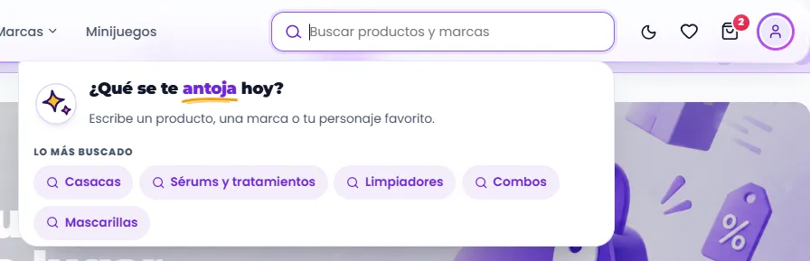
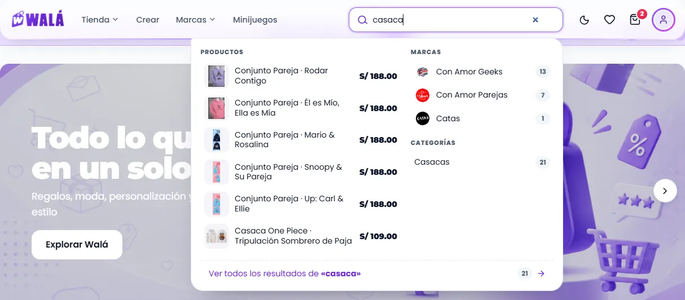
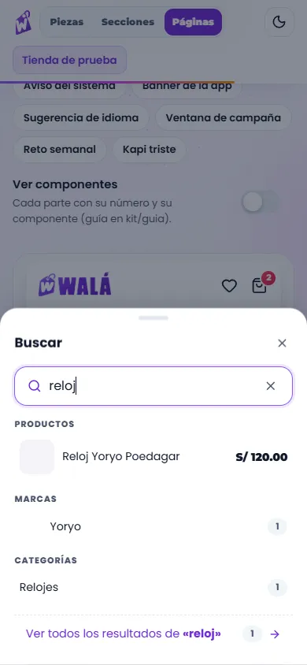
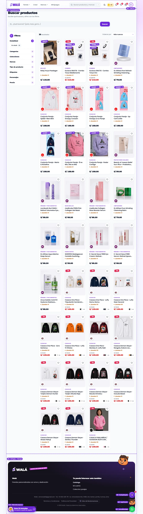
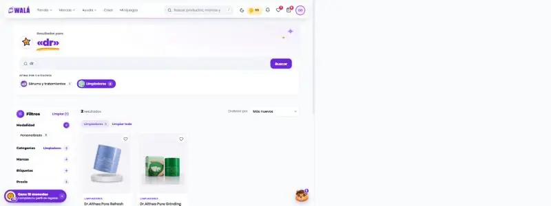
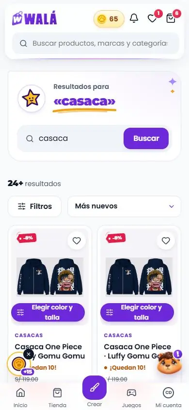

# Buscar: el buscador de la cabecera y la página `/buscar`

Cómo verlo en vivo: `npm run dev` → http://localhost:3000/componentes.html →
**Páginas** → **Tienda de prueba**:

- **Panel de sugerencias:** toca el buscador de la cabecera. Vacío muestra lo
  que buscaste antes; al escribir (desde 2 letras) sugiere productos, marcas y
  categorías. En escritorio se abre debajo del campo; en el celular, en una
  hoja con su propio campo. Enter o "Ver todos los resultados" lleva a la
  página.
- **Página:** **Buscar** en "Página", o Enter en la cabecera. Buscar "casaca",
  ordenar, filtrar, "Ver más productos" (de a 24), "zzz" (sin resultados) y una
  marca sugerida en el panel (búsqueda acotada a esa marca).

| Panel vacío (escritorio) | Escribiendo (escritorio) | Celular |
|---|---|---|
|  |  |  |

| Página (escritorio) | Página (celular) |
|---|---|
|  |  |

Revisado el 2026-10-13 contra wala.pe/buscar, `src/pages/SearchPage.jsx` y
`src/components/common/HeaderSearch/HeaderSearch.jsx`. Datos del ejemplo: los
35 productos de `demo/tienda.json` (ver TIENDA.md), buscados por nombre,
categoría o marca y sin tildes, como `services/search.js`.

## Partes

| Parte | Componente | Piezas que usa | Diseño en | Datos (en la tienda) |
|---|---|---|---|---|
| Buscador de la cabecera (M4) | `Cabecera` con `buscarSugerencias` | `Buscador`, `PanelBusqueda`, `HojaInferior` (celular), `useBusquedasRecientes` | `Navegacion.module.css` (`.panelBusqueda`), `piezas/PanelBusqueda.module.css` | `getSearchSuggestions` → `sugerenciasDesdeBusqueda` |
| P4 Página | `PaginaBusqueda` | `TituloSeccion`, `Aviso` (búsqueda en una marca), `Buscador` (`grande`, `boton`), `CatalogoConFiltros`, `EstadoVacio` | `paginas/Paginas.module.css` (`.busquedaCabeza`) | ver abajo |
| Resultados | `CatalogoConFiltros` (el mismo de /tienda) | `Selector` ("Ordenar por"), `Acordeon`, `OpcionesFiltro`, `GrillaProductos`, `TarjetaProducto` | `SeccionesExtra.module.css` (`.catalogo…`, `.catalogoOrden`) | resultados ordenados y sus filtros |

### Lo que hace el panel

- **Vacío:** si nunca buscaste, una invitación de Walá: sello `IconoWala`
  (destello) y "¿Qué se te *antoja* hoy?" con la letra del logo y la palabra
  subrayada a mano. Si ya buscaste, "Buscaste hace poco" con las últimas 6
  (en este navegador, misma clave `wala_busquedas_recientes` que la tienda) y
  "Borrar". En los dos casos, **"Lo más buscado"**: chips violeta con ideas
  (`ideasBusqueda` de la `Cabecera`; en la demo, las 5 categorías con más
  productos). Sin Kapi a propósito: ya está el flotante (uno solo a la vista).
- **Escribiendo:** "Productos · 21" (títulos con la letra del logo) con foto,
  precio y la parte que coincide con lo escrito en violeta (`TextoResaltado`);
  a la derecha las marcas (con su sello) y las categorías como chips con su
  foto y su cuenta.
  Elegir una marca busca solo en ella (`/buscar?q=…&brand=…`); una categoría
  lleva a `/tienda?categoria=…`.
- **Siempre:** "Ver los 21 resultados de «…»", un bloque lila con el sello de
  la flecha (degradado del logo).
- Cierra al tocar afuera o con Esc; en el celular, como cualquier hoja
  (arrastrar, tocar afuera, botón atrás).

### Lo que hace la página

- **El mostrador:** una tarjeta con la esquina de Walá y destellos quietos.
  Con término: sello de la estrella, "Resultados para" y **«el término»** en
  grande con su subrayado a mano (`InvitacionBusqueda`); sin término, "¿Qué se
  te antoja hoy?" (o el título que guarde el admin). Debajo, el buscador grande
  con su botón.
- **Afina por categoría:** si los resultados caen en más de una categoría,
  chips con su foto y su cuenta que aplican el mismo filtro de la columna (el
  elegido, lleno). En el celular, en una fila deslizable. Sin término, en su
  lugar "Lo más buscado".
- Acotada a una marca (`?brand=`): "Buscando solo en …" con "Buscar en todo el
  catálogo".
- Los resultados en el catálogo de /tienda: "N resultados" (con "+" si hay más
  por cargar), "Ordenar por" (más nuevos, precio, nombre), filtros con
  **Modalidad** (personalizado / en stock) primero, y los grupos de la tienda
  solo con lo que hay en los resultados.
- Sin resultados ni filtros: Kapi triste, "Prueba con otra palabra…" y
  "Prueba con" (las ideas). Ahí el pie no asoma a Kapi (`kapiEnPie={false}`):
  uno solo a la vista. Con filtros, el catálogo sigue a la vista para poder
  quitarlos.

## Para cambiar el diseño rápido: qué se repite

| Pieza | Aparece en | Archivo |
|---|---|---|
| `CatalogoConFiltros` | la búsqueda y /tienda | `SeccionesExtra.module.css` |
| `Buscador` | cabecera, página de búsqueda (`grande`), catálogo de una marca | `Formulario.module.css` (`.buscador`, `.buscadorGrande`) |
| `Selector` | "Ordenar por" (sirve para cualquier lista de opciones) | `Formulario.module.css` (`.selector`) |
| `HojaInferior` | panel en el celular, filtros, menús | `Feedback.module.css` |
| `FotoProducto` | fotos del panel (y miniaturas del carrito, menús…) | `piezas/FotoProducto.module.css` |
| `LogoMarca` (`sello`) | marcas del panel, menú Marcas, tarjetas | `piezas/LogoMarca.module.css` |

## Llevar a la tienda (hecho el 2026-10-19: ver "En la tienda" al final)

Página propia: paso 6 de [MIGRACION.md](MIGRACION.md); el panel va con la
cabecera (paso 7). Mantener al día si cambia un componente o su forma de
recibir datos.

### Reemplazos

| Parte | Hoy en la tienda | Pasa a (kit) |
|---|---|---|
| Panel | `components/common/HeaderSearch/HeaderSearch.jsx` (lupa + portal) | `Cabecera` con `buscarSugerencias` (o `PanelBusqueda` suelto debajo del buscador actual) |
| Página | `pages/SearchPage.jsx` | `PaginaBusqueda` |
| Barra de resultados | `.barra` con el `<select>` (~304-335) | la barra de `CatalogoConFiltros` con `orden` |
| Filtros | `SidebarCatalogLayout` + `gruposExtra` "Modalidad" (~203-236) | `CatalogoConFiltros` con `grupoModalidad` + `gruposDeCatalogo` |
| Vacío | `.vacio` (~349-354) | `EstadoVacio` |

### De dónde sale cada dato

| Prop del kit | En la tienda |
|---|---|
| `ideas` (página) | las mismas de `ideasBusqueda` |
| `kapiEnPie` (marco) | `resultados.length > 0` en /buscar |
| `ideasBusqueda` | las categorías con más productos (`categoriesData` + la cuenta de `automaticCategoryProducts`) o, si se quiere, los términos más buscados de `trackSearchQuery` |
| `buscarSugerencias(texto)` | `getSearchSuggestions(texto)` y `sugerenciasDesdeBusqueda(r, { marcas: brandsData, categorias: categoriesData, termino: texto })` (queries `brands` y `categories`, ya en caché) |
| `onBuscar(q)` (cabecera) | `navigate('/buscar?q=…')` + `trackSearchQuery(q, user)`; desde una página de marca, con `&brand=brandActual.id` |
| `termino`, `marcaFiltro` | `useSearchParams`: `q` y `brand` (nombre con `getBrand`) |
| `productos` | `searchProductsFirestore({ term, cursor, pageSize: 24 })` acumulados, sin `visible === false`, acotados a la marca si hay, y `ordenarProductos(lista, orden)` |
| `hayMas`, `onCargarMas`, `cargandoMas` | el cursor (`hasMore`, `loadMore`, `loading`) |
| `grupos` | `[grupoModalidad(resultados), ...gruposDeCatalogo({ …listas, productos: resultados, marcaActual: brand })]` (las listas, como en TIENDA.md) |
| `seleccion`, `onFiltrar` | estado de la página; filtra en el navegador (`filtrarAqui`) |
| `orden`, `onOrden`, `ordenes` | estado de la página; `ORDENES_BUSQUEDA` |
| `textos` | `storeConfig/homePage.searchPage` (los edita el admin: título, subtítulo, marcador, botón, vacíos) |
| `catalogo` | `marcas`, `categorias` y `marcaActual: brand` |

### Comportamiento que no se puede perder

- **Respuestas viejas:** la página ignora las que llegan tarde de un término
  anterior (`reqRef`); el panel ya descarta las que llegan después de cerrar.
- **Modo edición:** el bloque de textos es una `EditableSection`
  (`sectionId="searchPage"`) en el editor visual.
- **Analítica:** `trackSearchQuery` al buscar.
- **Búsqueda en una marca:** se conserva `brand` al volver a buscar.
- **Traducción:** textos con `<T>`; los nombres de marca no se traducen.

### Diferencias a propósito (no "corregirlas" al migrar)

- El panel se abre debajo del campo de la cabecera (hoy la cabecera tiene una
  lupa que abre un panel aparte); en el celular, hoja que sube (hoy, pantalla
  completa).
- Productos con foto y precio en el panel (hoy solo el nombre).
- Panel vacío con invitación y "Lo más buscado" (hoy, una línea de texto).
- Lo escrito resaltado en los nombres; categorías con foto; "Ver los N
  resultados" como bloque con sello.
- Página: el término en grande en un mostrador (hoy "Buscar productos" y una
  línea); "Afina por categoría" arriba (hoy solo en la columna); sin
  resultados, ideas para probar.
- Recientes como chips; marcas con su sello.
- "Ordenar por" con el selector de Walá; en el celular comparte fila con
  "Filtros".
- Filtros como chips con su cuenta, igual que /tienda (hoy listas de texto).
- En el celular el marcador es "¿Qué buscas?" (la frase con ejemplos se
  cortaba).
- Sin resultados: Kapi triste (hoy solo texto).

### Qué le faltaba al kit (hecho al migrar)

- ✓ Traducción: los textos de `PaginaBusqueda`, `InvitacionBusqueda`,
  `ChipsBusqueda` (ideas y categorías; lo que escribiste antes va tal cual) y
  `PanelBusqueda` pasan por `useTexto`. El panel ya estaba en la tienda sin
  traducir.
- ✓ `tarjeta`, `columnas`, `segundaFoto` y `sinKapi` en `PaginaBusqueda`
  (llegan al catálogo) y `envolverMostrador` para el marco del editor.
- Queda opcional: un `onIrA(url)` en `PanelBusqueda` si se quiere registrar en
  la analítica qué sugerencia se eligió (hoy los enlaces navegan solos).

### Pasos (cada uno se verifica solo y se puede volver atrás)

1. ✓ (junto con el 2, 2026-10-19) `SearchPage`: cambiar la barra, los filtros y la grilla por
   `CatalogoConFiltros` (con `orden`, `unidad` y `grupoModalidad`) dejando la
   búsqueda, el cursor y los textos como están. Probar: término, orden, cada
   filtro, "Ver más", sin resultados, con marca y en el celular.
2. ✓ Cambiar el encabezado por el de `PaginaBusqueda` (o la página completa):
   la página completa, en un solo paso (los dos juntos evitan una página a
   medias). Interruptor `busquedaVieja`.
3. ✓ Con la cabecera (paso 7): pasarle `buscarSugerencias` y retirar
   `HeaderSearch` (2026-10-19, `components/marco/CabeceraDeTienda.jsx`:
   `getSearchSuggestions` + `sugerenciasDesdeBusqueda`, acotado a la marca
   de la página, `trackSearchQuery` y el mismo historial).

Para volver atrás: cada paso en su propio commit; `SearchPageViejo` y
`HeaderSearch` no se borran hasta que lo nuevo lleve un tiempo en producción.

## En la tienda (2026-10-19)

| Escritorio (con "Afina por categoría" y un filtro puesto) | Celular |
|---|---|
|  |  |

`pages/SearchPage.jsx` monta `components/busqueda/BusquedaDeTienda.jsx`, que
dibuja `PaginaBusqueda` (`paginas/Busqueda.jsx`, en su propio archivo: baja
solo con /buscar). La página de antes (`pages/SearchPageViejo.jsx`, con
`SidebarCatalogLayout`) baja solo con el interruptor `busquedaVieja`
(`useLoViejo('busqueda')`: en Firestore `busquedaViejo: true`; en
localStorage, `"busqueda"`).

**Lo mismo que antes:** `searchProductsFirestore` de a 24 por cursor (sin
término, toda la tienda en memoria, como siempre), las respuestas que llegan
tarde de un término anterior se descartan, sin `visible === false`, `?brand=`
acota a la marca (y se conserva al volver a buscar), "Buscar en todo el
catálogo", los mismos cuatro órdenes, los textos del admin
(`storeConfig/homePage.searchPage`, con el borrador del editor en vivo) y el
mostrador marcado como "Página de búsqueda" en el editor (`EditableSection
sectionId="searchPage"`).

**Lo que cambia:**

- Los filtros (Modalidad primero, luego los de /tienda) salen de lo
  encontrado. Con `?brand=` ya no se baja el catálogo entero de la marca solo
  para los filtros.
- Las listas de nombres (colecciones, etiquetas, personajes, tipos) se piden
  solo cuando hay resultados; las categorías y las marcas salen de la caché
  que ya llenó la cabecera (antes `getCategories` en cada visita y `getBrand`
  aparte; ahora `getBrand` solo si la marca no está en la lista).
- Los filtros se vacían al cambiar el término o la marca (antes Modalidad se
  quedaba puesta).
- Buscar desde la página (el campo grande o una idea) se registra en la
  analítica con `trackSearchQuery`, como desde la cabecera.
- "Ver más" también llega solo al bajar (como en /tienda), y mientras llegan
  los primeros no dice "0 resultados" sobre los esqueletos (también en
  /tienda).
- Sin resultados: Kapi triste sin sesión; con sesión, un sello (ya está el
  flotante: uno solo a la vista).
- El panel de la cabecera (`PanelBusqueda`) baja al tocar la cabecera, como
  sus menús: el archivo principal pesa menos.

**Carga:** el archivo principal baja de 206,4 a 204,7 KB gzip (JS) y de 51,3
a 50,0 KB (CSS). /buscar pide su página (8,4 KB + 1,5 KB de CSS) y el panel
(8,7 KB + 8 KB de CSS, el mismo que usa la cabecera) en vez de `SearchPage`
(7,6 KB + 5,6 KB) y `SidebarCatalogLayout` (12,8 KB + 12,5 KB).

**Probado** con los emuladores (35 productos de la demo y copias, marcas
MUSSA, Nova y Con Amor): término, "24+" y la carga al bajar hasta 30, los
cuatro órdenes (nombre comprobado), Modalidad, "Afina por categoría", la hoja
de filtros en el celular, una marca desde el panel y desde la URL, sin
resultados con y sin sesión, sin término ("¿Qué se te antoja hoy?" y "Lo más
buscado"), en inglés (la página, el vacío y el panel), el editor (el texto del
botón cambia al escribirlo y se deshace), el interruptor y /tienda, a 1366 y
390, en claro y en oscuro. El evento de analítica quedó guardado con la ruta
/buscar.
