# Sorteos y campañas: Sorteos, Sorteo por suscripción, Suscripciones, Invitar y Link en bio

> **Regalos con amor salió del kit el 2026-10-16** (se pidió así): en el kit,
> `PaginaRegalosConAmor`, `AntesDespues` y `TarjetaResena` (y sus estilos);
> en la demo, su opción en "Cómo se abre" y sus datos. **En la tienda no se
> tocó nada:** `/regalos-con-amor` sigue con `NuevosUsuariosPage`, y
> `public/diseno` y `public/regalos-con-amor` siguen igual. Para volver, todo
> está en el historial de git.

Cómo verlo en vivo: `npm run dev` → http://localhost:3000/componentes.html →
**Páginas** → **Tienda de prueba** → **Sorteos y campañas**. "Cómo se abre"
tiene cinco opciones:

- **Sorteo** (`/sorteos` y `/sorteos/:slug`). Estados: ya participa, con
  tickets, cerrado, ganó, solo desde la app, sin sorteo, error y cargando.
  "¡Participar gratis!" abre la hoja con tus datos; con tickets, ahí mismo se
  paga.
- **Sorteo por suscripción** (`/suscrito-sorteo`). Estados: ya suscrito,
  PayPal queda pendiente, no disponible y cargando. "Suscribirme" abre la
  hoja con tres pasos: entrar, los datos con la autorización y el pago.
- **Suscripciones** (`/suscripciones`).
- **Link en bio** (`/l/sorteos-y-atencion`), sola, sin la cabecera ni el
  pie de la tienda. Estados: no disponible y cargando.
- **Invitar** (`/invitar/ISAAC7K`): la página de la invitación
  (`PaginaInvitacion`, cómo debe verse). Estados: ya tiene cuenta, ya recibió
  el bono, link no válido y cargando. "Crear mi cuenta" lleva al registro con
  el aviso de la invitación arriba, como hoy la tienda. El aviso también se
  prende en cualquier página desde "Mostrar también" → "Aviso de
  invitación", con sus tres estados.

## Cómo funcionan el Link en bio y la invitación

### Link en bio (`/l/:slug`)

**Qué es:** una página de botones estilo Linktree para poner en la bio de
Instagram o TikTok (las redes dejan un solo link). Se arma en el admin, en
**Enlaces** (`/admin/enlaces`, `AdminEnlaceEditor`): título, foto,
descripción, redes, botones con su miniatura, y el diseño (fondo, estilo de
botón, colores, letra). Se guarda en `link_pages` y se publica en
`/l/{slug}` cuando está "Activo".

**Hoy:** hay una sola, "Sorteos y Atencion" (`/l/sorteos-y-atencion`), con
dos botones (Sorteos y WhatsApp). Cuenta las visitas al cargar y los clics
de cada botón (en la nube, con la función `registrarClicEnlace`); el admin
los ve por botón, país, aparato y día.

**¿Sirve en la página principal?** No: nada de la tienda enlaza a `/l/`.
Solo se llega desde afuera (la bio de una red, un QR, un mensaje). No es una
sección de la tienda.

**Cómo debe funcionar (y así está el diseño del kit):**

1. Va **sola**, a pantalla completa, sin la cabecera, el pie ni las
   ventanas de la tienda: quien llega desde Instagram solo ve los botones.
   Hoy la tienda la muestra dentro de la cabecera y el pie: al migrar, quitar
   el marco en `/l/`.
2. **"Compartir"** arriba a la derecha: el menú de compartir del teléfono o,
   si no hay, copia el link.
3. Cada clic se cuenta, **también el de las redes** (hoy la función solo
   busca en `botones`: arreglarlo al migrar; el kit ya los manda).
4. Al pie, "Creado con Walá" lleva a la tienda.

### La invitación (`/invitar/:código`)

**Qué es:** el link permanente de cada cuenta para invitar gente nueva
(Mis referidos → "Compartir invitación").

**Hoy en la tienda:**

1. `InvitarPage` no muestra nada: lleva directo a `/registro` (sin cuenta)
   o al inicio (con cuenta), con `?ref=CÓDIGO&tipo=invitacion`.
2. `ReferralTracker` registra la visita (un doc de `referrals` por persona)
   y la guarda en el navegador (`wala_referral`). Arriba sale el aviso
   (`AvisoInvitacion`): "Isaac te invitó a Walá".
3. Cuando la cuenta nueva tiene **DNI y celular**, el servidor acepta la
   invitación (`aceptarInvitacionSecure`) si son de verdad nuevos (que no
   estén en otra cuenta ni en pedidos del ERP): **10 monedas** de bienvenida
   para quien llega.
4. Quien invita gana con la **primera compra** de esa persona en 30 días:
   15 monedas o el %, lo que sea mayor.
5. Si quien abre el link **ya tenía cuenta**, la invitación no aplica, pero
   el link vale como uno de compra: si compra en 36 h, quien invitó gana.

**Cómo debe funcionar (y así está el diseño del kit):** antes de pedir
datos, una página que explique la invitación (`PaginaInvitacion`):

- "**Isaac** te invitó a Walá", qué es Walá en una línea y "+10 de
  bienvenida al crear tu cuenta".
- Tres pasos con sello: crea tu cuenta, completa tu DNI y celular (así
  sabemos que es nueva) y recibes 10 monedas.
- "Crear mi cuenta" (al registro, con `?ref=…&tipo=invitacion`, como hoy) y
  "Ya tengo cuenta".
- La letra chica: quien invita gana con tu primera compra y la regla de
  cuenta nueva.
- **Con cuenta:** "La invitación es para cuentas nuevas", y que si compras
  en 36 h quien te invitó gana. **Ya aceptada:** "¡Ya tienes tus 10
  monedas!". **Código que no existe:** Kapi triste y "Ir a la tienda".

Al migrar, `InvitarPage` deja de redirigir y monta `PaginaInvitacion` con
el nombre de `getNombreInvitacion` y el estado según la sesión y
`wala_referral`. Lo demás (el aviso, el tracker, el servidor) no cambia.

| El sorteo (celular, noche: el boleto y la cuenta atrás) | Por suscripción | Link en bio (el real) |
|---|---|---|
| 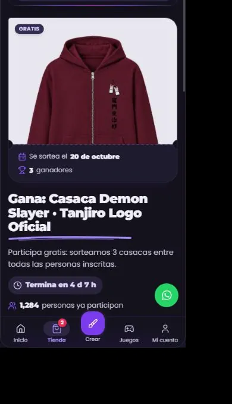 | 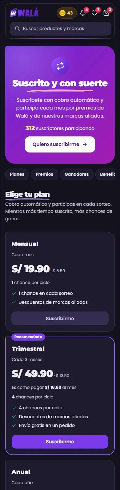 | 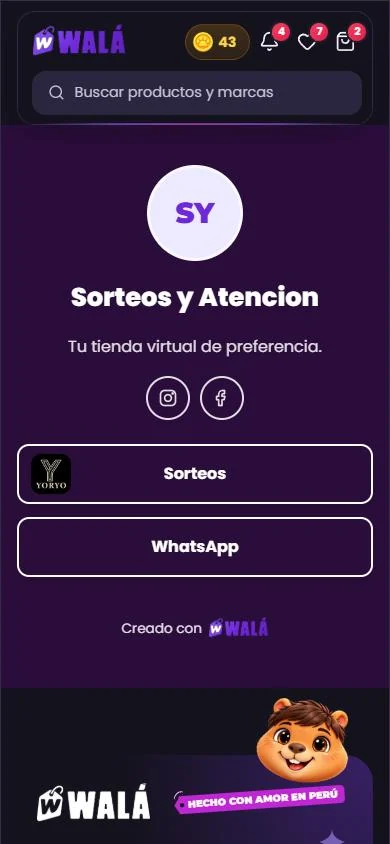 |

| Suscripciones | La invitación en el registro (claro) |
|---|---|
| 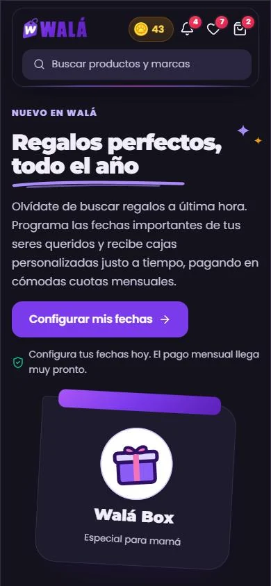 | 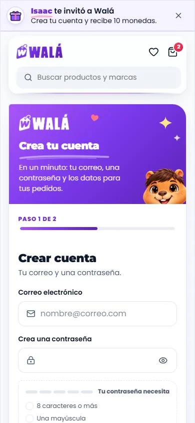 |

Las capturas son del celular. En escritorio también se revisaron (claro y
noche), pero el panel del navegador de esta sesión no daba para una captura
nítida a 1366.

Revisado el 2026-10-15 contra estos archivos:

| Página | Archivo | Líneas |
|---|---|---|
| Sorteo | `pages/SorteosPage.jsx` (+ `services/sorteos.js`) | 1224 |
| Sorteo por suscripción | `pages/SuscripcionSorteoPage.jsx` (+ `services/suscripcionSorteos.js`, `pages/suscripcion/PagoSuscripcion.jsx`) | 896 |
| Suscripciones | `pages/SubscriptionLandingPage.jsx` | 93 |
| Invitar | `pages/InvitarPage.jsx` (solo redirige), `components/analytics/ReferralTracker.jsx`, `components/common/AvisoInvitacion` | 27 + 125 + 133 |
| Link en bio | `pages/LinkInBioPage.jsx` (+ `services/enlaces.js`, `services/linkThemes.js`) | 326 |

**Qué es real y qué es de ejemplo.**

- **Reales:**
  - Link en bio: la única página de `link_pages`, "Sorteos y Atencion", con
    su diseño, sus botones y sus redes (`demo/campanas.json`).
  - Suscripciones: los textos (la página no lee datos).
  - La encuesta a la que lleva Suscripciones es la que ya está en el kit
    (ENCUESTA.md).
- **De ejemplo:**
  - El sorteo y la campaña por suscripción. En wala.pe hoy hay un solo
    sorteo, de prueba (terminó el 2 de julio pero sigue activo), y ninguna
    campaña por suscripción.
  - El ranking de ganadores, los planes, las marcas aliadas y los recibos.
    Las fotos son de productos y marcas reales.

## Partes

| Parte | Componente | Piezas que usa | Datos (en la tienda) |
|---|---|---|---|
| P21 Sorteo | `PaginaSorteo` (`paginas/Sorteo.jsx`) | `CabezaSorteo` (el premio como boleto), `ListaGanadores` (nuevas, `piezas/Sorteos.jsx`); `TarjetaCuenta`, `Estadistica`, `FormaGanar` (con `premio`: "+1"), `EnlaceInvitacion`, `CamposDatosPersonales` + `validarPerfil`, `Cantidad`, `PagoTarjeta`, `PagoPaypal`, `HojaInferior`, `Estallido`, `CuentaRegresiva` | `getSorteoActivo` / `getSorteoBySlug`, `getMiParticipacion`, `getContadorSorteo`; `participarSorteoGratis`, `comprarTicketSorteoSecure` + Culqi / PayPal, `sumarChanceCompartir` |
| P21 Sorteo por suscripción | `PaginaSuscripcionSorteo` (`paginas/Sorteos.jsx`) | `TarjetaPlan`, `TarjetaAliado`, `ListaGanadores` (nuevas); `Pestanas`, `ListaDatos`, `Estadistica`, `BotonGoogle`, `Casilla`, `PagoTarjeta`, `PagoPaypal`, `Chip` | `getCampaignBySlug`, `getContadorSuscriptores`, `getBeneficios`, `getGanadoresGaleria`, `getMiSuscripcion`, `getRecibos`; `crearSuscripcionCulqi`, `crearSuscripcionPaypal` + `confirmarSuscripcionPaypal`, `cancelarSuscripcion` |
| P21 Suscripciones | `PaginaSuscripciones` (`paginas/Suscripciones.jsx`) | `FormaGanar` (los 4 pasos), `IconoWala`, `Garabatos`, `Trazo`, `TituloSeccion` | — (textos fijos) |
| P21 Link en bio | `PaginaEnlaces` (`paginas/Enlaces.jsx`) | `RedesEnlaces` y `BotonEnlace` (nuevas), `Avatar`, `LogoWala` | `getLinkPageBySlug` (`link_pages`), `registrarClicEnlace`, `registrarVisitaEnlace`; el fondo y los botones con `construirFondoStyle` / `estiloBotonStyle` (`services/linkThemes`) |
| M12 La invitación | `AvisoInvitacion` (nueva, `piezas/Campanas.jsx`) y `PaginaInvitacion` (`paginas/Invitacion.jsx`, 2026-10-16) | `IconoWala`, `Trazo`, `Boton`; la página: `PasosSellos` (nueva, `piezas/PasosSellos.jsx`; también la usa el libro de reclamaciones), `GananciaMonedas`, `Sello`, `Aviso`, `EstadoVacio` | `useInvitacionReferido` (localStorage `wala_referral`), `getNombreInvitacion` |

Esqueletos: `EsqueletoPagina forma="sorteo"`, `"suscripcionSorteo"`,
`"landing"` (Suscripciones), `"invitacion"` y `"enlaces"`. El del sorteo trae el talón del
boleto y la píldora de la cuenta atrás.

### Lo que hace

- **Sorteo:**
  - **La cabeza (desde el 2026-10-16):** el premio como un **boleto**: la
    foto arriba con "Gratis" (o "S/ 5.00 por ticket") y, debajo de una
    línea punteada con dos muescas, el talón: "Se sortea el 20 de octubre"
    (o "Sorteo cerrado") y "3 ganadores". "Gana: …" con su trazo y la
    descripción. La cuenta atrás va en una píldora con su reloj ("Termina en
    4 d 7 h") y en bloques los dos últimos días. Debajo, "1,284 personas ya
    participan". Con la cabeza en dos columnas, puntos y destellos quietos
    junto al título.
  - Si ganaste: el sello del trofeo con confeti y "¡Felicidades, ganaste!".
  - **Tu participación:** tickets y chances.
  - **Suma más chances:** "Compartir y ganar 1 chance" (una vez) y tu link
    con "Copiar link".
  - **Cómo ganar más chances:** cada forma con su ícono de Walá y lo que
    suma en un sello ("+1", "+1 por ticket", "+1 por amigo"), en dos columnas
    cuando hay sitio.
  - **Quiénes ganaron:** con la tuya marcada.
  - **El botón:**
    - "¡Participar gratis!", "Quiero participar" / "Comprar más tickets"
      con su precio, "Ya estás participando", "El sorteo ya cerró", "Inicia
      sesión para participar", o "Descargar la app" si solo se juega desde
      la app.
    - En el celular va pegado abajo.
  - **La hoja:** tus datos (los de Mi perfil, ya puestos y con sus reglas) y
    el correo. Con tickets, la cantidad y el total; luego "Elige cómo
    pagar" con tarjeta o PayPal.
- **Sorteo por suscripción:**
  - **La portada:** de color, con el título, cuántos suscriptores participan
    y "Quiero suscribirme". Debajo, las anclas (Planes, Premios, Ganadores,
    Beneficios, Mi cuenta).
  - **Los planes:** el precio con la letra de la marca, "Es como pagar S/
    16.63 al mes", las chances por ciclo y lo que incluye. El recomendado va
    con su borde. Los tres en una fila desde unos 700 px (antes el tercero
    quedaba solo abajo).
  - Los premios, los ganadores y las marcas aliadas (con filtro por
    categoría).
  - **Mi cuenta:** el estado, el plan, el método, la vigencia y el próximo
    cobro; "Cancelar suscripción" pide confirmar en el mismo lugar. También
    Mis chances y Mis recibos.
  - **La hoja:**
    - sin sesión, "Continuar con Google";
    - nombres, el correo de la cuenta y "Autorizo el cobro automático de S/
      49.90 cada 3 meses…";
    - el pago con tarjeta o PayPal.
    - Si PayPal queda pendiente: "Tu suscripción se está activando".
- **Suscripciones:**
  - "Regalos perfectos, todo el año" con la Walá Box, que se endereza al
    pasar el ratón.
  - Los cuatro pasos y el llamado oscuro con su lista y "Separar mis fechas
    ahora".
  - Los dos botones llevan a la encuesta.
- **Link en bio:** la foto (o las iniciales), el título, la descripción, las
  redes en círculos (íconos de línea), los botones con el diseño del admin y
  "Creado con Walá". Cada clic se cuenta, también el de las redes.
- **La invitación:**
  - "**Isaac** te invitó a Walá" (con su trazo rosa).
  - Tres estados:
    - sin cuenta: "Crea tu cuenta y recibe 10 monedas", con el botón "Crear
      cuenta", salvo si ya estás en el registro;
    - aceptada: "Ya tienes tus 10 monedas…";
    - link de compra: "Compra hasta … y Isaac gana monedas".
  - En el celular, el texto corto.

## Llevar a la tienda (hecho el 2026-10-19, menos el sorteo por suscripción: ver "En la tienda" al final)

### Reemplazos

| Hoy | Pasa a (kit) |
|---|---|
| `SorteosPage` (GlassCard, Badge, emojis, el modal `FormularioDatosSorteo`, `CulqiTicketButton`, `PaypalTicketButtons`) | `PaginaSorteo` (con `onPagarTarjeta` / `onPagarPaypal` que abren Culqi y PayPal como hoy) |
| `SuscripcionSorteoPage` (GlassModal, `--sus-*`) | `PaginaSuscripcionSorteo` |
| `SubscriptionLandingPage` | `PaginaSuscripciones` |
| `LinkInBioPage` | `PaginaEnlaces` |
| `AvisoInvitacion` (common) | `AvisoInvitacion` (kit), en el mismo `#app-top-banner-slot` |

**Lo que no cambia:**

- Todas las funciones del servidor y sus reglas: participar, tickets,
  chances, el sorteo de ganadores, cobros recurrentes, webhooks, clics y
  visitas.
- `ReferralTracker` y `useInvitacionReferido`: la invitación sigue
  aceptándose sola.
- ~~`InvitarPage` sigue redirigiendo.~~ Ya no: muestra `PaginaInvitacion` (ver "Cómo funcionan…" y "En la tienda").
- `linkThemes.js` se comparte con el editor del admin, para que la vista
  previa sea igual a la página.

### De dónde sale cada dato

- **Sorteo:**
  - `sorteo` sale del doc de `sorteos`:
    - `premio: premio.nombre || titulo`, `imagen: heroImagenUrl || premio.imagenUrl`;
    - `hasta`: `fechaFin` (al final del día, hora de Lima);
    - `cerrado`: `estado === 'cerrado'`;
    - `participantes`: la suma de `contador/*`;
    - `reglas`: `chanceExtraCompartir`, `chanceExtraReferido`, y
      `requisitoApp` (`'chanceExtra'` → `appExtra`, `'obligatorio'` →
      `appObligatorio`);
    - `ganadores`: `[{ id: uid, nombre }]`.
  - `participacion`: `participantes/{uid}` →
    `{ tickets: ticketsPagados || 1, chances: chancesTotal, compartio: compartioClaim }`.
  - `urlInvitacion`: `${origin}/sorteos/${slug}?ref=${referralCode}`, con el
    slug.
  - `onComprar`: devuelve `{ monto, moneda }` de `comprarTicketSorteoSecure`.
  - `onPagarTarjeta`: abre Culqi con la `metadata` del ticket.
- **Sorteo por suscripción:**
  - `campana.planes`:
    - `precio: precioCentimos / 100`;
    - `chances: chancesPorCiclo`.
  - `aliados`: `beneficios`.
  - `ganadores`: `ganadores_galeria`.
  - `suscripcion`: `suscriptores/{uid}`, con el **nombre** del plan en vez
    del `planId` y las fechas en palabras.
  - `onPagarTarjeta`: Culqi → `crearSuscripcionCulqi`.
  - `onPagarPaypal`: `crearSuscripcionPaypal` + `confirmarSuscripcionPaypal`.
    Devuelve `{ pendiente }` si queda APPROVED.
- **Link en bio:**
  - Del doc de `link_pages`: `avatarUrl` → `avatar`, `botones[].thumbnailUrl`
    → `imagen`, `redes[].iconUrl` → `icono`, `diseno` tal cual.
  - `onClic(item)`: `registrarClic(pagina.id, item.id, ctx)`.
- **Invitación:**
  - `nombre`: el de `useInvitacionReferido()`.
  - `estado`:
    - `'aceptada'` si `invitacion === 'aceptada'`;
    - `'nueva'` si es una invitación sin decidir y sin cuenta;
    - si no, `'compra'`.
  - `plazo`: `plazoLegible(vence)` precedido de "hasta".
  - `urlRegistro`: `null` en `/registro`.

### Comportamiento que no se puede perder

- Participar y pagar los decide el servidor. El monto del ticket o del plan
  sale del doc, nunca del cliente.
- Al volver del login, el sorteo vuelve al mismo slug.
- Sorteo por suscripción: el cobro automático necesita la casilla
  marcada; cancelar deja vigente lo ya pagado.
- Link en bio: las internas (`/…`) navegan sin recargar, las externas
  abren otra pestaña, y la visita se cuenta al cargar.
- La invitación no sale en `/checkout` (ahí está la línea del checkout:
  `invitacion` en `PaginaCheckout`). Cerrarla dura la sesión.

### Diferencias a propósito (no "corregirlas" al migrar)

- **Sin emojis** (🎁, 🎟️, ⭐, 🏆, 🎉, 📢, 💳, 🅿️, 📷, 🟢) y sin
  `GlassCard`: tarjetas, sellos e íconos de Walá.
- **Sorteo:**
  - La cuenta atrás en palabras cuando falta mucho. Ya no dice "Termina en
    Finalizado": dice que pronto se anuncia quién ganó.
  - Los datos se validan con las reglas de Mi perfil.
  - El botón va pegado abajo solo en el celular.
- **Sorteo por suscripción:**
  - Una portada con los colores de Walá (no `--sus-*` por campaña: si se
    quieren colores por campaña, se agregan como variables).
  - El plan con su nombre.
- **Suscripciones:** la caja es la Walá Box con el ícono de Walá. Los textos
  son un poco más cortos, sin cambiar lo que prometen.
- **Link en bio:**
  - Los íconos de las redes son de línea (Instagram y Facebook dibujados
    en el kit: la versión de lucide no trae marcas).
  - Sin botones: "Pronto habrá enlaces aquí".
  - Página no disponible con Kapi.

### Lo que se encontró de paso (para decidir aparte)

- **Sorteo:**
  - Compartir, referir y volver del login pierden el slug: siempre llevan a
    `/sorteos`.
  - El admin ofrece `requisitoApp: 'recomendado'`, que no hace nada, y no
    ofrece `'chanceExtra'`, que sí existe en la página y en la función.
  - Un borrador se ve si se abre por su slug.
  - La imagen de respaldo tiene un `<T>` dentro del SVG. Pasa también en la
    suscripción.
- **Sorteo por suscripción:**
  - "Plan" muestra el `planId`.
  - Los ganadores son la galería del admin, no los que salieron en el
    sorteo.
  - Una campaña cerrada se sigue mostrando y falla al suscribirse.
- **Regalos con amor** (fuera del kit, sigue en la tienda): promete "S/15
  en monedas", pero la encuesta da 15 monedas más 5 por fecha (hasta 50); y
  la landing del builder con el mismo slug nunca se ve (NAVEGAR.md).
- **Link en bio:** los clics en las redes no se cuentan:
  `registrarClicEnlace` solo busca en `botones`. El kit ya los manda.
- **Enlaces sin entrada:** nada del sitio público enlaza a `/sorteos`,
  `/suscrito-sorteo`, `/regalos-con-amor` ni `/l/`. Se comparten desde
  afuera.

### Pasos

1. ✓ `AvisoInvitacion` del kit en `#app-top-banner-slot` y
   `PaginaInvitacion` en `InvitarPage` (2026-10-19).
2. ✓ `PaginaEnlaces` en `LinkInBioPage`, sin el marco de la tienda en `/l/`;
   la función cuenta también las redes (2026-10-19).
3. ✓ `PaginaSuscripciones` (2026-10-19; Regalos con amor se queda con
   `NuevosUsuariosPage`).
4. ✓ `PaginaSorteo` con el mismo flujo de Culqi y PayPal, y el slug en
   compartir y en el login (2026-10-19).
5. `PaginaSuscripcionSorteo` cuando haya una campaña real para probarla de
   punta a punta. Antes, en el kit: los botones de PayPal
   (`createSubscription`), la tarjeta controlada (`procesando`), "campaña
   cerrada", "ya suscrito", `correo` en vez de `email` y el precio en
   dólares del plan. En el servidor, para decidir aparte: cancelar saca del
   sorteo al instante (el sorteo solo cuenta `activo`), volver a
   suscribirse cobra otra vez y, con PayPal, deja la suscripción anterior
   cobrando; una campaña en borrador acepta pagos.

## En la tienda (2026-10-19)

| La invitación (sin cuenta) | Ya recibió el bono | El aviso, en inglés y claro |
|---|---|---|
| 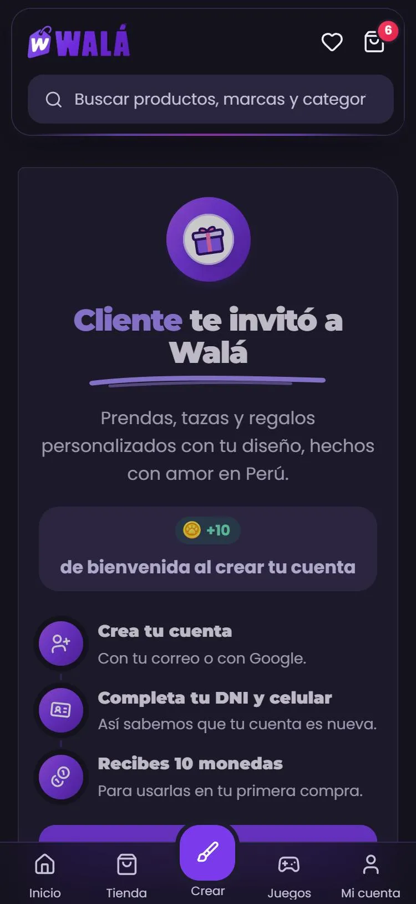 | 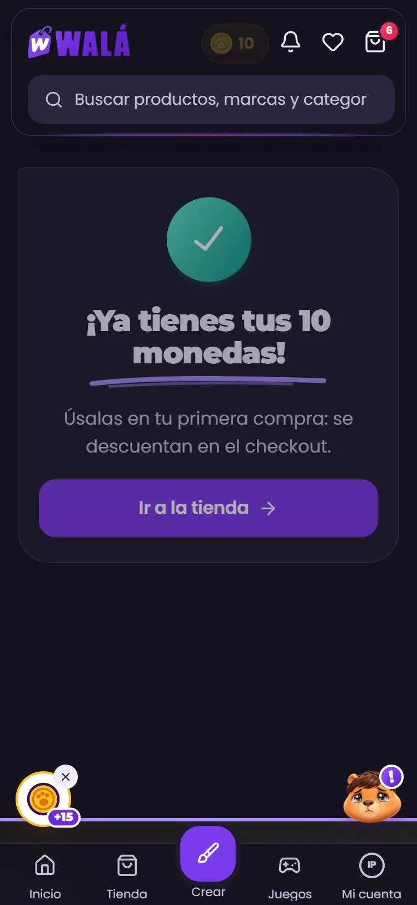 | 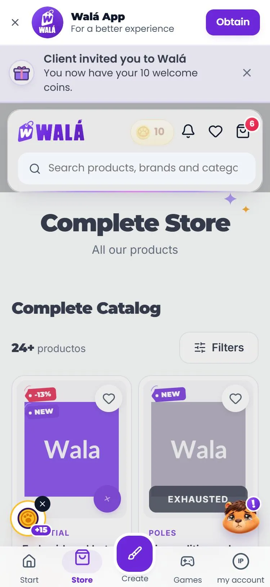 |

| Link en bio (solo, sin la tienda) | Suscripciones, en inglés y claro | El sorteo | Pagar un ticket |
|---|---|---|---|
| 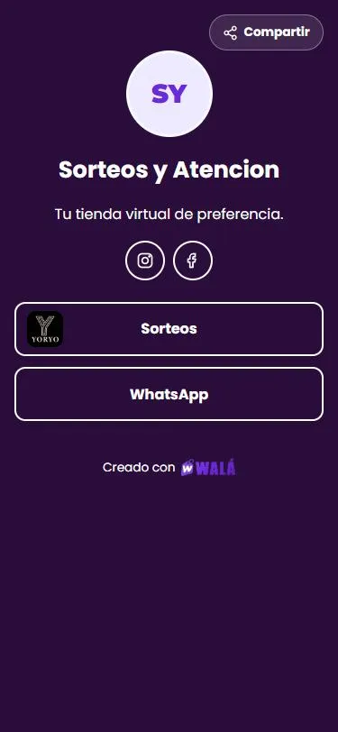 | 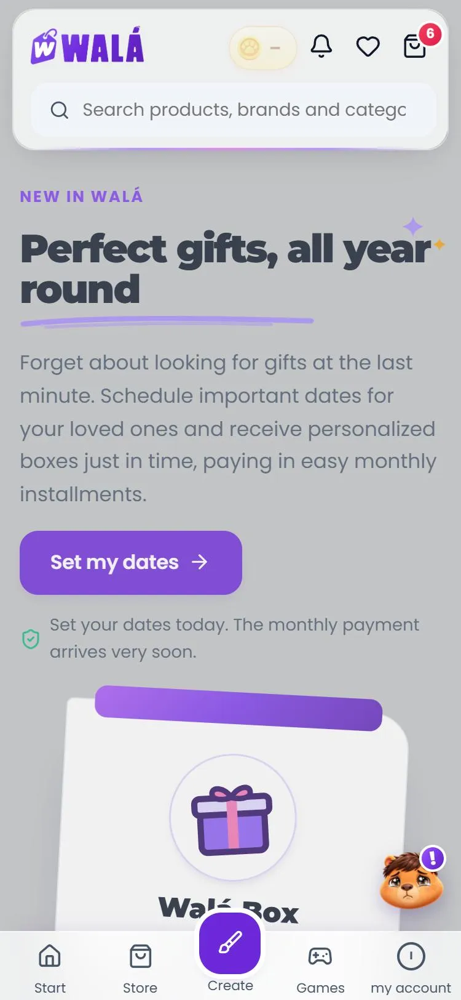 | 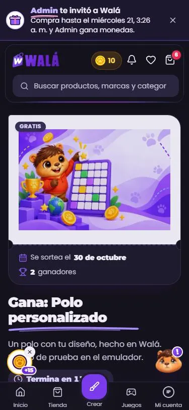 | 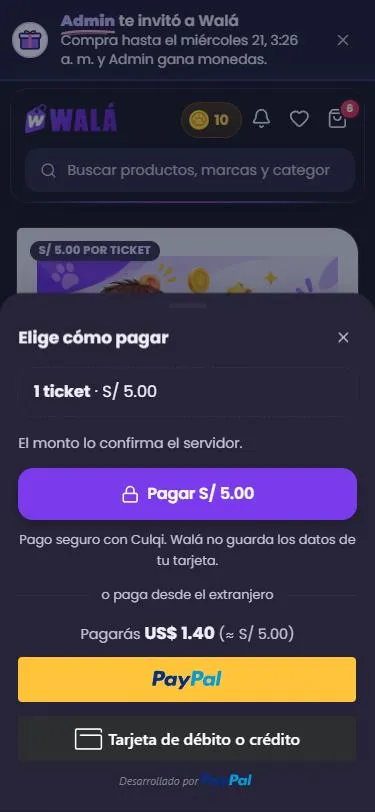 |

Las páginas (`pages/InvitarPage.jsx`, `LinkInBioPage.jsx`,
`SubscriptionLandingPage.jsx` y `SorteosPage.jsx`) montan
`components/campanas/InvitacionDeTienda.jsx`, `EnlacesDeTienda.jsx`,
`SuscripcionesDeTienda.jsx` y `SorteoDeTienda.jsx`; el aviso de arriba es
`components/marco/AvisoInvitacionDeTienda.jsx`. Lo de antes (`InvitarViejo`,
`LinkInBioViejo`, `SubscriptionLandingViejo`, `SorteosViejo` y el aviso de
`components/common`) baja solo con el interruptor `campanasViejo`
(`useLoViejo('campanas')`: en Firestore `campanasViejo: true`; en
localStorage, `"campanas"`). El sorteo por suscripción sigue con la página
de antes.

**La invitación.** `/invitar/:código` ya no redirige: la página registra la
visita ella misma (`registrarVisitaReferidoSecure`, el mismo
`wala_referral` que el tracker) y así sabe si el código no existe
(`'invalida'`) o es el tuyo (`'propia'`, nuevo). Sin cuenta, "Crear mi
cuenta" lleva al registro con `?ref=…&tipo=invitacion` como antes. Con
cuenta, `ReferralTracker` acepta la invitación (ahora también cuando cambia
lo guardado: escucha `wala:referido`) y la página muestra lo que decidió el
servidor: `'aceptada'`, `'conCuenta'` (no aplica) o `'faltanDatos'` (nuevo:
falta el DNI o el celular). Si el servidor no responde en 15 s,
`'error'` con "Reintentar". El aviso de arriba es el del kit, baja solo si
hay una invitación y no sale en `/invitar/`.

**Link en bio.** Sola (en `App.jsx`, como Regalos con amor), sin la
cabecera, el pie ni los flotantes, pero contando la página vista. La misma
lectura por slug, el borrador como no disponible, la visita después de la
sesión de analítica (ahora una vez por entrada: antes se contaba otra al
llegar la sesión) y cada clic sin esperar. `registrarClicEnlace` (desplegada)
cuenta también las redes (antes las rechazaba) y marca `tipoItem`; el
editor del admin muestra una fila por red. Los colores sin poner caen en
los de antes; un link sin `https://` abre afuera; la página vieja con el
interruptor también va sin el marco.

**Suscripciones.** Los mismos textos y los dos botones a la encuesta, todo
traducido.

**El sorteo.** El mismo sorteo (por slug o el activo), la participación, el
contador cada 20 s, participar gratis, comprar tickets (el monto lo fija el
servidor) y pagarlos con Culqi (la ventana del checkout:
`CulqiCustomCheckout` acepta un `cobro`, el ticket, sin el píxel de compra)
o con PayPal (`PaypalTicketSorteo`, las mismas funciones), compartir (+1
chance) y el referido con `?ref=`. Diferente: compartir, el link y el login
llevan el slug (y el login el `?ref`); termina al final del día de Lima
(antes, a las 7 p. m. del día anterior); un borrador por su slug es "no hay
sorteo"; "ganaste" solo con el sorteo cerrado; quien no es del Perú elige su
país; la sesión anónima no cuenta como cuenta; sin emojis y traducido.

**Servidor (desplegado el 2026-10-19):** `processCulqiPayment` solo cobra un
ticket a quien lo compró y se lo acredita a esa cuenta (antes, al uid que
mandara el navegador); "solo desde la app" se confirma con el origen de la
llamada (`https://localhost` o `capacitor://localhost`, el de la app) en
`participarSorteoGratis` y ahora también al comprar tickets
(`comprarTicketSorteoSecure`). Sin App Check no resiste una llamada armada
fuera del navegador. Las reglas no se tocaron: los datos de quienes
participan siguen legibles para cualquier cuenta (para decidir aparte).

**Carga:** la invitación baja 8,8 KB + 2,2 KB de CSS (antes 0,4 KB: solo
redirigía); el aviso, 1,9 KB y el del kit (3,9 + 2,3 KB, compartido con el
Link en bio) solo si hay invitación; el Link en bio, 5,4 + 1,4 KB (antes 5,7
+ 4,5); Suscripciones, 4,8 + 2,9 KB (antes 4,9 + 4,9); el sorteo, 20,6 + 9,5
KB más los botones de PayPal cuando se paga (antes 23,5 + 9,6). El archivo
principal: +240 B gzip (los mapas de las rutas nuevas y el aviso).

**Probado** con los emuladores: la invitación sin cuenta (la página, "Crear
mi cuenta" al registro con el aviso), con un código que no existe, el
propio link, una cuenta que ya existía ("no aplica"), una sin DNI
("faltan datos") y una cuenta nueva de punta a punta (registro, DNI y
celular, el bono: 0 → 10 monedas, "Ya tienes tus 10 monedas"); el aviso en
otras páginas, en inglés y claro; el Link en bio (sin marco, una visita, el
clic de un botón y de una red contados, el borrador, el interruptor);
Suscripciones (los botones a la encuesta, en inglés); el sorteo gratis
(participar, el contador, compartir +1), el pagado hasta elegir cómo pagar
(el ticket creado en el servidor, los botones de PayPal, el monto en
dólares con `config/fx`), cerrado con ganadores, solo desde la app, el
borrador, sin cuenta (el login con el slug y el `?ref`) y el interruptor;
el servidor con llamadas directas (desde la web, "debes entrar desde el
app"; con el origen de la app, sí; el ticket de otra cuenta, rechazado).
**No probado:** el pago de punta a punta con Culqi y con PayPal (no hay
llaves de prueba en esta carpeta: la ventana de Culqi avisa que falta la
llave), el sorteo en inglés (el traductor de la tienda no respondió en esa
prueba), la app (Capacitor) y el referido del sorteo con dos cuentas.
