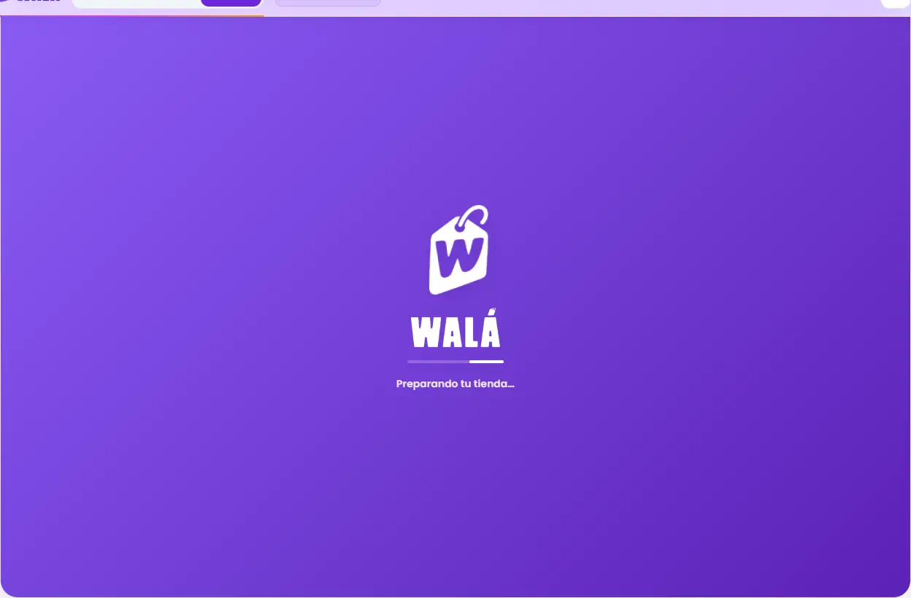
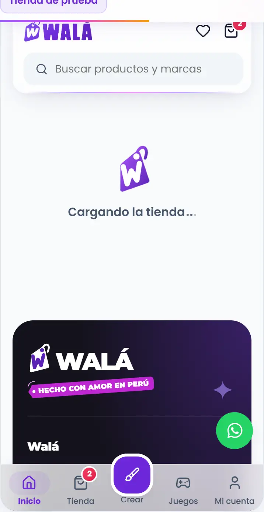
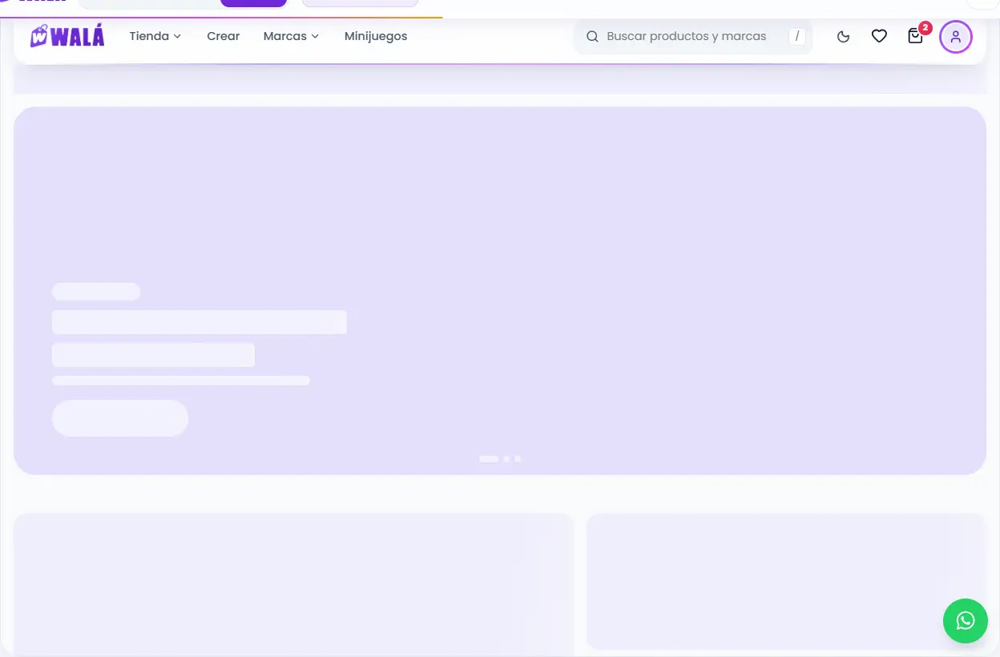
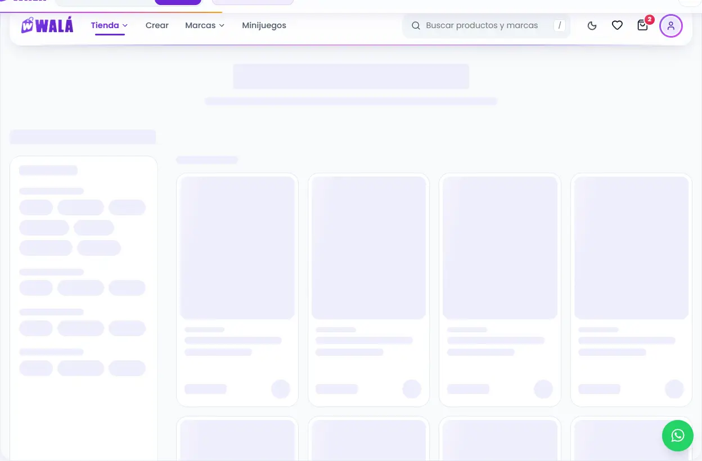
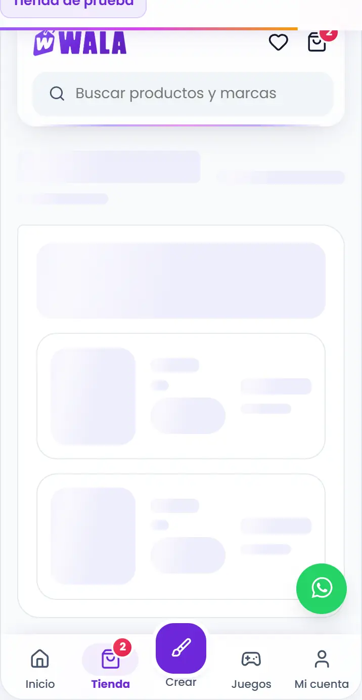

# Cargando: la primera vez, al cambiar de página y mientras llega una página

Cómo verlo en vivo: `npm run dev` → http://localhost:3000/componentes.html →
**Páginas** → **Tienda de prueba** → **Ver la carga**:

- **Primera vez (marca):** la pantalla de marca sobre la tienda. Se va sola
  a los 4 segundos, con su salida.
- **Cambio de página (esqueleto de esta página):** la cabecera queda y
  abajo, la forma de la página que llega. Cada apartado tiene la suya:
  - el inicio, sección por sección (las del builder);
  - la tienda, la búsqueda, el carrito, Minijuegos, la encuesta y el acceso;
  - cada módulo de Mi cuenta (resumen, perfil, pedidos, direcciones,
    ajustes, catálogo, cupones, misiones, referidos, creaciones, deseos y
    fechas importantes), con el menú al costado en ancho.
- **Esperando una acción (pago, landing…):** la página se queda a la vista
  detrás de un velo claro y encima una tarjeta con la etiqueta meciéndose:
  "Procesando tu pago".

**Con y sin sesión:** el esqueleto sigue a quien mira (`sesion`). Sin
sesión, Mi cuenta y la encuesta muestran la forma de la invitación a entrar
(Kapi, título y dos botones), y Minijuegos, el aviso para entrar en vez del
progreso. La cabecera es la de siempre (sin monedas ni campana).

**Regla:** para cambiar de página, siempre el esqueleto (ya se sabe la
forma de lo que viene). `CapaCargando` es solo para esperar algo que no
tiene forma conocida: un pago, verificar un documento, subir un diseño, o
una landing del builder antes de que llegue su configuración.

Las dos últimas vuelven solas a la página a los 4 s. Todos los esqueletos
sueltos (por componente, por sección y por página) están en **Piezas** →
**11 · Carga y esqueletos**.

| Primera vez (escritorio) | Esperando una acción (celular) | Cambio de página: el inicio (escritorio) |
|---|---|---|
|  |  |  |

| Tienda llegando (escritorio) | Carrito llegando (celular) |
|---|---|
|  |  |

Revisado el 2026-10-14 contra wala.pe y el código de la tienda:

- el splash estático de `index.html` (~92-101);
- `components/common/BrandLoader/BrandLoader.jsx` y `BrandLoaderOverlay.jsx`;
- `Loading/Loading.jsx` (el círculo);
- `PageLoading/PageLoading.jsx`.

Es parte del marco: **M11**.

## Cómo se arma

Todo vive en `kit/Cargando.jsx`. La idea es una sola: **la etiqueta del logo
se mece colgada de su cordón**, como una etiqueta de verdad. Gira alrededor
del cordón, arriba a la derecha (`transform-origin: 75% 4%`), ±6° en 2,4 s.

- **No usa halos ni brillos:** el fondo es el degradado plano del logo.
- **Es lo único que se mueve en bucle en el kit**, porque es lo que dice
  "algo está pasando".
- **Va en CSS** (solo `transform` y `opacity`): sigue fluida mientras React
  monta la tienda (el motivo por el que `BrandLoader` dejó framer-motion).
- **Con `prefers-reduced-motion`,** la etiqueta queda quieta y la barra
  queda fija.

| Parte | Componente | Qué es | Archivo del diseño |
|---|---|---|---|
| M11 | `PantallaCarga` | La primera carga, con varias piezas. Ver la lista de abajo. | `kit/Cargando.module.css` |
| M11 | `CapaCargando` | Esperar una acción: velo claro sobre la página y una tarjeta con `Cargando` (`texto`, `detalle`; `pantallaCompleta` fija al viewport). Mientras está, **la página no se mueve** (`useBloquearScroll` y la rueda o el dedo sobre el velo no desplazan un marco con scroll propio) y la tarjeta se queda en el medio de lo que se ve aunque la página sea larga (2026-10-16). | `kit/Cargando.module.css` |
| M11 | `Cargando` | La etiqueta del logo actual (la imagen del splash como máscara, con el degradado; la W calada deja ver el fondo, como el logo de la cabecera) meciéndose y "Cargando…", con los puntos que aparecen uno tras otro. Es la pieza de `CapaCargando` y sirve suelta en zonas chicas (un menú, un panel). Tiene `tamano` (sm, md, lg) y `bloque`. | `kit/Cargando.module.css` |
| M11 | `EsqueletoPagina` | Mientras llega una página (Suspense): su forma. Ver «Esqueletos» abajo. | `kit/Esqueletos.module.css` |

Qué lleva `PantallaCarga`:

- el degradado del logo;
- la etiqueta blanca meciéndose;
- WALÁ;
- una barra que va y viene;
- frases que cambian cada 2,4 s (`FRASES_CARGA`).

Cómo se comporta:

- **Sin entrada animada,** para relevar sin costura al splash estático.
- **Al terminar** se funde y se abre un poco hacia la tienda.
- **Con `pantallaCompleta`** va fija al viewport.
- **`relevo`** la hace salir en seco, porque hay otra igual detrás.

## Esqueletos (`kit/Esqueletos.jsx`)

Se arman en cadena, como el resto del kit, y todos comparten el mismo
brillo: un barrido suave en violeta muy claro (con poco movimiento,
quieto). Las piezas sueltas van `aria-hidden`; `EsqueletoSeccion` y
`EsqueletoPagina` avisan "Cargando" a los lectores de pantalla.

| Nivel | Componente | Para qué |
|---|---|---|
| Pieza | `Hueso` | `forma` linea, bloque, circulo o pildora; `ancho`, `alto`, `proporcion`; `claro` sobre otro hueso |
| Componente | `EsqueletoTexto`, `EsqueletoCabeza` | párrafos y títulos |
| Componente | `EsqueletoProducto` | la silueta de `TarjetaProducto` (es su `TarjetaProductoEsqueleto`) |
| Componente | `EsqueletoFila` | listas: misiones, ranking de referidos |
| Componente | `EsqueletoPedido` | Mis pedidos y el detalle de una compra |
| Componente | `EsqueletoTarjeta` | direcciones, cupones, personas |
| Componente | `EsqueletoFormulario` | completar perfil, encuesta |
| Sección | `EsqueletoSeccion tipo` | una forma por tipo del builder (`FORMA_DE_SECCION`): banner, fila, grilla, catalogo, categorias, beneficios, testimonios, preguntas, marcas, mosaico, texto, medio, ubicacion, anuncio |
| Página | `EsqueletoPagina` | `secciones` (los tipos del builder, en orden) o `forma`: productos, inicio, tienda, busqueda, producto, carrito, minijuegos, encuesta, acceso, cuenta (con `modulo`: resumen, perfil, pedidos, direcciones, ajustes, catalogo, cupones, misiones, referidos, creaciones, deseos, fechas), lista, formulario, ofertas, nichos, coleccion (un nicho o un vendedor; NAVEGAR.md), legal, reclamaciones (LEGALES.md), verDiseno (Ver diseño: la cabeza con "Copiar resumen" y las prendas con sus lados; con `tarjetas` = cuántas prendas, si no dos; una sola o la última de un número impar, a lo ancho; medida real 503 px en escritorio con dos, cada prenda ~700 px en el celular; CREAR.md P10), palabra, ruleta, bolitas (JUEGOS.md), sorteo, suscripcionSorteo, landing, enlaces (CAMPANAS.md) |

**Del tamaño de la página real.** Cada forma de página está medida contra
la página del kit a 1366px y a 390px:

- **Contenedor:** 1280px, como `BloqueSeccion`.
- **Tarjeta de producto:** 418px de alto.
- **Filtros del catálogo:** 264px.
- **Mi cuenta:** el menú mide 264×725px y el contenido 918px; la cabeza de
  cada módulo mide 57px, y Mi perfil no tiene cabeza.
- **Carrito:** la lista y un resumen de 370×425px.
- **Zona Arcade:** dos columnas hasta 1080px.
- **Encuesta:** abre en su portada.

Cada bloque cae a pocos píxeles de donde aparece el real, así que al llegar
los datos nada salta. Si una página real cambia, se ajusta su forma en
`Esqueletos.jsx` (la comparación lado a lado está en «Ver la carga» de la
Tienda de prueba).

Las páginas del kit ya los usan: los bloques grises que latían en la
cuenta, la encuesta y el acceso son ahora esqueletos con la forma de lo que
viene (pedidos, productos, tarjetas, filas y formularios).

La **fase compartida** viene de la idea de `BrandLoader`. Dos cargas
seguidas (la landing y la tienda) toman el vaivén desde el reloj de la
página, así que el relevo no se nota.

## Llevar a la tienda (a futuro: TODAVÍA NO se hace)

Va con el marco, en el paso 7 de [MIGRACION.md](MIGRACION.md) (junto a la
cabecera), o antes y suelto, porque no depende de datos.

### Reemplazos

| Hoy en la tienda | Pasa a (kit) |
|---|---|
| `BrandLoader` (dentro de `BrandLoaderOverlay`, cuando `useBrand`) | `PantallaCarga` (`pantallaCompleta`, `frases` opcional, `relevo` igual que hoy) |
| `Loading` (el círculo) en `BrandLoaderOverlay` cuando ya se vio la marca (cambio de página) | `EsqueletoPagina` con la forma de la ruta |
| `Loading fullScreen` en el login y el registro, y las esperas de pagos o subidas | El botón con `cargando`; si hay que bloquear la página, `CapaCargando pantallaCompleta` |
| `PageLoading` (fallback de `Suspense` en `App.jsx`) | `EsqueletoPagina` con la `forma` de la ruta. En el inicio y `/tienda`, `secciones` con los tipos del layout del builder (se conocen antes que los productos). |
| `ProductCardSkeleton` y los "Cargando..." sueltos de cada página | `EsqueletoProducto` y el esqueleto del componente que corresponda |
| El splash estático de `index.html` | El mismo lockup que `PantallaCarga`. Ver la lista de abajo. |

Qué cambia en el splash estático de `index.html`:

- quitar los dos halos (`#app-loading-halo*`);
- quitar el brillo de la barra (el `box-shadow` y el degradado);
- cambiar `appLoadingBreathe` por el mismo `vaiven` (2,4 s, ±6°, origen
  75% 4%).

Sin esos cambios, el relevo a React se notaría.

### Qué se queda en la tienda (no es del kit)

`BrandLoaderOverlay` sigue siendo el que decide. El kit solo dibuja, y la
lógica es de la tienda:

- **Marca solo una vez.** El splash de marca se ve una sola vez por
  navegador (`wala_brand_seen`) y después va el `Cargando`.
- **No tapa la cabecera.** El círculo se ancla bajo la cabecera.
- **Tiene un tope de 15 segundos.**
- **Bloquea el scroll hasta que termina la salida.**
- **Deja de bloquear clics al ocultarse** (`pointer-events: none`).
- **Marca o relevo.** Ahí solo cambia `<BrandLoader />` por `<PantallaCarga />`.
- **El momento de la salida.** La salida la anima el kit (`saliendo` y
  `onSalio`), no framer-motion. Por eso `AnimatePresence` tiene que esperar
  a `onSalio`, o la salida se puede quedar en un `motion.div` sin animación.

### Diferencias a propósito

- Vaivén colgado del cordón en vez de "respirar", y sin halos.
- La etiqueta del logo en vez del círculo que gira (en la tienda).
- Frases de Walá mientras se espera (opcionales).
- El esqueleto tiene la forma de la página y de cada sección, no siempre una grilla de productos.

### Pasos

1. `PageLoading` → `EsqueletoPagina` (lo más simple: sin estado; la forma sale de la ruta).
2. El círculo de `BrandLoaderOverlay` → `EsqueletoPagina` de la ruta (y `CapaCargando` donde hoy hay esperas de una acción).
3. `BrandLoader` → `PantallaCarga`, **en el mismo commit** que el splash de
   `index.html`. Probar la primera carga con la caché vacía y la red
   lenta: el relevo no debe saltar.
