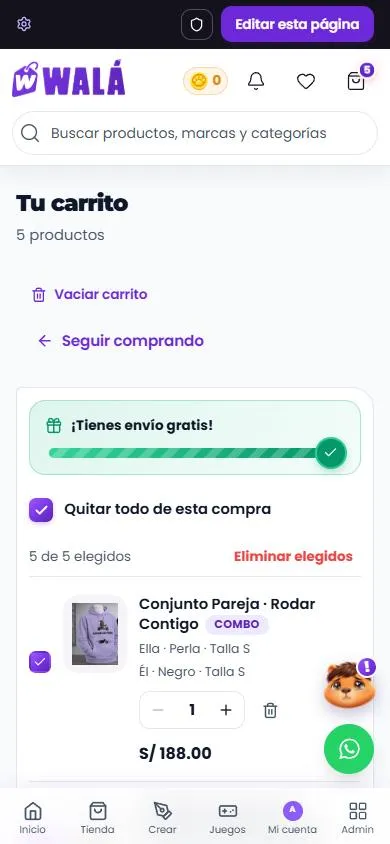

# El carrito (`/carrito`)

Cómo verlo en vivo: `npm run dev` → http://localhost:3000/componentes.html →
**Páginas** → **Tienda de prueba** → **Carrito**. "Agregar" en cualquier
tarjeta o ficha lo llena. En "Estado del carrito": un pedido esperando el
pago, falta una talla y "Restaurar carrito".

**En la tienda desde el 2026-10-17** (paso 6): `/carrito` es esta página (ver
"En la tienda", abajo).

| Escritorio | Celular (pedido esperando el pago) |
|---|---|
|  |  |

Revisado el 2026-10-15 contra `src/pages/CartPage.jsx`,
`src/pages/Tienda/components/Cart/Cart.jsx` (253 líneas),
`CartItem.jsx` (204), `contexts/CartContext.jsx` y `constants/envio.js`.

## Partes

| Parte | Componente | Piezas que usa | Diseño en | Datos (en la tienda) |
|---|---|---|---|---|
| P1 Página | `PaginaCarrito` (`paginas/Carrito.jsx`, en su propio archivo desde el 2026-10-17; `Paginas.jsx` lo reexporta) | `TituloSeccion`, `Aviso`, `Casilla`, `EstadoVacio`, `CarruselProductos` | `paginas/Carrito.module.css` (`.carrito…`, `.seleccion`) | `useCart` |
| Cada producto | `ItemCarrito` | `FotoProducto` (con `srcSet`), `Cantidad`, `Etiqueta`, `Enlace` | `Pedido.module.css` (`.item…`) | un item de `CartContext` → `itemCarritoDesde` |
| Envío gratis | `BarraEnvioGratis estricto` | `Estallido` | `Pedido.module.css` (`.envio…`) | `constants/envio` |
| Resumen | `ResumenPedido` | `Boton`, `Moneda` | `Pedido.module.css` (`.resumen…`) | `getTotalPrice`, monedas del perfil |

### Lo que hace

- **Qué se compra esta vez:**
  - Cada producto tiene su casilla. Sin marcar, la fila se apaga, dice "No se
    cobra en esta compra" y no entra en las cuentas.
  - Arriba van "Seleccionar todo" (o "Quitar todo de esta compra"), "1 de 2
    elegidos" y "Eliminar elegidos".
- **Cada producto:**
  - La foto y el nombre llevan a su ficha, a la creación o al combo.
  - Debajo, la talla y el color (con su bolita), "Combo" y sus prendas, o
    "Con tu diseño".
  - Si le falta el color o la talla: "Falta elegir talla · Elegir ahora".
  - Con más de una unidad, "S/ x c/u".
  - La cantidad va de 1 a 99. Para quitar el producto está la papelera.
- **Avisos:**
  - **Pedido esperando el pago:** "Lo enviaste por WhatsApp (código …)",
    el botón dice "Esperando la confirmación…" y "Vaciar carrito" pasa a
    "Cancelar pedido".
  - **Falta el color o la talla:** "A un producto le falta la talla" y el botón
    dice "Falta elegir talla".
- **Vaciar y eliminar** se confirman en la misma tarjeta, sin `window.confirm`.
- **Resumen:**
  - "Subtotal (N productos)" de lo elegido, los descuentos de precio, el envío
    y el total.
  - Con monedas: "Tienes 43 monedas: podrás usarlas al pagar".
  - El botón: "Ir a pagar (2)" o el motivo por el que no se puede.
  - Debajo: "Pago seguro con tarjeta, Yape, Plin o transferencia" (los medios
    de la tienda; `notaPago` lo cambia).
- **También te puede gustar:** se pide cuando se acerca a la vista
  (`onVerAbajo`, a 300px). Con `tarjeta`, la tarjeta de la tienda.
- **Envío:** la regla de la tienda, S/ 15 y gratis en compras de **más** de
  S/ 100 (`estricto`: con S/ 100 justos dice "Pasa de S/ 100.00 y el envío es
  gratis"). Sin nada elegido, no hay envío.

## En la tienda (hecho el 2026-10-17)

(Celular, 390 px, con los emuladores. Se probó también a 1366 y en oscuro.)

- **Conector:** `src/components/carrito/CarritoDeTienda.jsx`, desde
  `pages/CartPage.jsx`. Las líneas pasan por `itemCarritoDesde`
  (`adaptadores.js`); las acciones son las de CartContext (tabla de abajo).
  CartContext no cambió: localStorage, la nube, las pestañas, restaurar al
  entrar y el pedido aprobado por el ERP siguen igual.
- **Interruptor `carritoViejo`:** ahora vuelve **toda** la página vieja
  (`Cart.jsx`, que baja aparte, solo con el interruptor) y, con ella, sus
  preguntas con `window.confirm`.
- **Combos sin portada:** la foto de su primera prenda (`comboItems[].imageUrl`),
  sin pedir nada. Antes, `ComboProductImage` pedía las prendas a Firestore y
  precargaba todas sus fotos en cada línea.
- **También te puede gustar:** la consulta de la ficha
  (`['related-products', categoría, marca, id]`: categoría y marca del primer
  producto elegido sin diseño), sin lo que ya está en el carrito ni prendas
  de Crear, hasta 10, con `TarjetaDeProducto` ("Agregar rápido", corazón).
  Se pide al acercarse; las categorías y las marcas también.
- **Carga:**
  - `muestraColor` y `queLeFalta` leían y parseaban **todo** el catálogo de
    localStorage por cada línea y en cada dibujo. Ahora el catálogo se lee
    una vez por cambio del carrito (`catalogoPorId` en
    `utils/cartValidation.js`; las tres funciones aceptan ese Map y, sin él,
    hacen lo de antes, como en el checkout).
  - Las fotos de las líneas bajan en su tamaño (`productImageVariantes`, que
    el carrito ya guardaba, con `fuentesDeImagen`).
  - El paquete de `/carrito` pesa 11,6 KB gzip (antes 7,4). Casi todo es
    `Pedido.module.css`, que también trae el seguimiento de pedidos; el
    checkout lo reutiliza. `PaginaCarrito` vive en su propio archivo para no
    bajar las demás páginas.
  - Queda para después (decidido): CartContext escribe el carrito entero en
    Firestore en cada cambio (cada + o − es una escritura).
- **Arreglado de paso:** con el carrito vacío ya no salen "Seguir comprando"
  y "Ver la tienda" a la vez.

### Qué se probó (2026-10-17, localhost con los emuladores)

- Mismo total que la página vieja con el mismo carrito (S/ 693,00; el kit
  muestra el subtotal sin descuento y la línea "Descuentos").
- + y − (el − se apaga en 1, "S/ x c/u" con 2), desmarcar una línea ("No se
  cobra en esta compra", el subtotal y "4 de 5 elegidos"), quitar y volver a
  marcar todo, "Eliminar elegidos" con su pregunta.
- Una línea sin talla: el aviso, "Falta elegir talla · Elegir ahora" (a la
  ficha) y el botón bloqueado; al desmarcarla se puede pagar.
- Envío: S/ 15 con S/ 99 ("Te faltan S/ 1.00"), gratis con más de S/ 100.
- Pedido pendiente: el aviso con el código, "Esperando la confirmación…" y
  "Cancelar pedido" → vacío.
- Combo de la tienda (sus prendas con nombre, color y talla), creación ("Con
  tu diseño", a `/creacion/:id`) y combo de Crear (a `/combo/:id?mio=`), con
  líneas de prueba.
- Fotos con `srcset` (con copias de prueba: el emulador no tiene).
- Recomendados: en el celular aparecen recién al bajar, con la tarjeta de la
  tienda y sin lo que está en el carrito.
- "Ir a pagar" → `/checkout`; `carritoViejo` → la página vieja.
- 1366 y 390, claro y oscuro.

No se probó: el pedido aprobado por el ERP (el escucha de `pedidos_web` es
de CartContext y no cambió), restaurar el carrito de la nube al entrar (tampoco
cambió) y la app Android.

### Reemplazos (hechos)

| Parte | Hoy | Pasa a (kit) |
|---|---|---|
| Título doble ("Carrito de Compras" y "Tu Carrito (N)") | `CartPage` + `Cart` | `TituloSeccion` con las unidades |
| Barra de selección | casilla con indeterminado por DOM | `Casilla` + `.seleccion` |
| Avisos (pendiente, incompletos) | cajas con emojis | `Aviso` |
| Fila | `CartItem` (463 líneas de CSS) | `ItemCarrito` |
| Resumen | `GlassCard` con "Proceder al Pago (N)" | `ResumenPedido` |
| Vacío | 🛍️ y texto | `EstadoVacio` |

### De dónde sale cada dato

Un adaptador del item de `CartContext` a `ItemCarrito`:

| Prop | Sale de |
|---|---|
| `precio` | `customization.finalPrice` o `price` |
| `precioAntes` | `regularPrice`, si es mayor |
| `seleccionado` | `selected !== false` |
| `detalles` | `variant.size` y `variant.color` / `colorHex` (el color, si `muestraColor`) |
| `combo`, `piezas` | `isComboProduct` / `customization.tipo === 'comboCrear'` y sus `piezas` (color, talla, nombre) |
| `url` | `/combo/…?mio=`, `/creacion/:designId` o `/producto/:id` |
| `incompleto` | `cartValidation` |
| `pendiente` | todos con `status === 'pending_confirmation'` → `{ codigo: pseudoOrderId }` |

Las acciones son las de `CartContext`:

| Prop de la página | Acción |
|---|---|
| `onCantidad` | `updateQuantity` |
| `onQuitar` | `removeFromCart` |
| `onSeleccionar` | `toggleItemSelected` |
| `onSeleccionarTodo` | `setAllItemsSelected` |
| `onQuitarSeleccionados` | `removeSelectedItems` |
| `onVaciar` | `clearCart` |

### Comportamiento que no se puede perder

- El aviso de que el pedido fue aprobado (el `onSnapshot` de
  `pedidos_web/{webOrderId}`) y que el carrito se vacíe solo.
- La sincronización con la nube y entre pestañas, y el dedup de items, que
  viven en `CartContext` y no cambian.

### Diferencias a propósito (no "corregirlas" al migrar)

- La barra de envío gratis y "También te puede gustar" (la tienda no las
  tiene).
- Los precios de antes tachados y la línea "Descuentos".
- Las confirmaciones en la tarjeta en vez de `window.confirm`.
- Sin cupón en el carrito: va en el checkout (`cupones` queda solo para
  probarlo en la página de componentes).

### Pendiente

- Borrar lo viejo cuando lleve un tiempo en producción (ELIMINAR.md, paso 6).
- Un regalo de una lista se ve como una compra normal (también en la página
  vieja); podría decir para quién es.
