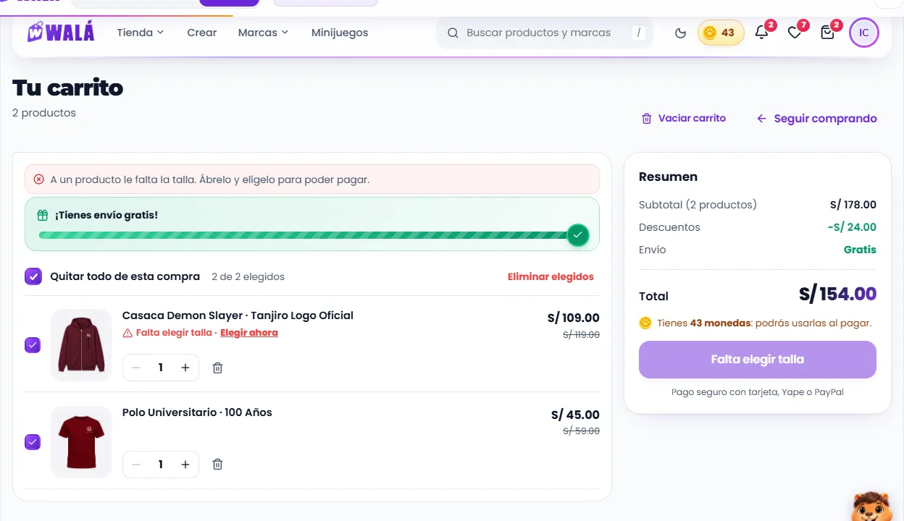
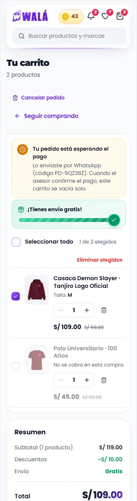

# El carrito (`/carrito`)

Cómo verlo en vivo: `npm run dev` → http://localhost:3000/componentes.html →
**Páginas** → **Tienda de prueba** → **Carrito**. "Agregar" en cualquier
tarjeta o ficha lo llena. En "Estado del carrito": un pedido esperando el
pago, falta una talla y "Restaurar carrito".

| Escritorio | Celular (pedido esperando el pago) |
|---|---|
|  |  |

Revisado el 2026-10-15 contra `src/pages/CartPage.jsx`,
`src/pages/Tienda/components/Cart/Cart.jsx` (253 líneas),
`CartItem.jsx` (204), `contexts/CartContext.jsx` y `constants/envio.js`.

## Partes

| Parte | Componente | Piezas que usa | Diseño en | Datos (en la tienda) |
|---|---|---|---|---|
| P1 Página | `PaginaCarrito` | `TituloSeccion`, `Aviso`, `Casilla`, `EstadoVacio`, `CarruselProductos` | `paginas/Paginas.module.css` (`.carrito…`, `.seleccion`) | `useCart` |
| Cada producto | `ItemCarrito` | `FotoProducto`, `Cantidad`, `Etiqueta`, `Enlace` | `Pedido.module.css` (`.item…`) | un item de `CartContext` |
| Envío gratis | `BarraEnvioGratis estricto` | `Estallido` | `Pedido.module.css` (`.envio…`) | `constants/envio` |
| Resumen | `ResumenPedido` | `Boton`, `Moneda` | `Pedido.module.css` (`.resumen…`) | `getTotalPrice`, monedas del perfil |

### Lo que hace

- **Qué se compra esta vez:**
  - Cada producto tiene su casilla. Sin marcar, la fila se apaga, dice "No se
    cobra en esta compra" y no entra en las cuentas.
  - Arriba van "Seleccionar todo" (o "Quitar todo de esta compra"), "1 de 2
    elegidos" y "Eliminar elegidos".
- **Cada producto:**
  - La foto y el nombre llevan a su ficha, a la creación o al combo.
  - Debajo, la talla y el color (con su bolita), "Combo" y sus prendas, o
    "Con tu diseño".
  - Si le falta el color o la talla: "Falta elegir talla · Elegir ahora".
  - Con más de una unidad, "S/ x c/u".
  - La cantidad va de 1 a 99. Para quitar el producto está la papelera.
- **Avisos:**
  - **Pedido esperando el pago:** "Lo enviaste por WhatsApp (código …)",
    el botón dice "Esperando la confirmación…" y "Vaciar carrito" pasa a
    "Cancelar pedido".
  - **Falta el color o la talla:** "A un producto le falta la talla" y el botón
    dice "Falta elegir talla".
- **Vaciar y eliminar** se confirman en la misma tarjeta, sin `window.confirm`.
- **Resumen:**
  - "Subtotal (N productos)" de lo elegido, los descuentos de precio, el envío
    y el total.
  - Con monedas: "Tienes 43 monedas: podrás usarlas al pagar".
  - El botón: "Ir a pagar (2)" o el motivo por el que no se puede.
- **Envío:** la regla de la tienda, S/ 15 y gratis en compras de **más** de
  S/ 100 (`estricto`: con S/ 100 justos dice "Pasa de S/ 100.00 y el envío es
  gratis"). Sin nada elegido, no hay envío.

## Llevar a la tienda (a futuro: TODAVÍA NO se hace)

### Reemplazos

| Parte | Hoy | Pasa a (kit) |
|---|---|---|
| Título doble ("Carrito de Compras" y "Tu Carrito (N)") | `CartPage` + `Cart` | `TituloSeccion` con las unidades |
| Barra de selección | casilla con indeterminado por DOM | `Casilla` + `.seleccion` |
| Avisos (pendiente, incompletos) | cajas con emojis | `Aviso` |
| Fila | `CartItem` (463 líneas de CSS) | `ItemCarrito` |
| Resumen | `GlassCard` con "Proceder al Pago (N)" | `ResumenPedido` |
| Vacío | 🛍️ y texto | `EstadoVacio` |

### De dónde sale cada dato

Un adaptador del item de `CartContext` a `ItemCarrito`:

| Prop | Sale de |
|---|---|
| `precio` | `customization.finalPrice` o `price` |
| `precioAntes` | `regularPrice`, si es mayor |
| `seleccionado` | `selected !== false` |
| `detalles` | `variant.size` y `variant.color` / `colorHex` (el color, si `muestraColor`) |
| `combo`, `piezas` | `isComboProduct` / `customization.tipo === 'comboCrear'` y sus `piezas` (color, talla, nombre) |
| `url` | `/combo/…?mio=`, `/creacion/:designId` o `/producto/:id` |
| `incompleto` | `cartValidation` |
| `pendiente` | todos con `status === 'pending_confirmation'` → `{ codigo: pseudoOrderId }` |

Las acciones son las de `CartContext`:

| Prop de la página | Acción |
|---|---|
| `onCantidad` | `updateQuantity` |
| `onQuitar` | `removeFromCart` |
| `onSeleccionar` | `toggleItemSelected` |
| `onSeleccionarTodo` | `setAllItemsSelected` |
| `onQuitarSeleccionados` | `removeSelectedItems` |
| `onVaciar` | `clearCart` |

### Comportamiento que no se puede perder

- El aviso de que el pedido fue aprobado (el `onSnapshot` de
  `pedidos_web/{webOrderId}`) y que el carrito se vacíe solo.
- La sincronización con la nube y entre pestañas, y el dedup de items, que
  viven en `CartContext` y no cambian.

### Diferencias a propósito (no "corregirlas" al migrar)

- La barra de envío gratis y "También te puede gustar" (la tienda no las
  tiene).
- Los precios de antes tachados y la línea "Descuentos".
- Las confirmaciones en la tarjeta en vez de `window.confirm`.
- Sin cupón en el carrito: va en el checkout (`cupones` queda solo para
  probarlo en la página de componentes).

### Pasos

1. El adaptador del item, comparado fila por fila (prenda, combo, creación,
   combo de Crear).
2. Cambiar la fila y el resumen.
3. Cambiar la barra de selección y los avisos.
4. Borrar `Cart.module.css` y `CartItem.module.css` cuando lleve un tiempo
   en producción.
