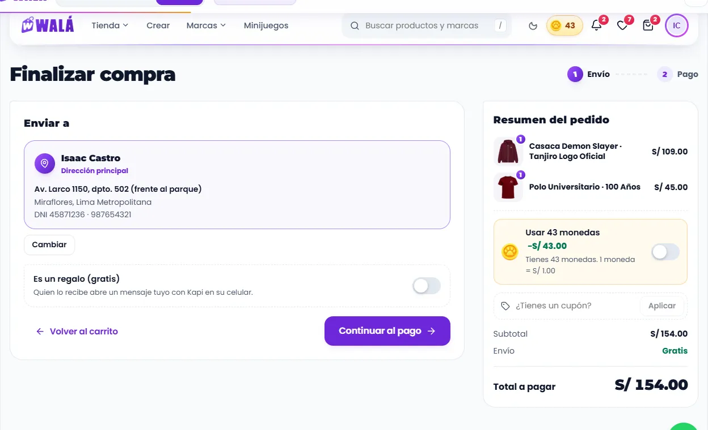
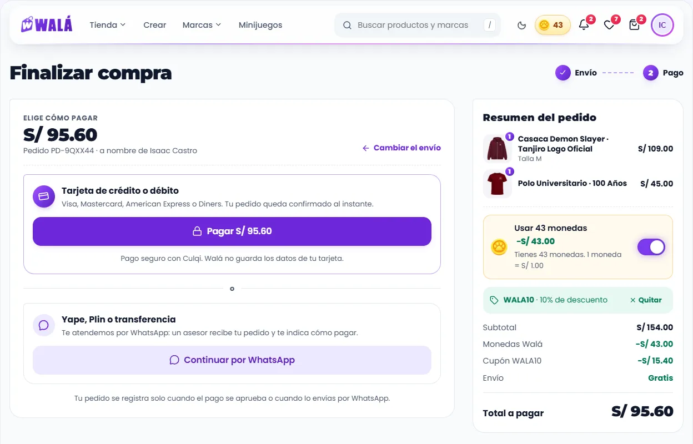
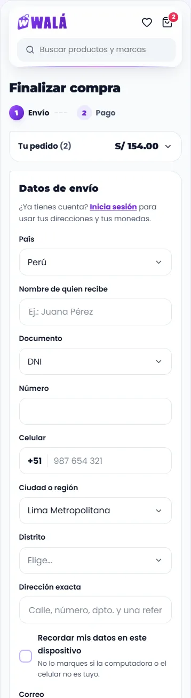

# El checkout (`/checkout`)

Cómo verlo en vivo: `npm run dev` → http://localhost:3000/componentes.html →
**Páginas** → **Tienda de prueba** → **Checkout**, o "Ir a pagar" desde el
**Carrito**. Usa lo que hay en el carrito de la demo (solo lo elegido). Prueba
"Con sesión" (tu dirección principal, tus monedas) y "Visitante" (el
formulario). En los estados: cargando, carrito vacío, sin direcciones
guardadas, la tarjeta falla, varias marcas, regalo programado, con invitación
y falta una talla. Cupones de prueba: `WALA10` y `ENVIOGRATIS`.

| Envío (escritorio) | Pago (escritorio) | Celular |
|---|---|---|
|  |  |  |

Revisado el 2026-10-15 contra `src/pages/CheckoutPage.jsx` (2.735 líneas y
1.735 de CSS), `constants/envio.js`, `CulqiCustomCheckout`, `PaypalCheckout`,
`services/cupones.js` y `services/direcciones.js`. Nada se cobra en la demo:
la tarjeta, WhatsApp y PayPal esperan y avisan.

## Partes

| Parte | Componente | Piezas que usa | Diseño en | Datos (en la tienda) |
|---|---|---|---|---|
| P14 Página | `PaginaCheckout` | `PasosCompra`, `Aviso`, `Boton`, `CapaCargando` (el cobro), `EstadoVacio` | `paginas/Checkout.module.css` | ver abajo |
| Envío | la misma página | `TarjetaDireccion` (la de Mis direcciones), `ListaEleccion`, **`CamposDireccion`** (pieza nueva, sacada de Mis direcciones: los dos usan los mismos campos), `Casilla`, `Campo` | `piezas/Direccion.module.css` | `obtenerDirecciones`, `peruUbigeo`, `ubicacionErp` |
| Regalo | la misma página | `Interruptor`, `Campo`, `ListaEleccion` (el sticker de Kapi) | `paginas/Checkout.module.css` (`.regalo`) | el item con `isWishlistGift` y `deliveryDate` |
| Resumen | `ResumenCompra` (pieza nueva) | `FilaMonedas`, `CampoCupon`, `FotoProducto`, `Moneda`, `Interruptor` | `piezas/Checkout.module.css` | `useCart`, `activeMainCoins`, `validarCuponSecure` |
| Pago | `MetodoPago` (pieza nueva) | `Sello`, `Boton`, `Aviso` | `piezas/Checkout.module.css` | Culqi, `crearSolicitudWhatsappSecure`, PayPal |

### Lo que hace

- **Pasos:** "Envío" y "Pago", en sellos unidos por una costura. En la tienda
  no hay pasos: el formulario se cambia por "Elige cómo pagar" en el mismo
  lugar.
- **Envío con cuenta:**
  - Abre con la dirección principal en su tarjeta y "Cambiar".
  - "Cambiar" muestra la lista de direcciones (elegir una vuelve a la
    tarjeta), "Agregar una dirección nueva" y "Cancelar".
  - El formulario lleva "Usar una dirección guardada" y la casilla "Guardar
    esta dirección en mi cuenta".
  - Si el perfil ya tiene nombre, documento y celular, quien recibe va
    resumido con "Cambiar".
- **Envío sin cuenta:**
  - El formulario completo: país, quién recibe, el lugar y la dirección.
  - "¿Ya tienes cuenta? Inicia sesión…".
  - El correo y la casilla "Recordar mis datos en este dispositivo", que va
    **sin marcar** porque puede ser un equipo ajeno.
- **El lugar:**
  - Perú: Lima Metropolitana, Callao u otras provincias (con departamento y
    provincia), y el distrito de la lista.
  - Fuera del Perú: región y ciudad escritas.
  - Al cambiar de país, de ciudad o de provincia se borra lo que ya no
    corresponde (`cambiarDireccion`).
- **Regalo:**
  - "Es un regalo (gratis)" abre el campo **Para**, el mensaje (hasta 200
    letras, con la cuenta) y cómo acompaña Kapi: Amor, Fiesta o Feliz, con
    íconos y sin emojis.
  - Si viene de una lista de deseos con fecha, ya viene activado. Dice
    "Entrega programada para el 24 de octubre · Cumpleaños" y el aviso si la
    fecha está cerca.
- **Continuar al pago:** valida todo y, si falta algo, avisa debajo y marca
  los campos. Si a un producto le falta el color o la talla, no deja pasar.
  Mientras tanto dice "Preparando tu pago…".
- **Pago (Perú):**
  - **Tarjeta:** "Pagar S/ x". Mientras cobra, una capa a pantalla completa
    dice "Confirmando tu pago". Si falla: "No se completó el pago con
    tarjeta", y se puede reintentar o ir por WhatsApp.
  - **Yape, Plin o transferencia:** "Continuar por WhatsApp" (mientras: "Creando
    tu pedido…").
  - **Varias marcas:** un botón por marca ("Enviar a Con Amor Geeks (1)") y
    "Listo, ya envié mis pedidos".
- **Pago (otro país):** el aviso de 7 a 30 días hábiles, **PayPal** en dólares
  y "Coordinar por WhatsApp".
- **Resumen:**
  - Cada producto con su foto y la cantidad en un sello.
  - **Monedas:** explica por qué no se pueden usar (sin sesión, sin monedas,
    "no alcanza"). Si se pueden, va el interruptor "Usar N monedas −S/ N".
  - **Cupón:** "Aplicar" o Enter; el error sale debajo y el aplicado con
    "Quitar".
  - Subtotal, monedas, cupón, envío, "Te faltan S/ x para el envío gratis" y
    "Total a pagar".
  - En el pago, las monedas y el cupón quedan como se prepararon (para
    cambiarlos, "Cambiar el envío").
  - **En el celular** va arriba, plegado en "Tu pedido (2) · S/ 154.00".
- **Listo:** Kapi feliz, "¡Pago aprobado!" o "¡Tu pedido está creado!" (por
  WhatsApp), el número del pedido, "Ver mi pedido" y "Seguir comprando". En
  la tienda no hay esta pantalla: se va a Mis pedidos con un aviso.

### Las cuentas (las de la tienda)

- **Envío:** S/ 15, gratis en compras de **más** de S/ 100 sobre el subtotal
  de los productos (con S/ 100 justos se cobra). Sale de `constants/envio`, y
  `functions/index.js` tiene los mismos números.
- **Monedas:** hasta la mitad del subtotal (redondeada hacia abajo), a S/ 1 la
  moneda.
- **Cupón:** lo valida el servidor. Uno de envío gratis deja el envío en 0 y
  no descuenta nada más.
- **Total** = máx(0, subtotal − monedas − cupón) + envío.

## Para cambiar el diseño rápido: qué se repite

- **`CamposDireccion`** es la misma en Mis direcciones y en el checkout.
- **`TarjetaDireccion`** y **`ListaEleccion`** son las de la cuenta.
- **`PasosCompra`** usa los sellos de la marca, como los pasos de Crear y del
  estudio.

## Llevar a la tienda (a futuro: TODAVÍA NO se hace)

### Reemplazos

| Parte | Hoy en `CheckoutPage` | Pasa a (kit) |
|---|---|---|
| Libreta y formulario | `modoDireccion` + campos con Yup | tarjeta, `ListaEleccion` y `CamposDireccion` |
| País y teléfono | `CountrySelect`, `PhoneIntlInput` | `Campo` con `paises`, `CampoTelefono` |
| Modo Regalo | toggle con emojis | `Interruptor` + `ListaEleccion` |
| Resumen | `GlassCard` con monedas y cupón | `ResumenCompra` |
| Tarjeta "Elige cómo pagar" | `.payCard` | la etapa de pago con `MetodoPago` |
| Cobrando | overlay propio | `CapaCargando pantallaCompleta` |
| Carrito vacío | texto y botón | `EstadoVacio` con Kapi |

### De dónde sale cada dato

- **`items`:** los elegidos de `useCart` (`selected !== false`), con
  `precio = customization.finalPrice || price`. `incompletos` sale de
  `cartValidation`.
- **`perfil`, `direcciones`, `monedas`:** `useAuth` (perfil y
  `activeMainCoins`), `obtenerDirecciones(uid)` con `direccionDesdeFirestore`.
- **`lugares`:** `DEPARTAMENTOS`, `getProvincias`, `distritosSugeridos` y
  `lugarLegible` (los mismos de Mis direcciones). **`paises`:**
  `constants/countries` sin las banderas.
- **`envio`:** `ENVIO_ESTANDAR` y `ENVIO_GRATIS_DESDE`.
- **`onCupon`:** `validarCuponSecure`, que devuelve `descuento` y `envioGratis`.
- **`onPreparar`:**
  1. Arma el payload del ERP y llama a `prepareCheckoutPayment`. Un
     `failed-precondition` se lanza con el mensaje del servidor.
  2. Guarda la dirección (`agregarDireccion` / `actualizarDireccion`) o los
     datos del invitado.
  3. Completa el perfil.
  4. Devuelve `{ numero }`.
- **`pago.onTarjeta`:** el modal de Culqi y `processCulqiPayment`; si no se
  cobró, lanza el error. **`pago.onWhatsApp(marca)`:**
  `crearSolicitudWhatsappSecure` y abrir `wa.me` (con la pestaña de "Creando
  tu pedido…"). **`pago.onPaypal`:** los botones de PayPal y
  `capturePaypalOrderSecure`. **`pago.usd`:** `penToUsd` de `services/fx`.
- **`pago.marcas`:** el flag `whatsapp_multimarca` y los items agrupados por
  marca.
- **`entrega`:** el item con `isWishlistGift`, `deliveryDate`,
  `deliveryRecipient` y `deliveryEventLabel`.

### Comportamiento que no se puede perder

- `trackCheckoutStart` una vez; precargar el SDK de Culqi y precalentar
  `prepareCheckoutPayment`.
- El mínimo de Culqi (S/ 3) y de PayPal (US$ 1).
- Después de un pago aprobado:
  - Marcar como regalados los items de la lista de deseos y las creaciones
    como "en pedido".
  - Olvidar el referido y congelar las monedas (`freezeMonedas`).
  - Canjear el cupón.
  - `trackPurchaseComplete` y el píxel de Meta.
  - `clearSelectedItems()`.
- El pedido por WhatsApp deja el carrito en `pending_confirmation` (el carrito
  lo muestra; ver CARRITO.md).
- La autodetección del país y lo guardado en `checkout_customer_info`.

### Diferencias a propósito (no "corregirlas" al migrar)

- Pasos visibles y una pantalla de "listo" con el número del pedido.
- El resumen va arriba y plegado en el celular, para que el total esté a la
  vista mientras se llena el formulario (en la tienda va debajo).
- "Recordar mis datos" sin marcar para un visitante.
- Sin emojis (regalo, aviso internacional, stickers).

### Pasos

1. Pasar Mis direcciones a `CamposDireccion` y comparar (ya lo usa en el kit).
2. Cambiar el resumen por `ResumenCompra`, con las mismas cuentas.
3. Cambiar el formulario y la libreta.
4. Cambiar la etapa de pago por `MetodoPago`, sin tocar Culqi ni PayPal.
5. Agregar los pasos y la pantalla de listo.
6. Borrar `CheckoutPage.module.css` cuando lleve un tiempo en producción.
