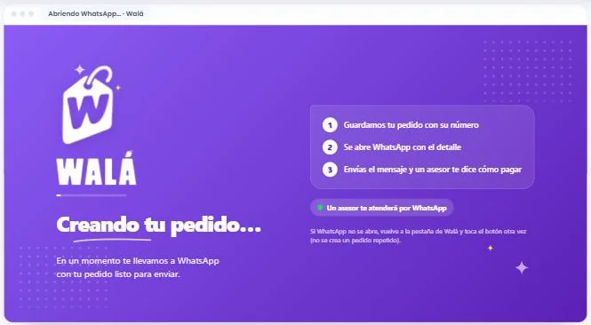
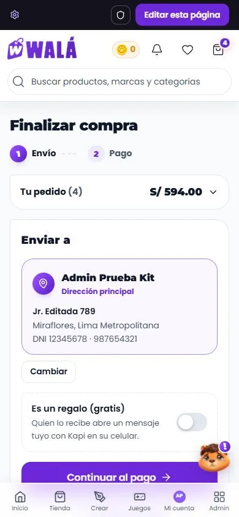

# El checkout (`/checkout`)

Cómo verlo en vivo: `npm run dev` → http://localhost:3000/componentes.html →
**Páginas** → **Tienda de prueba** → **Checkout**, o "Ir a pagar" desde el
**Carrito**. Usa lo que hay en el carrito de la demo (solo lo elegido). Prueba
"Con sesión" (tu dirección principal, tus monedas) y "Visitante" (el
formulario). En los estados: cargando, carrito vacío, sin direcciones
guardadas, la tarjeta falla, varias marcas, regalo programado, con invitación
y falta una talla. Cupones de prueba: `WALA10` y `ENVIOGRATIS`.

**En la tienda desde el 2026-10-17** (paso 6): `/checkout` es esta página (ver
"En la tienda", abajo).

| Envío (escritorio) | Pago (escritorio) | Celular |
|---|---|---|
|  |  |  |

Revisado el 2026-10-15 contra `src/pages/CheckoutPage.jsx` (2.735 líneas y
1.735 de CSS), `constants/envio.js`, `CulqiCustomCheckout`, `PaypalCheckout`,
`services/cupones.js` y `services/direcciones.js`. Nada se cobra en la demo:
la tarjeta, WhatsApp y PayPal esperan y avisan.

## Partes

| Parte | Componente | Piezas que usa | Diseño en | Datos (en la tienda) |
|---|---|---|---|---|
| P14 Página | `PaginaCheckout` | `PasosCompra`, `Aviso`, `Boton`, `CapaCargando` (el cobro), `EstadoVacio` | `paginas/Checkout.module.css` | ver abajo |
| Envío | la misma página | `TarjetaDireccion` (la de Mis direcciones), `ListaEleccion`, **`CamposDireccion`** (pieza nueva, sacada de Mis direcciones: los dos usan los mismos campos), `Casilla`, `Campo` | `piezas/Direccion.module.css` | `obtenerDirecciones`, `peruUbigeo`, `ubicacionErp` |
| Regalo | la misma página | `Interruptor`, `Campo`, `ListaEleccion` (el sticker de Kapi) | `paginas/Checkout.module.css` (`.regalo`) | el item con `isWishlistGift` y `deliveryDate` |
| Resumen | `ResumenCompra` (pieza nueva) | `FilaMonedas`, `CampoCupon`, `FotoProducto`, `Moneda`, `Interruptor` | `piezas/Checkout.module.css` | `useCart`, `activeMainCoins`, `validarCuponSecure` |
| Pago | `MetodoPago` (pieza nueva) | `Sello`, `Boton`, `Aviso` | `piezas/Checkout.module.css` | Culqi, `crearSolicitudWhatsappSecure`, PayPal |

### Lo que hace

- **Pasos:** "Envío" y "Pago", en sellos unidos por una costura. En la tienda
  no hay pasos: el formulario se cambia por "Elige cómo pagar" en el mismo
  lugar.
- **Envío con cuenta:**
  - Abre con la dirección principal en su tarjeta y "Cambiar".
  - "Cambiar" muestra la lista de direcciones (elegir una vuelve a la
    tarjeta), "Agregar una dirección nueva" y "Cancelar".
  - El formulario lleva "Usar una dirección guardada" y la casilla "Guardar
    esta dirección en mi cuenta".
  - Si el perfil ya tiene nombre, documento y celular, quien recibe va
    resumido con "Cambiar".
- **Sin cuenta (decidido el 2026-10-15: para pagar hace falta una cuenta):**
  - Se puede llenar todo (país, quién recibe, el lugar, la dirección, el
    correo y "Recordar mis datos", que va **sin marcar** porque puede ser un
    equipo ajeno).
  - Junto al botón: "Para pagar necesitas tu cuenta. Así tu pedido queda en
    «Mis pedidos» y puedes usar tus monedas. Lo que ya llenaste se guarda",
    con "¿No tienes cuenta? Créala aquí".
  - El botón es **"Inicia sesión para pagar"**. `onEntrar(ruta, datos)` guarda
    lo llenado antes de ir. La tienda ya lo hace así: guarda en
    `sessionStorage` (`wala_checkout_borrador`), va a `/login` o `/registro`
    con `state.from`, y al volver lo recupera.
  - **Por qué:** el cobro con tarjeta exige sesión en el servidor
    (`processCulqiPayment`). Antes un invitado llegaba a escribir su tarjeta y
    el cobro fallaba al final. Así el pedido además queda en su cuenta.
- **El lugar:**
  - Perú: Lima Metropolitana, Callao u otras provincias (con departamento y
    provincia), y el distrito de la lista.
  - Fuera del Perú: región y ciudad escritas.
  - Al cambiar de país, de ciudad o de provincia se borra lo que ya no
    corresponde (`cambiarDireccion`).
- **Regalo:**
  - "Es un regalo (gratis)" abre el campo **Para**, el mensaje (hasta 200
    letras, con la cuenta) y cómo acompaña Kapi: Amor, Fiesta o Feliz, con
    íconos y sin emojis.
  - Si viene de una lista de deseos con fecha, ya viene activado. Dice
    "Entrega programada para el 24 de octubre · Cumpleaños" y el aviso si la
    fecha está cerca.
- **Continuar al pago:** valida todo y, si falta algo, avisa debajo y marca
  los campos. Si a un producto le falta el color o la talla, no deja pasar.
  Mientras tanto dice "Preparando tu pago…".
- **Pago (Perú):**
  - **Tarjeta:** "Pagar S/ x". Mientras cobra, una capa a pantalla completa
    dice "Confirmando tu pago". Si falla: "No se completó el pago con
    tarjeta", y se puede reintentar o ir por WhatsApp.
  - **Yape, Plin o transferencia:** "Continuar por WhatsApp" (mientras: "Creando
    tu pedido…").
  - **La pestaña de WhatsApp** (desde el 2026-10-16 en el kit:
    `htmlAbriendoWhatsApp` y su vista `PantallaAbriendoWhatsApp`,
    `piezas/AbriendoWhatsApp.jsx`): la que se abre en el clic mientras el
    servidor crea el pedido. Es la pantalla de carga de Walá (el degradado,
    la etiqueta que se mece, WALÁ y la barra que va y viene) con "Creando tu
    pedido…", tres pasos (guardamos tu pedido, se abre WhatsApp con el
    detalle, el asesor te dice cómo pagar), "Un asesor te atenderá por
    WhatsApp" (con varias marcas, "El asesor de {marca}") y qué hacer si
    WhatsApp no se abre. Trae su propio link a Google Fonts (Poppins y
    Montserrat 900): la pestaña nueva no tiene las fuentes de la tienda. En
    el celular va en una columna; en escritorio
    (desde 860 px), en dos: la marca y el título a la izquierda, los pasos a
    la derecha. En la demo: estado "Pestaña de WhatsApp" (con "Varias
    marcas", la de una marca), dentro de una ventana del navegador que toma
    el ancho de la página.

    | Celular | Escritorio |
    |---|---|
    |  |  |
  - **Varias marcas:** un botón por marca ("Enviar a Con Amor Geeks (1)") y
    "Listo, ya envié mis pedidos".
- **Pago (otro país):** el aviso de 7 a 30 días hábiles, **PayPal** en dólares
  y "Coordinar por WhatsApp".
- **Resumen:**
  - Cada producto con su foto y la cantidad en un sello.
  - **Monedas:** explica por qué no se pueden usar (sin sesión, sin monedas,
    "no alcanza"). Si se pueden, va el interruptor "Usar N monedas −S/ N".
  - **Cupón:** "Aplicar" o Enter; el error sale debajo y el aplicado con
    "Quitar".
  - Subtotal, monedas, cupón, envío, "Te faltan S/ x para el envío gratis" y
    "Total a pagar".
  - En el pago, las monedas y el cupón quedan como se prepararon (para
    cambiarlos, "Cambiar el envío").
  - **En el celular** va arriba, plegado en "Tu pedido (2) · S/ 154.00".
- **Listo:** Kapi feliz, "¡Pago aprobado!" o "¡Tu pedido está creado!" (por
  WhatsApp), el número del pedido, "Ver mi pedido" y "Seguir comprando". En
  la tienda no hay esta pantalla: se va a Mis pedidos con un aviso.

### Las cuentas (las de la tienda)

- **Envío:** S/ 15, gratis en compras de **más** de S/ 100 sobre el subtotal
  de los productos (con S/ 100 justos se cobra). Sale de `constants/envio`, y
  `functions/index.js` tiene los mismos números.
- **Monedas:** hasta la mitad del subtotal (redondeada hacia abajo), a S/ 1 la
  moneda.
- **Cupón:** lo valida el servidor. Uno de envío gratis deja el envío en 0 y
  no descuenta nada más.
- **Total** = máx(0, subtotal − monedas − cupón) + envío.

## Para cambiar el diseño rápido: qué se repite

- **`CamposDireccion`** es la misma en Mis direcciones y en el checkout.
  Desde el 2026-10-17: fuera del Perú el documento es un solo campo
  ("Documento de identidad nacional") y, si `paises` trae `prefijo`, el
  teléfono va con el del país. `validarDireccion(d, { reglas })`: 'cuenta'
  (Mis direcciones) o 'checkout' (las de la tienda, más laxas).
- **`ListaEleccion`** acepta una `accion` por opción ("Editar"), al lado.
- **`TarjetaDireccion`** y **`ListaEleccion`** son las de la cuenta.
- **`PasosCompra`** usa los sellos de la marca, como los pasos de Crear y del
  estudio.

## En la tienda (hecho el 2026-10-17)

(Celular, 390 px, con los emuladores. Se probó también a 1366 y en oscuro.)

- **Conector:** `src/components/checkout/CheckoutDeTienda.jsx`, desde
  `pages/CheckoutPage.jsx`. Pasa los elegidos (con `itemCarritoDesde`), el
  perfil, la libreta (`direccionDesdeFirestore`), los países con su prefijo,
  lo ya llenado (`inicial`: el borrador al volver de entrar, o lo de la compra
  anterior si no hay libreta) y el país detectado (`paisSugerido`).
- **El pedido:** `services/pedidoCheckout.js`, sacado **tal cual** de la
  página de antes (por rangos de líneas, sin reescribir): `armarPedidoWeb`
  (el payload del ERP), `armarWhatsapp` (uno, o uno por marca),
  `aplicarEfectosDeCompra` (regalos, creaciones, referido, pendiente,
  monedas, cupón), `completarPerfilDesdeCheckout`, `formatDeliveryDate` y
  `businessDaysUntil`. Lo usan las dos páginas.
- **Tarjeta:** `CulqiCustomCheckout` con `renderBoton` (el botón es
  `PagoTarjeta` controlado; se abre solo al llegar al pago, como antes) por
  `pago.botonTarjeta`; cerrar la ventana sin pagar → `pago.tarjetaFallo`.
  Al cobrar, la tienda pone `listo`.
- **PayPal:** `PaypalCheckout` con `soloBotones` (nueva, opcional: sin ella,
  todo igual) por `pago.botonesPaypal`; baja solo si se paga desde otro país.
- **WhatsApp:** la pestaña se abre en el clic con `htmlAbriendoWhatsApp` del
  kit (la tienda seguía con su HTML viejo) mientras el servidor crea el pedido.
- **Interruptor `pagosViejo`:** vuelve la página de antes
  (`pages/CheckoutViejo.jsx`, que baja aparte).
- **Carga:**
  - El paquete del checkout: **28,4 KB gzip de JS** (antes 43,5; sin Formik,
    Yup, `CountrySelect`, `PhoneIntlInput` ni la página vieja) y 5,6 de CSS.
  - Los cinco mensajes del WhatsApp se piden a la vez (antes, uno detrás de
    otro); la tasa de cambio, cuando el navegador queda libre.
  - El catálogo de la caché se lee una vez (`catalogoPorId`).
  - La moneda 3D que giraba sin parar pasó a la `Moneda` quieta del kit.
- **Arreglado de paso:** el sticker "Feliz" vuelve a guardarse como
  `kapi-smile` (el kit decía `kapi-happy`); el cupón de envío gratis ya no
  aparece dos veces en el resumen.

### Diferencias a propósito que se suman

- En el pago, las monedas y el cupón quedan como se prepararon; para
  cambiarlos, "Cambiar el envío" (la tienda volvía a preparar el pago).
- La pantalla "listo" en vez de ir a Mis pedidos.
- Con un solo asesor de marca, el botón dice "Continuar por WhatsApp" (antes,
  "Continuar con el asesor de …"); la pestaña sí nombra la marca.
- En el Perú se manda el teléfono tal cual; fuera, con el código del país.

### Qué se probó (2026-10-17, localhost con los emuladores)

Con el emulador de Functions (`demo-wala`: no toca nada real) para
`prepareCheckoutPayment` y `crearSolicitudWhatsappSecure`:
- Llenar la dirección (Lima, distrito de la lista) → "Continuar al pago" → el
  pago con tarjeta y WhatsApp; se guardan los datos y la dirección.
- Un precio que el servidor no acepta: su mensaje exacto en la página.
- "Continuar por WhatsApp": el pedido queda en `pedidos_web` del emulador,
  el enlace lleva el mensaje del módulo, "¡Tu pedido está creado!" y en el
  carrito quedan solo los "no comprar esta vez".
- La libreta: "Enviar a" con la principal, "Cambiar", "Editar" desde la lista
  y el cambio guardado en `wala_direcciones`.
- Chile: un solo documento, +56, región y ciudad; en el pago, US$, el aviso
  de 7 a 30 días y los botones de PayPal (modo de prueba).
- Un cupón que no existe: el mensaje del servidor.
- El borrador al volver de entrar: la dirección de Callao, el regalo y el
  sticker.
- `pagosViejo`: la página de antes llega al pago y crea el pedido por
  WhatsApp con el mismo módulo (y lee lo que guardó la nueva).
- 1366 y 390, claro y oscuro.

No se probó: un cobro con tarjeta (en local no está la llave de Culqi y
`processCulqiPayment` necesita su secreto) ni con PayPal; un cupón válido y
las monedas (el emulador no tiene cupones ni monedas para la cuenta de
prueba); el equivalente en otra moneda (el emulador no tiene `config/fx`);
varias marcas; sin sesión en la tienda (sí en la demo); la app Android.

### Pendiente

- El estado "pedido esperando el pago" del carrito no llega a verse (la
  página de antes ya era así; decidido dejarlo para después): el checkout
  escribe `pending_confirmation` en localStorage y `clearSelectedItems()` lo
  pisa.

## Llevar a la tienda (el plan original, ya hecho)

### Reemplazos

| Parte | Hoy en `CheckoutPage` | Pasa a (kit) |
|---|---|---|
| Libreta y formulario | `modoDireccion` + campos con Yup | tarjeta, `ListaEleccion` y `CamposDireccion` |
| País y teléfono | `CountrySelect`, `PhoneIntlInput` | `Campo` con `paises`, `CampoTelefono` |
| Modo Regalo | toggle con emojis | `Interruptor` + `ListaEleccion` |
| Resumen | `GlassCard` con monedas y cupón | `ResumenCompra` |
| Tarjeta "Elige cómo pagar" | `.payCard` | la etapa de pago con `MetodoPago` |
| Cobrando | overlay propio | `CapaCargando pantallaCompleta` |
| Carrito vacío | texto y botón | `EstadoVacio` con Kapi |

### De dónde sale cada dato

- **`items`:** los elegidos de `useCart` (`selected !== false`), con
  `precio = customization.finalPrice || price`. `incompletos` sale de
  `cartValidation`.
- **`perfil`, `direcciones`, `monedas`:** `useAuth` (perfil y
  `activeMainCoins`), `obtenerDirecciones(uid)` con `direccionDesdeFirestore`.
- **`lugares`:** `DEPARTAMENTOS`, `getProvincias`, `distritosSugeridos` y
  `lugarLegible` (los mismos de Mis direcciones). **`paises`:**
  `constants/countries` sin las banderas.
- **`envio`:** `ENVIO_ESTANDAR` y `ENVIO_GRATIS_DESDE`.
- **`onCupon`:** `validarCuponSecure`, que devuelve `descuento` y `envioGratis`.
- **`onPreparar`:**
  1. Arma el payload del ERP y llama a `prepareCheckoutPayment`. Un
     `failed-precondition` se lanza con el mensaje del servidor.
  2. Guarda la dirección (`agregarDireccion` / `actualizarDireccion`) o los
     datos del invitado.
  3. Completa el perfil.
  4. Devuelve `{ numero }`.
- **`pago.onTarjeta`:** el modal de Culqi y `processCulqiPayment`; si no se
  cobró, lanza el error. **`pago.onWhatsApp(marca)`:**
  `crearSolicitudWhatsappSecure` y abrir `wa.me` (con la pestaña de "Creando
  tu pedido…": en `CheckoutPage`, `PANTALLA_ABRIENDO_WHATSAPP` pasa a
  `htmlAbriendoWhatsApp({ origen: window.location.origin, marca: g.label })`;
  es HTML suelto porque la pestaña nueva no tiene la app cargada). **`pago.onPaypal`:** los botones de PayPal y
  `capturePaypalOrderSecure`. **`pago.usd`:** `penToUsd` de `services/fx`.
- **`pago.marcas`:** el flag `whatsapp_multimarca` y los items agrupados por
  marca.
- **`entrega`:** el item con `isWishlistGift`, `deliveryDate`,
  `deliveryRecipient` y `deliveryEventLabel`.

### Comportamiento que no se puede perder

- `trackCheckoutStart` una vez; precargar el SDK de Culqi y precalentar
  `prepareCheckoutPayment`.
- El mínimo de Culqi (S/ 3) y de PayPal (US$ 1).
- Después de un pago aprobado:
  - Marcar como regalados los items de la lista de deseos y las creaciones
    como "en pedido".
  - Olvidar el referido y congelar las monedas (`freezeMonedas`).
  - Canjear el cupón.
  - `trackPurchaseComplete` y el píxel de Meta.
  - `clearSelectedItems()`.
- El pedido por WhatsApp deja el carrito en `pending_confirmation` (el carrito
  lo muestra; ver CARRITO.md).
- La autodetección del país y lo guardado en `checkout_customer_info`.

### Diferencias a propósito (no "corregirlas" al migrar)

- Pasos visibles y una pantalla de "listo" con el número del pedido.
- El resumen va arriba y plegado en el celular, para que el total esté a la
  vista mientras se llena el formulario (en la tienda va debajo).
- "Recordar mis datos" sin marcar para un visitante.
- Sin emojis (regalo, aviso internacional, stickers).

### Pasos

1. Pasar Mis direcciones a `CamposDireccion` y comparar (ya lo usa en el kit).
2. Cambiar el resumen por `ResumenCompra`, con las mismas cuentas.
3. Cambiar el formulario y la libreta.
4. Cambiar la etapa de pago por `MetodoPago`, sin tocar Culqi ni PayPal.
5. Agregar los pasos y la pantalla de listo.
6. Borrar `CheckoutPage.module.css` cuando lleve un tiempo en producción.
