# Crear (`/personalizar`): qué componente va en cada parte

Cómo verlo en vivo: `npm run dev` → http://localhost:3000/componentes.html →
**Páginas** → **Tienda de prueba** → página **Crear** (también el enlace
"Crear" de la cabecera y el botón central de la barra inferior).

- **Ver como:**
  - "Visitante": solo la portada, la comunidad y las prendas.
  - "Con sesión": suma tus borradores y tus creaciones.
  - "Admin": suma las prendas en borrador.
- **Estado de Crear:** Cargando prendas, Sin prendas y Sin combos.
- **¿Para cuántos?:** cambia entre prendas sueltas y combos.

| Escritorio (con sesión) | Celular | ¿Para cuántos? En pareja |
|---|---|---|
| 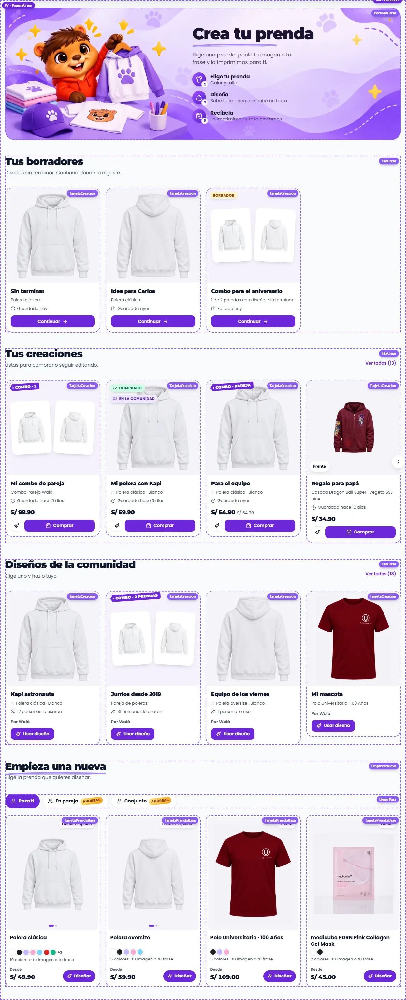 | 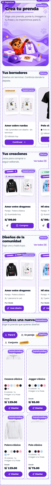 | 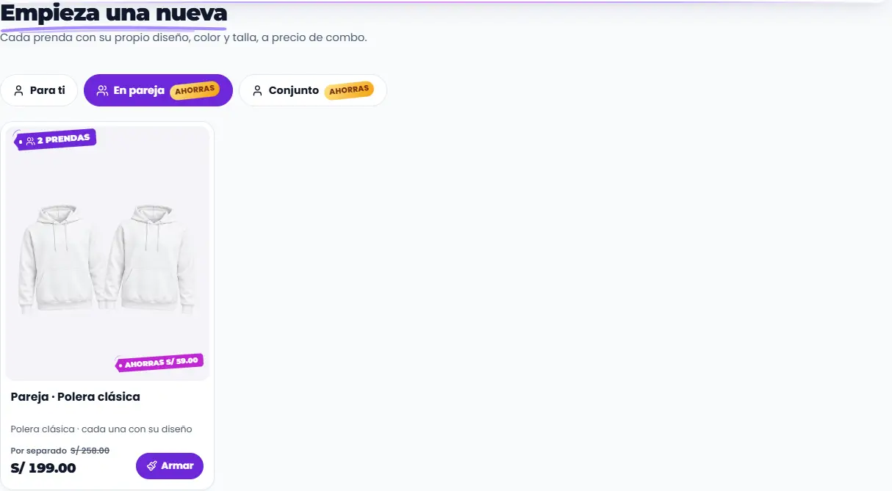 |

**Datos de la demo:** son los reales de Walá, en `src/componentes/demo/crear.json`, y pasan por los mismos adaptadores que usaría la tienda.

- **Qué se leyó (2026-10-15):** las prendas base y los combos de
  `productos_wala`, y los diseños de la comunidad (`listarComunidad`).
- **Con sesión:** esos diseños personalizados hacen de borradores y
  creaciones del cliente, también en Mis creaciones.

Revisado el 2026-10-15 contra wala.pe/personalizar (admin) y:

- `src/pages/PersonalizarPage.jsx` y `pages/Crear/TusBorradores.jsx`;
- `pages/Comunidad/TarjetaComunidad.jsx`;
- `pages/cuenta/components/MiCreacionCard.jsx` y `pages/Crear/TarjetaMiCombo.jsx`.

No es del builder: contenido propio, numerado **P7**.

## Cómo se arma

**P7 · `PaginaCrear`** (`paginas/Crear.jsx`) va dentro de `MarcoTienda`. Lleva
`kapiEnPie={false}` y no muestra el Kapi flotante, porque Kapi ya está en el
arte de la portada.

Sus partes, en orden:

1. **`PortadaCrear`**:
   - el arte de Kapi diseñando, ancho en escritorio y vertical en el
     celular;
   - en el lado libre, el título con la letra del logo y su `Trazo`;
   - los tres pasos en **sellos numerados unidos por una costura punteada**,
     como una prenda; el sello se gira al pasar.
2. **Tus borradores, Tus creaciones y Diseños de la comunidad**: cada una es
   una fila con `TituloSeccion`, "Ver todas (13)" y el `Carrusel` del kit
   (4 tarjetas en escritorio, 1,35 en el celular).
   - Las tres usan `TarjetaCreacion` con `vertical`: no se acuesta, como una
     tarjeta de producto.
   - Los borradores llevan `borrador`, con un solo botón, "Continuar".
   - La comunidad lleva `usar`: dice "Por Walá" y cuántos lo usaron, y su
     botón es "Usar diseño".
3. **Empieza una nueva**:
   - el título subrayado y "¿Para cuántos?" con **`Chip`** ("Para ti", "En
     pareja", "Conjunto");
   - la grilla con **`TarjetaProducto`**, la misma de la tienda, ya sin
     tarjetas propias de Crear:
     - **una prenda** usa `accion="crear"`: "Tu diseño", el botón con la
       paleta que lleva al estudio, la espalda al pasar (`imagenHover`), sus
       colores y en la categoría los lados que se diseñan ("Frente +
       Espalda");
     - **un combo** usa `piezas`, que muestra la etiqueta "Combo · 2" y sus
       prendas como cartas, y `precioAntes`, el precio por separado, que da
       el "-23%" y el tachado.

## Partes

| N.º | Qué es | Componente | Piezas | Archivo del diseño | Datos en la tienda |
|---|---|---|---|---|---|
| P7 | La página | `PaginaCrear` | las de abajo | `paginas/Crear.module.css` | — |
| — | Portada | `PortadaCrear` | `Sello`, `Trazo`, `Garabatos`; arte en `/crear/banner-crear*.webp` | `piezas/Crear.module.css` | `PASOS_CREAR` (texto fijo) |
| — | Tus borradores | `TarjetaCreacion borrador vertical` | `Carrusel`, `TituloSeccion` | `piezas/Creaciones.module.css` | `useBorradoresCrear` (+ `agruparCombos`) |
| — | Tus creaciones | `TarjetaCreacion vertical` (combo con `imagenes`) | ídem | ídem | `getDesignsByUser` filtrado por `tipo === 'crear'` o `esMiCombo` → `creacionDesdeDiseno` |
| — | Diseños de la comunidad | `TarjetaCreacion vertical usar` | ídem | ídem | `useComunidad` → `disenoComunidadDesde` |
| — | ¿Para cuántos? | `Chip` | — | `Etiquetas.module.css` | los tamaños de los combos (`textoPara`) |
| — | Prenda para diseñar | `TarjetaProducto accion="crear"` | `FotoProducto`, `Etiqueta` | `TarjetaProducto.module.css` | `getPrendasBase` → `prendaCrearDesdeProducto` |
| — | Combo | `TarjetaProducto` con `piezas` y `precioAntes` | ídem | ídem | `getCombosCrear` → `comboCrearDesde` |
| — | Cargando / vacío | `EsqueletoProducto` / `EstadoVacio` (Kapi 3D) | — | — | `isLoading`, sin prendas |
| M11 | Cambio de página | `EsqueletoPagina forma="crear"` | portada, fila y grilla | `Esqueletos.module.css` | — |

## Para cambiar el diseño rápido: qué se repite

- **`TarjetaCreacion`** es la misma de Mis creaciones. `vertical` y `usar`
  son props, no copias.
- **El gesto de las tarjetas** es el de `TarjetaProducto`: inclinación,
  canto con luz y barrido. Desde el 2026-10-16 también su forma: la foto va
  en su recuadro dentro de la tarjeta (`.fotoMarco`: 6px de margen y
  esquinas de 13px, como `.media`), la tarjeta tiene esquinas de 18px y no
  recorta (con `overflow: hidden` e inclinada, Chromium perdía las esquinas
  y el borde de arriba al pasar el ratón), y frente y espalda se acercan y
  se cruzan igual que `.img` e `.imgHover`.
- **`Carrusel`, `TituloSeccion` y `EstadoVacio`** son los de todo el kit.
- **Modo oscuro (2026-10-16):** las prendas de un combo (borrador, creación
  o de la comunidad) van sobre el escenario de foto (`--escenario-foto`,
  claro también de noche) y el recuadro del combo es un lila claro. Antes,
  de noche, las fotos se mezclaban (`multiply`) con la tarjeta oscura y
  salían negras. Los puntos y círculos de color (la tarjeta, "Color: Negro"
  de una creación, el estudio, el pedido) llevan el borde
  `--borde-muestra`: un negro ya no se pierde sobre la tarjeta oscura.

## Las páginas que salen de Crear

| Página | Estado en el kit | Se llega desde |
|---|---|---|
| Comunidad (`/comunidad`) | **P8 · `PaginaComunidad`** (en la tienda) | "Ver todos (8)" de Diseños de la comunidad |
| Creación (`/creacion/:id`) | **P9 · `PaginaCreacion`** (en la tienda) | "Comprar" de una creación |
| Ver diseño (`/ver/:id`) | **P10 · `PaginaVerDiseno`** (en la tienda) | el enlace del WhatsApp de un pedido |
| Combo (`/combo/:id`) | **P11 · `PaginaCombo`** (en la tienda) | "Armar" de un combo, "Usar diseño" de un combo de la comunidad, un combo de Mis creaciones |
| Estudio (`/crear/:id`) | **P12 · `PaginaEstudio`** | "Diseñar", "Continuar", "Editar", "Personalizar" y "Usar diseño" (Crear, Comunidad, una creación y un combo) |

### P8 · Comunidad (`paginas/Comunidad.jsx`)

Es la galería de los diseños que publica Walá. Se ve también sin iniciar
sesión.

- **Cabeza:** `CabezaCuenta` con el sello rosa, el título, "8 diseños listos
  para usar" y "Empezar desde cero" (lleva a Crear).
- **Filtro por prenda:** `Chip` con cuántos diseños tiene cada una. Agrupa
  por `productId` como `ComunidadPage`, pero el chip lleva el nombre de la
  prenda ("Polera clásica 7"), no el del primer combo que aparece.
- **Galería:** `TarjetaCreacion vertical usar`. Al cambiar de filtro, las
  tarjetas entran una tras otra.
- **Estados:** cargando (`EsqueletoProducto`), error (`Aviso` con
  "Reintentar") y vacío (Kapi con "Muy pronto").
- **Esqueleto al llegar:** `EsqueletoPagina forma="comunidad"`.

En la Tienda de prueba es la página **Comunidad**, con los estados en
"Estado de la galería". Para llevarla a la tienda, `ComunidadPage.jsx`
pasa a `<PaginaComunidad disenos={disenos.map(disenoComunidadDesde)}
cargando={isLoading} error={Boolean(error)} onReintentar={refetch} />`.

### P9 · Una creación (`paginas/Creacion.jsx`)

Es el "producto propio" del cliente, con la forma de una ficha de producto.
Solo la ve su dueño.

- **Galería:** `GaleriaProducto`, una pieza nueva que también servirá para la
  ficha de producto:
  - las miniaturas van en columna (debajo en el celular) y cada foto lleva su
    lado en una píldora;
  - con ratón, la foto se acerca donde está el cursor;
  - con el dedo, se desliza y unos puntos dicen cuál se ve.
- **Cabeza:**
  - migas a Mi cuenta y Mis creaciones;
  - "Mi creación" en etiqueta colgante (es cosa del producto);
  - el nombre con lápiz para renombrarlo ahí mismo;
  - "Hecha sobre Polo clásico · guardada el…".
- **Precio:** con la letra de la marca y, si hay oferta, el descuento en un
  sello inclinado con el degradado.
- **Combo:** "Es parte de tu combo", con "Ir al combo". Si no es parte de uno,
  "Llévala en combo" para cada combo que usa esa prenda.
- **Color, lados con diseño, talla y cantidad:**
  - el color es una muestra fija, porque va con el diseño;
  - la talla es `SelectorTalla` y queda guardada; si falta al agregar, se
    sacude y avisa;
  - la cantidad es `Cantidad`.
- **Botones:** "Agregar al carrito", "Editar diseño" y "Comprar ahora". Debajo,
  envío, cambios y pago seguro.
- **Detalles:** `Acordeon` con la prenda, el color, las zonas de impresión en
  cm, "Ver imagen completa" y "Sobre la prenda".
- **Al final:** publicar o retirar de la comunidad (solo el admin) y
  "Eliminar creación". Las dos se confirman en la página, sin ventanas del
  navegador.
- **Estados:** cargando (`EsqueletoPagina forma="producto"`), sin sesión, no
  encontrada, prenda no disponible y guardada con una versión vieja.
- **Datos:** `fichaCreacionDesde(diseno, prenda, { fecha, esAdmin })` hace lo
  mismo que `CreacionPage` (fotos, tallas del color, precio, combo).
  `itemDeCreacion` y `addToCart` siguen en la página de la tienda, en
  `onAgregar` y `onComprar`.

### P10 · Ver diseño (`paginas/VerDiseno.jsx`)

Es lo que abre el asesor desde el WhatsApp de un pedido, sin sesión.

- **Cabeza:** "Combo · 2 prendas", el nombre del diseño con su `Trazo` y
  **"Copiar resumen"**: deja el pedido en texto para pegarlo en el ERP o el
  WhatsApp (`resumenDeDiseno`: una línea por prenda con color, talla,
  nombre y lados, y "Espalda sin diseño" si va lisa).
- **Cada prenda:** una tarjeta con su número en un sello y el color con su
  punto (`--borde-muestra`), la talla en una píldora y el nombre de la
  pieza. Un combo va con sus prendas lado a lado en escritorio.
- **Fotos:** las de cada lado, con su nombre, sobre el escenario
  (`FotoProducto`) y **enteras**: cada recuadro toma el alto de su vista
  previa (cambia según la prenda; antes, en un cuadrado, se cortaban abajo).
  Al tocar una, se ve **en grande en una `HojaInferior`** con "Abrir la
  imagen original" (antes abría otra pestaña); la lupa sale al pasar el
  ratón. Un lado **sin diseño** va punteado, con una muestra grande del
  color, y dice "Este lado va liso, en Blanco", para que no parezca que
  falta la foto; se estira al alto de la foto de al lado.
- **Estados:** cargando (`EsqueletoPagina forma="verDiseno"`, con la medida
  real; antes un `Cargando` chico que dejaba subir el pie) y no disponible
  (Kapi triste).
- **Cuántas prendas y cuántos lados:** una sola prenda va a lo ancho (en
  escritorio, sus datos a la izquierda y sus lados a la derecha); un combo,
  de a dos por fila; con un número impar (3, 5…) la última va a lo ancho,
  así no queda media fila vacía. Una prenda con muchos lados (frente,
  espalda y mangas: el servidor manda hasta 6) los baja de fila. En el
  celular, siempre una columna. El esqueleto sigue las mismas reglas con
  `tarjetas` (cuántas prendas, si se sabe); si no, dos (lo más común). Lo
  que no puede saber es cuántos lados ni la proporción de cada foto: ahí
  puede diferir unos píxeles.
- **En la Tienda de prueba**, "Cómo se abre": combo de pareja, pareja con
  frente y espalda, una prenda y un **conjunto de 3 (de ejemplo:** junta
  tres diseños reales de la comunidad que no se pidieron juntos; la polera
  lleva sus 4 lados).
- **Todos los lados de cada prenda:** el servidor (`ladosDe` en
  `functions/pedidoDisenos.js`) manda cada lado de la prenda, con su foto o
  vacío; la demo hace lo mismo (las dos espaldas van lisas).

Hoy `VerDisenoPage.jsx` ya usa `Cargando` y `EstadoVacio` del kit. Para
llevarla a la tienda, devuelve `<PaginaVerDiseno titulo piezas cargando
noDisponible />` con los datos de `verDisenoCompartido`. **Encontrado de
paso (2026-10-16):** en la tienda las vistas previas (900 px de ancho y el
alto según la foto de la prenda) van en un cuadrado y se cortan abajo; al
migrar se arregla solo.

### P11 · Un combo (`paginas/Combo.jsx`)

Pareja, trío o conjunto: cada prenda con su propio diseño, color y talla, a
precio de combo. Usa el mismo marco de ficha que una creación
(`piezas/Ficha.jsx`: `MarcoFicha`, `Migas`, `PrecioFicha`,
`ConfianzaCompra`, `TituloEditable`) y `GaleriaProducto`, con todas las
prendas y sus lados.

- **Cabeza:** "Combo · 2 prendas" o "Mi combo" en etiqueta colgante; el
  nombre se renombra si es suyo. El precio lleva el de por separado tachado
  y "Ahorras S/ 59.00".
- **Desde la comunidad:** un aviso con "Personalizar". **Mi combo** dice
  "Guardado en Mis creaciones" y el admin puede publicarlo.
- **Este combo incluye:** "1 de 2 listas" y una barra de un tramo por
  prenda, que se pone verde al quedar lista. Cada prenda es
  **`FilaPiezaCombo`** (pieza nueva), con lo que se puede hacer según cómo
  está:
  - **vacía:** Diseñar, "Copiar de la prenda N" y Mis creaciones (en una
    `HojaInferior`);
  - **desde la comunidad:** Personalizar;
  - **diseñada:** su nombre se renombra, color, lados, su talla
    (`SelectorTalla`), Editar, "Usar en la otra / las demás" y Quitar;
  - **borrador o versión vieja:** su aviso.
- **Conjunto:** una sola talla para todas las prendas.
- **Agregar al carrito:** si falta una talla, una `HojaInferior` la pide
  antes, por prenda (o una para el conjunto).
- **Estados:** cargando (esqueleto de ficha), error y no disponible.

En la Tienda de prueba es la página **Un combo**, con "Cómo se abre" (nuevo,
conjunto, desde la comunidad, mi combo) y sus estados. "Armar" de Crear y
los combos de Mis creaciones llevan ahí.

En la Tienda de prueba son las páginas **Una creación** ("Comprar" de una
creación lleva ahí) y **Ver diseño**, cada una con sus estados.

### P12 · El estudio (`paginas/Estudio.jsx`)

Donde se diseña una prenda: el color, la zona y una imagen o un texto. En la
tienda el lienzo que se arrastra es fabric.js (`EstudioDeTienda`, separado
de `CrearStudioPage`, que solo elige la versión); en la demo del kit el diseño vive en el estado de la página y
**`LienzoPrenda`** lo dibuja con CSS, así se ve y se prueba todo lo demás.
Las piezas están en `piezas/Estudio.jsx`:

- **`LienzoPrenda`** (pieza nueva): la foto del lado. Si el color no tiene
  foto propia, la foto blanca se tiñe: el color recortado con la silueta
  (`mask-image`) y la foto encima en `multiply`; en una prenda oscura la
  foto vuelve tenue en `screen` para que se vean los pliegues. Un bicolor al
  revés voltea la foto. Las zonas son costuras punteadas (`x`, `y`, `w`,
  `proporcion`, `angulo` de la prenda base; el alto es `altoZonaFraccion`) y
  la elegida lleva su nombre. Las capas se arrastran dentro de su zona y lo
  que sale de ella se recorta, como en la impresión. El texto se mide en
  `cqw` de la zona, así escala con la prenda; con `curva` se dibuja en un
  arco (SVG). Con `guias={false}` es la foto final (sin zonas), la de
  "Guarda tu creación". Además:
  - `seleccion`: una capa o varias (Shift o Ctrl + clic las suma; arrastrar
    una de ellas mueve todas) · `onMenu`: clic derecho o toque largo ·
    `onDobleClic`: en una zona vacía escribe un texto ahí; en un texto lo
    edita; en una imagen la recorta.
  - `onSoltarArchivo(archivo, zona)`: una imagen arrastrada desde la
    computadora, con "Suelta tu imagen en …" sobre la zona.
  - `zoom` y `camara` (la vista): con zoom, arrastrar el fondo, Espacio o el
    botón del medio la recorren; `onRueda` con Ctrl acerca hacia el puntero.
  - `onGesto({ fase, factor, giro, centro })`: dos dedos. Con algo elegido o
    con zoom los dedos son del lienzo (`touch-action: none`); si no, un dedo
    desplaza la página y dos acercan la prenda (`pan-x pan-y`).
  - **Guías rosadas e imán** al arrastrar (como Canva y como la tienda): se
    pega a los bordes y al centro de la zona y de los otros diseños, y a
    espacios iguales (con los cm en una pastilla). 6 px con el ratón, 10 con
    el dedo (vibra al pegarse); Alt lo apaga. El cálculo es el de la tienda,
    sin fabric: `utils/guiasInteligentes.js`.
  - **Asas** de lo elegido (círculos blancos con borde violeta): las cuatro
    esquinas agrandan desde la esquina contraria, con imán (derecha o a 90°)
    y la medida "12 × 8 cm"; la de arriba gira, se queda derecha cerca de
    90° (4°) y con Shift va de 15° en 15°, mostrando los grados. Van fuera
    del recorte de la zona y no crecen con el zoom.
  - Soltar una capa fuera de su zona, sobre otra de este lado
    (`onPasarCapa`), la pasa a esa (la zona se marca mientras se arrastra).
    Si no entra, al 90% y al centro; un texto en una manga va girado.
    Varias de una misma zona pasan juntas (por dónde está el puntero).
    Conserva su tamaño y su giro en pantalla (las medidas pasan a las de la
    otra zona); si una imagen no entra, al 90%.
  - **Al arrastrar**, lo que se mueve se ve entero (una copia sin el recorte
    de su zona, un poco levantada) y sin asas; sobre otra zona, la copia ya
    toma el tamaño con que quedará y encima de la zona sale "Soltar en
    Manga izquierda". En la tienda igual: sin recorte, un poco transparente,
    sin asas y la zona destino resaltada.
  - **Varias elegidas** llevan una caja punteada: se arrastran tomándola de
    cualquier parte, también del hueco entre ellas (Shift + clic suma o
    quita la de debajo).
  - **A otro lado de la prenda:** mientras se arrastra (una o varias), arriba
    de la prenda sale "Suelta aquí para pasar a Espalda" (`onArrastre`, y la
    página pone esos destinos con `data-soltar-lado`). Al soltar ahí pasan a
    la zona del mismo nombre de ese lado (o a la primera), en el lugar donde
    estaban, y la vista cambia a ese lado (`onPasarALado`). Un solo paso de
    deshacer.
  - Un texto que se pasa del borde vuelve adentro al soltarlo, y uno que no
    entra en el 96% de su zona se achica solo (`onEncajar`).
  - **Recuadro** con el ratón sobre el fondo para elegir varias (Shift
    suma) y un borde punteado al pasar el ratón.
  - **Escribir sobre la prenda** (en la computadora): doble clic en un texto
    o uno nuevo (T, "Texto", doble clic en la zona) se escribe ahí mismo;
    mientras tanto va derecho aunque tenga arco. Vacío al terminar, se quita.
    Un solo paso de deshacer.
  - `cargando`: "Cargando tu diseño…" encima, con `aria-busy`.
  - Con el teclado: Tab llega a cada zona y a cada capa; Enter la elige.
- **`BarraLienzo`**: deshacer y rehacer; con algo elegido, achicar, agrandar,
  centrar, quitar y, en el celular, **Editar** (baja al panel); + Imagen y +
  Texto; el zoom (1× a 8×; no en el celular: ahí se acerca con los dedos) y
  los atajos (solo con ratón).
- **`PasosEstudio`**: los tres pasos en sellos unidos por una costura, como
  la portada de Crear: **1** el color (`SelectorColor`; si el color tiene
  versión al revés, el `Interruptor` "Invertir colores"), **2** la zona por
  lado (`Chip`, con un punto si ya lleva algo), **3** "Subir imagen" o
  "Escribir texto" (`OpcionSello`) y dónde se agrega. **Con avance**
  (2026-10-16): un paso hecho (color y zona elegidos, y la prenda con algún
  diseño) cambia su número por un check en un sello menta (`hecho` de
  `PasoEstudio`); se ve de un vistazo qué falta.
- **`PanelCapa`**: lo elegido, con un tacho (Quitar, aparte) y "Listo".
  Ordenado el 2026-10-16 (antes eran 8 botones iguales):
  - la imagen: **`MedidorCalidad`** (una barra de tres tramos, borrosa ·
    aceptable · nítida, con la regla de `calidadDeCapa`) y **"Dejarla
    nítida"**, que la achica justo hasta el ancho en que se imprime bien
    (`anchoNitidoDe`; la tienda, con `pixelesDeImpresion`);
  - **el ancho de la imagen** en un solo control (`Cantidad editable`: cm de
    la prenda, o % de la zona si no tiene medida);
  - **Arreglar la imagen**: "Quitar fondo" y "Recortar" en tarjetas con su
    sello (`OpcionSello`, la misma del paso 3; sin sesión van apagadas, como
    en la tienda);
  - **Acomodar en la zona**: centrar, llenar la zona y girar | las seis
    alineaciones, en dos bloques de íconos que bajan de línea enteros.

  El texto: el texto, la letra (`Campo` con `opciones`, cada
  una con su muestra y su grupo), el **alto de la letra en cm** (`Cantidad
  editable`, si la zona trae `anchoCm`), negrita y cursiva (`Chip`), el color
  (`SelectorColor` con `libre`: el arcoíris abre el hex) y **`EfectosTexto`**
  (Normal, Contorno, Sombra, Sticker, Arco y, en un `Acordeon`, contorno,
  sombra y curva a medida con `Deslizador`). Los dos: acomodar (centrar,
  girar de 90° en 90°, alinear contra los bordes de la zona), "Una parte
  queda fuera de la zona" y, en `Acordeon`, voltear, traer adelante, enviar
  atrás, duplicar y pasar a otra zona. Al final, **Agregar otro: Imagen ·
  Texto**.
- **La compra** (en la página): en escritorio, el total, "Agregar al
  carrito · S/ …", Guardar y Descargar. **En el celular, pegada abajo en una
  sola fila** (como la tienda): Guardar y Descargar como íconos y Agregar; el
  total ya está arriba, junto al nombre. Lleva `data-compra-fija` (los
  flotantes suben encima). Al agregar, el botón dice **"¡Agregado!"**
  (`useAgregado` de `piezas/Ficha`, el mismo de la ficha de producto).
- Una imagen nueva entra entera en su zona (el 80% del ancho o del alto, o
  la mitad si ya hay algo), como en la tienda.
- **`PanelVarios`**: con dos o más elegidas, alinearlas entre ellas,
  repartirlas (tres o más), centrar el grupo, duplicar y quitar.
- **`EstadoEdicion`**: al editar algo guardado, cómo va el borrador
  (guardando, guardado o error) o "Estás editando «nombre» ✎" (se renombra
  ahí mismo, `TituloEditable`) y si hay cambios sin guardar; siempre,
  "Empezar uno nuevo".
- **`GuiaGestos`**: la primera vez que se toca algo con el dedo, sobre la
  prenda: un dedo mueve, dos agrandan y giran, dos toques escriben.
- **`AtajosEstudio`**: la lista de atajos por grupos (editar, mover y
  ordenar, vista, agregar).

Piezas sueltas que usa (sirven en otras páginas):

- **`RecortarFoto forma="libre"`**: un recuadro con sus 4 esquinas, "Quitar
  bordes transparentes" y "Restablecer"; conserva la transparencia y la
  imagen se queda en el mismo lugar de la prenda.
- **`QuitarFondo`**: el editor de quitar el fondo (varita, borrar, restaurar,
  mover; tolerancia, pincel, zoom, fondos para ver, deshacer). Los píxeles
  los hace el `motor` que llega por props (en la tienda,
  `pages/Crear/fondoPixeles.js`).
- **`MenuContextual`**: en escritorio una lista flotante con los atajos; en
  el celular, una `HojaInferior` con las mismas opciones.
- En `Formulario`: `Deslizador`, `CampoHex` y `SelectorColor libre`.

La página (`PaginaEstudio`):

- **Cabeza:** volver (`etiquetaVolver`), la prenda con su color y los lados
  con diseño, el precio y "Mis creaciones". Debajo, `EstadoEdicion` y un
  `Aviso` según cómo se abrió: una prenda de un combo, desde un diseño de la
  comunidad, sin sesión, o una prenda en borrador (`borradorAdmin`, no se
  compra).
- **Ancho:** la prenda a la izquierda (fija al bajar) con las pestañas de
  lado (`Pestanas`, con cuántas capas lleva cada uno) y la barra; el panel a
  la derecha. **Celular:** una columna, y la compra pegada abajo. El lienzo
  vacío dice "Empieza tu diseño en …" con Subir imagen y Escribir texto.
- **Compra:** "Agregar al carrito · S/ X" (o "Listo, usar en el combo", con
  casillas para ponerlo también en las otras prendas del combo; o "Agotado
  por ahora"), Guardar (sin cambios se apaga y dice "Guardado"; si ya se
  guardó, guarda sin preguntar el nombre) y Descargar.
- **Hojas (`HojaInferior`):** la talla y la cantidad antes de agregar; el
  nombre al guardar, con la foto; "¡Creación guardada!" (agregar o volver al
  combo, "Ver mi creación" si `onGuardar` devuelve `{ urlCreacion }`, o
  seguir); sin sesión, iniciar sesión o crear una cuenta (al guardar, subir
  una imagen o agregar al carrito: `requiereSesion`); los atajos. Lo que
  hace la tienda mientras tanto (`procesando`) espera con `CapaCargando`.
- **Color:** al cambiarlo, el texto negro o blanco pasa al que se lee y lo
  que estaba en una zona que el nuevo color no tiene (un bicolor) pasa a la
  de igual nombre (`onAviso` lo cuenta).
- **Imágenes:** subir, pegar (Ctrl+V) o soltar sobre la prenda
  (`onSubirImagen(archivo?)`); lo recortado o sin fondo se sube con
  `onImagenEditada` (sin ella, una URL local).
- **Teclado:** ver `AtajosEstudio`. Deshacer, rehacer, guardar (Ctrl+S),
  elegir todo, copiar, cortar, pegar (también de un lado al otro), duplicar,
  flechas para mover (con Shift, más), + y −, R para girar, F para voltear,
  C para centrar, [ y ] para el orden, T e I para agregar, 1–9 para el lado,
  zoom (Ctrl + / − / 0, Shift+1, Shift+2), Supr y Esc.
- **Mouse y dedos:** las asas de lo elegido agrandan y giran; en el celular,
  además, dos dedos agrandan, giran y mueven lo elegido o acercan la prenda.
  Cerca de un múltiplo de 90° se queda derecho, y se guarda una sola vez en
  el deshacer, al soltar.
- **Teléfono (≤768 px):** al elegir algo, la vista se acerca a su zona
  (animación corta, cuando se levanta el dedo) y al soltarlo vuelve; "Ver la
  prenda completa" en la barra lo apaga. El zoom a mano manda.
- **Como la tienda:** flechas de 0,5% (Shift, 5%), + y − de ×1,05, los
  botones de ×1,12, RePág y AvPág para el orden, 80 pasos de deshacer; lo
  nuevo va al centro y luego arriba y abajo; pegar en la misma zona corre
  cada vez un poco más y en otra va al centro.
- **Estados:** cargando (`EsqueletoPagina forma="estudio"`), error, prenda no
  disponible, agotada, en borrador y el diseño que aún llega
  (`cargandoDiseno`).

Los datos llegan por `prendaEstudioDesde(producto)` (adaptadores): los lados
y, por color, sus zonas (`vistasDelColor`: un bicolor usa las suyas) con su
medida en cm (`medidaZona`), su foto, su tinte y sus tallas. La tienda pasa
además `calidadDe` y `fueraDeZona` (los suyos, con fabric); sin ellos, el kit
usa una aproximación con la medida de la zona.

En la Tienda de prueba es la página **Estudio**, con la polera y el polo
reales y "Cómo se abre": nuevo, editar una creación, desde la comunidad y
una prenda de un combo (al terminar vuelve al combo). Todos los "Diseñar",
"Continuar", "Editar" y "Personalizar" de Crear, una creación y un combo
llevan ahí. "Subir imagen" pone las caras de Kapi como si fueran fotos (una
buena, una regular y una chica, para ver los avisos de calidad) y "Quitar
fondo" usa el motor real de la tienda. En "Estados" están agotada, en
borrador, editando un borrador, el borrador que no se guardó y el diseño
que aún llega.

## Llevar a la tienda (hecho el 2026-10-19: ver "En la tienda" al final)

Va en el paso 6 de [MIGRACION.md](MIGRACION.md), después de Mis creaciones,
porque comparten `TarjetaCreacion`.

### Reemplazos

| Parte | Hoy en la tienda | Pasa a (kit) |
|---|---|---|
| Portada | `.hero` de `PersonalizarPage.jsx` | `PortadaCrear` |
| Borradores | `TusBorradores` + `TarjetaBorrador` | fila con `TarjetaCreacion borrador vertical` |
| Creaciones | `TusCreaciones` con `MiCreacionCard` / `TarjetaMiCombo` y `FilaCarrusel` | fila con `TarjetaCreacion vertical` + `Carrusel` |
| Comunidad | `DisenosComunidad` + `TarjetaComunidad` | fila con `TarjetaCreacion vertical usar` |
| ¿Para cuántos? | `.selectorPara` (`etiquetaPara`) | `Chip` + `textoPara` |
| Prenda | `TarjetaPrenda` | `TarjetaProducto accion="crear"` |
| Combo | `TarjetaCombo` | `TarjetaProducto` con `piezas` |
| Cargando | `.esqueleto` ×3 | `EsqueletoProducto` |
| Sin prendas | `.emptyState` con un ícono de polera | `EstadoVacio` con Kapi |

### De dónde sale cada dato

- **`prendas`**: `getPrendasBase({ incluirBorradores: isAdmin })`, cada una
  con `prendaCrearDesdeProducto`. Solo pasan los colores que se pueden pedir
  (`colorDisponible`), igual que hoy.
- **`combos`**: `getCombosCrear(...)`, cada uno con `comboCrearDesde(combo,
  prendaPorId)`; si falta una prenda, devuelve `null` y se filtra.
- **`para` y `onPara`**: el `?para=2` de la dirección (`useSearchParams`, con
  `replace`).
- **`borradores` y `creaciones`**: las mismas consultas de hoy, con
  `agruparCombos`. Las 8 más recientes, con `totalCreaciones`.
- **`comunidad`**: `useComunidad()`, cada uno con `disenoComunidadDesde`.
- Eliminar, renombrar y publicar van dentro de cada tarjeta (`onEliminar`…),
  como en Mis creaciones.

### Comportamiento que no se puede perder

- `useVersionesReemplazadas`, que marca y borra versiones viejas de los
  combos, sigue en la página de la tienda; no es del kit.
- El admin ve las prendas y los combos en borrador, con su etiqueta.
- "Armar" empieza un combo limpio (`?nuevo=1`) y "Usar diseño" abre el
  estudio con la plantilla (`?plantilla=`).
- Los borradores se vuelven a leer al volver del estudio
  (`refetchOnMount: 'always'`).

### Diferencias a propósito

- Las tarjetas de las filas son las de Mis creaciones, en vertical.
- "Ahorras" va en un sello dorado; los pasos van en sellos con su número.
- Sin prendas, Kapi en vez de una polera gris.

### El estudio (P12)

Es lo más delicado: el lienzo de fabric.js arma los archivos de impresión,
las vistas previas y el pedido. **No se cambia el lienzo**: se cambia lo de
alrededor, por partes.

| Parte | Hoy en `CrearStudioPage` | Pasa a (kit) |
|---|---|---|
| Barra de arriba y avisos | `.barraSuperior`, avisos de edición e invitado | cabeza de `PaginaEstudio` + `Aviso` |
| Barra rápida | la de debajo del lienzo | `BarraLienzo` |
| Panel sin selección | los tres pasos | `PasosEstudio` |
| Panel con un elemento | texto / imagen (con `SelectorFuente`) | `PanelCapa` (+ `EfectosTexto`) |
| Panel con varios | la barra de alinear y repartir | `PanelVarios` |
| Edición y borrador | los avisos de "Estás editando" y el autoguardado | `EstadoEdicion` |
| Modales | talla, guardar, guardada, login, atajos | `HojaInferior` (+ `AtajosEstudio`) |
| Menú del clic derecho | su menú propio | `MenuContextual` |
| Guía de los dedos | `.guiaGestos` | `GuiaGestos` |
| Recortar | su modal propio | `RecortarFoto forma="libre"` |
| Quitar fondo | `pages/Crear/QuitarFondo.jsx` | `QuitarFondo` con `motor` = `fondoPixeles.js` |
| Miniatura al guardar | la vista previa renderizada | se queda la de la tienda (`renderVistaPrevia`) |

- `PanelCapa` recibe la capa elegida de fabric traducida a sus campos
  (`texto`, `fuente`, `tamano`, `color`, y los efectos con los mismos
  números que `propiedadesTexto` de `renderDiseno.js`: `contorno` y `sombra`
  en % del tamaño de la letra, `curva` de −100 a 100, `espaciado` en
  milésimas de em, `interlineado`, `alineacion`, `sinRelleno`) y sus
  `onCambiar` se aplican al objeto de fabric. El tamaño en cm sale de
  `anchoZonaCm`; la guía de los dedos se marca como vista con
  `onGuiaGestosVista` (hoy, `localStorage` `crear_guia_gestos`). `LienzoPrenda` sirve para las
  miniaturas y para la vista previa de Crear, no reemplaza al lienzo.
- **Lo que vive en el lienzo no llega solo**: el lienzo de fabric se queda,
  así que lo que se haga en `LienzoPrenda` hay que hacerlo también en
  `CrearStudioPage`. Hoy los dos hacen lo mismo: guías e imán, asas, escribir
  sobre la prenda, recuadro, pasar a otra zona (una o varias juntas),
  arrastrar a otro lado ("Suelta aquí para pasar a…", desde el 2026-10-16
  también en la tienda) y el acercamiento en el teléfono.
- **Lo elegido viaja** (2026-10-16): el aro del color de la prenda y de la
  letra y el fondo de la talla se deslizan de la opción anterior a la nueva.
  En el kit lo hacen `SelectorColor` y `SelectorTalla` (`.colorAro`,
  `.tallaMarca`); en `CrearStudioPage`, `.aroColor` y `.tallaFondo` con el
  mismo resorte (`RESORTE_ELEGIDO`). Sin movimiento si se pide reducirlo.
- **El panel del estudio, ordenado** (2026-10-16), en los dos lados: pasos
  con check (`NumeroPaso` en `CrearStudioPage`, el tono menta del `Sello`),
  el medidor de calidad con "Dejarla nítida" (`dejarNitida`), el ancho de la
  imagen en cm o % (`TamanoLetra imagen`), Quitar fondo y Recortar como
  tarjetas (`.botonAgregar`, las del paso 3), "Acomodar en la zona" en dos
  bloques de íconos y el tacho junto a "Listo". **Diferencia a propósito:**
  en la tienda, agregar lleva al carrito, así que ahí no se ve
  "¡Agregado!"; la compra del celular ya era una fila.
- **"Llenar zona"** (2026-10-16): pone la imagen lo más grande que entra
  ENTERA en su zona, centrada y derecha, como `ajustarAZona` de
  `CrearStudioPage` (el menor de los dos: ancho de la zona o alto de la
  zona). El kit solo llenaba el ancho y una imagen más alta que la zona se
  salía arriba y abajo. Si la tienda no manda el `aspecto` de una imagen
  subida, el kit lo mide al cargarla (`medirAspecto`); sin él tampoco
  funcionaban bien las guías ni el aviso de "fuera de la zona".
- **"Escribe tu texto" sin agarradera** (2026-10-16), en los dos lados: el
  campo empieza en dos líneas y crece solo con lo escrito, sin la esquina para
  estirarlo a mano (se veía poco cuidado). En el kit es `Campo multilinea={2}`
  (`AreaTexto` de `Formulario.jsx`, con su cuenta "76/120"); en
  `CrearStudioPage`, `.textoInput` con `resize: none`, tope de 9 rem y su
  `onInput` que ajusta el alto. **Diferencia a propósito:** la tienda no
  muestra la cuenta de letras (ya tenía `maxLength` 120).
- **Los atajos de teclado, legibles** (2026-10-16, solo el kit: la tienda ya
  estaba bien). `AtajosEstudio` se partía en dos columnas por el ancho de la
  pantalla dentro de una hoja de 480 px, y las teclas largas pisaban las
  descripciones. Ahora las columnas siguen el ancho de la hoja (una en el
  modal), la columna de teclas mide lo mismo en todos los grupos, una
  combinación nunca se parte y las flechas van sin "+" (son cualquiera de
  ellas), como `AtajosTeclado` de `CrearStudioPage` (`juntas`).
- No se puede perder: el autoguardado del borrador, el aviso al salir sin
  guardar, la regla de la calidad (`calidadDeCapa`), quitar el fondo y
  recortar solo con sesión, `?combo=&pieza=` que vuelve al combo, `?copiar=`
  y `?plantilla=`, y los archivos de impresión por zona.
- Las letras se cargan al abrir el estudio (Google Fonts y
  `public/fonts/fonts.css`), no en toda la tienda.

### Pasos

**Estudio migrado (2026-10-19).** Primer paso: `CrearStudioPage` elige
`components/crear/EstudioDeTienda` o `CrearStudioViejo` con
`useLoViejo('crear')`; ambos se cargan con `lazy`. El respaldo conserva el
estudio anterior completo. Este primer paso solo separa las dos versiones;
los controles se sustituyen a continuación, sin cambiar Fabric ni las
fuentes originales de impresión. Cloudinary sigue limitado a la entrega
de fotos públicas, como en el resto de Crear.

Segundo paso: la barra rápida, los tres pasos, los paneles de una o varias
capas y la guía de gestos ya son las piezas del kit. `adaptadoresEstudio.js`
convierte solo los valores de los controles (alto de letra y ancho de
imagen), conservando las escalas originales y el formato `layersByView`.
Los textos de estas piezas pasan por la traducción. Las fotos que se están
subiendo no permiten recortar ni quitar fondo.

Tercer paso: la cabeza y la composición (`MarcoEstudio`), el inicio sobre
la prenda, la compra (`CompraEstudio`) y las hojas (`HojasEstudio`) se
comparten con la demo. La talla mantiene el flujo de la tienda (una unidad
y después `/carrito`). Recortar y quitar fondo cargan sus piezas aparte al
abrirlas; el motor sigue siendo `fondoPixeles`. La miniatura usa el render
de Fabric. Las hojas funcionan también con el body fijo del editor móvil.
El regreso del login conserva la marca y el borrador aunque StrictMode
cancele la primera inicialización.

Cuarto paso: la generación del estudio y de las plantillas se comparte en
`pages/Crear/generarArchivosCreacion.js`. Comprar sin cambios reutiliza sus
archivos si están completos; cambiar solo talla escribe la talla una vez.
Las firmas del borrador usan los valores normalizados; un borrador de la
pestaña que todavía no existe en la cuenta sí se guarda al volver del login.
Las muestras de las fuentes llegan al enfocar el selector. Los textos que
se pegan o pasan de zona se ajustan al terminar el redibujado, sin esperas
arbitrarias. El panel se mide con ResizeObserver y requestAnimationFrame.

El combo difiere los dos caminos que cargaban Fabric (las fotos de lados
lisos y crear desde una plantilla). Completar un lado liso todavía puede
cargarlo cuando sea necesario. Las secciones del builder importan piezas
directas; `PasoEstudio` vive aparte para no adelantar el editor al inicio.

Quinto paso: pruebas con los emuladores, capturas y cierre de esta guía.
El lienzo móvil reserva altura para las herramientas, los avisos completos
y el panel. Los comandos discretos del panel asientan el historial antes
de actuar, conservando un paso de deshacer por comando. Si una creación
antigua trae listas de archivos mal formadas, se regeneran al comprar.

1. ✓ Hacer los adaptadores con los datos reales y comparar las tarjetas.
2. ✓ Cambiar la portada y la grilla (prendas y combos) por las del kit.
3. ✓ Cambiar las tres filas por las del kit (después de Mis creaciones).
   Con Crear pasaron también la Comunidad, Ver diseño, una creación y el
   combo (2026-10-19, un commit por página).
4. ✓ El estudio (P12), por los cinco pasos anteriores, con Fabric.
5. Borrar `PersonalizarPage.module.css` cuando lleve un tiempo en
   producción.

## En la tienda (2026-10-19)

| Crear (con sesión) | Diseños de la comunidad | Ver diseño |
|---|---|---|
| 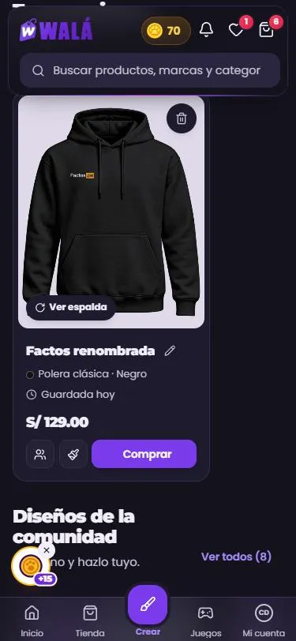 | 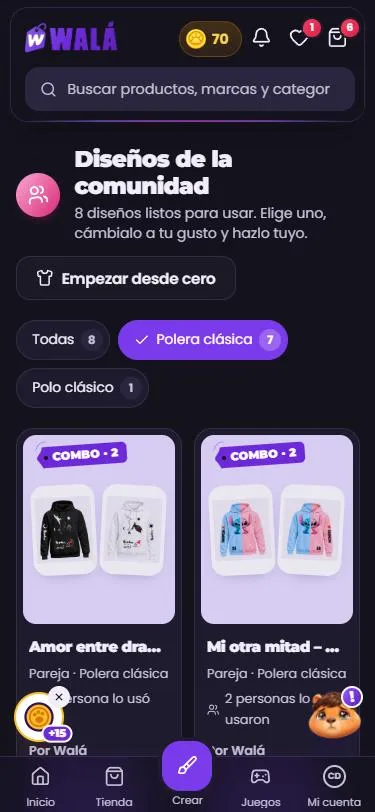 | 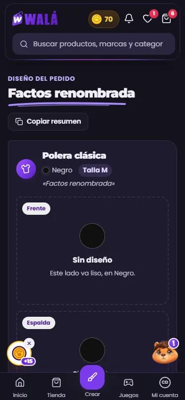 |

| Una creación | Un combo: Mi combo |
|---|---|
| 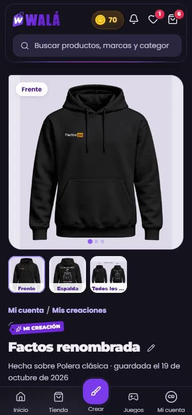 | 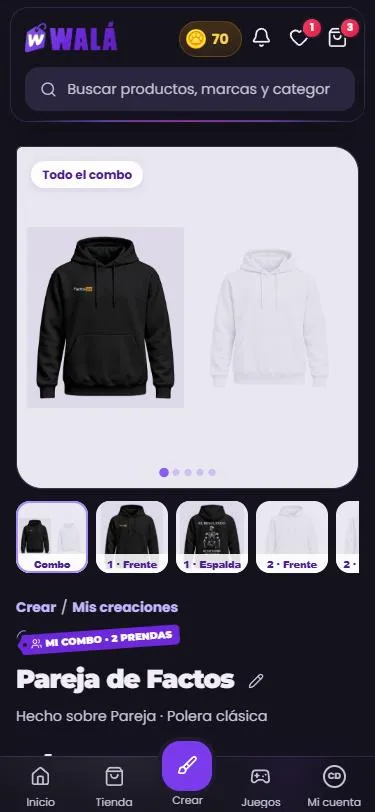 |

| Estudio · celular claro (390 × 844) | Estudio · celular oscuro (390 × 844) |
|---|---|
| 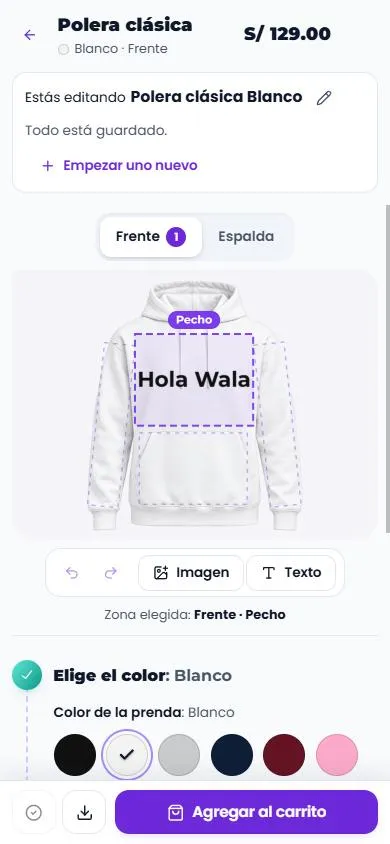 | 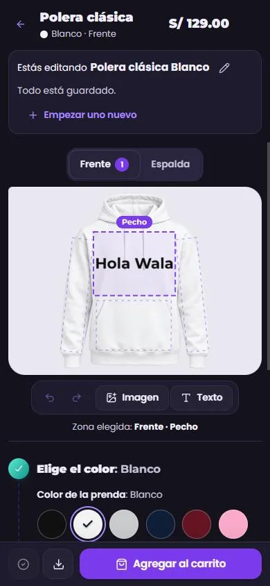 |

Las de escritorio son del 2026-10-19, con el marco del lienzo de antes (el
recuadro); falta volver a tomarlas con la escena del kit en una ventana ancha.

| Estudio · escritorio claro (1366 × 900) | Estudio · escritorio oscuro (1366 × 900) |
|---|---|
| 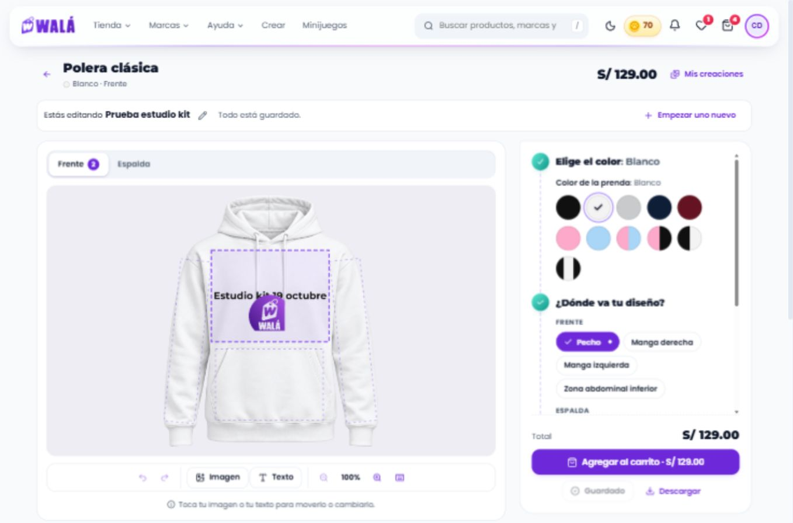 | 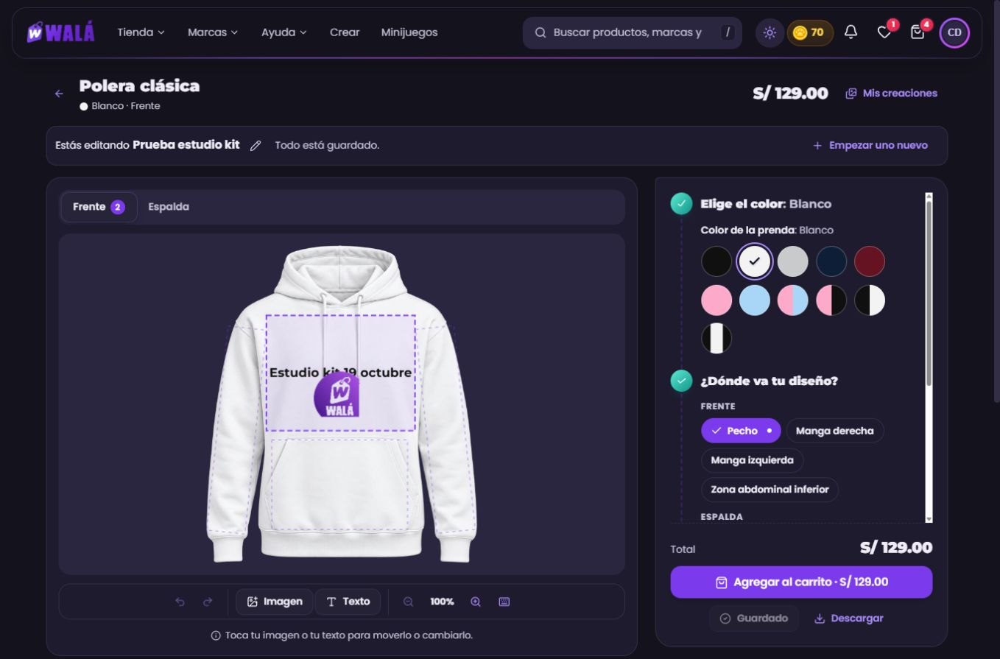 |

Las páginas (`pages/PersonalizarPage.jsx`, `pages/Comunidad/ComunidadPage.jsx`,
`pages/Crear/VerDisenoPage.jsx`, `CreacionPage.jsx` y `ComboCrearPage.jsx`)
montan `components/crear/CrearDeTienda.jsx`, `ComunidadDeTienda.jsx`,
`VerDisenoDeTienda.jsx`, `CreacionDeTienda.jsx` y `ComboDeTienda.jsx`. Lo de
antes (`PersonalizarViejo`, `ComunidadViejo`, `VerDisenoViejo`,
`CreacionViejo` y `ComboCrearViejo`) baja solo con el interruptor
`crearViejo` (`useLoViejo('crear')`: en Firestore `crearViejo: true`; en
localStorage, `"crear"`). El estudio (`/crear/:id`) monta
`EstudioDeTienda.jsx`; con ese mismo interruptor carga `CrearStudioViejo.jsx`
(la página anterior íntegra, sin cambios).

**Lo que comparten.** Los adaptadores de Crear (`prendaCrearDesdeProducto`,
`comboCrearDesde`, `disenoComunidadDesde`, `fichaCreacionDesde`) viven en
`adaptadoresCrear.js`, fuera del archivo principal. Las tarjetas de tus
creaciones y lo que se hace con ellas (eliminar, renombrar, la comunidad,
"Llevar en combo") salen de `components/cuenta/useTarjetasCreaciones.js`:
Mis creaciones, Crear y una creación hacen lo mismo. `useBorradoresCrear` y
`useComunidad` pasaron a sus propios archivos (los de antes los reexportan).
Los textos van traducidos; los nombres que pone el cliente (sus creaciones,
su combo) van tal cual.

**Crear.** Las prendas (el admin ve también las de borrador) y los combos
con sus botones al estudio o al combo ("Armar" con `?nuevo=1`); "¿Para
cuántos?" en la dirección (`?para=2`); tus borradores, tus creaciones (las 8
más recientes, cada combo una tarjeta) y la comunidad (8); las versiones
viejas de los combos se marcan y se borran a los días como antes. Sin el
Kapi flotante (está en la portada).

**La comunidad.** La galería pública (se vuelve a pedir al mostrarse), el
filtro por prenda, "Reintentar" y "Empezar desde cero"; "Usar diseño" abre
el estudio o el combo con la plantilla.

**Ver diseño.** `verDisenoCompartido` como antes (5 min en caché, un
reintento); un enlace que no existe dice "no disponible". Nuevo del kit:
la foto en grande y "Copiar resumen" (el resumen se copia en español: es
para el taller).

**Una creación.** La prenda se vuelve a leer al entrar; la talla elegida
queda guardada en la creación (al instante en pantalla); agregar al carrito
con la cantidad o "Comprar ahora" (solo esta línea elegida y al pago);
"Ir al combo" deja la creación en su prenda del combo si estaba vacía;
renombrar, eliminar (y volver a Mis creaciones) y la comunidad.

**El combo.** La lógica de antes pasó entera a `useComboCrear.js` (el
armado en el navegador, `?nuevo` / `?plantilla` / `?mio`, "Mi combo" que se
guarda solo y deja su `?mio=` en la dirección, una talla para el conjunto,
comprar con `crearDesdePlantilla`, `registrarUsoComunidad`, la misma línea
del carrito, `olvidarArmado` y al carrito); las fotos de las prendas, a
`pages/Crear/fotosCombo.js` (las usa también la página de antes). Al kit le
faltaban cosas y se sumaron:

- `FilaPiezaCombo` con `estado="cargando"` (con el nombre guardado si se
  sabe) y `estadoEnlaces`: Diseñar, Editar, Copiar y Personalizar vuelven al
  combo con su flecha;
- `GaleriaProducto` con "Todo el combo" (`juntas`: las prendas lado a lado,
  sin zoom), `relleno` y `atenuada` para la prenda en blanco, y los nombres
  de las fotos traducidos;
- `PaginaCombo`: `preparando` ("Preparando tu combo (prenda 1 de 2)…" en el
  botón), "Actualizar publicación", el aviso de la comunidad que espera y
  sigue abierto si falla, "ver la prenda" que se desliza a su foto
  (`salto`; antes volvía a montar la galería) y sube a la galería en el
  celular;
- `TarjetaProducto`: las piezas de una pareja (dos "Polera clásica") ya no
  repiten su clave.

### Diferencias a propósito (no "corregirlas")

- **Crear:** el producto de cada creación se lee con la misma caché que la
  ficha (antes, otra forma que dejaba tarjetas "Ya no disponible" después
  de pasar por Mis creaciones).
- **Una creación:** una talla guardada que ya no existe para su color no
  cuenta como elegida (antes pasaba el control); la publicación también se
  actualiza desde aquí; las migas no llevan el nombre (es del cliente: no
  se traduce).
- **El combo:** "Agregar al carrito" se activa con los diseños listos y, si
  falta una talla, la pide en una hoja (antes el botón esperaba la talla);
  "N de N listas" cuenta los diseños; "Reintentar" vuelve a pedir el combo
  sin recargar la página; la compra no queda fija abajo en el celular
  (como una creación con el kit).

### Carga

Lo que baja cada página además del archivo principal (JS + CSS, gzip,
contra el commit de antes de Crear y con el mismo `.env`; incluye Firestore,
que ya bajaba): Crear 182,5 → 184,3 KB, la comunidad 168,7 → 166,7, Ver
diseño 146,3 → 149,6, una creación 176,2 → 179,6 y el combo 270,9 → 274,6.
Lo que suma son las piezas del kit (`Ficha`, `GaleriaProducto`,
`Creaciones`), compartidas con la ficha de producto y Mis creaciones: si se
viene de ahí, ya están. El archivo principal queda igual (−37 B sin
comprimir; +135 B gzip por los nombres de los archivos nuevos).

**Probado** con los emuladores: Crear sin cuenta y con cuenta (las filas,
Diseñar y Armar, `?para`, renombrar guardado en Firestore, eliminar, Llevar
en combo, el interruptor) y Mis creaciones de nuevo; la comunidad (el
filtro, "Usar diseño"); Ver diseño (uno real y uno que no existe); una
creación (la talla guardada, agregar 6 → 7, Comprar ahora → /checkout,
eliminar → Mis creaciones, el interruptor); el combo (`?nuevo`, Mis
creaciones en su hoja, "Mi combo" guardado solo con su `?mio=`, Usar en la
otra, editar una copia con `&copiar=`, ver la prenda, agregar 3 → 4 con una
línea de combo, sus dos prendas y tallas, y al carrito; desde la comunidad
con la hoja de tallas por prenda; renombrar "Mi combo", Quitar, el estudio
con su vuelta y el interruptor), a 390 claro y oscuro y a 1366 sin
desbordes.
**No probado:** el inglés (el traductor no responde en este navegador),
comprar un combo de la comunidad de punta a punta (los diseños sembrados no
traen capas en el emulador: "no tiene diseño", igual en la página de antes),
publicar / actualizar / retirar como admin, las capturas de escritorio (el
panel no las toma nítidas a 1366) y la app (Capacitor).

### Estudio: cierre de la migración (2026-10-19)

`CrearStudioPage` solo decide qué versión montar; el conector
`components/crear/EstudioDeTienda.jsx` conserva consultas, borrador,
historial, selección, gestos, stock, carrito y render de Fabric. La demo
sigue con su lienzo CSS. Ambas usan el mismo `MarcoEstudio`,
`CompraEstudio`, `HojasEstudio` y piezas del panel; el kit recibe props y
acciones, sin leer Firestore. El recorte y quitar fondo se cargan al abrir
sus hojas. Se mantiene el motor `fondoPixeles`.

**Cloudinary.** Se conserva el uso actual de `OptimizedImage` para entregar
fotos públicas: `image/fetch`, formato y calidad automáticos, tamaños
adaptables y vuelta a la URL original si falla. Los archivos privados de
`designs/{uid}/crear` y las fuentes de impresión siguen por Storage.
`generarArchivosCreacion.js` comparte la generación del estudio y las
plantillas: PNG por zona, vista previa por lado diseñado y composición de
todos los lados, siempre desde los originales. No se cambiaron reglas,
funciones ni el servicio de subida.

**Medición comparable** contra `dfb0f06b`, mismo `.env`, compilación Vite
con manifiesto y sourcemaps. Bytes gzip del archivo principal; para rutas,
JS + CSS de su grafo de imports estáticos, descontando lo inicial:

| Carga | Antes | Ahora |
|---|---:|---:|
| Archivo principal JS | 207.398 B | 207.207 B |
| Estudio (incluye Fabric) | 172.049 B | 168.253 B |
| Combo (sin adelantar Fabric) | 131.616 B | 34.509 B |

Son tamaños de archivos, no tiempos de red. Un combo que deba completar
la foto de un lado liso o generar una plantilla cargará Fabric al
necesitarlo. La página de demostración del estudio no entra en la tienda.

**Verificado en `demo-wala` (emuladores):**

- Interfaz a 390 × 844 y 1366 × 900, claro y oscuro; lienzo, avisos,
  compra fija, panel y hojas utilizables. Capturas arriba.
- Texto en Fabric, imagen subida a Storage, recorte aplicado, apertura de
  quitar fondo con sus herramientas y calidad / "Dejarla nítida".
- Guardar con nombre y miniatura real; creación con PNG de impresión,
  vista previa y composición. Descarga recibida por el navegador.
- Invitado → guardar → login → misma prenda y texto; autoguardado del
  borrador al volver. Reabrir el borrador sin cambios no escribió de nuevo
  (comparado `updateTime` del documento).
- Talla M → carrito; comprar sin editar conservó las URLs de impresión,
  vistas previas y composición (comparadas en Firestore).
- Selección de dos capas, duplicar y deshacer en un paso. Combo → estudio
  con `?combo=&pieza=` → guardar con copia en la otra prenda → combo con
  dos diseños listos; reabrir mediante `?copiar=` conserva el diseño y la
  vuelta al mismo `?mio=`.
- Prenda inexistente: estado de error con regreso a prendas. `crearViejo`
  carga los controles anteriores y, al apagarlo, vuelve el kit. El archivo
  del respaldo es idéntico al original (`git hash-object`: `bee0d53c…`).
- Demo del estudio montada con el marco compartido; inicio y Crear siguen
  mostrando las imágenes públicas por Cloudinary con sus `srcset`.
- Siete pruebas de adaptadores, firmas y vigencia de archivos; lint con
  0 errores (131 avisos del repositorio); build de tienda y demo correcto.

**Pendiente de validación:** gestos con dos dedos en un dispositivo real y
Capacitor; inglés con el traductor del servicio; red interrumpida durante
subida/guardado, todas las combinaciones de stock y bicolor y las acciones
de publicación del admin. Quitar fondo se abrió con una imagen ya
transparente: queda probar la edición de píxeles sobre una foto opaca.
Se conserva el aviso visual de cambios; la página anterior tampoco tenía
un bloqueo de navegación global al salir. No se hicieron cobros ni
despliegues. Conservar los respaldos hasta validar en producción.

### Estudio: el marco del lienzo del kit (2026-10-20)

El lienzo de Fabric quedaba dentro del recuadro de la página de antes (con
su ayuda "Tu diseño irá en…" y un escenario oscuro de noche). Ahora la
escena es la de P12 en los dos lados: **`EscenaEstudio`**
(`paginas/MarcoEstudio.jsx`) pone las pestañas de los lados (con cuántos
diseños lleva cada uno), la prenda, la `BarraLienzo` y "Zona elegida: Frente
· Pecho"; la demo le pasa `LienzoPrenda` y la tienda, el lienzo de Fabric.

- El escenario de la prenda es el de `LienzoPrenda`: `--escenario-foto`
  (claro también de noche) con la esquina de etiqueta, sin recuadro.
- La zona elegida lleva su nombre en una pastilla violeta encima, como en
  el kit. Fabric la pinta (`after:render`) con el nombre ya traducido; no se
  pinta mientras otra zona recibe lo que se arrastra.
- En escritorio el lienzo usa el espacio que queda en la pantalla, hasta los
  680 px del kit (ver abajo: con `min(66vh, 680px)` a secas no cabía), y la
  escena queda fija al bajar, debajo de la cabecera. El panel sigue como en la
  tienda: con su propio desplazamiento y la compra siempre a la vista.
- En el celular la prenda sigue arriba mientras el panel sube por debajo;
  la separa el fondo de la página con una línea, sin recuadro ni sombra.
- La ayuda de antes ("Arrástralo para moverlo…", "Un dedo lo mueve…") deja
  su lugar a "Zona elegida", como el kit; los gestos los explica la guía de
  la primera vez (`GuiaGestos`) y los atajos, su hoja.

**Traducción.** Las frases van enteras: el traductor quita los espacios de
los bordes, y "Quitar los " + 3 salía "Remove the3". "Tu texto en Frente ·
Pecho", "3 elementos elegidos", "Quitar los 3" y "Suelta aquí para pasar a
Espalda" se traducen como una frase (`TextoResaltado` marca la zona); las
etiquetas van con su valor aparte ("Calidad de impresión: buena", "Se agrega
en: Frente · Pecho"). Ya no se mandan a traducir "%", "Aa", "N", "C" ni
"+". También pasan por la traducción "Subiendo tu imagen…", "Cargando tu
diseño…", "Suelta tu imagen en …" y las pestañas de los lados.

**Probado** con los emuladores: la escena en el celular (claro y oscuro,
capturas arriba), cambiar de lado, la pastilla de la zona, el lienzo fijo
mientras sube el panel, agregar un texto (la vista se acerca a su zona), la
guía de gestos, escritorio a 1280 (medidas y lienzo grande; la captura no:
el panel del navegador mide 780 px) y la demo del estudio con la misma
escena. **No probado:** el inglés (el traductor no responde en este
navegador) y un teléfono de verdad.

### Estudio: que quepa, la carga y sin pie (2026-10-20)

En producción, con la barra de administrador y el aviso de "Estás editando",
el estudio ya no cabía: el lienzo medía `min(66vh, 680px)` (el cambio de
arriba había quitado la regla de antes, que lo ajustaba a lo que queda), y
la prenda y el panel, fijos a 90 px, quedaban debajo de la cabecera.

- **El lienzo** usa lo que queda en la pantalla (como antes) y nunca pasa
  de 680 px ni baja de 300 (`ALTO_MAXIMO_LIENZO`). A 1366 × 768 el estudio
  mide justo la pantalla (antes 795 px: había que bajar).
- **Lo fijo** (la escena y el panel) va debajo de la cabecera real:
  `EstudioDeTienda` mide la cabecera (`[data-componente="Cabecera"]`) y la
  barra de administrador (`--admin-bar-height`) y publica `--tope-estudio`
  (92 px sin barra, 142 con ella).
- **Sin pie**, como en el kit (el estudio es una herramienta): `Footer` no
  sale en `/crear/…`; con `crearViejo`, sí (como antes).
- **"Preparando la vista previa (Espalda)….."**: los puntos salían dobles
  (el texto traía "…" y `Cargando` pone los suyos). El estudio los quita
  (`sinPuntos`) y `Cargando` también, si le llega texto con "…".
- **Los avisos sobre la prenda** son piezas del kit en los dos lados:
  `CargandoLienzo` (la etiqueta de Walá que se mece con "Cargando tu
  diseño", en vez de un círculo que gira; sobre el escenario claro también
  de noche, con `Cargando sobreClaro`), `AvisoSoltarArchivo` ("Suelta tu
  imagen en Pecho") y `SoltarLados` ("Suelta aquí para pasar a Espalda").

**Probado** con los emuladores: 1366 × 768 sin barra y con la barra
simulada (el tope pasa a 142 px), el pie (no sale; con `crearViejo`, sí),
soltar una imagen sobre la prenda (la pastilla del kit) y "Cargando tu
diseño" en la demo, en oscuro. **No probado:** el estudio con la barra de
administrador de verdad y el pago (no se cobró nada).

## Combos y creaciones: cómo funciona y sus casos (mapa del 2026-10-20)

**Cómo se guarda hoy.** Todo está en `designs`. Una prenda suelta es un doc
`tipo: 'crear'`. Un combo del cliente ("Mi combo") es otro doc
`tipo: 'comboCrear'` con `piezas: [{ designId, prendaId, talla, frente… }]`
por posición, y cada pieza es un doc `crear` aparte (con `combo: { id: <combo
de la tienda>, pieza }` si se hizo para el combo). Hasta el paso 2, dos piezas
podían apuntar al mismo diseño; ahora cada una lleva su copia (ver abajo). El
navegador recuerda el armado en `localStorage` `wala:combo-crear:<combo de la
tienda>`: UNO por combo de la tienda, compartido por todos sus "Mi combo".
La lista de Mis creaciones esconde las piezas que algún combo usa
(`agruparCombos`); lo que no usa ninguno se ve suelto.

**Paso 1 (hecho el 2026-10-20), sin cambiar cómo se guarda:**

| Qué pasaba | Arreglo |
|---|---|
| El aviso de eliminar era un velo al 94 % sobre la tarjeta: el texto quedaba encima de los restos borrosos | La pregunta ocupa el lugar del texto, en sólido y con su sello (rojo para eliminar: `Sello tono="peligro"`); la foto queda arriba, atenuada. Angosta: sello arriba y botones a lo ancho (`piezas/Creaciones.*`) |
| "Ponerlo también en la prenda 2" no hacía nada: al volver, la página del combo usaba su copia en caché (de antes del estudio) y la escribía encima | La página espera el combo al día (`isFetchedAfterMount`) antes de usarlo y antes de autoguardar (`useComboCrear.js`) |
| "Editar" en una prenda compartida creaba un borrador nuevo aunque no se cambiara nada: el combo volvía a borrador y la copia quedaba en "Versiones anteriores" | La copia (`&copiar=`) solo se guarda si se cambia algo; "Listo" sin cambios vuelve sin copiar (`EstudioDeTienda.jsx`) |
| Eliminado un combo, el navegador lo seguía recordando: lo diseñado después iba a un combo que no existe (y se perdía a los 7 días) | Al eliminarlo se olvida; la página del combo y el estudio comprueban que el recordado exista y, si no, empiezan uno nuevo |
| Las prendas de un combo en el carrito no contaban como "en el carrito": eliminar el combo (o la limpieza de versiones) podía borrarlas | `disenosEnCarrito` (`pages/Crear/comboCrear.js`) cuenta cada prenda de un combo; eliminar una prenda que usa un combo del carrito lo avisa y saca el combo del carrito |
| Eliminar un combo publicado no avisaba y la publicación quedaba en la galería sin forma de retirarla | Lo avisa y lo retira antes de eliminar (si no se puede retirar, no se elimina) |
| Un combo con una sola prenda diseñada se veía (y se eliminaba) como una creación suelta | La tarjeta lo trata como combo: sus prendas con el hueco "por diseñar" (punteado, con el pincel) y la etiqueta Borrador |

Probado con los emuladores (cuenta admin, pareja de poleras): "Ponerlo
también" con las dos prendas en la cuenta, "Editar" y salir sin cambios (sin
borrador nuevo), "Editar" y cambiar el color (copia nueva, el combo vuelve a
estar guardado al terminar), el combo a medias en Mis creaciones, eliminarlo
(se olvida en el navegador), un combo recordado que ya no existe (empieza
limpio), y uno publicado y en el carrito (se retira de la comunidad, sus
prendas se quedan y el carrito sigue con sus imágenes). Celular claro y
oscuro. **No probado:** dos pestañas a la vez, un combo comprado, trío y
conjunto.

**Paso 2 (hecho el 2026-10-20): cada combo es dueño de sus prendas.**

- **Una copia por prenda.** "Ponerlo también en la prenda 2" (estudio),
  "Usar en la otra" y elegir de "Mis creaciones" (página del combo) y "Llevar
  en combo" (Mis creaciones) ponen una COPIA en cada prenda
  (`copiarCreacionParaCombo`: mismas imágenes, no se sube nada), con el campo
  `combo`. Cambiar o borrar una ya no toca la otra, y una creación suelta
  elegida para un combo sigue igual (antes, editarla dentro del combo la
  cambiaba y eliminar el combo la borraba). "Mis creaciones" del combo ofrece
  solo creaciones sueltas.
- **Eliminar un combo comprado o en el carrito lo archiva**
  (`archivado: true`, `archivadoEn`): deja de verse y sus prendas siguen
  ocultas con él; el pedido (o el carrito) conserva sus diseños. Antes sus
  prendas volvían a verse sueltas. Las listas limpian solas los archivados que
  ya no hacen falta (ni pedido ni carrito: `cuidarCombosArchivados`, con la
  limpieza de versiones). Un enlace a un combo archivado (el del carrito)
  empieza uno nuevo en vez de editarlo.
- **Las listas traen todos los combos** (además de los 50 más recientes): uno
  viejo ya no deja sus prendas sueltas. Los borradores también miran las
  creaciones guardadas (una prenda en borrador de un combo guardado no se ve
  suelta).
- **Una prenda de un combo no se borra sola** (desde su página): lo avisa y
  manda al combo. Antes el combo quedaba apuntando a nada.
- **Qué prendas están vacías** lo dice el combo de la cuenta, no lo del
  navegador (que es uno por combo de la tienda y puede ser de otro "Mi combo").
- **Combos de antes** (piezas compartidas o creaciones sueltas elegidas): se
  siguen viendo y editando ("Editar" trabaja en una copia) y, al eliminarlos,
  la creación suelta del cliente vuelve a su lista (es suya).

Probado con los emuladores (pareja de poleras): "Ponerlo también" (dos
creaciones distintas), "Usar en la otra", elegir de "Mis creaciones" (la
original sin tocar), "Llevar en combo" (una copia por prenda), eliminar un
combo sin comprar (se borran él y sus prendas), uno en el carrito (archivado;
al vaciar el carrito la lista lo borra del todo), uno comprado (archivado y la
limpieza no lo toca), borrar sola una prenda de un combo (no deja), el enlace
de un combo archivado (empieza uno nuevo) y un combo de antes con una creación
suelta compartida (vuelve a la lista). **No probado:** un trío o un conjunto,
dos pestañas a la vez y un pedido real pagado (se marcó `enPedido` a mano,
como lo hace el servidor).

**Lo que queda:**

- El armado del navegador sigue siendo uno por combo de la tienda (dos "Mi
  combo" del mismo combo en dos pestañas pueden pisarse lo no guardado);
  ahora lo que decide el estudio sale de la cuenta.
- Al guardar de nuevo una creación se suben archivos nuevos y los viejos
  quedan en Storage.
- "Quitar" una prenda del combo la deja en "Versiones anteriores" (7 días,
  recuperable), como antes.

**Paso 3 (el admin):** las prendas de Crear (`esPrendaBase`) y los productos
normales comparten la ficha del admin y un mismo interruptor "Personalizable"
mueve dos modelos distintos (`esPrendaBase` del estudio nuevo y
`customizable`/`customizationViews` del editor viejo `/editor/:id`, más el
`YoryoPersonalizado`). Propuesta: una sección propia "Prendas de Crear" en el
admin, quitar "Personalizable" de los productos normales y retirar el editor
viejo para el cliente; falta decidir qué pasa con los productos personalizables
que ya existen. La ficha además guarda siempre `visible: true` (una prenda
oculta vuelve a verse al guardarla).

**Casos que tiene que cubrir el flujo** (para probar en cada cambio): una
prenda nueva, editada, guardada, comprada, eliminada (antes y después de
comprarla) y publicada; un combo de la misma prenda (pareja, trío) con el
mismo diseño en todas o uno distinto en cada una, con colores y tallas
distintos; un conjunto (prendas distintas, una talla); un combo de la
comunidad; empezar un combo desde una creación ("Llevar en combo"); un combo a
medias; comprarlo y volver a editarlo (el pedido conserva lo comprado); dos
"Mi combo" del mismo combo y dos pestañas; sin sesión y al iniciar sesión a
mitad; que el admin oculte la prenda, quite un color o archive el combo
después.
