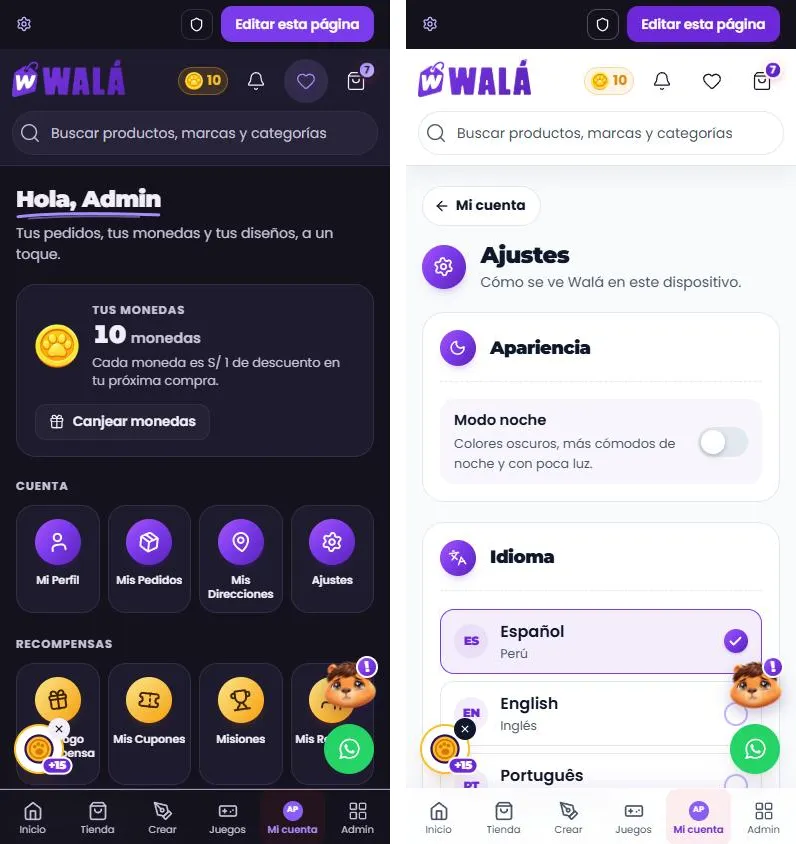
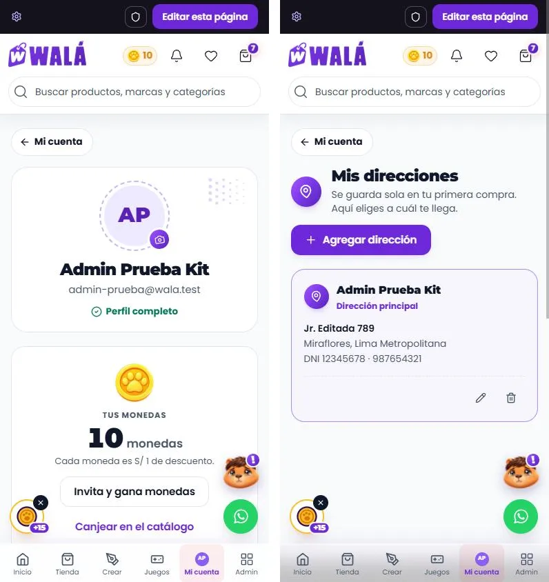
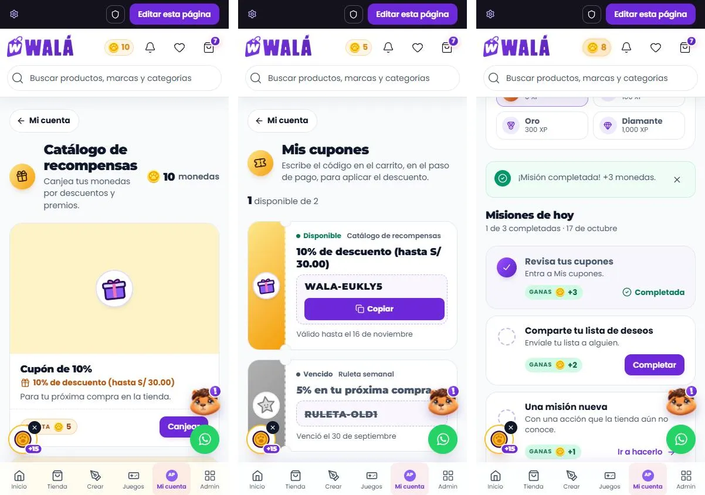
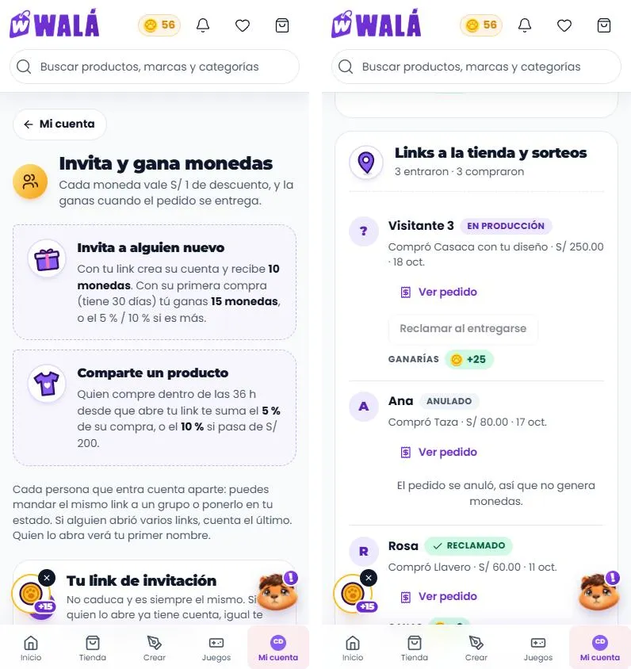
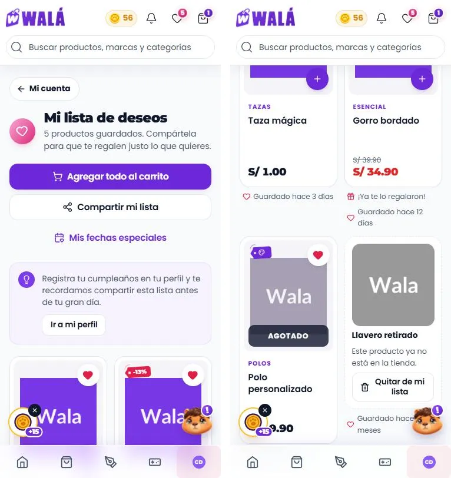
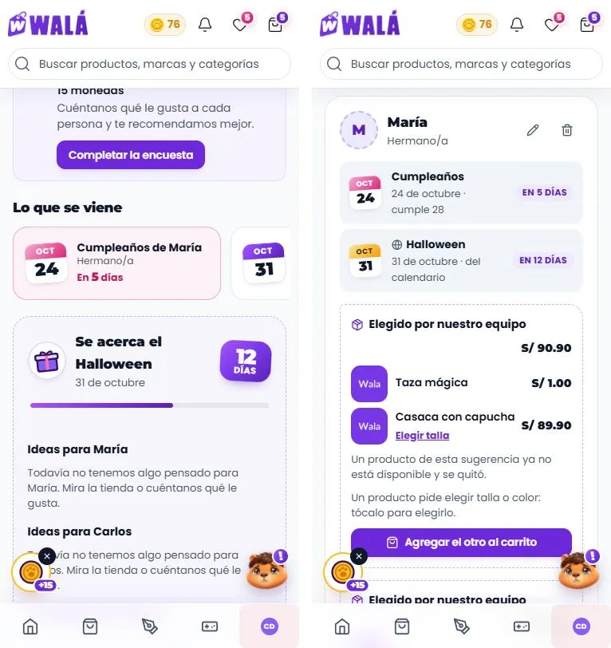
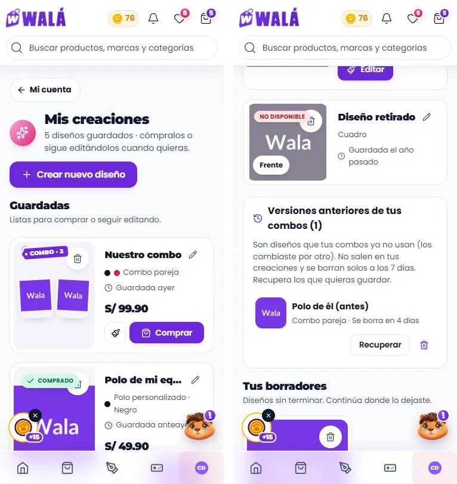
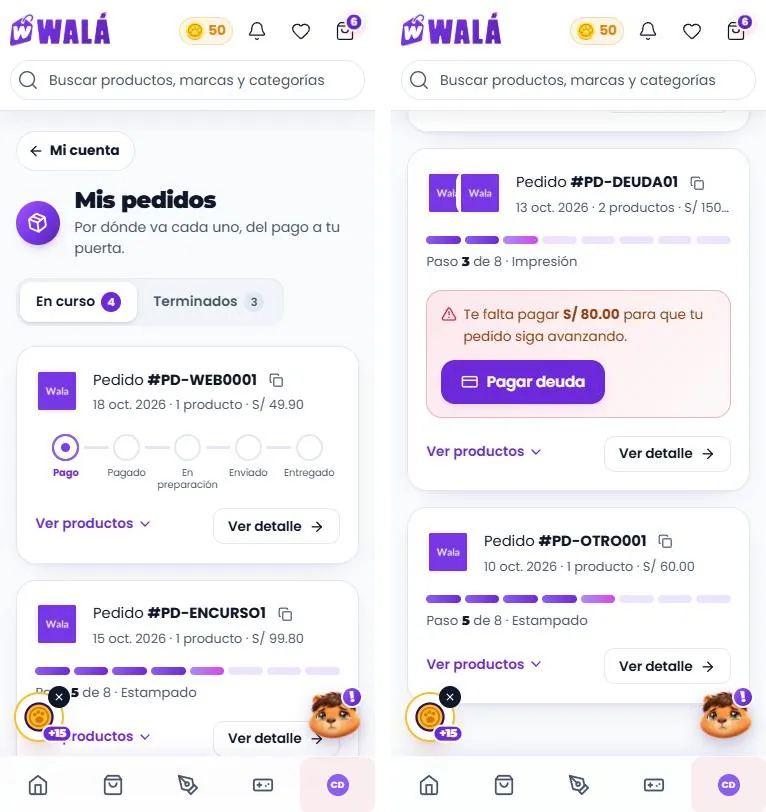

# Mi cuenta (`/cuenta` y sus 12 secciones): qué componente va en cada parte

Cómo verlo en vivo: `npm run dev` → http://localhost:3000/componentes.html →
**Páginas** → **Tienda de prueba** → página **Mi cuenta** (o "Mi cuenta" en la
barra inferior del celular, o cualquier enlace del menú de la cuenta en la
cabecera). Con **Ver como** → "Con sesión" aparecen los chips **Sección de la
cuenta** (los 12 módulos) y los estados **Perfil incompleto**, **Sin datos**,
**Cargando** y **Error al cargar**. "Visitante" muestra la invitación a entrar.
Las piezas sueltas están en **Piezas** → **10 · Piezas de la cuenta**.
El marco de la tienda (M) es el de siempre: ver
[INICIO.md](INICIO.md#marco-m-lo-que-rodea-a-las-secciones).

| Escritorio (resumen) | Celular (resumen) |
|---|---|
|  |  |

Revisado el 2026-10-14 contra wala.pe/cuenta/perfil (con sesión, admin) y
`src/pages/CuentaLayout.jsx` + `src/pages/cuenta/*`. No son páginas del
builder: contenido propio, numerado **C**. Mis pedidos (P2 en las fichas
anteriores) es **C3**.

## Cómo se arma

- **C0 · `MarcoCuenta`** (`paginas/Cuenta.jsx`): en escritorio (el marco mide
  860px o más; es container query) el **menú lateral** (`MenuCuenta lateral`,
  el acceso actual con el sello del logo) y el contenido a la derecha. En el
  celular no hay menú lateral: cada sección es su propia pantalla, con
  **"← Mi cuenta"** arriba para volver a los accesos. Con perfil incompleto,
  un `Aviso` con "Completar" encima de todo.
- Cada página empieza con **`CabezaCuenta`** (sello + título con la letra del
  logo + una línea de ayuda + acción a la derecha) y se arma con
  **`TarjetaCuenta`**, **`Estadistica`** y las piezas de su módulo.
- Los íconos van siempre en un **`Sello`** (círculo con degradado, girado),
  con un tono por grupo: Cuenta violeta, Recompensas oro, Personalización
  rosa. Las cifras (monedas, XP, días, personas) son texto: el número con la
  letra del logo y la palabra en gris.
- Confirmar algo (eliminar una dirección, una creación, una persona; canjear;
  publicar en la comunidad) se hace **en la misma tarjeta**, nunca con
  `window.confirm`.
- **Ningún control del navegador**: las listas son `ListaOpciones` (dentro de
  `Campo` con `opciones`: panel pegado al campo en escritorio, hoja en el
  celular, con buscador si hay más de 10 y `creable` para escribir algo que no
  está), las fechas son `CampoFecha` (calendario de Walá; empieza por el año
  en un cumpleaños; "No sé el año"), el teléfono es `CampoTelefono` (prefijo
  del país con código, sin banderas emoji), las casillas son `Casilla` y la
  foto pasa por `RecortarFoto` antes de subirse. Una hoja abierta encima de
  otra (la lista de distritos dentro de "Nueva dirección") se cierra sola con
  "atrás" o Esc, sin cerrar la de abajo.

## Partes

| Parte | Componente | Piezas que usa | Diseño en | Datos (en la tienda) | Quién la ve |
|---|---|---|---|---|---|
| C0 Marco | `MarcoCuenta` | `MenuCuenta lateral`, `Aviso`, `Enlace` ("← Mi cuenta") | `paginas/Cuenta.module.css`, `MenusCabecera.module.css` (`.lateral`) | `useAuth()` (usuario, `profileIncomplete`), `useCuentaNavGroups` | con sesión |
| Sin sesión | `PaginaCuentaInvitado` | `EstadoVacio` (Kapi), `Boton` | `paginas/Cuenta.module.css` (`.invitado`) | — (`pedidos` en /cuenta/pedidos) | visitante |
| C1 Resumen `/cuenta` | `PaginaResumenCuenta` | `CabezaCuenta` (subrayado), `Estadistica` (monedas), `AccesosCuenta` | `piezas/Cuenta.module.css` | `userProfile.monedas`, `monedasEnEspera`, los grupos | con sesión |
| C2 Mi perfil | `PaginaPerfil` | `IdentidadCuenta`, `Estadistica grande`, `TarjetaCuenta`, `ListaDatos`, `Interruptor`, `Campo` (con `opciones`) | `piezas/Cuenta.module.css`, `paginas/Cuenta.module.css` | `perfilDesdeUsuario(userProfile, user)`; WhatsApp: `marketingConsent.whatsapp` | con sesión |
| C3 Mis pedidos | `PaginaPedidos` (P2) | `CabezaCuenta`, `PedidosPorVerificar`, `Pestanas` (En curso · Terminados), `SeguimientoPedido` (5 pasos o las 8 etapas del taller como barra "Paso 5 de 8 · Estampado"; deuda, anulado, "Ver detalle"), `HojaPagarSaldo`, `EstadoVacio` | `Pedido.module.css`, `paginas/CuentaPedidos.module.css` | `usePedidos(dni, uid)` → `pedidos` y `pendientes` | con sesión |
| C3·d Detalle de compra `/cuenta/pedidos/:id` | `PaginaDetallePedido` | migas, `CabezaCuenta` + estado y pago, `LineaProduccion`, productos, dirección; al costado `ListaDatos` (detalle), `PagosPedido` (historial, boletas, fotos de envío, reclamar monedas), WhatsApp; `CarruselProductos` | `piezas/DetallePedido.module.css`, `paginas/CuentaPedidos.module.css` | `usePedidos` + `getOrderByIdAnyCollection(id)`; `derivarEstadoCompra` | con sesión |
| C4 Mis direcciones | `PaginaDirecciones` | `CabezaCuenta`, `TarjetaDireccion`, `HojaInferior`, `Campo`, `CamposDireccion` (la del checkout, ya en la tienda: desde el 2026-10-17, fuera del Perú un solo documento y, si `paises` trae `prefijo`, el teléfono del país) | `piezas/TarjetaDireccion.module.css` | `obtenerDirecciones(uid)` → `direccionDesdeFirestore`; ubigeo en `lugares` | con sesión |
| C5 Ajustes | `PaginaAjustes` | `TarjetaCuenta`, `Interruptor` (modo noche), `ListaEleccion` (idioma) | `paginas/Cuenta.module.css` | `useTheme()`, `useLanguage()` | con sesión |
| C6 Catálogo | `PaginaCatalogo` | `TarjetaRecompensa` (`FotoProducto`, `EtiquetaColgante`, `CostoMonedas`), `Aviso` | `piezas/Recompensas.module.css` | `rewardsCatalog` → `recompensaDesdeFirestore`; canje `redeemRewardSecure` | con sesión |
| C7 Mis cupones | `PaginaCupones` | `TarjetaCupon` (`IconoWala` en el talón) | `piezas/Recompensas.module.css` (`.cupon`) | `getMisCupones(uid)` + `estadoCupon` → `cuponDesdeFirestore` | con sesión |
| C8 Misiones | `PaginaMisiones` | `Estadistica` ×3, `NivelCuenta` (`BarraProgreso`, `Sello` bronce/plata/oro), `TarjetaMision` (`GananciaMonedas`) | `piezas/Recompensas.module.css` | `getDailyMissions()` → `misionDesdeServidor`, `dailyCheckIn()`, `xp`, `dailyStreak` | con sesión |
| C9 Mis referidos | `PaginaReferidos` | `FormaGanar` ×2, `EnlaceInvitacion`, `Estadistica` ×3, grupos en `TarjetaCuenta` con `FilaReferido` y `DetallePedidoReferido`, `RankingReferidos` (puestos en sellos oro, plata y bronce) | `piezas/Referidos.module.css` | `getReferralsByReferrer(code)`, `claimReferralCoins`, `getReferralOrderDetail` | con sesión |
| C10 Mis creaciones | `PaginaCreaciones` | `TarjetaCreacion` (también combos con sus prendas lado a lado, borradores en `Carrusel`, renombrar, publicar en la comunidad para admins) | `piezas/Creaciones.module.css` | `getDesignsByUser(uid)` → `creacionDesdeDiseno`; borradores `useBorradoresCrear` | con sesión |
| C11 Lista de deseos | `PaginaListaDeseos` | `TarjetaProducto` (`deseado` + `onDeseo`) o la de la tienda por `tarjeta`, `Aviso` | `paginas/CuentaPersonalizacion.module.css` | `useWishlist()` + `useProductosDeLista` (uno por uno) | con sesión |
| C12 Fechas importantes | `PaginaFechas` | `AgendaFechas` ("Lo que se viene": las próximas fechas de todos, llevan a su persona), `AvisoFestiva` (cuenta atrás en un sello y barra de los últimos 30 días), `TarjetaPersonaRegalo` (cada fecha en una `HojaCalendario`, con los años que cumple), `IdeaRegalo`, `HojaPersona` (el formulario, compartido con la encuesta: `piezas/FormularioPersona.jsx`) | `piezas/Regalos.module.css`, `piezas/FormularioPersona.module.css` | `userProfile.giftRecipients` → `personaDesdeRecipient`; ideas `useGiftCatalog` | con sesión |

### Cada módulo

| C2 Mi perfil | C4 Direcciones (celular) | C5 Ajustes (celular) |
|---|---|---|
|  |  |  |

| C3 Mis pedidos | C3·d Detalle de compra |
|---|---|
|  |  |

| C6 Catálogo | C7 Cupones (celular) | C8 Misiones |
|---|---|---|
|  |  |  |

| C9 Referidos (celular) | C10 Creaciones (celular) | C11 Lista de deseos | C12 Fechas importantes |
|---|---|---|---|
|  |  |  |  |

### En el celular

- Sin menú lateral; "← Mi cuenta" vuelve al resumen (que también abre la
  pestaña "Mi cuenta" de la barra inferior). "Cerrar sesión" está al final del
  resumen y de Ajustes.
- Accesos de 4 en fila (3 en teléfonos de 320px); las tarjetas de dirección,
  cupones y misiones en una columna; las creaciones en una columna con la
  tarjeta en horizontal; los productos de la lista de deseos de 2 en fila.
- Los formularios largos (nueva dirección, persona) son **hojas inferiores**
  (en escritorio, una ventana centrada).
- Medido sin desbordes en 320, 360, 390, 768 y 1366 px; revisado en claro y
  en noche.

## Para cambiar el diseño rápido: qué se repite

| Pieza | Aparece en | Archivo |
|---|---|---|
| `Sello` | cabeceras, accesos, menú lateral, misiones, niveles, direcciones | `Marca.module.css` (`.sello`, tonos) |
| `CabezaCuenta` | arriba de cada página y de cada `TarjetaCuenta` | `piezas/Cuenta.module.css` (`.cabeza`) |
| `TarjetaCuenta` | datos personales, ajustes, link de invitación, grupos de referidos | `piezas/Cuenta.module.css` (`.tarjeta`) |
| `Estadistica` | monedas (resumen, perfil, misiones), XP, racha, referidos | `piezas/Cuenta.module.css` (`.cifra`) |
| `MenuCuenta` | menú de la cabecera y menú lateral (`lateral`) | `MenusCabecera.module.css` |
| `Campo` (`opciones`) | perfil, dirección, persona | `Formulario.module.css` (`.inputLista`) |
| `HojaInferior` | nueva dirección, persona | `Feedback.module.css` |
| `EstadoVacio` | sin direcciones, cupones, creaciones, deseos, personas; sin sesión | `Feedback.module.css` |
| `GananciaMonedas` / `CostoMonedas` | misiones, referidos / catálogo | `Etiquetas.module.css` |
| `FotoProducto` | recompensas, creaciones, ideas de regalo, pedido de un referido | `piezas/FotoProducto.module.css` |

## El marco, el resumen y los ajustes en la tienda (hecho el 2026-10-17)

(Celular, 390 px. Se probó también a 1366, con el menú lateral, en claro y
en noche.)

- **Conectores** (`src/components/cuenta/`):
  - `MarcoDeCuenta.jsx`, desde `pages/CuentaLayout.jsx`: `MarcoCuenta` con
    el `<Outlet>` de siempre adentro (las secciones que todavía no migran
    se ven con su diseño de antes, dentro del marco nuevo).
  - `ResumenDeCuenta.jsx` (desde `CuentaResumenPage.jsx`) y
    `AjustesDeCuenta.jsx` (desde `CuentaAjustesPage.jsx`).
  - `gruposDeCuenta.js`: los grupos desde `useCuentaNavGroups` (la misma
    fuente que antes), con el diccionario `t()` y el tono de cada grupo; el
    esqueleto de cada sección (`moduloDeRuta`).
- **Igual que antes:**
  - mientras carga la sesión, el esqueleto (ahora `EsqueletoPagina
    forma="cuenta"` con el de la sección);
  - sin cuenta, la bienvenida en /cuenta y el login en cada sección;
  - Mis pedidos sin documento ni teléfono va a `/completar-perfil` con
    `state.from`;
  - el aviso de perfil incompleto, con "Completar" que también lleva
    `state.from` (prop nueva `estadoCompletar`; `Enlace` pasa `state` al
    router);
  - cerrar sesión (`logout` y la portada);
  - el modo noche con `useTheme().toggle()` y el idioma con `setLang`.
- **Traducción:** los textos fijos del marco, `MenuCuenta`, el resumen, los
  ajustes y las piezas de `piezas/Cuenta.jsx` pasan por `<Texto>`. Los
  grupos llegan traducidos por el diccionario; se agregaron las claves que
  faltaban (los tres grupos, Ajustes y Mis cupones) en español, inglés y
  portugués.
- **La entrada del contenido** ya no deja un `transform` puesto al terminar
  (`animation-fill-mode: backwards`): con él, una ventana `position: fixed`
  de una sección quedaba corrida (el marco de antes tenía lo mismo con
  `will-change: transform`).
- **Interruptor `cuentaVieja`** (`useLoViejo('cuenta')`; en Firestore,
  `cuentaViejo: true`): vuelven el marco, el resumen y los ajustes de antes
  (`CuentaLayoutViejo.jsx`, `CuentaResumenViejo.jsx`, `CuentaAjustesViejo.jsx`),
  que bajan aparte.

### Qué se probó (2026-10-17, localhost con los emuladores)

- El resumen (saludo, 10 monedas, accesos con sus tonos, "Cerrar sesión" al
  final en el celular) y Ajustes (modo noche se apaga y se guarda; English
  traduce el marco, el resumen y los grupos).
- Escritorio: el menú lateral con la sección encendida, sin "← Mi cuenta";
  las nueve secciones viejas cargan dentro del marco.
- Con el teléfono borrado del perfil de prueba: el aviso, "Completar" con
  `from: /cuenta/ajustes` y Mis pedidos que manda a completar con
  `from: /cuenta/pedidos`.
- `cuentaVieja` en `localStorage.wala_kit_viejo` → el marco y las páginas
  de antes.
- Una ventana fija dentro del contenido queda en (0, 0).
- 390 y 1366, claro y noche.

No se probó en la tienda: cerrar sesión y la bienvenida sin cuenta (la cuenta
de prueba no está en la semilla del emulador; ese código no cambió y en la
demo funciona), el esqueleto mientras carga la sesión (dura muy poco en
local) ni la app Android. En un teléfono de 390 px, "Catálogo Recompensas"
parte "Recompensas" en dos líneas (Chrome en Windows no tiene silabeo; en
Android el `hyphens: auto` lo corta con guion).

## Mi perfil y Mis direcciones en la tienda (hecho el 2026-10-17)

(Celular, 390 px, claro, con la cuenta de prueba del emulador. Se probó
también a 1366 y en noche.)

- **Conectores** (`src/components/cuenta/`): `PerfilDeCuenta.jsx` (desde
  `pages/cuenta/PerfilPage.jsx`) y `DireccionesDeCuenta.jsx` (desde
  `pages/cuenta/MisDireccionesPage.jsx`).
- **Mi perfil guarda lo mismo que antes:**
  - el documento en `dni`, `clienteNumeroDocumento` y `envioNumeroDocumento`
    (en el Perú sin espacios; fuera, como se escribió);
  - el tipo en `tipoDocumento`, `clienteTipoDocumento` y `docType` ('OTRO'
    fuera del Perú);
  - en el Perú, el celular solo con números; fuera, `phone` con el código
    del país y `phoneIntl`;
  - `marketingConsent` con la fecha, al tocar el interruptor (que espera
    mientras guarda).
- **La foto:** el kit la recorta (`RecortarFoto`, 512 px, sin
  react-easy-crop) y la tienda la sube a `users/{uid}/avatars/…`, guarda
  `avatarConfig` sin los restos del avatar 3D y borra la anterior solo
  cuando la nueva quedó guardada (igual al quitarla). Si algo falla, el
  mensaje sale bajo la foto.
- **Los ocho cambios acordados:**
  1. `validarPerfil` como `utils/helpers`: en el Perú, DNI de 8 y cualquier
     otro documento de 9 a 12 (el pasaporte también; un tipo viejo como
     'OTRO' ya no deja pasar un documento vacío); el nombre, no vacío. Al
     cambiar de país, el tipo pasa al que corresponde (`tipoDocumentoPara`).
     (Crear cuenta y Completar perfil todavía no usan esta pieza.)
  2. Solo la foto propia (`avatarConfig.avatarUrl`), como antes; la × sale
     solo con ella.
  3. Sin nombre guardado, el campo queda vacío (no se propone el del correo).
  4. Con el perfil sin llegar (`_perfilNoCargado`), esqueleto y sin editar.
  5. Si la libreta no se puede leer: el aviso con "Reintentar" y sin
     "Agregar" (antes quedaba vacía y guardar la reemplazaba entera).
  6. En Mis direcciones el distrito tiene que ser del lugar
     (`validarDireccion(…, { distritos })`); al cargar, el distrito se lleva
     al de la lista sin mirar tildes (`distritoDeLista`). El checkout no
     cambia (no pasa `distritos`).
  7. Los países van al formulario (`paises`): una dirección de fuera del
     Perú lleva el prefijo de su país y el teléfono ya no se corta a 9.
  8. Mientras guarda: el interruptor de WhatsApp, la fecha y el teléfono
     (`disabled`, nuevo en `Interruptor`, `CampoFecha` y `CampoTelefono`),
     las tarjetas (`ocupada`) y la hoja (`bloqueada`).
- **Traducción:** los textos de las dos páginas, `CamposDatosPersonales`
  (etiquetas, ejemplos y errores), `TarjetaDireccion` y los errores de
  `CamposDireccion`.
- **La libreta** usa la caché `['direcciones', uid]` (fresca al volver).
- **Interruptor `cuentaVieja`:** también vuelven `PerfilViejo.jsx` y
  `MisDireccionesViejo.jsx`.

### Qué se probó (2026-10-17, localhost con los emuladores)

- Mi perfil con un perfil de Chile: guardar escribe los mismos campos que la
  página de antes (`OTRO` en los tres, `+56987654321` y `phoneIntl`, el
  documento con sus puntos); cambiar a Perú pasa el tipo a DNI y pide 8
  números; pasaporte de 8 caracteres pide de 9 a 12; "Cancelar" deja todo
  como estaba.
- WhatsApp: se guarda con la fecha y el interruptor se bloquea mientras
  guarda.
- La foto: subir (al emulador de Storage, se ve con su ×) y quitar (el
  archivo se borra); en el kit, un error al quitar sale bajo la foto.
- Mis direcciones: agregar una de Chile (región, ciudad, +56), "Usar como
  principal", eliminar la principal (la otra pasa a serlo), cambiar a Callao
  sin elegir distrito ("Elige el distrito."), "rímac" guardado se ve como
  "Rimac".
- En el kit: el esqueleto del perfil, la libreta que no se pudo leer y la
  lista vacía con el sello.
- El checkout: la dirección guardada, "Agregar una dirección nueva" y sus
  errores.
- `cuentaVieja` → las dos páginas de antes. 390 y 1366, claro y noche.

No se probó: subir una foto que falle en la tienda (solo en el kit), la
traducción a otro idioma de estas dos páginas ni la app Android. Las copias
webp que `uploadFile` crea de cada foto no se borran al cambiarla (pasa
igual que antes).

## Catálogo, Cupones y Misiones en la tienda (hecho el 2026-10-17)

(Celular, 390 px, claro, con datos de prueba del emulador. Se probó también
a 1366 y en noche.)

- **Conectores** (`src/components/cuenta/`): `CatalogoDeCuenta.jsx`,
  `CuponesDeCuenta.jsx` y `MisionesDeCuenta.jsx`, desde
  `CatalogReward.jsx`, `MisCuponesPage.jsx` y `MisionesPage.jsx`.
- **Igual que antes:** `recordMissionAction` al entrar al catálogo y a los
  cupones; canjear con `redeemRewardSecure` y después `reloadProfile` (el
  saldo de la cabecera); el estado de cada cupón con `estadoCupon`; el
  check-in al entrar a Misiones con la lluvia de monedas si dio algo;
  completar con `completeMissionSecure`, la lluvia, `trackMissionComplete`
  y releer misiones y perfil.
- **Las siete recomendaciones acordadas:**
  1. Una misión verificable con una acción que la tienda no conoce lleva
     "Ir a hacerlo" (a Misiones, como antes), nunca "Completar"
     (`misionDesdeServidor`).
  2. Los niveles salen de `constants/tiers.js` (`nivelesDesdeTiers`); los
     `NIVELES` del kit quedan para la demo.
  3. El beneficio de una recompensa va en texto dorado bajo el título, sin
     etiqueta colgante (es solo de los productos).
  4. Una sola confirmación abierta a la vez en el catálogo
     (`confirmando`/`onConfirmar` en `TarjetaRecompensa`).
  5. Si completar falla, se ve el mensaje del servidor (los códigos de
     Firebase no); "Ganas" junto al +N (`GananciaMonedas etiqueta`).
  6. El catálogo queda en caché 5 minutos (`['recompensas-catalogo']`); el
     check-in y las misiones salen a la vez. Canjear invalida los cupones
     (`['mis-cupones', uid]`, frescos al entrar).
  7. Lo de arriba ("Igual que antes") no cambia.
- **Además:** los textos pasan por la traducción; los estados vacíos llevan un
  sello (un solo Kapi a la vista); Misiones tiene "Reintentar" si no cargan;
  la barra del nivel tiene nombre para lectores y el nivel actual
  `aria-current`.
- **Interruptor `cuentaVieja`:** también vuelven `CatalogRewardViejo.jsx`,
  `MisCuponesViejo.jsx` y `MisionesViejo.jsx`.

### Qué se probó (2026-10-17, localhost con los emuladores)

Con dos recompensas, tres misiones y un cupón vencido de prueba:
- Catálogo: el beneficio "10% de descuento (hasta S/ 30.00)", "Te faltan 490"
  en la que no alcanza, canjear (código `WALA-…`, saldo de 10 a 5 también en
  la cabecera) y "Ver mis cupones"; en el kit, una sola confirmación abierta.
- Cupones: el nuevo arriba ("1 disponible de 2", "Válido hasta el 16 de
  noviembre") y el vencido abajo; "Copiar" → "Copiado".
- Misiones: "Ganas +3", la de cupones verificada se completa (+3 monedas, la
  cabecera a 8, "1 de 3 completadas"), la desconocida con "Ir a hacerlo".
- `cuentaVieja` → las tres páginas de antes. 390 y 1366, claro y noche.

**Encontrado (ya pasaba antes, no se arregló aquí):** a veces, al entrar a
Misiones (también con la página de antes), `reloadProfile` recibe del
navegador un perfil a medias (`{ id, cart }`: lo que el carrito acaba de
escribir) y la pantalla muestra 0 monedas y "Te faltan tu documento…" hasta
recargar. Viene de `AuthContext.reloadProfile` (acepta lo que devuelve
`getDoc`, aunque sea la caché local); se propone aparte.

No se probó: un canje que falle en el servidor (sin monedas suficientes no
se puede tocar), la traducción de estas páginas ni la app Android.

## Mis referidos en la tienda (hecho el 2026-10-19)

(Celular, 390 px, claro, con referidos de prueba del emulador. Se probó
también a 1366 y en noche.)

- **Conector:** `src/components/cuenta/ReferidosDeCuenta.jsx`, desde
  `pages/cuenta/CuentaReferidosPage.jsx`. Los mismos grupos (tu invitación
  siempre, cada producto, la tienda, los links anteriores), el mismo orden por
  actividad, "Visitante N" por orden de llegada, los mismos estados y plazos
  (36 h, 30 días), los avisos de los últimos 3 días
  (`notified_referrals_{código}`), el reloj de 60 s solo con un plazo
  corriendo y compartir con copia de respaldo.
- **Las cinco recomendaciones acordadas:**
  1. El kit suma lo que faltaba: la nota "cuenta aparte / cuenta el último /
     verá tu primer nombre", "si ya tiene cuenta, igual te suma en 36 h", el
     estado anulado (`reclamo: 'anulado'`, sin ganancia), el avatar "?" del
     visitante sin nombre (`anonima`) y las monedas que vuelan desde el botón
     (`onReclamar(id, boton)`).
  2. En la app (Capacitor) `linkInvitacion` y `linkProducto` usan
     `https://wala.pe` (antes, `https://localhost`, que no abría en otro
     teléfono). En la web, el origen de siempre.
  3. El pedido de cada persona (`detalleReferidoSecure`) se pide solo para
     las compras por reclamar (para saber si ya se entregó) y, para las demás,
     al abrir "Ver pedido". El ranking, al acercarse (`onVerAbajo`).
  4. El detalle muestra la fase del taller (`paso`, de `estadoErp`) junto a
     la etapa, y el mensaje del servidor si falla.
  5. Lo de arriba (grupos, avisos, reloj, compartir) no cambia.
- **Interruptor `cuentaVieja`:** también vuelve `CuentaReferidosViejo.jsx`.

### Qué se probó (2026-10-19, localhost con los emuladores)

Con referidos de prueba de `cliente@wala.test` (KS-CLI001): dos por la
invitación (una cuenta nueva y un visitante con su plazo corriendo), una
compra entregada, una en el taller, una anulada, una ya reclamada y un link
viejo sin abrir:
- Los grupos, "Visitante 2/3" con "?", los chips (Cuenta nueva, el tiempo
  que queda, En producción, Entregado, Anulado, Reclamado) y "Ganarías / Ganas".
- "Ver pedido" del pedido en el taller ("En producción · En Estampado") y del
  ya reclamado (se pide recién al abrirlo).
- "Reclamar monedas": el servidor da +6, el saldo pasa de 50 a 56 y
  "Ganadas" de 3 a 9.
- El ranking aparece solo al bajar; "Copiar link" → "Copiado"; el link en la
  app sale con `https://wala.pe` (simulando Capacitor).
- Los avisos de los últimos 3 días quedan marcados para no repetirse.
- `cuentaVieja` → la página de antes. 390 y 1366, claro y noche.

No se probó: un reclamo que falle (el kit abre el pedido), compartir con el
menú del teléfono ni la app Android.

## Lista de deseos en la tienda (hecho el 2026-10-19)

(Celular, 390 px, claro, con una lista de prueba del emulador. Se probó
también a 1366 y en noche.)

- **Conector:** `src/components/cuenta/ListaDeseosDeCuenta.jsx`, desde
  `pages/cuenta/WishlistPage.jsx`. Lo mismo de antes: quitar, "Agregar todo
  al carrito", "Compartir mi lista" (`/wishlist/{código}`), "Mis fechas
  especiales" (copia y abre `/regalar/{código}`), "Guardado hace…", "¡Ya
  te lo regalaron!" y la tarjeta apagada de lo borrado u oculto con el
  nombre y la foto que guardó la lista.
- **Las cuatro recomendaciones acordadas:**
  1. Los productos de la lista se piden uno por uno
     (`useProductosDeLista` de `components/regalar/regaloDeLista.js`, la
     caché de la ficha), no el catálogo entero. Cada uno muestra su
     esqueleto hasta que llega (`cargando` en el item). "Agregar todo"
     espera a todos y omite lo mismo de antes: los regalados (sin contarlos),
     los borrados u ocultos, los agotados, los que ya están en el carrito y
     los que piden color o talla.
  2. Cada tarjeta es la de la tienda (`TarjetaDeProducto`: Agregar rápido,
     el corazón con su aviso, sus fotos en varios tamaños) por el hueco
     `tarjeta` del kit, como los relacionados de la ficha; sin "NUEVO" ni
     "X disponibles", como antes.
  3. En la app (Capacitor) los dos links salen con `https://wala.pe`
     (`origenPublico` de `services/referrals.js`); en la web, el origen de
     siempre. Se arman al tocar, no al dibujar.
  4. El consejo del cumpleaños se ve también con la lista vacía.
- **Diferencias a propósito:** el resultado de "Agregar todo" queda en un
  aviso arriba (de éxito, o informativo si no se agregó nada) en vez del
  toast; la lista vacía lleva un sello con el corazón (el Kapi flotante ya
  está); la foto apagada que tampoco carga deja una caja con un corazón.
- **Interruptor `cuentaVieja`:** también vuelve `WishlistViejo.jsx`.

### Qué se probó (2026-10-19, localhost con los emuladores)

Con una lista de prueba de `cliente@wala.test`: una taza con stock, un
gorro ya regalado, un polo agotado, un llavero oculto y borrado, y un
producto que ya no existe con una foto rota:
- Las cinco tarjetas: las tres de la tienda con sus etiquetas, las dos
  apagadas (la de la foto rota con la caja), "Guardado hoy / hace 3 días /
  hace 12 días / hace 2 meses / el año pasado" y "¡Ya te lo regalaron!".
- "Agregar todo al carrito" → "1 producto agregado al carrito · 3
  omitidos." y el carrito en 1; otra vez → "Esos productos ya están en tu
  carrito o no están disponibles."
- "Compartir mi lista" → "¡Link copiado!" con `/wishlist/KS-CLI001`; "Mis
  fechas especiales" copia y abre `/regalar/KS-CLI001`; simulando
  Capacitor, `https://wala.pe/wishlist/KS-CLI001`.
- "Quitar de mi lista" en una apagada y el corazón de una tarjeta de la
  tienda: los dos la sacan de la lista.
- La lista vacía con el consejo del cumpleaños; `cuentaVieja` → la página
  de antes. 390 y 1366, claro y noche.

No se probó: el esqueleto de un solo producto que tarda (llegan juntos en
el emulador), Agregar rápido desde esta página (es la misma tarjeta de la
tienda), copiar sin permiso del portapapeles ni la app Android.

## Fechas importantes en la tienda (hecho el 2026-10-19)

(Celular, 390 px, claro, con personas de prueba del emulador. Se probó
también a 1366 y en noche.)

- **Conector:** `src/components/cuenta/FechasDeCuenta.jsx`, desde
  `pages/cuenta/CuentaFechasImportantesPage.jsx`. Lo mismo de antes: las
  personas de `giftRecipients`, las festivas del admin que se acercan (30
  días), las ideas del buscador de regalos con la próxima ocasión de cada
  persona, los paquetes del equipo cruzados con el catálogo de hoy (lo
  retirado se cae, lo que sigue va con su precio de hoy), el banner de la
  encuesta, las monedas por fechas nuevas (`claimDatesReward`, con las
  monedas volando) y la foto en `gift_recipients/{uid}/`.
- **Las seis recomendaciones acordadas:**
  1. Interruptor `cuentaVieja`: vuelve `CuentaFechasImportantesViejo.jsx`.
  2. Guardar no pierde nada: se conserva lo que esta página no edita (lo
     de la encuesta: "Conjunto familia" con sus respuestas, otros campos);
     las respuestas de un gusto apagado se quedan (`gustosApagados`, como
     antes en `categoryAnswers`) y vuelven al prenderlo; la primera fecha
     guarda su tipo (un aniversario que estaba primero ya no se vuelve
     cumpleaños: la fila fija del cumpleaños es solo la de un cumpleaños).
  3. El kit suma lo que faltaba: varios paquetes por persona (`paquetes`),
     "Elegir talla" en cada producto que lo pide, "Agregar el otro / los
     otros N al carrito", la nota de las ideas con talla, el subtítulo con
     los días del admin (`aviso`, `textoDiasAviso`), cada festiva con un
     `IconoWala` (San Valentín y Día de la Madre, corazón; Navidad,
     estrella; Día de la Mujer, destello; Amistad, mano; el resto, regalo),
     la hoja que no se cierra mientras guarda o sube la foto
     (`bloqueada`), "Buscando ideas…" mientras carga, los textos con
     `<Texto>` y la lista vacía con el sello.
  4. Lo que pide talla o color (una idea o un producto del paquete) abre
     "Agregar rápido" (`AgregarRapidoDeProducto`, el mismo de las
     tarjetas); con `fichaVieja`, su ficha, como antes.
  5. Más liviano: las fotos de ideas y paquetes son la miniatura de la
     tienda con sus copias (`fotoDeTarjeta`), no la foto grande; los
     paquetes se guardan en caché 5 min (`['paquetes-sugeridos', uid]`);
     el catálogo se lee una vez para ideas y paquetes.
  6. La foto de la persona pasa por el recorte del kit (como en Mi perfil)
     y se sube como JPEG a la misma carpeta.
- **Diferencias a propósito:** borrar a alguien se confirma en la misma
  tarjeta (antes, una ventana); "Lo que se viene" junta las próximas
  fechas de todos arriba.

### Qué se probó (2026-10-19, localhost con los emuladores)

Con dos personas de prueba de `cliente@wala.test` (María, de la encuesta,
con "Conjunto familia" y un gusto apagado con respuestas; Carlos, con un
aniversario como primera fecha), dos paquetes para María (uno con un
producto retirado y una casaca con tallas) y Halloween en 12 días:
- "Lo que se viene", Halloween con su cuenta atrás, el subtítulo "dos
  semanas antes y un día antes" (del admin), las dos tarjetas con sus
  fechas, los dos paquetes, la nota del retirado y la de la talla. La
  página de antes muestra lo mismo.
- "Elegir talla" → Agregar rápido → talla M → al carrito; "Agregar el otro
  al carrito" y "Agregar todo al carrito" del segundo paquete.
- Editar a María (presupuesto) y guardar: en Firestore siguen
  `familySet`, `familyAnswers` (con sus textos), el campo extra y las
  respuestas del gusto apagado. Editar a Carlos: la primera fila dice
  "Aniversario" y se guarda así. El servidor pagó 15 monedas (3 fechas) y
  después 5 por una persona nueva.
- Añadir persona: sin nombre avisa "Falta el nombre de la persona."; con
  nombre, género y cumpleaños (calendario del kit) se guarda; Escape
  mientras guarda no cierra la hoja. Quitar a una persona.
- La lista vacía; `cuentaVieja` → la página de antes. 390 y 1366, claro y
  noche.

No se probó: las ideas de regalo con productos (el catálogo de prueba no
da ninguna, tampoco en la página de antes: se ven "Buscando ideas…" y los
textos sin ideas), los gustos en el formulario (la configuración de la
encuesta no se puede leer en el emulador), subir una foto, un guardado que
falle, la traducción ni la app Android.

## Mis creaciones en la tienda (hecho el 2026-10-19)

(Celular, 390 px, claro, con creaciones de prueba del emulador. Se probó
también a 1366 y en noche.)

- **Conector:** `src/components/cuenta/CreacionesDeCuenta.jsx`, desde
  `pages/cuenta/MisCreacionesPage.jsx`. Lo mismo de antes: cada combo es
  una tarjeta (sus prendas no se repiten), los borradores en su carrusel,
  renombrar (con Enter o al salir del campo), eliminar, publicar en la
  comunidad (admins con permiso, el servidor lo vuelve a comprobar),
  "Llevar en combo", y las versiones anteriores con su borrado a los 7
  días con el mismo cuidado (`useVersionesReemplazadas` solo con las dos
  listas cargadas y al día).
- **Las siete recomendaciones acordadas:**
  1. Interruptor `cuentaVieja`: vuelve `MisCreacionesViejo.jsx`.
  2. "Comprado" sale de `design.enPedido` (lo pone el checkout). Antes se
     pedían todos los pedidos (`misPedidosSecure`) y se buscaban en un
     campo que no existe: nunca se veía, y además pisaba la caché de Mis
     pedidos. La misma marca guarda los archivos al eliminar.
  3. Eliminar con una sola confirmación (la de la tarjeta): `useEliminarCreacion`
     suma `eliminar(diseno, { enPedido })` y `notasDe(diseno)` (lo mismo
     de su ventana, sin la ventana: saca del carrito, deja las listas al
     día, avisa) y `useEliminarMiCombo` acepta `{ confirmado: true }`.
     Los textos son los reales: un combo se lleva sus prendas ("Las que
     uses en otro combo, en un pedido o en el carrito se quedan"; antes el
     kit decía que se quedaban todas), "También se quitará de tu carrito" y
     el aviso de lo publicado en la comunidad.
  4. El kit suma lo que faltaba: combos (`imagenes`, `colores` por prenda,
     `/combo/:id?mio=`), borradores (`miniatura`, precio, "Editado hace 25
     minutos"), diseños del editor de antes (su foto con capas por `foto`,
     un solo "Editar"), la foto como enlace (`url`), la vuelta del estudio
     (`estadoEditar`: "Volver a Mis creaciones"), sin acciones lo que ya
     no está, colores bicolor (`color.fondo`), las fechas de los diseños
     antiguos (`fechaDeDiseno`), meses y años ("Guardada el año pasado"),
     "Llevar en combo" y `VersionesAnteriores` (recuperar, eliminar ya
     con su confirmación en la fila, días que quedan, "Está en un pedido").
  5. Como las demás: textos con `<Texto>`, la lista vacía con el sello,
     seis `EsqueletoCreacion` (la tarjeta acostada) y los borradores
     también con error o sin creaciones.
  6. Las creaciones en caché (`['mis-creaciones-cuenta', uid]`): al
     volver se ven al instante y se refrescan. Las fotos siguen siendo las
     de 900 px (no hay copias chicas en Storage).
  7. La espalda en el celular con "Ver espalda" (antes cambiaban solas
     cada 2,2 s).
- **También, en el kit:** la confirmación tapa toda la tarjeta (en la foto
  angosta del celular no entraba), y con tres botones "Comprar" se queda
  sin su ícono para no salirse de la tarjeta.

### Qué se probó (2026-10-19, localhost con los emuladores)

Con creaciones de prueba de `cliente@wala.test`: un combo con dos
prendas, una creación comprada (`enPedido`) con frente y espalda, otra
de una sola cara, un diseño del editor de antes, una de un producto que ya
no está, una versión anterior a 4 días de borrarse y un borrador:
- Las tarjetas, sus etiquetas (Combo · 2, Comprado, No disponible), los
  precios, "Guardada ayer / anteayer / el mes pasado / hace 3 meses / el
  año pasado" y "Editado hace 25 minutos"; los enlaces de la foto, editar
  y comprar como antes; editar lleva `desde: /cuenta/creaciones`.
- Renombrar con Enter y al salir del campo (los dos quedan en Firestore).
- Eliminar: el texto de lo comprado; una creación (aviso "Creación
  eliminada."); el combo con una sola confirmación, y se fueron el combo y
  sus dos prendas.
- Versiones anteriores: "Se borra en 4 días" y "Recuperar" (vuelve a las
  creaciones y se van la marca y el combo).
- "Llevar en combo": la hoja con "Combo pareja · 2 prendas · S/ 99.90" y,
  al elegirlo, el combo con la copia.
- La lista vacía; `cuentaVieja` → la página de antes. 390 y 1366, claro y
  noche.

No se probó: la comunidad (la cuenta de prueba no es admin), eliminar una
creación que está en el carrito o publicada (las notas), un error al
cargar, la traducción ni la app Android.

## Mis pedidos en la tienda (hecho el 2026-10-19)

(Celular, 390 px, claro, con pedidos de prueba del emulador. Se probó
también a 1366 y en noche.)

Paso 7, primera parte (la lista; el detalle con los pagos va aparte).

- **Conector:** `src/components/cuenta/PedidosDeCuenta.jsx`, desde
  `pages/cuenta/CuentaRastreoPage.jsx`; cada pedido pasa por
  `seguimientoDesdePedido` (`components/cuenta/resumenPedido.js`), la
  misma lectura de fase de antes (`resumirRastreo`): la fase del taller
  con sus 8 etapas cuando la hay, si no el estado de Walá o el combinado con
  los 5 pasos de siempre (Pago, Pagado, En preparación, Enviado,
  Entregado); deuda, anulado y "PAGAR DEUDA" con falta de stock.
- **Interruptores:** vuelve `CuentaRastreoViejo.jsx` con `cuentaVieja`
  **o** `pagosViejo` (los pedidos llevan a pagar las deudas).
- **Lo acordado:**
  - Pagar es solo en el detalle: "Pagar deuda" lleva a
    `/cuenta/pedidos/:id`; nunca "Pagar total" ni el aviso de las 72 h.
  - Pestañas "En curso / Terminados": abre en "En curso" y, si no hay
    ninguno en curso, en "Terminados" (antes de esta corrección se fijaba
    al montar, con la lista vacía, y quedaba en un "En curso" sin nada).
  - Las líneas sin precio (pedidos hechos en el taller) no dicen "Gratis":
    no muestran precio.
  - Sin bucles: el latido del paso actual y el camión se mueven dos veces
    al aparecer y se quedan quietos.
  - Vincular un pedido acepta el teléfono como antes (dígitos, + y
    espacios: "+51 987 654 321" o uno de fuera del Perú); antes el kit
    usaba `CampoTelefono` (9 dígitos del Perú).
  - Ya no se baja el catálogo entero: la foto sale de la línea del pedido
    (su diseño o la que guardó al comprar); solo las líneas sin foto piden
    su producto, uno por uno.
  - Textos con `<Texto>`, la lista vacía y "Completa tu perfil" con sello
    (sin la cara de Kapi) y el esqueleto con las pestañas y cuatro pedidos.
- **Diferencias a propósito:** la tarjeta dice la fecha, cuántos productos
  y el total, y "Ver productos" abre la lista de lo comprado.

### Qué se probó (2026-10-19, localhost con los emuladores y misPedidosSecure)

Con pedidos de prueba de `cliente@wala.test`: uno en estampado, uno con
deuda (150 − 50 de adelanto − 20 pagados), uno entregado del taller (sin
precios ni fotos en sus líneas), uno anulado, uno de la tienda sin fase del
taller y uno de otra persona con el mismo documento:
- "En curso 3 / Terminados 3", "Paso 5 de 8 · Estampado", los 5 pasos del
  pedido de la tienda en "Pago", "Te falta pagar S/ 80.00" (lo que calcula
  el servidor) con "Pagar deuda" → `/cuenta/pedidos/T-DEUDA`.
- "Tienes 1 pedido por verificar" con la pista del correo; vincular con un
  teléfono que no coincide muestra el mensaje del servidor; con
  "+51 987 654 321" se vincula y la lista se recarga sola (En curso 4).
- "Terminados": el entregado del taller sin "Gratis" y con la foto de su
  producto; el anulado con "Pedido cancelado".
- La lista vacía; `pagosViejo` y `cuentaVieja` → la página de antes.
  390 y 1366, claro y noche.

No se probó: verificar el correo (el emulador no envía correos), un error
del servidor al cargar, la traducción ni la app Android.

## Detalle de una compra en la tienda (hecho el 2026-10-19)

(Celular, 390 px, claro, con pedidos de prueba del emulador. Se probó
también a 1366 y en noche.)

Paso 7, segunda parte: con esto, Mis pedidos queda entero en el kit.

- **Conector:** `src/components/cuenta/DetallePedidoDeCuenta.jsx`, desde
  `pages/cuenta/CuentaCompraDetallePage.jsx`. El pedido es el de la lista
  (`usePedidos` → `misPedidosSecure`: el documento completo, con la deuda
  que se cobra); antes se volvía a leer por id y se le pegaba esa deuda
  encima. Solo se ve si el servidor confirmó que es de la cuenta.
- **Interruptores:** vuelve `CuentaCompraDetalleViejo.jsx` con
  `cuentaVieja` **o** `pagosViejo` (aquí se paga).
- **El dinero sale igual que antes:**
  - Culqi cobra `pedido.montoDeuda` con el mismo `CulqiCustomCheckout`
    (solo cambia su botón: `renderBoton` con `PagoTarjeta`, como el
    checkout); el servidor lo vuelve a calcular y rechaza otro monto.
  - PayPal (el mismo `PaypalCheckout`) ahora recibe `amountUsd` de
    `config/fx` con su margen: muestra los dólares que cobra el servidor
    (antes calculaba con 3.8 fijo y sin margen: S/ 80 decía $21.05 y se
    cobraban $21.89). Se muestra recién con el tipo de cambio leído.
  - "Pagar" solo con deuda (`conDeuda`); nunca "Pagar total".
  - El comprobante por WhatsApp: el mismo mensaje (`whatsapp_text_pagos`,
    con el id del pedido y el monto de la deuda).
  - Al pagar se cierra la hoja y se recarga el pedido: la deuda vieja no se
    queda en pantalla (antes seguía hasta recargar y un segundo intento lo
    rechazaba el servidor).
  - Al abrir la hoja se despiertan `processCulqiPayment` y los de PayPal
    (`precalentarFunciones`), y recién ahí se leen los números de Yape,
    Plin y WhatsApp (antes, al entrar a cualquier pedido con deuda).
- **Lo que no se pierde (en el kit):**
  - El aviso del taller "STOP… TIENES UNA DEUDA PENDIENTE…" se abre solo al
    entrar (impresión con deuda) y lleva a pagar (`pedido.avisoDeuda`).
  - La línea del taller cuenta como hecha la etapa que tiene fecha (sin
    importar el orden, `hechos`) y con deuda se pone en rojo entera.
  - Los combos: "Combo Pareja · 1 de 2" y las prendas de un combo de la
    tienda con su color y talla.
  - El texto del pago bajo el total, "Producto(s)", el envío oculto en los
    pedidos del taller (sin precios por línea).
  - WhatsApp de cada marca o el general, con las mismas reglas del número;
    sin número, el botón apagado.
  - Reclamar las 10 monedas (`secureClaimMonedas`) con las monedas
    volando desde el botón; si falla, ahora avisa.
- **Lo que cambia (acordado):**
  - El historial de pagos lee también los pagos del taller
    (`cobranza.historialPagos`, por `normalizarPedidoParaVista`), el más
    nuevo primero, con fecha, hora y medio; "Total abonado" es el total
    menos la deuda del servidor (incluye el adelanto).
  - Las boletas y fotos de envío se piden una vez (al volver a abrirlas ya
    están); cada imagen se abre en grande y su enlace dice cuál es.
  - Sin el catálogo entero: los productos de las líneas uno por uno (foto,
    marca para WhatsApp y categoría); los recomendados (la tarjeta de la
    tienda) se piden al acercarse.
  - Textos con `<Texto>`, "No encontramos esta compra" con sello y el
    esqueleto con la forma de la página (principal y costado).

### Qué se probó (2026-10-19, localhost con los emuladores y misPedidosSecure)

- El pedido con deuda (impresión): el aviso STOP se abre solo; "Ver
  detalles de pago" abre "Pagar el saldo" con S/ 80.00, "Pagar S/ 80.00"
  (Culqi) y PayPal "Pagarás $21.89 USD" (80 ÷ 3.8 × 1.04, la fórmula del
  servidor); con números de prueba, Yape y Plin y "Enviar comprobante" →
  `wa.me/51999000111` con "…del pedido *#T-DEUDA*… S/ *80*".
- La línea en rojo con "Esperando tu pago", el historial (S/ 20 por Yape,
  abonado S/ 70, falta S/ 80), boletas vacías.
- El entregado del taller: sin precio por línea ni fila de envío; "Reclamar
  10 monedas" → el servidor suma 10 (50 → 60) y queda reclamado.
- El de la tienda con los 5 pasos, el anulado (sin seguimiento ni pagos), un
  id que no existe ("No encontramos esta compra"), los recomendados al bajar.
- `pagosViejo` → la página de antes. 390 y 1366, claro y noche.

No se probó: un cobro de verdad con Culqi o PayPal (no se abren sus
ventanas), por lo tanto tampoco la recarga después de pagar; las fotos de
envío con imágenes; la traducción ni la app Android. El pedido de la tienda
de prueba dice "Pago confirmado" en el detalle y "Pendiente de pago" en la
lista: la página de antes muestra lo mismo (viene de `derivarEstadoCompra`
contra `estadoWala`), no es de la migración.

## Llevar a la tienda (lo que falta)

Páginas propias: van en el paso 6 de [MIGRACION.md](MIGRACION.md). Se migra
**un módulo a la vez**, empezando por el marco. Mantener al día si cambia un
componente o su forma de recibir datos.

### Reemplazos

| Parte | Hoy en la tienda | Pasa a (kit) |
|---|---|---|
| ✓ Marco | `pages/CuentaLayout.jsx` (hoy `CuentaLayoutViejo.jsx`): `<aside>`, aviso de perfil, `<Outlet>` | `MarcoCuenta` con `usuario`, `grupos`, `activo`, `perfilIncompleto`, `estadoCompletar` (hecho) |
| Sin sesión | ✓ Ya en la tienda, solo en /cuenta (`CuentaLayout.jsx`; antes `CuentaLoginPrompt` / `PedidosLoginPrompt`). Las secciones van al login y vuelven (`RutaPrivada`, `utils/rutaPrivada.js`) | `PaginaCuentaInvitado` |
| ✓ Resumen | `pages/cuenta/CuentaResumenPage.jsx` (hoy `CuentaResumenViejo.jsx`) | `PaginaResumenCuenta` (el "Cerrar sesión" lo pone `MarcoCuenta`) (hecho) |
| ✓ Perfil | `PerfilPage.jsx` (hoy `PerfilViejo.jsx`): `AvatarStudio`, recompensas, "Datos Personales" | `PaginaPerfil` (hecho) |
| ✓ Mis pedidos | `CuentaRastreoPage.jsx` (hoy `CuentaRastreoViejo.jsx`; tarjetas ~365-484, `ProgresoResumen` ~204-230) y `PedidosPorVerificar.jsx` | `PaginaPedidos` + `SeguimientoPedido` (`pasos`, `estado`, `deuda`, `anulado`, `urlDetalle`) + `PedidosPorVerificar` (hecho) |
| ✓ Detalle de compra | `CuentaCompraDetallePage.jsx` (hoy `CuentaCompraDetalleViejo.jsx`; `Timeline`, `PedidoAcciones`, `HistorialPagos`, modales de pago y boletas) | `PaginaDetallePedido` + `LineaProduccion` + `PagosPedido` + `HojaPagarSaldo` (hecho) |
| ✓ Foto de perfil | `AvatarStudio` + `AvatarCropModal` (react-easy-crop) | `IdentidadCuenta` + `RecortarFoto` (sin librería) (hecho) |
| ✓ País y teléfono (en Mi perfil y Mis direcciones) | `CountrySelect`, `PhoneIntlInput` (`<select>` con banderas emoji) | `Campo opciones` (buscador) y `CampoTelefono` (hecho) |
| Fechas de una persona | `FechaEventoInput` (día, mes, año) | `CampoFecha anioOpcional` |
| Gustos | `<input list>` con `<datalist>` | `Campo opciones creable` |
| Combo guardado | `TarjetaMiCombo` | `TarjetaCreacion` con `imagenes`, `subtitulo`, `aviso` |
| Publicar en la comunidad | `AccionesComunidad`, `InsigniaPublicada` | `TarjetaCreacion comunidad={…}` |
| ✓ Ranking | `ReferralRanking` | `RankingReferidos` (hecho) |
| ✓ Direcciones | `MisDireccionesPage.jsx` (hoy `MisDireccionesViejo.jsx`) | `PaginaDirecciones` + `TarjetaDireccion` (hecho) |
| ✓ Ajustes | `CuentaAjustesPage.jsx` (hoy `CuentaAjustesViejo.jsx`): `ThemeToggle`, idiomas | `PaginaAjustes` (hecho) |
| ✓ Catálogo | `CatalogReward.jsx` (hoy `CatalogRewardViejo.jsx`) | `PaginaCatalogo` + `TarjetaRecompensa` (hecho) |
| ✓ Cupones | `MisCuponesPage.jsx` (hoy `MisCuponesViejo.jsx`) | `PaginaCupones` + `TarjetaCupon` (hecho) |
| ✓ Misiones | `MisionesPage.jsx` (hoy `MisionesViejo.jsx`) | `PaginaMisiones` + `NivelCuenta` + `TarjetaMision` (hecho) |
| ✓ Referidos | `CuentaReferidosPage.jsx` (hoy `CuentaReferidosViejo.jsx`), `components/GrupoReferidos.jsx`, `components/DetallePedidoReferido.jsx` | `PaginaReferidos` + `FilaReferido` + `DetallePedidoReferido` (hecho) |
| ✓ Creaciones | `MisCreacionesPage.jsx` (hoy `MisCreacionesViejo.jsx`; `MiCreacionCard` ~151, `TusBorradores` ~168) | `PaginaCreaciones` + `TarjetaCreacion` + `VersionesAnteriores` (hecho) |
| ✓ Lista de deseos | `WishlistPage.jsx` (hoy `WishlistViejo.jsx`, `PremiumProductCard` ~275) | `PaginaListaDeseos` con `TarjetaDeProducto` por `tarjeta` (hecho) |
| ✓ Fechas importantes | `CuentaFechasImportantesPage.jsx` (hoy `CuentaFechasImportantesViejo.jsx`, + `FechasFestivasSeccion.jsx`, modal con portal ~739) | `PaginaFechas` + `TarjetaPersonaRegalo` + `AvisoFestiva` (hecho) |

### De dónde sale cada dato

| Prop del kit | En la tienda |
|---|---|
| `MarcoCuenta.usuario` | `{ nombre: displayName…, email: user.email, avatar: avatarConfig.avatarUrl \|\| user.photoURL }` (como CuentaLayout) |
| `grupos` | `useGruposDeCuenta()` (`src/components/cuenta/gruposDeCuenta.js`): `useCuentaNavGroups()` con `t(labelKey)`, `{ titulo, tono, items: [{ to, texto, Icono }] }` (tono: 'degradado', 'oro', 'rosa' por grupo) |
| `estadoCompletar` | `{ from: location.pathname }` (Completar perfil vuelve ahí) |
| `perfilIncompleto` | `profileIncomplete` de `AuthContext` |
| `monedas`, `enEspera` | `userProfile.monedas`, `userProfile.monedasEnEspera` |
| `PaginaPerfil.perfil` | `perfilDesdeUsuario(userProfile, user)` |
| `whatsapp` / `onWhatsapp` | `marketingConsent.whatsapp` / `handleToggleWhatsApp` (`updateUserProfile`) |
| `onGuardar` (perfil) | `handleSaveInfo` con los campos de hoy (`dni`, `clienteNumeroDocumento`, `envioNumeroDocumento`, `tipoDocumento`, `docType`, `phoneIntl`…); lanzar error para que la tarjeta lo muestre |
| `onCambiarFoto` | recibe la foto ya recortada (blob): `uploadFile` a `users/{uid}/avatars/…`, `updateUserProfile({ avatarConfig })` y borrar la anterior; lanzar un error con su mensaje si algo falla |
| `paises` | `constants/countries` (con `prefijo`) |
| `PaginaDirecciones.direcciones` | `obtenerDirecciones(uid)` → `direccionDesdeFirestore` |
| `lugares` | `{ departamentos: DEPARTAMENTOS, provincias: getProvincias, distritos: (d) => distritosSugeridos(direccionAFirestore(d)), legible: (d) => lugarLegible(direccionAFirestore(d)) }` (`constants/peruUbigeo`, `utils/ubicacionErp`: los nombres de campo de la tienda) |
| `onGuardar` / `onPrincipal` / `onEliminar` (direcciones) | `guardarDirecciones(uid, lista)` con `direccionAFirestore` (el servicio normaliza la principal) |
| `tema`, `onTema`, `idioma`, `idiomas`, `onIdioma` | `useTheme()`, `useLanguage()` (`available`, `LANG_NAMES`, `setLang`) |
| `recompensas`, `onCanjear` | `getCollection('rewardsCatalog', …)` → `recompensaDesdeFirestore(r, beneficioDe(r))`; `httpsCallable('redeemRewardSecure')` → `{ codigo: data.coupon.code }` y `reloadProfile()` |
| `cupones`, `onCopiar` | `getMisCupones(uid)`; `cuponDesdeFirestore(c, estadoCupon(c))`; `navigator.clipboard.writeText` |
| `misiones`, `onCompletar` | `getDailyMissions()` → `misionDesdeServidor(m, MISSION_ACTIONS)`; `completeMission(id)` → `{ recompensa: data.reward }` |
| `xp`, `racha` | `userProfile.xp`; `dailyStreak.count` y el resultado de `dailyCheckIn()` (`{ dias, hoy, ganado }`) |
| `PaginaReferidos.url`, `codigo` | `linkInvitacion(referralCode)`, `referralCode` |
| `grupos` (referidos) | `getReferralsByReferrer` agrupado como hoy (`grupoDe`); cada persona con `chips`/`detalle` de `estadoDe` y `restanteLegible`, `reclamo` según `pedido.finalizado` |
| `onReclamar`, `onVerPedido` | `claimReferralCoins(id)` (+ `volarMonedasGanadas`, toast, invalidar queries) / `getReferralOrderDetail(id)` |
| `creaciones`, `borradores` | `getDesignsByUser(uid)` (caché `['mis-creaciones-cuenta', uid]`) → `agruparCombos` → `creacionDesdeDiseno(d, { precio, precioAntes, disponible, foto, colores, combos, estadoEditar… })`; `useBorradoresCrear`; "Comprado" = `d.enPedido` |
| `onEliminar` (creación) | `useEliminarCreacion().eliminar(d, { enPedido })` (sin su ventana: la tarjeta ya confirma) o `useEliminarMiCombo()(combo, { confirmado: true })` |
| `versiones` | `useVersionesReemplazadas` → `{ id, nombre, imagen, combo, dias: diasParaBorrar(d), enPedido }`; `recuperarVersion` |
| `items` (deseos) | `wishlistItems` + `useProductosDeLista` (un producto por item) → `{ id, cargando, disponible, producto (solo el apagado: nombre, imagen), guardado, regalado: isGifted }`; `tarjeta`: `TarjetaDeProducto` |
| `PaginaPedidos.pedidos` | cada pedido de `usePedidos` por `seguimientoDesdePedido` (`components/cuenta/resumenPedido.js`, lo mismo que `resumirRastreo`); sin `onPagar` ni `pagoPendiente`: `{ id, codigo, fecha, items, total, paso, pasos: ETAPAS_PRODUCCION si hay fase del taller (o los 5 generales), estado: { texto: getEtapaBadgeLabel / estadoWalaADisplay, tono }, deuda: montoDeuda si conDeuda, anulado, urlDetalle }` |
| `porVerificar` | `{ pendientes: data.pendientes (fecha ya legible y fase con ETIQUETA_FASE), correoVerificado: data.emailVerificado, onEnviarVerificacion: enviarVerificacionCorreo, onYaVerifique: refrescarVerificacionCorreo + recargar, onVincular: vincularPedido }`; los servicios devuelven `{ error }` y el kit espera promesas que fallan: el conector lanza `new Error(mensaje)` |
| `PaginaDetallePedido.pedido` | el pedido de la lista (`_raw` de `usePedidos`, con `conDeuda`/`montoDeuda` del servidor; ya no se lee por id) y `getCodigoPedido`, `getNumeroProduccion`, `derivarEstadoCompra` (estado y `paymentLabel`), `fechas` → `fechasPasos`, líneas de `getProductosPedido`, dirección y montos como hoy |
| `pagos` | `historialPagos` → `historial`; `onBoletas`: `listFilesInFolder('00'+id)`; `onFotosEnvio`: `reparto.boletasEnvio` o Storage; `monedas`: `claimMonedas(id, 10)` y `monedasReclamadas` |
| `onPagar` → `HojaPagarSaldo` | `tarjeta`: `CulqiCustomCheckout` con `renderBoton` (`PagoTarjeta`) + `PaypalCheckout` con `amountUsd={penToUsd(deuda, fx)}`; al pagar, `recargar()`; `yape`, `plin`: `getMessage('yape_number')`…; `urlComprobante`: `whatsapp_number_pagos` con `whatsapp_text_pagos` |
| `ranking` | `getTopReferrersOfMonth()` → `{ codigo: referrerCode, compras: count, monedas: coins }` |
| `comunidadPara(c)` | con `usePuedePublicar(design)`: `{ estado: design.comunidad, onPublicar: publicarEnComunidad, onActualizar: publicarEnComunidad, onRetirar: retirarDeComunidad }` |
| `onAgregarTodo`, `onCompartir` | `handleAddAll` (devolver `{ texto, tipo }`), copiar `/wishlist/{referralCode}` (con `origenPublico`) |
| `personas`, `festivas` | `giftRecipients` → `personaDesdeRecipient` + `recomendar()` de `useGiftCatalog`; `useFechasFestivas` / `proximasFestivas` (con un `icono` de IconoWala, no el emoji) |
| `onGuardar` (persona) | `updateUserProfile({ giftRecipients })` con `personaARecipient` encima del recipient de antes (sin `familySet`/`familyAnswers`: son de la encuesta), luego `claimDatesReward()` → `ganadas` |

### Comportamiento que no se puede perder

- **Sin cuenta** (o con la sesión anónima de las landings de pago) solo /cuenta
  muestra `PaginaCuentaInvitado`; cada sección va al login con `?redirect=` y,
  al entrar, vuelve a esa sección (`IrALogin`, `utils/rutaPrivada.js`).
- **Mis pedidos sin documento ni teléfono** redirige a `/completar-perfil`
  con `state.from` (CuentaLayout ~80): queda en la página, antes del marco.
- **`key={location.pathname}`** en el contenido: `MarcoCuenta` ya anima la
  entrada al cambiar de sección.
- **Misiones al visitar:** `recordMissionAction('visit_catalogo_recompensas')`
  y `('visit_mis_cupones')` siguen en sus páginas, no en el kit.
- **Check-in diario** al abrir Misiones (idempotente) y la **lluvia de
  monedas** (`volarMonedasGanadas`) al ganar: en la página.
- **Toasts de actividad de referidos** (últimos 3 días, sin repetir:
  `notified_referrals_{code}`) y el reloj de 60 s de las cuentas regresivas.
- **Agregar todo al carrito** omite regalados, agotados, los que ya están y
  los que piden elegir talla o color.
- **Paquetes del equipo** cruzados con el catálogo vivo (precio actual, se
  quitan los que ya no existen): `quitados` lo cuenta.
- **El formulario de una persona** no se cierra mientras guarda o sube la
  foto; Esc o tocar fuera la cierran (`HojaInferior`).
- **Traducción:** hoy casi todo usa `<T>` o `t()`; el kit no traduce.

### Diferencias a propósito (no "corregirlas" al migrar)

- Íconos en sellos con degradado, sin emojis: los niveles (🥉🥈🥇💎) son
  sellos bronce, plata, oro y degradado; las fechas festivas, un `IconoWala`.
- "Perfil completo" y las cifras son texto, no píldoras.
- Confirmaciones en la misma tarjeta, sin `window.confirm` ni `alert`.
- El cupón es un boleto con talón (ruleta en violeta, catálogo en oro), sin
  la ilustración de Kapi: así queda **un solo Kapi a la vista**.
- La fila del documento dice el tipo real (DNI, carnet o pasaporte), el
  cumpleaños va legible ("12 de julio de 2001") y el celular agrupado.
- "Cancelar" deja los datos como estaban (hoy lo editado queda al volver a
  editar).
- La nueva dirección y la persona van en hoja inferior (no en el medio de la
  página); al llegar a 10 direcciones se explica por qué no se puede agregar.
- El título del formulario de una persona nueva siempre es "Añadir persona"
  (hoy cambia a "Editar a…" mientras se escribe el nombre).
- Los errores del servidor ("internal") no se muestran tal cual.
- En el celular, "← Mi cuenta" en cada sección.
- El resumen saluda y muestra tus monedas (y las que están en espera) con
  "Canjear monedas"; antes eran solo los accesos.
- Ajustes: el idioma con su código (ES, EN, PT) en vez de la bandera, y un
  detalle debajo ("Perú", "Inglés", "Portugués (Brasil)").
- Mis direcciones deja elegir el país de la dirección (como el checkout);
  antes se quedaba el de la dirección. Una nueva empieza con el país del
  perfil.
- Los avisos del perfil sin emoji ("Foto de perfil actualizada").
- Catálogo: el saldo arriba, el beneficio en texto y el error de carga sin
  mezclarse con el vacío; el cupón como boleto con talón (sin el banner de
  Kapi) y la fecha legible ("16 de noviembre", antes AAAA-MM-DD); los niveles
  con sellos en vez de 🥉🥈🥇💎.
- Referidos: las cifras con sellos y el ranking con sellos oro, plata y
  bronce (sin 🥇🥈🥉), con "Tú" en tu código.

### Qué le falta al kit antes de migrar

- Traducción (`<T>` / `t()`), como en las demás páginas.
- El formulario de tarjeta (Culqi, PayPal) entra como `tarjeta` en
  `HojaPagarSaldo`: el kit no lo dibuja.
- Mis creaciones: los diseños de legado con capas (`DomOverlay`,
  `ComboProductImage`) siguen dibujándose como antes, por `foto` (hecho
  el 2026-10-19).
- Las páginas públicas para compartir: la lista de deseos
  (`/wishlist/:código`, `WishlistPublic`) y el registro de regalos
  (`/regalar/:código`, `GiftRegistryPage`, con arrastrar a una fecha).
- El aviso de impresión con deuda ("STOP…") del detalle: además del aviso
  que se abre solo, la línea en rojo con "Esperando tu pago" en la etapa
  actual.

### Pasos (cada uno se verifica solo y se puede volver atrás)

1. ✓ `MarcoCuenta` en `CuentaLayout` (menú lateral, aviso de perfil, "← Mi
   cuenta"), con el `<Outlet>` adentro y las páginas viejas sin cambios
   (2026-10-17, arriba).
2. ✓ Resumen y Ajustes (2026-10-17, arriba).
3. ✓ Perfil y Direcciones (2026-10-17, arriba).
4. ✓ Catálogo, Cupones y Misiones (2026-10-17, arriba).
5. ✓ Referidos (2026-10-19, arriba).
6. ✓ Lista de deseos, Fechas importantes y Mis creaciones (2026-10-19,
   arriba).
7. ✓ Mis pedidos: la lista y el detalle de una compra con sus pagos
   (2026-10-19, arriba). Con esto, toda la cuenta está en el kit.

Para volver atrás: cada paso en su propio commit; las páginas viejas no se
borran hasta que las nuevas lleven un tiempo en producción.
