# Mi cuenta (`/cuenta` y sus 12 secciones): qué componente va en cada parte

Cómo verlo en vivo: `npm run dev` → http://localhost:3000/componentes.html →
**Páginas** → **Tienda de prueba** → página **Mi cuenta** (o "Mi cuenta" en la
barra inferior del celular, o cualquier enlace del menú de la cuenta en la
cabecera). Con **Ver como** → "Con sesión" aparecen los chips **Sección de la
cuenta** (los 12 módulos) y los estados **Perfil incompleto**, **Sin datos**,
**Cargando** y **Error al cargar**. "Visitante" muestra la invitación a entrar.
Las piezas sueltas están en **Piezas** → **10 · Piezas de la cuenta**.
El marco de la tienda (M) es el de siempre: ver
[INICIO.md](INICIO.md#marco-m-lo-que-rodea-a-las-secciones).

| Escritorio (resumen) | Celular (resumen) |
|---|---|
| 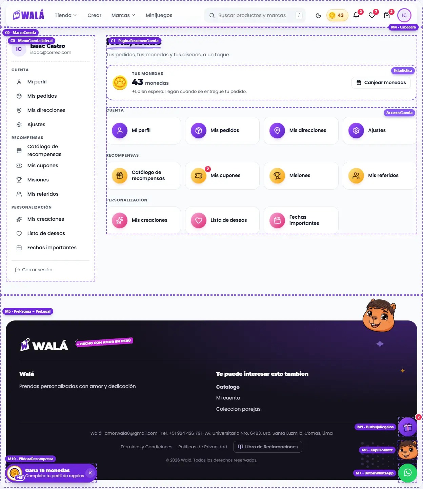 | 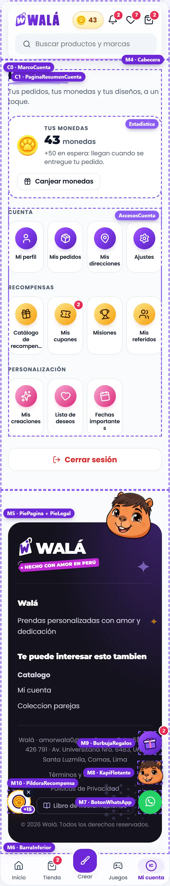 |

Revisado el 2026-10-14 contra wala.pe/cuenta/perfil (con sesión, admin) y
`src/pages/CuentaLayout.jsx` + `src/pages/cuenta/*`. No son páginas del
builder: contenido propio, numerado **C**. Mis pedidos (P2 en las fichas
anteriores) es **C3**.

## Cómo se arma

- **C0 · `MarcoCuenta`** (`paginas/Cuenta.jsx`): en escritorio (el marco mide
  860px o más; es container query) el **menú lateral** (`MenuCuenta lateral`,
  el acceso actual con el sello del logo) y el contenido a la derecha. En el
  celular no hay menú lateral: cada sección es su propia pantalla, con
  **"← Mi cuenta"** arriba para volver a los accesos. Con perfil incompleto,
  un `Aviso` con "Completar" encima de todo.
- Cada página empieza con **`CabezaCuenta`** (sello + título con la letra del
  logo + una línea de ayuda + acción a la derecha) y se arma con
  **`TarjetaCuenta`**, **`Estadistica`** y las piezas de su módulo.
- Los íconos van siempre en un **`Sello`** (círculo con degradado, girado),
  con un tono por grupo: Cuenta violeta, Recompensas oro, Personalización
  rosa. Las cifras (monedas, XP, días, personas) son texto: el número con la
  letra del logo y la palabra en gris.
- Confirmar algo (eliminar una dirección, una creación, una persona; canjear;
  publicar en la comunidad) se hace **en la misma tarjeta**, nunca con
  `window.confirm`.
- **Ningún control del navegador**: las listas son `ListaOpciones` (dentro de
  `Campo` con `opciones`: panel pegado al campo en escritorio, hoja en el
  celular, con buscador si hay más de 10 y `creable` para escribir algo que no
  está), las fechas son `CampoFecha` (calendario de Walá; empieza por el año
  en un cumpleaños; "No sé el año"), el teléfono es `CampoTelefono` (prefijo
  del país con código, sin banderas emoji), las casillas son `Casilla` y la
  foto pasa por `RecortarFoto` antes de subirse. Una hoja abierta encima de
  otra (la lista de distritos dentro de "Nueva dirección") se cierra sola con
  "atrás" o Esc, sin cerrar la de abajo.

## Partes

| Parte | Componente | Piezas que usa | Diseño en | Datos (en la tienda) | Quién la ve |
|---|---|---|---|---|---|
| C0 Marco | `MarcoCuenta` | `MenuCuenta lateral`, `Aviso`, `Enlace` ("← Mi cuenta") | `paginas/Cuenta.module.css`, `MenusCabecera.module.css` (`.lateral`) | `useAuth()` (usuario, `profileIncomplete`), `useCuentaNavGroups` | con sesión |
| Sin sesión | `PaginaCuentaInvitado` | `EstadoVacio` (Kapi), `Boton` | `paginas/Cuenta.module.css` (`.invitado`) | — (`pedidos` en /cuenta/pedidos) | visitante |
| C1 Resumen `/cuenta` | `PaginaResumenCuenta` | `CabezaCuenta` (subrayado), `Estadistica` (monedas), `AccesosCuenta` | `piezas/Cuenta.module.css` | `userProfile.monedas`, `monedasEnEspera`, los grupos | con sesión |
| C2 Mi perfil | `PaginaPerfil` | `IdentidadCuenta`, `Estadistica grande`, `TarjetaCuenta`, `ListaDatos`, `Interruptor`, `Campo` (con `opciones`) | `piezas/Cuenta.module.css`, `paginas/Cuenta.module.css` | `perfilDesdeUsuario(userProfile, user)`; WhatsApp: `marketingConsent.whatsapp` | con sesión |
| C3 Mis pedidos | `PaginaPedidos` (P2) | `CabezaCuenta`, `PedidosPorVerificar`, `Pestanas` (En curso · Terminados), `SeguimientoPedido` (5 pasos o las 8 etapas del taller como barra "Paso 5 de 8 · Estampado"; deuda, anulado, "Ver detalle"), `HojaPagarSaldo`, `EstadoVacio` | `Pedido.module.css`, `paginas/CuentaPedidos.module.css` | `usePedidos(dni, uid)` → `pedidos` y `pendientes` | con sesión |
| C3·d Detalle de compra `/cuenta/pedidos/:id` | `PaginaDetallePedido` | migas, `CabezaCuenta` + estado y pago, `LineaProduccion`, productos, dirección; al costado `ListaDatos` (detalle), `PagosPedido` (historial, boletas, fotos de envío, reclamar monedas), WhatsApp; `CarruselProductos` | `piezas/DetallePedido.module.css`, `paginas/CuentaPedidos.module.css` | `usePedidos` + `getOrderByIdAnyCollection(id)`; `derivarEstadoCompra` | con sesión |
| C4 Mis direcciones | `PaginaDirecciones` | `CabezaCuenta`, `TarjetaDireccion`, `HojaInferior`, `Campo` | `piezas/TarjetaDireccion.module.css` | `obtenerDirecciones(uid)` → `direccionDesdeFirestore`; ubigeo en `lugares` | con sesión |
| C5 Ajustes | `PaginaAjustes` | `TarjetaCuenta`, `Interruptor` (modo noche), `ListaEleccion` (idioma) | `paginas/Cuenta.module.css` | `useTheme()`, `useLanguage()` | con sesión |
| C6 Catálogo | `PaginaCatalogo` | `TarjetaRecompensa` (`FotoProducto`, `EtiquetaColgante`, `CostoMonedas`), `Aviso` | `piezas/Recompensas.module.css` | `rewardsCatalog` → `recompensaDesdeFirestore`; canje `redeemRewardSecure` | con sesión |
| C7 Mis cupones | `PaginaCupones` | `TarjetaCupon` (`IconoWala` en el talón) | `piezas/Recompensas.module.css` (`.cupon`) | `getMisCupones(uid)` + `estadoCupon` → `cuponDesdeFirestore` | con sesión |
| C8 Misiones | `PaginaMisiones` | `Estadistica` ×3, `NivelCuenta` (`BarraProgreso`, `Sello` bronce/plata/oro), `TarjetaMision` (`GananciaMonedas`) | `piezas/Recompensas.module.css` | `getDailyMissions()` → `misionDesdeServidor`, `dailyCheckIn()`, `xp`, `dailyStreak` | con sesión |
| C9 Mis referidos | `PaginaReferidos` | `FormaGanar` ×2, `EnlaceInvitacion`, `Estadistica` ×3, grupos en `TarjetaCuenta` con `FilaReferido` y `DetallePedidoReferido`, `RankingReferidos` (puestos en sellos oro, plata y bronce) | `piezas/Referidos.module.css` | `getReferralsByReferrer(code)`, `claimReferralCoins`, `getReferralOrderDetail` | con sesión |
| C10 Mis creaciones | `PaginaCreaciones` | `TarjetaCreacion` (también combos con sus prendas lado a lado, borradores en `Carrusel`, renombrar, publicar en la comunidad para admins) | `piezas/Creaciones.module.css` | `getDesignsByUser(uid)` → `creacionDesdeDiseno`; borradores `useBorradoresCrear` | con sesión |
| C11 Lista de deseos | `PaginaListaDeseos` | `TarjetaProducto` (`deseado` + `onDeseo`), `Aviso` | `paginas/CuentaPersonalizacion.module.css` | `useWishlist()` + `useProducts` → `tarjetaDesdeProducto` | con sesión |
| C12 Fechas importantes | `PaginaFechas` | `AgendaFechas` ("Lo que se viene": las próximas fechas de todos, llevan a su persona), `AvisoFestiva` (cuenta atrás en un sello y barra de los últimos 30 días), `TarjetaPersonaRegalo` (cada fecha en una `HojaCalendario`, con los años que cumple), `IdeaRegalo`, `HojaPersona` (el formulario, compartido con la encuesta: `piezas/FormularioPersona.jsx`) | `piezas/Regalos.module.css`, `piezas/FormularioPersona.module.css` | `userProfile.giftRecipients` → `personaDesdeRecipient`; ideas `useGiftCatalog` | con sesión |

### Cada módulo

| C2 Mi perfil | C4 Direcciones (celular) | C5 Ajustes (celular) |
|---|---|---|
| 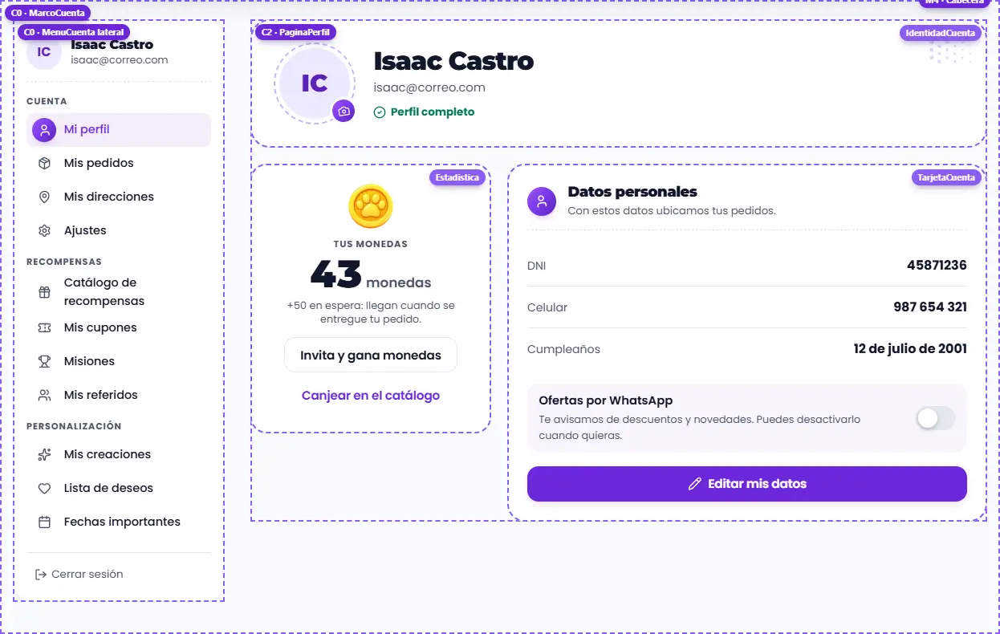 | 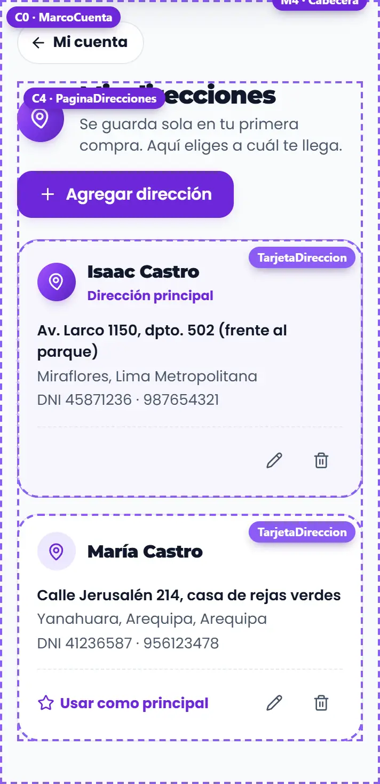 | 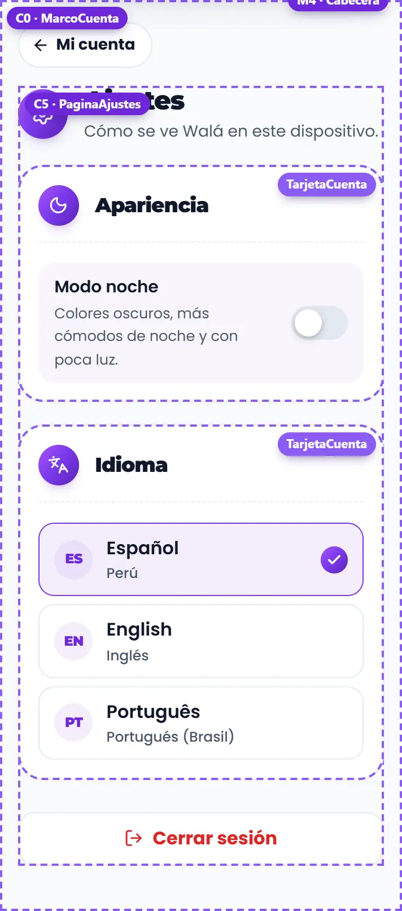 |

| C3 Mis pedidos | C3·d Detalle de compra |
|---|---|
| 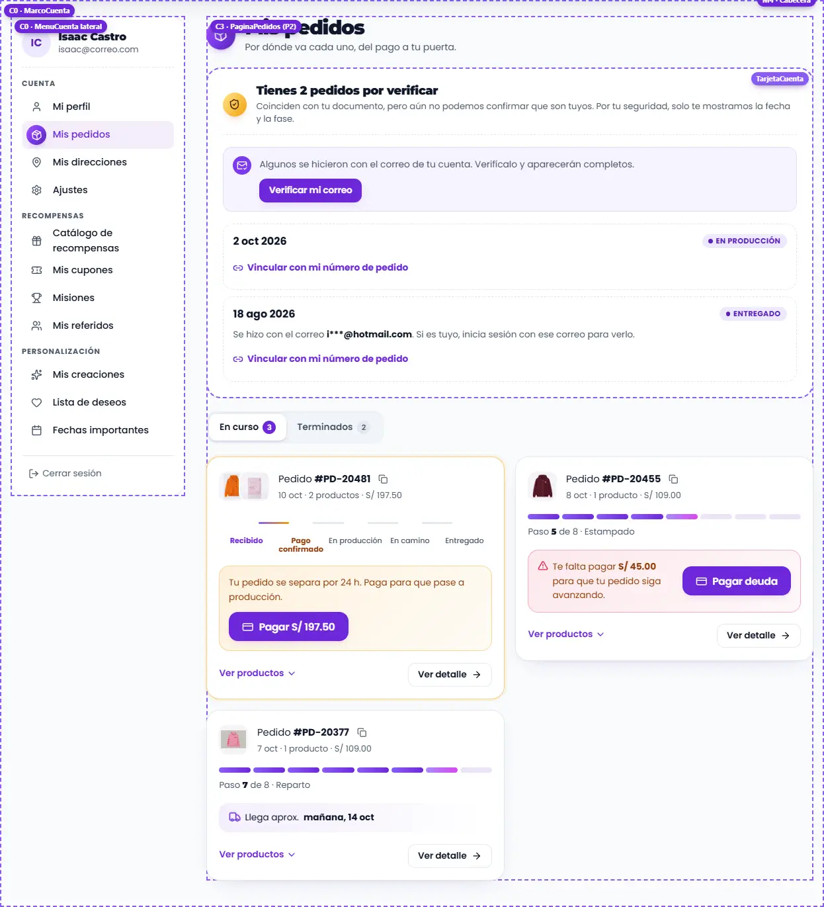 | 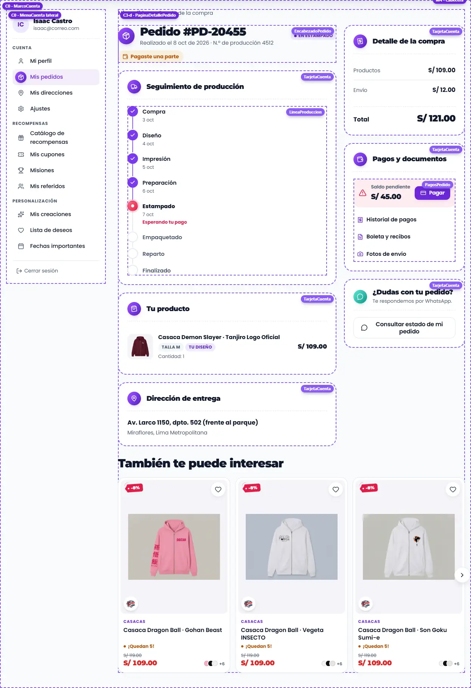 |

| C6 Catálogo | C7 Cupones (celular) | C8 Misiones |
|---|---|---|
| 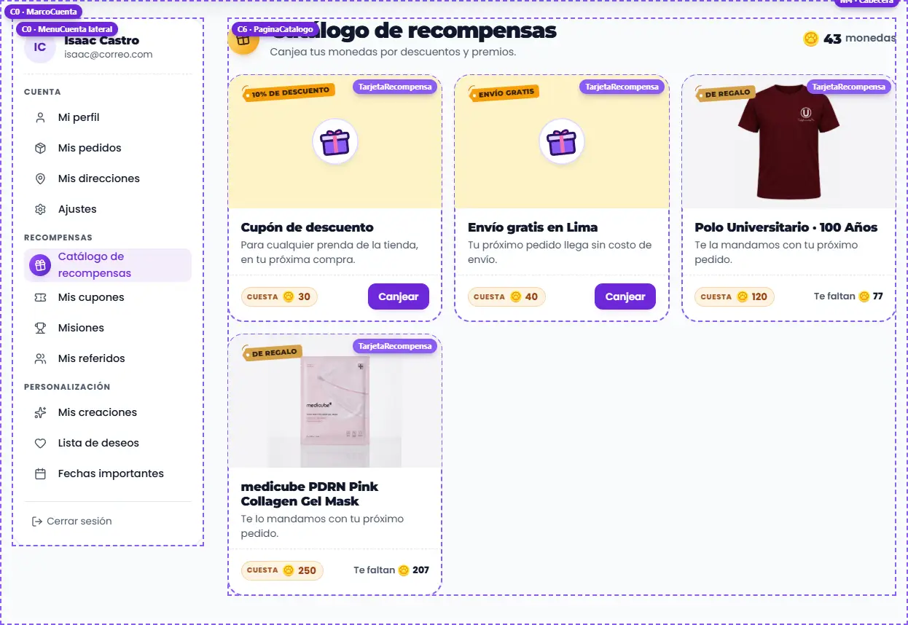 | 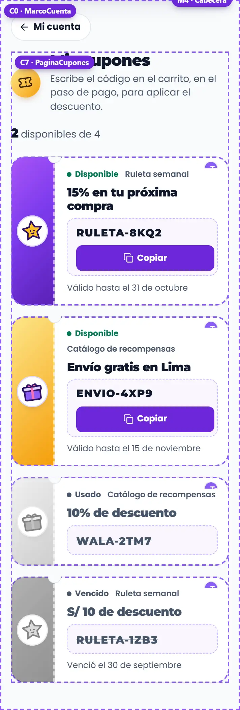 | 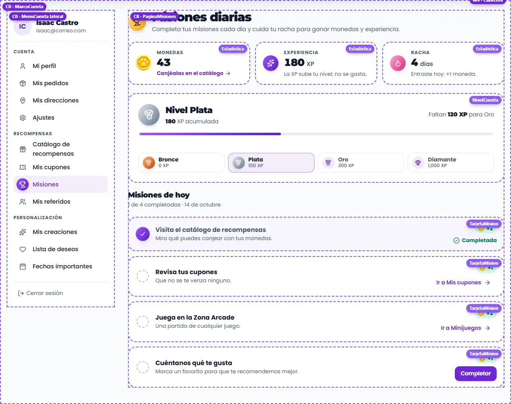 |

| C9 Referidos (celular) | C10 Creaciones (celular) | C11 Lista de deseos | C12 Fechas importantes |
|---|---|---|---|
| 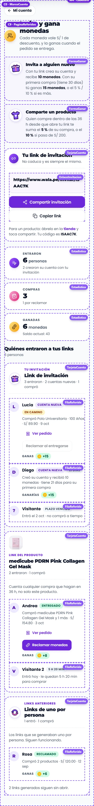 | 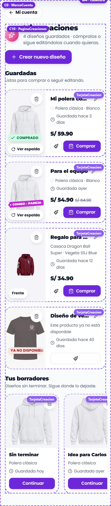 | 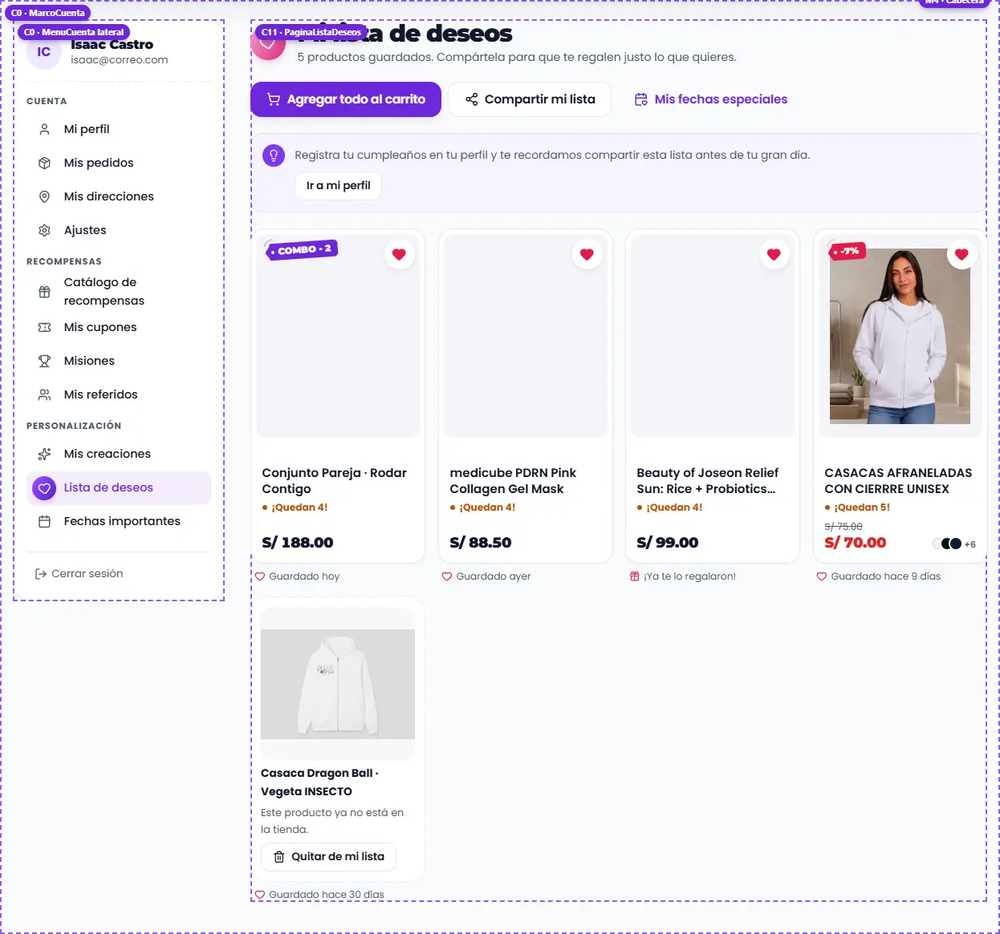 | 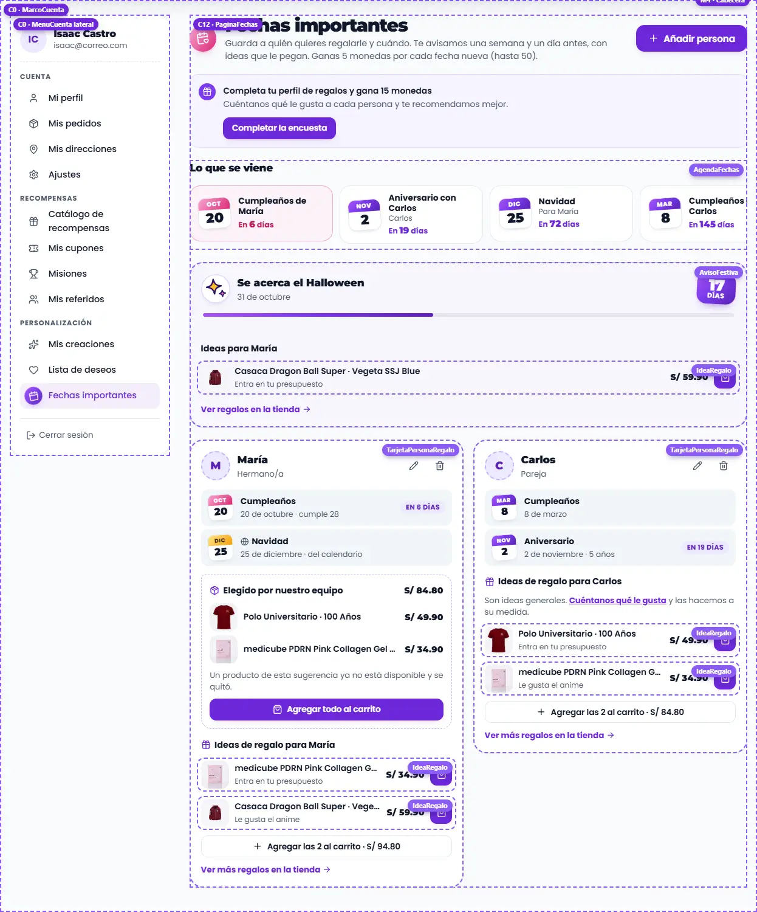 |

### En el celular

- Sin menú lateral; "← Mi cuenta" vuelve al resumen (que también abre la
  pestaña "Mi cuenta" de la barra inferior). "Cerrar sesión" está al final del
  resumen y de Ajustes.
- Accesos de 4 en fila (3 en teléfonos de 320px); las tarjetas de dirección,
  cupones y misiones en una columna; las creaciones en una columna con la
  tarjeta en horizontal; los productos de la lista de deseos de 2 en fila.
- Los formularios largos (nueva dirección, persona) son **hojas inferiores**
  (en escritorio, una ventana centrada).
- Medido sin desbordes en 320, 360, 390, 768 y 1366 px; revisado en claro y
  en noche.

## Para cambiar el diseño rápido: qué se repite

| Pieza | Aparece en | Archivo |
|---|---|---|
| `Sello` | cabeceras, accesos, menú lateral, misiones, niveles, direcciones | `Marca.module.css` (`.sello`, tonos) |
| `CabezaCuenta` | arriba de cada página y de cada `TarjetaCuenta` | `piezas/Cuenta.module.css` (`.cabeza`) |
| `TarjetaCuenta` | datos personales, ajustes, link de invitación, grupos de referidos | `piezas/Cuenta.module.css` (`.tarjeta`) |
| `Estadistica` | monedas (resumen, perfil, misiones), XP, racha, referidos | `piezas/Cuenta.module.css` (`.cifra`) |
| `MenuCuenta` | menú de la cabecera y menú lateral (`lateral`) | `MenusCabecera.module.css` |
| `Campo` (`opciones`) | perfil, dirección, persona | `Formulario.module.css` (`.inputLista`) |
| `HojaInferior` | nueva dirección, persona | `Feedback.module.css` |
| `EstadoVacio` | sin direcciones, cupones, creaciones, deseos, personas; sin sesión | `Feedback.module.css` |
| `GananciaMonedas` / `CostoMonedas` | misiones, referidos / catálogo | `Etiquetas.module.css` |
| `FotoProducto` | recompensas, creaciones, ideas de regalo, pedido de un referido | `piezas/FotoProducto.module.css` |

## Llevar a la tienda (a futuro: TODAVÍA NO se hace)

Páginas propias: van en el paso 6 de [MIGRACION.md](MIGRACION.md). Se migra
**un módulo a la vez**, empezando por el marco. Mantener al día si cambia un
componente o su forma de recibir datos.

### Reemplazos

| Parte | Hoy en la tienda | Pasa a (kit) |
|---|---|---|
| Marco | `pages/CuentaLayout.jsx`: `<aside>` (~95-130), aviso de perfil (~143-157), `<Outlet>` (~158) | `MarcoCuenta` con `usuario`, `grupos`, `activo={location.pathname}`, `perfilIncompleto` |
| Sin sesión | ✓ Ya en la tienda, solo en /cuenta (`CuentaLayout.jsx`; antes `CuentaLoginPrompt` / `PedidosLoginPrompt`). Las secciones van al login y vuelven (`RutaPrivada`, `utils/rutaPrivada.js`) | `PaginaCuentaInvitado` |
| Resumen | `pages/cuenta/CuentaResumenPage.jsx` (grilla ~34-48, "Cerrar sesión" ~58) | `PaginaResumenCuenta` (el "Cerrar sesión" lo pone `MarcoCuenta`) |
| Perfil | `PerfilPage.jsx`: `AvatarStudio` (~193), recompensas, `GlassCard` "Datos Personales" (~243-330) | `PaginaPerfil` |
| Mis pedidos | `CuentaRastreoPage.jsx` (tarjetas ~365-484, `ProgresoResumen` ~204-230) y `PedidosPorVerificar.jsx` | `PaginaPedidos` + `SeguimientoPedido` (`pasos`, `estado`, `deuda`, `anulado`, `urlDetalle`) + `PedidosPorVerificar` |
| Detalle de compra | `CuentaCompraDetallePage.jsx` (`Timeline`, `PedidoAcciones`, `HistorialPagos`, modales de pago y boletas) | `PaginaDetallePedido` + `LineaProduccion` + `PagosPedido` + `HojaPagarSaldo` |
| Foto de perfil | `AvatarStudio` + `AvatarCropModal` (react-easy-crop) | `IdentidadCuenta` + `RecortarFoto` (sin librería) |
| País y teléfono | `CountrySelect`, `PhoneIntlInput` (`<select>` con banderas emoji) | `Campo opciones` (buscador) y `CampoTelefono` |
| Fechas de una persona | `FechaEventoInput` (día, mes, año) | `CampoFecha anioOpcional` |
| Gustos | `<input list>` con `<datalist>` | `Campo opciones creable` |
| Combo guardado | `TarjetaMiCombo` | `TarjetaCreacion` con `imagenes`, `subtitulo`, `aviso` |
| Publicar en la comunidad | `AccionesComunidad`, `InsigniaPublicada` | `TarjetaCreacion comunidad={…}` |
| Ranking | `ReferralRanking` | `RankingReferidos` |
| Direcciones | `MisDireccionesPage.jsx` (lista ~155-180, formulario ~183-286) | `PaginaDirecciones` + `TarjetaDireccion` |
| Ajustes | `CuentaAjustesPage.jsx`: `ThemeToggle` (~56), idiomas (~61-87) | `PaginaAjustes` |
| Catálogo | `CatalogReward.jsx` (tarjetas ~133) | `PaginaCatalogo` + `TarjetaRecompensa` |
| Cupones | `MisCuponesPage.jsx` (tarjetas ~120) | `PaginaCupones` + `TarjetaCupon` |
| Misiones | `MisionesPage.jsx` (cifras, nivel ~141, lista) | `PaginaMisiones` + `NivelCuenta` + `TarjetaMision` |
| Referidos | `CuentaReferidosPage.jsx`, `components/GrupoReferidos.jsx`, `components/DetallePedidoReferido.jsx` | `PaginaReferidos` + `FilaReferido` + `DetallePedidoReferido` |
| Creaciones | `MisCreacionesPage.jsx` (`MiCreacionCard` ~151, `TusBorradores` ~168) | `PaginaCreaciones` + `TarjetaCreacion` |
| Lista de deseos | `WishlistPage.jsx` (`PremiumProductCard` ~275) | `PaginaListaDeseos` (`TarjetaProducto` con `deseado`) |
| Fechas importantes | `CuentaFechasImportantesPage.jsx` (+ `FechasFestivasSeccion.jsx`, modal con portal ~739) | `PaginaFechas` + `TarjetaPersonaRegalo` + `AvisoFestiva` |

### De dónde sale cada dato

| Prop del kit | En la tienda |
|---|---|
| `MarcoCuenta.usuario` | `{ nombre: displayName…, email: user.email, avatar: avatarConfig.avatarUrl \|\| user.photoURL }` (como CuentaLayout) |
| `grupos` | `useCuentaNavGroups()` con `t(labelKey)`: `{ titulo, tono, items: [{ to, texto, Icono }] }` (tono: 'degradado', 'oro', 'rosa' por grupo) |
| `perfilIncompleto` | `profileIncomplete` de `AuthContext` |
| `monedas`, `enEspera` | `userProfile.monedas`, `userProfile.monedasEnEspera` |
| `PaginaPerfil.perfil` | `perfilDesdeUsuario(userProfile, user)` |
| `whatsapp` / `onWhatsapp` | `marketingConsent.whatsapp` / `handleToggleWhatsApp` (`updateUserProfile`) |
| `onGuardar` (perfil) | `handleSaveInfo` con los campos de hoy (`dni`, `clienteNumeroDocumento`, `envioNumeroDocumento`, `tipoDocumento`, `docType`, `phoneIntl`…); lanzar error para que la tarjeta lo muestre |
| `onCambiarFoto` | abrir `AvatarCropModal` con el archivo y luego `handleSaveAvatar` |
| `paises` | `constants/countries` (con `prefijo`) |
| `PaginaDirecciones.direcciones` | `obtenerDirecciones(uid)` → `direccionDesdeFirestore` |
| `lugares` | `{ departamentos: DEPARTAMENTOS, provincias: getProvincias, distritos: (d) => distritosSugeridos({…}), legible: (d) => lugarLegible({…}) }` (`constants/peruUbigeo`, `utils/ubicacionErp`) |
| `onGuardar` / `onPrincipal` / `onEliminar` (direcciones) | `guardarDirecciones(uid, lista)` con `direccionAFirestore` (el servicio normaliza la principal) |
| `tema`, `onTema`, `idioma`, `idiomas`, `onIdioma` | `useTheme()`, `useLanguage()` (`available`, `LANG_NAMES`, `setLang`) |
| `recompensas`, `onCanjear` | `getCollection('rewardsCatalog', …)` → `recompensaDesdeFirestore(r, beneficioDe(r))`; `httpsCallable('redeemRewardSecure')` → `{ codigo: data.coupon.code }` y `reloadProfile()` |
| `cupones`, `onCopiar` | `getMisCupones(uid)`; `cuponDesdeFirestore(c, estadoCupon(c))`; `navigator.clipboard.writeText` |
| `misiones`, `onCompletar` | `getDailyMissions()` → `misionDesdeServidor(m, MISSION_ACTIONS)`; `completeMission(id)` → `{ recompensa: data.reward }` |
| `xp`, `racha` | `userProfile.xp`; `dailyStreak.count` y el resultado de `dailyCheckIn()` (`{ dias, hoy, ganado }`) |
| `PaginaReferidos.url`, `codigo` | `linkInvitacion(referralCode)`, `referralCode` |
| `grupos` (referidos) | `getReferralsByReferrer` agrupado como hoy (`grupoDe`); cada persona con `chips`/`detalle` de `estadoDe` y `restanteLegible`, `reclamo` según `pedido.finalizado` |
| `onReclamar`, `onVerPedido` | `claimReferralCoins(id)` (+ `volarMonedasGanadas`, toast, invalidar queries) / `getReferralOrderDetail(id)` |
| `creaciones`, `borradores` | `getDesignsByUser(uid)` → `creacionDesdeDiseno(d, { precio, precioAntes, disponible, comprado })`; `useBorradoresCrear` |
| `onEliminar` (creación) | `useEliminarCreacion` (sin su modal: la tarjeta ya confirma) |
| `items` (deseos) | `wishlistItems` + `useProducts([], { includeHidden: true })` → `{ id, producto: tarjetaDesdeProducto(p), guardado, regalado: isGifted, disponible }` |
| `PaginaPedidos.pedidos` | cada pedido de `usePedidos` como lo arma `resumirRastreo`: `{ id, codigo, fecha, items, total, paso, pasos: ETAPAS_PRODUCCION si hay fase del taller (o los 5 generales), estado: { texto: getEtapaBadgeLabel / estadoWalaADisplay, tono }, deuda: montoDeuda si conDeuda, anulado, urlDetalle }` |
| `porVerificar` | `{ pendientes: data.pendientes (fecha ya legible y fase con ETIQUETA_FASE), correoVerificado: data.emailVerificado, onEnviarVerificacion: enviarVerificacionCorreo, onYaVerifique: refrescarVerificacionCorreo + recargar, onVincular: vincularPedido }` |
| `PaginaDetallePedido.pedido` | el pedido efectivo de la página: `getCodigoPedido`, `getNumeroProduccion`, `derivarEstadoCompra` (estado y `paymentLabel`), `fechas` → `fechasPasos`, líneas de `getProductosPedido`, dirección y montos como hoy |
| `pagos` | `historialPagos` → `historial`; `onBoletas`: `listFilesInFolder('00'+id)`; `onFotosEnvio`: `reparto.boletasEnvio` o Storage; `monedas`: `claimMonedas(id, 10)` y `monedasReclamadas` |
| `onPagar` → `HojaPagarSaldo` | `tarjeta`: `CulqiCustomCheckout` + `PaypalCheckout`; `yape`, `plin`: `getMessage('yape_number')`…; `urlComprobante`: `whatsapp_number_pagos` con `whatsapp_text_pagos` |
| `ranking` | `getTopReferrersOfMonth()` → `{ codigo: referrerCode, compras: count, monedas: coins }` |
| `comunidadPara(c)` | con `usePuedePublicar(design)`: `{ estado: design.comunidad, onPublicar: publicarEnComunidad, onActualizar: publicarEnComunidad, onRetirar: retirarDeComunidad }` |
| `onAgregarTodo`, `onCompartir` | `handleAddAll` (devolver el texto del resultado), copiar `/wishlist/{referralCode}` |
| `personas`, `festivas` | `giftRecipients` → `personaDesdeRecipient` + `recomendar()` de `useGiftCatalog`; `useFechasFestivas` / `proximasFestivas` (con un `icono` de IconoWala, no el emoji) |
| `onGuardar` (persona) | `updateUserProfile({ giftRecipients })` con `personaARecipient`, luego `claimDatesReward()` → `ganadas` |

### Comportamiento que no se puede perder

- **Sin cuenta** (o con la sesión anónima de las landings de pago) solo /cuenta
  muestra `PaginaCuentaInvitado`; cada sección va al login con `?redirect=` y,
  al entrar, vuelve a esa sección (`IrALogin`, `utils/rutaPrivada.js`).
- **Mis pedidos sin documento ni teléfono** redirige a `/completar-perfil`
  con `state.from` (CuentaLayout ~80): queda en la página, antes del marco.
- **`key={location.pathname}`** en el contenido: `MarcoCuenta` ya anima la
  entrada al cambiar de sección.
- **Misiones al visitar:** `recordMissionAction('visit_catalogo_recompensas')`
  y `('visit_mis_cupones')` siguen en sus páginas, no en el kit.
- **Check-in diario** al abrir Misiones (idempotente) y la **lluvia de
  monedas** (`volarMonedasGanadas`) al ganar: en la página.
- **Toasts de actividad de referidos** (últimos 3 días, sin repetir:
  `notified_referrals_{code}`) y el reloj de 60 s de las cuentas regresivas.
- **Agregar todo al carrito** omite regalados, agotados, los que ya están y
  los que piden elegir talla o color.
- **Paquetes del equipo** cruzados con el catálogo vivo (precio actual, se
  quitan los que ya no existen): `quitados` lo cuenta.
- **El formulario de una persona** no se cierra mientras guarda o sube la
  foto; Esc o tocar fuera la cierran (`HojaInferior`).
- **Traducción:** hoy casi todo usa `<T>` o `t()`; el kit no traduce.

### Diferencias a propósito (no "corregirlas" al migrar)

- Íconos en sellos con degradado, sin emojis: los niveles (🥉🥈🥇💎) son
  sellos bronce, plata, oro y degradado; las fechas festivas, un `IconoWala`.
- "Perfil completo" y las cifras son texto, no píldoras.
- Confirmaciones en la misma tarjeta, sin `window.confirm` ni `alert`.
- El cupón es un boleto con talón (ruleta en violeta, catálogo en oro), sin
  la ilustración de Kapi: así queda **un solo Kapi a la vista**.
- La fila del documento dice el tipo real (DNI, carnet o pasaporte), el
  cumpleaños va legible ("12 de julio de 2001") y el celular agrupado.
- "Cancelar" deja los datos como estaban (hoy lo editado queda al volver a
  editar).
- La nueva dirección y la persona van en hoja inferior (no en el medio de la
  página); al llegar a 10 direcciones se explica por qué no se puede agregar.
- El título del formulario de una persona nueva siempre es "Añadir persona"
  (hoy cambia a "Editar a…" mientras se escribe el nombre).
- Los errores del servidor ("internal") no se muestran tal cual.
- En el celular, "← Mi cuenta" en cada sección.

### Qué le falta al kit antes de migrar

- Traducción (`<T>` / `t()`), como en las demás páginas.
- El formulario de tarjeta (Culqi, PayPal) entra como `tarjeta` en
  `HojaPagarSaldo`: el kit no lo dibuja.
- Mis creaciones: los diseños de legado con capas (`DomOverlay`,
  `ComboProductImage`) se ven con su imagen de vista previa.
- Las páginas públicas para compartir: la lista de deseos
  (`/wishlist/:código`, `WishlistPublic`) y el registro de regalos
  (`/regalar/:código`, `GiftRegistryPage`, con arrastrar a una fecha).
- El aviso de impresión con deuda ("STOP…") del detalle: el kit lo muestra
  como la etapa actual en rojo ("Esperando tu pago") y el aviso de deuda.

### Pasos (cada uno se verifica solo y se puede volver atrás)

1. `MarcoCuenta` en `CuentaLayout` (menú lateral, aviso de perfil, "← Mi
   cuenta"), con el `<Outlet>` adentro y las páginas viejas sin cambios.
   Probar escritorio y celular, claro y noche.
2. Resumen y Ajustes (los más simples).
3. Perfil y Direcciones (con `perfilDesdeUsuario`, `direccionDesdeFirestore` /
   `direccionAFirestore`): probar guardar, errores y "Cancelar".
4. Catálogo, Cupones y Misiones (canje, copiar, completar, check-in).
5. Referidos (con los mismos grupos y estados de hoy).
6. Lista de deseos, Fechas importantes y Mis creaciones (lo que les falta,
   arriba, antes).
7. Mis pedidos cuando el kit tenga `PedidosPorVerificar`.

Para volver atrás: cada paso en su propio commit; las páginas viejas no se
borran hasta que las nuevas lleven un tiempo en producción.
