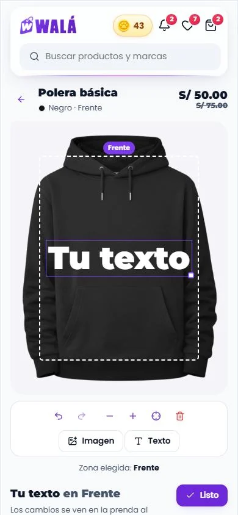
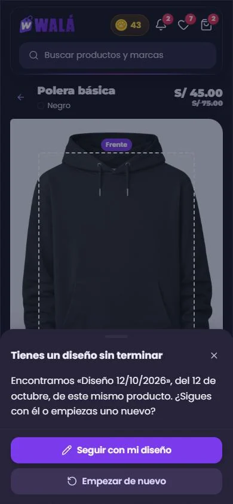

# El editor de un producto del catálogo (`/editor/:id`)

Cómo verlo en vivo: `npm run dev` → http://localhost:3000/componentes.html →
**Páginas** → **Tienda de prueba** → **Editor de producto**. También se
llega con "Personalizar" en la ficha de un producto. Estados: diseño sin
terminar, no se personaliza, producto retirado, cargando y error.

| El editor (celular, claro) | Un diseño sin terminar (celular, noche) |
|---|---|
|  |  |

Revisado el 2026-10-15 contra estos archivos:

| Qué | Archivo | Líneas |
|---|---|---|
| La página | `pages/EditorPage.jsx` | 1014 |
| El lienzo (fabric.js) | `components/editor/EditorCanvas/EditorCanvas.jsx` | 2002 |
| Herramientas, texto, color, imagen, cliparts | `components/editor/Toolbar`, `TextEditor`, `ColorPicker`, `ImageUploader`, `ImageProperties`, `ClipartSelector` | — |
| El estado (capas, deshacer, precio) | `components/editor/EditorContext.jsx` | — |
| Combos | `components/editor/ComboUserEditor/ComboUserEditor.jsx` | 679 |

## Lo primero: hoy nadie llega a este editor

En wala.pe **ningún producto visible abre este editor**. Hay seis productos
con `customizable` y `customizationViews`:

- cuatro están borrados u ocultos;
- dos usan el flujo de Yoryo (`YoryoPersonalizado`), que no pasa por aquí.

Lo que se personaliza hoy pasa por Crear (`/crear/:id`, el estudio).

Por eso el kit **no rehace el editor viejo**. `PaginaEditor` es el **mismo
estudio de Crear** (`PaginaEstudio`), alimentado por un adaptador que
convierte un producto del catálogo (`customizationViews`) en la prenda que
entiende el estudio. Si mañana vuelve un producto personalizable del
catálogo, se diseña igual que una prenda de Crear: un solo estudio, una sola
forma de guardar y de agregar al carrito.

La demo usa un producto real del catálogo, hoy retirado: la **Polera
básica** (`demo/editor.json`). Trae sus 8 colores con foto, sus tallas, su
zona de impresión (80 % de la foto) y su precio (S/ 45, antes S/ 75). Las
medidas de la foto (441 × 565) se tomaron a mano. El "diseño sin terminar" es
de ejemplo.

## Partes

| Parte | Componente | Piezas que usa | Datos (en la tienda) |
|---|---|---|---|
| P22 El editor | `PaginaEditor` (`paginas/Editor.jsx`) | `PaginaEstudio` entero (`LienzoPrenda`, `BarraLienzo`, `PasosEstudio`, `PanelCapa`, `RecortarFoto`, las hojas de guardar, talla e iniciar sesión), `EstadoVacio`, `HojaInferior` | `useProduct(id)` → `prendaEditorDesde`; `getDesignById` / `getDesignsByUser`; `saveDesign`; `addToCart` |
| El producto en el estudio | `prendaEditorDesde(producto, { medidas })` (adaptador nuevo) | — | `customizationViews` (+ `backSide`), `printAreas`, `imagesByColor`, `variants`, `price` / `salePrice` |

Cambios en lo que ya había:

- `PaginaEstudio` acepta `precioCapas` (`{ texto: 5, imagen: 10 }`): cada
  capa suma al precio, como `calculatePrice` del editor viejo. Sin él, el
  estudio de Crear sigue igual.
- En la demo, "Personalizar" de la ficha lleva al editor en vez de solo
  avisar.

Esqueleto: el del estudio (`EsqueletoPagina forma="estudio"`).

### Lo que hace

- Es el estudio de Crear con el producto del catálogo:
  - **Arriba:** el nombre, el color, lo que lleva diseño ("Negro · Frente")
    y el precio, que sube con cada capa (S/ 45 → S/ 50 con un texto → S/ 55
    con una imagen).
  - **La prenda:** la foto del color elegido y la zona punteada del
    producto. Las capas se arrastran, se agrandan, se centran y se quitan, y
    se puede deshacer y rehacer.
  - **Los pasos:** el color (los de las variantes, con su foto), la zona
    (una por vista o "Zona N" si hay varias) y agregar una imagen o un texto.
  - **Al elegir una capa:**
    - un texto: la letra, el tamaño, la negrita, la cursiva, el color, el
      contorno y la sombra;
    - una imagen: recortar, quitar el fondo y la calidad de impresión.
  - **La compra:** "Agregar al carrito · S/ 50.00", "Guardar" (sin cuenta,
    la hoja de iniciar sesión) y "Descargar".
- **Diseño sin terminar:** la hoja "Tienes un diseño sin terminar", con
  "Seguir con mi diseño" (se abre en modo editar: "Estás editando «…»") o
  "Empezar de nuevo".
- **No se personaliza:** Kapi triste, "Este producto no se personaliza",
  "Ver el producto" e "Ir a Crear".
- **Retirado:** "Este producto ya no está disponible" e "Ir a Crear".

## Llevar a la tienda (a futuro: TODAVÍA NO se hace)

**Recomendación:** antes de migrar, decidir si el editor del catálogo sigue
vivo. Si los productos personalizables se hacen como prendas de Crear, basta
con que `/editor/:id` redirija a la ficha del producto (o a Crear) y no hay
nada que migrar. Si vuelve a usarse, el plan es este.

### Reemplazos

| Hoy | Pasa a (kit) |
|---|---|
| `EditorPage` + `AdminViewEditor designOnly` + `EditorCanvas` (fabric.js) + `Toolbar` | `PaginaEditor` (el estudio) con `prendaEditorDesde` |
| La hoja "Ajustes de Producto" (talla y color) | El paso "Elige el color" y la hoja de la talla al agregar |
| Los modales "¡Guarda tu progreso!", "¿Salir sin guardar?", "Continuar diseño" y los `alert` / `confirm` | Las hojas del estudio y la de "Tienes un diseño sin terminar" |
| `ComboUserEditor` | El combo de Crear (`PaginaCombo`, CREAR.md): cada pieza se diseña en el estudio |

**Lo que no cambia:** la colección `designs`, `addToCart` y la copia de los
archivos al pedido (`functions/pedidoDisenos.js`).

### De dónde sale cada dato

- **`prenda`:** `prendaEditorDesde(product, { medidas })`.
  - Las `medidas` (ancho y alto de la foto de cada vista) hacen falta para
    que la zona tenga la proporción correcta. Se pueden guardar en el
    producto al configurarlo, o leerse de la foto al cargarla.
- **`personalizable`:** `product.customizable && !product.YoryoPersonalizado`.
  Hoy `EditorPage` no lo revisa y abre cualquier producto.
- **`pendiente`:** el diseño más nuevo de `getDesignsByUser(uid)` para este
  producto. `onContinuar` lo carga.
- **`inicial`:** con `?designId=`, el diseño guardado.
  - Ojo: el editor viejo guarda las capas en píxeles de fabric
    (`layersByView`), no por zona.
  - Hace falta una conversión, de capa a `{ x, y, ancho }` dentro de la
    zona. O bien se aceptan solo los diseños nuevos.
- **`onGuardar`:** `saveDesign` (con `tipo:'crear'` si se unifica con Crear,
  o sin `tipo` para seguir apareciendo como antes en Mis creaciones).
- **`onAgregar`:** `addToCart(product, { size, color }, { …, finalPrice })`.
  El precio lo arma el estudio con `precioCapas`. Mejor si el servidor lo
  recalcula: hoy confía en el cliente.
- **`?color=` y `?size=`** (de "Personalizar"): `inicial.color` y la talla.

### Comportamiento que no se puede perder

- Los diseños se guardan en `designs` y siguen apareciendo en Mis creaciones.
- El carrito recibe el diseño, el precio y la talla.
- Las imágenes se suben a `designs/{uid}/…` (con sesión), para que el pedido
  pueda copiarlas.

### Diferencias a propósito (no "corregirlas" al migrar)

- **Un solo estudio:** las herramientas son las de Crear. No hay formas
  (rectángulo, círculo, triángulo), cliparts, máscaras ni tinte; sí hay
  contorno, sombra, la calidad de impresión y quitar el fondo con un toque.
- **El precio se ve** y sube con cada capa (hoy el editor no lo muestra
  nunca).
- El color y la talla se eligen en la página (hoy los selectores no salen:
  leen `variants.sizes`, que no existe).
- Deshacer y rehacer tienen botones, no solo teclado.
- Sin `alert` ni `window.confirm`.

### Lo que se encontró de paso (para decidir aparte)

- Dentro del editor hay **dos `EditorProvider` anidados**
  (`AdminViewEditor` crea el suyo). Por eso:
  - "Zona Activa" nunca sale;
  - las capas nuevas caen en `{x: 100, y: 100}`;
  - la pestaña "Este producto" de los cliparts siempre está vacía.
- Los selectores de talla y color nunca se ven: leen `variants.sizes` y
  `variants.colors`, y `variants` siempre es una lista.
- El precio nunca se muestra, pero va al carrito.
- Al agregar al carrito, el guardado automático pierde el id del diseño
  nuevo, y el carrito queda sin `designId`.
- Sin sesión, las imágenes se suben a `designs/anonymous/…`, que las reglas
  no permiten. Quedan como `blob:` y se pierden al guardar.
- Los productos simples llegan al carrito sin foto del diseño.
- El campo de subir foto repite `id="image-upload"` (celular y escritorio).

### Pasos

1. Decidir si el editor del catálogo sigue (ver la recomendación).
2. Si sigue: guardar las medidas de las fotos al configurar el producto en el
   admin, y cambiar `EditorPage` por `PaginaEditor` con `prendaEditorDesde`.
3. Convertir (o dejar de abrir) los diseños viejos guardados en píxeles.
4. Recalcular en el servidor el precio de lo personalizado.
