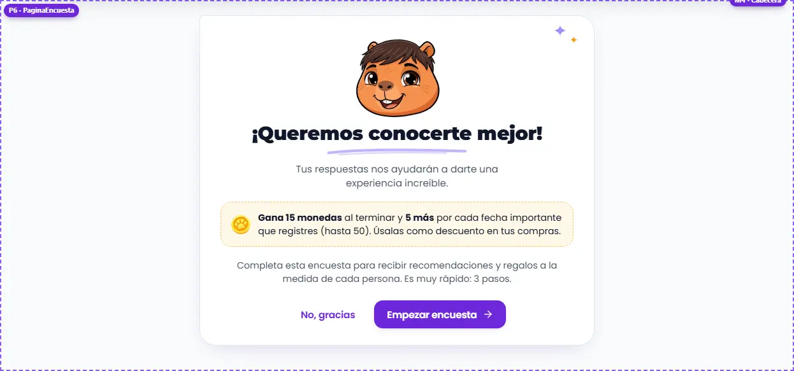
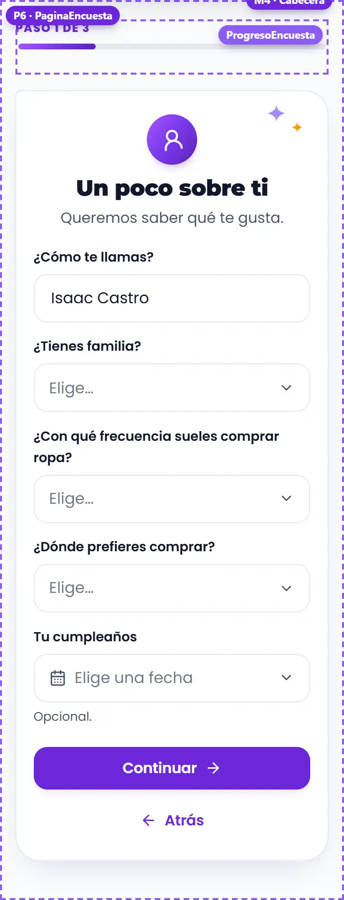
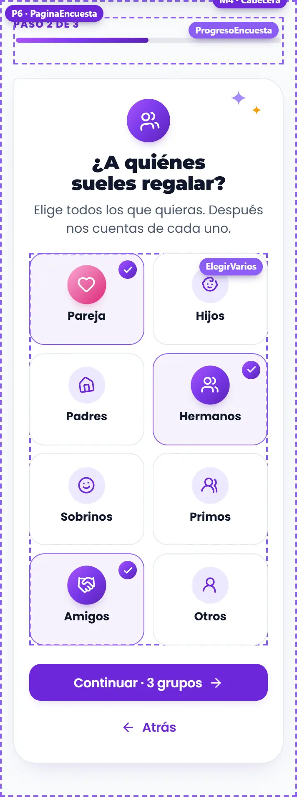
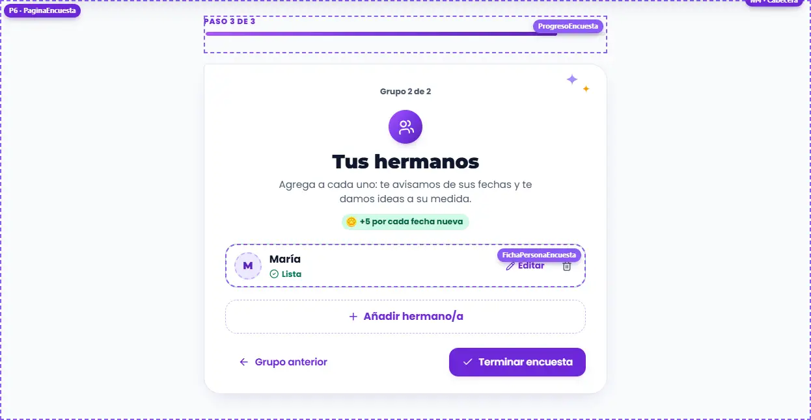
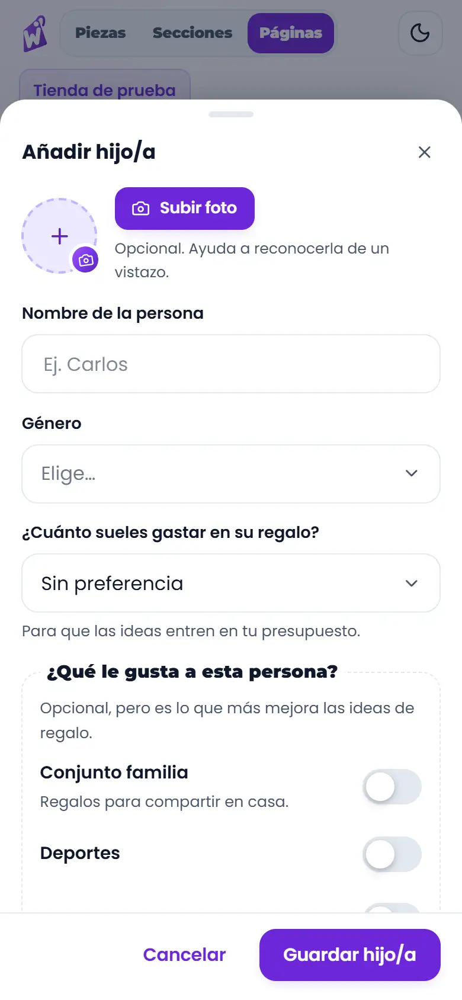
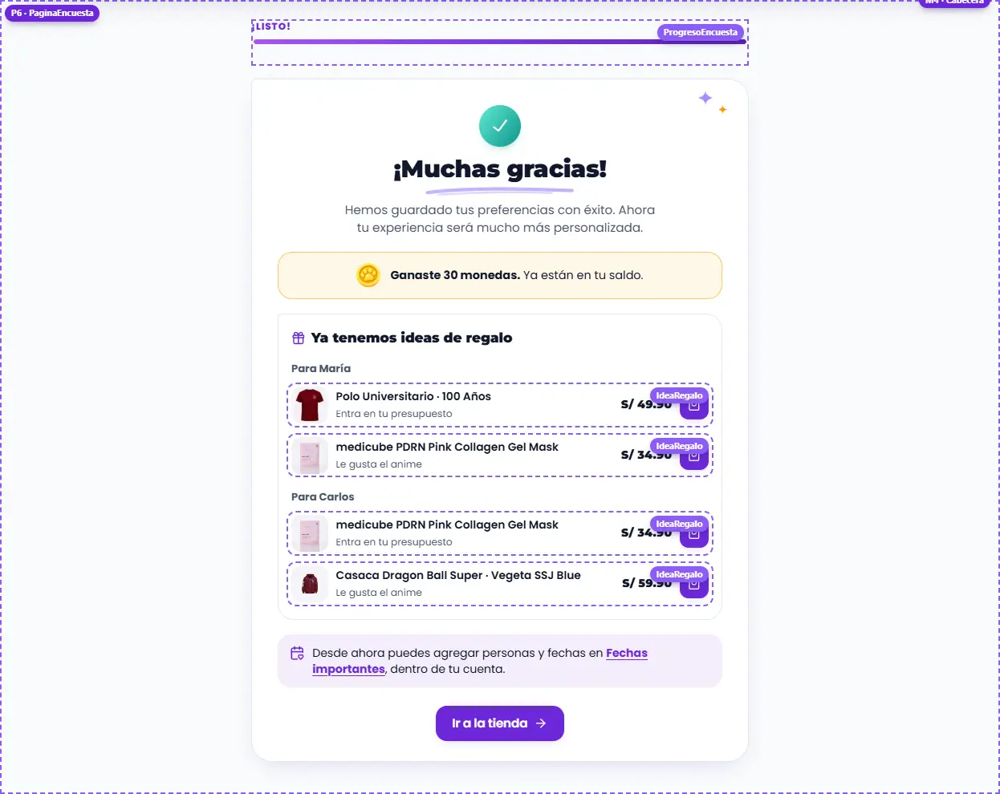
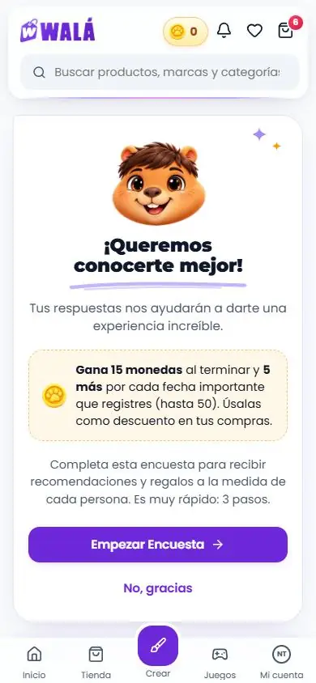
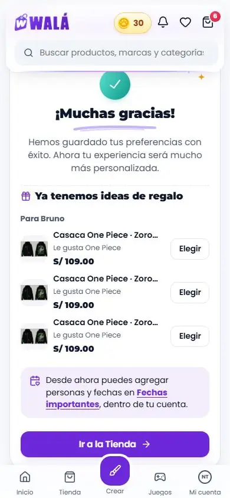
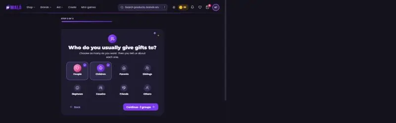

# Encuesta (`/encuesta-suscripcion`): qué componente va en cada parte

Cómo verla en vivo: `npm run dev` → http://localhost:3000/componentes.html →
**Páginas** → **Tienda de prueba** → página **Encuesta** (también la abren la
píldora "Gana 15 monedas", la campana y el aviso de Fechas importantes). Con
**Ver como** → "Con sesión" aparecen los estados **Ya respondida**, **Con
personas guardadas** (la pareja y una hermana del perfil), **Cargando** y
**Falla al guardar**. "Visitante" muestra la invitación a entrar.
Las piezas sueltas están en **Piezas** → **10 · Piezas de la cuenta**.
El marco de la tienda (M) es el de siempre: ver
[INICIO.md](INICIO.md#marco-m-lo-que-rodea-a-las-secciones).

| Portada (escritorio) | Un poco sobre ti (celular) | A quiénes regalas (celular) |
|---|---|---|
|  |  |  |

| Un grupo (escritorio) | Datos de una persona (celular) | Gracias (escritorio) |
|---|---|---|
|  |  |  |

Revisado el 2026-10-14 contra wala.pe/encuesta-suscripcion y
`src/pages/SubscriptionSurveyPage.jsx` (+ `services/encuestaConfig.js`). No es
del builder: contenido propio, numerado **P6**.

## Cómo se arma

- **P6 · `PaginaEncuesta`** (`paginas/Encuesta.jsx`) dentro de `MarcoTienda`
  (con `kapiEnPie={false}`: Kapi ya está en la portada). Una columna de
  620px como máximo: arriba **`ProgresoEncuesta`** ("Paso 2 de 3" y la barra
  con el degradado del logo; en el paso 3 avanza también grupo por grupo) y
  debajo una tarjeta por paso que entra de lado según se avance o se vuelva
  (una vez, sin bucle; nada con `prefers-reduced-motion`).
- Cada paso empieza con un **`Sello`** con su ícono (la pareja en rosa,
  "Gracias" en menta), el título con la letra del logo y una línea de ayuda.
  La portada lleva a Kapi en vez del sello y un `Trazo` bajo el título;
  garabatos quietos en la esquina de la tarjeta.
- Los botones van abajo: atrás a la izquierda (fantasma) y seguir a la
  derecha (violeta liso). En el celular los dos ocupan todo el ancho y el de
  seguir queda arriba, al pulgar.
- **Sin `alert` ni `confirm`**: los errores y las preguntas ("No agregaste a
  nadie en hijos. ¿Sigues igual?") salen en un `Aviso` encima de los botones,
  con su botón ("Seguir sin nadie", "Terminar sin personas").
- Las personas se guardan **en la página** hasta "Terminar encuesta"; recién
  ahí sale `onTerminar` con todo junto.

## Partes

| N.º | Qué es | Componente | Piezas | Archivo del diseño | Datos en la tienda |
|---|---|---|---|---|---|
| P6 | La encuesta | `PaginaEncuesta` | las de abajo | `paginas/Encuesta.module.css` | `getSurveyConfig` → `encuestaDesdeConfig`; `userProfile` (`surveyBasicData`, `birthDate`, `giftRoles`, `giftRecipients` → `personaDesdeRecipient`) |
| — | Avance | `ProgresoEncuesta` | `BarraProgreso` (`--bp-relleno`) | `piezas/Encuesta.module.css` | el paso y el grupo actual |
| 0 | Portada | — | Kapi, `Trazo`, `Moneda`, `Boton` | `paginas/Encuesta.module.css` (`.portada`, `.premio`) | `introPanel`; premio: `recompensa` (15 + 5 por fecha, tope 50) |
| 1 | Un poco sobre ti | — | `Campo` (texto o `ListaOpciones`), `CampoFecha` | `Formulario.module.css`, `Fecha.module.css` | `basicDataPanel.fields`; el cumpleaños propio va a `birthDate` |
| 2 | A quiénes regalas | `ElegirVarios` | `Sello` (suave → degradado al elegir) y el visto en la esquina | `piezas/Encuesta.module.css` | `GRUPOS_ENCUESTA` (los `roleKey` de siempre) |
| 3 | Las personas de cada grupo | `FichaPersonaEncuesta` | `Avatar`, `GananciaMonedas` ("+5 por cada fecha nueva") | `piezas/Encuesta.module.css` | las personas con `relacion` igual al grupo |
| 3·h | Datos de una persona | `HojaPersona` (`relacionFija`, `familia`) | `HojaInferior`, `Campo`, `CampoFecha`, `Interruptor`, `Casilla`, `RecortarFoto` | `piezas/FormularioPersona.module.css` | `brandsPanel.categories` → `conjuntos` (sugerencias de `useGiftCatalog`) |
| 4 | Gracias | — | `Sello` menta, `Moneda`, `IdeaRegalo`, `Enlace` | `paginas/Encuesta.module.css`, `piezas/Regalos.module.css` | `completionPanel`; monedas y ideas: lo que devuelve `onTerminar` |
| — | Sin sesión / ya respondida | `EstadoVacio` | Kapi feliz, `Boton` | `Feedback.module.css` | `user`, `userProfile.hasCompletedSurvey` |

## Para cambiar el diseño rápido: qué se repite

- **`HojaPersona`** (`piezas/FormularioPersona.jsx`) es el mismo formulario
  de Fechas importantes (C12): cambiarlo cambia los dos. La encuesta lo usa
  sin el campo Relación (la sabe por el grupo) y con el "Conjunto familia".
- **`IdeaRegalo`** es la misma de Fechas importantes; cuando su caja es
  angosta (menos de 340px) el precio baja bajo el nombre.
- **`Sello`**, **`BarraProgreso`**, **`Campo`**, **`CampoFecha`** y
  **`EstadoVacio`** son los de todo el kit.

## Llevar a la tienda (hecho el 2026-10-19: ver "En la tienda" al final)

Página propia: va en el paso 6 de [MIGRACION.md](MIGRACION.md), después de
Fechas importantes (comparten `HojaPersona`). Mantener al día si cambia un
componente o su forma de recibir datos.

### Reemplazos

| Parte | Hoy en la tienda | Pasa a (kit) |
|---|---|---|
| Página | `pages/SubscriptionSurveyPage.jsx` (ruta en `App.jsx` ~391) | `PaginaEncuesta` dentro de `MarcoTienda kapiEnPie={false}` |
| Avance | `.progreso` + `.progressBarContainer` (~382-390 y ~410) | `ProgresoEncuesta` |
| Portada | `currentStep === 0` (~419-441) | paso 0 de `PaginaEncuesta` |
| Sobre ti | `currentStep === 1` (~443-477): `<input>`, `<select>` y `<input type="date">` nativos | `Campo` / `ListaOpciones` y `CampoFecha` |
| Grupos | `currentStep === 2` (~479-508): `.groupCard` | `ElegirVarios` con `GRUPOS_ENCUESTA` |
| Personas de un grupo | `currentStep === 3` hub (~510-570): `.recipientCard` | `FichaPersonaEncuesta` + botón "Añadir…" |
| Datos de una persona | el formulario en la misma tarjeta (~572-800), con `FechaEventoInput` y `<datalist>` | `HojaPersona relacionFija familia` (en una hoja) |
| Gracias | `currentStep === 4` (~803-860): `ideasFinal`, `tipBox` | paso 4 de `PaginaEncuesta` con `IdeaRegalo` |

### De dónde sale cada dato

- **Textos y preguntas**: `getSurveyConfig()` (con `DEFAULT_SURVEY_CONFIG`)
  → `encuestaDesdeConfig(config, sugerenciasCampo)` → `{ config, conjuntos }`.
- **`inicial`**: `{ respuestas: userProfile.surveyBasicData, cumpleanos:
  userProfile.birthDate, grupos: claves de giftRoles en true, personas:
  giftRecipients.map(personaDesdeRecipient) }`.
- **`completada`**: `userProfile.hasCompletedSurvey`. **`sesion`**: `user`.
  **`cargando`**: `authLoading || configLoading`.
- **`onOmitir`**: `updateUserProfile({ lastSurveyPromptedAt: Date.now() })` y
  `navigate('/', { replace: true })` (lo de `handleSkip` ~128).
- **`onTerminar({ respuestas, cumpleanos, grupos, personas, quitadas })`**:
  lo de `handleFinalSave` (~323): `updateUserProfile({ surveyBasicData:
  respuestas, giftRoles: { [grupo]: true… }, giftRecipients, hasCompletedSurvey:
  true, birthDate (solo si hay) })` con `personas.map(personaARecipient)` más
  los del perfil que no se tocaron **menos los `quitadas`**; después
  `registrarConversionPopup('encuesta', …)` y `grantSurveyReward()` +
  `claimDatesReward()`; si pagaron, `volarMonedasGanadas(null, total)`.
  Devuelve `{ monedas: total, ideas: personas.map((p) => ({ id, nombre,
  ideas: recomendar(recipient, { limite: 3 }).filter(tipo === 'gusto') →
  props de IdeaRegalo })) }`.
- **`onSubirFoto`**: la misma subida de Fechas importantes.
  **`onAgregarIdea`**: agregar al carrito (o abrir la ficha si necesita talla).

### Comportamiento que no se puede perder

- Precargar las personas del perfil y **fusionar** al guardar: nunca
  reemplazar `giftRecipients` entero (se perderían las que no se ven aquí).
- La pareja: si se marca, su grupo trae una ficha para completar; no se
  puede quitar ni añadir otra.
- Una persona está lista con nombre, género y la fecha de cada evento (y el
  nombre de la fecha especial): `validarPersona`. Con alguna incompleta no se
  pasa de grupo.
- Las monedas las calcula el servidor; la animación sale solo con lo que de
  verdad pagó (15 una vez + 5 por fecha nueva, tope 50).
- El cumpleaños propio no pisa uno guardado con vacío.

### Diferencias a propósito (no "corregirlas" al migrar)

- **Sin sesión** hay invitación a entrar (la ruta no tiene guardia: hoy se ve
  la encuesta y falla al guardar).
- **Ya respondida**: pantalla con "Ver mis fechas" y "Volver a responder" en
  vez de empezar de cero sin avisar.
- Avisos en la tarjeta en vez de `alert`/`confirm`; si no se elige ningún
  grupo, "Terminar sin personas" (antes había que volver atrás).
- **Quitar a alguien lo quita de verdad** (`quitadas`): antes la fusión lo
  traía de vuelta.
- El formulario de una persona es el de Fechas importantes, en una hoja
  (foto con recorte, gustos con sugerencias, presupuesto en una lista).
- Sin emojis (🎂, 🎁, 💡): sellos e íconos.

### Pasos (cada uno se verifica solo y se puede volver atrás)

1. ✓ `personaARecipient` guarda `familySet`/`familyAnswers`.
2. ✓ `SubscriptionSurveyPage.jsx` monta `EncuestaDeTienda`; lo de antes
   quedó en `SubscriptionSurveyViejo.jsx` (interruptor `encuestaVieja`).
3. ✓ Probado (ver "En la tienda").
4. Borrar `SubscriptionSurveyPage.module.css` cuando lleve un tiempo en
   producción (ELIMINAR.md, "La encuesta").

## En la tienda (2026-10-19)

| Portada (celular) | Gracias, con ideas (celular) | Grupos en inglés y oscuro (escritorio) |
|---|---|---|
|  |  |  |

`pages/SubscriptionSurveyPage.jsx` monta
`components/encuesta/EncuestaDeTienda.jsx`, que dibuja `PaginaEncuesta`. La
página de antes (`pages/SubscriptionSurveyViejo.jsx`) baja solo con el
interruptor `encuestaVieja` (`useLoViejo('encuesta')`: en Firestore
`encuestaViejo: true`; en localStorage, `"encuesta"`).

**Lo mismo que antes al terminar:** `surveyBasicData`, `giftRoles` (los ocho
grupos en true o false), `giftRecipients` fusionado (las personas listas
sobre lo que ya tenían guardado, con lo que la encuesta no edita, y las del
perfil que no se tocaron), `hasCompletedSurvey` y el cumpleaños propio solo
si hay fecha; la conversión del pop-up `encuesta`; las monedas las paga el
servidor (`grantSurveyReward` + `claimDatesReward`) y vuelan solo si pagó.
"No, gracias" guarda `lastSurveyPromptedAt` y va al inicio. Sin el perfil
leído no se guarda (la fusión pisaría a quien no se ve).

**Lo que cambia (además de las diferencias a propósito de arriba):**

- El catálogo de regalos (`useGiftCatalog({ activo })`: el catálogo entero,
  etiquetas, personajes y colecciones) se pide al dejar la portada
  (`onEmpezar`), no al abrir la página: quien dice "No, gracias" no lo baja.
- La config se lee con `leerSurveyConfig` (sin intentar crearla: el
  "PERMISSION_DENIED" de la consola salía de ahí; `getSurveyConfig` queda
  para el admin). El buscador de regalos también la lee así.
- "Elegir" en una idea abre "Agregar rápido" (antes las ideas llevaban a la
  ficha); lo que no pide talla se agrega al tiro.
- Los grupos que ya tenía vienen marcados al volver a responder.
- El color de la config (`design.primaryColor`) ya no se usa: la encuesta
  va con los colores de Walá.
- Sin el Kapi flotante en la encuesta (`components/marco/Kapi.jsx`): ya está
  el de la portada.
- Todo pasa por la traducción (antes, solo algunos textos).
- `encuestaDesdeConfig` vive en `adaptadoresEncuesta.js` (en
  `adaptadores.js` iba al archivo principal).

**Carga:** la página baja 21,4 KB (8,4 KB gzip) + 5,6 KB de CSS, más el
formulario de la persona (compartido con Fechas importantes) y las piezas de
la encuesta; antes, 24,2 KB + 10,9 KB de CSS y el catálogo entero apenas se
abría. El archivo principal: unos 130 B gzip más, del mapa de dependencias
de la ruta (ningún código de la encuesta entra en él).

**Probado** con los emuladores a 390 y 1366, en claro y en oscuro: la
portada (un solo Kapi), "Un poco sobre ti" con su error, los grupos, la
pareja sin datos (aviso), su hoja (nombre, género, gusto con sugerencia,
cumpleaños sin año), un grupo vacío ("Seguir sin nadie"), terminar (20
monedas: 15 + 5), lo guardado en Firestore, volver a responder (todo
precargado), quitar a alguien (se quita de verdad y la persona de otro
grupo se conserva), las ideas de regalo y "Elegir" (Agregar rápido), "No,
gracias", inglés y el interruptor. **No probado:** subir la foto de una
persona y una falla de red al guardar.
