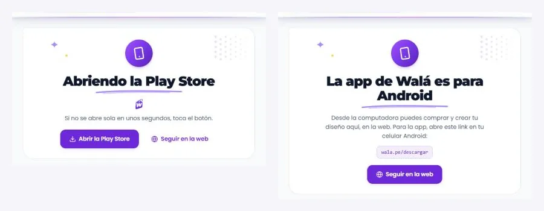
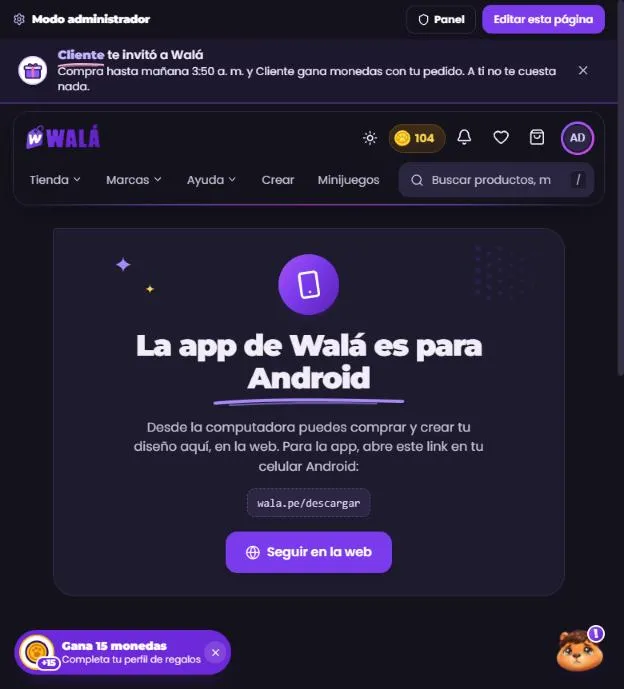

# Generales: página no encontrada y descargar la app

Cómo verlo en vivo: `npm run dev` → http://localhost:3000/componentes.html →
**Páginas** → **Tienda de prueba** → **No encontrada** y **Descargar la app**
(con "Se abre desde": Android, iPhone o Computadora).

| No encontrada (celular) | Descargar la app (Android y computadora) |
|---|---|
|  |  |

**En la tienda desde el 2026-10-20** (ver "En la tienda" al final). Antes
eran una propuesta del kit: la tienda no tenía ninguna de las dos
pantallas. Revisado contra `App.jsx`, `pages/Tienda/DynamicLandingPage.jsx`
y `pages/AppRedirect.jsx`.

## Cómo funcionaba antes (lo que vuelve con `generalesViejo`)

- **Una dirección que no existe:** no hay página de "no encontrada".
  - `wala.pe/algo` cae en `/:slug` (las landings). Como no hay ninguna con
    ese nombre, `DynamicLandingPage` manda al inicio sin avisar.
  - Lo demás que no tiene ruta (`*`) va a `/cuenta`.
- **`/descargar` y `/app`** (`AppRedirect`): intenta abrir la Play Store en
  el teléfono (`market://`) y, al segundo, la Play Store en la web. Mientras
  tanto, un texto suelto ("Redirigiendo a la Play Store…") sin estilos de
  Walá. Desde un iPhone o la computadora también termina en la Play Store,
  aunque no sirva ahí. La usan "Descargar la app" del sorteo (solo desde la
  app) y del regalo sorpresa.

## Partes

| Parte | Componente | Piezas que usa | Datos |
|---|---|---|---|
| P22 No encontrada | `PaginaNoEncontrada` (`paginas/Generales.jsx`) | Kapi triste (`CARAS_KAPI`), el sello "404", `Trazo`, `Buscador` (`grande`, con botón), `Boton`, `Puntos`, `Destello` | `ruta` (la dirección pedida); `onBuscar` lleva a `/buscar?q=…` |
| P23 Descargar la app | `PaginaDescargarApp` (`paginas/Generales.jsx`) | `Sello` (el teléfono), `Cargando`, `Trazo`, `Boton` | `plataforma` (`android`, `iphone`, `computadora`: la tienda la saca del navegador) |

Esqueleto: `EsqueletoPagina forma="aviso"` (una tarjeta centrada). Las dos
páginas no cargan datos, así que casi nunca se ve.

### Lo que hace

- **No encontrada:** Kapi triste, "404" en un sello, "No encontramos esta
  página" con su trazo, qué pudo pasar, la dirección que se pidió, el
  buscador y "Ir a la tienda" / "Crear mi diseño". El Kapi del pie no sale
  (ya está en la tarjeta).
- **Descargar la app:**
  - **Android:** "Abriendo la Play Store", la etiqueta de Walá meciéndose y
    "Abrir la Play Store" por si no se abrió sola; "Seguir en la web".
  - **iPhone:** "La app de Walá es para Android" y que en la web se puede
    comprar, crear y ver los pedidos; "Seguir en la web".
  - **Computadora:** lo mismo, con `wala.pe/descargar` para abrirlo en el
    celular.

## Llevar a la tienda (hecho el 2026-10-20: ver "En la tienda" al final)

1. **No encontrada:**
   - En `DynamicLandingPage`, cuando no hay landing (y no es un slug viejo
     con `redirigirA`), mostrar `PaginaNoEncontrada` en vez de
     `<Navigate to="/" />`.
   - La ruta `*` también.
   - **Ojo:** las landings que se borraron o cambiaron de nombre sin
     `slugsAnteriores` dejarían de llevar al inicio: revisarlas antes.
2. **Descargar la app:** `AppRedirect` monta `PaginaDescargarApp`.
   - La plataforma sale del navegador:
     - `android` si `/android/i`;
     - `iphone` si `/iphone|ipad|ipod/i`;
     - si no, `computadora`.
   - Solo en Android se sigue intentando `market://` y luego la Play Store
     en la web.

## En la tienda (2026-10-20)

| No encontrada (celular, claro) | Descargar la app (computadora, oscuro) |
|---|---|
|  |  |

- **Una dirección que no existe:** `pages/NoEncontradaPage.jsx` monta
  `components/generales/NoEncontradaDeTienda.jsx` (`PaginaNoEncontrada`) en
  los dos lugares: cuando la landing `/:slug` no existe (`DynamicLandingPage`,
  antes al inicio sin avisar) y en la ruta `*` (antes, a Mi cuenta). Siguen
  igual las landings de K-CHERO (a `/tienda`) y las renombradas
  (`slugsAnteriores`: en producción, `mussa` → `lumi`; las 15 landings
  revisadas el 2026-10-20).
  - Con la cabecera y el pie (la landing los oculta mientras busca) y un
    solo Kapi: el de la tarjeta (`LayoutContext`: `pieSinKapi` y
    `kapiFlotanteOculto`, que Kapi también respeta).
  - El buscador lleva a `/buscar?q=…`; los buscadores no guardan la página
    (`<meta name="robots" content="noindex">` mientras se ve).
  - **Enlaces rotos en la analítica:** cada visita guarda un evento
    `page_not_found` en `analytics_events` con la dirección (`path` y
    `eventData.ruta`) y de dónde venía (`eventData.desde`, el referrer; no
    cuando es la misma página al recargar). Lo registra
    `services/analytics/enlacesRotos.js`, aparte de `tracker.js` para no
    pesar en el archivo principal; la misma dirección no se cuenta dos veces
    seguidas. Las reglas ya dejaban crear eventos: nada que desplegar.
    En el admin se ven en `dashboard/paginas`, tarjeta "Enlaces rotos"
    (`pages/admin/dashboard/EnlacesRotos.jsx`): las direcciones más pedidas
    del rango, cuántas veces, cuántas personas y de dónde venían. Una
    dirección de un tramo (`/promo`) trae dos atajos: crear la landing
    (`/admin/landing-pages?nueva=promo`) o que lleve a una que ya existe
    (se suma a sus `slugsAnteriores`).
- **Descargar la app:** `pages/AppRedirect.jsx` monta
  `components/generales/DescargarAppDeTienda.jsx` (`PaginaDescargarApp`). La
  plataforma sale de `plataformaDesdeNavegador` (`adaptadoresGenerales.js`,
  con sus pruebas; un iPad con iPadOS cuenta como iPhone). Solo en Android
  sigue abriendo la Play Store sola (`market://` y, al segundo, la web);
  en un iPhone o la computadora se queda en la página.
- Las dos páginas del kit pasan sus textos por la traducción.
- **Interruptor `generalesViejo`** (`useLoViejo('generales')`): vuelve al
  inicio sin avisar, la ruta `*` a Mi cuenta y `AppRedirectViejo.jsx`.

**Carga:** las dos páginas van en su propio paquete; el archivo principal
sube 71 B gzip (la ruta nueva y las marcas de Kapi en `LayoutContext`).

**Diferencias a propósito:** una dirección que no existe ya no lleva al
inicio ni a Mi cuenta; desde un iPhone o la computadora ya no se va a la
Play Store.

**Probado** con los emuladores: una landing que no existe y una dirección
de varias partes (la página, la dirección pedida, la cabecera, el pie, un
solo Kapi, el `noindex` y que se va al salir), el buscador a `/buscar?q=`,
el evento (uno por visita), una landing que sí existe, las de K-CHERO a
`/tienda`, `/descargar` desde la computadora y el interruptor (a Mi cuenta).
**No probado:** Android de verdad (abrir la Play Store) y un iPhone (la
detección tiene pruebas), el inglés y una landing renombrada (no hay en el
emulador; esa parte no cambió).
