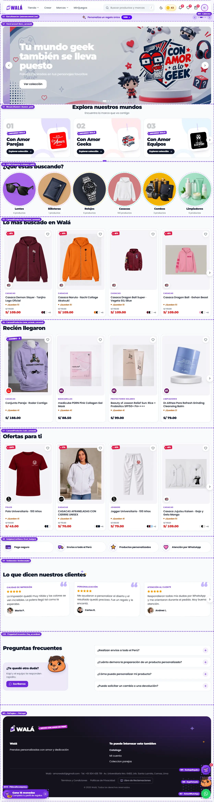
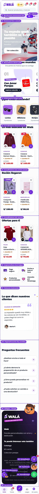
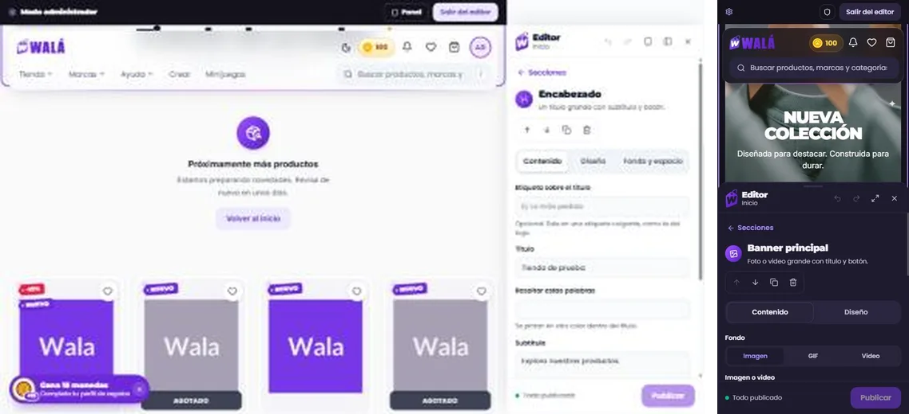
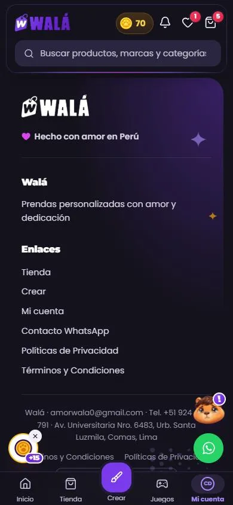

# Inicio (`/`): qué componente va en cada parte

Cómo verlo en vivo: `npm run dev` → http://localhost:3000/componentes.html →
**Páginas** → **Tienda de prueba** → enciende **Ver componentes**. Cada parte
lleva el mismo número que aquí (M = marco, igual en todas las páginas;
S = sección del builder, en el orden de `pages/home`). Con **Ver como**
cambias entre visitante, con sesión y admin; con los chips aparecen los avisos
y ventanas que no siempre están.

| Escritorio | Celular |
|---|---|
|  |  |

Revisado el 2026-10-13 contra wala.pe, `pages/home` y `pages/footer`.

## Marco (M): lo que rodea a las secciones

Se arma con `MarcoTienda` (`paginas/Paginas.jsx`). Es el mismo en el inicio,
el carrito y Mis pedidos.

| # | Parte | Componente | Piezas que usa | Diseño en | Datos (en la tienda) | Quién lo ve |
|---|---|---|---|---|---|---|
| M1 | Aviso del sistema (franja arriba) | `AvisoSistema` | — | `piezas/Marco.module.css` | `configuracion/estado_app` | todos, si está activo |
| M2 | Banner "Walá App" | `BannerApp` | ícono de la app en el violeta de la cabecera (`public/assets/marca/app-icono.webp`), `Boton` | `piezas/Marco.module.css` | — | celular web, no en la app |
| M3 | Barra de admin | `BarraAdmin` | `Boton`, `Enlace` | `piezas/Marco.module.css` | `isAdmin` (AuthContext) | admins. En el celular "Panel" queda como botón con escudo: es el acceso al panel (la barra inferior no lleva pestaña Admin) |
| M4 | Cabecera | `Cabecera` | `Logo`, `Desplegable`, `MenuTienda`, `MenuMarcas`, `SaldoMonedas` + `AyudaMonedas`, `ListaNotificaciones`, `VistaFavoritos`, `VistaCarrito`, `MenuCuenta`, `Buscador`, `BotonTema`, `Boton`, `Contador` | `Navegacion.module.css` (+ `MenusCabecera.module.css`) | enlaces: `storeConfig/homePage.header.navLinks`; categorías y marcas; AuthContext, CartContext, WishlistContext, NotificationsContext | todos (monedas y campana con sesión; la cuenta fuera del celular y de la app). Ancha en una fila; en la tablet (hasta 1100 px) dos filas: logo y accesos arriba, enlaces y buscador abajo |
| M5 | Pie | `PiePagina` (`MarcoPie` + `ColumnasPie`, `TextoPie`, `ImagenPie`) + `PieLegal` | `LogoWala`, `Garabatos`, `Corazon`, `Enlace` | `piezas/Pie.module.css` y `piezas/Marco.module.css` (`.legal…`) | columnas: `pages/footer`; contacto: `config/empresa.js` | todos (no en la app) |
| M6 | Barra inferior | `BarraInferior` (siempre 5 pestañas, "Crear" al centro; en "Mi cuenta" las iniciales o la foto en un aro del mismo trazo que los íconos) | `Enlace`, `Avatar`, `Contador` | `BarraInferior.module.css` (`.barra`, `.tab…`; en su propio archivo desde el 2026-10-19) | ruta actual, AuthContext | celular (hasta 768 px) |
| M7 | WhatsApp flotante | `BotonWhatsApp` (dentro de `PilaFlotante`) | `Enlace` | `piezas/Flotantes.module.css` | Firestore `messages` (número por zona) | todos (no admin, checkout ni landings) |
| M8 | Kapi | `KapiFlotante` (abre `VentanaKapi`, ficha en [KAPI.md](KAPI.md)) | `CARAS_KAPI` | `piezas/Flotantes.module.css`, `piezas/VentanaKapi.module.css` | perfil (`kapiDesdePerfil`: comida del día, felicidad, tutorial) | con sesión |
| M9 | (retirada) | — | — | — | La burbuja de regalos sugeridos se quitó el 2026-10-15: ya no tenía uso | — |
| M10 | "Gana 15 monedas" | `PildoraRecompensa` | `IconoWala` (moneda), `Enlace` | `piezas/Flotantes.module.css` | perfil sin encuesta | con sesión. Sello blanco con aro dorado y "+15" |
| M11 | Anuncio de campaña | `VentanaCampana` (`formato: 'imagen'`, como la tienda: solo la imagen, que es el botón, y una X; tocar afuera cierra) o `'tarjeta'` | `EtiquetaColgante`, `Boton`, `HojaInferior` (solo en tarjeta) | `piezas/Marco.module.css` (`.anuncio…`) | `storeConfig/popups` (las reglas siguen en la tienda) | según reglas |
| M12 | Sugerencia de idioma | `AvisoIdioma` | `Boton` | `piezas/Marco.module.css` | idioma del navegador | una vez, si no es español |

## Secciones (S): las de `pages/home`, en orden

Se dibujan con `PaginaTienda` → `RenderSecciones`. Cada una va dentro de
`BloqueSeccion` (relleno y fondo iguales en todas) y casi todas empiezan con
`TituloSeccion`. Los campos son los que el editor guarda en `settings`.

| # | Parte | `type` | Componente | Piezas que usa | Diseño en | Datos | Campos del editor |
|---|---|---|---|---|---|---|---|
| S1 | Barra de anuncios | `announcement_bar` | `BarraAnuncios` | `IconoWala`, `Marquesina`, `Enlace` | `Secciones.module.css` (`.anuncios…`) | settings | messages (text, link, icon), animationType, speed, variant, bgColor, textColor |
| S2 | Carrusel principal | `hero_carousel` | `HeroCarrusel` | `Carrusel`, `Boton` | `Secciones.module.css` (`.hero…`) | settings | slides (imageUrl, mobileImageUrl, title, subtitle, buttonText, buttonLink), autoPlaySpeed, heightDesktop, heightMobile |
| S3 | "Explora nuestros mundos" | `banner_grid` (`dataSource: 'brands'`) | `MosaicoBanners` | `TituloSeccion`, `Carrusel`, `TarjetaMarca` (`EtiquetaColgante`, `LogoMarca`) | `SeccionesContenido.module.css` + `piezas/TarjetaMarca.module.css` | `tienda_brands` | title, subtitle, columns, brandCardStyle (editorial = de color · uniform = todas violeta · outline = con borde), showBrandName, autoPlay |
| S4 | "¿Qué estás buscando?" | `category_grid` (`cardStyle: 'round'`) | `GrillaCategorias` | `TituloSeccion`, `TarjetaCategoria` (cuadro: cantidad en etiqueta colgante · círculo: aro punteado) | `Secciones.module.css` (`.categorias`) + `piezas/TarjetaCategoria.module.css` | categorías con productos, orden del admin | dataSource (sin valor = a mano), sortMode (admin · más productos · alfabético), limit (solo automático), imageSource (producto · categoría), columns (se ajusta si hay menos), cardStyle (compact = cuadros · round = círculos), showProductCount |
| S5 | "Lo más buscado en Walá" | `featured_carousel` | `CarruselProductos` | `TituloSeccion`, `Carrusel`, `TarjetaProducto` | `TarjetaProducto.module.css` | productos con `featured`, por `featuredOrder` | eyebrow, title, visibleItems, autoPlay |
| S6 | "Recién llegaron" | `new_arrivals_carousel` | `CarruselProductos` | igual que S5 | `TarjetaProducto.module.css` | los más nuevos | igual que S5 |
| S7 | "Ofertas para ti" | `sale_carousel` | `CarruselProductos` | igual que S5 | `TarjetaProducto.module.css` | con `salePrice` | igual que S5 |
| S8 | Íconos de confianza | `trust_badges` | `InsigniasConfianza` | `Beneficio`, `IconoWala` | `piezas/Beneficio.module.css` | settings | badges (text, icon) |
| S9 | "Lo que dicen nuestros clientes" | `testimonials` | `Testimonios` | `TituloSeccion`, `Carrusel`, `TarjetaTestimonio` | `piezas/TarjetaTestimonio.module.css` | settings | title, testimonials (text, author, topic, rating, avatar, verified) |
| S10 | "Preguntas frecuentes" | `faq_accordion` | `PreguntasFrecuentes` | `TituloSeccion`, `Acordeon`, `TarjetaAyuda` (Kapi asomado) | `Secciones.module.css` (`.faq…`), `Acordeon.module.css`, `piezas/TarjetaAyuda.module.css` | settings; el botón "Escríbenos" usa el WhatsApp de la tienda (`contacto` por `propsPara`) | title, items (question, answer), layout, defaultOpen |

**Distancias entre secciones:** las pone el builder (espacio arriba y abajo
de cada sección, `paddingTop` / `paddingBottom`), pero nunca bajan de
`--seccion-min` (1 a 1.5rem según el ancho): si el builder guarda `0`, manda
el mínimo, y si guarda más, manda el builder. Así dos secciones nunca quedan
pegadas (los componentes viejos traían ese aire por dentro). La única que va
pegada a propósito es la barra de anuncios (S1).

Qué lista de productos va en S5, S6 y S7 lo decide `productosDeSeccion`
(`paginas/Paginas.jsx`), con la misma regla que TiendaPage.

**Título de las secciones (`TituloSeccion`):** todas las que llevan título
entienden los campos de estilo del editor: `titleAlign` (izquierda · centro ·
derecha), `titleUnderline` (trazo a mano), `titleBg` (resaltado), `titleLink`
(el título lleva a una ruta, con flecha), `eyebrow` (etiqueta colgante) y el
botón `buttonText` / `buttonLink` con sus colores si el editor los fijó.

## Para cambiar el diseño rápido: qué se repite

Cambiar una pieza cambia todas las partes que la usan. Antes de tocar, mira
esta tabla:

| Pieza | Aparece en | Archivo |
|---|---|---|
| `TarjetaProducto` | S5, S6, S7, "También te puede gustar" del carrito | `TarjetaProducto.module.css` |
| `TituloSeccion` | S3, S4, S5, S6, S7, S9, S10 | `Seccion.module.css` |
| `BloqueSeccion` (relleno y fondo) | todas las S | `Seccion.module.css` (`--seccion-min`) |
| `Carrusel` (flechas, puntos) | S2, S3, S5, S6, S7, S9 | `Carrusel.module.css` |
| `EtiquetaColgante` | descuentos y "Nuevo" de S5-S7, "Universo Walá" de S3, antetítulos, M11 | `Marca.module.css` |
| `Boton` | M2, M3, M4, M11, M12, S2, carrito, Mis pedidos | `Boton.module.css` |
| `IconoWala` | S1, S8, M10 | `IconosWala.jsx` (dibujos) + `IconosWala.module.css` |
| `FotoProducto` (escenario + `multiply`) | M4 (menús de tienda, favoritos y carrito; notificaciones), toasts, "Agregar rápido", piezas de un combo en S5-S7, carrito, Mis pedidos. Fuera del inicio: burbujas de `categories_nav`, polaroid de `feature_list`, `TarjetaDestacado` | `piezas/FotoProducto.module.css`; el color, `--escenario-foto` en `tokens.css` (también lo usan la foto grande de `TarjetaProducto` y el fondo vacío de los cuadros de S4) |
| `LogoMarca` `sello` | sello de la marca en S5-S7 y menú Marcas de M4 | `piezas/LogoMarca.module.css` (`.sello`) |
| `Avatar` | M4 (botón y menú de la cuenta), M6 (pestaña Cuenta), S9 (testimonios) | `piezas/Avatar.module.css` |
| `Moneda` | M4 (saldo y Mis monedas), costo y ganancia en monedas, resumen del carrito | `Etiquetas.jsx` |
| Colores, radios, sombras | todo | `src/styles/variables.css`, `src/theme/tokens.css` |
| Letra del logo (`--fuente-marca`) | títulos, precios, marcas | `Marca.module.css` / variables |

Reglas que no hay que romper al cambiar algo (ver `README.md` del kit):
botones violeta lisos, brillo solo al interactuar, fotos de producto con
`FotoProducto` (escenario `--escenario-foto` con `multiply`, nunca color
detrás; en noche baja a `#e9e7f0`), modo claro y noche, nada de emojis (usar
`IconoWala`), y probar en celular (390 px).

## El editor en el celular

Viendo como Admin → "Editar esta página":

1. El editor sube como **hoja inferior** (la mitad baja); la página sigue a
   la vista arriba y se puede desplazar.
2. Se toca una sección en la página (o en la lista) y la página la deja
   arriba, visible sobre la hoja; la hoja muestra su formulario con las
   pestañas Contenido · Diseño · Fondo y espacio.
3. Cada cambio se ve al instante en la página de arriba ("Cambios sin
   publicar" hasta tocar **Publicar**).
4. El botón de flechas agranda la hoja casi a pantalla completa (para
   formularios largos) y la vuelve a achicar; deslizarla no cierra nada.
5. Mientras se edita se esconden los flotantes (WhatsApp, Kapi,
   monedas) para que no tapen el panel. En el celular no aparece el botón
   "ver en celular/escritorio" (ya estás en uno).

Es el mismo `PanelEditor`: en la tienda va fijo a la pantalla; en la demo,
dentro del marco (`incrustado`). Diseño en `editor/Editor.module.css`.

## Llevar a la tienda (a futuro: TODAVÍA NO se hace)

Plan para cuando se decida pasar el inicio real (`/`) a este diseño. Hoy la
tienda sigue con sus componentes; esto es solo la hoja de ruta. Mantenerla al
día si cambia un componente del kit o su forma de recibir datos.

**El marco ya está en la tienda (paso 2, 2026-10-16):** M1 `AvisoSistema`,
M2 `BannerApp`, M3 `BarraAdmin`, M7-M10 la pila de flotantes (WhatsApp, Kapi
y la píldora), M11 `VentanaCampana`, M12 `AvisoIdioma` y el pie legal. Cada
uno con su conector en `src/components/marco/` (lee lo de la tienda y dibuja
la pieza); lo viejo queda en su sitio hasta el final
([ELIMINAR.md](ELIMINAR.md)). Después pasaron la barra inferior y la
cabecera (paso 7, 2026-10-19) y las columnas del pie (2026-10-20, ver "El
pie en la tienda" al final): el marco entero está en el kit.

### Reemplazos

| Parte | Hoy en la tienda | Pasa a (kit) |
|---|---|---|
| Secciones (S1-S10) | `pages/Tienda/TiendaPage.jsx`: `renderSection` (switch desde ~914) + el bucle de ~1504 | `PaginaTienda` / `RenderSecciones` con `respaldo` para lo que no está en el kit |
| Tarjeta de producto | `PremiumProductCard` (carruseles), `ProductCard` (grillas) | `TarjetaProducto` + `tarjetaDesdeProducto` |
| Cabecera (M4) | `components/common/Header/Header.jsx` (+ `HeaderSearch`, `NotificationTray`, `ThemeToggle`) | `Cabecera` + menús de `MenusCabecera` (✓ 2026-10-19, `components/marco/CabeceraDeTienda.jsx`) |
| Barra inferior (M6) | `components/common/BottomNav/BottomNav.jsx` | `BarraInferior` (✓ 2026-10-19, `components/marco/BarraInferiorDeTienda.jsx`) |
| Pie (M5) | `components/common/Footer/Footer.jsx` | ✓ `MarcoPie` y sus bloques + `PieLegal` (`components/marco/PieDeTienda.jsx`, 2026-10-20) |
| Barra de admin (M3) | `components/common/AdminBar/AdminBar.jsx` | `BarraAdmin` |
| Aviso del sistema (M1) | `components/common/SystemAlert` | `AvisoSistema` |
| Banner de la app (M2) | `pages/Tienda/components/AppDownloadBanner.jsx` | `BannerApp` |
| Flotantes (M7-M10) | `WhatsAppButton`, `KapiPet` (solo el botón), `PackageBubble` (retirada el 2026-10-15, sin equivalente en el kit), píldora de la encuesta en `Header.jsx` ~1333-1359, `.floating-action-stack` de `App.jsx` | `PilaFlotante` + `BotonWhatsApp`, `KapiFlotante`, `PildoraRecompensa` (la ventana de Kapi ya está en el kit: `VentanaKapi`, ver KAPI.md) |
| Anuncio de campaña (M11) | `components/common/CampaignPopup/PopupCard.jsx` | `VentanaCampana` (las reglas de `services/popupsLogic.mjs` se quedan) |
| Idioma (M12) | `components/i18n/LanguagePopup.jsx` | `AvisoIdioma` |
| Editor | `VisualEditorPanel`, `EditableSection`, `ModuleInserter` | `PanelEditor`, `SeccionEditable`, `InsertarAqui`, `useBorrador` (✓ 2026-10-19, `components/constructor/`) |
| Toasts | ya hecho: `contexts/ToastContext.jsx` usa `ProveedorToasts` | — |

### De dónde sale cada dato

| Prop del kit | En la tienda |
|---|---|
| `secciones` | `loadStorefrontPage('home')` / `getStorefrontConfig` (`pages/home`), ya en React Query (`storefront-config`) |
| `productos.destacados` | `getFeaturedProducts(marca)` (query `featured-products`) |
| `productos.nuevos` | `getStoreProductsPage({ sort: 'newest', pageSize: 12 })` (como `ProductQueryCarousel`) |
| `productos.ofertas` | `getOnSaleProducts(marca)` |
| `productos.porCategoria` / `porColeccion` | las mismas consultas de `ProductQueryCarousel` / `CollectionCarousel` |
| `categorias` | `getCategories()` + cuenta de productos (lo que hoy arma `automaticCategoryProducts`, ~450) |
| `marcas` | `getBrands()` (hoy `automaticGridBrands`, ~365) |
| imagen de cada tarjeta | `useProductThumbnailVariant(product)` (miniatura elegida y `recordImpression`) |
| `cabecera.usuario`, `monedas`, `onCerrarSesion` | `AuthContext` (`user`, `userProfile`, `activeMainCoins`) |
| `cabecera.carrito`, `barraInferior.carrito` | `CartContext` (items seleccionados) |
| `cabecera.favoritos` | `WishlistContext` |
| `cabecera.notificaciones` | `NotificationsContext` (`users/{uid}/notifications`) |
| `cabecera.enlaces`, textos de menús | `storeConfig/homePage` (`header.navLinks`, `accountPopup`, `favoritesPopup`) |
| `menuTienda`, `menuMarcas` | `getCategories` (con productos) y `getBrands` (visibles); en `menuMarcas`, `limite: 6` y `activa: brandActual?.id` |
| `gruposCuenta` | `useCuentaNavGroups` filtrado por `ACCESOS_RAPIDOS_HEADER` (`Header.jsx` ~54) |
| `pie` | `getStorefrontConfig('footer')` (`pages/footer`) |
| `pieLegal.empresa` | `config/empresa.js` |
| `BotonWhatsApp.numero` | Firestore `messages` (`whatsapp_number_tienda`…), marca y producto como hoy |
| `PildoraRecompensa` | `userProfile.hasCompletedSurvey` y `surveyFabHiddenUntil` (3 días) |
| `AvisoSistema` | `configuracion/estado_app` en tiempo real |
| `onAgregar` | `CartContext.addToCart`; "elegir" abre `AgregarRapido` con `opcionesDeProducto` |
| `contacto` de Preguntas frecuentes (`propsPara`) | el mismo número de WhatsApp de la zona |

### Comportamiento que no se puede perder

- **Carga:** `DeferredSection` (las secciones de abajo se cargan al acercarse), `BrandLoaderOverlay` hasta que el hero está listo, y el `prefetchQuery` de `index.jsx`.
- **Excepciones:** ninguna. Las de la landing del reloj K-CHERO (`isKcheroLanding`, `conversion_fold`, `landing_payment`) se fueron con ella el 2026-10-19.
- **Visibilidad:** quién ve cada parte (columna "Quién lo ve" del Marco): sesión, admin, rutas sin WhatsApp (admin, checkout, landings), Capacitor sin pie ni banner de app, landings sin cabecera (`LayoutContext`).
- **Página de marca:** `pageBrandId` acota productos y oculta el sello de la marca (`catalogo.marcaActual`).
- **Analítica:** `recordImpression` de las miniaturas, `trackAddToCart` (ya en `CartContext`), eventos de popups.
- **Traducción:** la tienda envuelve los textos en `<T>` y el kit no traduce. Hay que pasar los textos ya traducidos o agregar un proveedor de traducción.
- **Edición:** `VisualEditorContext` (borrador, `isEditModeActive`), `CustomFontsInjector`.
- **App:** safe areas, botón atrás que cierra hojas, `DeepLinkHandler`.

### Diferencias a propósito (no "corregirlas" al migrar)

- Barra inferior siempre de 5 pestañas, sin "Admin": el panel se abre desde `BarraAdmin`
  (en el celular, el botón del escudo).
- Barra inferior: sin el "?" de la sesión anónima (las landings la abren):
  el ícono de persona, como sin sesión; sin número en "Tienda" (el carrito ya
  lo tiene en la cabecera); los textos no se esconden por debajo de 380 px
  (caben en 320).
- "¡Quedan N!" solo con 10 unidades o menos (hoy dice "N disponibles" en todos).
- Sin puntuación ni reseñas inventadas (`ProductCard.jsx:169`): solo si hay reseñas reales.
- Píldora de la encuesta con moneda (no regalo).
- Distancia mínima entre secciones aunque el builder guarde 0.
- Anuncio de campaña de solo imagen, centrado también en el celular.
- Ícono del banner de la app en el violeta de la cabecera.
- Menú Marcas: 6 marcas con su logo y "Ver N marcas más" las abre en el mismo
  menú (hoy son 5 y "Ver todas las marcas" abre un panel al costado que solo
  sale al pasar el ratón: en el celular y con teclado no funcionaba). No hay
  enlace a `/marcas` porque esa página pública no existe.
- **En la app (Capacitor) la cabecera lleva el logo de Walá, como en la web.**
  Hoy la tienda cambia el logo por una casita (`Header.jsx`, `isNativeApp` →
  `nativeBackBtn` con el ícono `Home`, desde mayo de 2026). Se decidió el
  2026-10-16 dejar el logo: el inicio ya está en la barra inferior
  ("Inicio") y la casita repetía ese acceso sin la marca. Al migrar no se
  agrega una casita a `Cabecera`. Lo demás de la app sí se mantiene: sin pie,
  sin el banner de descargar la app y sin `BarraAdmin` en la tienda.
- El menú Tienda solo lleva categorías (las marcas tienen su menú).
- Editor: sin el modo flotante que se arrastraba (a un lado en escritorio, en
  una hoja abajo en el celular) y la página se corre para que el panel no la
  tape; eliminar se confirma en el mismo botón; avisos en vez de `alert`.
- Editor: no se pasan los formularios que nadie abría (`heroBanner`,
  `layout`), "Nuestras marcas" del menú de cuenta (nadie las dibujaba) ni el
  color, la letra, la negrita y la cursiva de los enlaces del menú y del
  texto de favoritos (la cabecera nueva no los usa).
- Editor: el menú de la cabecera ahora también puede ser "con las marcas de
  la tienda" (`isBrandAuto`, que la cabecera ya entendía).
- Editor: el pie solo ofrece columnas, texto e imagen (lo que dibuja) y, si
  no tiene nada guardado, empieza con sus columnas de siempre. La columna
  "Redes" no se ofrece hasta migrar el pie.
- Cabecera: los enlaces sin el color, la letra, la negrita ni la cursiva que
  les ponía el admin (decidido el 2026-10-19: todos con la letra y el violeta
  de la marca). El editor todavía deja elegirlos; no se ven.
- Cabecera: la sesión anónima (la de las landings) se ve como sin sesión:
  sin monedas, sin campana y con el menú para entrar (antes, un "?" y un
  saldo de 0).
- Cabecera en la tablet (761-1100 px): dos filas. Antes los íconos de la
  derecha (campana, carrito, cuenta) se salían de la pantalla.
- Cabecera: el buscador es un campo siempre a la vista (antes, una lupa en
  escritorio), con el panel debajo; en el celular, una hoja (BUSCAR.md).
- Cabecera: los textos del menú de favoritos que edita el admin se ven
  también guardados (antes solo en el borrador del editor).

### Qué le falta al kit antes de migrar

- ✓ `TarjetaProducto`: la impresión (`onVisible`), el favorito con `WishlistContext`, el recorte del admin, el fondo de la marca y la precarga de la ficha (paso 4, 2026-10-16).
- ✓ `Cabecera`: selector de idioma en `MenuCuenta`, aviso para activar notificaciones push, el buscador con sugerencias (2026-10-19).
- ✓ Traducción: `ProveedorTraduccion` ya está en `App.jsx` y los textos fijos del marco pasan por `useTexto`. Falta hacer lo mismo con los de las secciones y la cabecera al migrarlas.
- `imageSource: 'product'` de las categorías: la página debe pasar `imagenProducto`.
- La `TrustBadges` vieja no entiende los íconos nuevos del editor del kit (`camion`, `escudo`…): mientras convivan, usar `iconoDesde`.

### Pasos (cada uno se verifica solo y se puede volver atrás)

Siguen el orden común de [MIGRACION.md](MIGRACION.md); aquí, lo que le toca
al inicio.

1. ✓ Marco: `BarraAdmin`, `AvisoSistema`, `BannerApp`, flotantes, `PieLegal` (2026-10-16, un commit por pieza). Al migrar, el kit ganó `BarraAdmin` `fija` y `editarEn`, `BannerApp` `onAccion`, `AvisoIdioma` `flotante`, `VentanaCampana` `textoCerrar`, `PilaFlotante` `ocultarEnCelular` y los adaptadores `avisoDesdeEstadoApp`, `numeroWhatsApp`, `campanaDesdePopup` y `pieLegalDesdeEmpresa`.
2. ✓ `TarjetaProducto` en los carruseles (`TarjetaDeProducto`, 2026-10-16).
3. ✓ Secciones del inicio (2026-10-16): `SeccionDelKit` por cada una dentro del bucle de `TiendaPage`, conservando `DeferredSection`, el editor y las excepciones; datos de las mismas consultas (`featured-products`, `query-carousel`, `brands`, `categories` + `storefront-category-grid-products` con `categoriasDeGrilla`); preguntas frecuentes con el WhatsApp de `useWhatsAppDeLaRuta` y sin Kapi cuando está el flotante. Interruptor `seccionesViejo`.
4. ✓ `BarraInferior` (2026-10-19) y ✓ `Cabecera` (2026-10-19, ver abajo).
   `components/marco/BarraInferiorDeTienda.jsx` la monta en todas las
   páginas con las mismas reglas que `BottomNav`: solo hasta 768 px, fija
   abajo, 56 px (`--bottom-nav-height`) más la zona segura; no sale si la
   página la apaga (landings con "sin pie", el editor visual), en el estudio
   (`/crear/…`) ni en el editor viejo (`/editor`). La pestaña activa sale de
   la ruta: Inicio, Tienda, Crear y Juegos exactas, "Mi cuenta" con todo
   `/cuenta/…`; en otra página (la ficha, el carrito), ninguna. Interruptor
   `barraVieja`.

   

   Al migrarla, el kit ganó: la barra en su propio archivo
   (`BarraInferior.jsx`, Navegacion.jsx la sigue exportando: la tienda la
   carga sin la cabecera), el alto de la tienda (`--bottom-nav-height` en vez
   de 64 px fijos), los textos por la traducción, `activo={null}` = ninguna
   pestaña, el ícono de persona dentro del aro si la cuenta no tiene nombre ni
   foto, el foco con teclado dentro de la pestaña y sin rebote con
   "reducir movimiento".

   **La cabecera:** `components/marco/CabeceraDeTienda.jsx` reemplaza a
   `Header` con los mismos datos y reglas: el menú de
   `storeConfig/homePage` (el borrador del editor si se edita; mientras
   llega, la copia del navegador) más "Minijuegos"; "Tienda" con las
   categorías que tienen productos, pedidas al abrir el menú (en la página de
   una marca, las suyas y "Ver todo" a la marca); "Marcas" con 6 y "Ver N
   más"; los desplegables del admin y los de colección como menús de
   enlaces; monedas (la píldora vacía mientras llega el perfil, "–" a los
   4 s), notificaciones (10, "Marcar leídas", abrir sigue su enlace, invitar
   a los avisos), favoritos y carrito ("Ir a pagar" al carrito, barra del
   envío gratis); la cuenta con los 6 accesos, la encuesta, "Ver toda mi
   cuenta" y cerrar sesión; sin sesión, los textos del admin, volver a la
   página después de entrar y el idioma. Buscar acotado a la marca de la
   página, con `trackSearchQuery` y el mismo historial. Pegada arriba bajo
   la barra de admin, publica su alto (`--header-height`, en todos los
   anchos: en la tablet tiene dos filas), las fuentes propias de la página
   (`CustomFontsInjector`) y la caja "Menú de Navegación" del editor.
   Interruptor `cabeceraVieja`. El archivo principal pesa menos que antes
   (JS 652 KB y CSS 262 KB, antes 661 y 291): la cabecera vieja y su
   buscador salen de él y los menús del kit llegan aparte.

   

   Al migrarla, el kit ganó lo que se lista en MIGRACION.md (paso 7) y en el
   README del kit (`Navegacion.jsx`, `MenusCabecera.jsx`).
5. ✓ Editor del kit en lugar de `VisualEditorPanel` (2026-10-19, en cuatro
   commits, interruptor `editorViejo`).

   

   - **El panel** (`components/constructor/EditorDeTienda.jsx`): lee y
     escribe el mismo borrador que antes (`VisualEditorContext`, ahora con
     deshacer y rehacer y "sin publicar"), así la página, la cabecera y el pie
     dibujan cada cambio al instante. Publicar guarda igual que antes: página
     bloqueada, `storeConfig/homePage` + las secciones, la copia en
     `storeConfigLogs` y la caché; avisa con un toast.
   - **Los datos de los selectores** son los de antes: colecciones, marcas y,
     en la página de una marca, solo las categorías que usan sus productos.
     Las burbujas de una marca se editan con `CategoryNavEditor` dentro del
     panel.
   - **Toda la tienda** (en el inicio y `/tienda`): el menú de la cabecera,
     el menú de cuenta, el de favoritos, los textos de `/buscar` y el pie
     (el panel pasa a editarlo y vuelve con "Volver a la página").
   - **En la página** (`MarcasDeEdicion`, llega con el editor): el marco de
     cada sección con su barra (subir, bajar, duplicar) y el "+" entre
     secciones, que abre el catálogo del panel en ese lugar. Lo global
     (menú, buscador, cuenta) usa el mismo marco con su nombre.
   - **Landings** (pestaña "Página"): el tema y ocultar la cabecera o el pie;
     se guardan al momento en la landing, con su marca.
   - **K-CHERO** (el cacherito): sus landings, sus dos bloques y sus
     formularios se retiraron el 2026-10-19.
   - "Salir del editor" (en la barra de admin y en el panel) pregunta si hay
     cambios sin publicar; antes los perdía sin avisar.

Para volver atrás: cada paso en su propio commit, y el componente viejo no se borra hasta que el nuevo lleve un tiempo en producción.

## Datos del ejemplo

`demo/inicio.json` es una copia de solo lectura de `pages/home`,
`pages/footer`, 10 destacados, 10 recientes, 10 ofertas y las categorías con
productos (con su cuenta). `demo/marcas.json` son las marcas de
`tienda_brands`. Se pueden volver a copiar con la API pública de Firestore; la
demo no lee Firestore.

## Cómo rehacer las imágenes

Con el servidor de desarrollo corriendo, abre la Tienda de prueba, elige
"Con sesión", enciende "Ver componentes" y captura el lienzo completo
(escritorio 1366 px y celular 390 px).

## El pie en la tienda (M5, 2026-10-20)

| Celular, oscuro (con sesión: Kapi flota) | Celular, claro | Sin sesión (Kapi en el pie) |
|---|---|---|
|  |  |  |

`components/common/Footer/Footer.jsx` monta `components/marco/PieDeTienda.jsx`;
lo de antes (`FooterViejo.jsx`, la franja gris con la línea roja) baja solo
con el interruptor `pieViejo` (`useLoViejo('pie')`: en Firestore
`pieViejo: true`; en localStorage, `"pie"`) o con `editorViejo` (su editor
dibuja dentro de ese pie).

**El kit.** `PiePagina` salió de `SeccionesExtra.jsx` a `piezas/Pie.jsx` (con
su CSS): el pie ya no le suma a cada página el código de las secciones (el
catálogo, los filtros), y no entra al archivo principal: la sección
`footer_columns` del builder lo carga al usarse (`Secciones.jsx`) y la demo
lo toma de `piezas/Pie`. Se arma por partes: `MarcoPie` (la tarjeta
noche, los garabatos, el logo, Kapi y la franja legal) recibe los bloques,
`ColumnasPie` (texto, enlaces y redes), `TextoPie` e `ImagenPie` (los
bloques `text` e `image` que el pie de la tienda ya admitía). Todo pasa por
la traducción.

**Lo mismo que antes:** lo que guarda el builder en `pages/footer` (10 min en
caché), las columnas de siempre si no hay nada guardado
(`components/marco/columnasDelPie.js`, también la base del editor), no sale
si la página lo apaga, en la app ni en el estudio; el editor del kit con
"Editar el pie de página", "Estás editando el pie…", el "+" entre bloques y
cada bloque con su `EditableSection`; `#site-footer` (el editor baja hasta
él) y, en el celular, el lugar de la barra inferior.

**Diferencias a propósito:**

- Una tarjeta redondeada dentro del ancho de la página (como el kit), en vez
  de la franja de borde a borde con la línea roja.
- "Hecho con amor en Perú" va en texto con un corazón: la etiqueta colgante
  es solo para productos (antes, en la demo, era una etiqueta).
- **Un solo Kapi a la vista.** Kapi se asoma por el pie solo cuando no flota
  el de la esquina (con perfil y fuera de las páginas que lo ocultan,
  `components/marco/kapiFlotante.js`, que ahora comparten los dos), la página
  no termina con Preguntas frecuentes (`LayoutContext.pieSinKapi`, lo pone
  `TiendaPage`) y no trae el suyo (`sinKapiEnPie`: los juegos, regalar,
  privacidad y términos, pagar y Mi cuenta sin sesión). Las páginas que
  muestran a Kapi según su estado (buscar sin resultados, un producto
  retirado) no se ven desde el pie: ahí pueden salir dos.
- El editor del pie ofrece la columna **Redes** (`pieConRedes`).
