# Los juegos por dentro: Palabra del día, Ruleta y Las Bolitas de Kapi

Cómo verlo en vivo: `npm run dev` → http://localhost:3000/componentes.html →
**Páginas** → **Tienda de prueba** → **Un juego**. También se llega desde los
botones de las tarjetas de **Minijuegos**. "Cómo se abre" tiene tres
opciones:

- **Palabra del día** (`/palabra-del-dia`). Estados: ya jugó hoy (ganó), ya
  jugó hoy (perdió), primera vez (la ayuda se abre sola) y cargando. Se juega
  de verdad, con el teclado en pantalla o el de la computadora.
- **Ruleta Semanal** (`/ruleta`). Estados: lista para girar (por defecto),
  racha 4/7, ya giró esta semana, semana perdida, giro pendiente, cerrada y
  cargando. "Girar la ruleta" sortea un premio y la rueda para en su gajo.
- **Las Bolitas de Kapi** (`/ball-sort`). Estados: casi resuelto (gana en 2
  jugadas), ya ganó hoy, primera vez y cargando.

Sin sesión: la palabra se juega igual, pero el premio invita a entrar. La
ruleta pide entrar. Las bolitas se juegan y el premio también invita a
entrar.

| La Palabra del día (escritorio) | La palabra (celular, noche) |
|---|---|
| 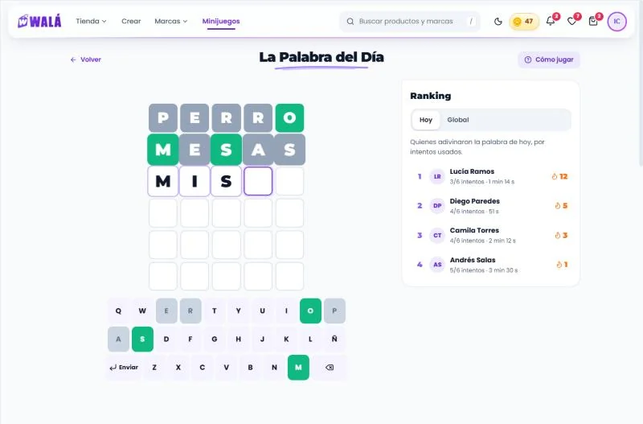 | 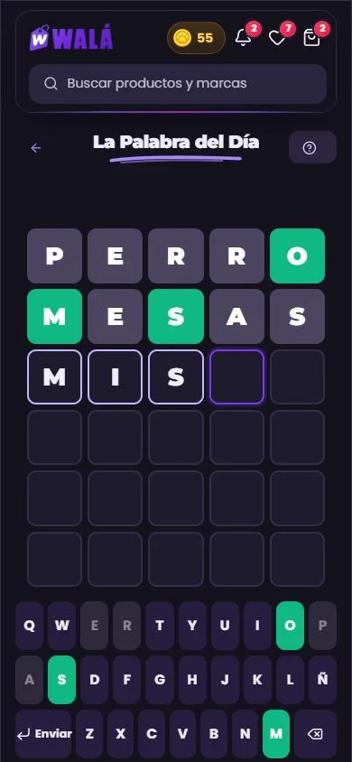 |

| La ruleta (celular, noche) | Su premio | Las bolitas (una levantada) |
|---|---|---|
| 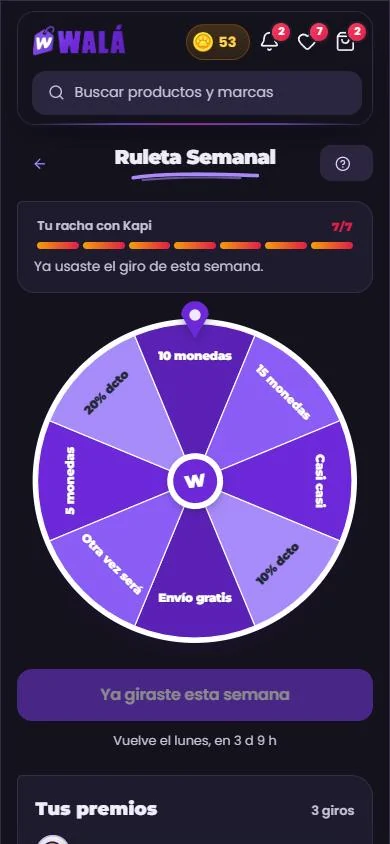 | 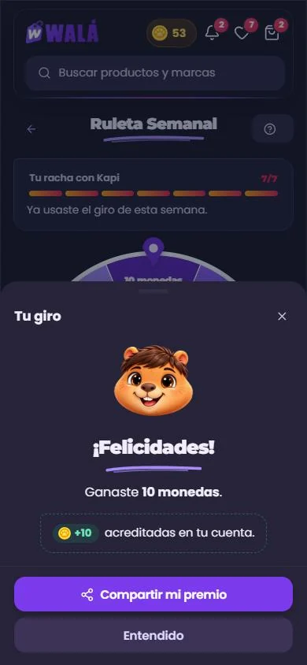 | 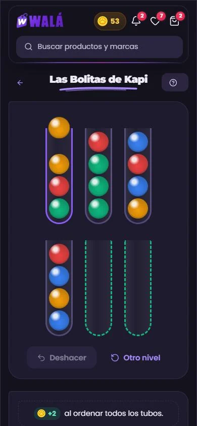 |

Revisado el 2026-10-15 contra estos archivos:

| Juego | Archivo | Líneas |
|---|---|---|
| Palabra del día | `pages/Tienda/WordlePage.jsx` (+ `services/wordle.js`, `data/wordleDictionary.js`) | 803 |
| Ruleta | `pages/Minijuegos/RuletaPage.jsx`, `components/ruleta/RuedaRuleta.jsx`, `utils/ruletaModel.js` | — |
| Bolitas | `pages/Minijuegos/BallSortPage.jsx` | — |
| El marco de los tres | `pages/Minijuegos/ArcadeShell.jsx` | — |

**Qué es real y qué es de ejemplo.**

- **Reales:**
  - La palabra de hoy: la misma cuenta que `getDailyWord`, con la lista de
    `data/wordleDictionary`. Hoy no hay palabra puesta por el admin.
  - El diccionario de la palabra.
  - La rueda: `ruletaConfig/settings` y `ruletaPrizes`, en
    `demo/juegos.json`, con los premios que salen hoy (`premiosDeHoy`).
  - El sorteo usa la misma regla que el servidor (`sortearPremio`).
- **De ejemplo:**
  - el ranking (el real lleva nombres de clientes);
  - las estadísticas;
  - el historial de la ruleta;
  - los códigos de cupón.

  No se guarda nada y las monedas solo suben en la cabecera de la demo.

## Partes

| Parte | Componente | Piezas que usa | Datos (en la tienda) |
|---|---|---|---|
| P20 Lo común | `MarcoJuego`, `AyudaJuego`, `ResultadoJuego`, `PremioJuego`, `CifrasJuego` (nuevas, `piezas/Juegos.jsx`) | `Boton`, `HojaInferior`, `Sello`, `Trazo`, `GananciaMonedas`, `Cargando` | — |
| P20 Palabra del día | `PaginaPalabra` (`paginas/Palabra.jsx`) | `TableroPalabra`, `FichaPalabra`, `TecladoPalabra`, `LeyendaPalabra`, `RankingPalabra` y las reglas `evaluarIntento`, `estadosDeTeclas` y `normalizarPalabra` (nuevas, `piezas/Palabra.jsx`); `Pestanas`, `Avatar`, `CuentaRegresiva` | `getDailyWord`, `VALID_GUESSES`, `getEstadoPartidaDeHoy` + localStorage (`wala_wordle_{fecha}`), `getWordleRankingToday` / `getWordleRanking`, el perfil (`wordlePlayed`…), `saveWordleResult` + `claimWordleRewardSecure` |
| P20 Ruleta | `PaginaRuleta` (`paginas/Ruleta.jsx`) | `RuedaRuleta` y `HistorialRuleta` (nuevas, `piezas/Ruleta.jsx`); `BarraProgreso` (la racha), `CodigoCopiable` (el cupón), `IconoWala` por tipo de premio | `getRuletaBoard` (config, premios, historial), `getRuletaEligibility`, `spinRuletaSecure` |
| P20 Bolitas | `PaginaBolitas` (`paginas/Bolitas.jsx`) | `TuboBolitas` y `Bolita` (`piezas/Bolitas.jsx`); las reglas, los niveles y el solucionador en `piezas/bolitasMotor.mjs` (desde el 2026-10-21; antes `nivelBolitas`, `puedeSoltar`, `moverBolita`…); `Pestanas`, `Estallido`, `BarraProgreso` | `lastBallSortReward`, `claimBallSortRewardSecure`; en el aparato, `wala_bolitas_nivel`, `wala_bolitas_reto`, `wala_bolitas_vistos` |

Esqueletos: `EsqueletoPagina forma="palabra"`, `"ruleta"` y `"bolitas"`
(nuevas, con la medida real en escritorio y en el celular).

`CodigoReclamacion` (del libro de reclamaciones) pasó a ser `CodigoCopiable`,
con `rotulo` y `detalle`. Lo usan la reclamación y el cupón de la ruleta.

### Lo que hace

- **En los tres juegos:**
  - Arriba, "Volver" (a la Zona Arcade), el título con su trazo y "Cómo
    jugar". En el celular, los dos botones quedan solo con su ícono.
  - "Cómo se juega" es una hoja con los pasos numerados en sellos. Se abre
    sola la primera vez (`ayudaVista`).
  - El resultado es otra hoja: Kapi (feliz o triste), el título con su trazo
    y el premio. Mientras se acreditan las monedas, la hoja no se cierra.
  - Kapi no asoma en el pie ni flota: aparece en el resultado.
- **Palabra del día:**
  - Se escribe con el teclado en pantalla (con Ñ y "Enviar") o con el de la
    computadora. Tocar una casilla permite corregirla.
  - Si faltan letras o la palabra no existe, la fila se sacude y sale un
    mensaje que se va solo ("Faltan letras", "Esa palabra no está en el
    diccionario"). No sale un `alert`.
  - Al enviar, cada letra se voltea y muestra su color: verde (en su sitio),
    ámbar (en otro sitio) o gris (no está). El teclado se pinta igual.
  - Al terminar, en lugar del teclado: "Lo lograste en N intentos" o "La
    palabra era X", "Nueva palabra en 9 h 22 min" y "Ver mi resultado".
  - El resultado muestra el premio ("+4 acreditadas. ¡Bonus por acertar
    rápido!"), las cuatro cifras, la cuenta atrás, "Compartir mi resultado" y
    "Ver otros juegos".
  - El ranking va al costado en escritorio y abajo en el celular. Tiene dos
    pestañas, Hoy y Global, y tu fila va marcada.
- **Ruleta:**
  - Arriba de la rueda, la racha con Kapi en 7 pasos y una línea según el
    estado (se completó la semana, es el giro de la semana pasada, se perdió
    un día, ya se usó el giro).
  - La rueda tiene los gajos con el color del admin y el texto con la letra
    de la marca, sin emojis.
  - El centro con la W no gira. El texto del gajo ganador queda derecho al
    parar.
  - El botón: "Girar la ruleta" (brilla cuando está lista), "Girando…", "Ya
    giraste esta semana", "Semana perdida" o "Bloqueada: te faltan 3 días".
    Debajo, "Vuelve el lunes, en 3 d 9 h".
  - El resultado puede tener:
    - las monedas acreditadas;
    - el cupón con "Copiar código" y "Válido hasta el 14 de noviembre";
    - "Nos pondremos en contacto contigo" (premio manual);
    - "Compartir mi premio".
  - Al costado, "Tus premios": cada giro con el ícono de Walá de su tipo y su
    cupón.
- **Bolitas:**
  - Se toca un tubo y su bolita de arriba sube. Los tubos donde sí se puede
    soltar se marcan con un borde verde punteado.
  - Las bolitas viajan de un tubo a otro. Un tubo listo celebra con confeti.
  - "Deshacer" (nuevo) vuelve un paso. "Otro nivel" reparte otra vez.
  - Al costado: "+2 al ordenar todos los tubos" (o "Ya ganaste tus monedas
    hoy"), Movimientos, Tubos listos y su barra en pasos.
  - Al ganar: "¡Nivel completado! Lo resolviste en N movimientos", el
    premio, "Jugar otra vez" y "Ver otros juegos".

## Llevar a la tienda (hecho el 2026-10-19: ver "En la tienda" al final)

### Reemplazos

| Hoy | Pasa a (kit) |
|---|---|
| `ArcadeShell` (barra con "Volver" y `acciones`) | `MarcoJuego` |
| Los modales de ayuda hechos a mano (`createPortal`, `.ayudaCard`) | `AyudaJuego` |
| Los modales de resultado (`.resultCard`, `.winCard`, el de la ruleta con framer) | `ResultadoJuego` + `PremioJuego` + `CifrasJuego` |
| `WordlePage` (tablero, teclado, ranking) | `PaginaPalabra` |
| `RuletaPage` + `components/ruleta/RuedaRuleta` | `PaginaRuleta` + `RuedaRuleta` (del kit) |
| `BallSortPage` (tubos con framer, `TubeConfetti`) | `PaginaBolitas` + `TuboBolitas` (`Estallido`) |

**Lo que no cambia:**

- Todo lo del servidor: `claimWordleRewardSecure`, `spinRuletaSecure`,
  `getRuletaBoard` y `claimBallSortRewardSecure`, con sus reglas y sus
  textos de error.
- `saveWordleResult` y las rachas.
- `volarMonedasGanadas` y `useEntregaMonedas`: la página espera a
  `coins-animation-end` antes de dar por cobrado.
- `trackMinigame` (start / complete).
- Las claves de localStorage.
- La vista previa del admin de la ruleta, que puede pasar a usar la
  `RuedaRuleta` del kit (es solo presentación).

### De dónde sale cada dato

- **Palabra:**
  - `objetivo`: `getDailyWord(limaTodayStr())`.
  - `esValida(p)`: `VALID_GUESSES.has(p)`.
  - `inicial.filas`: `wala_wordle_{fecha}.guesses`. Si
    `getEstadoPartidaDeHoy()` dice `'jugada'` y no hay tablero guardado,
    `inicial.terminada` = `{ gano, intentos, palabra }`.
  - `estadisticas`: `wordlePlayed`, `wordleWins`, `wordleCurrentStreak` y
    `wordleMaxStreak` del perfil.
  - `ranking.hoy` y `ranking.global`: las dos consultas, con `yo` en la fila
    del uid.
  - `hasta`: `Date.now() + msHastaMananaLima()`.
  - `onTerminar`: `saveWordleResult` y, si ganó, `claimWordleReward()`.
    Devuelve `{ monto: reward, rapido }`, `{ ya: true }` si `alreadyClaimed`,
    o `null`.
  - `ayudaVista`: `wala_wordle_ayuda_vista`.
- **Ruleta:**
  - De `getRuletaBoard()`:
    - `premios`: los premios, con `texto: textoPremio(p)`;
    - `tema` y `reglas`: `config` (`normalizarConfig`);
    - `historial`: `historial` → `{ id, tipo, texto, cupon: cuponCode, fecha: fechaCorta }`.
  - `eleccion`: `getRuletaEligibility()`, que devuelve `isUnlocked` →
    `desbloqueada`, `days` → `dias`, `hasSpun` → `girada`, `hasLost` →
    `perdida` y `esPendienteAnterior` → `pendienteAnterior`.
  - `estado`: `'cerrada'` si `!config.activa`; `'preparacion'` si no hay
    premios.
  - `hasta`: `msHastaLunesLima()`.
  - `onGirar`: `spinRuletaSecure` → `{ indice: premios.findIndex(id), premio, cupon: { codigo, vence: expiraEn } }`.
    Las monedas vuelan al terminar el giro.
- **Bolitas:**
  - `yaHoy`: `lastBallSortReward === limaTodayStr()`.
  - `onGanar`: `claimBallSortReward()` → `{ monto: reward }`, o `{ ya: true }`
    si el servidor dice "Ya reclamaste".

### Comportamiento que no se puede perder

- **Palabra:**
  - Un resultado por día. El servidor revisa la palabra y los intentos antes
    de pagar.
  - Si guardar falla, se dice: no entró al ranking ni se acreditaron
    monedas.
  - Escape cierra la ayuda o el resultado.
- **Ruleta:**
  - La rueda para en el gajo que dice el servidor: el orden de los premios
    tiene que ser el mismo (`premiosDeHoy`, por id).
  - Si el premio ganado no está en la rueda cargada, se vuelve a pedir el
    tablero.
  - Con "reducir movimiento", una vuelta en 600 ms.
- **Bolitas:**
  - Se puede seguir jugando después de cobrar, sin prometer premio.
  - Sin sesión hoy se manda al login. En el kit se juega, y el premio invita
    a entrar (ver abajo).

### Diferencias a propósito (no "corregirlas" al migrar)

- **Palabra:**
  - Faltan letras o la palabra no existe: la fila se sacude y sale un aviso
    que se va solo. Hoy no pasa nada, o sale un `alert` que bloquea.
  - Las letras se voltean al revelarse. Hoy aparecen de golpe.
  - La cuenta atrás de la palabra nueva y "Compartir" (sin cuadritos de
    emoji).
  - "Enviar" en vez de "ENTER".
  - El ranking dice "persona" y no "el primero".
- **Ruleta:**
  - La racha se ve en la página (hoy solo en la tarjeta de Minijuegos).
  - Íconos de Walá en vez de emojis (🪙, 🏷️, 🎁, 📦, 🍀) y sin emojis en los
    botones ("✅", "❌", "🔒").
  - El botón bloqueado dice cuántos días faltan.
  - El centro de la rueda no gira, y el premio ganador queda derecho.
- **Bolitas:**
  - "Deshacer".
  - "Otro nivel" en vez de "Reiniciar nivel".
  - Sin sesión se puede jugar (como la palabra), y el premio invita a entrar.
- Las tres pantallas viven dentro del marco de la tienda (cabecera y pie),
  como el resto del kit. Hoy `ArcadeShell` no muestra las monedas: las pone
  la cabecera.

### Lo que se encontró de paso (para decidir aparte)

- **La Ñ de la palabra nunca sirve:**
  - el diccionario (`VALID_GUESSES`) no tiene ninguna palabra con Ñ;
  - `removeAccents` convierte la Ñ de la palabra objetivo en N.

  `normalizarPalabra` del kit conserva la Ñ: si se agregan palabras con Ñ,
  funcionan.
- **Palabras más largas que 5:** el admin acepta palabras de 5 a 8 letras,
  pero el diccionario solo tiene de 5. Con una de 6, nadie puede ganar.
- **"AEDAS" para el 2026-10-09:** está fija en `PALABRAS_FIJAS`, pero el
  propio diccionario la pone como ejemplo de palabra mala.
- **Lo que guarda el cliente:** la partida y las estadísticas las escribe el
  cliente, y las reglas solo revisan el `userId`. El cobro sí se valida en el
  servidor, pero el ranking se puede falsear.
- ~~**Bolitas sin solución:** el nivel se mezcla al azar sin comprobar que
  tenga solución.~~ Resuelto el 2026-10-21: cada nivel pasa por el
  solucionador (ver "Niveles, obstáculos y reto del día" al final).

### Pasos

1. ✓ Las bolitas (2026-10-19), con el mismo `claimBallSortReward` y sin
   cuenta.
2. ✓ La ruleta (2026-10-19): la rueda del kit también en la vista previa
   del admin; comprobado con `?premios=demo` y con un giro de verdad que
   para en el gajo del premio.
3. ✓ La palabra (2026-10-19), con `saveWordleResult`, el localStorage y el
   ranking.
4. Decidir aparte la Ñ y el largo de las palabras del admin.

## En la tienda (2026-10-19)

| Las bolitas sin cuenta (celular) | Su resultado | En inglés y en claro |
|---|---|---|
| 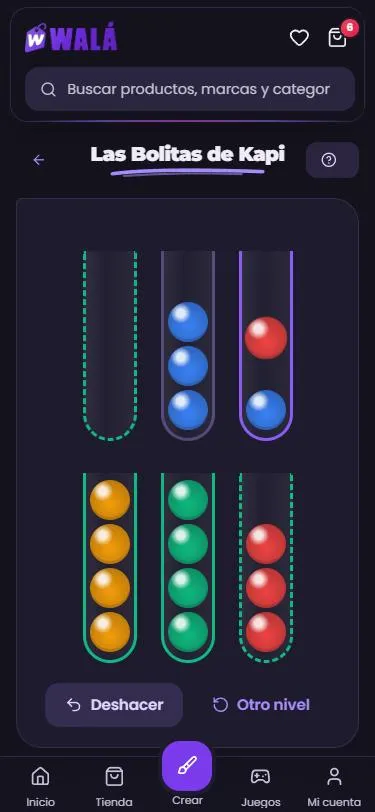 | 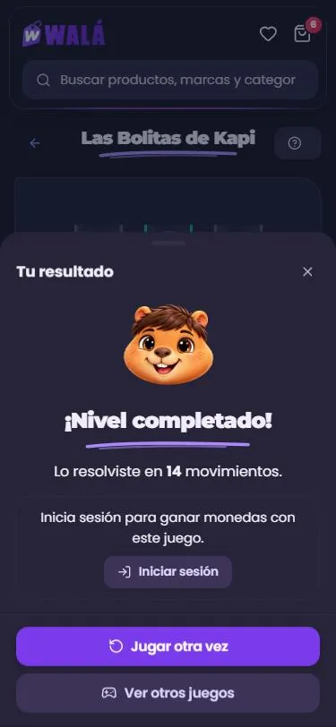 | 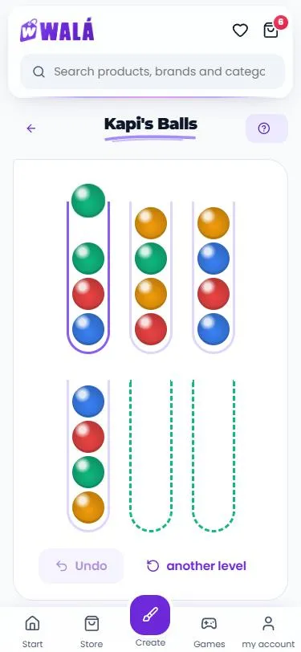 |

| La ruleta: un giro de verdad | El cupón (modo diseño), en inglés y en claro |
|---|---|
| 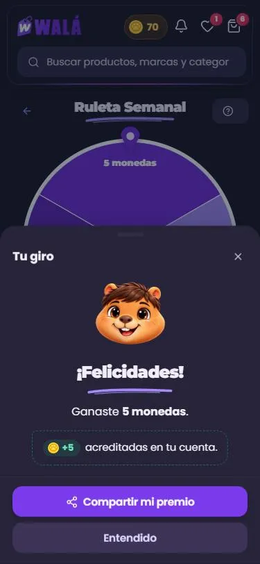 | 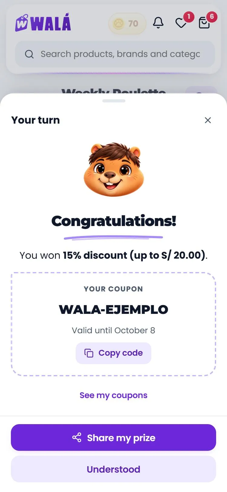 |

| La palabra como invitada (perdida, al volver) | Ganada: acreditando | Escritorio en inglés y en claro |
|---|---|---|
| 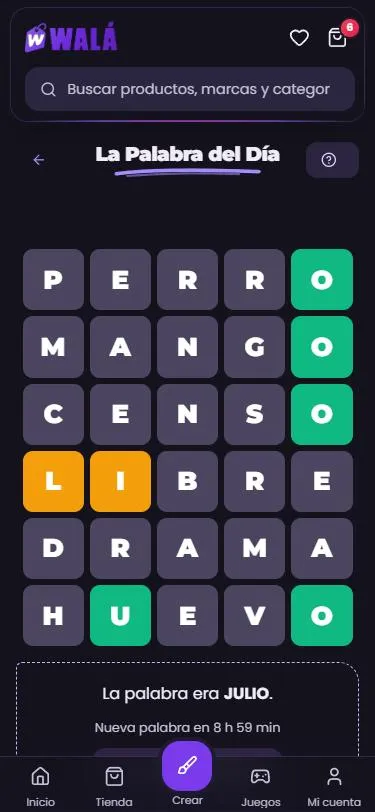 | 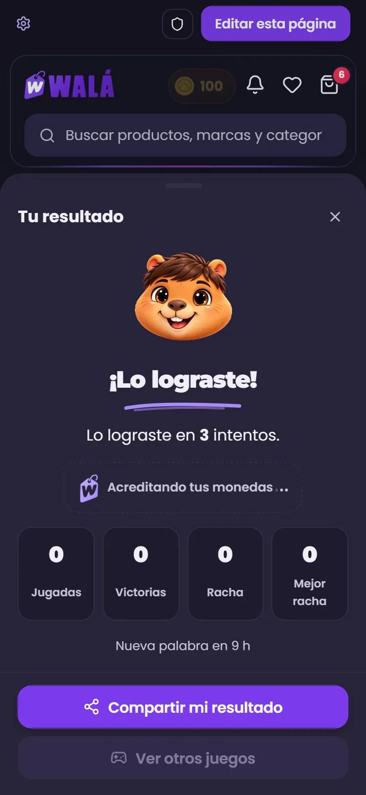 | 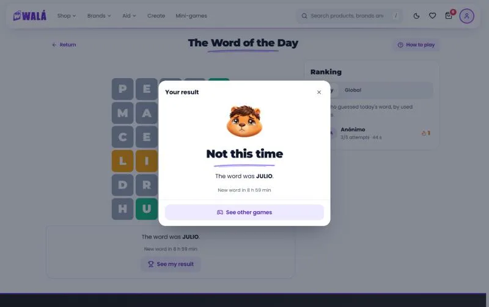 |

Las tres páginas (`pages/Minijuegos/BallSortPage.jsx`, `RuletaPage.jsx` y
`pages/Tienda/WordlePage.jsx`) montan `components/minijuegos/BolitasDeTienda.jsx`,
`RuletaDeTienda.jsx` y `PalabraDeTienda.jsx`. Las de antes (`BallSortViejo`,
`RuletaViejo`, `WordleViejo`) bajan solo con el interruptor `juegosViejo`
(`useLoViejo('juegos')`: en Firestore `juegosViejo: true`; en localStorage,
`"juegos"`). Con él, las bolitas vuelven a pedir cuenta.

El kit separó los juegos: `paginas/Palabra.jsx`, `Ruleta.jsx` y
`Bolitas.jsx` (`paginas/Juegos.jsx` solo los reúne para la demo); cada
página baja solo el suyo. Las monedas vuelan con `entregarMonedas` (la
promesa termina con `coins-animation-end` o a los 8 s) y la hoja del premio
no se cierra mientras tanto.

**Lo mismo que antes:** los cobros del servidor (`claimBallSortRewardSecure`,
`spinRuletaSecure`, `claimWordleRewardSecure`), `getRuletaBoard`, la
elegibilidad con las reglas del admin, `saveWordleResult` y las rachas, el
día de Lima, "ya jugaste hoy" según el servidor, la partida a medias en
`wala_wordle_{fecha}`, las claves de la ayuda, `trackMinigame` (inicio y
fin), la ruleta que manda al login sin cuenta, "reducir movimiento" (una
vuelta en 600 ms) y el modo diseño de la ruleta (`?sesion=activa`,
`?premios=demo`, `?ruleta=…`, `?resultado=nada|premio|cupon`) y de las
bolitas (`?bolitas=completado`).

**Lo que cambia (además de las diferencias a propósito de arriba):**

- **Bolitas sin cuenta:** `/ball-sort` ya no pasa por `RutaPrivada`; la
  tarjeta de la Zona Arcade dice "Jugar ahora" también sin cuenta.
- **Bolitas:** si el servidor dice que ya cobraste hoy, se dice eso (antes
  salía como error); mientras se acredita no se reparte otro nivel ni se
  sale de la hoja.
- **Ruleta:** si el premio ganado ya no está en la rueda ni al volver a
  pedirla (era el último en stock), se pone en su sitio y la rueda para ahí
  (antes paraba en el primer gajo). Si el tablero no carga, "No pudimos
  cargar la ruleta" con "Reintentar" (antes, "en preparación"). Con 0
  monedas no se espera ningún vuelo. El cupón vence "el 8 de octubre"
  (antes, 2026-10-08). La rueda muestra la imagen del centro del admin y,
  si un premio no tiene nombre ni etiqueta, su texto.
- **Palabra:** las estadísticas salen del perfil (en otro equipo salían en
  0) y el navegador ya no guarda el perfil entero; si guardar o cobrar
  falla, se dice, gane o pierda (antes, el cobro fallaba en silencio); la
  partida se guarda con la palabra tal cual, con sus tildes (el servidor
  compara con la oficial: con una palabra con tilde puesta por el admin no
  pagaba); el tiempo sigue tras recargar. La sesión anónima juega como
  invitada y no guarda la partida.
- `PremioJuego` es un `div` (con "Acreditando" dentro de un párrafo la
  consola avisaba).
- Todo pasa por la traducción; las cifras siguen en negrita
  (`TextoResaltado`).

**Carga:** las bolitas bajan 10,1 KB + 2,3 KB de CSS más lo común de los
tres juegos (6,4 KB + 5,3 KB de CSS, compartido); antes, 13,3 + 12,1 KB de
CSS más `ArcadeShell`. La ruleta, 13 KB más la rueda (4,5 + 2,6 KB, la
misma del admin); antes, 14,8 + 10 KB de CSS más su rueda. La palabra,
17,6 + 5,1 KB de CSS; antes, 17,2 + 12,8 KB. El archivo principal no crece
(644,6 KB, 204,4 KB gzip).

**Probado** con los emuladores: las bolitas resueltas de verdad con cuenta
(+2, 31 → 33; otra vez, "ya ganaste hoy"; con `?bolitas=disponible`, el
"ya cobraste" del servidor), sin cuenta (la tarjeta, jugar, el premio que
invita y su enlace con `?redirect=`), en inglés y claro, a 1366 y a 390; la
ruleta con un giro de verdad (para en el gajo, +5, 65 → 70, el historial y
"Ya giraste" al volver), `?premios=demo`, `?resultado=cupon` en inglés, la
imagen del centro, la vista previa del admin y sin cuenta al login; la
palabra con cuenta (un intento que no existe, recargar a medias, ganar en 3:
+4 con el bonus, las estadísticas 1/1/1/1, el ranking con "Tú", volver
con y sin el tablero en este navegador) y como invitada (perder y volver);
Escape; el interruptor en las tres (las bolitas viejas piden cuenta); la
demo. **No probado:** el error al cargar la ruleta (el tablero tiene
respaldo y no se pudo forzar), un cobro fallido de la palabra, la app
(Capacitor).

## Las bolitas: niveles, obstáculos y reto del día (2026-10-21)

Tomado de cómo funciona un Ball Sort comercial (analizado desde su APK),
con niveles propios: no se copió ninguno, se generan con la misma forma.

**El motor** (`piezas/bolitasMotor.mjs`, puro; `npm run test:bolitas`):

- **Movimiento:** se llevan juntas todas las bolitas de arriba del mismo
  color que quepan (antes, una por vez). Es la regla del juego de referencia:
  sus soluciones solo funcionan así.
- **Niveles 1, 2, 3…** siempre iguales para el mismo número (semilla). La
  curva: del 1 al 10 se aprende (2 a 7 colores), sube hasta el 100 (hasta 9)
  y desde el 101 queda entre 9 y 12 colores, 4 bolitas por tubo y 2 tubos
  vacíos; lo que varía son los obstáculos.
- **Obstáculos**, cada uno solo en su primer nivel (con su explicación) y
  después cada tanto: **bolitas ocultas** "?" desde el 12 (se ven al quedar
  arriba), **cortina** desde el 25 (el tubo no se usa hasta completar el
  color que muestra) y **hielo** desde el 45 (la bolita no se mueve; el
  número baja con cada movimiento). Hasta la fase 1 el hielo llegaba en el
  40, que pasó a ser un jefe.
- **Solucionador:** cada nivel se resuelve antes de mostrarlo; si no tiene
  solución se reparte otra vez. También da la pista. Armar un nivel tarda
  0,5 ms la mitad de las veces y 160 ms el peor de 1.500 (en un PC); el
  siguiente se prepara mientras se ve el resultado.
- **Reto del día:** un nivel de 10 a 12 colores con un obstáculo, el mismo
  para todos según el día de Lima.

**La página** (`paginas/Bolitas.jsx`): pestañas Niveles / Reto del día, el
número de nivel, ayudas contadas por nivel (`AYUDAS_BOLITAS`: 5 para
deshacer, 1 tubo de más y 3 pistas; "Reiniciar" las devuelve), la hoja "Sin
movimientos" y "Siguiente nivel". Deshacer no vuelve a tapar una "?" ya vista
ni quita el tubo de más.

**En la tienda** (`BolitasDeTienda.jsx`): el nivel, el último reto hecho y los
obstáculos explicados se guardan en el aparato (`wala_bolitas_nivel`,
`wala_bolitas_reto`, `wala_bolitas_vistos`); `trackMinigame('complete')`
manda además el modo, el nivel o la fecha y los movimientos. **El premio no
cambia:** +2 una vez al día (`claimBallSortRewardSecure`), al pasar un nivel
o el reto.

**Demo:** estados "Nivel 12 (ocultas)", "Nivel 25 (cortina)", "Nivel 40
(hielo)", "Nivel 150" y "Reto de hoy hecho".

**Probado** en el navegador (sin cuenta): el nivel 1 resuelto, la pista, la
hoja del resultado, pasar al 2 y que se guarde; los niveles 12, 25 y 40 con
su explicación, el aviso de la cortina y el hielo que baja; el 150 a 375 px
(14 tubos en dos filas, sin desborde); el reto y "Un tubo más". **No
probado:** el cobro con cuenta (no cambió), la hoja "Sin movimientos" en
pantalla (la regla sí, en las pruebas del motor), inglés y la app
(Capacitor). **Pendiente:** el progreso vive en el aparato; para que siga a
la cuenta haría falta guardarlo en el perfil.

### Fase 1: que sea divertido (2026-10-21)

Sin servidor y sin tocar las monedas: lo que engancha no vale dinero.

- **Estrellas (1 a 3)** según los movimientos (`estrellasPara`): igualar o
  mejorar la solución del motor (`par`) da 3; hasta un cuarto más, 2. La
  solución del motor queda entre 0 y 5 movimientos por encima de la óptima
  (medido contra búsqueda en anchura en los niveles 1 a 35): 3 estrellas
  piden jugar casi perfecto. Durante el juego se ven las que llevarías y la
  meta; al ganar entran animadas, con "¡Nuevo récord!" y "Repetir por 3
  estrellas".
- **Mundos de 20 niveles** (`NIVELES_POR_MUNDO`, `MUNDOS`: nombre y colores
  de fondo de la mesa, en claro y en oscuro). El último de cada mundo es un
  **jefe** (`esJefe`): un color más y todos los obstáculos que ya salieron.
  El **mapa** (`MapaBolitas`) muestra los 20 niveles con sus estrellas,
  candado en los que faltan y la corona del jefe; desde ahí se repite
  cualquier nivel abierto.
- **Racha de victorias:** cada `RACHA_COFRE` (3) niveles seguidos ganados
  abre un **cofre** (`premioCofre`): 1 pista, 3 para deshacer o 1 tubo de
  más, que se **guardan** y se usan cuando se acaban las del nivel.
  Reiniciar o dejar un nivel empezado corta la racha (con aviso). El reto
  del día no cuenta.
- **Sonido y vibración** (`piezas/efectosBolitas.js`): sonidos armados con
  Web Audio (sin archivos) al levantar, soltar, completar un tubo, ganar,
  abrir el cofre y en un toque que no vale; vibración con `navigator.vibrate`.
  Dos interruptores junto a "Cómo jugar". En Android se agregó el permiso
  `VIBRATE` al manifiesto (no le pregunta nada a la persona; sin él el
  WebView no vibraba, tampoco en el estudio). En iPhone no hay vibración.
- **Progreso en una sola clave** (`PROGRESO_BOLITAS`, `progresoBolitas`):
  la página lo recibe en `progreso` y avisa cada cambio con `onProgreso`;
  la tienda lo guarda en `wala_bolitas_progreso`. Reemplaza a las claves
  sueltas de la primera versión, que no llegaron a producción.
- **Toques rápidos:** el tubo elegido vive también en una referencia; dos
  toques antes de que se vuelva a pintar (un celular lento) ya no eligen el
  tubo equivocado.

**Demo:** "Racha 2 (el próximo abre cofre)", "El mapa del mundo" y "Nivel
20 (jefe)"; el hielo pasó a "Nivel 45".

**Carga:** la página de las bolitas baja 36,5 KB (13,8 KB gzip); antes de
esta fase, 23,2 KB.

**Probado** en el navegador (sin cuenta, a 638 px): el nivel 1 con la racha
en 2 (3 estrellas, el cofre con 1 pista y lo guardado), el panel de la
racha, el mapa (estrellas, actual, candados, jefe), la pista que gasta
primero las del nivel y después la guardada, reiniciar que corta la racha,
el jefe del nivel 20, el fondo del mundo en claro y oscuro, y que el sonido
y la vibración se disparan y se apagan con sus interruptores. **No
probado:** escuchar los sonidos de verdad, la vibración en un Android real
(hace falta compilar la app con el permiso nuevo), el inglés.

### Fase 2: conectarlo con walá (2026-10-21)

Decidido con el dueño: el cobro se comprueba si la app manda la partida (las
apps instaladas siguen cobrando sin prueba hasta activar un interruptor), la
ruleta sigue igual (solo con Kapi) y el ranking muestra nombre e inicial.

- **Partida comprobada en el servidor** (`registrarPartidaBolitasSecure`):
  cada victoria con sesión manda `{ modo, nivel | fecha, movimientos, tubos }`
  (los movimientos que valen, después de deshacer, y los tubos de más). El
  servidor rearma el nivel con **el mismo motor** (`functions/bolitasMotor.mjs`,
  copia generada con `npm run gen:motor-bolitas`; una prueba avisa si quedó
  vieja) y repite los movimientos (`comprobarPartida`). Si resuelve el nivel:
  paga el +2 si hoy no se cobró (libro mayor: `ball_sort_daily`), marca la
  misión del día (`bolitas_nivel` o `bolitas_reto` en `userActions`, sin que
  el celular la declare) y, si es el reto de hoy, lo anota en el ranking.
- **El cobro de antes** (`claimBallSortRewardSecure`, sin prueba) sigue para
  las apps instaladas (la de Android trae su copia de la web), anotado como
  `ball_sort_daily_sin_prueba`. Con `loyaltyConfig/global.bolitasExigirPrueba
  = true` (a mano, en la consola) se deja de aceptar. La web nueva, si la
  función nueva todavía no existe en el servidor, cobra con la de antes.
- **Ranking del reto** (`getRankingBolitasSecure`, `RankingBolitas`): hoy
  (menos movimientos; empate, quien llegó antes) y la semana desde el lunes
  (más retos; empate, menos movimientos). Los 20 primeros y tu puesto. Se
  guarda en `bolitasRetos/{fecha}_{uid}` (el mejor del día) y
  `bolitasSemanas/{lunes}_{uid}`; el celular no las lee ni las escribe. El
  nombre es "Lucía R." (`nombrePublico`: nunca el correo).
- **Progreso en la cuenta** (`bolitasProgreso/{uid}`, lo escribe el dueño):
  al entrar se une con el del aparato (`unirProgresos` en
  `piezas/bolitasProgreso.mjs`: lo ganado no se pierde; la racha y las
  ayudas, del que cambió último). Se sube 1,5 s después del último cambio.
- **Misiones:** `bolitas_nivel` y `bolitas_reto` en `MISSION_ACTIONS` (el
  admin ya las ve en `/admin/misiones`) y en `seed-misiones.js`, **apagadas**:
  pagan monedas de verdad y se activan a mano.
- **Aviso local del reto** (`services/bolitasNotifications.js`, ID 30): en la
  app y solo con el permiso ya dado, a las 19:00 si el reto de hoy falta (si
  no, mañana). Tocar un aviso local con `extra.ruta` abre esa página
  (`NotificationsContext`; antes tocar un aviso local abría el inicio).
- **Reglas** (`firebase/firestore.rules`): `bolitasProgreso` solo el dueño; y
  `bolitasProgreso`, `bolitasRetos`, `bolitasSemanas` y `loyaltyConfig` van en
  `esSoloWala`. Sin eso, la regla general del ERP (al final del archivo)
  dejaba escribirlas a cualquiera con sesión: se descubrió al probar.

**Orden para publicar:** 1) reglas (`npm run deploy:firestore-rules`),
2) funciones (`npm run deploy:functions`), 3) la web. Si la web sale antes,
cobra con la función de antes y el ranking queda vacío hasta que lleguen las
funciones. La app de Android necesita una versión nueva para mandar partidas
comprobadas.

**Probado** con los emuladores (`demo-wala`): una prueba de punta a punta
(partida válida: +2, libro mayor `ball_sort_daily` y misión; otra el mismo
día: sin pago; partida que no resuelve: rechazada; reto: misión y ranking
con "Ana P."; reto repetido sin mejorar: no cambia; reglas: el progreso
propio sí, el de otro no, el ranking nunca; cobro viejo: `sin_prueba` y,
con el interruptor, bloqueado), y en el navegador con sesión: el progreso de
la cuenta unido al entrar (nivel 3), ganar el nivel 3 (+2, de 5 a 7, 3
estrellas), el reto con el ranking ("Prueba N." con "Tú") y que todo quedó en
la cuenta. **No probado:** el aviso local en un Android real, la web antes
que las funciones (la vuelta al cobro de antes), y con muchos jugadores (el
ranking lee hasta 1.000 filas y ordena en el servidor).

**Publicado (2026-10-21):** solo las tres funciones
(`registrarPartidaBolitasSecure`, `getRankingBolitasSecure`,
`claimBallSortRewardSecure`). Las reglas **no**. Ojo: el 2026-10-21 se leyó
mal el ruleset vivo (el de la base `lumi`, 2.702 caracteres, en vez del de
la principal) y se creyó que producción tenía reglas abiertas. No es así: la
base principal corre las reglas fusionadas Walá+ERP (unos 35.000
caracteres), algo más viejas que `master`. Pero en ellas las colecciones de
las bolitas no están en `esSoloWala`, así que la regla general del ERP deja
escribirlas a cualquiera con sesión hasta que se publiquen las reglas.

### El aspecto, como la ilustración del juego (2026-10-22)

Siguiendo la ilustración de la tarjeta de la Zona Arcade
(`/assets/kapi/banners/bolitas.webp`):

- **Bolitas brillantes**: reflejo grande arriba, uno chico abajo y sombra.
- **Tubos de vidrio**: con una franja de luz, un **aro de color** en la boca
  (violeta, rosado, azul y amarillo, en ese orden, como en el dibujo) y una
  **base violeta con huella** (`PawPrint`).
- **Al completar un tubo**: el aro se vuelve dorado, salta confeti y tres
  `Destello` de la marca, una sola vez.
- **Al ganar**: confeti grande desde el centro de la mesa, y la hoja del
  resultado se abre un segundo después para que se vea.
- **Adornos quietos** en las esquinas de la mesa (`Destello` y `Puntos`).
- **La pista** late tres veces y se queda marcada (antes latía sin parar).

Nada se mueve solo, de acuerdo con el criterio de diseño animado pero
liviano. Con muchos tubos, desde 7 se reparten en dos filas; en el celular,
los aros y las bases se angostan (`--mesa-base-extra`).

**Fondos ilustrados** (`piezas/FondoBolitas.jsx`, SVG quietos, sin imágenes):

| Mundo | Escena |
|---|---|
| El jardín de Kapi | colinas, flores y sol |
| Playa de colores | mar, velero, arena, estrellas de mar |
| Bosque de caramelo | chupetines y gomitas |
| Ciudad de neón | edificios con ventanas encendidas |
| Cueva de cristal | cristales |
| Volcán dulce | volcán de chocolate con glaseado y chispas |
| Nubes de algodón | arcoíris y nubes |
| Galaxia de bolitas | planetas y estrellas |

- Las flores, ventanas, estrellas… cambian de lugar según el número de nivel
  (semilla): cada nivel se ve un poco distinto.
- El jefe lleva una luz de atardecer; el reto tiene su escenario con
  reflectores; los mundos de marca, sus colores.
- El dibujo va abajo y a todo el ancho, de modo que el suelo queda bajo los
  tubos. Arriba hay un velo del color de la mesa para leer el título, y los
  botones van en una franja del mismo color.
- Lo redondo y de color (chupetines, planetas) va suave y lejos de los tubos,
  para que no se confunda con las bolitas.
- De noche, la escena va más tenue.

### Fase 3: las marcas (2026-10-21)

Decidido con el dueño: el admin elige por fecha qué marca patrocina el reto y
pone el cupo de cupones.

- **Cupones de marca** (checkout): un cupón con `brandId` descuenta solo
  sobre los productos de catálogo de esa marca en el carrito
  (`calcularDescuentoCupon`, paso 2b); sin ninguno, no descuenta y avisa. Los
  cupones sin `brandId` (ruleta, recompensas) no cambian. Los crea
  `crearCuponBolitas` (`functions/index.js`), con origen `bolitas_reto` o
  `bolitas_semana` y el id que asegura uno por persona.
- **Reto patrocinado** (`bolitasPatrocinios/{fecha}`: marca, cupón, cupo,
  entregados, texto): el reto de ese día toma los colores y el logo de la
  marca (`PatrocinioBolitas`) y quien lo completa con sesión recibe su cupón
  (`registrarPartidaBolitasSecure`, en la misma transacción) mientras quede
  cupo. El resultado muestra el cupón (`CuponGanado`) y productos de la
  marca (`ProductosMarca`).
- **Mundos de marca** (`bolitasConfig/mundos`: las marcas en orden, se
  repiten): cada mundo toma colores y logo de su marca (`MarcaBolitas`, en la
  cabecera y el mapa); al vencer al jefe se muestran sus productos.
- **Premios del ranking semanal** (`bolitasConfig/premios`: puestos y
  cupón, con marca opcional): `premiarRankingBolitas` cada lunes 00:15 (Lima)
  premia la semana que terminó; `bolitasPremios/{semana}` y el id del cupón
  evitan premiar dos veces. El admin puede premiar una semana a mano.
- **Métricas** (`bolitasStats/{fecha}`: partidas, retos, partidas por
  nivel, toques hacia la tienda por marca; `bolitasJugadores/{uid}`: primer
  y último día, días jugados, nivel más alto): las escribe el servidor al
  comprobar cada partida (solo con sesión); los toques los cuenta
  `contarClicBolitasSecure` (también sin sesión).
- **Admin** (`/admin/bolitas`, `AdminBolitasPage`, en el menú junto a la
  Ruleta): patrocinios por fecha (con entregados/cupo), el orden de las marcas
  de los mundos, los premios semanales y las métricas (volvieron otro día,
  siguen 7 días después, dónde se traban, toques por marca). Todo pasa por
  `adminBolitasSecure` (solo admin).
- **Topes** (`LIMITES_CUPON`): 50 % o S/ 100 por cupón y 1000 cupones por
  día, aunque el admin ponga más. En el repo, `bolitasPatrocinios` y
  `bolitasConfig` se leen y solo el admin las escribe; `bolitasStats`,
  `bolitasJugadores` y `bolitasPremios` solo el servidor (todas en
  `esSoloWala`).

**Orden para publicar** (importa: toca el checkout y crea cupones):
1) `validarCuponSecure` y `canjearCuponSecure` (el cálculo con marca):
**publicadas el 2026-10-22**; 2) **las reglas** con las colecciones de las
bolitas en `esSoloWala` (con las reglas vivas de hoy, cualquiera con sesión
podría escribirse un patrocinio o los premios y el servidor emitiría
cupones); 3) `registrarPartidaBolitasSecure`, `contarClicBolitasSecure`,
`adminBolitasSecure` y `premiarRankingBolitas`; 4) la web. Si un cupón de
marca existiera con el checkout viejo, descontaría sobre todo el carrito.

**Probado** con los emuladores (punta a punta, 7 pasos): solo el admin guarda
un patrocinio y el servidor lo acota (80 % → 50 %); el reto patrocinado da el
cupón, uno por persona y hasta el cupo; el cupón de marca descuenta S/ 10 (20 %
de los S/ 50 de la marca) en un carrito de S/ 150 y nada sin productos de la
marca; un cupón sin marca sigue sobre todo el carrito; los toques y las
métricas; los premios semanales una sola vez y con su marca; las reglas (se
lee el patrocinio, no se escribe; las métricas nunca). En el navegador: el
mundo con la marca, el reto patrocinado, el cupón y los productos en el
resultado, y `/admin/bolitas` con datos. **No probado:** guardar desde los
formularios del admin (usan `alert`), la tarea del lunes ejecutándose sola,
el checkout de punta a punta con un cupón de marca (solo validar), inglés.
