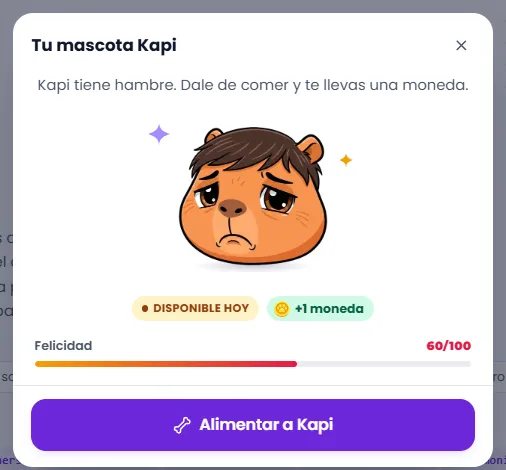
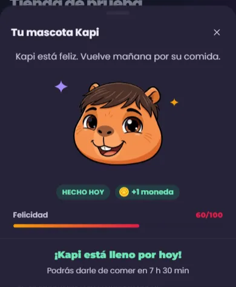
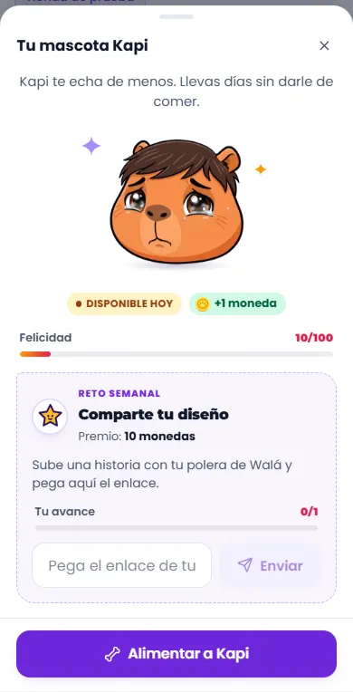

# Kapi (M8): el botón flotante y su ventana

Kapi es parte del marco: está en todas las páginas con sesión (no en landings,
ni en el estudio de Crear, ni al abrir un regalo en `/regalo/:pedido`, donde
ya está el del sobre: un solo Kapi a la vista). Cómo verlo en vivo: `npm run dev` →
http://localhost:3000/componentes.html → **Páginas** → **Tienda de prueba** →
**Ver como: Con sesión** → toca a Kapi (abajo a la derecha). También lo abre
"Reclamar moneda" en **Minijuegos**. Chips para probar:

- **Juegos de hoy → Kapi alimentado** (en Minijuegos): lleno o con hambre.
- **Mostrar también → Kapi triste**: lleva días sin comer (felicidad baja).
- **Mostrar también → Reto semanal**: el bloque del reto (ejemplo inventado:
  hoy no hay un reto activo en `globals/activeChallenge`).

Al alimentarlo, las monedas vuelan al contador de la cabecera y el saldo sube.
En **Piezas** están las fichas de `VentanaKapi` (con un botón para abrirla) y
`RetoSemanal`.

| Con hambre (escritorio) | Lleno (celular, noche) | Triste con reto (celular) |
|---|---|---|
|  |  |  |

Revisado el 2026-10-13 contra wala.pe (ventana "Tu Mascota Kapi") y
`src/components/common/KapiPet/KapiPet.jsx`.

## Partes

| Parte | Componente | Piezas que usa | Diseño en | Datos (en la tienda) |
|---|---|---|---|---|
| Botón flotante | `KapiFlotante` (en `PilaFlotante`) | `CARAS_KAPI` | `piezas/Flotantes.module.css` | `estado` y `aviso` de `kapiDesdePerfil` |
| Ventana | `VentanaKapi` | `HojaInferior` (hoja en el celular, centrada en escritorio) | `piezas/VentanaKapi.module.css` | `kapiDesdePerfil` + `hasta` |
| Frase según el ánimo | `VentanaKapi` | — | ídem | `estado` (feliz, hambre, triste) |
| Kapi (sin círculo, con destellos quietos) | `VentanaKapi` | `CARAS_KAPI`, `Destello` | ídem | `estado`; comiendo, la cara feliz con saltitos |
| "Hecho hoy / ● Disponible hoy" y "+1 moneda" | `Etiqueta` (`punto`), `GananciaMonedas` | — | `Etiquetas.module.css` | `alimentado`, `recompensa` |
| Felicidad | `BarraProgreso` (`etiqueta`) | — | `piezas/BarraProgreso.module.css` | `felicidad` |
| Reto semanal | `RetoSemanal` | `IconoWala` (estrella), `BarraProgreso`, `Campo`, `Boton`, `Aviso` | `piezas/RetoSemanal.module.css` | `retoDesdePerfil(globals/activeChallenge, perfil)` |
| "Alimentar a Kapi" / "¡Kapi está lleno por hoy!" | `Boton`, `CuentaRegresiva` (`frase`) | — | `piezas/VentanaKapi.module.css` | `onAlimentar`, `hasta` |

## Para cambiar el diseño rápido: qué se repite

| Pieza | Aparece en | Archivo |
|---|---|---|
| `CARAS_KAPI` (512px) y `CARAS_KAPI_MINI` (256px) | todas las caras de Kapi del kit: el botón flotante (la chica), la ventana, los estados vacíos, el acceso, la encuesta, el pie, el editor | `piezas/Flotantes.jsx` |
| `HojaInferior` | esta ventana, filtros del catálogo, menús en el celular | `Feedback.module.css` |
| `BarraProgreso` | felicidad, avance del reto, racha de la ruleta, "Quedan N" | `piezas/BarraProgreso.module.css` |
| `Etiqueta` / `GananciaMonedas` | estado y moneda (también en la Zona Arcade) | `Etiquetas.module.css` |
| `CuentaRegresiva` (`frase`) | "Podrás darle de comer en…" (y la Zona Arcade) | `CuentaRegresiva.module.css` |
| `SaldoMonedas` | adonde vuelan las monedas (`.global-coins-target`) | `Etiquetas.jsx` |

## Las caras: Kapi 3D

Desde el 2026-10-14 el kit usa las caras de Kapi en 3D (feliz, hambre y
triste, en `public/assets/kapi/3d/`), del mismo estilo que los banners de
los juegos. Se prepararon desde los PNG originales:

- **Borde limpio:** sin los píxeles casi transparentes teñidos de rojo y
  amarillo que dejaban un halo.
- **Formato:** recortadas en cuadrado con un poco de aire y pasadas a webp,
  de 512px (unos 44 KB) y 256px (unos 17 KB).

Todo el kit las toma de `CARAS_KAPI`; nadie escribe la ruta a mano. La
tienda real sigue con las de antes (`/assets/kapi/kapi-*.webp`), y
`EstadoVacio` conserva la de antes como valor por defecto porque la tienda
lo usa en Ver diseño. Cambiar las de la tienda es un paso de la migración.

## Llevar a la tienda (hecho el 2026-10-16)

Va con el paso 2 de [MIGRACION.md](MIGRACION.md) (marco). Mantener al día si
cambia un componente o su forma de recibir datos.

### Reemplazos

| Parte | Hoy en la tienda | Pasa a (kit) |
|---|---|---|
| Botón | `components/common/KapiPet/KapiPet.jsx` (`.fab`, ~351-362) | `KapiFlotante` |
| Ventana | ídem, el portal con `motion` (~370-516) | `VentanaKapi` |
| Insignias | `Badge` de `components/ui` | `Etiqueta` |
| Felicidad | `.stats` + `.happinessBar` (~428-438) | `BarraProgreso etiqueta="Felicidad"` |
| Reto | `.challengeCard` (~442-485), con `alert()` al enviar | `RetoSemanal` (el resultado se muestra dentro) |
| Botón y espera | `#kapi-feed-btn` y `textoEspera(msHastaMananaLima())` (~487-511) | `Boton` + `CuentaRegresiva variante="frase"` |

### De dónde sale cada dato

| Prop del kit | En la tienda |
|---|---|
| `estado`, `felicidad`, `alimentado`, `recompensa`, `aviso` | `kapiDesdePerfil(userProfile)` (usa `limaTodayStr` y `felicidadKapiHoy` de `utils/fechaLima`, igual que hoy) |
| `hasta` | `new Date(Date.now() + msHastaMananaLima()).toISOString()` |
| `onAlimentar(boton)` | `await feedKapi()` (`AuthContext`); con error, `addToast(res.error, 'error')`; si no, `volarMonedasGanadas(boton, res.data.reward)` |
| `reto` | `retoDesdePerfil(activeWeeklyChallenge, userProfile)` + `onEnviar: (url) => httpsCallable(getFunctions(), 'submitChallengeEvidence')({ evidenceUrl: url, challengeId, evidenceType: 'link' })` |
| `abierta` | estado propio; se abre con el evento `open-kapi-pet` (Zona Arcade) y con `weekly-challenge-completed` |

### Comportamiento que no se puede perder

- **Dónde aparece:** no en landings (`LayoutContext.isHeaderVisible === false`)
  ni en `/crear/…`; sin perfil no hay Kapi.
- **Recorrido de bienvenida** (driver.js, una vez por cuenta,
  `kapiTutorialVisto`): se abre solo en "momentos tranquilos" (`/`, `/cuenta`,
  `/minijuegos`) y señala `#kapi-pet-container`, `#kapi-stats` y
  `#kapi-feed-btn`. `VentanaKapi` conserva esos tres id.
- **Despertar al servidor** al abrir con la comida pendiente (`calentarKapi`).
- **Notificaciones de Kapi** (`scheduleKapiNotifications(userProfile)`).
- **No se cierra mientras come** (botón, Esc y tocar afuera).
- **Modo diseño** (`?sesion=activa&kapi=feliz|hambriento|triste&felicidad=25`):
  queda en la página, cambiando lo que se pasa al kit.
- **Traducción** (`<T>`).

### Diferencias a propósito (no "corregirlas" al migrar)

- Kapi suelto, sin el círculo detrás, con sombra en el piso y destellos.
- Sin emojis: el botón usa un hueso dibujado en vez de "🍖", y el reto el sello
  de la estrella en vez de "🎯"/"✅".
- En el celular es una hoja que sube desde abajo (se cierra arrastrando); en
  escritorio, ventana centrada.
- El reto muestra el resultado del envío dentro del bloque (sin `alert()`).
- "¡Kapi está lleno por hoy!" en el pie, en verde, con la cuenta atrás que se
  actualiza sola.

### Qué le falta al kit antes de migrar

- ✓ Traducción: los textos de la ventana y del reto pasan por `useTexto`.
- La felicidad que suba al comer la decide el servidor: la ventana muestra lo
  que diga el perfil después de `feedKapi`.

### Pasos (cada uno se verifica solo y se puede volver atrás)

1. ✓ y 2. ✓ juntos, en `src/components/marco/Kapi.jsx` (no dentro de
   `KapiPet.jsx`, que queda intacto para volver atrás): `KapiFlotante` en la
   pila de flotantes y `VentanaKapi` con `kapiDesdePerfil` y
   `retoDesdePerfil`; eventos, recorrido, notificaciones, visibilidad y modo
   diseño como estaban. Probado en local: hambre, lleno, triste, modo diseño,
   el error al alimentar (toast), el error del reto (dentro del bloque), no
   cerrar mientras come, el evento de la Zona Arcade y el recorrido de una
   cuenta nueva (queda guardado en el perfil). Sin probar en local: las
   monedas volando tras alimentar (sin emulador de functions).

Para volver atrás: cada paso en su propio commit; el `KapiPet` viejo no se
borra hasta que el nuevo lleve un tiempo en producción.
