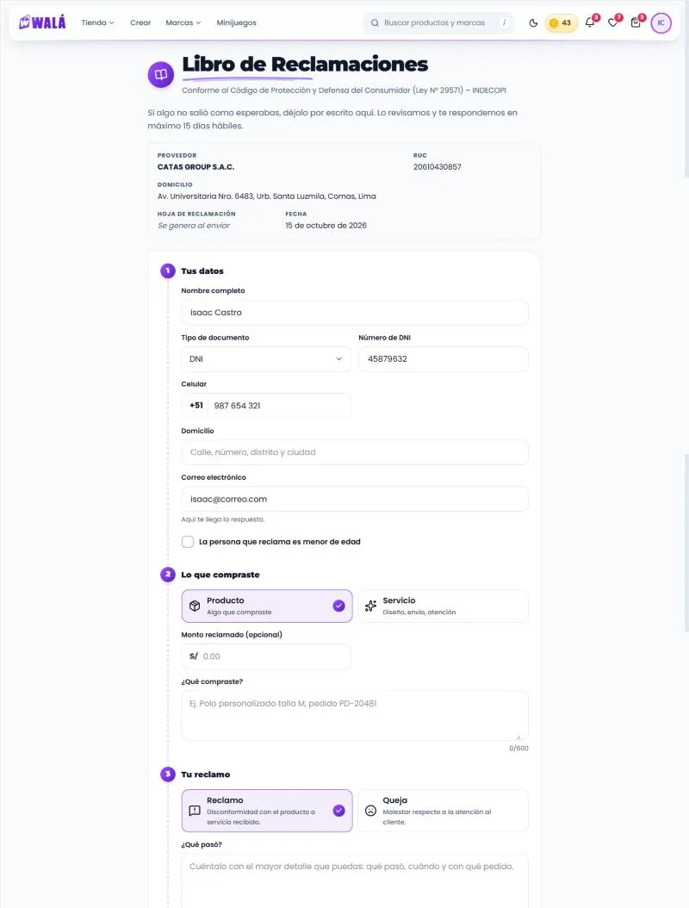
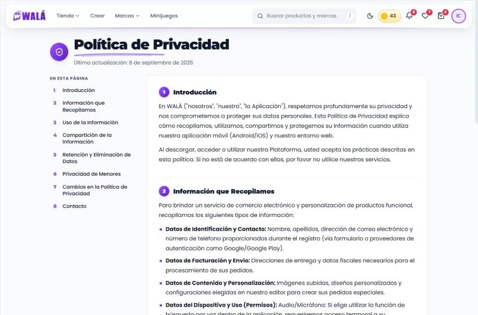
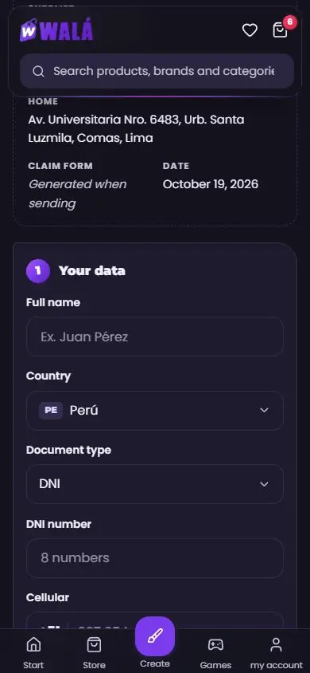

# Legales: libro de reclamaciones, privacidad y términos

Cómo verlo en vivo: `npm run dev` → http://localhost:3000/componentes.html →
**Páginas** → **Tienda de prueba** → **Legales**, con "Cómo se abre":

- **Libro de reclamaciones** (`/libro-de-reclamaciones`). Estados: el envío
  falla y cargando. "Con sesión" llega con los datos de la cuenta ya puestos.
  Enviar arma el código como la tienda, pero la demo no guarda nada.
- **Política de privacidad** (`/politicas-privacidad`) y **Términos y
  condiciones** (`/terminos-y-condiciones`). Estado: cargando.

El pie de la Tienda de prueba también lleva aquí. Su enlace a privacidad
apuntaba a `/politicas-de-privacidad`, que no existe, y se corrigió.

| El libro (ancho, con el paso 1 hecho) | El libro (celular, noche: arriba y la queja con cuánto falta) | Registrada (celular, noche) |
|---|---|---|
|  |  |  |

| Privacidad (escritorio) | Privacidad (celular, noche, índice abierto) |
|---|---|
|  |  |

Revisado el 2026-10-15 contra estos archivos:

| Página | Archivo | Líneas |
|---|---|---|
| Libro de reclamaciones | `pages/LibroReclamacionesPage.jsx` (+ `LibroReclamaciones.module.css`) | 284 (+244) |
| Política de privacidad | `pages/PoliticasPrivacidadPage.jsx` | 122 |
| Términos y condiciones | `pages/TerminosCondicionesPage.jsx` | 107 |
| Estilos de las dos | `pages/PoliticasPrivacidad.module.css` | 285 |
| Datos de la empresa | `config/empresa.js` | — |

**Los textos son los reales.** Viven en `src/config/legales/privacidad.js` y
`terminos.js` (antes en `demo/legales.js`), como datos: los leen la tienda y
la demo. La empresa (razón social, RUC,
domicilio, correo, WhatsApp, plazo de 15 días hábiles) sale de
`config/empresa.js`. En la reclamación, el DNI y el celular "con sesión" son
de ejemplo.

## Partes

| Parte | Componente | Piezas que usa | Datos (en la tienda) |
|---|---|---|---|
| P19 Libro de reclamaciones | `PaginaReclamaciones` (`paginas/Reclamaciones.jsx`) | `CabezaLegal`, `DatosProveedor`, `CodigoCopiable`, `PasosAtencion` y `AvanceHoja` (nuevas, `piezas/Legales.jsx`); `PasoEstudio` (los 3 pasos con su costura), `CamposDatosPersonales` (nombre, documento y celular, con las reglas de Mi perfil), `Campo` (con `multilinea`, nuevo), `ListaEleccion`, `Casilla`, `Aviso`, `Boton` | `empresa`; al enviar, `createDocument('libro_reclamaciones', …)` |
| P19 Privacidad y términos | `PaginaLegal` | `CabezaLegal`, `IndiceLegal`, `SeccionLegal` (nuevas), `TarjetaAyuda` (Kapi, el correo y WhatsApp), `Boton` | hoy los textos están escritos en el JSX de cada página (ver abajo) |

Validación: `validarReclamacion(datos)` (exportada) usa `validarPerfil` para
el nombre, el documento y el celular, y suma domicilio, correo, apoderado si
es menor, monto, qué compraste, qué pasó, qué solución esperas y la casilla.

Esqueletos: `EsqueletoPagina forma="legal"` y `forma="reclamaciones"`
(nuevas, con la medida real en escritorio y en el celular).

**Pieza nueva compartida: `Campo multilinea`.** El kit no tenía un campo de
texto largo, y había dos `<textarea>` hechos a mano (Opiniones y el
estudio). Ahora `Campo` tiene `multilinea` (true = 3 líneas, o el número que
se pase). Con `maxLength` cuenta lo escrito ("120/800"). Opiniones ya lo usa.
`CampoTelefono` y `CamposDatosPersonales` aceptan `id` / `ids`, para llevar
el foco al primer error.

### Lo que hace

- **Libro de reclamaciones:**
  - El libro en su sello, "Libro de Reclamaciones" con su trazo y la ley.
    Debajo, qué es y que lo revisa una persona del equipo. En pantallas
    anchas, puntos y destellos quietos al costado.
  - **Lo que sigue** (`PasosAtencion`, desde el 2026-10-16): tres sellos
    unidos por una costura: llenas tu hoja, recibes tu código y te
    respondemos en máximo N días hábiles a tu correo. En el celular, uno
    debajo del otro.
  - **Datos del proveedor**, como pide INDECOPI: razón social, RUC,
    domicilio, "Hoja de reclamación: se genera al enviar" y la fecha de hoy.
  - **1. Tus datos:** nombre completo, tipo y número de documento, celular
    (+51), domicilio, correo ("Aquí te llega la respuesta.") y "La persona que
    reclama es menor de edad". Si se marca, aparece el nombre del padre, madre o
    apoderado.
  - **2. Lo que compraste:** Producto o Servicio, el monto (opcional, con
    "S/") y "¿Qué compraste?" (con el pedido como ejemplo).
  - **3. Tu reclamo:** Reclamo o Queja, cada uno con lo que significa;
    "¿Qué pasó?" y "¿Qué solución esperas?", con su cuenta de letras. Con
    Queja, la pregunta cambia a "¿Cómo te atendimos?" y los ejemplos hablan
    de la atención.
  - **Cada paso se marca solo** al completarse (las mismas reglas que al
    enviar, sin mostrar errores antes de tiempo): su sello pasa a menta con
    un check y el título dice lo elegido ("Lo que compraste: Producto").
  - **Cuánto falta** (`AvanceHoja`), antes de la casilla: un tramo por paso
    que se llena al completarlo y "Te falta: lo que compraste y tu
    reclamo." o "Todo listo: marca la casilla de abajo y envía."
  - La casilla de veracidad enlaza a la Política de Privacidad. Abajo,
    "Enviar reclamación" ("Registrando…" mientras guarda) y la nota legal de
    INDECOPI.
  - Si falta algo, cada campo dice qué le falta y el foco va al primero.
  - Si falla el envío, el aviso de error encima del botón, y lo escrito se
    queda.
  - **Registrada:** el sello con el visto, "¡Reclamación registrada!", el
    código grande con "Copiar código" y la fecha, a qué correo y en cuántos
    días hábiles se responde, "Registrar otra reclamación" y "Volver a la
    tienda".
- **Privacidad y términos:**
  - El escudo o la hoja en su sello, el título con su trazo y "Última
    actualización: 8 de septiembre de 2026".
  - El índice: en escritorio va fijo al costado mientras se lee; en el
    celular, plegado arriba ("En esta página · 8 secciones"). Cada entrada
    lleva a su sección.
  - Las secciones numeradas en sellos, con párrafos y listas con un punto con
    el degradado del logo. La excepción de devoluciones (7 días) va destacada.
  - "Contacto" termina con la tarjeta de ayuda: Kapi, el correo y "Escribir
    por WhatsApp". Como Kapi ya asoma ahí, el pie no lo repite.
  - Abajo, el enlace al otro documento ("¿Buscabas cómo tratamos tus datos?").

## Llevar a la tienda (hecho el 2026-10-19: ver "En la tienda" al final)

### Reemplazos

| Hoy | Pasa a (kit) |
|---|---|
| `LibroReclamacionesPage` (inputs nativos, 📕, ✅, un solo error arriba) | `PaginaReclamaciones` |
| `PoliticasPrivacidadPage` y `TerminosCondicionesPage` (texto en el JSX, `PoliticasPrivacidad.module.css`) | `PaginaLegal` con su `documento` |

**Lo que no cambia:** el documento que se guarda en `libro_reclamaciones`
(mismos campos, y el admin lo sigue viendo en `/admin/libro-reclamaciones`) y
las rutas, incluida la redirección de `/terminos-condiciones`.

### De dónde sale cada dato

- **`empresa`:** `config/empresa.js` (`razonSocial`, `ruc`,
  `domicilioFiscal`, `email`, `plazoRespuestaDiasHabiles`).
- **`hoy`:** la fecha de Lima en palabras (`limaTodayStr`).
- **`inicial`** (con sesión): `userProfile` → `{ nombre: displayName,
  tipoDocumento, documento: dni, telefono, email }`, con los mismos campos que
  Mi perfil (`perfilDesdeUsuario`). Sin sesión, vacío: la página es pública.
- **`onEnviar(datos)`:** arma el mismo documento de hoy:
  - `codigo` (`WALA-AAAAMMDD-NNNN`), `estado: 'pendiente'` y `proveedor`
    (copia de `empresa`);
  - `consumidor`: `nombre`, `tipoDocumento`, `numeroDocumento: documento`,
    `domicilio`, `telefono`, `email`, `esMenor` y `apoderado`;
  - `bien`: `tipo: tipoBien`, `montoReclamado: monto` y `descripcion`;
  - `reclamo`: `tipo: tipoReclamo`, `detalle` y `pedido`.

  Llama a `createDocument('libro_reclamaciones', …)` y devuelve `{ codigo,
  fecha }`. Si `createDocument` devuelve `error`, lanza un `Error` con un
  mensaje para el cliente, no el de Firebase.
- **`documento`** de privacidad y términos: sacar el texto del JSX a un
  archivo de datos con la forma de `demo/legales.js`: `{ titulo, actualizado,
  secciones: [{ id, titulo, parrafos, lista: [{ etiqueta, texto }],
  destacado, contacto }] }`. Por ejemplo, `src/config/legales.js`, para que
  la tienda y el kit lean el mismo. Así un cambio legal se hace en un solo
  lugar.

### Comportamiento que no se puede perder

- La reclamación se puede presentar sin cuenta. Es la ley, y no cambia con
  "pagar pide cuenta".
- Los datos del proveedor van copiados en cada hoja.
- La nota de INDECOPI y el plazo de respuesta a la vista.
- La traducción: cada párrafo pasa entero por `Texto` (hoy algunos títulos y
  la cláusula partida por el `<strong>` no se traducían).

### Diferencias a propósito (no "corregirlas" al migrar)

- **Errores por campo, todos a la vez**, y el foco en el primero. Hoy sale un
  solo mensaje arriba y hay que adivinar cuál campo es.
- **El documento y el celular se validan** con las reglas de Mi perfil (DNI
  de 8, celular de 9 que empieza con 9). Hoy se acepta cualquier cosa.
- La hoja muestra la fecha. El código se puede copiar.
- "Carnet de extranjería" (como en Mi perfil) en vez de "Carné de
  Extranjería".
- Sin emojis (📕, ✅).
- Privacidad y términos: índice, secciones con ancla, la excepción de
  devoluciones destacada, y el contacto con WhatsApp además del correo, desde
  `empresa` y no escrito a mano. Una sola `<main>`: hoy hay dos anidadas (la
  del marco y la de la página).

### Lo que se encontró de paso (para decidir aparte)

- El código de la hoja (`WALA-AAAAMMDD-NNNN` al azar) se arma en el
  navegador, sin revisar que no se repita. Dos reclamaciones el mismo día
  pueden chocar (1 entre 9000). Si importa, que lo asigne una función con un
  contador.
- No se manda correo: ni al cliente (copia de su hoja) ni a Walá (aviso de una
  reclamación nueva), y la respuesta del admin tampoco le llega al cliente.
- `respuestaProveedor: null`, `apoderado: null` y `montoReclamado: null` no
  se guardan: `createDocument` quita los `null`. El admin ya los trata como
  ausentes.
- El admin no ve el domicilio, si es menor ni el apoderado.

### Pasos

1. ✓ Los textos de privacidad y términos en `src/config/legales/` (uno por
   archivo) y `PaginaLegal` en las dos páginas.
2. ✓ `PaginaReclamaciones` en `LibroReclamacionesPage`, con el mismo
   `createDocument` (comparado en Firestore; el admin no se miró en pantalla).
3. Decidir aparte el correo de copia y el código con contador.

## En la tienda (2026-10-19)

| Privacidad: contacto (celular, con sesión) | El libro en inglés y oscuro (celular) |
|---|---|
|  |  |

Las páginas (`pages/PoliticasPrivacidadPage.jsx`,
`TerminosCondicionesPage.jsx`, `LibroReclamacionesPage.jsx`) montan
`components/legales/LegalDeTienda.jsx` y `ReclamacionesDeTienda.jsx`. Las de
antes (`*Viejo.jsx`) bajan solo con el interruptor `legalesViejo`
(`useLoViejo('legales')`: en Firestore `legalesViejo: true`; en
localStorage, `"legales"`).

**El texto legal, igual:** se comparó lo que se lee en la página vieja contra
la nueva, párrafo por párrafo. Términos, idéntico; privacidad, idéntico salvo
el guion de la sublista ("- Audio/Micrófono"). Los datos de contacto ("Equipo
de Soporte WALÁ", el correo y la atención por WhatsApp) se ven tal cual,
antes de la tarjeta de ayuda (`contacto: { equipo, lineas }`, el correo de
`config/empresa`).

**El libro, igual:** público, el mismo documento en `libro_reclamaciones`
(código, estado, la copia de la empresa, consumidor, bien, reclamo). Con
sesión llega con el nombre, el documento, el celular y el correo.

**Lo que cambia (además de las diferencias a propósito de arriba):**

- **País en el libro:** en el kit solo se aceptaba un DNI y un celular
  peruanos; ahora se elige el país (Perú por defecto) y fuera del Perú el
  documento y el teléfono son libres. Se guarda `tipoDocumento: 'OTRO'`
  (como en el perfil) y el teléfono con su código (`+56 912345678`). El admin
  lo muestra tal cual ("OTRO CL-445566").
- Si el envío falla, un mensaje para el cliente (antes, el de Firebase).
- Con sesión, la tarjeta de ayuda de "Contacto" va sin Kapi (`sinKapi`):
  ya está el flotante.
- Todo pasa por la traducción (antes, partes sueltas). Una sola `<main>`.
- `PaginaReclamaciones` está en `paginas/Reclamaciones.jsx`: privacidad y
  términos no bajan su formulario.

**Carga:** privacidad y términos bajan unos 30 KB propios (el trozo de la
página legal y su CSS, compartido entre las dos) más su texto (6,1 y 4,6 KB);
el libro, unos 67 KB propios, con piezas que ya usa la cuenta (la lista de
elección, los datos personales, la fecha). Antes: 8,3 + 5,8 KB y un CSS
compartido; el libro, 11,1 + 4,9 KB. El archivo principal no suma código:
46 B gzip del mapa de rutas.

**Probado** con los emuladores: el texto contra la página vieja; el contacto
a 390 con sesión (un solo Kapi); el libro con sesión (datos puestos), enviar
vacío (cada error y el foco en el primero), Chile con documento y teléfono
libres, registrada con su código y el documento revisado en Firestore; sin
sesión, vacío; en inglés y oscuro; el interruptor. **No probado:** la hoja
nueva en la pantalla del admin y "Copiar código" (el portapapeles).
