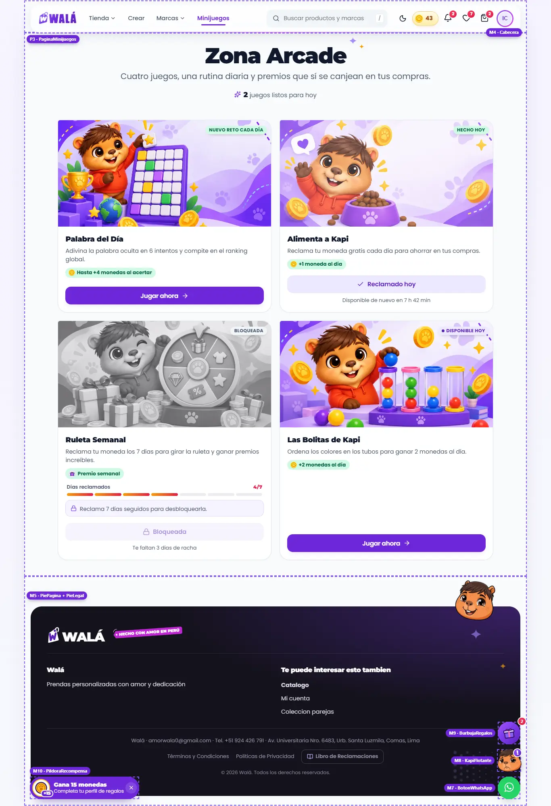
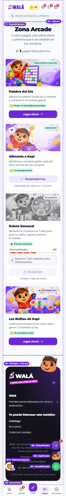

# Minijuegos (`/minijuegos`, Zona Arcade): qué componente va en cada parte

Cómo verlo en vivo: `npm run dev` → http://localhost:3000/componentes.html →
**Páginas** → **Tienda de prueba** → página **Minijuegos** (o "Minijuegos" en
la cabecera, o "Juegos" en la barra inferior del celular). Con **Ver como** →
"Con sesión" aparecen los chips **Juegos de hoy** (palabra jugada, Kapi
alimentado, bolitas hechas, cargando sesión) y los cinco estados de la ruleta.
El marco (M) es el mismo del inicio: ver
[INICIO.md](INICIO.md#marco-m-lo-que-rodea-a-las-secciones).

| Escritorio | Celular |
|---|---|
|  |  |

Revisado el 2026-10-13 contra wala.pe/minijuegos (visitante y con sesión) y
`src/pages/Minijuegos/MinijuegosPage.jsx`. No es una página del builder: es
contenido propio (P).

## Partes (P3: `PaginaMinijuegos`)

| Parte | Componente | Piezas que usa | Diseño en | Datos (en la tienda) | Quién la ve |
|---|---|---|---|---|---|
| Encabezado "Zona Arcade" | `Encabezado` (con `children`) | `Garabatos` (destellos) | `SeccionesContenido.module.css` | textos fijos | todos |
| Estado del día ("2 juegos listos para hoy", "Ya hiciste todo por hoy", "Cargando tu progreso…") | `PaginaMinijuegos` | texto simple (número en la letra de la marca), ícono | `paginas/Paginas.module.css` (`.arcadeListos`) | `listos` de `juegosDelArcade` | con sesión |
| "Entra con tu cuenta" | `Aviso` + `Boton` | — | `Feedback.module.css` | — | visitante |
| Tarjeta de cada juego (×4) | `TarjetaJuego` | `Etiqueta` (`sobreFoto`, `punto`), `GananciaMonedas` (con texto o con `IconoWala` regalo), `BarraProgreso` (`pasos`), `Aviso` (`compacto`), `Boton`, `CuentaRegresiva` (`frase`) | `piezas/TarjetaJuego.module.css` | `juegos` de `juegosDelArcade` | todos (los botones cambian con la sesión) |

### Las cuatro tarjetas

| Juego | Estado (sobre el banner) | Recompensa | Botón | Debajo |
|---|---|---|---|---|
| Palabra del Día | "Nuevo reto cada día" / "Hecho hoy" | Hasta +4 monedas al acertar | Jugar ahora / Ver mi resultado | "Disponible de nuevo en…" cuando ya jugó |
| Alimenta a Kapi | "● Disponible hoy" / "Hecho hoy" | +1 moneda al día (+2 con el reto semanal) | Reclamar moneda / Reclamado hoy (abre a Kapi; si ya reclamó, toast) | igual |
| Ruleta Semanal | "● Giro disponible" / "Girada" / "Semana perdida" / "Bloqueada" | Premio semanal (regalo) | Girar ruleta / Bloqueada / Ya giraste esta semana | racha de 7 días por pasos, nota (bloqueo, giro pendiente…) y "Te faltan N días de racha" o "Vuelve el lunes, en…" |
| Las Bolitas de Kapi | "● Disponible hoy" / "Hecho hoy" | +2 monedas al día | Jugar ahora / Completado — jugar igual | "Disponible de nuevo en…" |

Sin sesión todos los botones son "Inicia sesión" (contorno). Mientras se
resuelve la sesión, botones "Cargando…" y ningún estado (no se anuncia un
juego ya hecho como disponible).

## Para cambiar el diseño rápido: qué se repite

| Pieza | Aparece en | Archivo |
|---|---|---|
| `TarjetaJuego` | las cuatro tarjetas | `piezas/TarjetaJuego.module.css` |
| `Etiqueta` | estados de las tarjetas (y del pedido, del carrito…) | `Etiquetas.module.css` (`.sobreFoto`, `.punto`) |
| `GananciaMonedas` | recompensas (y "+N" en la cuenta) | `Etiquetas.module.css` (`.ganancia`) |
| `BarraProgreso` | racha de la ruleta (y "Quedan N" de las ofertas) | `piezas/BarraProgreso.module.css` (`.pasos`) |
| `Aviso` | "Entra con tu cuenta", notas de la ruleta | `Feedback.module.css` (`.compacto`) |
| `CuentaRegresiva` | "Disponible de nuevo en…" (y ofertas relámpago) | `CuentaRegresiva.module.css` (`.frase`) |
| `Encabezado` | "Zona Arcade" (y `header` del builder: "Tienda Completa") | `SeccionesContenido.module.css` |
| `Boton` | todos los botones | `Boton.module.css` |

## Llevar a la tienda (a futuro: TODAVÍA NO se hace)

Página propia: va en el paso 6 de [MIGRACION.md](MIGRACION.md) (páginas que
no son del builder). Mantener al día si cambia un componente o su forma de
recibir datos.

### Reemplazos

| Parte | Hoy en la tienda | Pasa a (kit) |
|---|---|---|
| Página | `pages/Minijuegos/MinijuegosPage.jsx` dentro de `ArcadeShell` | `PaginaMinijuegos` (y más adelante dentro de `MarcoTienda`) |
| Encabezado y estado del día | `<header className={styles.hero}>` (~237-274) | `Encabezado` + el estado de `PaginaMinijuegos` |
| Cada tarjeta | `JuegoCard` (~60-111) y sus cuatro usos (~288, ~322, ~362, ~463) | `TarjetaJuego` con las props de `juegosDelArcade` |
| Insignias de estado | `Badge` de `components/ui` | `Etiqueta` (`sobreFoto`, `punto`) |
| Recompensa | `<Moneda />` + texto en `.recompensa`; la ruleta con un emoji 🎁 | `GananciaMonedas` (la ruleta con `IconoWala` "regalo") |
| Racha | `.progreso` + `.pips` (~396-415) | `BarraProgreso pasos` |
| Notas de la ruleta | `.notaBuena`, `.notaBloqueo` (~420-440) | `Aviso compacto` |
| Cuenta atrás | `textoEspera(msHastaMananaLima())` en texto fijo + tic de 60 s (~160-206) | `CuentaRegresiva variante="frase"` con `hasta` |

### De dónde sale cada dato

| Prop del kit | En la tienda |
|---|---|
| `sesion` | `Boolean(user)` (`AuthContext`); el modo diseño `?sesion=activa` lo fuerza |
| `cargando` | `loading` de `AuthContext` (sin modo diseño) |
| `palabraHecha` | `getMiPartidaDeHoy()` (`services/wordle`) |
| `kapiReclamado` | `userProfile.lastKapiClaimDate === limaTodayStr()` |
| `kapiDoble` | `userProfile.activeMultiplier === 'kapi_double_3d'` y `multiplierExpiresAt` vigente |
| `bolitasHechas` | `userProfile.lastBallSortReward === limaTodayStr()` |
| `ruleta` | `getRuletaEligibility(userProfile)` (`services/firebase/ruleta`): `isUnlocked` → `desbloqueada`, `hasSpun` → `girada`, `hasLost` → `perdida`, `haEmpezado` → `empezada`, `esPendienteAnterior` → `pendienteAnterior`, `days` → `dias` |
| `hasta.manana`, `hasta.lunes` | `Date.now() + msHastaMananaLima()` / `msHastaLunesLima()` (`utils/fechaLima`), en ISO |
| `onAlimentar` | con la moneda ya reclamada, `addToast('¡Ya alimentaste a Kapi hoy!…')`; si no, `window.dispatchEvent(new CustomEvent('open-kapi-pet'))` |
| `urlLogin` | `/login` |

### Comportamiento que no se puede perder

- **El día lo decide el servidor en hora de Lima** (`limaTodayStr`): el kit no
  calcula fechas, solo recibe los resultados.
- **Misión diaria:** `recordMissionAction('visit_minijuegos')` al entrar con
  sesión (queda en la página, no en el kit).
- **Modo diseño** (`utils/modoDiseno`: `?sesion=`, `?moneda=`, `?bolitas=`,
  `?palabra=`, `?ruleta=`, `?dias=`): sigue en la página y solo cambia lo que
  se pasa a `juegosDelArcade`, con su aviso "Modo diseño activo".
- **Sin sesión no hay perfil:** `juegosDelArcade` ya ignora lo hecho y deja la
  ruleta en cero.
- **Traducción:** títulos, descripciones y botones con `<T>`.
- **Entrada animada** de las tarjetas (`Stagger`): el kit no la tiene; usar
  `Revelar` si se quiere conservar.

### Diferencias a propósito (no "corregirlas" al migrar)

- Sin emoji en la recompensa de la ruleta: `IconoWala` "regalo".
- Las recompensas van todas en el verde de "ganancia" (hoy cada juego tiene
  su color): ganar monedas se lee igual en toda la tienda.
- El estado del día es texto simple, no una píldora (es un dato de la página).
- Las insignias de estado son opacas (`sobreFoto`): en modo noche se leen
  sobre la ilustración.
- La invitación a entrar es un `Aviso` con su botón.
- Mientras carga la sesión no se muestra ningún estado.
- La cuenta atrás se actualiza sola cada medio minuto (`CuentaRegresiva`), sin
  re-pintar toda la página cada minuto.
- Tarjeta con el lenguaje de la tienda: esquina superior izquierda cerrada,
  título con la letra del logo, el violeta lleno solo para "jugar".

### Qué le falta al kit antes de migrar esta página

- Traducción (`<T>`), como en las demás páginas.
- La entrada escalonada (`Stagger`), si se quiere conservar.
- Las pantallas de cada juego (`/palabra-del-dia`, `/ruleta`, `/ball-sort`,
  `ArcadeShell` con su barra "Volver") ya están en el kit, cada una con su
  plan: ver [JUEGOS.md](JUEGOS.md).

### Pasos (cada uno se verifica solo y se puede volver atrás)

1. Dentro de `MinijuegosPage`, armar `juegosDelArcade(...)` con los datos de
   arriba y cambiar `JuegoCard` por `TarjetaJuego`. Probar cada estado con el
   modo diseño (`?sesion=activa&moneda=reclamada&ruleta=girada…`), visitante y
   modo noche.
2. Cambiar el encabezado por `Encabezado` + el estado (o usar
   `PaginaMinijuegos` completa dentro de `ArcadeShell`).
3. Cuando el marco se migre (paso 2 y 7 de MIGRACION.md), la página queda
   dentro de `MarcoTienda`.

Para volver atrás: cada paso en su propio commit; `JuegoCard` no se borra
hasta que `TarjetaJuego` lleve un tiempo en producción.
