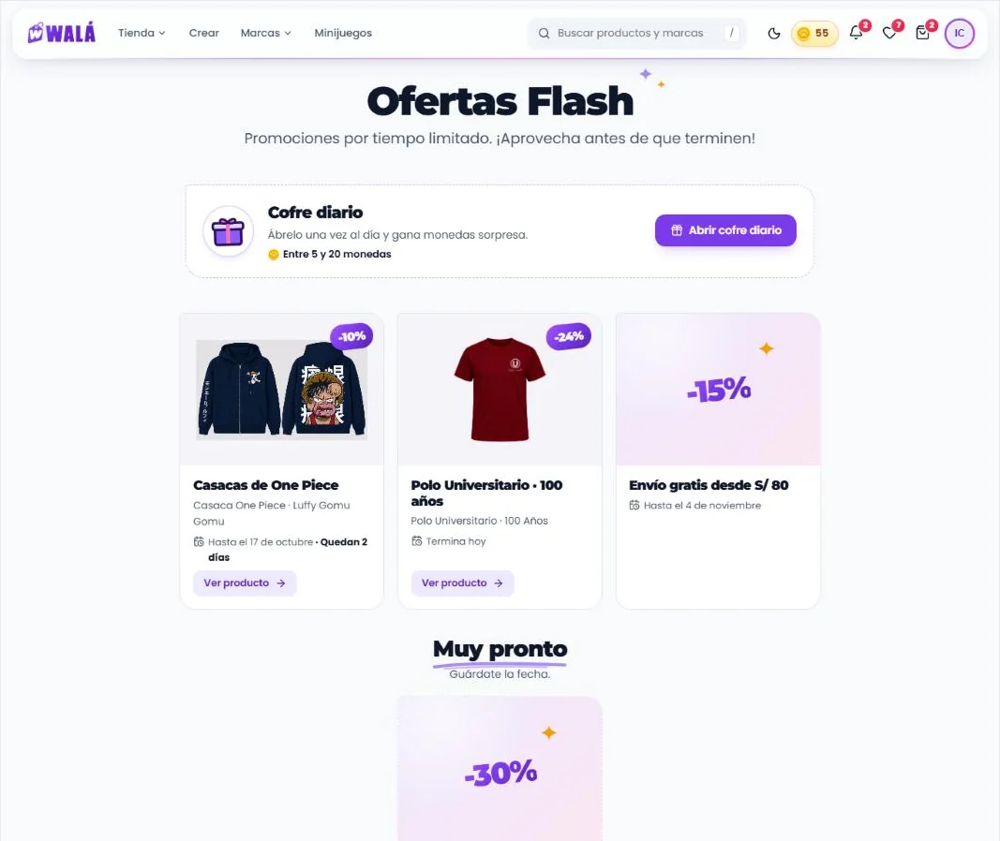
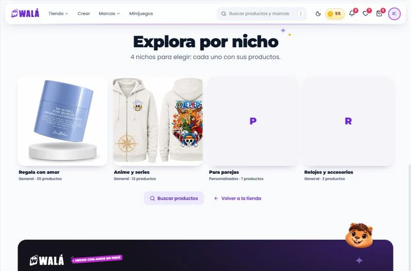
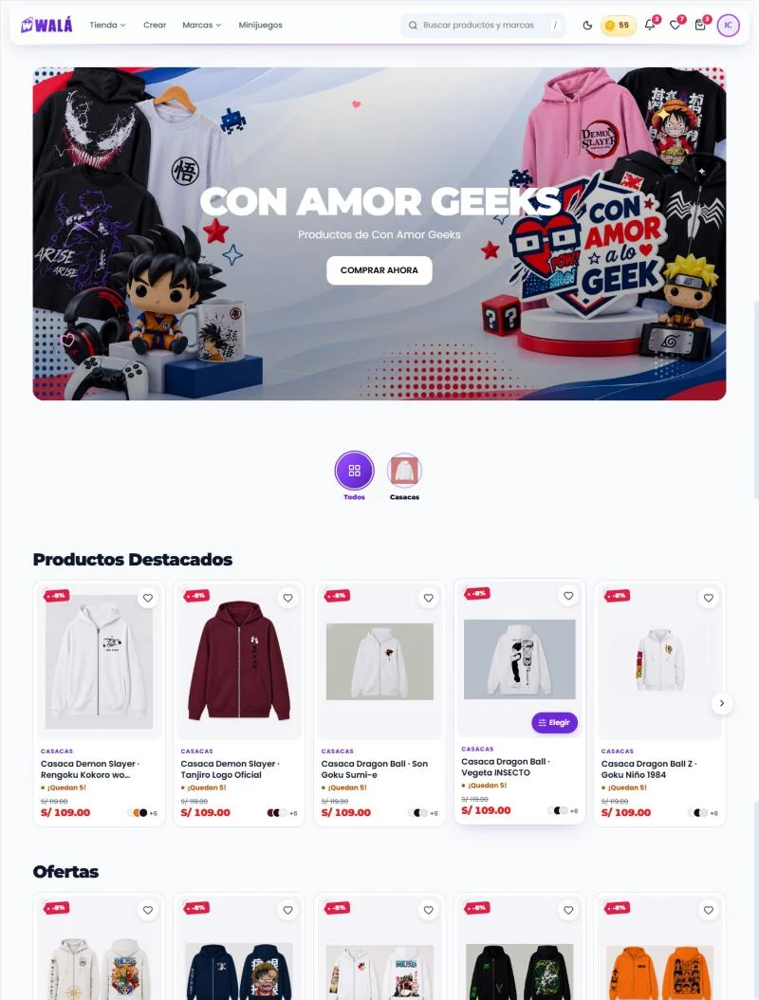
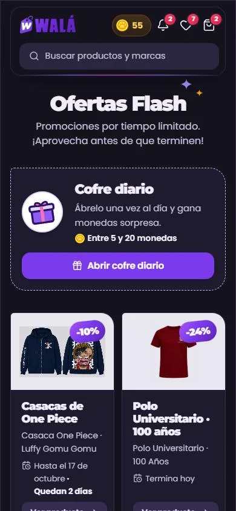
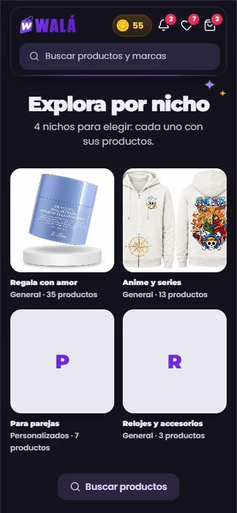
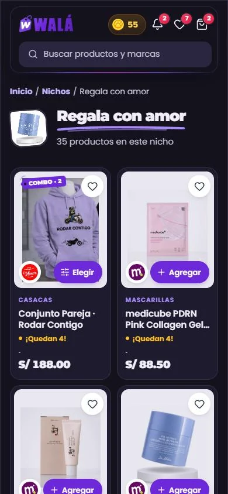

# Navegar la tienda: ofertas, nichos, vendedores y landings

Cómo verlo en vivo: `npm run dev` → http://localhost:3000/componentes.html →
**Páginas** → **Tienda de prueba**:

- **Ofertas** (`/ofertas`): el cofre diario y las ofertas flash. Estados: sin
  ofertas (como hoy en wala.pe), cofre ya abierto hoy, el cofre falla, error
  al cargar y cargando. Con sesión, "Abrir cofre diario" da 12 monedas que
  vuelan a la cabecera.
- **Nichos y vendedores**, con "Cómo se abre":
  - todos los nichos (`/nichos`);
  - un nicho (`/nicho/regala-con-amor`) y un nicho sin productos;
  - la tienda de un vendedor (`/tienda-vendedor/mussa`) y "WALA", el único
    vendedor real.

  Estados: no encontrado, sin nichos y cargando.
- **Landing de marca** (`/:slug`): dos landings reales del builder, Con Amor
  Geeks (catálogo con filtros) y Yoryo (carruseles por categoría). El menú
  Marcas de la cabecera también lleva a la de Con Amor Geeks.

| Ofertas | Nichos | Landing de marca |
|---|---|---|
|  |  |  |

| Ofertas (celular, noche) | Nichos (celular, noche) | Un nicho (celular, noche) |
|---|---|---|
|  |  |  |

Revisado el 2026-10-15 contra estos archivos:

| Página | Archivo | Líneas |
|---|---|---|
| Ofertas | `pages/OfertasFlashPage.jsx` (+ `services/flashOffers.js`, `services/chest.js`) | 166 |
| Nichos | `pages/NichesPage.jsx` | 116 |
| Un nicho | `pages/NichePage.jsx` | 107 |
| Tienda de un vendedor | `pages/VendorStorefrontPage.jsx` | — |
| Landings | `pages/Tienda/DynamicLandingPage.jsx` → `TiendaPage` | 143 |

**Qué es real y qué es de ejemplo en la demo.** Las landings son reales:
`landingPages`, `pages/{slug}` y los productos de esas marcas, leídos con la
API pública (`demo/landings.json`). Las ofertas y los nichos son **de
ejemplo**, porque hoy `flashOffers` y `niches` están vacías en wala.pe. Sí son
reales los productos a los que apuntan. De los vendedores, "WALA" es el único
real: no tiene slug, logo ni productos. El otro vendedor es de ejemplo, con
los productos de MUSSA.

## Partes

| Parte | Componente | Piezas que usa | Datos (en la tienda) |
|---|---|---|---|
| P17 Ofertas | `PaginaOfertas` (`paginas/Navegar.jsx`) | `Encabezado`, `CofreDiario` y `TarjetaOferta` (piezas nuevas, `piezas/Ofertas.jsx`), `TituloSeccion`, `EstadoVacio`, `Aviso` | `getActiveFlashOffers` (`flashOffers`, `active == true`, por `order`), `openDailyChest` (`openDailyChestSecure`) |
| P17 Cofre diario | `CofreDiario` | `IconoWala` (regalo), `Boton`, `Moneda`, `CuentaRegresiva` (frase), `Estallido`, `Aviso` | `openDailyChestSecure`: `{ reward, monedas }` o `{ alreadyOpened, monedas }` |
| P17 Una oferta | `TarjetaOferta` | `FotoProducto`, sello del descuento (como el de `PrecioFicha`), `Destello`, `Boton` | un doc de `flashOffers` con `ofertaDesdeFirestore` (adaptador nuevo) |
| P18 Nichos | `PaginaNichos` | `Encabezado`, `TarjetaCategoria` cuadro (nuevo: `detalle`), `EstadoVacio`, `Boton` | `getNiches` (`niches` por `order`) con `nichoDesdeFirestore` (adaptador nuevo) |
| P18 Un nicho y un vendedor | `PaginaColeccion` (`tipo="nicho"` o `"vendedor"`) | `Migas`, `Avatar` o `Sello`, `Trazo`, `GrillaProductos` (con "Ver más"), `EstadoVacio` | `searchCatalog({ facets: { nicheId } })` o `{ vendorId }`, `getNiches` / `getVendors` |
| S1… Landing | `PaginaTienda` + `RenderSecciones` | las secciones del builder | `landingPages` (`slug`, `brandId`, `hideHeader`, `hideFooter`) y `pages/{slug}` |

Esqueletos: `EsqueletoPagina forma="ofertas"`, `"nichos"` y `"coleccion"`
(nuevas, con la medida real), y la landing por sus secciones
(`EsqueletoPagina secciones={…}`).

### Lo que hace

- **Ofertas:**
  - Arriba, "Ofertas Flash" con sus destellos y el subtítulo.
  - **Cofre diario:** el regalo de Walá, "Ábrelo una vez al día y gana
    monedas sorpresa." y lo que puede salir ("Entre 5 y 20 monedas").
    - "Abrir cofre diario" pasa a "Abriendo…".
    - Al ganar, el regalo salta con confeti, "¡Ganaste 12 monedas!", "Tu
      saldo: 55" y "Mañana hay otro". Las monedas vuelan desde el botón.
    - Ya abierto: "Ya abriste tu cofre hoy. Se abre de nuevo en 7 h 56 min".
    - Si falla, el aviso de error debajo y el botón sigue ahí.
    - Sin sesión: "Inicia sesión para abrir el cofre". Las ofertas se ven
      igual.
  - **Las ofertas:**
    - Con producto: su foto, el descuento en el sello con el degradado, el
      título, el nombre del producto, las fechas y "Ver producto".
    - Sin producto: el descuento grande es la portada.
    - Fechas en palabras: "Hasta el 17 de octubre · Quedan 2 días" (solo si
      faltan 7 o menos), "Termina hoy".
    - Las que aún no empiezan van aparte, en "Muy pronto" ("Empieza el 27 de
      noviembre"), sin botón. Las que ya terminaron no se muestran.
  - Sin ofertas: Kapi triste, "No hay ofertas flash activas en este momento"
    y "Ver la tienda".
- **Nichos:** "Explora por nicho", cuántos hay y un cuadro por nicho: foto (o
  su inicial), nombre y, en texto, el tipo y cuántos productos tiene
  ("Personalizados · 7 productos"). Abajo, "Buscar productos" y "Volver a la
  tienda".
- **Un nicho o un vendedor:**
  - Migas (Inicio / Nichos / Regala con amor), la foto del nicho o el logo
    del vendedor, el nombre con su trazo y "35 productos en este nicho".
  - Debajo, la grilla de la tienda de a 12, con "Ver más productos" (y al
    llegar abajo).
  - Sin productos: "Aún no hay productos en este nicho" o "Esta tienda aún no
    tiene productos publicados".
  - No encontrado: Kapi triste y "Ver todos los nichos" o "Ir a la tienda".
- **Landing de marca:** `PaginaTienda` con las secciones guardadas. Las
  burbujas de categorías filtran el catálogo de la misma página, como en la
  tienda. Con `hideHeader` / `hideFooter`, sin cabecera o sin pie.

## Las landings del builder salen con el kit

Comprobado el 2026-10-15 contra las 18 landings de `landingPages`:

| Landings | Secciones | ¿Las dibuja el kit? |
|---|---|---|
| catas, conamorequipos, conamorgeeks, conamorparejas, factos, lumi, nova | `hero_banner`, `categories_nav`, `featured_carousel`, `sale_carousel`, `sidebar_catalog`, `marquee` | Sí (en la demo, Con Amor Geeks) |
| yoryo | `hero_carousel`, 4 × `category_carousel`, `marquee` | Sí (en la demo) |
| muebleria | `header`, `sidebar_catalog` | Sí |
| regalos-con-amor | `header`, `text`, `video`, `marquee`, `map_location`, `image` | Sí, pero hoy nadie la ve (ver abajo) |
| testing | `text` | Sí |
| reloj-kchero-2026, reloj-matador-pro-2026, combo-reloj-billetera-2026 | `announcement_bar`, `header`, `video`, `conversion_fold`, `landing_payment`, `faq_accordion` | Todo menos `conversion_fold` y `landing_payment`: son del cacherito y siguen con su componente por `respaldo` |
| deportes-top, pareja-viral, relojes-promocion, veranito-promo | ninguna | Página vacía (también hoy) |

Hoy ni `DynamicLandingPage` ni `TiendaPage` usan el kit: dibujan con su
propio `renderSection`. Migrarlas es el mismo paso que el inicio y /tienda
(INICIO.md, TIENDA.md).

## Llevar a la tienda (a futuro: TODAVÍA NO se hace)

### Reemplazos

| Hoy | Pasa a (kit) |
|---|---|
| `OfertasFlashPage` (hero, `.chestCard`, cajas verde/azul/roja, `.offerCard`) | `PaginaOfertas` + `CofreDiario` + `TarjetaOferta` |
| `NichesPage` (estilos en línea, tarjetas con degradado lila) | `PaginaNichos` + `TarjetaCategoria` cuadro |
| `NichePage` y `VendorStorefrontPage` (estilos en línea, `ProductCard`, "‹ Anterior / Siguiente ›") | `PaginaColeccion` + `GrillaProductos` |
| `TiendaPage isLandingPage` dentro de `DynamicLandingPage` | `PaginaTienda` (`secciones`, `marcaActual = brandId`, `respaldo` para el cacherito) |

**Lo que no cambia:** `DynamicLandingPage` sigue resolviendo el slug (por
`slug`, sin mayúsculas, y `slugsAnteriores` → `redirigirA`), el tema
(`themeId` → `cssContent`) y el atajo del slug viejo de K-CHERO. Solo cambia
lo que dibuja.

### De dónde sale cada dato

- **Ofertas:** `getActiveFlashOffers()`; cada una con
  `ofertaDesdeFirestore(o, { producto })` y la lista con `ofertasVigentes`.
  `producto` es el de `productId`. Hay que leerlo aparte (`getProductById` o la
  caché de productos); sin él, la tarjeta sale con el descuento grande.
- **Cofre:** `onAbrir(boton)` llama a `openDailyChest()`. Devuelve `{ premio:
  reward, saldo: monedas }` o `{ yaAbierto: true, saldo }`, y si falla lanza el
  `Error` con su mensaje. Antes de devolver, `volarMonedasGanadas(boton,
  reward)` y `reloadProfile()`.
  - `abiertoHoy`: `perfil.lastChestDate === limaTodayStr()`. Así el botón no
    aparece si ya se abrió, y no hay que tocarlo para enterarse.
  - `hasta`: `Date.now() + msHastaMananaLima()`.
- **Nichos:** `getNiches()` sin los `active === false`, cada uno con
  `nichoDesdeFirestore(n, { cuenta })`. `cuenta` sale de contar
  `productos_wala` por `nicheId` en la caché de productos, si está a mano;
  sin ella, solo el tipo.
- **Un nicho:** `titulo` es `niche.name`, `imagen` es `niche.imageUrl` y
  `total` es `result.total`. `productos` son las páginas de
  `searchCatalog({ facets: { nicheId: niche.slug || niche.id } })` ya
  cargadas, una tras otra. `hayMas` es `page < totalPages`.
- **Un vendedor:** `titulo` es `displayName || name`, `imagen` es `logoUrl`,
  y lo demás igual, con `{ vendorId: vendor.id }`.
- **Landing:** las secciones de `loadStorefrontPage(slug)`, `marcaActual` es
  `landing.brandId` y los productos, los mismos que reparte `TiendaPage` con
  `pageBrandId` (destacados y catálogo acotados a la marca).

### Comportamiento que no se puede perder

- El cofre lo decide el servidor (5 a 20 monedas por uid y día de Lima, uno
  por día, con su movimiento `cofre_diario` en el historial). El kit no
  calcula nada.
- `trackCollectionView` al abrir un nicho (una vez por slug).
- La invalidación de `['flash-offers']` desde el admin.
- `GlobalLayout` (cabecera y pie) en nichos y vendedores. Las landings
  esconden la cabecera y el pie según `hideHeader` / `hideFooter`.

### Diferencias a propósito (no "corregirlas" al migrar)

- **Las fechas de las ofertas se miran.** Hoy una oferta vencida se sigue
  mostrando mientras esté `active`. Aquí las terminadas no salen y las que no
  empezaron van en "Muy pronto". Las fechas van en palabras, no "2026-10-17".
- **Una oferta con producto muestra su foto**, y el título no se tapa con el
  descuento.
- **El cofre dice lo que puede salir** ("Entre 5 y 20 monedas") y cuánto
  falta para el siguiente, sin emojis (🎉) ni cajas de colores. El spinner de
  hoy no gira (no hay `.animate-spin`); el `Boton` del kit sí.
- **Nichos:** la cuenta va en texto ("General · 13 productos"), no en una
  etiqueta colgante (esa es para productos). Los inactivos no salen; hoy sí.
- **Un nicho no encontrado dice que no existe.** Hoy se muestra el slug crudo
  como título con "0 productos" y "(Conecta Firebase para cargar el
  catálogo.)". Ese paréntesis es para desarrolladores y no va.
- **"Ver más" en vez de páginas numeradas**, como el resto de la tienda.
- La foto del nicho (`imageUrl`) también se ve dentro del nicho, no solo en la
  lista.

### Lo que se encontró de paso (para decidir aparte)

- `flashOffers` y `niches` están vacías en producción, y nada del sitio
  público enlaza a `/ofertas` ni a `/nichos` (solo un popup del admin podría).
- Posible error: la consulta de ofertas (`active == true` + `orderBy('order')`)
  necesita un índice compuesto que no está en `firestore.indexes.json`. Si se
  crea una oferta, la página podría mostrar el mensaje crudo de Firestore.
  Comprobarlo antes de usar ofertas.
- `/nicho/<id>` no encuentra productos si el nicho tiene slug: compara el
  parámetro de la URL con `nicheId`, y el admin guarda `slug || id`. Los nichos
  sin `order` no salen (`orderBy`). `NichePage` busca dos veces al abrir.
- La landing `regalos-con-amor` no se ve nunca: la ruta `/regalos-con-amor`
  de `NuevosUsuariosPage` está declarada antes que `/:slug`.

### Pasos

1. `PaginaColeccion` en `VendorStorefrontPage` y `NichePage` (las dos chicas
   y casi iguales). Arreglar a la vez el filtro por `slug || id`.
2. `PaginaNichos` en `NichesPage`.
3. Ofertas: antes, crear el índice de `flashOffers` (o leer sin `orderBy` y
   ordenar en el cliente). Después, `PaginaOfertas` con el cofre.
4. Las landings, junto con la migración del inicio y /tienda a
   `PaginaTienda` (paso 5 de MIGRACION.md): `DynamicLandingPage` deja de
   montar `TiendaPage` y monta `PaginaTienda` con `respaldo` para el
   cacherito.
