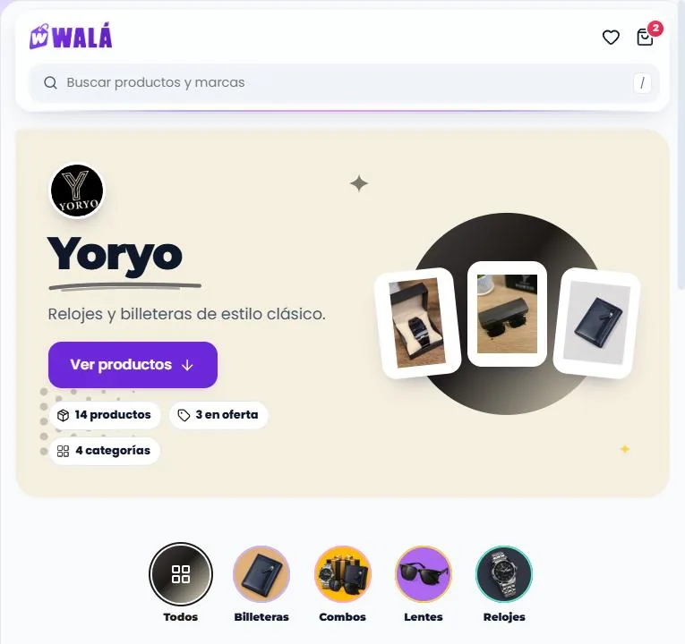
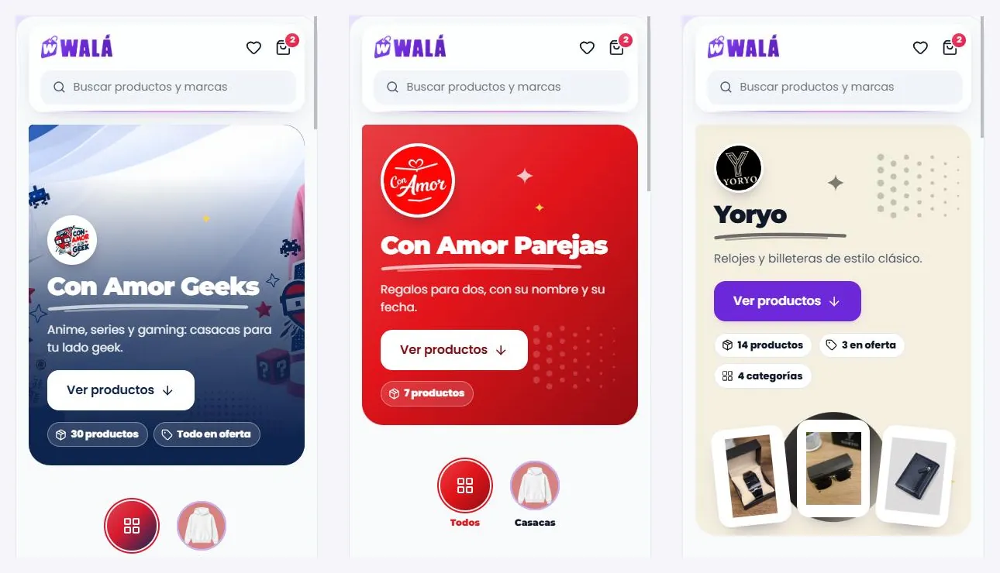

# Navegar la tienda: las landings de marca

> **Retirado el 2026-10-16** (en la tienda y en el kit; nadie lo usaba):
>
> - **Ofertas flash y cofre diario.** En la tienda: `OfertasFlashPage`,
>   `AdminFlashOffers` (y su enlace del admin), `services/flashOffers.js` y
>   `services/chest.js`. En el kit: `PaginaOfertas`, `CofreDiario`,
>   `TarjetaOferta`, `ofertaDesdeFirestore`, `ofertasVigentes`, el esqueleto
>   `forma="ofertas"` y su demo. `/ofertas` lleva a `/tienda`.
> - **Nichos y vendedores.** En la tienda: `NichesPage`, `NichePage`,
>   `VendorStorefrontPage`, el panel `VendorPanel` (`/vendedor`), el admin de
>   Nichos, Vendedores y Pagos a vendedores (`AdminNichos`, `AdminVendors`,
>   `AdminPayouts` y sus enlaces del menú), `services/niches.js`,
>   `services/vendors.js`, `services/payouts.js` y los selectores "Nicho" y
>   "Vendedor" del formulario de producto. En el kit: `PaginaNichos`,
>   `PaginaColeccion`, `nichoDesdeFirestore`, los esqueletos `forma="nichos"`
>   y `"coleccion"` y su demo. `/nichos`, `/nicho/:slug`,
>   `/tienda-vendedor/:slug` y `/vendedor` llevan a `/tienda`.
>
> **Se dejó sin tocar:** el servidor (`openDailyChestSecure`,
> `createOrderWithSubordersSecure`, `createCheckoutPreferenceSecure` y los
> pagos: ninguna pantalla los llama; el checkout real usa
> `prepareCheckoutPayment`), las colecciones (`flashOffers`, `niches`,
> `vendors` con WALA, `payouts`) con sus reglas, y las etiquetas `vendorId` y
> `nicheId` de los productos (`products.js` sigue leyendo sus valores por
> defecto; el buscador sigue filtrando por ellas si llegan). Un producto que
> se edita conserva las suyas. Para volver, todo está en el historial de git
> (los commits dicen "retirados").

Cómo verlo en vivo: `npm run dev` → http://localhost:3000/componentes.html →
**Páginas** → **Tienda de prueba** → **Página de marca** (`/:slug`): el
diseño nuevo, la página de una marca sin armarla (abajo). El menú Marcas de
la cabecera también lleva ahí (las marcas con productos en los datos de la
demo). La pestaña "Landing de marca", con las landings tal como están hoy,
se quitó el 2026-10-16: la demo muestra solo el diseño nuevo.

Revisado el 2026-10-15 contra `pages/Tienda/DynamicLandingPage.jsx` →
`TiendaPage` (143 líneas). Los datos de la demo son reales:
`landingPages`, `pages/{slug}` y los productos de esas marcas, leídos con la
API pública (`demo/landings.json`; de ahí salen los productos de la página de
marca y la foto de Con Amor Geeks).

## Partes

| Parte | Componente | Piezas que usa | Datos (en la tienda) |
|---|---|---|---|
| S1… Landing | `PaginaTienda` + `RenderSecciones` | las secciones del builder | `landingPages` (`slug`, `brandId`, `hideHeader`, `hideFooter`) y `pages/{slug}` |

Esqueleto: la landing por sus secciones (`EsqueletoPagina secciones={…}`).

### Lo que hace

`PaginaTienda` con las secciones guardadas. Con `hideHeader` /
`hideFooter`, sin cabecera o sin pie.

**Las burbujas de categorías (`categories_nav`)** filtran el catálogo de la
misma página, como en la tienda, y salen de la **lista curada de la marca**
(`tienda_brands.categoryNav`, con `navDeMarca`; antes de 2026-10-16 el kit
usaba las categorías sueltas de los productos y mostraba "Casacas" donde
wala.pe dice "Poleras"):

- la lista de la marca en su orden, con su nombre y su foto (sin foto, la de
  la categoría), solo las que tienen productos de la marca;
- al final, las categorías que la marca usa y no están en la lista;
- sin lista, todas las que usa;
- el estilo de la marca (`categoryNavStyle`: alineación y `slider`) manda.

La sección es compacta (0,75 rem arriba y abajo si el editor no fija otro
relleno), como en wala.pe: las burbujas quedan casi pegadas al banner y al
catálogo.

## La página de una marca sin armarla (`PaginaMarca`)

Hoy cada marca arma su landing a mano en el builder y 7 de ellas repiten lo
mismo (banner, burbujas, destacados, ofertas y catálogo), todas en el violeta
de Walá. `PaginaMarca` hace esa página sola con la **identidad** de la marca
(unos pocos campos) y una **plantilla** de secciones del builder. Cómo verla:
**Tienda de prueba** → **Página de marca**, con "Cómo se abre" (tres marcas y
la de hoy) y los estados (cargando, error, sin productos).

**Las identidades de la demo son DE EJEMPLO.** Los colores salen de cada
logo y la foto de Con Amor Geeks es la de su landing real, pero en
`tienda_brands` todavía no existe `identidad` (todas tienen `bgColor`
blanco). Las frases también son de ejemplo. Los productos y las burbujas sí
son reales (los combos de Yoryo traen sus piezas, `comboItems`, copiadas
de `productos_wala` el 2026-10-16: sin ellas la tarjeta salía sin foto; y
todos los combos de la demo, su portada `comboPreviewImage`, que la tarjeta
usa primero como la tienda).

### Partes

| Parte | Componente | Qué hace |
|---|---|---|
| El color | `TemaMarca` (`temaDeMarca`) | Va solo en la portada y en el trazo bajo los títulos. Todo lo que se toca sigue violeta, como en toda la tienda: los botones, las burbujas de categorías, los filtros (su sello, la ✕, los chips elegidos), los sellos de los productos, la cabecera, el pie y Kapi. El 2026-10-16 las burbujas y los filtros también tomaban el color de la marca y, al lado de lo violeta, se veía raro. |
| La portada | `PortadaMarca` | Logo en sello girado, el nombre con trazo, la frase, "Ver productos" (baja al catálogo) y sus cifras en sellos: productos, en oferta ("Todo en oferta" si lo están todos) y categorías (las que son 0, o una sola categoría, no salen). Tres estilos: `foto` (la foto de fondo con el color de la marca detrás del texto), `color` (el degradado de la marca con el logo grande) y `collage` (fondo tenue con tres productos en cartas giradas sobre el sello grande de la marca, con puntos y destellos de su color). |
| Las secciones | `plantillaDeMarca` | `categories_nav` (las burbujas curadas, `navDeMarca`), `featured_carousel` "Lo más pedido", `sale_carousel` "En oferta" y `sidebar_catalog` "Todo {marca}" con `anchorId: 'catalogo'`. Sin destacados o sin ofertas, esa fila no sale. Las filas van más juntas que en el inicio (1 rem arriba, 1,5 abajo). |
| La página | `PaginaMarca` | `PaginaTienda` con la portada (`antes`) y el tema (`tema`). Si la marca ya tiene secciones propias (una landing del builder), mandan esas; la portada sale solo si no traen `hero_banner` ni `hero_carousel`. |

Esqueleto: `EsqueletoPagina secciones={ESQUELETO_MARCA}` (portada, burbujas,
una fila y el catálogo). Error: Kapi triste y "Reintentar". Sin productos:
"Ir a la tienda".

### Lo que se configura (a futuro, en `tienda_brands.identidad`)

| Campo | Qué es | Sin él |
|---|---|---|
| `color` | El color de la marca (hex) | `bgColor` si no es blanco; si no, el violeta de Walá |
| `color2` | El segundo color: el final del degradado y, de noche, el acento si el primero no se ve (el negro de Yoryo pasa a crema) | El primero oscurecido |
| `estilo` | `foto`, `color` o `collage` | `foto` si hay `imagen`; si no, `color` |
| `imagen` | La foto de la portada | Sin ella, `foto` cae en `color` |
| `frase` | Una línea bajo el nombre | "Productos de {marca}" |
| `bloques` | Qué secciones lleva y cuáles no (`BLOQUES_MARCA`: categorias, destacados, ofertas, catalogo) | Todas |

Lo lee `identidadDeMarca(marca)`. Para la noche, `temaDeMarca` busca una
versión del color que se vea sobre el fondo oscuro (contraste 3:1); el texto
encima de un acento se elige blanco u oscuro por contraste.

## Las landings del builder salen con el kit

Comprobado el 2026-10-15 contra las 18 landings de `landingPages`:

| Landings | Secciones | ¿Las dibuja el kit? |
|---|---|---|
| catas, conamorequipos, conamorgeeks, conamorparejas, factos, lumi, nova | `hero_banner`, `categories_nav`, `featured_carousel`, `sale_carousel`, `sidebar_catalog`, `marquee` | Sí |
| yoryo | `hero_carousel`, 4 × `category_carousel`, `marquee` | Sí |
| muebleria | `header`, `sidebar_catalog` | Sí |
| regalos-con-amor | `header`, `text`, `video`, `marquee`, `map_location`, `image` | Sí, pero hoy nadie la ve (ver abajo) |
| testing | `text` | Sí |
| reloj-kchero-2026, reloj-matador-pro-2026, billetera-kchero-2026, combo-reloj-billetera-2026 | — | Retiradas el 2026-10-19 (K-CHERO): sus URLs llevan a `/tienda` (`DynamicLandingPage`) |
| deportes-top, pareja-viral, relojes-promocion, veranito-promo | ninguna | Página vacía (también hoy) |

Hoy ni `DynamicLandingPage` ni `TiendaPage` usan el kit: dibujan con su
propio `renderSection`. Migrarlas es el mismo paso que el inicio y /tienda
(INICIO.md, TIENDA.md).

## Llevar a la tienda (en parte: las secciones, 2026-10-16)

**Hecho:** las páginas de marca (landing con `brandId`) dibujan sus secciones con el kit dentro de `TiendaPage`
(`esPaginaDeMarca`), igual que `/tienda` (TIENDA.md): `hero_banner` →
`BannerPrincipal` (con `trackBannerClick` y lo que falte del banner global),
`categories_nav` → `NavCategorias` (`navCategoriesByBrand`: burbujas y
estilo de la marca, esqueleto mientras cargan; filtran el catálogo y bajan
hasta él), `featured_carousel` / `sale_carousel` / `category_carousel` →
`CarruselProductos`, `sidebar_catalog` → `CatalogoConFiltros` (sin grupo
Marcas, con buscador en vivo sobre todos los productos de la marca) y
`marquee` → `MarcasMarquesina`. Interruptor: `seccionesViejo`.

Desde el 2026-10-17 también las **landings sin marca** van con el kit (todos
los tipos) y con el fondo y los colores de la tienda. Las de **K-CHERO** (el
cacherito: reloj, billetera y combo), que seguían con lo de antes y un tema
oscuro (`landing-mobile.css`), se retiraron el 2026-10-19 con sus dos
bloques: sus URLs llevan a `/tienda` y la caja de cualquier landing queda en
`landing.css`.

En producción (2026-10-17): `testing` (un texto), `regalos-con-amor` (no se
ve: la ruta es de `NuevosUsuariosPage`) y tres sin documento en `pages`
(`deportes-top`, `pareja-viral`, `veranito-promo`, vacías como antes).

**Falta:** lo de abajo (`PaginaMarca` con la identidad).

### Reemplazos

| Hoy | Pasa a (kit) |
|---|---|
| `TiendaPage isLandingPage` dentro de `DynamicLandingPage` | `PaginaTienda` (`secciones`, `marcaActual = brandId`, `respaldo` para lo que el kit no tenga). Por ahora: `SeccionDelKit` dentro de `TiendaPage` (arriba) |

**Lo que no cambia:** `DynamicLandingPage` sigue resolviendo el slug (por
`slug`, sin mayúsculas, y `slugsAnteriores` → `redirigirA`), el tema
(`themeId` → `cssContent`) y manda a `/tienda` las URLs retiradas de K-CHERO. Solo cambia
lo que dibuja.

### De dónde sale cada dato

Las secciones de `loadStorefrontPage(slug)`, `marcaActual` es
`landing.brandId` y los productos, los mismos que reparte `TiendaPage` con
`pageBrandId` (destacados y catálogo acotados a la marca). Las burbujas:
`navPorMarca = { [brandId]: navDeMarca(getBrand(brandId), { productos:
getProductsByBrand(brandId), categorias: getCategories() }) }` por cada
`categories_nav` con marca (la misma regla que `navCategoriesByBrand` de
`TiendaPage`). En la demo, `demo/marcas.json` trae la `categoryNav` real de
cada marca.

### Comportamiento que no se puede perder

Las landings esconden la cabecera y el pie según `hideHeader` / `hideFooter`.

### Lo que se encontró de paso (para decidir aparte)

- La landing `regalos-con-amor` no se ve nunca: la ruta `/regalos-con-amor`
  de `NuevosUsuariosPage` está declarada antes que `/:slug`.
- Si algún día vuelven las ofertas flash: la consulta (`active == true` +
  `orderBy('order')`) necesita un índice compuesto que no está en
  `firestore.indexes.json`.

### Pasos

La página de marca va después: primero la identidad en el admin de
marcas (los seis campos de arriba en `tienda_brands.identidad`), luego
`DynamicLandingPage` monta `PaginaMarca` (con las `secciones` de la landing
si existe) y las landings que hoy repiten la plantilla pueden dejar sus
secciones vacías.

Junto con la migración del inicio y /tienda a `PaginaTienda` (paso 5 de
MIGRACION.md): `DynamicLandingPage` deja de montar `TiendaPage` y monta
`PaginaTienda`.
