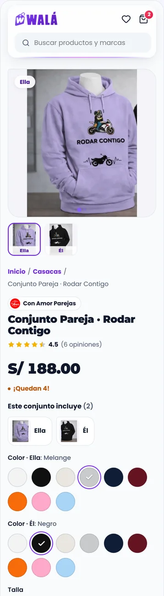
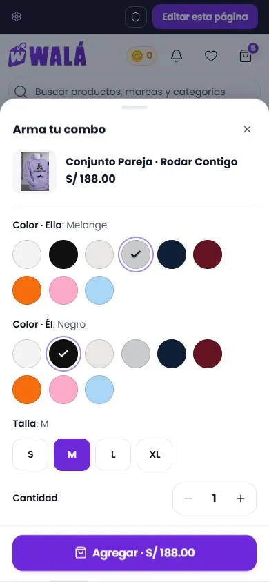

# La ficha de un producto (`/producto/:id`)

Cómo verla en vivo: `npm run dev` → http://localhost:3000/componentes.html →
**Páginas** → **Tienda de prueba** → **Un producto**. También se abre desde
**cualquier tarjeta** de la Tienda de prueba (inicio, tienda, buscar,
favoritos, el carrito). En "Cómo se abre": una prenda con colores y tallas,
uno sin opciones, un combo de pareja y un producto de un solo modelo. En los
estados: cargando, error, ya no está disponible, agotado, personalizable (para
ver el botón), personalizable con Yoryo, sin opiniones, opiniones cargando,
combo con las prendas cargando y el regalo de una lista.

**En la tienda desde el 2026-10-17** (paso 6): `/producto/:id` es esta página
(ver "En la tienda", abajo).

(Celular, 390 px, 2026-10-16. En escritorio es la misma columna a la derecha
de la galería; la captura de 1366 sale achicada en el panel y no se dejó.)

Revisado el 2026-10-15 contra `src/pages/ProductPage.jsx` y
`src/pages/Tienda/components/ProductDetail/ProductDetail.jsx` (905 líneas) y
`ProductReviews.jsx`. Datos del ejemplo: `demo/producto.json`, con 6
documentos reales de `productos_wala` (solo los campos que usa la ficha: la
descripción, las variantes y las dos prendas del combo "Rodar Contigo"). Los
demás productos de la demo abren su ficha con lo que trae la lista (sin
descripción).

**Rediseñada el 2026-10-16** para que no se sienta estática: la galería se
desliza, lo elegido viaja de una opción a otra, el precio corre, el botón
confirma "¡Agregado!" y en escritorio aparece la barra de compra al bajar.
Ver "Lo que hace".

**Las opiniones de la demo son de ejemplo.** Hoy `product_reviews` tiene 3
reseñas de prueba en un producto borrado, así que no sirven para ver el diseño.
`DemoProducto.jsx` lo dice en el código.

## Partes

| Parte | Componente | Piezas que usa | Diseño en | Datos (en la tienda) |
|---|---|---|---|---|
| P13 Página | `PaginaProducto` | `MarcoFicha`, `Migas`, `PrecioFicha`, `ConfianzaCompra`, `BarraCompra` (el marco de `piezas/Ficha`, el mismo de una creación y de un combo) | `paginas/Producto.module.css` | `fichaProductoDesde(producto, { catalogo, subproductos })` |
| Galería | `GaleriaProducto` | — | `piezas/GaleriaProducto.module.css` | `fotos.base` y `fotos[varianteId]`; las copias de cada foto con `fuentes` |
| Migas y precio | `Migas`, `PrecioFicha` | `useContador` (el precio corre) | `piezas/Ficha.module.css` | `producto.categoria`, `precio`, `precioAntes` |
| Opciones | `OpcionesProducto` (la misma de "Agregar rápido") | `SelectorColor`, `SelectorTalla`, `Cantidad` | `piezas/OpcionesProducto.module.css` y `Formulario.module.css` (`.colorAro`, `.tallaMarca`) | `opcionesDeProducto` (ya existía) |
| Compra | `.compra` de `PaginaProducto` (pegada abajo en el celular) | `Boton`, `IconoWala` (el regalo) | `paginas/Producto.module.css` | `onAgregar`, `onComprar`, `onPersonalizar` y `textoPersonalizar`, `carrito`, `onPagarCarrito`, `regalo` |
| Confianza | `ConfianzaCompra` | `IconoWala` (`camion`, `cambio`, `escudo`) | `piezas/Ficha.module.css` | fija |
| Barra de compra (escritorio, al bajar) | `BarraCompra` (pieza nueva) | `FotoProducto`, `Boton` | `piezas/Ficha.module.css` | la foto, el nombre, lo elegido y el precio de la ficha |
| Opiniones | `ResumenOpiniones`, `TarjetaOpinion`, `FormularioOpinion`, `Estrellas` (piezas nuevas) | `Avatar`, `Sello`, `Campo`, `Boton`, `Hueso` (mientras llegan) | `piezas/Opiniones.module.css` | `getProductReviews` → `opinionesDesde` (+ `cargando`); se piden con `onVerAbajo` |
| También te puede gustar | `Carrusel` + `TarjetaProducto` (o la de la tienda con `tarjeta`) | — | los suyos | `getProductsByCategory` → `tarjetaDesdeProducto`; se piden con `onVerAbajo` |

### Lo que hace

- **Cabeza:** las migas (Inicio / la categoría / el producto). La categoría
  lleva a `/tienda?categoria=…`; en la tienda las dos llevan a `/`. Después,
  la marca con su logo como enlace a su página, el nombre con la letra de la
  marca y, con sesión, **Compartir y ganar monedas**. Si hay opiniones, las
  estrellas con el promedio llevan a la sección de opiniones.
- **Precio:** `PrecioFicha`, con el precio de antes y el descuento en su sello.
  Con 10 o menos unidades, "¡Quedan N!" (la misma regla que la tarjeta).
- **Combo:** "Este conjunto incluye (2)", cada prenda con su foto (la del
  color elegido, si ese color tiene). Después, un color por prenda (abre con
  el color del combo, `variantMapping.color`; `allowedColors` se compara sin
  espacios ni mayúsculas) y, debajo, **la talla de esa prenda** ("Talla ·
  Ella", "Talla · Él"): una pareja puede ser de tallas distintas (desde el
  2026-10-22; antes era una talla para todas). El admin lo elige por combo
  ("Tallas del combo", campo `comboTallas`): `'una'` vuelve a una sola talla
  para todas (la que comparten los colores elegidos, con "Se aplica a las N
  prendas"); sin el campo o `'porPrenda'`, una por prenda. Las tallas de cada prenda son
  las de su color elegido (`tallasDePieza`): si al cambiar el color la talla
  elegida ya no está, se vuelve a pedir. Cada prenda va al carrito con su
  talla (`comboVariantSelections[i].size`), que el pedido ya guardaba por
  prenda.
- **Falta la talla:** al tocar Agregar o Comprar sin talla, la que falta (en
  un combo, cada una) se marca en rojo y se sacude en cada intento; si no está
  a la vista (en el celular el botón va pegado abajo), la página baja hasta
  ella.
  **Al cambiar el color de una prenda, la galería se desliza hasta la foto de
  esa prenda en ese color** ("Él · Negro"; la miniatura dice solo "Él"). Las
  fotos salen de la variante de la prenda (`imageUrl`, `galleryImages`,
  `images`) y, si no tiene, de la prenda (`imageUrl` del combo, `mainImage`,
  `images`). Si el color elegido no tiene foto, la prenda sigue en la galería
  con la que hay, rotulada con su color real, y la galería no se mueve.
- **Galería:** las fotos van en una tira que se desliza. En el celular sigue
  al dedo y encaja foto por foto, con puntos abajo. En escritorio, al tocar o
  pasar por una miniatura, la tira se desliza hasta esa foto. El borde de la
  miniatura elegida viaja de una a otra. Con ratón, la foto se acerca donde
  está el cursor. La foto se funde con el escenario (`multiply`), así que su
  fondo blanco no deja una franja.
- **Opciones:** el color en muestras (o el modelo en botones, si las
  variantes no tienen color) y la talla con su nombre (`sizeLabel`: Talla,
  Medida…). **Lo elegido viaja**: el aro del color y el fondo violeta de la
  talla se deslizan de la opción anterior a la nueva (con resorte; sin
  movimiento si se pide reducirlo). **Las muestras son siempre de color**,
  nunca la foto de la variante (se probó el 2026-10-16 y se veía mal). Si a
  una variante le falta `colorHex`, el color sale del nombre
  (`getFallbackHex`: "Negro", "Celeste"…); solo sin color pasa a botones
  "Modelo". **Una sola variante con tallas** muestra igual su color
  (como la tienda); sin tallas ("Principal" de un sérum) no se muestra.
  Al cambiar de color, la galería pasa a
  sus fotos y **la talla elegida se queda** si el nuevo color la tiene (igual
  que "Agregar rápido"). Abre con la variante principal (`defaultVariantId`);
  la tienda abre siempre la primera. Cada cambio de variante (y la de
  entrada) llega a `onVariante`.
- **Precio:** si cambia (otra variante), corre hasta el nuevo; el descuento
  entra con un golpe de sello.
- **Comprar:** Agregar al carrito (y Personalizar, si es personalizable),
  Comprar ahora y, si ya hay algo en el carrito, "Ir a pagar mi carrito (N)".
  Sin talla no se agrega: las tallas toman un borde rojo y se sacuden una
  vez a los lados (sin recuadro alrededor; quietas si se pide menos
  movimiento) y debajo dice "Elige una talla para continuar". Agotado: "Agotado por ahora", sin "Comprar ahora" ni cantidad.
  Al agregar, el botón dice **"¡Agregado!"** con un check un momento (1,8 s).
  **En el celular, Agregar y Personalizar quedan pegados abajo**, sobre la
  barra inferior, y los flotantes (WhatsApp, Kapi) suben por encima
  (`data-compra-fija` → `--flotante-extra`). **En escritorio, al bajar**
  hasta la descripción o las opiniones, sube desde abajo la `BarraCompra`:
  la foto, el nombre, lo elegido ("Perla · M" o "Elige talla"), el precio y
  Agregar. Si falta la talla, la vista vuelve hasta ella. **Se va antes de
  "También te puede gustar" y del pie** (`hasta`), para no taparlos; vuelve
  al subir de nuevo a las opiniones.
  "Ir a pagar mi carrito" llama a `onPagarCarrito` si se pasa.
- **Confianza:** envío, cambios y pago seguro con los íconos de Walá
  (`IconoWala`), no con íconos de línea.
- **Descripción:** también da formato a lo que escribe el editor de
  productos: títulos, listas, imágenes, videos (`iframe` 16:9), enlaces y la
  alineación (`ql-align-*` o `text-align`).
- **Descripción:** el HTML del producto en un `Acordeon` abierto (las líneas
  vacías del editor no dejan huecos).
- **Opiniones:** a la izquierda, el resumen (fijo al bajar, debajo de la
  cabecera, que también va pegada arriba): el promedio
  grande, las estrellas y una barra por estrella (tocarla deja solo esas).
  Debajo, "Escribir una opinión". A la derecha:
  - **Fotos de clientes:** una tira con todas las fotos de las opiniones. Al
    tocar una se abre grande en una hoja.
  - **La más útil:** la opinión con más votos (desde 1) va primero, en una
    tarjeta con costura y "La más útil para la comunidad".
  - **Las demás:** de a 4, con "Ver más opiniones (N)". Cada una muestra
    quién (nombre e inicial del apellido), la fecha, las estrellas, el texto,
    sus fotos y **Útil · N**. Sin sesión, votar pide entrar.
  - **El formulario:** las estrellas (radios: flechas y Enter), el texto y
    hasta 5 fotos con vista previa y quitar. Sin estrellas o sin texto avisa
    abajo, sin `alert`. Sin sesión, invita a entrar.
- **Estados:**
  - Cargando: `EsqueletoPagina forma="producto"`.
  - Error: Kapi triste y "Reintentar". En la tienda se ve un `div` con
    "Error al cargar el producto: Documento no encontrado".
  - Retirado (`deleted` o `visible: false`) o que no existe: "Este producto
    ya no está disponible" e "Ir a la tienda".
  - Combo con las prendas cargando (`piezasCargando`): los colores de cada
    prenda van en esqueleto; al llegar, cada una abre con su color (el del
    combo o el primero).
  - Opiniones cargando (`opiniones.cargando`): dos tarjetas en esqueleto.
  - Regalo de una lista (`regalo`): el aviso con el regalo de Walá sobre los
    botones.
- **Lo de abajo, cuando se acerca:** `onVerAbajo` se llama una vez, cuando
  las opiniones quedan a 300px de la vista (`IntersectionObserver`). La
  tienda pide recién ahí las opiniones y los relacionados.
- **Fotos:** cada foto puede traer `srcSet` (con `fuentes(url) → { src,
  srcSet }`): la grande pide la copia de `SIZES_FOTO` (`(max-width: 900px)
  100vw, 46vw`) y la miniatura la de 76px. La foto con la que abre se pide
  primero (`fetchpriority="high"`); las demás, al acercarse. Con muchas
  fotos, la columna de miniaturas mide lo que la foto grande y se desplaza
  (la elegida queda a la vista).

## Para cambiar el diseño rápido: qué se repite

- **El marco de ficha** (`piezas/Ficha.module.css`) es el de una creación, un
  combo y este producto. Lo que cambie ahí cambia en las tres.
- **Los selectores** (`OpcionesProducto`) son los mismos de la hoja "Agregar
  rápido" de las tarjetas.
- **Las estrellas** usan el mismo dorado (`#f5b301`) en el resumen, en cada
  opinión y en la cabeza.
- **Lo que viaja al elegir** (`SelectorColor`, `SelectorTalla` en
  `Formulario.jsx`) es lo mismo en "Agregar rápido", Crear (las tallas de un
  combo) y el estudio. En `CrearStudioPage` se hizo igual (CREAR.md, P12).
- **`ConfianzaCompra` y `GaleriaProducto`** son las de una creación y un combo.

## En la tienda (hecho el 2026-10-17)

(Celular, 390 px, con los emuladores. Se probó también a 1366 en claro y
oscuro; el panel achica esa captura y no se dejó.)

- **Conector:** `src/components/producto/FichaDeProducto.jsx`, desde
  `pages/ProductPage.jsx` (las redirecciones a `/crear/:id` y `/combo/:id`
  siguen ahí). Lee `useProduct`, las marcas, las prendas del combo
  (`usePiezasDelCombo.js`: caché primero, red si falta), las opiniones y los
  relacionados; arma todo con `fichaProductoDesde` y `opinionesDesde`.
- **Lo elegido → carrito:** `components/producto/eleccionCarrito.js`
  (`argumentosDelCarrito`, `rutaDelEditor`): el mismo `addToCart` que
  `ProductDetail`, también para "Agregar rápido".
- **Interruptor `fichaVieja`** (`useLoViejo`): vuelve a `ProductDetail`
  (que ahora baja aparte, solo con el interruptor) y hace que "Elegir" de
  las tarjetas vuelva a llevar a la ficha.
- **"Agregar rápido" en las tarjetas** (decidido en el paso 4, llega con la
  ficha): "Elegir talla"/"Elegir color" abre la hoja
  (`components/producto/AgregarRapidoDeProducto.jsx`, que baja aparte la
  primera vez que se abre) en todas las tarjetas de la tienda
  (`TarjetaDeProducto`). Abre con la variante principal; en un combo, pide
  las prendas al abrir (los colores van en esqueleto mientras llegan).
  Personalizar va al editor con lo elegido; Yoryo, a la ficha.
- **Se mantiene igual:** `recordProductClick` y `trackProductView` al abrir,
  `recordVariantViewTime` (segundos por variante, ahora contados por reloj
  en vez de un `setInterval`), `trackAddToCart` (en CartContext), el
  regalo de una lista (`location.state.regalo`: aviso, `isWishlistGift` y
  al carrito), comprar ahora (`selectOnly`), "Ir a pagar mi carrito"
  (`selectAllItems`), compartir con el código real, Yoryo y su historial
  (fuera del kit, bajan al tocar "Personalizable"), el WhatsApp del producto
  (el marco lee la misma consulta `['product', id]`) y `initialData` desde
  las listas.
- **Carga:**
  - Ya no se precargan todas las URLs del producto (`useImagePreloader`
    recorría el documento entero, también las copias chicas, y volvía a
    dibujar la ficha una vez por foto). Ahora baja la foto que se ve, en su
    tamaño (`fuentesDeImagen`, como las tarjetas), y cuando el navegador
    queda libre, la primera foto de cada color (hasta 8).
  - Opiniones y relacionados se piden al acercarse (`onVerAbajo`), con
    caché (`['product-reviews', id]`); antes se pedían al entrar y las
    opiniones de nuevo en cada visita.
  - El paquete de la ficha pesa casi lo mismo (gzip: 15,8 KB de JS y 4,9 de
    CSS; antes 13,6 y 6,5) y ya no trae `ProductDetail`, el historial de
    Yoryo ni `PremiumProductCard`.
  - Queda para después (decidido): `useProduct` lee y reescribe todo el
    catálogo de localStorage en cada ficha.
- **Arreglado de paso:** un solo toast al agregar (el de CartContext); una
  opinión recién publicada ya se puede marcar útil (`addReview` devuelve el
  id aparte y la ficha vieja lo perdía); si las prendas del combo no llegan,
  avisa en vez de quedarse cargando; sin portada, la hoja del combo muestra
  la foto de una prenda (no el relleno "Producto").
- **Sesión:** "con sesión" es `tieneCuenta` (no la sesión anónima de las landings), como el resto de la tienda. Opinar sin cuenta lleva a
  `/login?redirect=` y vuelve a la ficha.
- **Traducción:** los textos fijos de la ficha, las opciones, las opiniones,
  la galería y "Agregar rápido" pasan por `<Texto>` (TRADUCCION.md).

### Reemplazos (hechos)

| Parte | Hoy en la tienda | Pasa a (kit) |
|---|---|---|
| Galería | `Gallery` (interno de ProductDetail) | `GaleriaProducto` |
| Migas, título, marca, precio | el bloque de `.infoCol` | `Migas`, cabeza de `PaginaProducto`, `PrecioFicha` |
| Color, talla, cantidad, combo | swatches con `DraggableContainer`, píldoras, − / + | `OpcionesProducto` |
| CTAs y barra fija del celular | `.ctaStack` | `.compra` de `PaginaProducto` |
| Insignias | las tres fijas | `ConfianzaCompra` |
| Descripción | `
` | `Acordeon` |
| Reseñas | `ProductReviews` (406 + 598 líneas de CSS) | `ResumenOpiniones`, `TarjetaOpinion`, `FormularioOpinion` |
| Relacionados | `FeaturedCarousel` con `PremiumProductCard` | `Carrusel` + `TarjetaProducto` |
| Barra de compra en escritorio | no existe | `BarraCompra` (nueva) |
| Retirado y error | tarjeta de ProductPage y un `div` sin estilos | estados de `PaginaProducto` |

### De dónde sale cada dato

- **`producto`, `opciones`, `varianteInicial`, `fotos`:** `useProduct(id)`, los
  sub-productos del combo (el mismo efecto de hoy) y `getBrands()` y las
  categorías para `catalogo`, todo por `fichaProductoDesde`.
- **`opiniones`:** `getProductReviews(id)` → `opinionesDesde(resenas, { uid })`.
  `onOpinar` sube las fotos y llama a `addReview`; `onUtil` llama a
  `toggleHelpfulVote`.
- **`relacionados`:** `getProductsByCategory(categoria, marca)`, sin el
  producto, máximo 12, con `tarjetaDesdeProducto`.
- **`onAgregar` y `onComprar`:** `addToCart` con el mismo item de hoy
  (`variant { size, color, colorHex, selectedVariant }` y, en combos,
  `comboVariantSelections`). Comprar va con `{ selectOnly: true, silent: true }`
  y navega a `/checkout`.
- **`onPersonalizar`:** `/editor/{id}?size=&color=&comboSelections=`.
- **`onVariante`:** `recordVariantViewTime` (el contador por variante de hoy).
- **`onPagarCarrito`:** `selectAllItems()` y `/checkout` (con el toast si el
  carrito está vacío, como hoy).
- **`onCompartir`:** `linkProducto` con el código del cliente, copiado al
  portapapeles.
- **`carrito`:** cuántos hay en el carrito (`useCart`).

### Comportamiento que no se puede perder

- Las redirecciones de ProductPage: `esPrendaBase` → `/crear/:id` y
  `esComboCrear` → `/combo/:id`.
- La analítica: `recordProductClick`, `trackProductView`,
  `recordVariantViewTime` (el contador por variante, con `onVariante`) y
  `trackAddToCart`.
- `initialData` desde la caché de las listas: la ficha se pinta al instante.
- Combos: no se agrega mientras cargan las prendas ("Un momento: estamos
  cargando las prendas del combo").
- **Lo que se queda en la tienda, sin pasar al kit:**
  - El personalizador **Yoryo** (`YoryoPersonalizado`, con su historial de
    diseños). El botón se muestra con el texto "Personalizable".
  - (El **cuestionario** de algunos productos, `cuestionario://` dentro de la
    descripción, se retiró de la tienda el 2026-10-16: no tenía pantalla en
    el admin, había una sola plantilla de ejemplo y creaba el pedido desde el
    navegador. Para volver, todo está en el historial de git.)
- El botón de WhatsApp global lee `whatsappEnabled`, `whatsappNumber` y
  `whatsappMessage` del producto.

### Diferencias a propósito (no "corregirlas" al migrar)

- La categoría de las migas lleva a su página de la tienda, no al inicio.
- Abre con la variante principal (`defaultVariantId`), no con la primera.
- La galería no repite el nombre del producto en cada foto: solo dice el
  color, o la prenda en un combo.
- Las opiniones van a todo el ancho, debajo de la ficha (en la tienda van
  apretadas en la columna derecha de 520px).
- La firma de una opinión es el nombre y la inicial del apellido.
- El error y el retirado tienen su estado con Kapi y una salida.
- Sin emojis ("🔍 Hover para zoom", "✨", "✅").
- No elige la primera talla sola: se elige y, si falta, se avisa.
- Al cambiar de color la talla se conserva si existe.
- En escritorio, la barra de compra al bajar (la tienda no la tiene).
- El botón confirma "¡Agregado!" además del toast.
- Combo: si el color elegido de una prenda no tiene foto, la prenda sigue en
  la galería con la foto que hay (rotulada con su color); en la tienda
  desaparece y la galería vuelve a la portada. Con los datos reales casi
  ningún color tiene foto propia (en "Rodar Contigo", 1 de 9 por prenda).
- Las muestras son de color, no la foto de la variante (en la tienda, la
  foto si la hay).

### Lo encontrado de paso (2026-10-16, comparando con `ProductDetail.jsx`)

Resuelto al llevarla a la tienda (2026-10-17):

- **Fotos:** `fuentes` (copias en varios tamaños), la primera con
  `fetchpriority="high"` y las vistas de personalización por color en
  `fichaProductoDesde` (`vistasPorColor`).
- **Muchas fotos:** la columna de miniaturas mide lo que la foto grande y se
  desplaza.
- El **WhatsApp del producto** sigue en el marco de la tienda
  (`useWhatsAppDeLaRuta`), sin cambios.
- **El toast doble** al agregar: queda solo el de CartContext.
- `.compra` usa `--alto-barra-inferior` (la demo la define en su marco) o,
  en la tienda, `--bottom-nav-height` + la zona segura.
- Con "Ver componentes", el resumen de opiniones dejaba de quedarse fijo al
  bajar (la regla de la demo le ganaba al `sticky`): arreglado con `:where()`
  en `DemoTienda.module.css`.

### Qué se probó (2026-10-17, localhost con los emuladores)

- Prenda (Casaca One Piece): sin talla avisa y no agrega; color + talla →
  carrito con `selectedVariant` y talla; al cambiar de color la talla se
  queda; "¡Agregado!" y un solo toast; comprar ahora deja solo ese elegido y
  va a `/checkout`; "Ir a pagar mi carrito (2)" elige todo.
- Combo (Rodar Contigo, con sus dos prendas sembradas en el emulador desde
  `demo/producto.json`): las prendas llegan después y cada una abre con su
  color; cambiar el color de una y la talla → `comboVariantSelections` con
  color y talla por prenda. Otro combo sin sus prendas en el emulador (Snoopy
  Corazón): deja de cargar, avisa al agregar y el botón no dice "¡Agregado!".
- Sin opciones (SKIN1004): agrega con su única variante.
- No existe (`/producto/no-existe-123`): "ya no está disponible".
- Opiniones: publicar (4 estrellas, sin fotos), "Útil" marca y desmarca;
  en el celular se piden recién al bajar.
- Relacionados con la tarjeta de la tienda; "Elegir" abre "Agregar rápido"
  (prenda y combo) y agrega.
- Regalo de una lista (`location.state`): aviso, `isWishlistGift` y al
  carrito.
- Compartir: copia `/producto/:id?ref=` con el código de la cuenta.
- `fichaVieja` en `localStorage.wala_kit_viejo`: vuelve `ProductDetail`.
- 1366 y 390, claro y oscuro.

No se probó en la tienda: Yoryo (ningún producto del emulador lo tiene; el
botón "Personalizable" se vio en la demo), el editor desde "Personalizar"
(ningún producto personalizable en el emulador), un producto agotado o con
fotos de variantes (el emulador casi no tiene; se vieron en la demo), subir
fotos en una opinión (sin emulador de Storage) y la app Android.

### Pendiente

- Borrar lo viejo cuando lleve un tiempo en producción (ELIMINAR.md, paso 6).
- La ficha no pone título ni descripción propios para buscadores (tampoco la
  vieja).
