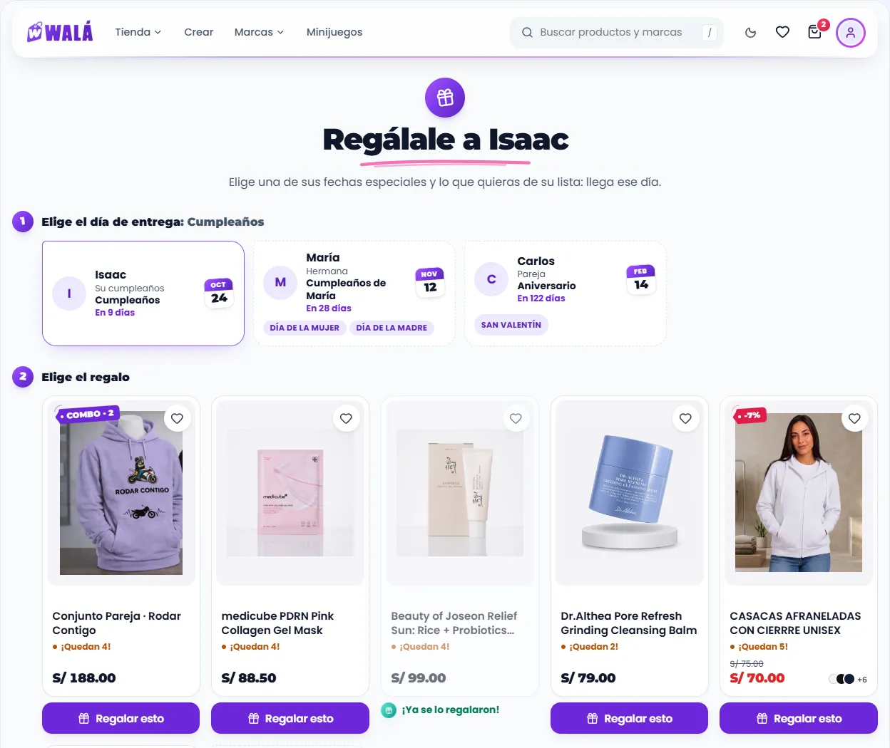
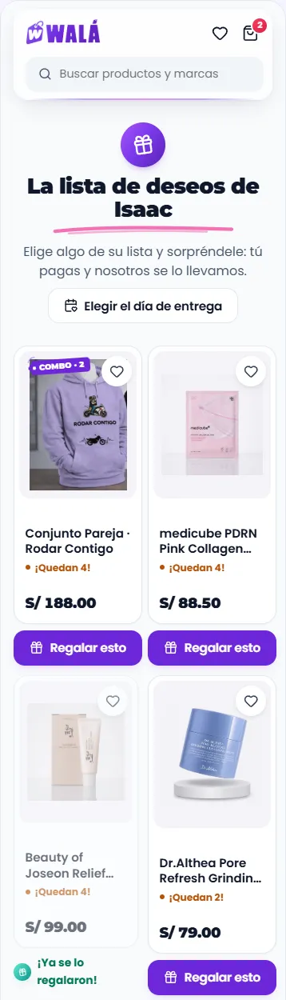
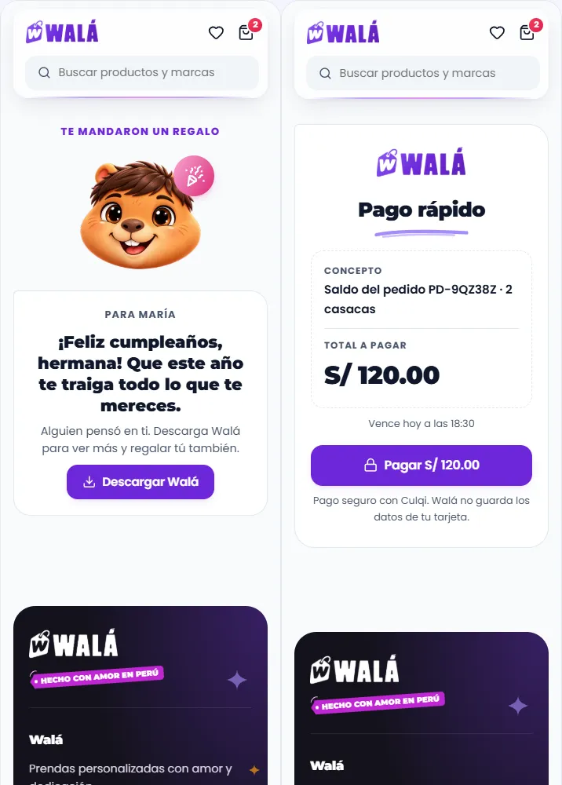
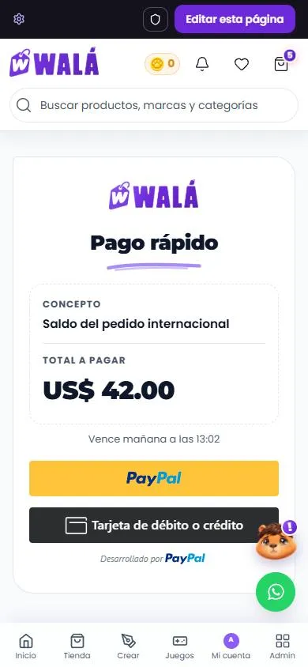
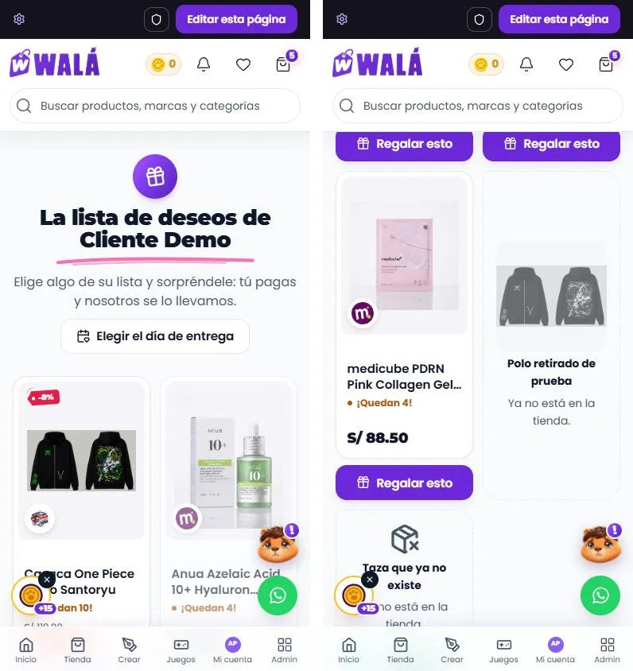
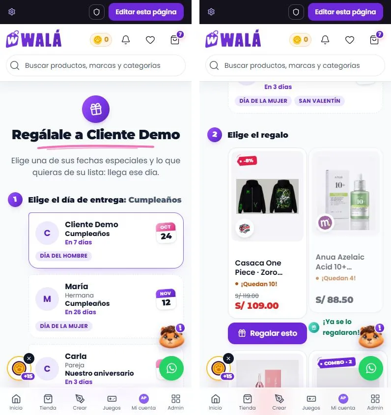
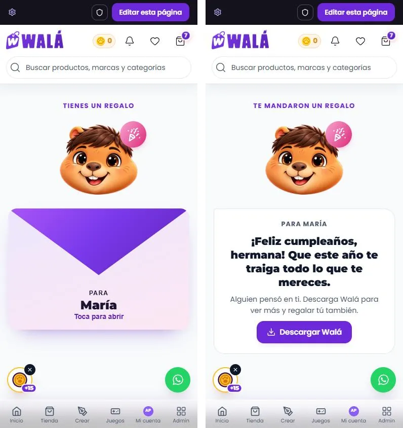

# Regalar y pagar: la lista de otra persona, sus fechas, el regalo y el pago rápido

Cómo verlo en vivo: `npm run dev` → http://localhost:3000/componentes.html →
**Páginas** → **Tienda de prueba**:

- **Regalar**, con "Cómo se abre":
  - su lista de deseos (`/wishlist/:código`);
  - regalar para una fecha (`/regalar/:código`);
  - abrir el regalo (`/regalo/:pedido`).

  Estados: cargando, no encontrada, lista vacía, sin fechas y abierto en la
  app. "Regalar esto" pone el regalo en el carrito de la demo y lleva al
  carrito.
- **Pago rápido** (`/pago-rapido/:id`): en soles con tarjeta o en dólares
  con PayPal. Estados: ya pagado, vencido, no encontrado, el pago falla y
  cargando. **En la tienda desde el 2026-10-17** (ver "Pago rápido en la
  tienda", abajo).
- **Su lista de deseos, regalar para una fecha y abrir el regalo, en la
  tienda desde el 2026-10-17** (ver "La lista pública en la tienda",
  "Regalar para una fecha en la tienda" y "Abrir el regalo en la tienda",
  abajo).

| Regalar para una fecha | Su lista (celular) | El regalo y el pago rápido (celular) |
|---|---|---|
|  |  |  |

Revisado el 2026-10-15 contra estos archivos:

| Página | Archivo | Líneas |
|---|---|---|
| Su lista de deseos | `pages/WishlistPublic/WishlistPublic.jsx` | 242 |
| Regalar para una fecha | `pages/GiftRegistry/GiftRegistryPage.jsx` | 934 (+908 de CSS) |
| Abrir el regalo | `pages/GiftExperiencePage.jsx` | 136 |
| Pago rápido | `pages/PagoRapidoPage.jsx` | 128 |
| Tarjeta | `CulqiCustomCheckout` | 401 |
| PayPal | `PaypalCheckout` y `PaypalEnlaceCheckout` | 180 y 100 |

Los productos de la demo son reales; la persona (Isaac) y sus fechas son de
ejemplo.

## Partes

| Parte | Componente | Piezas que usa | Datos (en la tienda) |
|---|---|---|---|
| P15 Su lista | `PaginaListaPublica` | `TarjetaRegalo` (pieza nueva: `TarjetaProducto sinAccion sinDeseo` + "Regalar esto"), `Sello`, `Trazo`, `EstadoVacio` | `getWishlistByUserCode`, `getPublicGiftRegistry` (el nombre y si tiene fechas), `getProduct` de cada uno (`itemRegaloDesde`) |
| P15 Regalar para una fecha | `PaginaRegalar` | `FechaEntrega` (pieza nueva: `Avatar`, `HojaCalendario`, `Etiqueta`), `PasoEstudio`, `TarjetaRegalo` | `getPublicGiftRegistry` (fechas y lista) por `fechaEntregaDesde` (`proximaOcurrencia`, `festivasDePersona`); `getProduct` de cada uno |
| P15 Abrir el regalo | `PaginaRegaloSorpresa` | `SobreRegalo` (pieza nueva: Kapi 3D, el sticker en un `Sello`) | `getOrderGiftDetails` |
| P16 Pago rápido | `PaginaPagoRapido` | `PagoTarjeta`, `PagoPaypal` (piezas nuevas), `LogoWala`, `EstadoVacio` | `enlaces_pago/{id}` |
| Pagar (también en el checkout) | `PagoTarjeta`, `PagoPaypal` | `Boton`, `Aviso`, `CapaCargando` | Culqi Checkout v4, el SDK de PayPal |

### Lo que hace

- **Su lista:**
  - "La lista de deseos de Isaac" con el sello del regalo y su trazo.
  - "Elegir el día de entrega" lleva a sus fechas.
  - Cada producto es la tarjeta de la tienda con **"Regalar esto"** debajo,
    siempre a la vista. El ya regalado lleva su sello y no se puede volver a
    regalar. El que salió de la tienda muestra la foto que se guardó, en gris.
- **Regalar para una fecha:**
  - **1. Elige el día de entrega:** cada fecha con la foto o inicial, la
    relación, la ocasión, la hoja de calendario de la próxima vez que cae, "En
    9 días" y sus fechas festivas. Es un grupo de radios.
  - **2. Elige el regalo:** "Regalar esto" lo agrega con esa fecha, y abajo
    dice "Se entrega el 24 de octubre (Cumpleaños) a Isaac".
  - Sin fechas: el aviso, y se regala igual.
- **Abrir el regalo:** el sobre cerrado ("Para María · Toca para abrir"),
  y al abrirlo Kapi con el sticker y el mensaje. Debajo, "Descargar Walá" (en
  la web) o "Ver la tienda" (en la app).
- **Pago rápido:**
  - El logo, "Pago rápido", el concepto, el total y cuándo vence.
  - En soles, `PagoTarjeta`; en dólares, `PagoPaypal`.
  - Pagado: Kapi feliz, "¡Pago recibido!" y el número de operación.
  - Vencido o no encontrado: Kapi triste y "Escribir al asesor".
- **`PagoTarjeta`:**
  - "Pagar S/ x" abre la ventana de Culqi.
  - Mientras cobra, "Confirmando tu pago" a pantalla completa.
  - **Controlado** (`procesando`, `error`): tocar solo llama a `onPagar`
    (abre la ventana, que cobra después) y la capa la pone la tienda. Si no,
    la capa quedaría encima de la ventana mientras se escribe la tarjeta.
  - El error sale debajo, y bajo el mínimo (S/ 3 o US$ 1), el aviso de
    coordinar por WhatsApp.
- **`PagoPaypal`:**
  - "Pagarás US$ x (≈ …)" y los botones del SDK (`botones`); en la demo, un
    botón.
  - Mientras captura, "Procesando el pago… No cierres esta ventana". Los
    botones del SDK quedan montados (ocultos): desmontarlos a mitad del pago
    cortaba su aviso de vuelta.
  - El error sale debajo, y bajo US$ 1, el aviso.

## Pago rápido en la tienda (hecho el 2026-10-17)

(Celular, 390 px, con un enlace de prueba del emulador. Se probó también a
1366 y en oscuro.)

- **Conector:** `src/components/pago/PagoRapidoDeTienda.jsx`, desde
  `pages/PagoRapidoPage.jsx`. Lee `enlaces_pago/{id}` y lo pasa por
  `enlacePagoDesde` (`adaptadores.js`): las reglas de la página vieja (vence
  en `expiresAt` o a las 36 h de `createdAt`, salvo pagado; sin moneda es USD;
  el monto en `monto`, `montoUSD` o `montoPEN`), "Vence hoy a las 18:30" y
  el número de operación (`culqiChargeId` o el de PayPal).
- **Tarjeta:** el mismo `CulqiCustomCheckout` (cobro, anti doble cobro, vigía
  del modal cerrado, el píxel), con la prop nueva `renderBoton({ abrir,
  procesando })`: el botón es `PagoTarjeta` controlado. **Sin esa prop todo
  sigue igual** (checkout y saldo de un pedido).
- **PayPal:** `PaypalEnlaceCheckout` con `soloBotones`: avisa "procesando" y
  el error (`onProcesando`, `onError`) y `PagoPaypal` los muestra. Baja
  aparte, solo con los enlaces en dólares.
- **Escribir al asesor** (vencido o no encontrado): el número principal de
  WhatsApp (`whatsapp_number_principal`, como el checkout) con "Hola, mi
  enlace de pago (id) ya venció. ¿Me mandas uno nuevo?".
- **Sin cuenta:** se paga igual; basta con tener el link (ver "Pagar sin
  cuenta", abajo).
- **Interruptor `pagosViejo`:** ahora también vuelve la página de antes
  (`pages/PagoRapidoViejo.jsx`, que baja aparte).
- **Carga:** 3,8 KB + 0,8 KB de CSS (gzip). PayPal (4,6 KB y su script) ya no
  baja con los enlaces en soles; el SDK de Culqi, solo con ellos.

### Qué se probó (2026-10-17, localhost con los emuladores)

Enlaces de prueba sembrados en el emulador (`prueba-kit-*`):
- En soles: el concepto, el total, "Vence hoy a las…", el botón del kit; el
  SDK de Culqi baja y el de PayPal no. Tocar "Pagar" llega a la apertura de
  Culqi, sin capa encima.
- En dólares: "Vence mañana…" y los botones de PayPal (modo de prueba)
  dentro de `PagoPaypal`; Culqi no baja.
- Pagado ("¡Pago recibido!", "Operación chr_test_ABC123"), vencido, viejo sin
  `expiresAt` de hace 40 h (vencido), sin moneda (en dólares) y un id que no
  existe, con "Escribir al asesor".
- `pagosViejo` en `localStorage.wala_kit_viejo` → la página de antes.
- Sin cuenta, en la demo ("Visitante"); `PagoTarjeta` sin modo controlado, en
  la demo (capa y "¡Pago recibido!").
- 390 y 1366, claro y oscuro.

No se probó: el cobro (en local no está la llave de Culqi,
`REACT_APP_CULQI_PUBLIC_KEY`, y las Cloud Functions no corren; nunca se
cobra de verdad), la captura de PayPal ni la app Android.

## La lista pública en la tienda (hecho el 2026-10-17)

(Celular, 390 px, claro, con la lista de prueba del emulador. Se probó
también a 1366 y en oscuro.)

- **Conector:** `src/components/regalar/ListaPublicaDeTienda.jsx`, desde
  `pages/WishlistPublic/WishlistPublic.jsx` (el interruptor). Lo que
  comparte con regalar para una fecha está en
  `src/components/regalar/regaloDeLista.js`: el código en mayúsculas, el
  aviso de la ficha, la consulta del registro, los productos de la lista y
  la tarjeta de cada uno (`itemDeTarjeta` → `itemRegaloDesde`).
- **Carga:**
  - Antes bajaba **todo el catálogo**, con ocultos y borrados, para cruzar
    unos pocos productos, y esperaba a pantalla completa a la lista, al
    catálogo y a la Cloud Function, una detrás de otra.
  - Ahora la lista (`getWishlistByUserCode`) y el registro
    (`getPublicGiftRegistry`, el nombre) salen a la vez; mientras, el
    esqueleto de productos.
  - Las tarjetas se ven al tiro con lo que guardó la lista (nombre, foto con
    sus copias, precio) y "Regalar esto" espera (`cargando`) a que llegue su
    producto (`getProduct`, uno por uno). Usa la caché de la ficha
    (`['product', id]`): abrirla después es inmediato.
  - La consulta de categorías ya no se hace (la tarjeta del kit no la usa).
- **La tarjeta:** `TarjetaProducto` del kit con la foto de la tienda (la
  miniatura elegida, `srcSet`, respaldo) y la impresión de la miniatura al
  verse, **sin el corazón** (`sinDeseo`) ni Agregar rápido: esos botones no
  llevan los datos del regalo.
- **"Regalar esto":** igual que antes. Sin opciones, `addToCart` con
  `isWishlistGift` y el código en mayúsculas, el aviso y el carrito. Con
  talla, color o piezas, la ficha con `state.regalo` y su aviso.
- **Se avisa al dueño** (`notifyWishlistVisitSecure`) una vez por visita.
- **Interruptor `regalarViejo`:** vuelve la página de antes
  (`WishlistPublicViejo.jsx`, que baja aparte).

### Qué se probó (2026-10-17, localhost con los emuladores)

Con la lista de prueba de `cliente-uid` (`KS-CLI001`), con un regalo ya
hecho, un producto retirado (`deleted`) y uno que ya no existe (y ya
regalado):
- Las tarjetas, el sello "¡Ya se lo regalaron!" (también en el que ya no
  existe) y los dos apagados con "Ya no está en la tienda".
- "Regalar esto" de un serum: el carrito, con `isWishlistGift` y
  `KS-CLI001`.
- "Regalar esto" de una casaca con talla: la ficha con "Regalo para Cliente
  Demo, de su lista de deseos…", sin esperar (la caché).
- "Elegir el día de entrega" (`/regalar/KS-CLI001`) aparece con fechas y no
  sin ellas; el aviso al dueño corre.
- La lista vacía (`KS-6N28JH`), un código que no existe y el esqueleto.
- El `srcSet` de las fotos, con un producto de prueba (los del emulador no
  traen copias).
- `regalarViejo` en `localStorage.wala_kit_viejo` → la página de antes.
- 390 y 1366, claro y oscuro.

No se probó: un visitante sin sesión (en el emulador entra con la cuenta de
admin), la traducción a otro idioma ni la app Android.

## Regalar para una fecha en la tienda (hecho el 2026-10-17)

(Celular, 390 px, claro, con las fechas de prueba del emulador. Se probó
también a 1366 y en oscuro.)

- **Conector:** `src/components/regalar/RegalarDeTienda.jsx`, desde
  `pages/GiftRegistry/GiftRegistryPage.jsx` (el interruptor). Usa lo de
  `regaloDeLista.js` (los productos uno por uno y sus tarjetas, `exigirPrecio`).
- **Las fechas:** `fechaEntregaDesde` (`adaptadores.js`): la próxima vez que
  cae (`proximaOcurrencia`), cuánto falta, "24 de octubre", las ocasiones de
  la persona (`festivasDePersona`, lo que antes era `getGlobalDates`
  copiado en la página) y la etiqueta del carrito ("Cumpleaños de María
  (Hermana)", como `construirLabel`). Viene elegida la primera.
- **"Regalar esto":** igual que antes. Sin opciones, `addToCart` con
  `isWishlistGift`, el código en mayúsculas, `deliveryDate`,
  `deliveryEventLabel` y `deliveryRecipient`, el aviso "¡Regalo agregado!
  Se entregará el 24/10/2026 para…" y el carrito. Con talla, color o piezas,
  la ficha con `state.regalo` y su aviso. Sin precio, no se agrega.
- **Carga:** el registro con la caché de la lista pública (de "Elegir el día
  de entrega" se ve al tiro) y fresco al volver; cada producto con
  `getProduct`, no el catálogo entero. Las 908 líneas de CSS, Aurora, Glass y
  el arrastre con su portal ya no bajan: 1,5 KB gzip propios (antes 6,4 KB
  más 3,6 KB de CSS), más el kit de Regalar, que comparte con la lista pública.
- **Interruptor `regalarViejo`:** vuelve la página de antes
  (`GiftRegistryPageViejo.jsx`, con el arrastre, que baja aparte).

### Qué se probó (2026-10-17, localhost con los emuladores)

Con fechas de prueba en `cliente-uid` (su cumpleaños, el de su hermana y un
aniversario con nombre propio):
- Las tres fechas, "En 7 días", la hoja de calendario y las ocasiones (Día
  del Hombre, Día de la Mujer, San Valentín); tocar otra la elige y cambia
  "Se entrega el 12 de noviembre (Cumpleaños de María) a Cliente Demo".
- "Regalar esto" de un serum con la fecha de María: el carrito con
  `2026-11-12`, "Cumpleaños de María (Hermana)" y "Cliente Demo".
- "Regalar esto" de una casaca con talla: la ficha con "Regalo para Cliente
  Demo · se entregará el 24/10/2026 (Cumpleaños de Cliente Demo)…" y los
  datos de entrega en `state.regalo`.
- Sin fechas: el aviso y se regala sin datos de entrega.
- Un código que no existe; de la lista pública a esta página, ya pintada.
- `regalarViejo` → la página de antes, con el arrastre.
- 390 y 1366, claro y oscuro.

No se probó: un visitante sin sesión, una foto de la persona (las de prueba
no tienen; sale la inicial) ni la app Android.

## Abrir el regalo en la tienda (hecho el 2026-10-17)

(Celular, 390 px, claro, con un pedido de regalo de prueba del emulador. Se
probó también a 1366 y en oscuro.)

- **Conector:** `src/components/regalar/RegaloSorpresaDeTienda.jsx`, desde
  `pages/GiftExperiencePage.jsx` (el interruptor). Lee
  `getOrderGiftDetails` (la Cloud Function `obtenerRegaloSecure`: para quién,
  el mensaje y el sticker) y lo guarda 5 minutos.
- **La app:** `window.Capacitor.isNativePlatform()`, como antes: en la app,
  "Ver la tienda"; en la web, "Descargar Walá".
- **"Descargar Walá"** va a `/descargar` (la misma redirección a la Play
  Store, `AppRedirect`) sin recargar; antes recargaba `https://wala.pe/descargar`.
- **Un solo Kapi:** el flotante no sale en `/regalo/` (`components/marco/Kapi.jsx`).
- **Interruptor `regalarViejo`:** vuelve la página de antes
  (`GiftExperienceViejo.jsx`, con el Kapi en CSS y los emojis).

### Qué se probó (2026-10-17, localhost con los emuladores)

Con un pedido de prueba en `pedidos_web` (`PD-REGALO1`, sticker `kapi-party`):
- Cerrado ("Tienes un regalo", "Para María", "Toca para abrir") y abierto
  ("Te mandaron un regalo", el mensaje, "Descargar Walá" → `/descargar`).
- En la app (`window.Capacitor` de prueba): "Ver la tienda" → `/tienda`.
- Un pedido que no existe; el flotante de Kapi no sale.
- `regalarViejo` → la página de antes.
- 390 y 1366, claro y oscuro.

No se probó: la app Android de verdad ni los otros stickers (`kapi-smile`,
`kapi-love`; en la demo sí).

## Llevar a la tienda (lo que falta: TODAVÍA NO se hace)

### Reemplazos

| Hoy | Pasa a (kit) |
|---|---|
| ✓ `WishlistPublic` con `PremiumProductCard` y "Regalar esto" | `PaginaListaPublica` + `TarjetaRegalo` (hecho) |
| ✓ `GiftRegistryPage` (fechas arrastrables, `GiftProductCard`) | `PaginaRegalar` + `FechaEntrega` + `TarjetaRegalo` (hecho) |
| ✓ `GiftExperiencePage` (Kapi en CSS, emojis) | `PaginaRegaloSorpresa` + `SobreRegalo` (hecho) |
| ✓ `PagoRapidoPage` (estilos en línea) | `PaginaPagoRapido` (hecho) |
| El botón y la nota de `CulqiCustomCheckout`; la caja de `PaypalCheckout` | `PagoTarjeta`, `PagoPaypal` |

**Lo que no cambia:** la ventana de Culqi (`culqiSingleton`,
`processCulqiPayment`), los botones del SDK de PayPal (van en `botones`), el
vigía del modal cerrado y el anti doble cobro.

### De dónde sale cada dato

- **`items`:** los de la lista, cada uno con su producto (`getProduct`, no
  el catálogo entero) por `itemRegaloDesde`. `regalado` sale de `isGifted`.
  `disponible` es falso si el producto no existe, si está oculto o si está
  borrado (y, para una fecha, si no tiene precio).
- **`fechas`:** `dates` de `getPublicGiftRegistry`, con `proximaOcurrencia`.
  `festivas` sale de `getGlobalDates(roleKey, gender)`.
- **`onRegalar({ item, fecha })`:** `addToCart` con `isWishlistGift`,
  `wishlistUserCode` y, si hay fecha, `deliveryDate`, `deliveryEventLabel` y
  `deliveryRecipient`; luego, el carrito. El checkout ya lee esos datos (ver
  CHECKOUT.md, `entrega`).
- **Pago rápido:** `enlaces_pago/{id}`. Vence según `expiresAt`, o a las 36 h
  si es un enlace viejo. `pagado` sale de `estado === 'pagado'`.

### Comportamiento que no se puede perder

- `notifyWishlistVisitSecure` (avisarle al dueño que alguien vio su lista).
- `markItemAsGifted` al pagar (lo hace el checkout).
- El código va en mayúsculas al carrito.

### Diferencias a propósito (no "corregirlas" al migrar)

- **Regalar para una fecha:** se toca la fecha y luego "Regalar esto". La
  tienda también deja arrastrar varios productos sobre una fecha y
  mandarlos juntos. Tocar funciona igual con el dedo, y un regalo a la vez es
  lo común.
- Sin emojis (🎁, 🎉, 📅, ⚠️, ✅).
- Un solo Kapi a la vista: la lista vacía y la no encontrada llevan un
  sello con ícono (en la tienda ya está el Kapi flotante).
- Un producto agotado no se puede regalar ("Regalar esto" apagado); antes
  se agregaba igual.
- "Elegir el día de entrega" en la lista pública, solo si la persona tiene
  fechas especiales (antes no había ese enlace).
- Regalar para una fecha sin fechas registradas: se regala igual, sin datos
  de entrega (antes pedía elegir una fecha y no dejaba).
- La línea de la entrega dice de quién es la ocasión si no es del dueño
  ("Cumpleaños de María").
- Abrir el regalo: "Descargar Walá" va a `/descargar` sin recargar, y el Kapi
  flotante no sale (el del sobre es el único).
- Los textos de no encontrado dicen qué hacer, y el pago rápido vencido lleva
  a escribirle al asesor.

### Pagar sin cuenta (2026-10-19)

El enlace de pago lo manda el asesor por el chat: se paga con solo tener el
link, sin entrar ni crear cuenta. Del 2026-10-15 al 2026-10-19 pidió cuenta
("Inicia sesión para pagar"); se quitó, también la prop `sesion` de
`PaginaPagoRapido`.

En el servidor, `processCulqiPayment` acepta una llamada sin sesión solo si
cobra un enlace (`metadata.enlaceId`, sin `checkoutIntentId` ni sorteo); el
uid de los cerrojos es entonces `"invitado"`. El monto, el estado y el
vencimiento los sigue poniendo el servidor (`objetivoEnlace`). Las funciones
de PayPal de los enlaces ya no pedían sesión. El checkout, el saldo de un
pedido y los sorteos siguen pidiendo cuenta.

### Pasos

1. ✓ `PaginaPagoRapido` (2026-10-17, arriba).
2. ✓ La lista pública (2026-10-17, arriba).
3. ✓ Regalar para una fecha (2026-10-17, arriba; sin el arrastre).
4. ✓ Abrir el regalo (2026-10-17, arriba).
5. Cambiar el botón de Culqi y la caja de PayPal del checkout y del saldo de
   un pedido por `PagoTarjeta` y `PagoPaypal`.
