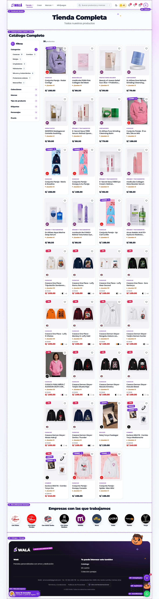

# Tienda (`/tienda`): qué componente va en cada parte

Cómo verlo en vivo: `npm run dev` → http://localhost:3000/componentes.html →
**Páginas** → **Tienda de prueba** → página **Tienda** → enciende **Ver
componentes**. También se llega desde el menú **Tienda** de la cabecera: "Ver
todo el catálogo" o una categoría (entra con esa categoría elegida, como
`/tienda?categoria=`). El marco (M) es el mismo del inicio: ver
[INICIO.md](INICIO.md#marco-m-lo-que-rodea-a-las-secciones).

| Escritorio | Celular |
|---|---|
|  |  |

Revisado el 2026-10-13 contra wala.pe/tienda y `pages/tienda`. Datos del
ejemplo: `src/componentes/demo/tienda.json` (abajo).

## Secciones (S): las de `pages/tienda`, en orden

Se dibujan con `PaginaTienda` → `RenderSecciones`, igual que el inicio.

| # | Parte | `type` | Componente | Piezas que usa | Diseño en | Datos | Campos del editor |
|---|---|---|---|---|---|---|---|
| S1 | "Tienda Completa" | `header` | `Encabezado` | `EtiquetaColgante`, `Trazo`, `Boton` | `SeccionesContenido.module.css` | settings | eyebrow, title, titleHighlight, subtitle, botón, textAlign, colores, compact, estilos de texto |
| S2 | "Catálogo Completo" | `sidebar_catalog` | `CatalogoConFiltros` | `TituloSeccion`, `Acordeon` (`lista`), `OpcionesFiltro` (`Chip`), `Campo` (precio), `Buscador` (solo en la página de una marca), `HojaInferior` (filtros en el celular), `GrillaProductos` → `TarjetaProducto` | `SeccionesExtra.module.css` (`.catalogo…`, `.filtro…`), `Acordeon.module.css`, `piezas/OpcionesFiltro.module.css` | `productos_wala` + las listas de filtros (abajo) | brandId, eyebrow, title (con align, underline, bg, link), botón, fondo, espacios |
| S3 | "Empresas con las que trabajamos" | `marquee` | `MarcasMarquesina` | `TituloSeccion`, `Marquesina`, `LogoMarca` | `Secciones.module.css` + `piezas/LogoMarca.module.css` | settings.items | title, items (logo, forma, zoom, encuadre, enlace), speed |

### El catálogo por dentro (S2)

- **Escritorio:** título del builder arriba; a la izquierda los filtros,
  pegados al bajar (si los grupos abiertos no caben, la columna se desliza por
  dentro); a la derecha "N productos" (texto simple: las etiquetas colgantes
  quedan solo para los productos) y la grilla.
- **Celular:** "N productos" y el botón **Filtros (n)**, que abre una hoja
  inferior con los mismos grupos y "Ver N productos" al pie.
- **Grupos** (plegables, en el orden de la tienda): Categorías, Temporadas
  (colecciones con nombre de fecha o estación), Colecciones, Marcas (no en la
  página de una marca), Tipo de producto, Etiquetas, Personajes y Precio.
  Abiertos al entrar: el primero y los que ya tienen algo elegido. Cerrado, un
  grupo muestra junto a su título lo que tiene elegido.
- **Opciones:** chips con su cuenta de productos; una por grupo; tocarla otra
  vez la quita. Con muchas (etiquetas, personajes) se ven 8 y "Ver N más".
  Las que no tienen productos no aparecen.
- **Precio:** tres rangos rápidos y "desde / hasta" con el precio más bajo y
  el más alto como guía.
- Lo elegido queda como chips arriba de la grilla, con "Limpiar todo".
- **Combos sin foto propia:** la tarjeta muestra sus piezas como cartas
  (`TarjetaProducto`).

## Para cambiar el diseño rápido: qué se repite

| Pieza | Aparece en | Archivo |
|---|---|---|
| `TarjetaProducto` | S2 (y en el inicio S5-S7, carrito) | `TarjetaProducto.module.css` |
| `GrillaProductos` | S2, `product_grid`, `featured_products` | `SeccionesExtra.module.css` (`.grilla`, `.colsCelular`, `.colsEscritorio`) |
| `Acordeon` | S2 (variante `lista`), preguntas frecuentes del inicio (S10, variante de tarjetas) | `Acordeon.module.css` |
| `OpcionesFiltro` / `Chip` | S2 (cada grupo), chips de filtros elegidos | `piezas/OpcionesFiltro.module.css`, `Etiquetas.module.css` |
| `EtiquetaColgante` | eyebrow de S1, descuentos, "Nuevo" y "Combo" de las tarjetas de S2 | `Marca.module.css` |
| `TituloSeccion` | S2, S3 | `Seccion.module.css` |
| `LogoMarca` | S3 (sticker), sello de la marca en cada tarjeta de S2 | `piezas/LogoMarca.module.css` |
| `HojaInferior` | filtros de S2 en el celular, menús de la cabecera | `Feedback.module.css` |

## Llevar a la tienda (a futuro: TODAVÍA NO se hace)

Sigue el orden común de [MIGRACION.md](MIGRACION.md) (paso 5, después del
inicio). Mantener al día si cambia un componente o su forma de recibir datos.

### Reemplazos

| Parte | Hoy en la tienda | Pasa a (kit) |
|---|---|---|
| Página | `pages/Tienda/TiendaPage.jsx` con `pageId` `tienda` (`renderSection`, bucle ~1504) | `PaginaTienda` / `RenderSecciones` con `respaldo` |
| S1 | `case 'header'` (~914) → `components/HeaderBlock/HeaderBlock.jsx` | `Encabezado` |
| S2 | `case 'sidebar_catalog'` (~1345) → `components/SidebarCatalogLayout.jsx` (grupos ~486-669, `GrupoSidebar` ~372) → `components/ProductGrid/ProductGrid.jsx` → `PremiumProductCard` | `CatalogoConFiltros` + `gruposDeCatalogo` + `grillaDesdeConfiguracion`; tarjetas con `tarjetaDesdeProducto` |
| S3 | `case 'marquee'` (~1185) → `components/BrandMarquee/BrandMarquee.jsx` | `MarcasMarquesina` |
| Marco | igual que el inicio | ver [INICIO.md](INICIO.md#reemplazos) |

`SidebarCatalogLayout` también lo usa la búsqueda (`pages/SearchPage.jsx`, con
`facetProducts` y `scopeFacetsToProducts`): se queda hasta que se pase esa
página.

### De dónde sale cada dato

| Prop del kit | En la tienda |
|---|---|
| `secciones` | `loadStorefrontPage('tienda')` (`pages/tienda`), query `storefront-config` |
| `productos` del catálogo | `catalogProducts`: página con cursor de `getStoreProductsPage` cuando `usePaginatedCatalog` (~529: sin `?categoria` ni búsqueda); si no, la lista completa |
| `hayMas`, `onCargarMas`, `cargandoMas` | `catalogPaginationProps` (~901: `hasMore`, `onLoadMore`, `isFetchingMore`) |
| `grupos` | `gruposDeCatalogo({ categorias, colecciones, marcas, tipos, etiquetas, personajes, productos, marcaActual })` con `categoriesData` (`getCategories`), queries `collections`, `tags`, `characters`, `productTypes` (las mismas de `SidebarCatalogLayout` ~158-162), `brandsData` (`getBrands`) y como `productos` la fuente completa de facetas (query `storefront-category-grid-products`: `getProducts` o `getProductsByBrand`), así las cuentas y las opciones vacías salen del catálogo entero y no de la primera página |
| `marcaActual` | `pageBrandId` (página de una marca: no hay grupo Marcas y las listas quedan acotadas a esa marca) |
| `seleccion` / `onFiltrar` | estado de `TiendaPage`. La categoría va al servidor con `handleServerFacetChange` (~819) cuando la lista es paginada; el resto se filtra en el navegador (`filtrarAqui`, como hoy). `?categoria` de la URL = selección inicial; con `categories_nav` en la página, la categoría es la misma de las burbujas (`navCategoryId`) |
| `precio` / `onPrecio`, `limitesPrecio` | estado de la página; `limitesDePrecio(productos de la marca o de la página)` (como `priceBounds`) |
| `conBuscador` | `Boolean(pageBrandId)` (como el buscador de la marca hoy) |
| `columnas`, `segundaFoto` | `grillaDesdeConfiguracion(storeConfig?.layout)` (query `store-config-custom`, `storeConfig/homePage`) |
| `total` | no hay cuenta en servidor: sin `total`, con la lista paginada no se muestra "N productos" |
| `onAgregar` | `CartContext.addToCart`; "elegir" abre `AgregarRapido` |
| `catalogo` (sellos y categoría de las tarjetas) | `marcas` y `categorias` de la página (`PaginaTienda` ya lo arma) |
| S3 `settings.items` | el mismo documento `pages/tienda` |

### Comportamiento que no se puede perder

- **Catálogo vacío:** `catalogIsEmpty` muestra el mensaje una sola vez
  (`emptyMessage`); el kit usa `vacio` de `GrillaProductos`.
- **Ir al catálogo:** al elegir una burbuja de `categories_nav` se baja al
  catálogo (`catalogSectionRef`, ~584; `scrollMarginTop: 7rem`).
- **Carga diferida:** `DeferredSection` también aquí; el catálogo se marca
  visible al filtrar desde las burbujas (`markSectionVisible`).
- **Página de una marca** (`/conamor`, `/mussa`…): mismo catálogo con
  `brandId`; facetas solo de esa marca, sin grupo Marcas y con buscador.
- **Búsqueda por nombre:** con lista paginada, buscar en el navegador solo ve
  lo cargado; por eso hoy el buscador solo existe con marca (catálogo completo
  de la marca) y se apaga "Ver más" mientras se busca. Respetarlo.
- **Traducción:** nombres de categorías, colecciones, etiquetas y textos con
  `<T>` / `t('cat.*')`; los nombres de marca no se traducen.
- **Analítica:** `recordImpression` de las miniaturas (ver INICIO.md).
- **App:** la hoja de filtros ya respeta safe areas y el botón atrás
  (`HojaInferior`).

### Diferencias a propósito (no "corregirlas" al migrar)

- Filtros como chips con su cuenta y grupos plegables con el sello "+" (hoy:
  listas de texto con "Todas" y una flecha ▸). No hay opción "Todas": se quita
  tocando otra vez, con el chip de arriba o "Limpiar todo".
- El grupo con algo elegido muestra lo elegido junto a su título.
- Precio con rangos rápidos además de "desde / hasta".
- En el celular, botón "Filtros (n)" y hoja inferior que no se cierra en cada
  toque (hoy "Filtrar y Categorías" abre un cajón lateral que se cierra al
  elegir); se cierra con "Ver N productos".
- Grilla de 4 por fila en escritorio (hoy 2: cada tarjeta pide 320 px); si el
  admin fija columnas en `storeConfig.layout`, mandan esas.
- "N productos" arriba de la grilla, en texto simple (solo cuando se sabe el
  total). No va en etiqueta colgante: se confundía con "Combo · 2".
- Combo sin foto: sus piezas como cartas (hoy se compone una imagen en canvas
  con `comboImageComposer`).
- En el celular, como mucho dos etiquetas sobre la foto y en tamaño chico,
  por importancia: descuento, Combo, Nuevo, Tu diseño (tres tapaban la foto y
  "Combo · 3" llegaba al corazón). Si "Nuevo" no entra, va junto a la
  categoría: "COMBOS · NUEVO". En escritorio, todas en la foto.
- Las tarjetas no muestran el "0" suelto de hoy (bug de abajo).

### Qué le falta al kit antes de migrar esta página

- `GrillaProductos`: estado de error con "Reintentar" (`productsError`) y
  textos propios del vacío con enlace (`emptyTitle`, `emptyHomeLink`).
- Lo mismo que el inicio en `TarjetaProducto` (favorito controlado e
  impresión) y la traducción (`<T>`).
- Si se quiere "N productos" con la lista paginada: una cuenta en servidor
  (`getCountFromServer`) que llegue como `total`.

### Pasos (cada uno se verifica solo y se puede volver atrás)

1. `TarjetaProducto` dentro de `ProductGrid` (el mismo paso 2 del inicio):
   comparar `/tienda` antes y después.
2. S1 y S3 con `RenderSecciones` + `respaldo` para lo demás (como el inicio).
3. S2: en `case 'sidebar_catalog'`, `CatalogoConFiltros` con los datos de
   arriba en vez de `SidebarCatalogLayout`. Probar: cada grupo, precio,
   "Ver más productos", `/tienda?categoria=…`, burbujas de `categories_nav`,
   una página de marca, catálogo vacío, celular (hoja) y modo noche.
4. Pasar `pages/SearchPage.jsx` al mismo catálogo y recién entonces retirar
   `SidebarCatalogLayout`.

Para volver atrás: cada paso en su propio commit; los componentes viejos no se
borran hasta que el nuevo lleve un tiempo en producción.

### Bug de la tienda real visto al mapear

- `PremiumProductCard.jsx:412` hace `{product.salePrice && (…)}`: con
  `salePrice: 0` React dibuja un "0" suelto en la esquina de la tarjeta (se ve
  en wala.pe/tienda). Se arregla con `product.salePrice > 0 &&`. No se tocó.

## Datos del ejemplo

`src/componentes/demo/tienda.json` (copiado el 2026-10-13 con la API REST
pública de Firestore, solo lectura): `pages/tienda`, 35 productos de
`productos_wala` (los 16 más nuevos visibles más algunos con personaje,
colección, tipo, combo o personalización, para que cada filtro tenga algo) y
las listas `tienda_categories`, `tienda_collections`, `tags`, `characters` y
`productTypes`. "Tipo test" es un tipo de producto real de la base.

## Cómo rehacer las imágenes

Como en INICIO.md: Tienda de prueba → página **Tienda** → "Con sesión" →
**Ver componentes**, lienzo completo a 1366 px y 390 px, en webp.
